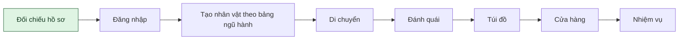

TÓM TẮT 1 [NGUỒN] — PARTIAL. Đã đối chiếu hồ sơ bàn giao của Tester01 cho Test-36.
TÓM TẮT 2 [NGUỒN] — Điểm tiếp tục là đăng nhập. Bảng môn phái và ngũ hành đã có nguồn tĩnh dẫn lại.
TÓM TẮT 3 [NGUỒN] — Đã ghi báo cáo, cập nhật trạng thái và nhật ký tester, bổ sung kết quả cuối task.
TÓM TẮT 4 [CHƯA KIỂM] — Độ phủ chơi thử 0/7 bước. Chưa có ảnh, log hoặc lỗi quan sát được trong lượt này.
TÓM TẮT 5 [NGUỒN] — Chỉ đọc và kiểm tra tài liệu. Chưa build, chạy exe, VM hay kết nối Test-36. Tổng quản phụ trách commit và giao lượt chơi thử.

# TS-01 — Bàn giao kiểm thử Tester01 trên Test-36

Loại: kiểm thử  
Chủ đề: Xác định điểm tiếp tục và độ phủ của lượt chơi thử.  
Từ khóa: kiểm thử, đăng nhập, môn phái, ngũ hành, Test-36, TS-01, Q-59  
Trạng thái: PARTIAL — đã bàn giao tài liệu, còn lượt chơi thử trực tiếp.  
Độ phủ: 0/7 bước chơi đã xác minh, tính theo `JX1_OPS/TASKS/TS-01.md:26`.  
Liên quan: [Chuẩn báo cáo](../DESIGN/CHUAN-BAO-CAO.md), [TS-01](../TASKS/TS-01.md), [Bảng môn phái và ngũ hành](../STATE/TESTER/KIEN-THUC/mon-phai-ngu-hanh/README.md).  
Cần tôi quyết định: không. Tổng quản tiếp nhận và giao lượt chạy riêng.

## Phạm vi và độ phủ

| Bước | Độ phủ | Điều cần ghi khi thực hiện |
|---|---|---|
| Đăng nhập | Chưa phủ | Kết quả vào đúng máy chủ thử nghiệm. |
| Tạo nhân vật | Chưa phủ | Ngũ hành đã chọn và môn phái cần thử theo bảng. |
| Di chuyển | Chưa phủ | Thao tác và phản hồi của nhân vật. |
| Đánh quái | Chưa phủ | Thao tác chiến đấu và kết quả quan sát. |
| Túi đồ | Chưa phủ | Kết quả mở túi và nội dung hiển thị. |
| Cửa hàng (`shop`) | Chưa phủ | Kết quả mở cửa hàng và thao tác đã thử. |
| Nhiệm vụ | Chưa phủ | Nhiệm vụ đã thử và kết quả từng bước. |

Danh sách bước lấy từ `JX1_OPS/TASKS/TS-01.md:26`. Nơi ghi kiến thức và lỗi theo `JX1_OPS/STATE/TESTER/LOI-GIAO-VIEC.md:3`.

## Giải mã tên

| Tên gốc | Mã hóa | Chữ đúng | Nguồn file:dòng |
|---|---|---|---|
| JX1 Mobile TEST | UTF-8 trong tài liệu | JX1 Mobile TEST | `JX1_OPS/TASKS/TS-01.md:22` |

Chưa có tên kỹ năng, trang bị, quái, NPC hoặc bản đồ từ một lượt chơi. Tên môn phái tra trong bảng đã có.

## Sắp theo cấu trúc game

Nhóm nhân vật tra theo ngũ hành khi tạo và theo môn phái khi gia nhập. Bảng hiện có phân biệt mục trong danh sách gia nhập và mục chỉ được khai báo (`JX1_OPS/STATE/TESTER/KIEN-THUC/mon-phai-ngu-hanh/README.md:3–5`). Các bước di chuyển, chiến đấu, túi đồ, cửa hàng và nhiệm vụ đang xếp theo luồng thử vì chưa có dữ liệu quan sát để nhóm theo bản đồ hoặc bộ trang bị.

## Mục sổ thông số

| Nhóm | Tên/hằng số | file:dòng | Giá trị | Đơn vị | Ảnh hưởng | Đổi an toàn | Nguồn đo |
|---|---|---|---|---|---|---|---|
| Bảng môn phái | Mục gia nhập đã liệt kê / tổng mục khai báo | `JX1_OPS/STATE/TESTER/KIEN-THUC/mon-phai-ngu-hanh/README.md:5`, `:9–24` | 11/16 | mục | Giúp chọn ca tạo nhân vật | CẨN THẬN | Đếm trên tài liệu dẫn nguồn tĩnh. Chưa đối chiếu tệp game hoặc client chạy. |

## Đã xác minh / Chưa xác minh

- **Đã xác minh:** Hồ sơ ghi «chưa bắt đầu» trước lượt này (`JX1_OPS/STATE/TESTER/TRANG-THAI.md:4`). Tám mục lỗi còn ở mẫu trống tại dòng 3 của từng tệp dưới `JX1_OPS/STATE/TESTER/LOI/`. Bảng môn phái đã tự ghi giới hạn kiểm chứng bằng client (`JX1_OPS/STATE/TESTER/KIEN-THUC/mon-phai-ngu-hanh/README.md:26–28`).
- **Chưa xác minh:** Trạng thái thực của tài khoản và nhân vật, kết nối Test-36, giao diện chọn ngũ hành và kết quả của bảy bước chơi. Chưa đọc mã server/client vì task chỉ chỉ định hồ sơ tester và không ghim root hoặc phiên bản mã cần đối chiếu. Không có phép thử game đã chạy.
- **Vướng mắc và cách xử lý:** Đề bài trong tệp yêu cầu chơi trực tiếp. Chỉ đạo của lượt này loại trừ VM, exe và mạng nên phần chơi được bàn giao ở bước đăng nhập. Tệp nhịp nằm ngoài worktree có quyền ghi. Các mốc được báo trong cuộc trò chuyện.

## Bàn giao

Tổng quản phụ trách commit. Tester tiếp tục từ đăng nhập khi được giao lượt chạy Test-36, tra bảng trước khi tạo nhân vật và ghi kết quả từng bước vào hồ sơ tester. Chưa có SHA cho thay đổi của lượt này và chưa push.

Kỹ năng đã dùng: `jx1-report`, `jx1-retrofit` (khuôn báo cáo), `jx1-knowledge`, `jx1-parameters`. Đã đọc `jx1-read-server` và `jx1-read-client` để xác định giới hạn kiểm chứng. Không mở mã nguồn.
