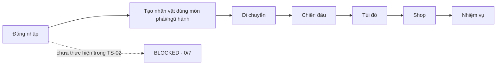

TÓM TẮT
1. [NGUỒN] BLOCKED: đã đối chiếu tài liệu tester cho lượt TS-02; 0/7 bước chơi được xác minh.
2. [NGUỒN] Chưa có kết quả runtime; phiên/nhân vật trong mô tả task chưa được đối chiếu với trạng thái tester.
3. [NGUỒN] Đã cập nhật trạng thái, nhật ký việc và mục Kết quả cuối trong task TS-02.
4. [CHƯA KIỂM] Chưa đăng nhập, tạo nhân vật, di chuyển, chiến đấu, xem túi đồ, shop hoặc nhiệm vụ; không có ảnh/log của lượt này.
5. [NGUỒN] Không chạy build, EXE, VM/LD hoặc adb trong lượt này; cần phạm vi tiếp tục phù hợp trước khi chơi thật.

# TS-02 — Tester01 lượt 2: trải nghiệm game Test-36

Loại: kiểm thử
Chủ đề: Đối chiếu trạng thái tester và bàn giao lượt chơi thật Test-36.
Từ khóa: kiểm thử, môn phái, ngũ hành, Tester01, TS-02, Test-36, LDPlayer, adb
Trạng thái: BLOCKED — thao tác chơi thật chưa được phép trong giới hạn lượt hiện hành.
Độ phủ: 0/7 bước chơi được xác minh; không thao tác runtime.
Liên quan: JX1_OPS/TASKS/TS-01.md; JX1_OPS/STATE/TESTER/; JX1_OPS/DESIGN/CHUAN-BAO-CAO.md
Cần tôi quyết định: có — người giao việc cần cấp phạm vi tiếp tục tương thích và xác nhận phiên/nhân vật cần kiểm.

## Phạm vi và độ phủ

| Bước theo task | Trạng thái lượt TS-02 | Bằng chứng |
|---|---|---|
| Đăng nhập | Chưa thực hiện | JX1_OPS/TASKS/TS-02.md:26,30 |
| Tạo nhân vật đúng môn phái/ngũ hành | Chưa thực hiện | JX1_OPS/TASKS/TS-02.md:26; bảng môn phái chỉ được xác minh từ nguồn tĩnh: JX1_OPS/STATE/TESTER/KIEN-THUC/mon-phai-ngu-hanh/README.md:9–24 |
| Di chuyển | Chưa thực hiện | JX1_OPS/TASKS/TS-02.md:26 |
| Chiến đấu | Chưa thực hiện | JX1_OPS/TASKS/TS-02.md:26 |
| Túi đồ | Chưa thực hiện | JX1_OPS/TASKS/TS-02.md:26 |
| Shop | Chưa thực hiện | JX1_OPS/TASKS/TS-02.md:26 |
| Nhiệm vụ | Chưa thực hiện | JX1_OPS/TASKS/TS-02.md:26 |

## Giải mã tên

| Tên gốc trong nguồn | Mã hóa | Chữ đúng | Nguồn file:dòng |
|---|---|---|---|
| Test-36 | ID môi trường, không phải chuỗi tên game được giải mã | Test-36 | JX1_OPS/TASKS/TS-02.md:18,30 |
| Ba Lăng Huyện | UTF-8 trong task; mã nguồn gốc chưa đối chiếu | Ba Lăng Huyện | JX1_OPS/TASKS/TS-02.md:30 |

## Sắp theo cấu trúc game

Chưa có dữ liệu chơi thật để sắp môn phái, nhánh, cấp học, bản đồ, quái hoặc NPC. Bảng phạm vi phía trên giữ thứ tự 7 bước trải nghiệm mà task giao; không suy ra cấu trúc nội dung game từ nguồn tĩnh.

## Kết quả và giới hạn

Task giao thao tác thật theo chuỗi đăng nhập, tạo nhân vật, di chuyển, chiến đấu, túi đồ, shop và nhiệm vụ (JX1_OPS/TASKS/TS-02.md:26,30). Lời giao việc yêu cầu ghi tri thức/lỗi dựa trên điều quan sát được và cập nhật trạng thái (JX1_OPS/STATE/TESTER/LOI-GIAO-VIEC.md:2–3). Trong lượt này không gọi adb, không mở LD, không chụp màn hình và không đọc log theo giới hạn môi trường đang áp dụng; vì vậy không có kết quả gameplay hay lỗi adb thực tế.

Mô tả task cho biết phiên trước đã vào game và thấy một nhân vật ở Ba Lăng Huyện (JX1_OPS/TASKS/TS-02.md:30), nhưng đây là thông tin bàn giao, không phải quan sát mới. Trạng thái tester trước đó ghi tài khoản chưa có nhân vật (JX1_OPS/STATE/TESTER/TRANG-THAI.md:3), và trạng thái bảng môn phái nói chưa xác minh bằng client thật (JX1_OPS/STATE/TESTER/KIEN-THUC/mon-phai-ngu-hanh/README.md:26,28). Chưa xác định mô tả phiên và bản ghi tester có cùng tài khoản/nhân vật hay không; không khẳng định nhân vật nào đã được tạo trong lượt này.

Không ghi khóa hoặc mật khẩu. Không có dữ liệu runtime mới để thêm vào kho KIEN-THUC hoặc LOI, và không có hàng mới đề xuất cho mục lục tri thức.

## Đã xác minh / Chưa xác minh

**Đã xác minh (đối chiếu văn bản):** task yêu cầu bảy bước chơi (JX1_OPS/TASKS/TS-02.md:26); lượt trước được ghi nhận 0/7 (JX1_OPS/STATE/TESTER/TRANG-THAI.md:10); bảng phái/ngũ hành hiện đánh dấu chưa kiểm bằng client (JX1_OPS/STATE/TESTER/KIEN-THUC/mon-phai-ngu-hanh/README.md:26,28). Đây là xác minh nội dung tài liệu, không phải xác nhận runtime.

**Chưa xác minh:** toàn bộ bảy bước gameplay, trạng thái phiên/nhân vật hiện tại, lựa chọn môn phái trên client, ảnh chụp và log. Không chạy test/build/adb vì giới hạn lượt này cấm thao tác VM/EXE/mạng. Không phát sinh lỗi lệnh để thử lại.

## Bàn giao

Đã ghi checkpoint tại JX1_OPS/STATE/TESTER/TRANG-THAI.md và thêm dòng nhật ký tại JX1_OPS/STATE/TESTER/NHAT-KY-VIEC.md; kết quả cũng được ghi cuối JX1_OPS/TASKS/TS-02.md. Không cập nhật được `D:\JX-wt\TS-02.nhip` vì tệp nằm ngoài worktree được phép ghi. Bước tiếp theo là cấp phạm vi công việc phù hợp với giới hạn môi trường và xác nhận phiên/nhân vật cần kiểm; sau đó mới có thể tiếp tục từ đăng nhập. Không commit theo yêu cầu.

Kỹ năng đã dùng: jx1-report, jx1-retrofit. Đã đọc jx1-read-server, jx1-read-client, jx1-parameters, jx1-knowledge; không thực hiện đọc mã nguồn hay ghi thông số vì lượt này chỉ đối chiếu tài liệu tester và chưa có kết quả runtime.

liên quan: JX1_OPS/TASKS/TS-01.md; JX1_OPS/STATE/TESTER/; JX1_OPS/DESIGN/CHUAN-BAO-CAO.md
