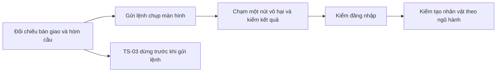

TÓM TẮT 1 [NGUỒN] — BLOCKED: TS-03 giới hạn ở `T36-tester01`, gồm kiểm Cầu Nối, đăng nhập và tạo nhân vật theo ngũ hành.
TÓM TẮT 2 [NGUỒN] — Đã đối chiếu tài liệu bàn giao, bảng môn phái và sự hiện diện của hai thư mục hòm cầu.
TÓM TẮT 3 [NGUỒN] — Đã ghi điểm tiếp tục cho hai mục tester, nhật ký và kết quả cuối task.
TÓM TẮT 4 [CHƯA KIỂM] — 0/4 bước kiểm thử trực tiếp; chưa có ảnh hoặc log của TS-03 vì hòm lệnh nằm ngoài vùng được phép ghi.
TÓM TẮT 5 [CHƯA KIỂM] — Chưa chạy build, exe, VM hay thao tác mạng. Không commit theo yêu cầu; Tổng quản tiếp tục từ bước kiểm cầu.

# TS-03 — Đăng nhập và tạo nhân vật qua Cầu Nối

- Loại: kiểm thử
- Chủ đề: Bàn giao lượt kiểm đăng nhập và tạo nhân vật trên Test-36 qua Cầu Nối LDPlayer.
- Từ khóa: đăng nhập, tạo nhân vật, ngũ hành, Cầu Nối, TS-03, Q-70, `T36-tester01`, `screenshot`, `tap`
- Trạng thái: BLOCKED — không thể gửi lệnh trong vùng ghi của lượt này.
- Độ phủ: đã kiểm trực tiếp 0 trên 4 bước, đếm riêng hai thao tác kiểm cầu.
- Liên quan: [chuẩn báo cáo](../DESIGN/CHUAN-BAO-CAO.md), [TS-03](../TASKS/TS-03.md), [hướng dẫn Cầu Nối](../STATE/TESTER/CAU-NOI.md), [bảng môn phái và ngũ hành](../STATE/TESTER/KIEN-THUC/mon-phai-ngu-hanh/README.md).
- Cần tôi quyết định: có — giao lượt kiểm trực tiếp cho môi trường được phép ghi vào hòm lệnh và điều khiển đúng phiên Test-36.

## Phạm vi và độ phủ

| Bước trên Test-36 | Phủ trực tiếp | Điều cần xác nhận khi tiếp tục | Nguồn |
|---|---|---|---|
| Chụp màn hình qua cầu | Chưa phủ | Có kết quả của lệnh và ảnh tương ứng. | `JX1_OPS/STATE/TESTER/CAU-NOI.md:6`, `JX1_OPS/STATE/TESTER/CAU-NOI.md:30` |
| Chạm một nút vô hại | Chưa phủ | Chọn nút từ màn hình thực tế, xác nhận `ok:true`. | `JX1_OPS/STATE/TESTER/CAU-NOI.md:30` |
| Đăng nhập | Chưa phủ | Xác nhận đúng phiên và dùng thông tin đã lưu trong ứng dụng. | `JX1_OPS/TASKS/TS-03.md:16` |
| Tạo nhân vật | Chưa phủ | Xác nhận màn hình tạo, ngũ hành ứng với môn phái cần kiểm và kết quả tạo. | `JX1_OPS/TASKS/TS-03.md:16`, `JX1_OPS/STATE/TESTER/KIEN-THUC/mon-phai-ngu-hanh/README.md:3` |

## Giải mã tên

Không trích tên kỹ năng, trang bị, quái, NPC hay bản đồ trong lượt này. `T36-tester01` là mã phiên kiểm thử, giữ nguyên theo `JX1_OPS/STATE/TESTER/PHAN-CONG.md:5`.

## Sắp theo cấu trúc game

Đi theo luồng tài khoản → đăng nhập → màn hình tạo nhân vật → chọn ngũ hành → gia nhập môn phái sau khi vào game. Hai bước cuối được phân biệt trong tài liệu tĩnh `JX1_OPS/STATE/TESTER/KIEN-THUC/mon-phai-ngu-hanh/README.md:3`; các lựa chọn thực tế trên bản mobile vẫn chưa được xác nhận (`JX1_OPS/STATE/TESTER/KIEN-THUC/mon-phai-ngu-hanh/README.md:26`).

## Đã xác minh / Chưa xác minh

- **Đã xác minh:** Task chỉ định đúng phiên Test-36 và yêu cầu ít nhất một bước có ảnh hoặc log (`JX1_OPS/TASKS/TS-03.md:16`). PowerShell `Test-Path -PathType Container` trả `True` cho cả `lenh` và `ket-qua` tại hòm đã phân công (`JX1_OPS/STATE/TESTER/PHAN-CONG.md:5`). Kết quả này chỉ xác nhận đường dẫn hiện diện.
- **Đã đối chiếu tài liệu:** Ghi nhận ban đầu nói tài khoản chưa có nhân vật (`JX1_OPS/STATE/TESTER/TRANG-THAI.md:3`); ghi nhận muộn hơn của Sonnet nói đã đăng nhập và thấy nhân vật (`JX1_OPS/STATE/TESTER/TRANG-THAI.md:23`, `JX1_OPS/STATE/TESTER/TRANG-THAI.md:24`). Đây là thông tin bàn giao từ hai thời điểm, chưa được TS-03 xác nhận lại và không tính vào độ phủ của lượt này.
- **Chưa xác minh:** Không gửi tệp lệnh, không đọc kết quả của TS-03 và không kiểm được cầu đang chạy hay không. Sandbox chỉ cấp vùng ghi trong worktree, còn task xác định hòm ở ngoài đó (`JX1_OPS/TASKS/TS-03.md:15`). Không có lỗi trả về từ cầu hoặc lỗi game quan sát được. Không thử `adb`, build, exe, VM hay thao tác mạng. Chưa đối chiếu mã nguồn client/server vì task không chỉ định root nguồn cho lượt kiểm này.
- **Lỗi và cách xử lý:** Lệnh PowerShell `Set-Content` ghi tệp nhịp thất bại với `Access to the path 'D:\JX-wt\TS-03.nhip' is denied.` (`UnauthorizedAccessException`). Không thử lại vì đường dẫn nằm ngoài vùng ghi. Dùng cập nhật trong cuộc trò chuyện thay cho tệp nhịp. Máy không có `rg`; đã dùng PowerShell trong các thư mục được giao.

## Bàn giao

- Điểm tiếp tục: [đăng nhập](../STATE/TESTER/BAN-GIAO/dang-nhap/README.md) và [tạo nhân vật](../STATE/TESTER/BAN-GIAO/tao-nhan-vat/README.md). Giữ `TRANG-THAI.md` nguyên trạng vì nằm ngoài `vung_file`; thông tin dừng được ghi ở nhật ký và cuối task.
- Khi môi trường cho phép, bắt đầu bằng `screenshot`, sau đó `tap` một nút vô hại theo ảnh thực tế. Lưu bằng chứng đã lọc trước khi kiểm đăng nhập. Xác nhận phiên hiện có nhân vật hay còn chỗ tạo trước khi thực hiện bước tạo theo bảng ngũ hành.
- Không stage, commit hay push theo yêu cầu; Tổng quản nhận các thay đổi trong worktree. Không có SHA mới.
- Kỹ năng đã nạp: `jx1-retrofit`, `jx1-read-server`, `jx1-read-client`, `jx1-parameters`, `jx1-knowledge`, `jx1-report`. Áp dụng khuôn báo cáo và nhãn xác minh; không có báo cáo cũ cần chuẩn hóa, nguồn client/server cần đọc hay thông số game mới để ghi sổ.
