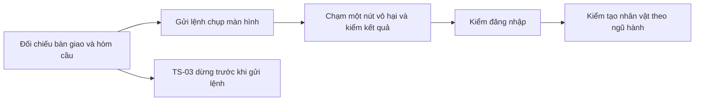

TÓM TẮT 1 [NGUỒN] — BLOCKED: TS-03 giới hạn ở `T36-tester01`, gồm kiểm Cầu Nối, đăng nhập và tạo nhân vật theo ngũ hành.
TÓM TẮT 2 [NGUỒN] — Đã đối chiếu tài liệu bàn giao, bảng môn phái và sự hiện diện của hai thư mục hòm cầu.
TÓM TẮT 3 [NGUỒN] — Đã ghi điểm tiếp tục cho hai mục tester, nhật ký và kết quả cuối task.
TÓM TẮT 4 [CHƯA KIỂM] — 0/4 bước kiểm thử trực tiếp; chưa có ảnh hoặc log của TS-03 vì hòm lệnh nằm ngoài vùng được phép ghi.
TÓM TẮT 5 [CHƯA KIỂM] — Chưa chạy build, exe, VM hay thao tác mạng. Không commit theo yêu cầu; Tổng quản tiếp tục từ bước kiểm cầu.

# TS-03 — Đăng nhập và tạo nhân vật qua Cầu Nối

- Loại: kiểm thử
- Chủ đề: Bàn giao lượt kiểm đăng nhập và tạo nhân vật trên Test-36 qua Cầu Nối LDPlayer.
- Từ khóa: đăng nhập, tạo nhân vật, ngũ hành, Cầu Nối, TS-03, Q-70, `T36-tester01`, `screenshot`, `tap`
- Trạng thái: BLOCKED — không thể gửi lệnh trong vùng ghi của lượt này.
- Độ phủ: đã kiểm trực tiếp 0 trên 4 bước, đếm riêng hai thao tác kiểm cầu.
- Liên quan: [chuẩn báo cáo](../DESIGN/CHUAN-BAO-CAO.md), [TS-03](../TASKS/TS-03.md), [hướng dẫn Cầu Nối](../STATE/TESTER/CAU-NOI.md), [bảng môn phái và ngũ hành](../STATE/TESTER/KIEN-THUC/mon-phai-ngu-hanh/README.md).
- Cần tôi quyết định: có — giao lượt kiểm trực tiếp cho môi trường được phép ghi vào hòm lệnh và điều khiển đúng phiên Test-36.

## Phạm vi và độ phủ

| Bước trên Test-36 | Phủ trực tiếp | Điều cần xác nhận khi tiếp tục | Nguồn |
|---|---|---|---|
| Chụp màn hình qua cầu | Chưa phủ | Có kết quả của lệnh và ảnh tương ứng. | `JX1_OPS/STATE/TESTER/CAU-NOI.md:6`, `JX1_OPS/STATE/TESTER/CAU-NOI.md:30` |
| Chạm một nút vô hại | Chưa phủ | Chọn nút từ màn hình thực tế, xác nhận `ok:true`. | `JX1_OPS/STATE/TESTER/CAU-NOI.md:30` |
| Đăng nhập | Chưa phủ | Xác nhận đúng phiên và dùng thông tin đã lưu trong ứng dụng. | `JX1_OPS/TASKS/TS-03.md:16` |
| Tạo nhân vật | Chưa phủ | Xác nhận màn hình tạo, ngũ hành ứng với môn phái cần kiểm và kết quả tạo. | `JX1_OPS/TASKS/TS-03.md:16`, `JX1_OPS/STATE/TESTER/KIEN-THUC/mon-phai-ngu-hanh/README.md:3` |

## Giải mã tên

Không trích tên kỹ năng, trang bị, quái, NPC hay bản đồ trong lượt này. `T36-tester01` là mã phiên kiểm thử, giữ nguyên theo `JX1_OPS/STATE/TESTER/PHAN-CONG.md:5`.

## Sắp theo cấu trúc game

Đi theo luồng tài khoản → đăng nhập → màn hình tạo nhân vật → chọn ngũ hành → gia nhập môn phái sau khi vào game. Hai bước cuối được phân biệt trong tài liệu tĩnh `JX1_OPS/STATE/TESTER/KIEN-THUC/mon-phai-ngu-hanh/README.md:3`; các lựa chọn thực tế trên bản mobile vẫn chưa được xác nhận (`JX1_OPS/STATE/TESTER/KIEN-THUC/mon-phai-ngu-hanh/README.md:26`).

## Đã xác minh / Chưa xác minh

- **Đã xác minh:** Task chỉ định đúng phiên Test-36 và yêu cầu ít nhất một bước có ảnh hoặc log (`JX1_OPS/TASKS/TS-03.md:16`). PowerShell `Test-Path -PathType Container` trả `True` cho cả `lenh` và `ket-qua` tại hòm đã phân công (`JX1_OPS/STATE/TESTER/PHAN-CONG.md:5`). Kết quả này chỉ xác nhận đường dẫn hiện diện.
- **Đã đối chiếu tài liệu:** Ghi nhận ban đầu nói tài khoản chưa có nhân vật (`JX1_OPS/STATE/TESTER/TRANG-THAI.md:3`); ghi nhận muộn hơn của Sonnet nói đã đăng nhập và thấy nhân vật (`JX1_OPS/STATE/TESTER/TRANG-THAI.md:23`, `JX1_OPS/STATE/TESTER/TRANG-THAI.md:24`). Đây là thông tin bàn giao từ hai thời điểm, chưa được TS-03 xác nhận lại và không tính vào độ phủ của lượt này.
- **Chưa xác minh:** Không gửi tệp lệnh, không đọc kết quả của TS-03 và không kiểm được cầu đang chạy hay không. Sandbox chỉ cấp vùng ghi trong worktree, còn task xác định hòm ở ngoài đó (`JX1_OPS/TASKS/TS-03.md:15`). Không có lỗi trả về từ cầu hoặc lỗi game quan sát được. Không thử `adb`, build, exe, VM hay thao tác mạng. Chưa đối chiếu mã nguồn client/server vì task không chỉ định root nguồn cho lượt kiểm này.
- **Lỗi và cách xử lý:** Lệnh PowerShell `Set-Content` ghi tệp nhịp thất bại với `Access to the path 'D:\JX-wt\TS-03.nhip' is denied.` (`UnauthorizedAccessException`). Không thử lại vì đường dẫn nằm ngoài vùng ghi. Dùng cập nhật trong cuộc trò chuyện thay cho tệp nhịp. Máy không có `rg`; đã dùng PowerShell trong các thư mục được giao.

## Bàn giao

- Điểm tiếp tục: [đăng nhập](../STATE/TESTER/BAN-GIAO/dang-nhap/README.md) và [tạo nhân vật](../STATE/TESTER/BAN-GIAO/tao-nhan-vat/README.md). Giữ `TRANG-THAI.md` nguyên trạng vì nằm ngoài `vung_file`; thông tin dừng được ghi ở nhật ký và cuối task.
- Khi môi trường cho phép, bắt đầu bằng `screenshot`, sau đó `tap` một nút vô hại theo ảnh thực tế. Lưu bằng chứng đã lọc trước khi kiểm đăng nhập. Xác nhận phiên hiện có nhân vật hay còn chỗ tạo trước khi thực hiện bước tạo theo bảng ngũ hành.
- Không stage, commit hay push theo yêu cầu; Tổng quản nhận các thay đổi trong worktree. Không có SHA mới.
- Kỹ năng đã nạp: `jx1-retrofit`, `jx1-read-server`, `jx1-read-client`, `jx1-parameters`, `jx1-knowledge`, `jx1-report`. Áp dụng khuôn báo cáo và nhãn xác minh; không có báo cáo cũ cần chuẩn hóa, nguồn client/server cần đọc hay thông số game mới để ghi sổ.

## Kết quả tiếp tục — 19/11/2026, 11:53–11:59 (UTC+7)

TÓM TẮT 1 [NGUỒN] — PARTIAL: đạt 2/4 bước kiểm trực tiếp; đã kiểm cầu bằng ảnh và chạm mở Hành trang, chưa đăng nhập/tạo nhân vật cho `tester01`.
TÓM TẮT 2 [NGUỒN] — Hòm `.ldbridge` trong worktree hoạt động; 7 lệnh chụp + 7 lệnh chạm đều trả `ok:true`, có ảnh trước/sau.
TÓM TẮT 3 [NGUỒN] — Đã bổ sung bằng chứng, kiến thức, lỗi điều kiện bàn giao, hai mục bàn giao, nhật ký và kết quả cuối task.
TÓM TẮT 4 [CHƯA KIỂM] — Form hiện lưu `testa`, khác tài khoản được giao; dừng trước Đăng nhập, cần Tổng quản chuẩn bị đúng `tester01` trong app.
TÓM TẮT 5 [CHƯA KIỂM] — Không build/chạy exe/khởi động VM/đổi mạng; không commit/push. Chỉ điều khiển phiên có sẵn qua cầu; file nhịp yêu cầu nằm ngoài vùng ghi.

- Loại: kiểm thử.
- Chủ đề: Kiểm cầu thật và xác định điểm chặn trước đăng nhập đúng tài khoản.
- Từ khóa: đăng nhập, tạo nhân vật, Hành trang, Cầu Nối, TS-03, tester01, screenshot, tap.
- Trạng thái: PARTIAL — đã có bằng chứng thật, bị chặn ở điều kiện tài khoản trước hai bước còn lại.
- Độ phủ: 2/4 bước trực tiếp, cùng mẫu số của lượt trước: chụp, chạm, đăng nhập, tạo nhân vật. Bước (1) kiểm cầu của task hoàn tất; bước (4) ghi hồ sơ đã làm trong phạm vi.
- Liên quan: [task](../TASKS/TS-03.md), [Cầu Nối](../STATE/TESTER/CAU-NOI.md), [lỗi điều kiện bàn giao](../STATE/TESTER/LOI/dang-nhap/2026-11-19-tai-khoan-luu-khong-khop.md).
- Cần tôi quyết định: có — Tổng quản chuẩn bị sẵn đúng `tester01` trong ứng dụng; không cần cung cấp mật khẩu cho worker.

Phần trước mục này là ghi nhận lịch sử lượt 1, giữ nguyên kết luận, số liệu và bằng chứng. Kết quả mới dưới đây thay điểm tiếp tục, không sửa lặng lịch sử. Sơ đồ Mermaid đầu báo cáo mô tả luồng kiểm chung và điểm dừng cũ; lượt này đã qua kiểm cầu, đi tới form đăng nhập rồi dừng trước bước xác thực.

### Phạm vi và độ phủ lượt tiếp tục

| Phần tử | Độ phủ | Bằng chứng/giới hạn |
|---|---|---|
| Chụp màn hình qua cầu | Đã phủ | 7 ảnh; `JX1_OPS/STATE/TESTER/KIEN-THUC/dang-nhap/TS-03/ket-qua.jsonl:1,3,6,8,10,12,14`. |
| Chạm một nút vô hại | Đã phủ | Hành trang mở sau (680,52); log cùng file dòng 2–3, ảnh 01–02. |
| Đăng nhập `tester01` | Chưa phủ | Đã tới form nhưng tên lưu là tài khoản khác; log dòng 11–14, ảnh 06–07. Chưa bấm Đăng nhập. |
| Tạo nhân vật đúng ngũ hành | Chưa phủ | Chưa đăng nhập đúng tài khoản, chưa mở màn tạo. Bảng tĩnh chỉ là nguồn chuẩn bị: `JX1_OPS/STATE/TESTER/KIEN-THUC/mon-phai-ngu-hanh/README.md:3,26–28`. |
| Kiến thức/lỗi/bàn giao đăng nhập | Đã phủ | Bổ sung trong đúng ba mục được giao; ghi nhận LOI-dang-nhap-001 theo mẫu, không gán là lỗi game. |
| Kiến thức/bàn giao tạo nhân vật | Đã phủ phần bàn giao | Ghi rõ phụ thuộc tài khoản. Không thêm lỗi tạo nhân vật vì chưa quan sát màn tạo; giữ `LOI/tao-nhan-vat/README.md` nguyên trạng. |
| Nhật ký và kết quả cuối task | Đã phủ | Thêm cuối; giữ các ghi nhận cũ. |
| Nhịp ngoài worktree | Chưa phủ | `D:\JX-wt\TS-03.nhip` không thuộc vùng ghi được cấp. Lượt này không thử lại lỗi từ chối của lượt trước và không đổi quyền. |

### Giải mã tên của dữ liệu quan sát mới

| Tên gốc | Mã hóa | Chữ đúng UTF-8 | Nguồn file:dòng |
|---|---|---|---|
| T36nv1 | ASCII hiển thị trên UI; không đọc byte tên từ game | T36nv1 | `JX1_OPS/STATE/TESTER/KIEN-THUC/dang-nhap/TS-03/bang-chung.tsv:2`, ảnh `01-hien-trang.jpg`. |
| Ba Lăng Huyện | Đọc chữ đã render trên UI; chưa xác minh mã hóa dữ liệu gốc | Ba Lăng Huyện; không suy tên Hán | Cùng tệp TSV dòng 2, góc bản đồ ảnh `01-hien-trang.jpg`. |

Không thực hiện chuyển GBK/TCVN3 hoặc nhận định byte tên trong dữ liệu game vì không đọc nguồn game ở lượt kiểm này. `testa`/`tester01` là định danh tài khoản quan sát/yêu cầu, không phải tên nhân vật; không có mật khẩu trong tài liệu hoặc lệnh.

### Sắp theo cấu trúc game và các bước thực chạy

Trình tự: phiên đang trong game → kiểm Hành trang → Cài đặt → Đăng xuất → chọn máy chủ → form tài khoản → dừng trước xác thực → chưa tới màn tạo/ngũ hành. Không dùng nhân vật đã có để nhận bước tạo nhân vật mới là đạt.

| Giờ cầu (19/11, UTC+7 theo môi trường) | Thao tác/kết quả | Bằng chứng |
|---|---|---|
| 11:53:19 | `screenshot` thấy nhân vật T36nv1 cấp 1 trong game; đây chưa phải bằng chứng đúng tài khoản. | Log dòng 1, ảnh 01. |
| 11:54:13–11:54:46 | `tap(680,52)` → Hành trang mở; hoàn tất kiểm cầu. | Log dòng 2–3, ảnh 02. |
| 11:55:32–11:55:39 | Đóng Hành trang (1553,957), mở Cài đặt (1193,52); không sửa thiết lập. | Log dòng 4–6, ảnh 03. |
| 11:56:40–11:56:44 | Chọn Đăng xuất (1176,955), về màn Bắt đầu trò chơi. | Log dòng 7–8, ảnh 04. |
| 11:57:25–11:57:29 | Chọn Bắt đầu trò chơi (960,588), hiện màn chọn máy chủ. | Log dòng 9–10, ảnh 05. |
| 11:58:30–11:58:34 | Chọn máy chủ (500,298), thấy form lưu `testa`. | Log dòng 11–12, ảnh 06. |
| 11:59:14–11:59:18 | Chạm mũi tên tài khoản (1166,565) một lần; ảnh chưa hiện danh sách khác. Dừng ở form. | Log dòng 13–14, ảnh 07. |

Trong bảng, “log” là `JX1_OPS/STATE/TESTER/KIEN-THUC/dang-nhap/TS-03/ket-qua.jsonl`; toàn bộ 14 dòng là phản hồi cầu thực tế. Tọa độ, ID và băm ảnh ở `JX1_OPS/STATE/TESTER/KIEN-THUC/dang-nhap/TS-03/bang-chung.tsv:1–15`. `ok:true` xác nhận cầu xử lý lệnh, ảnh mới xác nhận kết quả UI; không dùng phản hồi cầu để suy đăng nhập thành công.

### Bộ bằng chứng đã lọc

- [Bảng bằng chứng và SHA-256](../STATE/TESTER/KIEN-THUC/dang-nhap/TS-03/bang-chung.tsv), [14 phản hồi cầu](../STATE/TESTER/KIEN-THUC/dang-nhap/TS-03/ket-qua.jsonl).
- [01 — hiện trạng](../STATE/TESTER/KIEN-THUC/dang-nhap/TS-03/01-hien-trang.jpg), [02 — Hành trang mở](../STATE/TESTER/KIEN-THUC/dang-nhap/TS-03/02-mo-hanh-trang.jpg), [03 — Cài đặt](../STATE/TESTER/KIEN-THUC/dang-nhap/TS-03/03-cai-dat.jpg).
- [04 — sau Đăng xuất](../STATE/TESTER/KIEN-THUC/dang-nhap/TS-03/04-sau-dang-xuat.jpg), [05 — chọn máy chủ](../STATE/TESTER/KIEN-THUC/dang-nhap/TS-03/05-chon-may-chu.jpg).
- [06 — tài khoản không khớp](../STATE/TESTER/KIEN-THUC/dang-nhap/TS-03/06-tai-khoan-khong-khop.jpg), [07 — sau chạm mũi tên](../STATE/TESTER/KIEN-THUC/dang-nhap/TS-03/07-sau-cham-mui-ten.jpg); đã phủ đen toàn ô mật khẩu trước lưu vào hồ sơ.
- Bản JPEG phục vụ bàn giao, 139.352–340.011 byte/ảnh, đều dưới 1 MiB; ảnh gốc PNG 1920×1080 do cầu sinh được giữ trong hòm, không đưa vào bộ tài liệu bàn giao. Bảng TSV phân biệt SHA-256 PNG gốc và JPEG đã chuyển/che; không nhận hai tệp là giống byte.

### Lỗi, cách thử và kết quả

1. **Điểm chặn hòm cầu của lượt cũ đã thay đổi:** task hiện trỏ hòm trong worktree (`JX1_OPS/TASKS/TS-03.md:15`), còn phân công vẫn dẫn hòm cũ (`JX1_OPS/STATE/TESTER/PHAN-CONG.md:5`). Dùng đường task chỉ định; thư mục `.ldbridge` quan sát là thư mục thường, không thấy liên kết chuyển ra ngoài. Gửi lệnh đầu thành công, có kết quả và ảnh; không lặp dựng cầu, không đổi phân công.
2. **LOI-dang-nhap-001 — lệch điều kiện tài khoản:** kiểm 1/1 lượt về form và 1 lần chạm mũi tên; chưa thấy lựa chọn khác. Không thử mật khẩu, không bấm đăng nhập tài khoản sai, không kết luận mũi tên hỏng hay tài khoản `tester01` không tồn tại. Cần Tổng quản chuẩn bị đúng tài khoản ngay trong app. Hồ sơ theo `JX1_OPS/STATE/TESTER/MAU/BAO-LOI.md:1–9` tại [ghi nhận lỗi](../STATE/TESTER/LOI/dang-nhap/2026-11-19-tai-khoan-luu-khong-khop.md).
3. **Nhịp:** đường được yêu cầu nằm ngoài vùng ghi. Giữ nguyên lỗi lịch sử ở phần trước, không tạo thêm lỗi giả cho lượt này; không chạy lại phép ghi ngoài sandbox. Các mốc tiến độ được thông báo trong cuộc trò chuyện; không nhận là đã cập nhật tệp nhịp.

### Đã xác minh / Chưa xác minh của lượt tiếp tục

- **ĐÃ XÁC MINH:** Git ban đầu ở `task/TS-03`, có sẵn thay đổi task và hướng dẫn cầu; giữ các thay đổi đó. Ghi/đọc hòm trong worktree thành công; 14/14 phản hồi `ok:true`, 7 ảnh; Hành trang mở sau chạm. Quan sát tên tài khoản trên form khác `tester01` là bằng chứng mới trực tiếp.
- **CHƯA XÁC MINH:** chưa kiểm độc lập cấu hình cầu/serial LD; đích `T36-tester01` lấy theo task, không gọi adb hay thiết bị khác. Chưa biết tài khoản thực của phiên có T36nv1; tên lưu trên form không tự chứng minh tài khoản của phiên trước.
- **CHƯA XÁC MINH:** chưa bấm Đăng nhập, chưa xác thực đúng `tester01`, chưa mở màn tạo, chưa chọn hệ hoặc xác nhận tạo/gia nhập môn phái. Chưa đo FPS/độ trễ, không dùng số nổi trên một ảnh làm số đo hiệu năng.
- **Test đã chạy:** cầu chụp/chạm và kiểm UI như bảng thời gian; một lượt về form, một lần kiểm mũi tên. **Test/build chưa chạy:** unit/integration/build, exe, adb, VM khởi động/snapshot, mạng/DNAT, xác thực tài khoản và tạo nhân vật. Không sửa source/cấu hình/credential; không gửi `start`, `stop`, `dnat`, `text` hoặc `logcat`.

### Bàn giao lượt tiếp tục

- **PARTIAL:** đủ điều kiện “≥1 bước thật có ảnh/log”; chưa hoàn tất mục tiêu đăng nhập/tạo nhân vật. Phiên dừng ở form lưu `testa`; phiên game ban đầu đã được đăng xuất khi đi về form. Tổng quản lưu sẵn đúng `tester01`, worker tiếp tục bằng ảnh kiểm form, xác nhận đúng tài khoản rồi đăng nhập và tạo theo bảng ngũ hành; không cần đọc lại toàn bộ nguồn.
- Đã thêm cuối hai mục kiến thức, hai mục bàn giao, nhật ký và kết quả task; thêm ghi nhận điều kiện bàn giao trong `LOI/dang-nhap`. Không sửa `TRANG-THAI.md`, `PHAN-CONG.md`, `INDEX.md`, `CAU-NOI.md` hoặc mục môn phái vì ngoài vùng sửa; Tổng quản gộp điểm tiếp tục vào trạng thái chung.
- Không tự ghi `REPORTS/_CHIMUC/TS-03.tsv` hoặc chỉ mục tri thức vì ngoài `vung_file` và ngoại lệ báo cáo/task được giao. Hàng đề nghị PM gộp: `JX1_OPS/REPORTS/TS-03.md | kiểm thử | Kiểm cầu đạt, chặn tài khoản trước tạo nhân vật | đăng nhập; tạo nhân vật; tester01; Cầu Nối; TS-03 | PARTIAL | 2/4 bước trực tiếp; 14/14 phản hồi cầu | TASKS/TS-03.md; STATE/TESTER/BAN-GIAO/dang-nhap/README.md`.
- Không stage/commit/push theo yêu cầu; chưa có SHA mới. Không gửi báo cáo qua kênh ngoài. Tổng quản nhận tệp local và tự commit.
- Kỹ năng đã dùng: `jx1-report` (báo cáo/bàn giao), `jx1-knowledge` (nhãn độ chắc, luồng game), `jx1-retrofit` (giữ lịch sử, nêu phát hiện riêng). Đã nạp `jx1-read-server`, `jx1-read-client`, `jx1-parameters`; không mở rộng sang nguồn client/server hoặc sổ thông số game vì lượt này là kiểm UI, chưa có thông số game cần khảo sát.

### Phát hiện khi chuẩn hóa/tiếp tục

- Các phát biểu hòm nằm ngoài vùng ghi ở phần lịch sử phản ánh lượt trước. Task hiện đã được điều chỉnh; lượt này có bằng chứng cầu hoạt động. Không sửa kết luận cũ thành kết quả mới.
- Bàn giao mô tả tài khoản được cấp là `tester01`, nhưng form thực tế đang lưu `testa`. Đây là mâu thuẫn cần Tổng quản xử lý trước khi tiếp tục; không dùng ghi nhận trong tài liệu để nhận đăng nhập đúng tài khoản là đạt.

### Kiểm tra hồ sơ trước bàn giao

- Đã xem diff; các phần kết luận cũ được giữ, phần tiếp tục thêm cuối. Chín tệp Markdown được kiểm đọc UTF-8 không BOM và liên kết nội bộ đều tồn tại; đã đọc lại tệp lỗi mới và xem ảnh JPEG bàn giao cuối, ô mật khẩu đã được phủ đen.
- Đã đối chiếu đủ 14 ID/phản hồi, 7 `tap` + 7 `screenshot`, tất cả `ok:true`; băm SHA-256 của cả 7 PNG gốc và 7 JPEG khớp bảng TSV, mỗi JPEG dưới 1 MiB. Kiểm tổng hợp PowerShell dừng sau bước UTF-8/liên kết nên đã ngắt, chuyển sang đọc tệp và tính băm bằng Node.js; phần kiểm thay thế hoàn tất, không tạo script phụ.
- `git diff --check` mặc định cảnh báo CR cuối dòng trong task có CRLF. Không chuẩn hóa phần task có sẵn; chạy kiểm chỉ cho phép CRLF bằng `git -c core.whitespace=blank-at-eol,blank-at-eof,space-before-tab,cr-at-eol diff --check` trả mã 0. Tùy chọn chỉ áp dụng cho lệnh kiểm, không ghi Git config.
