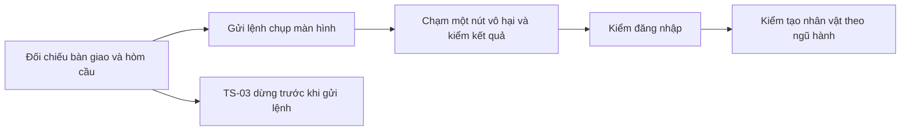
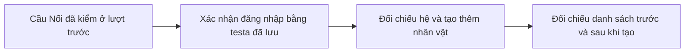
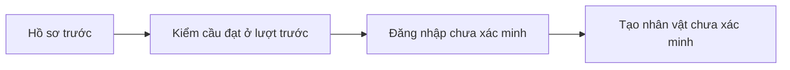
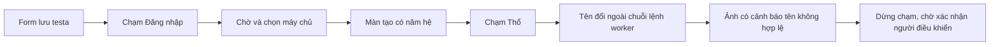

TÓM TẮT 1 [NGUỒN] — BLOCKED: TS-03 giới hạn ở `T36-tester01`, gồm kiểm Cầu Nối, đăng nhập và tạo nhân vật theo ngũ hành.
TÓM TẮT 2 [NGUỒN] — Đã đối chiếu tài liệu bàn giao, bảng môn phái và sự hiện diện của hai thư mục hòm cầu.
TÓM TẮT 3 [NGUỒN] — Đã ghi điểm tiếp tục cho hai mục tester, nhật ký và kết quả cuối task.
TÓM TẮT 4 [CHƯA KIỂM] — 0/4 bước kiểm thử trực tiếp; chưa có ảnh hoặc log của TS-03 vì hòm lệnh nằm ngoài vùng được phép ghi.
TÓM TẮT 5 [CHƯA KIỂM] — Chưa chạy build, exe, VM hay thao tác mạng. Không commit theo yêu cầu; Tổng quản tiếp tục từ bước kiểm cầu.

# TS-03 — Đăng nhập và tạo nhân vật qua Cầu Nối

- Loại: kiểm thử
- Chủ đề: Bàn giao lượt kiểm đăng nhập và tạo nhân vật trên Test-36 qua Cầu Nối LDPlayer.
- Từ khóa: đăng nhập, tạo nhân vật, ngũ hành, Cầu Nối, TS-03, Q-70, `T36-tester01`, `screenshot`, `tap`
- Trạng thái: BLOCKED — không thể gửi lệnh trong vùng ghi của lượt này.
- Độ phủ: đã kiểm trực tiếp 0 trên 4 bước, đếm riêng hai thao tác kiểm cầu.
- Liên quan: [chuẩn báo cáo](../DESIGN/CHUAN-BAO-CAO.md), [TS-03](../TASKS/TS-03.md), [hướng dẫn Cầu Nối](../STATE/TESTER/CAU-NOI.md), [bảng môn phái và ngũ hành](../STATE/TESTER/KIEN-THUC/mon-phai-ngu-hanh/README.md).
- Cần tôi quyết định: có — giao lượt kiểm trực tiếp cho môi trường được phép ghi vào hòm lệnh và điều khiển đúng phiên Test-36.

## Phạm vi và độ phủ

| Bước trên Test-36 | Phủ trực tiếp | Điều cần xác nhận khi tiếp tục | Nguồn |
|---|---|---|---|
| Chụp màn hình qua cầu | Chưa phủ | Có kết quả của lệnh và ảnh tương ứng. | `JX1_OPS/STATE/TESTER/CAU-NOI.md:6`, `JX1_OPS/STATE/TESTER/CAU-NOI.md:30` |
| Chạm một nút vô hại | Chưa phủ | Chọn nút từ màn hình thực tế, xác nhận `ok:true`. | `JX1_OPS/STATE/TESTER/CAU-NOI.md:30` |
| Đăng nhập | Chưa phủ | Xác nhận đúng phiên và dùng thông tin đã lưu trong ứng dụng. | `JX1_OPS/TASKS/TS-03.md:16` |
| Tạo nhân vật | Chưa phủ | Xác nhận màn hình tạo, ngũ hành ứng với môn phái cần kiểm và kết quả tạo. | `JX1_OPS/TASKS/TS-03.md:16`, `JX1_OPS/STATE/TESTER/KIEN-THUC/mon-phai-ngu-hanh/README.md:3` |

## Giải mã tên

Không trích tên kỹ năng, trang bị, quái, NPC hay bản đồ trong lượt này. `T36-tester01` là mã phiên kiểm thử, giữ nguyên theo `JX1_OPS/STATE/TESTER/PHAN-CONG.md:5`.

## Sắp theo cấu trúc game

Đi theo luồng tài khoản → đăng nhập → màn hình tạo nhân vật → chọn ngũ hành → gia nhập môn phái sau khi vào game. Hai bước cuối được phân biệt trong tài liệu tĩnh `JX1_OPS/STATE/TESTER/KIEN-THUC/mon-phai-ngu-hanh/README.md:3`; các lựa chọn thực tế trên bản mobile vẫn chưa được xác nhận (`JX1_OPS/STATE/TESTER/KIEN-THUC/mon-phai-ngu-hanh/README.md:26`).

## Đã xác minh / Chưa xác minh

- **Đã xác minh:** Task chỉ định đúng phiên Test-36 và yêu cầu ít nhất một bước có ảnh hoặc log (`JX1_OPS/TASKS/TS-03.md:16`). PowerShell `Test-Path -PathType Container` trả `True` cho cả `lenh` và `ket-qua` tại hòm đã phân công (`JX1_OPS/STATE/TESTER/PHAN-CONG.md:5`). Kết quả này chỉ xác nhận đường dẫn hiện diện.
- **Đã đối chiếu tài liệu:** Ghi nhận ban đầu nói tài khoản chưa có nhân vật (`JX1_OPS/STATE/TESTER/TRANG-THAI.md:3`); ghi nhận muộn hơn của Sonnet nói đã đăng nhập và thấy nhân vật (`JX1_OPS/STATE/TESTER/TRANG-THAI.md:23`, `JX1_OPS/STATE/TESTER/TRANG-THAI.md:24`). Đây là thông tin bàn giao từ hai thời điểm, chưa được TS-03 xác nhận lại và không tính vào độ phủ của lượt này.
- **Chưa xác minh:** Không gửi tệp lệnh, không đọc kết quả của TS-03 và không kiểm được cầu đang chạy hay không. Sandbox chỉ cấp vùng ghi trong worktree, còn task xác định hòm ở ngoài đó (`JX1_OPS/TASKS/TS-03.md:15`). Không có lỗi trả về từ cầu hoặc lỗi game quan sát được. Không thử `adb`, build, exe, VM hay thao tác mạng. Chưa đối chiếu mã nguồn client/server vì task không chỉ định root nguồn cho lượt kiểm này.
- **Lỗi và cách xử lý:** Lệnh PowerShell `Set-Content` ghi tệp nhịp thất bại với `Access to the path 'D:\JX-wt\TS-03.nhip' is denied.` (`UnauthorizedAccessException`). Không thử lại vì đường dẫn nằm ngoài vùng ghi. Dùng cập nhật trong cuộc trò chuyện thay cho tệp nhịp. Máy không có `rg`; đã dùng PowerShell trong các thư mục được giao.

## Bàn giao

- Điểm tiếp tục: [đăng nhập](../STATE/TESTER/BAN-GIAO/dang-nhap/README.md) và [tạo nhân vật](../STATE/TESTER/BAN-GIAO/tao-nhan-vat/README.md). Giữ `TRANG-THAI.md` nguyên trạng vì nằm ngoài `vung_file`; thông tin dừng được ghi ở nhật ký và cuối task.
- Khi môi trường cho phép, bắt đầu bằng `screenshot`, sau đó `tap` một nút vô hại theo ảnh thực tế. Lưu bằng chứng đã lọc trước khi kiểm đăng nhập. Xác nhận phiên hiện có nhân vật hay còn chỗ tạo trước khi thực hiện bước tạo theo bảng ngũ hành.
- Không stage, commit hay push theo yêu cầu; Tổng quản nhận các thay đổi trong worktree. Không có SHA mới.
- Kỹ năng đã nạp: `jx1-retrofit`, `jx1-read-server`, `jx1-read-client`, `jx1-parameters`, `jx1-knowledge`, `jx1-report`. Áp dụng khuôn báo cáo và nhãn xác minh; không có báo cáo cũ cần chuẩn hóa, nguồn client/server cần đọc hay thông số game mới để ghi sổ.

## Kết quả tiếp tục — 19/11/2026, 11:53–11:59 (UTC+7)

TÓM TẮT 1 [NGUỒN] — PARTIAL: đạt 2/4 bước kiểm trực tiếp; đã kiểm cầu bằng ảnh và chạm mở Hành trang, chưa đăng nhập/tạo nhân vật cho `tester01`.
TÓM TẮT 2 [NGUỒN] — Hòm `.ldbridge` trong worktree hoạt động; 7 lệnh chụp + 7 lệnh chạm đều trả `ok:true`, có ảnh trước/sau.
TÓM TẮT 3 [NGUỒN] — Đã bổ sung bằng chứng, kiến thức, lỗi điều kiện bàn giao, hai mục bàn giao, nhật ký và kết quả cuối task.
TÓM TẮT 4 [CHƯA KIỂM] — Form hiện lưu `testa`, khác tài khoản được giao; dừng trước Đăng nhập, cần Tổng quản chuẩn bị đúng `tester01` trong app.
TÓM TẮT 5 [CHƯA KIỂM] — Không build/chạy exe/khởi động VM/đổi mạng; không commit/push. Chỉ điều khiển phiên có sẵn qua cầu; file nhịp yêu cầu nằm ngoài vùng ghi.

- Loại: kiểm thử.
- Chủ đề: Kiểm cầu thật và xác định điểm chặn trước đăng nhập đúng tài khoản.
- Từ khóa: đăng nhập, tạo nhân vật, Hành trang, Cầu Nối, TS-03, tester01, screenshot, tap.
- Trạng thái: PARTIAL — đã có bằng chứng thật, bị chặn ở điều kiện tài khoản trước hai bước còn lại.
- Độ phủ: 2/4 bước trực tiếp, cùng mẫu số của lượt trước: chụp, chạm, đăng nhập, tạo nhân vật. Bước (1) kiểm cầu của task hoàn tất; bước (4) ghi hồ sơ đã làm trong phạm vi.
- Liên quan: [task](../TASKS/TS-03.md), [Cầu Nối](../STATE/TESTER/CAU-NOI.md), [lỗi điều kiện bàn giao](../STATE/TESTER/LOI/dang-nhap/2026-11-19-tai-khoan-luu-khong-khop.md).
- Cần tôi quyết định: có — Tổng quản chuẩn bị sẵn đúng `tester01` trong ứng dụng; không cần cung cấp mật khẩu cho worker.

Phần trước mục này là ghi nhận lịch sử lượt 1, giữ nguyên kết luận, số liệu và bằng chứng. Kết quả mới dưới đây thay điểm tiếp tục, không sửa lặng lịch sử. Sơ đồ Mermaid đầu báo cáo mô tả luồng kiểm chung và điểm dừng cũ; lượt này đã qua kiểm cầu, đi tới form đăng nhập rồi dừng trước bước xác thực.

### Phạm vi và độ phủ lượt tiếp tục

| Phần tử | Độ phủ | Bằng chứng/giới hạn |
|---|---|---|
| Chụp màn hình qua cầu | Đã phủ | 7 ảnh; `JX1_OPS/STATE/TESTER/KIEN-THUC/dang-nhap/TS-03/ket-qua.jsonl:1,3,6,8,10,12,14`. |
| Chạm một nút vô hại | Đã phủ | Hành trang mở sau (680,52); log cùng file dòng 2–3, ảnh 01–02. |
| Đăng nhập `tester01` | Chưa phủ | Đã tới form nhưng tên lưu là tài khoản khác; log dòng 11–14, ảnh 06–07. Chưa bấm Đăng nhập. |
| Tạo nhân vật đúng ngũ hành | Chưa phủ | Chưa đăng nhập đúng tài khoản, chưa mở màn tạo. Bảng tĩnh chỉ là nguồn chuẩn bị: `JX1_OPS/STATE/TESTER/KIEN-THUC/mon-phai-ngu-hanh/README.md:3,26–28`. |
| Kiến thức/lỗi/bàn giao đăng nhập | Đã phủ | Bổ sung trong đúng ba mục được giao; ghi nhận LOI-dang-nhap-001 theo mẫu, không gán là lỗi game. |
| Kiến thức/bàn giao tạo nhân vật | Đã phủ phần bàn giao | Ghi rõ phụ thuộc tài khoản. Không thêm lỗi tạo nhân vật vì chưa quan sát màn tạo; giữ `LOI/tao-nhan-vat/README.md` nguyên trạng. |
| Nhật ký và kết quả cuối task | Đã phủ | Thêm cuối; giữ các ghi nhận cũ. |
| Nhịp ngoài worktree | Chưa phủ | `D:\JX-wt\TS-03.nhip` không thuộc vùng ghi được cấp. Lượt này không thử lại lỗi từ chối của lượt trước và không đổi quyền. |

### Giải mã tên của dữ liệu quan sát mới

| Tên gốc | Mã hóa | Chữ đúng UTF-8 | Nguồn file:dòng |
|---|---|---|---|
| T36nv1 | ASCII hiển thị trên UI; không đọc byte tên từ game | T36nv1 | `JX1_OPS/STATE/TESTER/KIEN-THUC/dang-nhap/TS-03/bang-chung.tsv:2`, ảnh `01-hien-trang.jpg`. |
| Ba Lăng Huyện | Đọc chữ đã render trên UI; chưa xác minh mã hóa dữ liệu gốc | Ba Lăng Huyện; không suy tên Hán | Cùng tệp TSV dòng 2, góc bản đồ ảnh `01-hien-trang.jpg`. |

Không thực hiện chuyển GBK/TCVN3 hoặc nhận định byte tên trong dữ liệu game vì không đọc nguồn game ở lượt kiểm này. `testa`/`tester01` là định danh tài khoản quan sát/yêu cầu, không phải tên nhân vật; không có mật khẩu trong tài liệu hoặc lệnh.

### Sắp theo cấu trúc game và các bước thực chạy

Trình tự: phiên đang trong game → kiểm Hành trang → Cài đặt → Đăng xuất → chọn máy chủ → form tài khoản → dừng trước xác thực → chưa tới màn tạo/ngũ hành. Không dùng nhân vật đã có để nhận bước tạo nhân vật mới là đạt.

| Giờ cầu (19/11, UTC+7 theo môi trường) | Thao tác/kết quả | Bằng chứng |
|---|---|---|
| 11:53:19 | `screenshot` thấy nhân vật T36nv1 cấp 1 trong game; đây chưa phải bằng chứng đúng tài khoản. | Log dòng 1, ảnh 01. |
| 11:54:13–11:54:46 | `tap(680,52)` → Hành trang mở; hoàn tất kiểm cầu. | Log dòng 2–3, ảnh 02. |
| 11:55:32–11:55:39 | Đóng Hành trang (1553,957), mở Cài đặt (1193,52); không sửa thiết lập. | Log dòng 4–6, ảnh 03. |
| 11:56:40–11:56:44 | Chọn Đăng xuất (1176,955), về màn Bắt đầu trò chơi. | Log dòng 7–8, ảnh 04. |
| 11:57:25–11:57:29 | Chọn Bắt đầu trò chơi (960,588), hiện màn chọn máy chủ. | Log dòng 9–10, ảnh 05. |
| 11:58:30–11:58:34 | Chọn máy chủ (500,298), thấy form lưu `testa`. | Log dòng 11–12, ảnh 06. |
| 11:59:14–11:59:18 | Chạm mũi tên tài khoản (1166,565) một lần; ảnh chưa hiện danh sách khác. Dừng ở form. | Log dòng 13–14, ảnh 07. |

Trong bảng, “log” là `JX1_OPS/STATE/TESTER/KIEN-THUC/dang-nhap/TS-03/ket-qua.jsonl`; toàn bộ 14 dòng là phản hồi cầu thực tế. Tọa độ, ID và băm ảnh ở `JX1_OPS/STATE/TESTER/KIEN-THUC/dang-nhap/TS-03/bang-chung.tsv:1–15`. `ok:true` xác nhận cầu xử lý lệnh, ảnh mới xác nhận kết quả UI; không dùng phản hồi cầu để suy đăng nhập thành công.

### Bộ bằng chứng đã lọc

- [Bảng bằng chứng và SHA-256](../STATE/TESTER/KIEN-THUC/dang-nhap/TS-03/bang-chung.tsv), [14 phản hồi cầu](../STATE/TESTER/KIEN-THUC/dang-nhap/TS-03/ket-qua.jsonl).
- [01 — hiện trạng](../STATE/TESTER/KIEN-THUC/dang-nhap/TS-03/01-hien-trang.jpg), [02 — Hành trang mở](../STATE/TESTER/KIEN-THUC/dang-nhap/TS-03/02-mo-hanh-trang.jpg), [03 — Cài đặt](../STATE/TESTER/KIEN-THUC/dang-nhap/TS-03/03-cai-dat.jpg).
- [04 — sau Đăng xuất](../STATE/TESTER/KIEN-THUC/dang-nhap/TS-03/04-sau-dang-xuat.jpg), [05 — chọn máy chủ](../STATE/TESTER/KIEN-THUC/dang-nhap/TS-03/05-chon-may-chu.jpg).
- [06 — tài khoản không khớp](../STATE/TESTER/KIEN-THUC/dang-nhap/TS-03/06-tai-khoan-khong-khop.jpg), [07 — sau chạm mũi tên](../STATE/TESTER/KIEN-THUC/dang-nhap/TS-03/07-sau-cham-mui-ten.jpg); đã phủ đen toàn ô mật khẩu trước lưu vào hồ sơ.
- Bản JPEG phục vụ bàn giao, 139.352–340.011 byte/ảnh, đều dưới 1 MiB; ảnh gốc PNG 1920×1080 do cầu sinh được giữ trong hòm, không đưa vào bộ tài liệu bàn giao. Bảng TSV phân biệt SHA-256 PNG gốc và JPEG đã chuyển/che; không nhận hai tệp là giống byte.

### Lỗi, cách thử và kết quả

1. **Điểm chặn hòm cầu của lượt cũ đã thay đổi:** task hiện trỏ hòm trong worktree (`JX1_OPS/TASKS/TS-03.md:15`), còn phân công vẫn dẫn hòm cũ (`JX1_OPS/STATE/TESTER/PHAN-CONG.md:5`). Dùng đường task chỉ định; thư mục `.ldbridge` quan sát là thư mục thường, không thấy liên kết chuyển ra ngoài. Gửi lệnh đầu thành công, có kết quả và ảnh; không lặp dựng cầu, không đổi phân công.
2. **LOI-dang-nhap-001 — lệch điều kiện tài khoản:** kiểm 1/1 lượt về form và 1 lần chạm mũi tên; chưa thấy lựa chọn khác. Không thử mật khẩu, không bấm đăng nhập tài khoản sai, không kết luận mũi tên hỏng hay tài khoản `tester01` không tồn tại. Cần Tổng quản chuẩn bị đúng tài khoản ngay trong app. Hồ sơ theo `JX1_OPS/STATE/TESTER/MAU/BAO-LOI.md:1–9` tại [ghi nhận lỗi](../STATE/TESTER/LOI/dang-nhap/2026-11-19-tai-khoan-luu-khong-khop.md).
3. **Nhịp:** đường được yêu cầu nằm ngoài vùng ghi. Giữ nguyên lỗi lịch sử ở phần trước, không tạo thêm lỗi giả cho lượt này; không chạy lại phép ghi ngoài sandbox. Các mốc tiến độ được thông báo trong cuộc trò chuyện; không nhận là đã cập nhật tệp nhịp.

### Đã xác minh / Chưa xác minh của lượt tiếp tục

- **ĐÃ XÁC MINH:** Git ban đầu ở `task/TS-03`, có sẵn thay đổi task và hướng dẫn cầu; giữ các thay đổi đó. Ghi/đọc hòm trong worktree thành công; 14/14 phản hồi `ok:true`, 7 ảnh; Hành trang mở sau chạm. Quan sát tên tài khoản trên form khác `tester01` là bằng chứng mới trực tiếp.
- **CHƯA XÁC MINH:** chưa kiểm độc lập cấu hình cầu/serial LD; đích `T36-tester01` lấy theo task, không gọi adb hay thiết bị khác. Chưa biết tài khoản thực của phiên có T36nv1; tên lưu trên form không tự chứng minh tài khoản của phiên trước.
- **CHƯA XÁC MINH:** chưa bấm Đăng nhập, chưa xác thực đúng `tester01`, chưa mở màn tạo, chưa chọn hệ hoặc xác nhận tạo/gia nhập môn phái. Chưa đo FPS/độ trễ, không dùng số nổi trên một ảnh làm số đo hiệu năng.
- **Test đã chạy:** cầu chụp/chạm và kiểm UI như bảng thời gian; một lượt về form, một lần kiểm mũi tên. **Test/build chưa chạy:** unit/integration/build, exe, adb, VM khởi động/snapshot, mạng/DNAT, xác thực tài khoản và tạo nhân vật. Không sửa source/cấu hình/credential; không gửi `start`, `stop`, `dnat`, `text` hoặc `logcat`.

### Bàn giao lượt tiếp tục

- **PARTIAL:** đủ điều kiện “≥1 bước thật có ảnh/log”; chưa hoàn tất mục tiêu đăng nhập/tạo nhân vật. Phiên dừng ở form lưu `testa`; phiên game ban đầu đã được đăng xuất khi đi về form. Tổng quản lưu sẵn đúng `tester01`, worker tiếp tục bằng ảnh kiểm form, xác nhận đúng tài khoản rồi đăng nhập và tạo theo bảng ngũ hành; không cần đọc lại toàn bộ nguồn.
- Đã thêm cuối hai mục kiến thức, hai mục bàn giao, nhật ký và kết quả task; thêm ghi nhận điều kiện bàn giao trong `LOI/dang-nhap`. Không sửa `TRANG-THAI.md`, `PHAN-CONG.md`, `INDEX.md`, `CAU-NOI.md` hoặc mục môn phái vì ngoài vùng sửa; Tổng quản gộp điểm tiếp tục vào trạng thái chung.
- Không tự ghi `REPORTS/_CHIMUC/TS-03.tsv` hoặc chỉ mục tri thức vì ngoài `vung_file` và ngoại lệ báo cáo/task được giao. Hàng đề nghị PM gộp: `JX1_OPS/REPORTS/TS-03.md | kiểm thử | Kiểm cầu đạt, chặn tài khoản trước tạo nhân vật | đăng nhập; tạo nhân vật; tester01; Cầu Nối; TS-03 | PARTIAL | 2/4 bước trực tiếp; 14/14 phản hồi cầu | TASKS/TS-03.md; STATE/TESTER/BAN-GIAO/dang-nhap/README.md`.
- Không stage/commit/push theo yêu cầu; chưa có SHA mới. Không gửi báo cáo qua kênh ngoài. Tổng quản nhận tệp local và tự commit.
- Kỹ năng đã dùng: `jx1-report` (báo cáo/bàn giao), `jx1-knowledge` (nhãn độ chắc, luồng game), `jx1-retrofit` (giữ lịch sử, nêu phát hiện riêng). Đã nạp `jx1-read-server`, `jx1-read-client`, `jx1-parameters`; không mở rộng sang nguồn client/server hoặc sổ thông số game vì lượt này là kiểm UI, chưa có thông số game cần khảo sát.

### Phát hiện khi chuẩn hóa/tiếp tục

- Các phát biểu hòm nằm ngoài vùng ghi ở phần lịch sử phản ánh lượt trước. Task hiện đã được điều chỉnh; lượt này có bằng chứng cầu hoạt động. Không sửa kết luận cũ thành kết quả mới.
- Bàn giao mô tả tài khoản được cấp là `tester01`, nhưng form thực tế đang lưu `testa`. Đây là mâu thuẫn cần Tổng quản xử lý trước khi tiếp tục; không dùng ghi nhận trong tài liệu để nhận đăng nhập đúng tài khoản là đạt.

### Kiểm tra hồ sơ trước bàn giao

- Đã xem diff; các phần kết luận cũ được giữ, phần tiếp tục thêm cuối. Chín tệp Markdown được kiểm đọc UTF-8 không BOM và liên kết nội bộ đều tồn tại; đã đọc lại tệp lỗi mới và xem ảnh JPEG bàn giao cuối, ô mật khẩu đã được phủ đen.
- Đã đối chiếu đủ 14 ID/phản hồi, 7 `tap` + 7 `screenshot`, tất cả `ok:true`; băm SHA-256 của cả 7 PNG gốc và 7 JPEG khớp bảng TSV, mỗi JPEG dưới 1 MiB. Kiểm tổng hợp PowerShell dừng sau bước UTF-8/liên kết nên đã ngắt, chuyển sang đọc tệp và tính băm bằng Node.js; phần kiểm thay thế hoàn tất, không tạo script phụ.
- `git diff --check` mặc định cảnh báo CR cuối dòng trong task có CRLF. Không chuẩn hóa phần task có sẵn; chạy kiểm chỉ cho phép CRLF bằng `git -c core.whitespace=blank-at-eol,blank-at-eof,space-before-tab,cr-at-eol diff --check` trả mã 0. Tùy chọn chỉ áp dụng cho lệnh kiểm, không ghi Git config.

## Kết quả lượt 2 theo chỉ dẫn lúc 12:15 — 19/11/2026

TÓM TẮT 1 [NGUỒN] — PARTIAL. Độ phủ trực tiếp lũy kế là 2/4 bước trên `T36-tester01`.
TÓM TẮT 2 [NGUỒN] — Đối chiếu 14 phản hồi cầu đã lưu với bảng bằng chứng. Cả 7 ảnh JPEG khớp SHA-256.
TÓM TẮT 3 [NGUỒN] — Đã cập nhật bàn giao hai mục, nhật ký và cuối task theo chỉ dẫn dùng `testa` đã lưu.
TÓM TẮT 4 [CHƯA KIỂM] — Chưa xác thực `testa`, chưa mở màn tạo và chưa tạo nhân vật mới.
TÓM TẮT 5 [CHƯA KIỂM] — Chưa chạy build, exe, VM hay kiểm thử qua mạng trong lượt này. Tổng quản nhận thay đổi trong worktree để commit.

- Loại: kiểm thử.
- Chủ đề: Đối chiếu bằng chứng và cập nhật điểm tiếp tục đăng nhập, tạo nhân vật trên Test-36.
- Từ khóa: đăng nhập, tạo nhân vật, ngũ hành, Cầu Nối, TS-03, Test-36, `T36-tester01`, `testa`.
- Trạng thái: PARTIAL — hồ sơ đã cập nhật, hai bước còn lại cần một lượt kiểm trực tiếp có thao tác trên game và kết nối.
- Độ phủ: 2 trên 4 bước kiểm trực tiếp lũy kế.
- Liên quan: [task TS-03](../TASKS/TS-03.md), [chuẩn báo cáo](../DESIGN/CHUAN-BAO-CAO.md), [ghi nhận điều kiện bàn giao cũ](../STATE/TESTER/LOI/dang-nhap/2026-11-19-tai-khoan-luu-khong-khop.md).
- Cần tôi quyết định: có — bố trí lượt kiểm trực tiếp trên Test-36 nếu cần hoàn tất hai bước còn lại.

### Phạm vi và độ phủ lượt 2

| Phần tử | Độ phủ | Nguồn |
|---|---|---|
| Chụp màn hình qua cầu | Đã phủ ở lượt trước | `JX1_OPS/STATE/TESTER/KIEN-THUC/dang-nhap/TS-03/ket-qua.jsonl:1`, `JX1_OPS/REPORTS/TS-03.md:79` |
| Chạm một nút vô hại | Đã phủ ở lượt trước | `JX1_OPS/STATE/TESTER/KIEN-THUC/dang-nhap/TS-03/ket-qua.jsonl:2–3`, `JX1_OPS/REPORTS/TS-03.md:80` |
| Đăng nhập bằng `testa` đã lưu | Chưa phủ | `JX1_OPS/TASKS/TS-03.md:31`, `JX1_OPS/REPORTS/TS-03.md:108–109` |
| Tạo thêm nhân vật đúng ngũ hành | Chưa phủ | `JX1_OPS/TASKS/TS-03.md:31`, `JX1_OPS/STATE/TESTER/KIEN-THUC/mon-phai-ngu-hanh/README.md:3,26–28` |
| Hồ sơ hai mục, nhật ký, kết quả task | Đã cập nhật | `JX1_OPS/STATE/TESTER/BAN-GIAO/dang-nhap/README.md:18`, `JX1_OPS/STATE/TESTER/BAN-GIAO/tao-nhan-vat/README.md:17`, `JX1_OPS/STATE/TESTER/NHAT-KY-VIEC.md:9`, `JX1_OPS/TASKS/TS-03.md:33` |
| Tệp nhịp ngoài worktree | Chưa ghi được | PowerShell trả `UnauthorizedAccessException` khi ghi `D:\JX-wt\TS-03.nhip`. Các mốc được cập nhật trong cuộc trò chuyện. |

### Giải mã tên và sắp theo cấu trúc game

| Tên gốc | Mã hóa | Chữ đúng UTF-8 | Nguồn file:dòng |
|---|---|---|---|
| T36nv1 | ASCII trong hồ sơ bàn giao | T36nv1 | `JX1_OPS/REPORTS/TS-03.md:92`, `JX1_OPS/TASKS/TS-03.md:31` |

Luồng tiếp tục theo sơ đồ đầu báo cáo. Xác nhận form đang lưu `testa` → xác thực → mở màn chọn/tạo nhân vật → đối chiếu ngũ hành của môn phái cần kiểm → tạo thêm và ghi nhận kết quả. Việc gia nhập môn phái nằm sau bước tạo, theo bảng tĩnh tại `JX1_OPS/STATE/TESTER/KIEN-THUC/mon-phai-ngu-hanh/README.md:3`. Giữ `T36nv1` theo chỉ dẫn tại `JX1_OPS/TASKS/TS-03.md:31`.

### Đã xác minh / Chưa xác minh lượt 2

- **ĐÃ XÁC MINH từ hồ sơ:** PowerShell đối chiếu `bang-chung.tsv:2–15` với `ket-qua.jsonl:1–14` trong `JX1_OPS/STATE/TESTER/KIEN-THUC/dang-nhap/TS-03/`. Có 14 ID duy nhất, gồm 7 chụp và 7 chạm, đều khớp loại lệnh và trả `ok:true`. `Get-FileHash -Algorithm SHA256` khớp cả 7 JPEG với bảng và từng ảnh dưới giới hạn 1 MiB. Đây là phép kiểm bằng chứng đã lưu.
- **ĐÃ XÁC MINH từ văn bản:** `JX1_OPS/TASKS/TS-03.md:31` cho phép dùng `testa` đã lưu ở lượt 2. Yêu cầu chuẩn bị `tester01` thuộc lần bàn giao trước.
- **CHƯA XÁC MINH trực tiếp:** trạng thái form hiện tại, đăng nhập `testa`, tài khoản của phiên trước có `T36nv1`, ô tạo còn trống, lựa chọn ngũ hành và kết quả tạo. Không gửi lệnh cầu trong lượt này. Không có lỗi xác thực hoặc lỗi tạo mới để ghi vào hồ sơ lỗi.
- **Lỗi khi ghi nhịp:** `Add-Content` trả `Access to the path 'D:\JX-wt\TS-03.nhip' is denied.` Đường dẫn nằm ngoài vùng ghi được cấp. Không lặp phép ghi. `rg` không có trong môi trường, đã dùng `Select-String` trên tệp chỉ mục được dẫn.

### Bàn giao lượt 2

- Chuyển điểm tiếp tục sang form `testa` trên đúng phiên Test-36. Lượt được phép kiểm trực tiếp cần xác nhận form, thực hiện đăng nhập bằng thông tin đã lưu, đối chiếu bảng ngũ hành trước khi tạo thêm và giữ `T36nv1`. Ghi ảnh và log đã lọc theo mẫu nếu có kết quả thực chạy. [Bàn giao đăng nhập](../STATE/TESTER/BAN-GIAO/dang-nhap/README.md) · [Bàn giao tạo nhân vật](../STATE/TESTER/BAN-GIAO/tao-nhan-vat/README.md).
- Hàng cập nhật chỉ mục cho Tổng quản: `JX1_OPS/REPORTS/TS-03.md | kiểm thử | Kiểm cầu đã đạt, bàn giao lượt dùng testa | đăng nhập, tạo nhân vật, testa, ngũ hành, TS-03 | PARTIAL | 2/4 bước trực tiếp | JX1_OPS/TASKS/TS-03.md`.
- Tổng quản commit phần thay đổi tài liệu trong worktree. Lượt này không stage, commit hoặc push.
- Kỹ năng đã dùng: `jx1-retrofit`, `jx1-knowledge`, `jx1-report`. Đã nạp `jx1-read-server`, `jx1-read-client`, `jx1-parameters` để đối chiếu phạm vi. Task kiểm UI không chỉ định root mã nguồn hay thông số game cần đo trong lượt này.

### Phát hiện khi chuẩn hóa/tiếp tục

- Chỉ dẫn mới thay tài khoản cho lượt 2. Ghi nhận `LOI-dang-nhap-001` mô tả việc form không khớp yêu cầu dùng `tester01` ở lượt trước. Tiêu chí của lần kiểm tiếp theo lấy theo `JX1_OPS/TASKS/TS-03.md:31`.
- Đã kiểm tra báo cáo dùng UTF-8 không BOM. Nội dung văn bản các lượt trước được giữ nguyên.

## Kết quả rà soát phần còn thiếu — 19/11/2026

TÓM TẮT 1 [NGUỒN] — PARTIAL. Độ phủ trực tiếp lũy kế trên `T36-tester01` là 2/4 bước.
TÓM TẮT 2 [NGUỒN] — Đã đối chiếu chỉ dẫn lúc 12:15 với hai mục bàn giao và rà phản hồi ngoài bảng bằng chứng.
TÓM TẮT 3 [NGUỒN] — Đã bổ sung tiêu chí xác nhận đăng nhập và tạo nhân vật, cập nhật nhật ký và kết quả cuối task.
TÓM TẮT 4 [CHƯA KIỂM] — Đăng nhập bằng `testa` và tạo thêm nhân vật đúng hệ vẫn chờ kiểm trực tiếp.
TÓM TẮT 5 [CHƯA KIỂM] — Lượt này không chạy build, exe, VM hoặc kiểm thử qua mạng. Tổng quản nhận phần tài liệu để commit.

- Loại: kiểm thử.
- Chủ đề: Rà soát hồ sơ và bổ sung tiêu chí cho hai bước kiểm còn thiếu trên Test-36.
- Từ khóa: đăng nhập, tạo nhân vật, ngũ hành, Cầu Nối, Test-36, TS-03, `testa`.
- Trạng thái: PARTIAL — hai bước kiểm trực tiếp còn lại cần một lượt có thao tác game và mạng.
- Độ phủ: 2 trên 4 bước kiểm trực tiếp lũy kế.
- Liên quan: [task TS-03](../TASKS/TS-03.md), [bàn giao đăng nhập](../STATE/TESTER/BAN-GIAO/dang-nhap/README.md), [bàn giao tạo nhân vật](../STATE/TESTER/BAN-GIAO/tao-nhan-vat/README.md).
- Cần tôi quyết định: có — bố trí lượt kiểm trực tiếp trên Test-36.

### Phạm vi và độ phủ

| Phần tử | Độ phủ | Nguồn |
|---|---|---|
| Chụp màn hình qua Cầu Nối | Đã phủ ở lượt trước | `JX1_OPS/REPORTS/TS-03.md:173` |
| Chạm nút vô hại | Đã phủ ở lượt trước | `JX1_OPS/REPORTS/TS-03.md:174` |
| Đăng nhập bằng `testa` đã lưu | Chưa phủ | `JX1_OPS/TASKS/TS-03.md:31`, `JX1_OPS/STATE/TESTER/BAN-GIAO/dang-nhap/README.md:24–27` |
| Tạo thêm nhân vật đúng hệ, giữ `T36nv1` | Chưa phủ | `JX1_OPS/TASKS/TS-03.md:31`, `JX1_OPS/STATE/TESTER/BAN-GIAO/tao-nhan-vat/README.md:22–25` |
| Hồ sơ kiến thức và lỗi hai mục | Đã ghi nhận ở lượt trước. Chưa có quan sát mới về game | `JX1_OPS/REPORTS/TS-03.md:61,192` |
| Bàn giao, nhật ký, kết quả cuối task | Đã bổ sung | `JX1_OPS/STATE/TESTER/BAN-GIAO/dang-nhap/README.md:24`, `JX1_OPS/STATE/TESTER/BAN-GIAO/tao-nhan-vat/README.md:22`, `JX1_OPS/STATE/TESTER/NHAT-KY-VIEC.md:11`, `JX1_OPS/TASKS/TS-03.md:40` |
| Tệp nhịp | Chưa ghi được | `Add-Content` trả `GetContentWriterUnauthorizedAccessError` |

### Giải mã tên

| Tên gốc | Mã hóa | Chữ đúng UTF-8 | Nguồn file:dòng |
|---|---|---|---|
| T36nv1 | ASCII | T36nv1 | `JX1_OPS/TASKS/TS-03.md:31` |

### Sắp theo cấu trúc game

Thứ tự kiểm là tài khoản → danh sách nhân vật → ngũ hành khi tạo → danh sách sau tạo. Môn phái dùng để tra hệ trước khi tạo. Việc gia nhập môn phái diễn ra sau bước tạo, theo bảng tĩnh. `JX1_OPS/STATE/TESTER/KIEN-THUC/mon-phai-ngu-hanh/README.md:3,26–28`.

### Mục sổ thông số

| Nhóm | Tên | file:dòng | Giá trị | Đơn vị | Ảnh hưởng | Đổi an toàn | Nguồn đo |
|---|---|---|---|---|---|---|---|
| Hồ sơ tester | Giới hạn ảnh trong mẫu báo lỗi | `JX1_OPS/STATE/TESTER/MAU/BAO-LOI.md:7` | ≤1 | MB/ảnh | Điều kiện nhận ảnh vào hồ sơ | KHÔNG trong phạm vi task | Đọc tĩnh từ mẫu |

### Đã xác minh / Chưa xác minh

- **ĐÃ XÁC MINH từ hồ sơ.** Chỉ dẫn 12:15 và hai mục bàn giao thống nhất dùng `testa` đã lưu trên `T36-tester01` và giữ `T36nv1`. `JX1_OPS/TASKS/TS-03.md:31`, `JX1_OPS/STATE/TESTER/BAN-GIAO/dang-nhap/README.md:20–22`, `JX1_OPS/STATE/TESTER/BAN-GIAO/tao-nhan-vat/README.md:19–20`.
- **ĐÃ XÁC MINH bằng đọc tệp.** PowerShell đối chiếu tên phản hồi với cột `id` trong bảng bằng chứng. Phản hồi `t1` ngoài bảng có thời điểm sửa 11:42:14 và trả `ok:true`. Nhật ký cầu ghi lệnh `tap`. Thư mục kết quả không có PNG trùng ID. Bằng chứng này chưa xác nhận đăng nhập hoặc tạo nhân vật. `.ldbridge/nhat-ky.log:1`, `.ldbridge/ket-qua/t1.json:1`, `JX1_OPS/STATE/TESTER/KIEN-THUC/dang-nhap/TS-03/bang-chung.tsv:2–15`.
- **CHƯA XÁC MINH trực tiếp.** Form hiện tại, xác thực `testa`, ô tạo còn trống, lựa chọn ngũ hành và kết quả tạo. Không gửi lệnh cầu vì hai bước còn lại cần thao tác game và mạng, ngoài phạm vi lượt này. Chưa quan sát lỗi game mới.
- **Lỗi ghi nhịp.** `Add-Content` trả `Access to the path 'D:\JX-wt\TS-03.nhip' is denied.` Đường dẫn nằm ngoài vùng ghi. Các mốc rà soát được báo trong cuộc trò chuyện.

- **Kiểm tra tài liệu.** Lần chạy đầu của `git diff --check` báo CRLF ở các dòng mới của tệp task. Đã đổi riêng các dòng mới sang LF, giữ phần cũ nguyên văn.

### Bàn giao

- Khi có lượt được phép chạy trên Test-36, dùng hai mục bàn giao để xác nhận đã vào danh sách nhân vật, ghi hệ đã chọn và đối chiếu danh sách trước/sau khi tạo.
- Tổng quản commit phần tài liệu trong worktree. Hàng chỉ mục để gộp đã có tại `JX1_OPS/REPORTS/TS-03.md:198`. Tệp chỉ mục riêng nằm ngoài vùng sửa.
- Kỹ năng đã dùng: `jx1-retrofit`, `jx1-knowledge`, `jx1-parameters`, `jx1-report`. Đã nạp `jx1-read-server` và `jx1-read-client` để đối chiếu phạm vi. Task không giao root mã nguồn server hay client cho lượt rà hồ sơ.

### Phát hiện khi chuẩn hóa

- Hòm cầu có 15 phản hồi tại thời điểm rà, gồm một lần chạm cũ trước phiên kiểm đã được ghi trong bảng. Số liệu bằng chứng của phiên đó vẫn là 14 phản hồi.

## Kết quả tiếp tục — 19/11/2026

- **PARTIAL — lũy kế 2/4 bước trực tiếp; không có bước mới trong lượt này.** Đã đọc task, chuẩn báo cáo và các hồ sơ được chỉ định; không làm lại phần đã có.
- Không gửi lệnh điều khiển game, không đăng nhập hoặc tạo nhân vật do giới hạn lượt này cấm thao tác VM/exe/mạng. Không có ảnh/log mới; giữ nguyên mọi kết luận và số liệu lịch sử.
- **Phạm vi:** chụp màn hình và chạm vô hại đã đạt ở lượt trước; đăng nhập và tạo nhân vật chưa xác minh mới. Không tính hồ sơ lịch sử thành kết quả lượt này.
- **Đã xác minh:** hồ sơ bàn giao và kết quả TS-03 đã có. **Chưa xác minh:** trạng thái hiện tại, đăng nhập, tạo nhân vật; không có kiểm thử/build/exe/VM/mạng mới.
- Nhịp: không ghi được `D:\JX-wt\TS-03.nhip`; PowerShell báo `Access to the path 'D:\JX-wt\TS-03.nhip' is denied.` Không thử vượt giới hạn.
- Bàn giao: tiếp tục kiểm qua Cầu Nối khi có lượt được phép thao tác ứng dụng. Không commit/push.
- Kỹ năng đã dùng: `jx1-retrofit`, `jx1-read-server`, `jx1-read-client`, `jx1-parameters`, `jx1-knowledge`, `jx1-report`.

liên quan: [task TS-03](../TASKS/TS-03.md), [bàn giao đăng nhập](../STATE/TESTER/BAN-GIAO/dang-nhap/README.md), [bàn giao tạo nhân vật](../STATE/TESTER/BAN-GIAO/tao-nhan-vat/README.md).

TÓM TẮT 1 [NGUỒN] — PARTIAL: lượt 3 đã gửi 11 lệnh thật trước khi sửa hồ sơ, vượt mốc tối thiểu 8; 11/11 phản hồi ok:true.
TÓM TẮT 2 [NGUỒN] — Đã chạm Đăng nhập bằng testa lưu sẵn, chọn máy chủ, tới màn tạo có năm hệ và chạm Thổ.
TÓM TẮT 3 [NGUỒN] — Lưu 7 ảnh đã mở kiểm, 11 lệnh/phản hồi và bảng SHA-256; ảnh form bàn giao đã che toàn ô mật khẩu.
TÓM TẮT 4 [CHƯA KIỂM] — Chưa tạo nhân vật/vào game; tên đổi ngoài chuỗi lệnh worker và xuất hiện cảnh báo, cần xác nhận người điều khiển.
TÓM TẮT 5 [NGUỒN] — Không build/adb/khởi động VM/exe/đổi mạng; chỉ dùng cầu có sẵn. Không commit/push; Tổng quản nhận hồ sơ và điều phối bước tiếp.

## TS-03 — Kết quả lượt 3 thực chạy, 19/11/2026, 13:05–13:12 (UTC+7)

Loại: kiểm thử
Chủ đề: Thực hiện đăng nhập/chọn hệ qua Cầu Nối và ghi điểm dừng có bằng chứng.
Từ khóa: đăng nhập, tạo nhân vật, ngũ hành, Thổ, Cầu Nối, screenshot, tap, TS-03, T36-tester01, testa
Trạng thái: PARTIAL — đã thao tác thật, dừng chạm khi UI đổi ngoài chuỗi lệnh và có cảnh báo chưa được hướng dẫn xử lý.
Độ phủ: 2/4 bước đạt chắc chắn theo mẫu số lịch sử; đã thao tác đăng nhập tới màn tạo, chưa xác minh vào game/tạo nhân vật hoàn tất.
Liên quan: [task](../TASKS/TS-03.md), [bảng hệ](../STATE/TESTER/KIEN-THUC/mon-phai-ngu-hanh/README.md), [bằng chứng lượt 3](../STATE/TESTER/KIEN-THUC/dang-nhap/TS-03-L3-1305/bang-chung.tsv), [quan sát cần kiểm lại](../STATE/TESTER/LOI/tao-nhan-vat/2026-11-19-ten-doi-ngoai-chuoi-lenh.md).
Cần tôi quyết định: có — xác nhận không có người/tiến trình khác cùng điều khiển LD trước khi tiếp tục gõ tên hoặc xác nhận tạo; không cần gửi mật khẩu.

Phần lịch sử phía trên giữ nguyên. Chỉ phần này ghi 11 ID mới. Task yêu cầu cầu trong worktree và ≥8 lệnh trước sửa tài liệu tại JX1_OPS/TASKS/TS-03.md:46–53; ảnh 01,03,05,06,08 đã được mở trước lần ghi hồ sơ đầu tiên. Không dùng hòm cũ của phân công.

### Phạm vi và độ phủ

| Phần tử | Kết quả | Bằng chứng/giới hạn |
|---|---|---|
| Chụp qua cầu | Đã phủ; 7 ảnh mới | ket-qua.jsonl:1,3,5,6,8,10,11; đủ PNG gốc và JPEG bàn giao. |
| Chạm vô hại/kiểm cầu | Đã đạt ở lượt trước; lượt này 4 tap được nhận | Lệnh 02 chạm vùng trống, ảnh 03 vẫn là form; không nhận nút game hoạt động chỉ từ chạm không đổi UI. |
| Đăng nhập testa | Đã thực hiện, tới màn tạo; chưa nhận end-to-end đạt | Lệnh 04 → ảnh 05 còn form → ảnh 06 chọn máy chủ; lệnh 07 → ảnh 08 màn tạo. Chưa có ảnh danh sách/vào game. |
| Chọn hệ theo bảng | Đã tra và gửi chạm Thổ | Bảng môn phái README.md:17–18; lệnh 09, ảnh 10 mẫu nhân vật đổi. Chưa kiểm hệ đã lưu. |
| Tạo thêm, giữ T36nv1 | Chưa phủ | Worker chưa gõ tên/bấm Xác định; chưa đối chiếu danh sách trước/sau và T36nv1. |
| Vào game rồi mở Cài đặt | Chưa phủ | Không có ảnh trong game/Cài đặt của lượt 3. |
| ≥8 lệnh trước sửa tài liệu | Đạt | Đủ ID 01–08 và ảnh đã mở trước khi ghi hồ sơ. |
| Nhịp đúng đường yêu cầu | Không ghi được | Set-Content bị từ chối tại D:\JX-wt\TS-03.nhip; không thử vượt quyền. |

Các tên ket-qua.jsonl, lenh.jsonl, bang-chung.tsv và JPEG trong phần lượt 3 đều thuộc JX1_OPS/STATE/TESTER/KIEN-THUC/dang-nhap/TS-03-L3-1305/. Mẫu số 4 vẫn là chụp, chạm, đăng nhập, tạo; không cộng số lệnh thành số bước đạt.

### Giải mã tên

| Tên gốc | Mã hóa | Chữ đúng UTF-8 | Nguồn file:dòng |
|---|---|---|---|
| T36nv1 | ASCII trong chỉ dẫn; chưa quan sát lại | T36nv1 | JX1_OPS/TASKS/TS-03.md:31. |
| T36nv2 | ASCII đọc trên ảnh, chưa đọc dữ liệu gốc | T36nv2 | bang-chung.tsv:11; 10.jpg. |
| Tsbaone | ASCII đọc trên ảnh, chưa đọc dữ liệu gốc | Tsbaone | bang-chung.tsv:12; 11.jpg. |
| Võ Đang / 武当派 | UTF-8 của bảng bàn giao; chưa kiểm byte GBK/TCVN3 nguồn game | Võ Đang / 武当派 | JX1_OPS/STATE/TESTER/KIEN-THUC/mon-phai-ngu-hanh/README.md:17. |
| Côn Lôn / 昆仑派 | UTF-8 của bảng bàn giao; chưa kiểm byte GBK/TCVN3 nguồn game | Côn Lôn / 昆仑派 | Cùng bảng:18. |

Không khẳng định T36nv2/Tsbaone đã được tạo hoặc mẫu hình chứng minh đã gia nhập phái.

### Sắp theo cấu trúc game và nhật trình thực chạy

Tài khoản → máy chủ → màn tạo → ngũ hành → tên/xác nhận tạo → danh sách/vào game → Cài đặt. Các chặng từ xác nhận tạo chưa hoàn tất. Tọa độ lấy từ ảnh thực; không chạm nút vào game ở hướng dẫn cũ khi nút đó không hiện.

| Giờ cầu UTC+7 | ID lệnh | Thao tác và quan sát | Tên PNG trong .ldbridge/ket-qua/; JPEG bàn giao |
|---|---|---|---|
| 13:05:23 | ts03-r3-20261119-130520731-01 | screenshot: form lưu testa | ts03-r3-20261119-130520731-01.png; 01.jpg |
| 13:05:54–13:05:59 | ts03-r3-20261119-130520731-02; ts03-r3-20261119-130520731-03 | tap(960,588), screenshot: vẫn form | ts03-r3-20261119-130520731-03.png; 03.jpg |
| 13:06:30–13:06:35 | ts03-r3-20261119-130520731-04; ts03-r3-20261119-130520731-05 | tap(830,772) Đăng nhập, screenshot: ảnh tức thời còn form | ts03-r3-20261119-130520731-05.png; 05.jpg |
| 13:07:28 | ts03-r3-20261119-130520731-06 | screenshot sau chờ tối thiểu 10 giây: Lựa chọn máy chủ | ts03-r3-20261119-130520731-06.png; 06.jpg |
| 13:08:33–13:08:38 | ts03-r3-20261119-130520731-07; ts03-r3-20261119-130520731-08 | tap(500,298) máy chủ, screenshot: màn tạo có năm hệ, tên còn placeholder | ts03-r3-20261119-130520731-08.png; 08.jpg |
| 13:09:29–13:09:34 | ts03-r3-20261119-130520731-09; ts03-r3-20261119-130520731-10 | tap(960,855) Thổ, screenshot: mẫu đổi, tên đã hiện T36nv2 ngoài lệnh gõ của worker | ts03-r3-20261119-130520731-10.png; 10.jpg |
| 13:12:14 | ts03-r3-20261119-130520731-11 | chỉ screenshot: Tsbaone, cảnh báo tên không hợp lệ | ts03-r3-20261119-130520731-11.png; 11.jpg |

### Đã xác minh / Chưa xác minh

- **ĐÃ XÁC MINH:** 11 ID mới khớp phản hồi, gồm 4 tap + 7 screenshot, tất cả ok:true; lenh.jsonl:1–11, ket-qua.jsonl:1–11, bang-chung.tsv:2–12. Worker không gửi text/key hoặc tap Xác định. ok:true chỉ chứng minh cầu nhận/xử lý lệnh.
- **ĐÃ XÁC MINH bằng ảnh:** form testa → chọn máy chủ → màn tạo Kim/Mộc/Thủy/Hỏa/Thổ. Ảnh 10 hiện T36nv2, ảnh 11 hiện Tsbaone và “Tên nhân vật chứa ký tự đặc biệt hoặc các ký tự không được phép!”.
- **CHƯA XÁC MINH:** nguyên nhân tên đổi, có đầu điều khiển khác hay không, thao tác gây cảnh báo, tài khoản thực của phiên có nhân vật cũ, danh sách trước/sau, hệ đã lưu, tạo/vào game/Cài đặt. Chưa kết luận có người khác hoặc cầu trỏ sai đích.
- **Giới hạn nguồn:** đích LD lấy theo task/hòm, chưa kiểm độc lập serial/cấu hình cầu. Không đọc source game/dữ liệu tài khoản; bảng hệ là nguồn bàn giao, chưa đối chiếu lại G/Settings.
- **Test thực chạy:** chuỗi cầu/ảnh trong bảng. **Chưa chạy:** build, unit/integration, adb, exe game/server, khởi động/dừng/snapshot VM, đổi DNAT/mạng. Không dùng start/stop/dnat/logcat; không xóa nhân vật.

### Mục sổ thông số

| Nhóm | Tên/hằng số | file:dòng | Giá trị | Đơn vị | Ảnh hưởng | Đổi an toàn | Nguồn đo |
|---|---|---|---|---|---|---|---|
| Hồ sơ | Giới hạn ảnh | JX1_OPS/STATE/TESTER/MAU/BAO-LOI.md:7 | ≤1 | MB/ảnh | Không đưa PNG lớn vào hồ sơ bàn giao | KHÔNG — giữ mẫu | Đọc tĩnh; JPEG thực tế kiểm ≤1.000.000 byte. |
| Chọn hệ | Hệ cho Võ Đang/Côn Lôn | JX1_OPS/STATE/TESTER/KIEN-THUC/mon-phai-ngu-hanh/README.md:17–18 | Thổ | hệ | Chuẩn bị chọn, không chứng minh gia nhập phái | CẨN THẬN — chưa kiểm lưu nhân vật | Bảng bàn giao; tap 09, ảnh 10. |

### Lỗi, cách thử, kết quả và phát hiện khi tiếp tục

1. Nhịp: Set-Content trả Access to the path 'D:\JX-wt\TS-03.nhip' is denied.; UnauthorizedAccessException/GetContentWriterUnauthorizedAccessError. Thử một lần, không đổi quyền/ghi đường thay thế ngoài phạm vi. Các mốc được báo trong cuộc trò chuyện, không nhận là đã ghi tệp nhịp.
2. Đầu ra đọc chuẩn lần đầu sai dấu do console mặc định; đọc lại -Encoding UTF8 và console UTF-8 cho chữ đúng, không sửa chuẩn nguồn.
3. rg thiếu, CommandNotFoundException một lần; chuyển Select-String trên đúng task/bảng hệ, không cài hoặc quét thư mục lớn.
4. Lượt trả đầu của lệnh chờ không hiện kết quả; đọc lại đúng ID 06 đã có ok:true và ảnh chọn máy chủ, không gửi lại/đếm hai lần.
5. Cảnh báo tên chưa tái hiện có kiểm soát: ảnh 08 placeholder → ảnh 10 T36nv2 → ảnh 11 Tsbaone/cảnh báo; lenh.jsonl không có text/key/tap Xác định. Đã dừng chạm và hỏi người dùng về điều khiển đồng thời, chưa có trả lời tại mốc ghi hồ sơ. Không đóng cảnh báo/đổi tên/thử lại tạo; 0 lượt tái hiện chủ động, 1 lần quan sát. [Hồ sơ theo mẫu](../STATE/TESTER/LOI/tao-nhan-vat/2026-11-19-ten-doi-ngoai-chuoi-lenh.md).
6. Lệnh ghi hồ sơ qua Node bị lỗi cú pháp trước thực thi; đã đọc lại phần cuối tám tệp và kiểm tệp lỗi chưa tồn tại, xác nhận chưa ghi. Chuyển sang payload JSON để ghi nối cuối, không chạy lại mù.

### Đề xuất tối ưu và bàn giao

- Tổng quản xác nhận một đầu điều khiển rồi chụp mới. Không lặp đăng nhập nếu đã chuyển màn; xử lý cảnh báo sau khi có hướng dẫn. Đối chiếu danh sách trước/sau, giữ T36nv1; tiếp tục Thổ cho nhánh nêu trên, tên riêng chưa dùng, xác nhận một lần. Tạo đạt rồi vào game và mở Cài đặt để khép lượt 3.
- [Bộ bằng chứng](../STATE/TESTER/KIEN-THUC/dang-nhap/TS-03-L3-1305/bang-chung.tsv): 7 JPEG dưới 1 MB/ảnh; ảnh 01/03/05 che toàn ô mật khẩu. TSV phân biệt SHA-256 PNG gốc trong hòm với SHA-256 JPEG bàn giao. Giữ PNG trong hòm; không gửi dữ liệu dự án ra ngoài.
- Chỉ thêm cuối hồ sơ thuộc vùng giao và ngoại lệ báo cáo/task; không đổi kết luận cũ, source, TRANG-THAI, PHAN-CONG, INDEX hoặc bảng hệ. Không tạo chỉ mục ngoài vùng; hàng đề nghị PM gộp: JX1_OPS/REPORTS/TS-03.md | kiểm thử | Lượt 3 đã thao tác cầu, dừng khi UI đổi ngoài chuỗi lệnh | đăng nhập; tạo nhân vật; Thổ; TS-03; testa | PARTIAL | 11/11 lệnh, 7 ảnh; 2/4 bước đạt | TASKS/TS-03.md; LOI/tao-nhan-vat/2026-11-19-ten-doi-ngoai-chuoi-lenh.md.
- Không stage/commit/push theo yêu cầu; không có SHA mới. Tổng quản commit hồ sơ đã lọc. Không gửi thông báo ngoài.
- Kỹ năng đã dùng: jx1-retrofit (giữ lịch sử), jx1-knowledge (nhãn độ chắc/cấu trúc game), jx1-parameters (sổ thông số), jx1-report (bằng chứng/bàn giao). Đã nạp jx1-read-server/client nhưng không mở rộng đọc source khi task chưa giao root cần khảo sát.

### Kiểm tra bàn giao lượt 3

- Đã đọc lại kết quả báo cáo và cuối task; xác nhận tám tệp cũ giữ nguyên từng byte phần trước khi bổ sung (SHA-256 phần đầu khớp). Chín tệp Markdown được sửa/tạo đọc UTF-8 không BOM, các liên kết mới đều có đích tồn tại.
- Đối chiếu 11 ID/lệnh/phản hồi với bảng TSV: 4 tap + 7 screenshot, tất cả ok:true. SHA-256 của 7 PNG gốc và 7 JPEG khớp bảng; JPEG lớn nhất 283.414 byte, dưới 1 MB. Đã mở ảnh gốc từng bước và ảnh JPEG bàn giao đầu/cuối; ô mật khẩu bị che toàn bộ.
