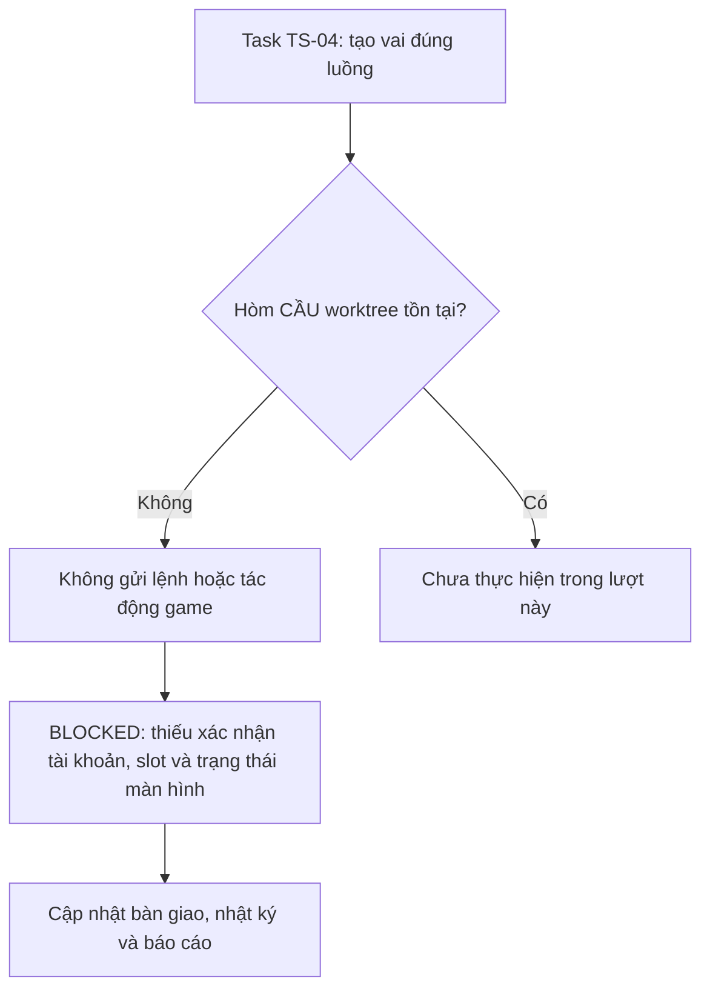

TÓM TẮT 1 [NGUỒN]: BLOCKED — phạm vi kiểm trực tiếp là luồng tạo vai có chọn Tân thủ thôn, tên chữ thường ASCII từ 12 ký tự.
TÓM TẮT 2 [CHƯA KIỂM]: Lượt TS-04 chưa gửi lệnh CẦU, chưa xác nhận tài khoản/ô vai trống và chưa tạo vai nào.
TÓM TẮT 3 [NGUỒN]: Tài liệu hiện có ghi nhận luồng đúng phải chọn Ba Lăng huyện rồi Xác nhận; luật chung server được ghi 6–16 byte.
TÓM TẮT 4 [CHƯA KIỂM]: Độ phủ thao tác lượt này 0/8 bước; không có ID lệnh, ảnh hoặc kết quả để xác minh.
TÓM TẮT 5 [CHƯA KIỂM]: Không chạy VM, EXE, adb hay mạng; chưa có hòm CẦU trong worktree để tiếp tục theo điều kiện task.

# TS-04 — Tester01 lượt 4: tạo vai đúng luồng, có chọn thôn

Loại: kiểm thử
Chủ đề: Tiếp tục kiểm thử tạo nhân vật qua giao diện theo luồng có chọn thôn, với tên chữ thường ASCII dài ít nhất 12 ký tự.
Từ khóa: tạo nhân vật, Tester01, T36-tester01, Ba Lăng huyện, Tân thủ thôn, luật tên, CẦU
Trạng thái: BLOCKED — hòm CẦU trong worktree không tồn tại; không thể xác nhận tài khoản hoặc thao tác giao diện theo giới hạn lượt.
Độ phủ: 0 trên 8 bước thao tác trực tiếp (bước tạo vai trong lượt TS-04).
Liên quan: JX1_OPS/REPORTS/TS-03.md; JX1_OPS/DESIGN/CHUAN-BAO-CAO.md
Cần tôi quyết định: có — cần bố trí hòm CẦU trong worktree và xác nhận ứng dụng đang giữ tài khoản tester01.

## Phạm vi và độ phủ

| Thứ tự theo luồng game | Phần tử | Độ phủ lượt TS-04 | Bằng chứng / giới hạn |
|---|---|---|---|
| 1 | Bắt đầu trò chơi | Chưa phủ | Không có ID lệnh hoặc ảnh; chưa thao tác |
| 2 | Chọn máy chủ | Chưa phủ | Chưa xác nhận màn hình hoặc máy chủ |
| 3 | Đăng nhập bằng tài khoản đã lưu | Chưa phủ | Chưa xác nhận tài khoản tester01; không nhập mật khẩu |
| 4 | Chọn Tạo nhân vật mới | Chưa phủ | Chưa kiểm tra danh sách nhân vật/slot |
| 5 | Chọn Tân thủ thôn: Ba Lăng huyện, rồi Xác nhận | Chưa phủ | Bước bắt buộc được nêu tại JX1_OPS/TASKS/TS-04.md:18; chưa thao tác |
| 6 | Chọn hệ khác nhau cho từng vai nếu còn chỗ, tối đa 3 vai | Chưa phủ | Số slot và hệ hiện có chưa biết; không suy từ hồ sơ cũ |
| 7 | Gõ tên chữ thường ASCII ≥12 ký tự và chụp ảnh xác nhận thứ tự | Chưa phủ | Chưa có ID lệnh/ảnh; chưa nhập tên |
| 8 | Bấm Xác định và xác nhận vai được tạo | Chưa phủ | Chưa gửi yêu cầu; không có kết quả tạo mới |

## Giải mã tên

| Tên gốc | Mã hóa | Chữ đúng | Nguồn |
|---|---|---|---|
| Ba Lăng huyện | UTF-8 | Ba Lăng huyện; chữ Hán chưa đối chiếu trong nguồn task | JX1_OPS/TASKS/TS-04.md:18 |
| Tân thủ thôn | UTF-8 | Tân thủ thôn; chữ Hán chưa đối chiếu trong nguồn task | JX1_OPS/TASKS/TS-04.md:18 |
| T36-tester01 | ASCII (ID) | T36-tester01 | JX1_OPS/STATE/TESTER/PHAN-CONG.md:5 |

## Sắp theo cấu trúc game

Luồng được xếp theo cấu trúc tạo vai: vào trò chơi → chọn máy chủ → đăng nhập → danh sách nhân vật/tạo mới → chọn thôn → chọn hệ → nhập tên → xác định. Việc tạo thêm vai theo từng hệ phải chờ kiểm tra chỗ trống và hệ đã có; lượt này chưa có dữ kiện để sắp hoặc chọn vai cụ thể.

## Mục sổ thông số

| Nhóm | Tên/hằng số | file:dòng | Giá trị | Đơn vị | Ảnh hưởng | Đổi an toàn | Nguồn đo |
|---|---|---|---|---|---|---|---|
| Luật tên | Ngưỡng của task TS-04 | JX1_OPS/TASKS/TS-04.md:18 | ≥12, chữ thường ASCII | ký tự | Điều kiện tên của lượt kiểm | CẨN THẬN — thao tác tạo vai ghi trạng thái bền vững | Yêu cầu task; chưa đo trong lượt này |
| Luật tên | Giao giữa giới hạn client/server ghi trong kiến thức | JX1_OPS/STATE/TESTER/KIEN-THUC/tao-nhan-vat/NUT-GIAO-DIEN.md:30 | 6–16 | byte | Độ dài chung được ghi nhận để tuân thủ phía server | CẨN THẬN — không sửa mã/cấu hình | Ghi nhận đọc mã có sẵn; không kiểm lại mã trong TS-04 |

## Kết quả và lý do chặn

### Đã xác minh
- Task yêu cầu đi qua bước chọn Tân thủ thôn, chọn Ba Lăng huyện và Xác nhận trước khi chọn hệ, gõ tên và bấm Xác định: JX1_OPS/TASKS/TS-04.md:18.
- Bàn giao trước ghi rằng cần xác nhận đúng tài khoản, kiểm nhân vật hiện có và chưa mở màn chọn/tạo vai: JX1_OPS/STATE/TESTER/BAN-GIAO/tao-nhan-vat/README.md:11 và :13.
- Hòm cầu được hướng dẫn đặt dưới worktree để sandbox ghi được; task yêu cầu mỗi bước có ID lệnh và ảnh: JX1_OPS/STATE/TESTER/CAU-NOI.md:3 và JX1_OPS/TASKS/TS-04.md:18.
- Đã kiểm tra tại thời điểm làm việc: không có thư mục D:\JX-wt\TS-04.ldbridge, cũng không có lenh/ và ket-qua/ bên dưới. Không tạo ID lệnh hoặc ảnh mới.

### Chưa xác minh
- Tài khoản đang lưu, trạng thái đăng nhập, máy chủ/màn hình hiện tại và số nhân vật còn có thể tạo.
- Lựa chọn hệ, việc gõ đúng tên chữ thường ASCII ≥12 ký tự, ảnh chụp trước xác nhận và kết quả tạo nhân vật của lượt này.
- Không suy kết quả trực tiếp từ các ghi nhận cũ trong NUT-GIAO-DIEN.md; chúng không chứng minh thao tác TS-04.

## Lỗi, cách thử, kết quả và bước tiếp theo

- Lỗi/blocker: chưa có hòm CẦU trong worktree được giao. Quy trình đọc CAU-NOI yêu cầu hòm trong worktree; phân công cũ trỏ tới một vị trí ngoài worktree, không dùng vị trí đó.
- Cách thử: kiểm tra hiện diện của thư mục hòm worktree cùng hai thư mục lenh/ và ket-qua/.
- Kết quả: không tồn tại; không gửi lệnh screenshot/tap hoặc lệnh game. Không chạy adb, VM, EXE hay mạng.
- Bước tiếp theo: chuẩn bị hòm CẦU dùng được trong worktree, xác nhận ứng dụng đang có tài khoản tester01 đã lưu; sau đó tiếp tục bằng screenshot và tap vô hại theo CAU-NOI trước khi làm luồng TS-04. Không nhập mật khẩu, không xóa nhân vật.
- Không phát sinh thay đổi trong thư mục LOI vì chưa có lỗi game được quan sát.
- Không tạo bảng chỉ mục TSV vì đường dẫn đó nằm ngoài vung_file của TS-04.
- Đề xuất mục lục tri thức: TS-04 | kiểm thử tạo vai có bước chọn thôn, bị chặn trước thao tác vì thiếu hòm CẦU worktree.

## Nhịp công việc

Không ghi được `D:\JX-wt\TS-04.nhip`: quyền truy cập từ phiên làm việc từ chối đường dẫn ngoài worktree. Đã thử một lần ở mốc bắt đầu; không thử lại cùng lỗi.

## Bàn giao

Chưa commit theo yêu cầu. Trạng thái task: BLOCKED. PM cần bảo đảm hòm CẦU trong worktree và xác nhận đúng tài khoản trước khi tiếp tục; không có SHA hoặc bằng chứng push.

Kỹ năng đã dùng: jx1-retrofit, jx1-parameters, jx1-knowledge, jx1-report. jx1-read-server và jx1-read-client không dùng để mở mã nguồn vì phạm vi lượt này là thao tác giao diện, không phải khảo sát mã.

## Phát hiện khi chuẩn hóa — lượt tiếp tục 19/11/2026

- Giữ nguyên kết quả cũ: **BLOCKED, 0/8 bước**, chưa tạo vai. Báo cáo, kiến thức, bàn giao và nhật ký đã có sẵn; không làm lại phần đã có.
- Danh sách nguồn cần đọc từ task: `JX1_OPS/STATE/TESTER/KIEN-THUC/tao-nhan-vat/NUT-GIAO-DIEN.md:29` (luật tên), cùng file `:33` (luồng thành công), sau đó `JX1_OPS/STATE/TESTER/CAU-NOI.md:1`. Đối chiếu thêm chuẩn báo cáo, task, báo cáo/bàn giao hiện có và mục lục theo skill; chỉ trích dòng TS-04 trong nhật ký và dòng phân công hòm CẦU. Không mở mã nguồn hoặc quét thư mục lớn.
- **ĐÃ XÁC MINH — tài liệu:** luồng 8 bước, ngưỡng tên ≥12 chữ thường ASCII tại `JX1_OPS/TASKS/TS-04.md:18`; giới hạn 6–16 byte là nguồn gián tiếp tại `JX1_OPS/STATE/TESTER/KIEN-THUC/tao-nhan-vat/NUT-GIAO-DIEN.md:30`, chưa đối chiếu mã trong lượt này.
- **ĐÃ XÁC MINH — đường dẫn lúc 18:33 +07:00:** `Test-Path -LiteralPath` trả `False` cho `D:\JX-wt\TS-04.ldbridge`, hai đường dẫn con `lenh`, `ket-qua`, cùng `D:\JX-wt\TS-04\.ldbridge`, `D:\JX-wt\TS-04\lenh`, `D:\JX-wt\TS-04\ket-qua`. Chỉ kết luận về các vị trí được kiểm. Cách ghi `<worktree>.ldbridge` tại `JX1_OPS/STATE/TESTER/CAU-NOI.md:3` mô tả đường dẫn nằm cạnh worktree, chưa bảo đảm quyền ghi khi sandbox chỉ cho ghi bên trong worktree. Hòm phân công tại `JX1_OPS/STATE/TESTER/PHAN-CONG.md:5` nằm ngoài worktree; không dùng trong lượt này.
- **CHƯA XÁC MINH — runtime:** không có ID lệnh/ảnh mới; tài khoản, màn hình, slot, hệ và vai mới đều chưa kiểm. Chỉ dẫn hiện tại cấm VM/exe/mạng, nên bước tiếp theo trong báo cáo cũ chỉ áp dụng cho lượt được Tổng quản cho phép thao tác game và có hòm ghi được.
- **Lỗi/cách thử/kết quả:** `rg` không có trong phiên; chuyển sang `Select-String` trên đúng file, không cài công cụ. Ghi nhịp `D:\JX-wt\TS-04.nhip` một lần ở mốc bắt đầu bằng `WriteAllText` thất bại: `UnauthorizedAccessException`, `Access to the path ... is denied.` Không thay quyền, không ghi sang đường dẫn thay thế, không thử lại cùng lỗi. Các mốc hoàn tất đối chiếu/sắp xong báo qua hội thoại, chưa ghi được tệp nhịp.
- Không tạo TSV ngoài `vung_file`; giữ bảng giải mã và kiến thức cũ vì không có dữ kiện game mới. Không build/test game, không chạy VM/exe/adb/mạng. Không stage/commit/push theo yêu cầu; chưa có SHA mới. Tổng quản cần giao lượt cho phép thao tác game và bố trí hòm trong vùng ghi được trước khi tiếp tục.
- Kỹ năng đã nạp từ `.agents/skills`: `jx1-retrofit`, `jx1-read-server`, `jx1-read-client`, `jx1-parameters`, `jx1-knowledge`, `jx1-report`. Hai skill đọc mã chỉ áp dụng ranh giới nguồn, không mở mã vì task không giao nguồn mã.

Liên quan: `JX1_OPS/TASKS/TS-04.md`; `JX1_OPS/DESIGN/CHUAN-BAO-CAO.md`; `JX1_OPS/STATE/TESTER/BAN-GIAO/tao-nhan-vat/README.md`.

- Kiểm tra tài liệu lượt tiếp tục: đọc UTF-8 nghiêm ngặt, kiểm không BOM, đủ 5 dòng TÓM TẮT và các mục bắt buộc; xem diff để bảo đảm chỉ thêm nội dung và giữ kết luận cũ. Đây là kiểm tài liệu, không phải test game. Lỗi ghi bằng `apply_patch` đã phục hồi bằng `AppendAllText` UTF-8 trên đúng file được giao; không đổi quyền. Kiểm diff phát hiện CRLF ở dòng mới; đã chuẩn hóa LF để khắc phục.
