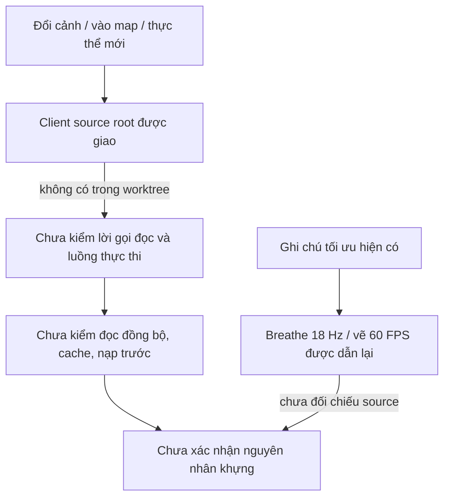

TÓM TẮT 1: [NGUỒN] PARTIAL; TU-01 xác định khảo sát đường nạp spr/map/âm thanh/pak của client khi đổi cảnh, vào map và xuất hiện thực thể mới.
TÓM TẮT 2: [NGUỒN] Hai root source được giao không tồn tại trong worktree; chưa xác minh được lời gọi đọc đồng bộ, bộ đệm hay nạp trước (TU-01.md:19-20).
TÓM TẮT 3: [NGUỒN] Có tám luồng/điểm cần ưu tiên kiểm tra ở bảng phạm vi; chúng là mục khảo sát, không phải bottleneck đã xác nhận.
TÓM TẮT 4: [CHƯA KIỂM] Ghi chú tối ưu nêu Breathe 18 Hz và vẽ 60 FPS, nhưng source gốc không có để đối chiếu; chưa có đo runtime (TOI-UU-TRUYEN-TAI-TOI-NAY.md:37).
TÓM TẮT 5: [CHƯA KIỂM] Không build, chạy exe, VM hay mạng; còn thiếu source tree và không ghi được file nhịp ngoài writable root.

# TU-01 — Khảo sát khựng khi nạp spr/map/âm thanh (client)
Loại: khảo sát
Chủ đề: Định vị đọc tài nguyên đồng bộ, cache/nạp trước và điểm có thể gây khựng trên client.
Từ khóa: nạp đồng bộ, sprite, spr, bản đồ, map, âm thanh, pak, KUpdateLayer, Breathe
Trạng thái: PARTIAL — không có source tree để kiểm chứng luồng đọc.
Độ phủ: 0/8 luồng đọc được xác minh; 8/8 mục tiêu khảo sát đã được liệt kê để tiếp tục khi có source.
Liên quan: JX1_OPS/DESIGN/TOI-UU-TRUYEN-TAI-TOI-NAY.md
Cần tôi quyết định: có — cần cung cấp/khôi phục source đúng root để tiếp tục khảo sát mã.

## Luồng khảo sát

## Phạm vi và độ phủ

Xếp hạng dưới đây là thứ tự ưu tiên cho lần đọc mã/profiling tiếp theo theo tác động tiềm năng. Đây không phải kết luận đã xác nhận hay đề xuất sửa. Các dòng task chỉ chứng minh phạm vi được giao; chúng không chứng minh cách cài đặt trong client.

| Ưu tiên | Luồng/điểm cần kiểm | Tác động tiềm năng / rủi ro nếu sửa khi chưa hiểu đủ | Độ phủ và căn cứ |
|---:|---|---|---|
| 1 | Đọc tài nguyên khi đổi cảnh trên luồng chính/luồng vẽ | Có thể chặn nhiều frame; rủi ro cao nếu chuyển luồng khi chưa biết vòng đời tài nguyên | Chưa phủ; phạm vi đổi cảnh ở TU-01.md:19, khảo sát đồng bộ được yêu cầu tại TOI-UU-TRUYEN-TAI-TOI-NAY.md:15 |
| 2 | Nạp dữ liệu map khi vào bản đồ | Có thể gây dồn I/O/giải nén ở thời điểm chuyển map; rủi ro cao với thứ tự khởi tạo cảnh | Chưa phủ; phạm vi vào map ở TU-01.md:19 |
| 3 | Nạp sprite và frame khi thực thể mới xuất hiện | Có thể gây khựng lúc render entity; rủi ro vừa-cao với cache và giải phóng tài nguyên | Chưa phủ; phạm vi thực thể mới và gợi ý KNpcResVN.cpp ở TU-01.md:19 |
| 4 | Tìm và giải nén entry trong pak | Có thể cộng thêm I/O/CPU cho mọi loại tài nguyên; rủi ro vừa-cao nếu đổi cache/index | Chưa phủ; pak thuộc phạm vi ở TU-01.md:19 |
| 5 | Đọc/giải mã tài nguyên âm thanh khi đổi cảnh | Có thể tranh I/O hoặc CPU với khung hình; rủi ro vừa nếu đổi thời điểm phát âm | Chưa phủ; âm thanh thuộc phạm vi ở TU-01.md:19 |
| 6 | Cache/bộ đệm và tái sử dụng tài nguyên giữa cảnh | Cache miss có thể lặp tải; cache quá lớn có thể tăng RAM; chưa biết có cache hay không | Chưa phủ; task yêu cầu kiểm bộ đệm/nạp trước tại TU-01.md:19 |
| 7 | Nạp trước resource cho map hoặc entity sắp xuất hiện | Có thể dời tải khỏi thời điểm hiển thị; rủi ro vừa do tải thừa, RAM và đồng bộ hủy | Chưa phủ; task yêu cầu kiểm nạp trước tại TU-01.md:19 |
| 8 | Nhịp logic Breathe so với nhịp vẽ | Có thể tạo cảm giác khựng riêng với I/O; rủi ro vừa-cao nếu thay đổi nhịp logic | Chưa phủ ở source; ghi chú thiết kế dẫn Breathe 18 Hz và vẽ 60 FPS, chưa đo/đối chiếu (TOI-UU-TRUYEN-TAI-TOI-NAY.md:37) |

## Giải mã tên

Không có tên kỹ năng, trang bị, quái, NPC hoặc bản đồ nào được trích từ dữ liệu game trong lượt này. `Breathe`, `KUpdateLayer.cpp`, `KNpcResVN.cpp` và `KgameWorld.cpp` là tên symbol/tệp, không phải tên đối tượng game. Tên `Breathe` chỉ xuất hiện trong ghi chú gián tiếp tại `JX1_OPS/DESIGN/TOI-UU-TRUYEN-TAI-TOI-NAY.md:37`; chưa kiểm tra định dạng mã hóa của source gốc.

| Tên gốc | Mã hóa | Chữ đúng | Nguồn |
|---|---|---|---|
| Không phát sinh tên đối tượng game | — | — | Source tree không có; TU-01.md:20 nêu root được giao |

## Sắp theo cấu trúc game

Chưa thể sắp theo bản đồ, loại thực thể hay nhóm tài nguyên vì không đọc được source/dữ liệu game tại các root được giao. Bảng ưu tiên phía trên sắp theo điểm kích hoạt và tác động tiềm năng, không đại diện cho cấu trúc dữ liệu trong game.

## Kết quả khảo sát

Task giao source client tại `Folder/Client2912-.../Client/Classes` và source server tại `SwordOnline/SwordOnline/jxOnline/gameserver/Sources` (TU-01.md:20). Kiểm tra sự tồn tại của hai root trong worktree đều không tìm thấy. Do đó chưa thể xác định file/hàm thật gọi đọc `.spr`, map, âm thanh hoặc pak; chưa thể kết luận các thao tác có đồng bộ trên luồng vẽ hay không; cũng chưa thể xác nhận cache, nạp trước, giải nén hay nguyên nhân khựng.

Ghi chú kế hoạch tối ưu trước đó ghi mục khựng khi nạp spr/map/âm thanh đổi cảnh ở trạng thái “cần khảo sát” (JX1_OPS/DESIGN/TOI-UU-TRUYEN-TAI-TOI-NAY.md:15). Ghi chú cũng dẫn `KgameWorld.cpp:5628-5633` cho nhịp `Breathe` 18 Hz và `AppDelegate.cpp:119` cho vẽ 60 FPS, đồng thời gọi đây là giả thuyết chưa đo bằng quay khung (JX1_OPS/DESIGN/TOI-UU-TRUYEN-TAI-TOI-NAY.md:37). Các dòng source được dẫn lại này chưa được mở hoặc kiểm tra trong worktree hiện tại, nên không dùng làm bằng chứng rằng chúng đang chạy trong bản client nào.

### Mức sổ thông số

| Nhóm | Tên/hằng số | file:dòng | Giá trị | Đơn vị | Ảnh hưởng | Đổi an toàn | Nguồn đo |
|---|---|---|---|---|---|---|---|
| Nhịp client | `Breathe` / nhịp vẽ | `JX1_OPS/DESIGN/TOI-UU-TRUYEN-TAI-TOI-NAY.md:37` (dẫn `KgameWorld.cpp:5628-5633`, `AppDelegate.cpp:119`) | 18 / 60 | Hz logic / FPS vẽ | Có thể ảnh hưởng cảm nhận chuyển động; tách biệt với việc đọc tài nguyên | CẨN THẬN; chưa xác minh source hay đo runtime | Ghi chú thiết kế; chưa đo trong task này |

### Đề xuất tối ưu và bước tiếp theo

1. Khôi phục hoặc gắn đúng hai source root ở chế độ chỉ đọc; sau đó chỉ tìm các file/symbol mục tiêu nêu trong TU-01.md:19-20.
2. Lần theo caller từ đổi cảnh, vào map và tạo entity đến API đọc file/pak; ghi riêng thao tác đồng bộ, giải nén, cache hit/miss và nơi gọi.
3. Chỉ khi có môi trường đo được duyệt, so sánh thời gian frame và thời gian I/O/giải nén tại ba tình huống trên; không suy ra hiệu năng runtime từ source.

## Đã xác minh

- Task xác định đúng ba trigger (đổi cảnh, vào map, thực thể mới xuất hiện), bốn loại tài nguyên (spr/map/âm thanh/pak), và yêu cầu kiểm đồng bộ/bộ đệm/nạp trước (JX1_OPS/TASKS/TU-01.md:19).
- Task cung cấp hai root source được yêu cầu đọc (JX1_OPS/TASKS/TU-01.md:20); cả hai đường dẫn tương ứng không hiện diện trong worktree tại lúc khảo sát.
- Ghi chú kế hoạch đang để mục tải tài nguyên ở trạng thái cần khảo sát và ghi nhận giả thuyết riêng về nhịp logic/vẽ (JX1_OPS/DESIGN/TOI-UU-TRUYEN-TAI-TOI-NAY.md:15, 37).

## Chưa xác minh

- File/hàm thật thực hiện đọc `.spr`, map, audio và pak; call chain; thread affinity; đồng bộ I/O; giải nén; cache; preload; giải phóng tài nguyên.
- Tác động thực tế lên frame time, RAM, tiếng động, đổi cảnh và thời điểm entity xuất hiện; chưa có runtime trace/profile.
- Server source không có trong root được giao; task này tập trung vào client nên chưa khảo sát server.
- Không chạy build, test, exe, VM hoặc mạng theo phạm vi chỉ đọc.
- Không ghi được `D:\JX-wt\TU-01.nhip`: đích nằm ngoài writable root `D:\JX-wt\TU-01`, lệnh ghi bị từ chối; không thử vượt quyền.

## Bàn giao

- Commit: không yêu cầu; chưa commit.
- Bước cần PM: cung cấp source đúng hai root hoặc chỉ định commit/root có sẵn, rồi tiếp tục đối chiếu tám mục ưu tiên trên. Chưa tạo chỉ mục TSV vì `vung_file` của TU-01 chỉ cho phép báo cáo này.
- Kỹ năng đã dùng: `jx1-retrofit` (quy chuẩn cấu trúc), `jx1-read-server`, `jx1-read-client`, `jx1-parameters`, `jx1-knowledge`, `jx1-report`.
- Liên quan: `JX1_OPS/DESIGN/TOI-UU-TRUYEN-TAI-TOI-NAY.md`.
