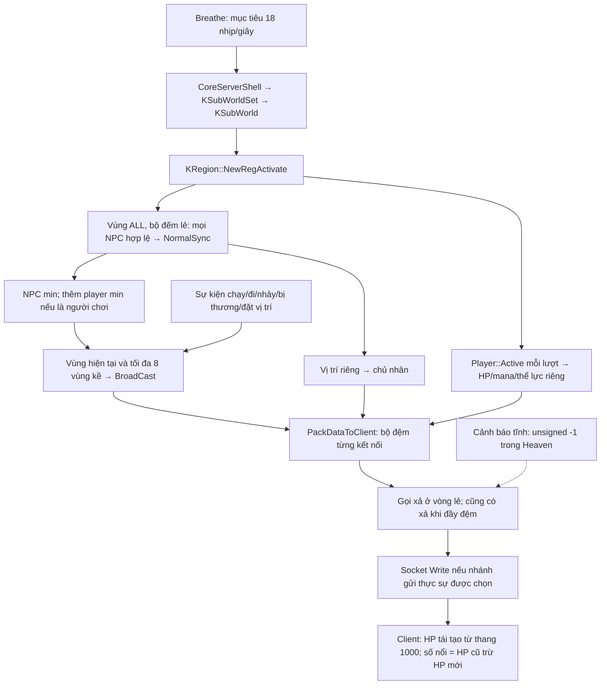

TÓM TẮT 1: [NGUỒN] DONE — hoàn tất khảo sát tĩnh 14 loại gói liên quan, 8 nhóm mục tiêu và 12 điểm ưu tiên; một điểm tạo `s2c_syncnpcmin` trong `NormalSync`, gọi từ bộ đếm vùng (`S/Core/Src/KNpc.cpp:7902`, `S/Core/Src/KRegion.cpp:1118`).
TÓM TẮT 2: [NGUỒN] Nhịp logic mục tiêu 18 Hz; đồng bộ NPC phụ thuộc bộ đếm vùng, còn HP của chính người chơi được tạo mỗi lần `Active` (`S/MultiServer/GameServer/KSOServer.cpp:90`, `S/Core/Src/KPlayer.cpp:341`).
TÓM TẮT 3: [NGUỒN] Số sát thương nổi lấy từ chênh HP trên client; khối gửi `s2c_bloodsync` đang là chú thích (`C/gamecore/KProtocolProcess.cpp:2544`, `S/Core/Src/KNpc.cpp:14263`).
TÓM TẮT 4: [NGUỒN] Có lỗi logic tĩnh ở nhánh `Heaven`: đối số unsigned `-1` bị lọc như ID cụ thể; ảnh hưởng trên exe/DLL đang chạy chưa kiểm, vì thế không đồng nhất lịch gọi xả 9 Hz với số lần gửi thật (`S/MultiServer/Heaven/Interface/iServer.h:116`, `S/MultiServer/Heaven/ServerStage.cpp:443`).
TÓM TẮT 5: [CHƯA KIỂM] Không chạy build, exe, VM hay mạng; không commit/push theo yêu cầu, Tổng quan nhận tài liệu để commit; tệp nhịp ngoài vùng ghi sandbox.

# TU-02 — Tần suất đồng bộ vị trí, HP và số sát thương

Loại: khảo sát
Chủ đề: Lần đường gửi gói và tần suất theo nhịp trong source server, đối chiếu cách client nhận để xác định chỗ có thể gửi thừa.
Từ khóa: đồng bộ vị trí, HP, số sát thương, s2c_syncnpcmin, NormalSync, KRegion, SendPackToClient, bộ đệm, vùng thấy
Trạng thái: DONE — hoàn tất phạm vi khảo sát tài liệu; không xác nhận runtime hoặc hiệu quả tối ưu.
Độ phủ: 8/8 nhóm mục tiêu; 14/14 loại gói trong bảng phạm vi (12 có mã gửi, 2 khối gửi bị chú thích); 12 điểm ưu tiên. Không tuyên bố kiểm kê toàn bộ giao thức game.
Liên quan: `JX1_OPS/TASKS/TU-02.md`; `JX1_OPS/DESIGN/TOI-UU-TRUYEN-TAI-TOI-NAY.md`; `JX1_OPS/DESIGN/CHUAN-BAO-CAO.md`; `JX1_OPS/CONTEXT-PACK/GS001-MAP.md`.
Cần tôi quyết định: không — chỉ khảo sát tài liệu; mọi thử nghiệm sửa/chạy cần task riêng.



ĐÃ XÁC MINH từ mã: chuỗi gọi tại `S/MultiServer/GameServer/KSOServer.cpp:4373`, `S/Core/Src/CoreServerShell.cpp:2250`, `S/Core/Src/KSubWorldSet.cpp:603`, `S/Core/Src/KSubWorld.cpp:305`, `S/Core/Src/KRegion.cpp:1118`, `S/Core/Src/KRegion.cpp:1191`. Sơ đồ không xác nhận gói đã đến client.

## 1. Phạm vi và độ phủ

### Root, phiên bản và danh sách tệp đọc

- `S` = `C:\Jx1CocoV3\SwordOnline\SwordOnline\jxOnline\gameserver\Sources`.
- `C` = `C:\Jx1CocoV3\Folder\Client2912-20260116T044348Z-3-001\Client2912\Client\Classes`.
- Các dẫn chứng dạng `S/...:dòng` và `C/...:dòng` được ghép với hai root trên. Đây là source hiện có trên đĩa ngày 19/11/2026, không có commit source được ghim trong task; chưa chứng minh trùng exe/DLL/APK đang chạy.
- Bản đồ GS001 chỉ định vị; số dòng dưới đây lấy từ file thật. Không có `graphify-out/GRAPH_REPORT.md` ngay trong hai root task; dùng tìm symbol có giới hạn, không tạo lại graph.
- Báo cáo UTF-8 không BOM. Tên hàm/trường ASCII được giữ nguyên; không dùng phần chú thích Hán bị giải mã lỗi làm bằng chứng nghiệp vụ.

Danh sách được lập từ nguồn task và mở rộng theo symbol/include/caller cần thiết, không liệt kê đệ quy toàn bộ `Folder` hay `SwordOnline`:

| Nhóm nguồn | Tệp đọc có giới hạn | Lý do / điểm kiểm chính |
|---|---|---|
| Chỉ dẫn | `JX1_OPS/TASKS/TU-02.md`; `JX1_OPS/DESIGN/CHUAN-BAO-CAO.md`; sáu `SKILL.md` được yêu cầu | Phạm vi, chuẩn báo cáo và rào chắn. |
| Bối cảnh | `JX1_OPS/DESIGN/TOI-UU-TRUYEN-TAI-TOI-NAY.md`; phần liên quan trong `JX1_OPS/CONTEXT-PACK/GS001-MAP.md`, `JX1_OPS/DESIGN/MUC-LUC-TRI-THUC.md` | Định vị, giữ nguyên kết luận cũ; không mở hàng loạt báo cáo khác. |
| Server: chuỗi nhịp | `S/MultiServer/GameServer/KSOServer.cpp`; `S/Core/Src/CoreServerShell.cpp`, `KSubWorldSet.cpp`, `KSubWorld.cpp` | Hằng 18, gọi core, gọi từng vùng; `KSOServer.cpp:90`, `KSubWorld.cpp:305`. |
| Server: tạo gói / người nhận | `S/Core/Src/KNpc.cpp`, `KNpc.h`, `KRegion.cpp`, `KRegion.h`, `KPlayer.cpp`, `KNpcSet.cpp`, `KProtocolProcess.cpp` | Chu kỳ, HP riêng, các sự kiện và yêu cầu dữ liệu ban đầu; `KPlayer.cpp:341`, `KRegion.cpp:2251`. |
| Server: ghép và xả | `S/MultiServer/Heaven/ServerStage.cpp`; `S/MultiServer/Heaven/Interface/iServer.h` | Bộ đệm và hợp đồng `-1`; `ServerStage.cpp:399`, `iServer.h:112`. |
| Client: diễn giải | `C/gamecore/KProtocolProcess.cpp`, `KProtocol.h`, `KNpc.cpp`, `KRegion.h`; `C/gamescene/KgameWorld.cpp` | HP, số nổi, vùng nhận, thời hạn đồng bộ và nhịp logic. |
| Tìm symbol phụ | Chỉ tìm include/hằng trong `S/Core/Src/KCore.h`, `C/gamecore/KCore.h`, `KNpc.h`; tìm đúng symbol trên các `*.cpp` trực tiếp trong `S/Core/Src` | Tìm caller của `NormalSync`, `SendBloodNo` và giao thức; kết quả `_backup` không dùng làm bằng chứng đường đang dựng. |

| Nhóm mục tiêu | Độ phủ | Bằng chứng chính |
|---|---|---|
| Nhịp logic và gọi vùng | Đã phủ | `S/MultiServer/GameServer/KSOServer.cpp:1442`; `S/Core/Src/KSubWorld.cpp:302`. |
| Tạo `s2c_syncnpcmin` | Đã phủ | `S/Core/Src/KRegion.cpp:1117`; `S/Core/Src/KNpc.cpp:7902`. |
| Vị trí và dữ liệu riêng người chơi | Đã phủ | `S/Core/Src/KNpc.cpp:8247`; `C/gamecore/KProtocolProcess.cpp:2637`. |
| HP riêng và HP người quan sát | Đã phủ | `S/Core/Src/KPlayer.cpp:1152`; `S/Core/Src/KNpc.cpp:7921`. |
| Các gói vị trí theo sự kiện | Đã phủ trong bảng dưới | `S/Core/Src/KNpc.cpp:4204`, `S/Core/Src/KNpc.cpp:14890`. |
| Số sát thương và gói bị thương | Đã phủ | `S/Core/Src/KNpc.cpp:3028`, `S/Core/Src/KNpc.cpp:14263`; `C/gamecore/KProtocolProcess.cpp:2544`. |
| Vùng thấy, số người nhận, đệm/xả | Đã phủ | `S/Core/Src/KRegion.cpp:2223`; `S/MultiServer/Heaven/ServerStage.cpp:375`. |
| Trùng/thừa và thứ tự tối ưu ≥8 điểm | Đã phủ: 12 điểm | Mục 8; dẫn chứng riêng từng hàng. |
| Gói/giây, byte/giây và độ trễ thực tế | Chưa phủ, không thuộc quyền chạy task | Chưa kiểm exe/DLL/APK và chưa đo runtime; không dùng số đọc tĩnh làm số đo. |

## 2. Giải mã tên

| Tên gốc | Mã hóa | Chữ đúng UTF-8 | Nguồn file:dòng |
|---|---|---|---|
| Không có tên riêng kỹ năng, trang bị, quái cụ thể, NPC định danh hay bản đồ riêng được khảo sát | Không áp dụng GBK/TCVN3; báo cáo UTF-8 | NPC, người chơi và vùng là loại đối tượng; giữ nguyên ID giao thức ASCII | `JX1_OPS/TASKS/TU-02.md:19`; `S/Core/Src/KNpc.cpp:7902`. |

Không suy tên Hán/Việt từ phần chú thích lỗi mã hóa. Trường `nName` được nhắc như một trường dữ liệu, không chép tên nhân vật (`S/Core/Src/KNpc.cpp:7953`).

## 3. Sắp theo cấu trúc game

Thứ tự trình bày: chính người chơi → thực thể quanh người chơi → hành động di chuyển/chiến đấu → dữ liệu khi xuất hiện → số sát thương → vùng thấy và vận chuyển. Đây là luồng game; không xếp dữ liệu theo thứ tự file. Nguồn phân biệt chủ nhân/người quan sát: `S/Core/Src/KNpc.cpp:8057`, `S/Core/Src/KNpc.cpp:8258`, `C/gamecore/KProtocolProcess.cpp:2521`.

## 4. Bảng 14 loại gói và số đường tạo

ĐÃ XÁC MINH trong các hàm được liệt kê: **12 loại có khối gửi, 2 loại có khối gửi bị chú thích**. “Một điểm tạo” là điểm gán protocol ở đường đã đọc, không phải một gói TCP hoặc một lần nhận thành công. Tần suất sự kiện chưa có số đo; ký hiệu `e_x(t)` là số lần thực sự đi tới điểm gửi loại `x` trong nhịp `t`.

| # | Đối tượng / giao thức | Điểm tạo và người nhận | Số lượng theo một nhịp / tần suất |
|---|---|---|---|
| 1 | HP của chủ nhân — `s2c_synccurplayernormal` | Một điểm tạo tại `KPlayer::SendCurNormalSyncData`, gọi từ `Active`, gửi riêng chủ nhân | Một lần mỗi lượt `Active` qua được điều kiện kết nối/đổi server; mục tiêu 18 lần/giây khi có một lượt mỗi nhịp. `S/Core/Src/KPlayer.cpp:261`, `S/Core/Src/KPlayer.cpp:341`, `S/Core/Src/KPlayer.cpp:1151`, `S/Core/Src/KPlayer.cpp:1172`. |
| 2 | Vị trí riêng — `s2c_syncnpcminplayer` | Một điểm tạo trong nhánh người chơi của `NormalSync`, gửi riêng chủ nhân | Một lần cho mỗi `NormalSync` hợp lệ của người chơi, không tự chạy 18 Hz. `S/Core/Src/KNpc.cpp:8248`, `S/Core/Src/KNpc.cpp:8258`. |
| 3 | Thực thể quanh mình — `s2c_syncnpcmin` | Một điểm tạo `NPC_NORMAL_SYNC` trong `NormalSync`; một caller định kỳ ở `NewRegActivate` | Bộ đếm lẻ gọi toàn bộ NPC trong vùng ALL, có điều kiện loại chết/hồi sinh/vùng sai/HP tối đa bằng 0; `f(N)=18N/(2N+1)` với giả định ở mục 5. `S/Core/Src/KRegion.cpp:1117`, `S/Core/Src/KNpc.cpp:7889`, `S/Core/Src/KNpc.cpp:7902`, `S/Core/Src/KNpc.cpp:7908`. |
| 4 | Người chơi quanh mình — `s2c_syncplayermin` | Một điểm tạo `PLAYER_NORMAL_SYNC`, thêm vào cùng lần `NormalSync` của một người chơi | Một bản phát theo vùng cho mỗi lần đồng bộ hợp lệ; đi cùng gói #3, có nội dung khác. `S/Core/Src/KNpc.cpp:8057`, `S/Core/Src/KNpc.cpp:8060`, `S/Core/Src/KNpc.cpp:8236`. |
| 5 | Chạy — `s2c_npcrun` | Một điểm tạo trong `RunTo`, phát vùng hiện tại + vùng kề | `e_run(t)` lần; không có chặn “đích không đổi” trước đoạn gửi đã đọc. `S/Core/Src/KNpc.cpp:4194`, `S/Core/Src/KNpc.cpp:4204`, `S/Core/Src/KNpc.cpp:4222`. |
| 6 | Đi bộ — `s2c_npcwalk` | Một điểm tạo hoạt động trong `Goto`; bản thứ hai trong `DoWalk` bị chú thích | `e_walk(t)` lần trong `Goto`, không cộng khối chú thích thành lần gửi thứ hai. `S/Core/Src/KNpc.cpp:4245`, `S/Core/Src/KNpc.cpp:4254`, `S/Core/Src/KNpc.cpp:4310`, `S/Core/Src/KNpc.cpp:4341`. |
| 7 | Nhảy — `s2c_npcjump` | Một điểm tạo trong `DoJump`, phát theo vùng | Một gói logic mỗi lần qua điều kiện bắt đầu nhảy; đang nhảy thì trả về trước điểm gửi. `S/Core/Src/KNpc.cpp:6787`, `S/Core/Src/KNpc.cpp:6796`, `S/Core/Src/KNpc.cpp:6813`. |
| 8 | Phản ứng bị thương — `s2c_npchurt` | Một điểm tạo trong `DoHurt`; mang ID, số frame và vị trí | `e_hurt(t)` lần qua các điều kiện của hàm; đây không phải gói chứa con số sát thương. `S/Core/Src/KNpc.cpp:2965`, `S/Core/Src/KNpc.cpp:3028`, `S/Core/Src/KNpc.cpp:3031`, `S/Core/Src/KNpc.cpp:3048`; client dùng `ProcNetCommand(do_hurt)` tại `C/gamecore/KProtocolProcess.cpp:617`. |
| 9 | Đặt vị trí — `s2c_npcsetpos` | Một điểm tạo trong nhánh người chơi của `SetPos`, phát qua `SendDataToNearRegion` | Theo sự kiện thay vị trí, bỏ qua nếu tọa độ không đổi; còn có gói remove cho vùng cũ. `S/Core/Src/KNpc.cpp:14826`, `S/Core/Src/KNpc.cpp:14833`, `S/Core/Src/KNpc.cpp:14854`, `S/Core/Src/KNpc.cpp:14890`, `S/Core/Src/KNpc.cpp:14900`. |
| 10 | Di chuyển đặc biệt — `s2c_npcsecmove` | Một điểm tạo trong `DoSecMove`, phát vùng hiện tại + vùng kề | Theo lần xử lý di chuyển qua điểm gửi, không có nhịp độc lập được chứng minh. `S/Core/Src/KNpc.cpp:16188`, `S/Core/Src/KNpc.cpp:16279`, `S/Core/Src/KNpc.cpp:16296`. |
| 11 | Dữ liệu xuất hiện đầy đủ — `s2c_syncnpc` | Một điểm tạo trong `SendSyncData`; nhánh yêu cầu client → `NpcRequestCommand` → `KNpcSet::SyncNpc` | Một phản hồi khi tìm được NPC; mặc định `bBroadCast=false`, các caller khác có thể yêu cầu phát vùng. Không cộng vào nhịp định kỳ #3. `S/Core/Src/KProtocolProcess.cpp:5424`, `S/Core/Src/KNpcSet.cpp:1288`, `S/Core/Src/KNpc.h:1178`, `S/Core/Src/KNpc.cpp:7668`, `S/Core/Src/KNpc.cpp:7712`. |
| 12 | Dữ liệu người chơi đầy đủ — `s2c_syncplayer` | Một điểm tạo thêm trong `SendSyncData` nếu `IsPlayer()` | Đi kèm #11 cho người chơi; phát vùng hoặc trả riêng theo cùng cờ. `S/Core/Src/KNpc.cpp:7730`, `S/Core/Src/KNpc.cpp:7733`, `S/Core/Src/KNpc.cpp:7816`, `S/Core/Src/KNpc.cpp:7822`. |
| 13 | Số sát thương tách riêng — `s2c_bloodsync` | Khối `BLOOD_SYNC` trong `SendBloodNo` nằm trọn trong `/* ... */` | **0 gói từ khối này**, dù vẫn có caller của hàm; không suy toàn bộ binary không có loại gói này. `S/Core/Src/KNpc.cpp:1437`, `S/Core/Src/KNpc.cpp:14255`, `S/Core/Src/KNpc.cpp:14263`, `S/Core/Src/KNpc.cpp:14269`. |
| 14 | Đứng yên — `s2c_npcstand` | Khối gửi trong `DoStand` bị chú thích | **0 gói từ khối này**; không coi là đường gửi trùng đang hoạt động. `S/Core/Src/KNpc.cpp:3305`, `S/Core/Src/KNpc.cpp:3307`, `S/Core/Src/KNpc.cpp:3334`. |

## 5. Nhịp tạo gói, số lời gọi đóng gói và lịch xả

### 5.1. Chu kỳ theo vùng

ĐÃ XÁC MINH: `GAME_FPS=18`; lịch mục tiêu gọi `MainLoop` theo thời gian, không phải phép đo server đạt 18 Hz. Mỗi lần core chạy, vòng hoạt động gọi từng vùng trong `m_cActRegionIdx`. NPC chỉ đồng bộ/hoạt động khi `IsActiveAll()`; hàm này kiểm `emACT_TYPE_ALL` (`S/MultiServer/GameServer/KSOServer.cpp:90`, `S/MultiServer/GameServer/KSOServer.cpp:1442`, `S/Core/Src/KSubWorld.cpp:302`, `S/Core/Src/KRegion.cpp:1106`, `S/Core/Src/KRegion.h:287`).

ĐÃ XÁC MINH: nhánh lẻ không so với chỉ số từng NPC; nó gọi `NormalSync` cho mọi nút NPC hợp lệ rồi mới `Activate`. Bộ đếm tăng sau vòng lặp và chỉ đặt lại khi **lớn hơn** `2 × số nút`. Các dòng từng chia lượt theo `nCounter` đang là chú thích (`S/Core/Src/KRegion.cpp:1115`, `S/Core/Src/KRegion.cpp:1117`, `S/Core/Src/KRegion.cpp:1120`, `S/Core/Src/KRegion.cpp:1125`). Thay đổi HP/vị trí do `Activate` của lượt đó xảy ra sau ảnh chụp định kỳ trong cùng vùng.

SUY RA TỪ NGUỒN: giả sử `N≥1` là số nút cố định của `m_NpcList`, vùng luôn ALL và được gọi đúng một lần mỗi nhịp, bộ đếm đi `0,1,...,2N,0`. Có `N` lượt lẻ trên `2N+1` lượt, nên mỗi NPC đủ điều kiện tạo gói ở tần suất `f(N)=F×N/(2N+1)`, với `F` là số lượt vùng/giây; bảng dùng **F mục tiêu =18**, không phải số đo (`S/Core/Src/KRegion.cpp:1117`, `S/Core/Src/KRegion.cpp:1126`).

| N nút cố định | Số nhịp / chu kỳ | Lượt đồng bộ / chu kỳ | Lần tạo/giây nếu F=18 |
|---|---|---|---|
| 1 | 3 | 1 | 6 |
| 2 | 5 | 2 | 7,2 |
| 10 | 21 | 10 | 8,5714 |
| 100 | 201 | 100 | 8,9552 |

SUY RA TỪ NGUỒN: khoảng cách giữa các lượt gửi là 2 nhịp và một khoảng 3 nhịp khi vòng đếm quay về 0; riêng `N=1` luôn cách 3 nhịp. Nếu F=18, tương ứng khoảng 111,11 ms và 166,67 ms. NPC vào/ra làm N đổi, vùng ngừng ALL làm bộ đếm dừng; khi đó không áp bảng chu kỳ cố định (`S/Core/Src/KRegion.cpp:1106`, `S/Core/Src/KRegion.cpp:1125`).

### 5.2. Đếm công việc theo một nhịp

SUY RA TỪ NGUỒN: gọi `E` là số NPC đủ điều kiện gửi, `P≤E` là số người chơi trong số đó, `H` là số `Player::Active` đi tới đoạn gửi HP của vùng trong nhịp. Tại lượt lẻ, có `E` gói NPC theo vùng, `P` gói player theo vùng, `P` gói vị trí riêng và `H` gói HP riêng; lượt không đồng bộ vẫn có `H` gói HP riêng. Đây là số thông điệp logic trước khi nhân người nhận, chưa gồm sự kiện/yêu cầu đầy đủ (`S/Core/Src/KNpc.cpp:8044`, `S/Core/Src/KNpc.cpp:8236`, `S/Core/Src/KNpc.cpp:8258`, `S/Core/Src/KPlayer.cpp:1172`).

Nếu mỗi bản phát thực hiện `R` lời gọi đóng gói tới người nhận hợp lệ, số **lời gọi `PackDataToClient` dự kiến** của nhóm định kỳ là `R×(E+P)+P+H` ở lượt lẻ, `H` ở lượt còn lại. Thực tế mỗi gói có thể có `R` khác nhau; phải cộng từng danh sách nhận. Thêm các lượng sự kiện `Σ e_x(t)×R_x(t)` và các phản hồi yêu cầu. Không dùng công thức này làm số TCP packet, số byte thực truyền hay số gói đến thành công (`S/Core/Src/KRegion.cpp:2272`, `S/Core/Src/KNpc.cpp:8258`, `S/MultiServer/Heaven/ServerStage.cpp:413`).

Với `B_n`, `B_p`, `B_s`, `B_h` là các kích thước `sizeof` tương ứng và cùng R ổn định, lượng payload được đưa vào đệm/giây theo mô hình là `f(N)×[R×(E×B_n+P×B_p)+P×B_s] + F×H×B_h`. Chưa kiểm ABI/kích thước byte của bản dựng server; không gán số byte giả định và chưa cộng phần bao gói vận chuyển (`S/Core/Src/KNpc.cpp:8044`, `S/Core/Src/KNpc.cpp:8236`, `S/Core/Src/KNpc.cpp:8258`, `S/Core/Src/KPlayer.cpp:1172`).

### 5.3. Xả bộ đệm: lịch gọi và phát hiện unsigned

ĐÃ XÁC MINH: sau core, `MainLoop` chỉ gọi `SendPackToClient(-1)` khi `m_nGameLoop & 1`, rồi tăng bộ đếm ở cuối. Đó là **lịch gọi mục tiêu F/2 =9 lần/giây**, không phải 9 lần `Write` đã được chứng minh (`S/MultiServer/GameServer/KSOServer.cpp:4373`, `S/MultiServer/GameServer/KSOServer.cpp:4378`, `S/MultiServer/GameServer/KSOServer.cpp:4438`).

ĐÃ XÁC MINH: `PackDataToClient` ghép payload vào bộ đệm từng kết nối. Nếu lượng cũ hoặc lượng sau khi cộng chạm ngưỡng, nó gọi `_SendDataEx` cho dữ liệu cũ, xóa đệm rồi thêm gói mới. Xả theo lịch chỉ ghi socket khi đệm có dữ liệu; một lần ghi có thể chứa nhiều thông điệp logic. `PreparePackSink` trong `ServerStage.cpp` chỉ trả `S_OK` (`S/MultiServer/Heaven/ServerStage.cpp:370`, `S/MultiServer/Heaven/ServerStage.cpp:399`, `S/MultiServer/Heaven/ServerStage.cpp:408`, `S/MultiServer/Heaven/ServerStage.cpp:413`, `S/MultiServer/Heaven/ServerStage.cpp:473`, `S/MultiServer/Heaven/ServerStage.cpp:497`).

**ĐÃ XÁC MINH TĨNH — điểm phải đối chiếu trước mọi thử đổi nhịp:** hợp đồng ghi `-1` là gửi tất cả, nhưng kiểu đối số là `const unsigned long&`. Triển khai kiểm `ulnClientID>=0`, rồi bỏ qua nếu `index!=ulnClientID`. Với `-1` chuyển sang giá trị unsigned lớn nhất, điều kiện `>=0` luôn đúng; các ID kết nối hợp lệ khác giá trị đó đều bị bỏ qua. Như vậy lời gọi `-1` không đi tới `Write` trong triển khai này với các ID thông thường. Đây là lỗi logic của đoạn source, **chưa kiểm nó có nằm trong DLL/exe chạy thật** (`S/MultiServer/Heaven/Interface/iServer.h:112`, `S/MultiServer/Heaven/Interface/iServer.h:116`, `S/MultiServer/Heaven/ServerStage.cpp:429`, `S/MultiServer/Heaven/ServerStage.cpp:443`, `S/MultiServer/Heaven/ServerStage.cpp:445`).

ĐÃ XÁC MINH: nhánh không `_STANDALONE` tạo server qua factory của `heaven.dll`; nhánh `_STANDALONE` tạo `IServer` trực tiếp. Chưa kiểm nhánh build, DLL hay bản thực thi đang dùng. GIẢ THUYẾT: nếu đúng triển khai lỗi ở trên được dùng, gửi khi đầy đệm có thể che một phần vấn đề, khiến lưu lượng ít chờ lâu; cần đo riêng số lần gọi xả, số lần `Write` và tuổi gói trong đệm (`S/MultiServer/GameServer/KSOServer.cpp:77`, `S/MultiServer/GameServer/KSOServer.cpp:823`, `S/MultiServer/GameServer/KSOServer.cpp:832`, `S/MultiServer/GameServer/KSOServer.cpp:841`, `S/MultiServer/Heaven/ServerStage.cpp:408`).

SUY RA CÓ ĐIỀU KIỆN: nếu cơ chế xả tất cả hoạt động đúng, gói tạo ở cuối lượt logic có thể thêm 0 hoặc 1 nhịp chờ do pha chẵn/lẻ; trường hợp phân bố đều giữa hai pha cho trung bình 27,78 ms tại 18 Hz. Gói đến ở thời điểm tùy ý giữa hai lần xả không có cùng giả định đó. Không dùng con số này làm độ trễ runtime hay giới hạn trễ mạng, nhất là khi chưa giải quyết khác biệt triển khai nói trên (`S/MultiServer/GameServer/KSOServer.cpp:4378`).

## 6. Vùng thấy KRegion và tải nhân theo người nhận

ĐÃ XÁC MINH: mỗi `NormalSync` phát vùng hiện tại và tối đa 8 vùng kề. `nMaxCount` khởi tạo bằng `MAX_PLAYER` cho gói NPC và được khởi tạo lại cho gói player; không dùng giới hạn 100 ở hai bản phát này. Chưa đối chiếu giá trị số của `MAX_PLAYER` trong header bản dựng (`S/Core/Src/KNpc.cpp:8031`, `S/Core/Src/KNpc.cpp:8043`, `S/Core/Src/KNpc.cpp:8052`, `S/Core/Src/KNpc.cpp:8235`, `S/Core/Src/KNpc.cpp:8244`).

ĐÃ XÁC MINH: `BroadCast` duyệt danh sách người chơi, kiểm ID/kết nối và `m_bSleepMode==FALSE`; điều kiện khoảng cách sử dụng `MAX_SYNC_RANGE=32` đang bị chú thích. Bộ đếm ngân sách dùng chung qua các vùng, giảm ở mỗi nút đã duyệt, kể cả nút không thực hiện gửi. Vì vậy ngân sách không đồng nghĩa số người thực nhận; giảm nó tùy tiện có thể ưu tiên vùng đầu và bỏ vùng kề phía sau (`S/Core/Src/KRegion.cpp:2229`, `S/Core/Src/KRegion.cpp:2252`, `S/Core/Src/KRegion.cpp:2266`, `S/Core/Src/KRegion.cpp:2272`, `S/Core/Src/KRegion.cpp:2277`).

ĐÃ XÁC MINH: các gói hành động và helper `SendDataToNearRegion` thường bắt đầu với `MAX_BROADCAST_COUNT=100`, dùng chung qua chín vùng. Chín lời gọi theo vùng không tự chứng minh một người nhận chín bản: cần biết thành viên mỗi vùng và tính duy nhất của các vùng kề; task chưa kiểm dữ liệu runtime này (`S/Core/Src/KRegion.h:15`, `S/Core/Src/KNpc.cpp:4221`, `S/Core/Src/KNpc.cpp:14123`, `S/Core/Src/KNpc.cpp:14130`).

ĐÃ XÁC MINH: client còn loại `s2c_syncnpcmin` nếu chênh theo X hoặc Y vượt `CORRECT_SYNC_RANGE=30` theo tọa độ ô bản đồ; đây là lọc sau khi đã nhận và không tiết kiệm đường truyền từ server. Chưa chứng minh dùng lại trực tiếp ngưỡng này cho server là an toàn với đích xa, kỹ năng hay chuyển vùng (`C/gamecore/KRegion.h:24`, `C/gamecore/KProtocolProcess.cpp:2433`, `C/gamecore/KProtocolProcess.cpp:2437`).

SUY RA TỪ NGUỒN: trong mô hình danh sách cố định, tăng cả thực thể gửi và người quan sát làm số lần đóng gói tăng theo tích hai số đó, tới giới hạn ngân sách. Lọc người nhận/giảm dữ liệu không đổi có tiềm năng giảm số byte, còn chỉ tăng nhịp logic làm cả tải tạo gói lẫn mô phỏng tăng; chưa có số đo lợi ích (`S/Core/Src/KRegion.cpp:1113`, `S/Core/Src/KNpc.cpp:8044`, `S/Core/Src/KRegion.cpp:2252`).

## 7. HP, số sát thương và các chỗ dữ liệu chồng nhau

ĐÃ XÁC MINH: HP của thực thể được quan sát nằm trong `s2c_syncnpcmin`: trường tên `nLifeDamagePerCent` thực tế được gán `_CalcPercent(CurrentLife, CurrentLifeMax, 1000)`, không phải lượng sát thương của một đòn. Client lấy `CurrentLifeMax×trường/1000` để tái tạo HP (`S/Core/Src/KNpc.cpp:7906`, `S/Core/Src/KNpc.cpp:7921`, `C/gamecore/KProtocolProcess.cpp:2522`, `C/gamecore/KProtocolProcess.cpp:2531`). Quy tắc làm tròn của `_CalcPercent` chưa kiểm.

ĐÃ XÁC MINH: với `kind_normal` hoặc `kind_partner`, client chỉ gọi `SetBlood` khi HP cũ trừ HP mới dương; hàm `SetBlood` hoạt động có tại `C/gamecore/KNpc.cpp:10320`. SUY RA: nhiều đòn giữa hai ảnh chụp có thể gộp thành một số mất máu ròng; hồi HP xen giữa cũng tác động chênh lệch. Giảm nhịp gói này có thể đổi cảm nhận số nổi và độ mới thanh máu; không chỉ ảnh hưởng vị trí (`C/gamecore/KProtocolProcess.cpp:2524`, `C/gamecore/KProtocolProcess.cpp:2544`). Nhánh đã đọc không chứng minh mọi con số nổi trong game đều đi theo đường này.

ĐÃ XÁC MINH: HP chủ nhân theo gói riêng dạng giá trị tuyệt đối; nhánh HP của `SyncNpcMin` bỏ qua chính người chơi. Vì vậy hai đường có mục đích khác nhau, không được xóa gói HP riêng vì tưởng trùng (`S/Core/Src/KPlayer.cpp:1152`, `C/gamecore/KProtocolProcess.cpp:2077`, `C/gamecore/KProtocolProcess.cpp:2521`).

ĐÃ XÁC MINH: nguồn phát theo vùng không loại chính chủ nhân. Chủ nhân đủ điều kiện có thể được đóng gói `s2c_syncnpcmin` của mình đồng thời nhận `s2c_syncnpcminplayer` riêng. Tuy nhiên gói NPC còn cập nhật trạng thái/thuộc tính, gói riêng còn có thời gian chơi và nhánh chuyển vùng; chỉ có phần tọa độ chồng nhau, chưa có bằng chứng có thể bỏ trọn một gói (`S/Core/Src/KRegion.cpp:2266`, `S/Core/Src/KNpc.cpp:7934`, `S/Core/Src/KNpc.cpp:8251`, `C/gamecore/KProtocolProcess.cpp:2572`, `C/gamecore/KProtocolProcess.cpp:2655`, `C/gamecore/KProtocolProcess.cpp:2658`, `C/gamecore/KProtocolProcess.cpp:2683`).

ĐÃ XÁC MINH: `NormalSync` không có cổng kiểm “payload đã thay đổi” ở đường đã đọc, vẫn mang tên, danh hiệu, tốc độ, trạng thái và thuộc tính. `SendCurNormalSyncData` cũng tạo lại HP/mana/thể lực/đội mỗi lượt. Đây là khả năng gửi lặp dữ liệu không đổi, chưa phải số lượng lãng phí đã đo (`S/Core/Src/KNpc.cpp:7932`, `S/Core/Src/KNpc.cpp:7953`, `S/Core/Src/KNpc.cpp:7980`, `S/Core/Src/KPlayer.cpp:1147`).

ĐÃ XÁC MINH: client dùng các lần nhận để cập nhật `m_SyncSignal` và loại NPC không phải người chơi nếu quá `MAX_SYNC_TIMES=120` nhịp. Bất kỳ đề xuất chỉ gửi khi thay đổi nào cũng cần gói giữ sống và khởi tạo đầy đủ cho người vừa vào vùng, nếu không có nguy cơ mất NPC rồi yêu cầu lại dữ liệu (`C/gamecore/KRegion.h:23`, `C/gamecore/KNpc.cpp:623`, `C/gamecore/KProtocolProcess.cpp:2619`, `C/gamecore/KProtocolProcess.cpp:2444`, `S/Core/Src/KNpcSet.cpp:1288`).

## 8. Đề xuất tối ưu — 12 điểm xếp theo tác dụng / rủi ro

Các cách thử dưới đây **chưa chạy và không được triển khai trong TU-02**. Thứ tự ưu tiên cân bằng khả năng giảm tải/độ trễ với rủi ro đổi hành vi; hiệu quả đều là GIẢ THUYẾT cần đo. Bối cảnh đã loại sửa server khỏi đợt tối nay (`JX1_OPS/DESIGN/TOI-UU-TRUYEN-TAI-TOI-NAY.md:32`).

| Ưu tiên | Điểm / tác dụng dự kiến | Rủi ro / điều kiện | Cách kiểm ở task riêng và bằng chứng |
|---|---|---|---|
| 1 | Đối chiếu bản dựng và lỗi unsigned `-1`: xác định đường xả thật trước khi tối ưu | Cao nếu sửa nhầm phiên bản; hiện chỉ kết luận source | Đối chiếu nhánh build/DLL; đếm lời gọi xả và `Write`, nhất là khi lưu lượng thấp. `S/MultiServer/GameServer/KSOServer.cpp:823`; `S/MultiServer/Heaven/ServerStage.cpp:443`. |
| 2 | Giảm payload NPC không đổi: tiềm năng giảm byte lớn khi đông thực thể | Vừa–cao: tên/trạng thái, người mới vào vùng và thời hạn giữ sống | Tách dữ liệu thay đổi/khởi tạo, giữ gói định kỳ; đo byte theo loại. `S/Core/Src/KNpc.cpp:7953`; `C/gamecore/KNpc.cpp:623`; `C/gamecore/KProtocolProcess.cpp:2619`. |
| 3 | Chỉ gửi HP riêng khi đổi, kèm giữ sống: giảm gói khi đứng yên | Vừa: phải so sánh toàn bộ trường HP/mana/thể lực/đội, không chỉ HP | So tải khi đứng yên, hồi phục, vào/ra đội, chết/hồi sinh; chưa áp dụng. `S/Core/Src/KPlayer.cpp:341`, `S/Core/Src/KPlayer.cpp:1152`, `S/Core/Src/KPlayer.cpp:1162`. |
| 4 | Chia pha NPC trong vùng: giảm đợt tạo gói dồn cùng nhịp | Vừa: giữ số lượt/ngưỡng tuổi và thứ tự trạng thái | Đo số gói và CPU mỗi tick, không chỉ trung bình/giây. `S/Core/Src/KRegion.cpp:1115`, `S/Core/Src/KRegion.cpp:1117`. |
| 5 | Xả mỗi tick: có thể giảm phần chờ pha bộ đệm | Vừa: tăng số lần ghi nhỏ; phải kiểm điểm 1 trước | Đo tuổi gói, số `Write`, byte, CPU và độ trễ cùng tải. `S/MultiServer/GameServer/KSOServer.cpp:4378`; `S/MultiServer/Heaven/ServerStage.cpp:473`. |
| 6 | Lọc khoảng cách trước gửi: giảm số người nhận cho mỗi NPC | Cao: biên vùng, đích xa, theo dõi combat/nhảy/chuyển cảnh | Không bật lại nguyên comment 32; kiểm tọa độ và tập người nhận trước/sau. `S/Core/Src/KRegion.cpp:2263`, `S/Core/Src/KRegion.cpp:2267`; `C/gamecore/KRegion.h:24`. |
| 7 | Rà lệnh chạy/đi bộ cùng đích lặp: giảm gói theo sự kiện | Vừa–cao: lặp lệnh có thể còn phục vụ đổi trạng thái/hàng đợi | Đếm đích trùng và trạng thái, giữ đổi hướng/chuyển hành động. `S/Core/Src/KNpc.cpp:4204`, `S/Core/Src/KNpc.cpp:4232`, `S/Core/Src/KNpc.cpp:4254`. |
| 8 | Rà phần tọa độ tự nhận trùng giữa gói vùng và gói riêng | Vừa–cao: không được bỏ các trường trạng thái và chuyển vùng | Kiểm chủ nhân đứng/chạy/đổi vùng, thời gian chơi; cân nhắc tách trường thay vì bỏ trọn gói. `S/Core/Src/KNpc.cpp:7934`, `S/Core/Src/KNpc.cpp:8251`; `C/gamecore/KProtocolProcess.cpp:2658`. |
| 9 | Tách độ mới HP/số nổi khỏi lịch gửi vị trí | Cao: đổi giao thức hai phía và ý nghĩa số sát thương | Đo mất máu ròng so từng đòn/hồi máu; không giảm nhịp NPC chung tùy tiện. `S/Core/Src/KNpc.cpp:7921`; `C/gamecore/KProtocolProcess.cpp:2531`, `C/gamecore/KProtocolProcess.cpp:2544`. |
| 10 | Sửa chu kỳ `2N+1` nếu mục tiêu là lịch đồng bộ đều | Vừa: tăng nhịp rõ nhất ở vùng ít NPC, chưa chắc giảm tải | So N=1/2/10, vào/ra vùng; cân nhắc giữ nguyên nhịp trung bình khi chia pha. `S/Core/Src/KRegion.cpp:1126`. |
| 11 | Rà ngân sách người nhận 100 / `MAX_PLAYER` và thứ tự vùng | Cao nếu giảm số mà bỏ sót người nhận; không phải nút giảm tải an toàn | Đo nút duyệt, nút bỏ qua và người được đóng gói từng vùng. `S/Core/Src/KRegion.h:15`; `S/Core/Src/KNpc.cpp:8043`; `S/Core/Src/KRegion.cpp:2277`. |
| 12 | Giữ nguyên nhịp logic 18 khi chưa có số đo phân tách | Cao nếu tăng toàn cục: AI/timer/HP riêng/tạo gói cùng tăng | Chỉ thử đổi `GAME_FPS` trong task build/đo riêng sau khi có gốc; không coi là chỉnh cấu hình đã được xác minh. `S/MultiServer/GameServer/KSOServer.cpp:90`; `S/Core/Src/KRegion.cpp:1120`; `S/Core/Src/KPlayer.cpp:341`. |

ĐÃ XÁC MINH, không phải chỗ có thể cắt thêm lưu lượng hiện tại: `s2c_bloodsync` trong `SendBloodNo`, `s2c_npcstand` trong `DoStand` và khối `s2c_npcwalk` trong `DoWalk` đều đã bị chú thích. Không tính các bản này thành “gửi trùng” (`S/Core/Src/KNpc.cpp:14263`, `S/Core/Src/KNpc.cpp:3305`, `S/Core/Src/KNpc.cpp:4310`).

## 9. Mục sổ thông số

Mọi dòng dưới đây lấy từ đọc tĩnh hoặc tính từ source; **chưa đo runtime**. “CẨN THẬN/KHÔNG” không cấp quyền sửa.

| Nhóm | Tên/hằng số | file:dòng | Giá trị | Đơn vị | Ảnh hưởng | Đổi an toàn (CÓ/CẨN THẬN/KHÔNG) | Nguồn đo |
|---|---|---|---|---|---|---|---|
| Logic server | `GAME_FPS` | `S/MultiServer/GameServer/KSOServer.cpp:90` | 18 | nhịp/giây mục tiêu | Nhịp core và các công việc phụ thuộc | CẨN THẬN | Đọc tĩnh, chưa đo FPS thực. |
| Logic | `1000/F` với F=18 | `S/MultiServer/GameServer/KSOServer.cpp:1442` | 55,56 | ms/nhịp lý thuyết | Đổi tick sang thời gian | KHÔNG — giá trị suy đổi, không có nút cấu hình riêng | Tính số học, chưa đo. |
| Đồng bộ vùng | Reset `counter > 2N` | `S/Core/Src/KRegion.cpp:1126` | Chu kỳ `2N+1`, N lượt lẻ | nhịp / chu kỳ | Tần suất phụ thuộc số nút, dồn mọi NPC ở lượt lẻ | CẨN THẬN | Đọc tĩnh với N cố định. |
| Đồng bộ NPC | `F×N/(2N+1)` | `S/Core/Src/KRegion.cpp:1117` | 6 đến dưới 9 khi F=18, N≥1 | lần tạo/giây/NPC hợp lệ | Độ mới HP/vị trí của người quan sát | CẨN THẬN | Công thức suy ra; không phải gói đến/giây. |
| Xả đệm | `m_nGameLoop & 1` | `S/MultiServer/GameServer/KSOServer.cpp:4378` | F/2; mục tiêu 9 | lời gọi/giây | Pha xả; chịu lỗi unsigned tại triển khai Heaven | CẨN THẬN | Đọc tĩnh; số `Write` chưa kiểm. |
| Vùng thấy | Hiện tại + `POff[8]` | `S/Core/Src/KNpc.cpp:8031`, `S/Core/Src/KNpc.cpp:8046` | Tối đa 9 | vùng / bản phát | Nhân số người nhận | CẨN THẬN | Đọc tĩnh; thành viên runtime chưa kiểm. |
| Ngân sách sự kiện | `MAX_BROADCAST_COUNT` | `S/Core/Src/KRegion.h:15`, `S/Core/Src/KNpc.cpp:4221` | 100 | nút người chơi được duyệt / bản phát | Có thể hết trước khi tới vùng kề | CẨN THẬN | Đọc tĩnh; không đồng nghĩa 100 người nhận. |
| Ngân sách NPC định kỳ | `MAX_PLAYER` | `S/Core/Src/KNpc.cpp:8043`, `S/Core/Src/KNpc.cpp:8235` | Dùng ký hiệu; giá trị số chưa kiểm | nút / bản phát | Hai ngân sách riêng cho NPC min và player min | CẨN THẬN | Chưa đọc header ngoài root Sources. |
| Bán kính server | `MAX_SYNC_RANGE` | `S/Core/Src/KRegion.cpp:2229`, `S/Core/Src/KRegion.cpp:2267` | 32, điều kiện dùng nó bị chú thích | ô bản đồ | Hiện không loại theo khoảng cách ở `BroadCast` | CẨN THẬN | Không coi hằng hiện diện là bộ lọc đang chạy. |
| Lọc client | `CORRECT_SYNC_RANGE` | `C/gamecore/KRegion.h:24`, `C/gamecore/KProtocolProcess.cpp:2435` | 30 theo từng trục | ô bản đồ | Loại gói sau khi nhận | CẨN THẬN | Đọc tĩnh; không tiết kiệm băng thông server. |
| Giữ sống NPC | `MAX_SYNC_TIMES` | `C/gamecore/KRegion.h:23`, `C/gamecore/KNpc.cpp:623` | 120; kiểm `>120` | nhịp client | Quá hạn thì loại NPC không phải người chơi | CẨN THẬN | 120/18≈6,67 s chỉ là quy đổi tại 18 Hz; kiểm bằng dấu `>` và pha cập nhật. |
| HP người quan sát | Thang `_CalcPercent(...,1000)` | `S/Core/Src/KNpc.cpp:7921`, `C/gamecore/KProtocolProcess.cpp:2533` | 1000 | phần / HP tối đa | HP tái tạo và số nổi chênh HP; bước tái tạo xấp xỉ `LifeMax/1000` | CẨN THẬN | Đọc tĩnh; làm tròn helper chưa kiểm. |
| Đệm vận chuyển | `m_nNetworkBufferMaxLen` | `S/MultiServer/Heaven/ServerStage.cpp:168`, `S/MultiServer/Heaven/ServerStage.cpp:399` | `bufferSize - 32`; giá trị được truyền thực tế chưa kiểm | byte | Gây xả sớm khi đệm chạm ngưỡng | CẨN THẬN | Không dùng comment mặc định làm cấu hình runtime. |
| Nhịp client | Điều kiện `elapsed×18` | `C/gamescene/KgameWorld.cpp:5681` | 18 | nhịp logic/giây mục tiêu | Mốc quy đổi bộ đếm client; không phải FPS vẽ đã đo | CẨN THẬN | Đọc tĩnh; có lời gọi `JxInterpOnTick` tại dòng 5685, chưa khảo sát nội suy. |

## 10. Đã xác minh / Chưa xác minh

### ĐÃ XÁC MINH

- Nhánh và cây làm việc ban đầu: `git status --short --branch` trả `## task/TU-02`, không có thay đổi có sẵn; `JX1_OPS/REPORTS/TU-02.md` chưa tồn tại. Không kiểm kê môi trường hay gọi mạng.
- Đã đọc file thật ở các điểm tạo, caller, điều kiện vùng/đệm và cách client dựng HP; dẫn chứng nằm trong mục 4–9. Các khối chú thích được tách khỏi mã hoạt động.
- Đã chạy phép tính PowerShell cho N=1/2/10/100, cho kết quả 6 / 7,2 / 8,5714 / 8,9552 Hz. Đây chỉ kiểm tra số học công thức; không chạy mã game.
- Đã viết báo cáo và kết quả cuối task bằng tiếng Việt. Kiểm tĩnh PowerShell đạt: cả hai file UTF-8 không BOM, không có ký tự thay thế U+FFFD; đúng 5 dòng tóm tắt, 1 sơ đồ Mermaid, 12 hàng ưu tiên, đủ mục bắt buộc và đúng 1 mục `Kết quả` cuối task.

### CHƯA XÁC MINH — chưa kiểm

- Source có trùng phiên bản exe/DLL/APK đang chạy; lựa chọn `_STANDALONE`; giá trị `MAX_PLAYER` và kích thước byte của các struct trong bản dựng server.
- Tần suất thật, số người nhận thành công, số `Write`, mức đầy đệm, băng thông, CPU, p95/max độ trễ và pha đồng bộ giữa các vùng.
- Tập caller/đường khác ngoài các hàm đã liệt kê, thành viên vùng và dữ liệu kết nối runtime; không khẳng định đã kiểm kê mọi opcode hay mọi file được đưa vào build.
- Hiệu quả/rủi ro thực tế của 12 đề xuất; độ chính xác số sát thương từng đòn, làm tròn `_CalcPercent`, tác dụng đầy đủ của nội suy client.
- **Chưa chạy** build, test game, exe, VM, bot, kết nối hoặc mạng vì task chỉ cho đọc. Không dùng kết quả tài liệu bối cảnh làm kết quả test của TU-02.

## 11. Lỗi, cách thử, kết quả và giới hạn thao tác

| Vấn đề | Cách xử lý thực hiện | Kết quả / bước tiếp tục |
|---|---|---|
| Đầu ra PowerShell ban đầu đọc UTF-8 sai cách | Chuyển đọc tài liệu sang `-Encoding UTF8`, đặt output UTF-8 | Đọc đúng tiếng Việt; không sửa nội dung gốc. Chú thích Hán nguồn cũ không được dùng để suy tên. |
| Không có `rg` | Thử tìm symbol bằng `rg`, nhận `CommandNotFoundException`; chuyển sang `Select-String` | Đã tìm đủ các đường cần khảo sát; không cài công cụ. |
| Root nguồn viết tắt không nằm trong worktree | Kiểm đường được chỉ định tại bản gốc chỉ đọc; liệt kê tên có lọc | Server tồn tại; client thực tế có thêm lớp `Client2912` trước `Client/Classes`, đã đọc đúng root C nêu trên. |
| Một lượt dò client bỏ thiếu lớp `Client2912` | Dò tên tệp trả lỗi không tìm thấy; ngừng dùng root đó, kiểm lớp thư mục trực tiếp rồi dùng root đúng | Lỗi đã xử lý; không đọc nguồn client thay thế khác phiên bản. |
| Không có Graphify ngay trong root task; `KNetServer.cpp` tại `Core/Src` không tồn tại | Kiểm đường cụ thể; lần trực tiếp `g_pServer` tới `iServer.h`/`ServerStage.cpp` | Không tạo graph hay script phụ; đủ chứng minh các đoạn đang báo cáo. |
| Một đầu ra tổng hợp bị cắt | Thu hẹp lại các đoạn bị cắt, không khảo sát lại phần đã đủ bằng chứng | Đã kiểm được dấu chú thích và điều kiện gửi quan trọng. |
| Tệp nhịp ngoài root ghi sandbox | Không thực hiện ghi ngoài quyền, không xin/bypass quyền | Chưa ghi `D:\JX-wt\TU-02.nhip`; mốc tiến độ lưu tại báo cáo. Đây là giới hạn thao tác, không phải lỗi Git/push. |

## 12. Bàn giao

- Đầu ra: `JX1_OPS/REPORTS/TU-02.md`; thêm đúng mục `Kết quả` cuối `JX1_OPS/TASKS/TU-02.md` theo yêu cầu trực tiếp. Không sửa metadata cũ, kết luận cũ, source hoặc cấu hình.
- Commit/SHA/push: **không thực hiện theo yêu cầu**; chưa có SHA, Tổng quan commit hộ. Không có lỗi Git hay bằng chứng push để báo thành công.
- Kiểm tài liệu thực chạy: bộ giải mã UTF-8 nghiêm ngặt, kiểm BOM/ký tự lỗi và đếm các mục/hàng bằng PowerShell đều đạt. Đây là kiểm tài liệu, không phải build hoặc test game.
- Tệp chỉ mục `_CHIMUC/TU-02.tsv` và mục lục chung không nằm trong vùng được giao; không tạo/sửa. Hàng TSV đề xuất để PM gộp:

```tsv
file	loại	chủ đề	từ khóa	trạng thái	độ phủ	liên quan
JX1_OPS/REPORTS/TU-02.md	khảo sát	Tần suất đồng bộ vị trí, HP và số sát thương	s2c_syncnpcmin; KRegion; HP; số sát thương; SendPackToClient	DONE	8/8 nhóm mục tiêu; 14 loại gói; 12 điểm ưu tiên; runtime chưa kiểm	JX1_OPS/TASKS/TU-02.md; JX1_OPS/DESIGN/TOI-UU-TRUYEN-TAI-TOI-NAY.md
```

Hàng mục lục tri thức đề xuất: `Đồng bộ vị trí, HP, số sát thương | REPORTS/TU-02.md | NormalSync, NewRegActivate, SendCurNormalSyncData, SendPackToClient | khảo sát tĩnh; runtime chưa kiểm`.

Bước tiếp theo cho PM: đối chiếu phiên bản/nhánh mạng và điểm unsigned trước; nếu duyệt task thử nghiệm riêng thì ghi baseline số thông điệp từng opcode, người nhận, byte, tuổi đệm, `Write` và độ trễ với cùng tải trước/sau. Chưa có quyền chạy trong TU-02; giữ nguyên quyết định loại sửa server tối nay (`JX1_OPS/DESIGN/TOI-UU-TRUYEN-TAI-TOI-NAY.md:32`).

## Mốc tiếp tục

| Mốc | Thời gian +07:00 | Hoàn thành ước tính | Kết quả |
|---|---|---|---|
| Bắt đầu | 2026-11-19 19:15 | 0% | Nhánh `task/TU-02`, Git sạch; báo cáo chưa có; đã đọc chuẩn và task. |
| Xong đường chính | 2026-11-19 19:21 | 60% | Đã đọc tạo gói, vùng nhận, bộ đệm và cách client dựng HP/số nổi; tiếp tục tổng hợp, không cần đọc lại các đoạn đã có bằng chứng. |
| Xong bảng và công thức | 2026-11-19 19:25 | 85% | Chốt 14 loại gói, 12 điểm ưu tiên, công thức bộ đếm và cảnh báo unsigned; chuyển sang kiểm tài liệu. |
| Sắp xong | 2026-11-19 19:31 | 95% | Đã ghi báo cáo và kết quả cuối task; kiểm UTF-8/bố cục đạt, còn đối chiếu diff cuối lượt. |

Tệp nhịp được yêu cầu là `D:\JX-wt\TU-02.nhip`, nằm ngoài root ghi `D:\JX-wt\TU-02`. Sandbox hiện tại không cho phép ghi tại đó và không có luồng xin quyền; chưa ghi tệp nhịp, không thử vượt sandbox.

Kỹ năng đã dùng: jx1-retrofit, jx1-read-server, jx1-read-client, jx1-parameters, jx1-knowledge, jx1-report.

## 13. Phát hiện khi chuẩn hóa / đối chiếu — giữ nguyên kết luận cũ

1. Dòng gợi ý trong task đã lệch: `KNpc.cpp:8193` hiện là gán PK; đường `s2c_syncnpcmin` ở dòng 7902. `KRegion.cpp:1138` mở khối chú thích đối tượng; điều kiện đồng bộ NPC ở dòng 1117. `KSOServer.cpp:4383` là kiểm trạng thái người chơi; lịch xả ở dòng 4378. Chỉ cập nhật dẫn chứng trong báo cáo mới, không sửa task gốc (`S/Core/Src/KNpc.cpp:8193`, `S/Core/Src/KRegion.cpp:1138`, `S/MultiServer/GameServer/KSOServer.cpp:4383`).
2. Bối cảnh mô tả lịch xả vòng lẻ và mức trễ dự kiến; báo cáo này bổ sung khác biệt của triển khai unsigned và phân biệt tạo gói/xả đệm/ghi socket. Không sửa nhận định cũ và không suy hiện trạng máy chạy (`JX1_OPS/DESIGN/TOI-UU-TRUYEN-TAI-TOI-NAY.md:13`; `S/MultiServer/Heaven/ServerStage.cpp:443`).
3. Bối cảnh ghi chưa thấy nội suy. Source client hiện đọc có lời gọi `JxInterpOnTick` sau `Breathe`; chưa đọc triển khai nên không xác nhận có/không có nội suy hoạt động. Giữ cả hai thông tin, không đổi kết luận bối cảnh (`JX1_OPS/DESIGN/TOI-UU-TRUYEN-TAI-TOI-NAY.md:37`; `C/gamescene/KgameWorld.cpp:5685`).
4. Metadata task còn literal `worktree: D:\JX-wt$id`; dùng đường worktree và nhánh đã được người giao nêu rõ, đã xác nhận Git ban đầu. Không sửa metadata để mở rộng phạm vi (`JX1_OPS/TASKS/TU-02.md:9`).
