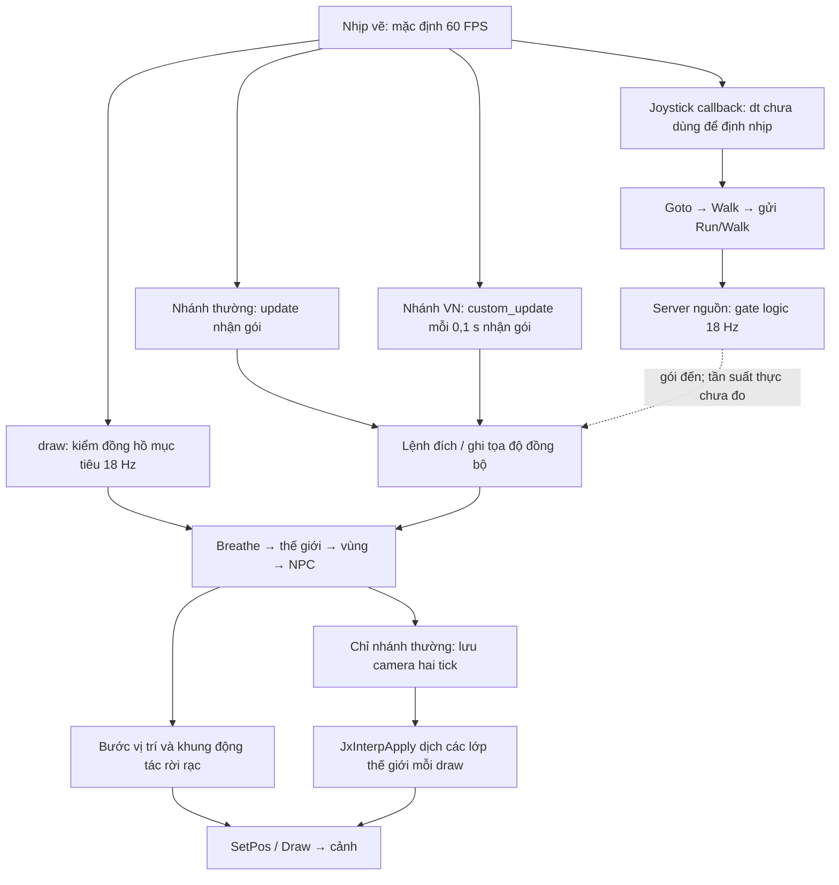

TÓM TẮT 1 [NGUỒN]: DONE khảo sát tĩnh TU-03 trên đúng bản client Folder/Client2912 và server SwordOnline; có 10 đề xuất xếp theo tác dụng/rủi ro, không sửa nguồn hay kết luận cũ.
TÓM TẮT 2 [NGUỒN]: Logic dùng bước 18 Hz theo đồng hồ, còn nhịp vẽ đặt riêng; nhánh thường bù tối đa 1 tick/lần draw, nhánh VN tối đa 128 tick (C/gamescene/KgameWorld.cpp:5681; C/vn/gamescence/KgameWorldVN.cpp:1542).
TÓM TẮT 3 [NGUỒN]: Bản nguồn hiện có nội suy camera/lớp thế giới; chưa thấy bộ đệm hai vị trí theo gói cho từng NPC trong đường đã lần (C/gamescene/KgameWorld.cpp:5578; C/gamecore/KProtocolProcess.cpp:2553).
TÓM TẮT 4 [NGUỒN]: Joystick phát yêu cầu theo callback, không dùng dt để định nhịp; công thức KTimer bỏ phần microsecond của mốc đầu, cần kiểm chứng tác động lúc reset (C/gamescene/KHRocker.cpp:598; C/engine/KTimer.cpp:88).
TÓM TẮT 5 [CHƯA KIỂM]: Chưa build, chạy exe, VM, APK hay mạng; chưa đo FPS/độ giật; không commit/push theo yêu cầu, Tổng quan nhận bàn giao; tệp nhịp ngoài worktree bị từ chối ghi.

# TU-03 — Nội suy và bước thời gian client: FPS, joystick và giật hình

Loại: khảo sát

Chủ đề: Tách nhịp logic, vẽ, nhận gói và phát lệnh di chuyển để xác định các nguồn giật khi logic mục tiêu là 18 Hz.

Từ khóa: nội suy, interpolation, camera, FPS, Breathe, joystick, KTimer, LimitFPS, 18 Hz, TU-03

Trạng thái: DONE — hoàn tất phạm vi đọc tĩnh và bảng 10 đề xuất; nhịp ngoài worktree bị chặn ghi, runtime ngoài phạm vi.

Độ phủ: 10/10 nhóm khảo sát tĩnh trong bảng dưới; 0/2 nhóm kiểm chứng runtime/binary, không phải nhiệm vụ được phép chạy.

Liên quan: JX1_OPS/DESIGN/TOI-UU-120FPS.md; JX1_OPS/DESIGN/TOI-UU-TRUYEN-TAI-TOI-NAY.md; JX1_OPS/REPORTS/H-13-tick-do-tre-don.md; JX1_OPS/REPORTS/H-15-dan-xuyen-quai-fps.md

Cần tôi quyết định: không — chỉ bàn giao khảo sát; các thay đổi và phép đo đề xuất cần task triển khai riêng.

## 1. Phạm vi, nguồn và độ phủ

`C` = `C:/Jx1CocoV3/Folder/Client2912-20260116T044348Z-3-001/Client2912/Client/Classes`. Đây là đúng bản Folder mà task mô tả, không phải lời khẳng định về APK đang cài. `S` = `C:/Jx1CocoV3/SwordOnline/SwordOnline/jxOnline/gameserver/Sources`. Các ký hiệu `C/…:dòng`, `S/…:dòng` dưới đây đều trỏ tới tệp thật đã đối chiếu trong lượt này. Nguồn không có commit ghim từ task; kết quả là ảnh đọc tĩnh trên đĩa ngày 19/11/2026, không phải xác nhận nguồn khớp binary.

Hai thư mục này không nằm trực tiếp trong worktree báo cáo. Đã định vị đúng tiền tố mà task yêu cầu tại gốc trên; không đọc bản Cocos khác. Git đầu lượt: `## task/TU-03`, sạch; báo cáo TU-03 chưa tồn tại. Trường `worktree` trong task chứa chuỗi literal `D:\JX-wt$id`; dùng đường dẫn cụ thể `D:\JX-wt\TU-03` do prompt giao, khớp nhánh yêu cầu.

Danh sách đọc được khoanh theo nguồn task và những hàm gọi trực tiếp, không liệt kê đệ quy Folder/SwordOnline:

| Nhóm | Tệp đã đọc đoạn hoặc tìm ký hiệu liên quan |
|---|---|
| Khuôn và bối cảnh | CHUAN-BAO-CAO.md; TOI-UU-120FPS.md; TOI-UU-TRUYEN-TAI-TOI-NAY.md; chỉ mục tri thức và GS001-MAP ở phần liên quan; hai báo cáo H-13/H-15 dẫn từ thiết kế |
| Nhịp vẽ/cảnh | C/AppDelegate.cpp; C/gameui/KuiOptions.cpp; C/gamescene/KgameWorld.cpp; C/vn/gamescence/KgameWorldVN.cpp; C/gamescene/KScenePlaceC.cpp |
| Thế giới và vị trí | C/gamecore/CoreShell.cpp; KSubWorldSet.cpp; KSubWorld.cpp; KRegion.cpp; KNpc.cpp; KNpcRes.cpp, cùng thư mục gamecore |
| Điều khiển và gói | C/gamescene/KHRocker.cpp; C/gamecore/KPlayer.cpp; KProtocol.cpp; KProtocolProcess.cpp |
| Đồng hồ/khai báo | C/engine/KTimer.cpp, KTimer.h; C/gamecore/KCore.cpp:65; KCore.h:374; KNpc.h:790; kiểm ký hiệu trong KgameWorld.h và các header đã dẫn khi cần định vị |
| Đối chiếu server | S/MultiServer/GameServer/KSOServer.cpp; S/Core/Src/CoreServerShell.cpp, KSubWorldSet.cpp; chỉ định vị hàm trong S/Core/Src/KNpc.cpp |

Không tìm thấy dấu gốc Graphify ở hai đường `<root>/graphify-out/.graphify_root` đã kiểm; dùng tìm ký hiệu trong tệp thật, không dựng lại graph. Các báo cáo H-13/H-15 dùng một số nguồn `D:/JX-source/...`; chúng chỉ giúp định vị và đối chiếu lịch sử, không thay bằng chứng `C/S` của TU-03 (H-13-tick-do-tre-don.md:56; H-15-dan-xuyen-quai-fps.md:65).

| # | Phần tử phạm vi | Độ phủ | Bằng chứng/giới hạn |
|---|---|---|---|
| 1 | Nhịp vẽ, thanh FPS | Đã phủ tĩnh | C/AppDelegate.cpp:119; C/gameui/KuiOptions.cpp:185, :186, :457 |
| 2 | Đồng hồ cấp thời gian cho logic | Đã phủ tĩnh | C/gamecore/KCore.cpp:65; C/engine/KTimer.cpp:44, :83 |
| 3 | Gate logic nhánh thường | Đã phủ tĩnh | C/gamescene/KgameWorld.cpp:5672, :5681, :5683 |
| 4 | Gate logic/bù bước nhánh VN | Đã phủ tĩnh | C/vn/gamescence/KgameWorldVN.cpp:1529, :1542, :1544 |
| 5 | Chuỗi thế giới → NPC → vị trí/khung | Đã phủ tĩnh | C/gamecore/CoreShell.cpp:2806; KSubWorld.cpp:143; KNpc.cpp:644, :729, :3732 |
| 6 | Nội suy camera và giới hạn của nó | Đã phủ tĩnh | C/gamescene/KgameWorld.cpp:5573, :5578, :5584, :5611 |
| 7 | Nhận gói và cách áp tọa độ | Đã phủ tĩnh | C/gamescene/KgameWorld.cpp:5121; C/vn/gamescence/KgameWorldVN.cpp:362, :3582; C/gamecore/KProtocolProcess.cpp:657, :2354, :2553 |
| 8 | Joystick → gửi yêu cầu di chuyển | Đã phủ tĩnh | C/gamescene/KHRocker.cpp:587, :598, :639; C/gamecore/CoreShell.cpp:5147; KProtocol.cpp:195 |
| 9 | Nhịp server và ranh giới logic/gửi gói | Đã phủ tĩnh | S/MultiServer/GameServer/KSOServer.cpp:90, :1442, :4378; S/Core/Src/CoreServerShell.cpp:2250 |
| 10 | Điểm chặn/chi phí trong đường vẽ | Đã phủ tĩnh | C/gamescene/KgameWorld.cpp:5691, :5841; C/vn/gamescence/KgameWorldVN.cpp:1553, :1571; C/gamescene/KScenePlaceC.cpp:1558 |
| 11 | APK chọn nhánh nào, cờ và binary hiệu lực | Chưa phủ — ngoài phạm vi chạy | Chưa kiểm build definition, APK, trạng thái jx_interp.txt hay thiết lập lưu thực tế |
| 12 | FPS/tick/gói thực, p95/p99, nguồn giật lớn nhất | Chưa phủ — ngoài phạm vi chạy | Không quay khung, chạy bot, benchmark, VM hoặc mạng |

## 2. Giải mã tên

Không trích tên riêng kỹ năng, trang bị, quái, NPC hay bản đồ; không có tập tên GBK/TCVN3 cần chuyển. `NPC` dưới đây là loại thực thể. Giữ nguyên các định danh kỹ thuật ASCII, trình bày nghĩa bằng UTF-8; không suy mã hóa chú thích legacy từ cách console hiển thị.

| Tên gốc | Mã hóa | Chữ đúng/nghĩa UTF-8 | Nguồn file:dòng |
|---|---|---|---|
| KgameWorld / KgameWorldVN | ASCII | Cảnh thường / cảnh VN | C/gamescene/KgameWorld.cpp:5617; C/vn/gamescence/KgameWorldVN.cpp:1482 |
| Breathe | ASCII | Một lượt cập nhật logic | C/gamecore/CoreShell.cpp:2806 |
| KNpc / KNpcRes | ASCII | Logic thực thể / dữ liệu hình thực thể | C/gamecore/KNpc.cpp:591; KNpcRes.cpp:194 |
| HRocker / joystick | ASCII | Cần điều khiển di chuyển | C/gamescene/KHRocker.cpp:598 |
| JxInterpOnTick / JxInterpApply | ASCII | Lưu camera theo tick / dịch lớp hiển thị | C/gamescene/KgameWorld.cpp:5578, :5584 |
| KTimer / GetElapse | ASCII | Đồng hồ / số mili giây tính từ mốc | C/engine/KTimer.cpp:44, :83 |
| LimitFPS | ASCII | Giới hạn nhịp vẽ yêu cầu | C/gameui/KuiOptions.cpp:188, :457 |
| GAME_FPS | ASCII | Nhịp logic mục tiêu trong nguồn server | S/MultiServer/GameServer/KSOServer.cpp:90 |

## 3. Sắp theo cấu trúc game

Thân bài đi theo **đồng hồ và nhịp → thế giới/vùng → nhân vật/NPC → camera/hiển thị → nhận gói → joystick/phát lệnh → ranh giới server**. Không sắp theo thứ tự thư mục; task không khảo sát tập phái, kỹ năng, bộ trang bị hoặc bản đồ.

Quy ước độ chắc: **ĐÃ XÁC MINH (tĩnh)** = thấy mã và điều kiện thực thi tại điểm neo; **GIẢ THUYẾT** = tác động cần đo; **CHƯA XÁC MINH / chưa kiểm** = chưa có phép đo hoặc chưa kiểm binary.

## 4. Kết quả khảo sát

### 4.1. Bước cố định có gate theo thời gian, FPS vẽ đặt riêng

**ĐÃ XÁC MINH (tĩnh):** khởi động yêu cầu `Director` vẽ ở `1/60` giây; UI tạo slider 30–90 FPS, dù callback còn chặn trên ở 120. Cả slider và callback chỉ đổi animation interval, không đổi hằng số 18 trong gate logic (C/AppDelegate.cpp:119; C/gameui/KuiOptions.cpp:185, :186, :453, :454, :457; C/gamescene/KgameWorld.cpp:5681).

Trong nhánh thường, `scheduleUpdate` đăng ký cập nhật; `update` lấy gói và gọi `NetMsgCallbackFunc`. Logic nằm ở `draw`: nếu `nLoopCount * 1000 <= timerStart.GetElapse() * 18` thì gọi một lần `Breathe`, tăng bộ đếm và lưu camera. Đây là bước logic rời rạc, được đến hạn bằng đồng hồ; không phải nhân tốc độ di chuyển với `delta` mỗi khung vẽ. Chỉ có một `if`, nên tối đa một Breathe mỗi lần draw ở đường này (C/gamescene/KgameWorld.cpp:454, :5061, :5121, :5142, :5681, :5683, :5684, :5685). Khối tương tự ở `:5069` là comment, kết thúc tại `:5104`; không đếm nó thành lượt logic thứ hai.

Nhánh VN đặt logic trong `draw` và chạy `while` bù tối đa 128 lượt; nhánh resume `bSkipBreatheOnce` chỉ reset đồng hồ/bộ đếm cho một khung. `custom_update` nhận gói lại được hẹn riêng 0,1 giây; `scheduleUpdate` cũ bị comment (C/vn/gamescence/KgameWorldVN.cpp:361, :362, :1482, :1532, :1537, :1542, :1544). Hai nhánh khác nhau về khả năng bù bước; chưa kiểm APK dùng nhánh nào.

**GIẢ THUYẾT có điều kiện:** nhánh thường không theo kịp 18 bước/s nếu số lần draw thực sự dưới 18/s trong một khoảng kéo dài; nhánh VN có thể gom nhiều bước/CPU vào cùng khung khi tồn đọng. Trần 128 là số lần gọi, không phải ngân sách mili giây; `128/18 ≈ 7,11 s` chỉ là lượng thời gian logic tương đương, không phải thời gian CPU đã đo (C/gamescene/KgameWorld.cpp:5681; C/vn/gamescence/KgameWorldVN.cpp:1542).

### 4.2. Đồng hồ có sai lệch gốc cần kiểm trước accumulator

**ĐÃ XÁC MINH (tĩnh):** `timerStart` là `KTimer` toàn cục. `Start` lưu cả `timeval`, nhưng hai nhánh nền tảng của `GetElapse` chỉ tính `(giây_hiện_tại - giây_đầu) * 1000 + microsecond_hiện_tại / 1000`, không trừ microsecond đầu (C/gamecore/KCore.cpp:65; C/gamecore/KCore.h:374; C/engine/KTimer.cpp:44, :47, :49, :88, :92).

**Suy luận từ biểu thức, chưa chạy thử:** nếu Start tại phần lẻ 800 ms của một giây và đọc sau 1 ms, hàm cho xấp xỉ 801 ms thay vì 1 ms. Sai lệch gốc nằm trong khoảng gần 0–1000 ms, tùy mốc Start; không phải bằng chứng cứ mỗi giây lại phát sinh một nhát giật. Với gate 18 Hz, sai lệch có thể tạo lượng bước cần bù ngay sau khởi tạo/reset. Tác động thực và bản hàm được liên kết vào APK **chưa kiểm** (C/engine/KTimer.cpp:88, :92; C/gamescene/KgameWorld.cpp:456, :457; C/vn/gamescence/KgameWorldVN.cpp:1537, :1544).

`JxInterp` dùng `steady_clock`, còn gate logic dùng `KTimer/gettimeofday`; do đó không được mặc định hai nguồn thời gian có cùng tính chất khi đồng hồ hệ thống đổi. Độ lệch và tác động runtime **chưa đo** (C/gamescene/KgameWorld.cpp:5577, :5600; C/engine/KTimer.cpp:87, :91).

### 4.3. Nhân vật tự bước giữa các lệnh server, chưa thấy nội suy snapshot theo gói

**ĐÃ XÁC MINH (tĩnh):** `Breathe → KSubWorldSet::MainLoop → SubWorld::Activate → KRegion::NewRegActivate → KNpc::Activate`. Thế giới tăng giờ logic một đơn vị mỗi Activate; NPC xử lý lệnh/trạng thái rồi ghi vị trí cho tài nguyên vẽ (C/gamecore/CoreShell.cpp:2809; KSubWorldSet.cpp:240, :242; KSubWorld.cpp:148, :160; KRegion.cpp:386, :400; KNpc.cpp:644, :646, :724, :729, :733).

Chạy/đi bộ gọi `WaitForFrame` và `ServeMove`. `ServeMove` cộng độ dời vào `m_OffX/m_OffY`; không nhận delta thời gian. `WaitForFrame` tăng chỉ số khung động tác từng đơn vị; `Paint` chuyển chỉ số này vào `KNpcRes::Draw`, nơi chọn khung SPR từ tỷ lệ chỉ số khung. Vì vậy nhịp vẽ cao hơn chưa tự tạo thêm vị trí logic hay thêm khung động tác (C/gamecore/KNpc.cpp:768, :771, :2129, :2151, :2161, :2162, :3256, :3294, :3329, :3330, :3734, :5916; KNpcRes.cpp:265).

Nhận gói chạy chuyển thành lệnh đích `do_run`, sau đó NPC tự mô phỏng theo các tick client. Một số gói vị trí/NPC nhỏ lại ghi thẳng tọa độ; đồng bộ thế giới gán `WorldSync->Frame` vào giờ thế giới. Trong các handler và đường SetPos/Draw đã lần, chưa thấy cặp snapshot theo thời gian nhận gói cùng hệ số blend vị trí mỗi render (C/gamecore/KProtocolProcess.cpp:645, :657, :2354, :2553, :2671, :3227; KNpcRes.cpp:197, :246). **Không có nội suy theo gói trong đường đã kiểm không có nghĩa nhân vật chỉ chuyển động lúc có gói mới.**

Không lấy mọi đoạn có phép chia làm bằng chứng nội suy hiển thị đang bật: `HurtAutoMove` có phép tiến tới vị trí đồng bộ theo số khung còn lại, nhưng lời gọi trong Activate đang comment; `Paint` có làm gần dần hướng `m_ResDir`, là hướng chứ không phải bộ đệm vị trí giữa hai gói (C/gamecore/KNpc.cpp:692, :10096, :10154, :5873). Chưa khẳng định không có cơ chế khác ở toàn bộ client ngoài danh sách đã khoanh.

### 4.4. Đã có làm mượt camera, phạm vi hẹp hơn nội suy từng NPC

**ĐÃ XÁC MINH (tĩnh):** nguồn nhánh thường có chú thích bổ sung `#255`, lưu camera trước/hiện tại từ `SubWorld[0].m_nLeft/m_nTop` mỗi tick, rồi tính `f = clamp((now - tickTime) * 18 / 1000, 0, 1)`. Nó dịch đồng loạt 10 lớp thế giới bằng phần bù giảm dần; không ghi lại tọa độ logic từng NPC (C/gamescene/KgameWorld.cpp:5571, :5580, :5581, :5597, :5600, :5603, :5607, :5611, :5614, :5685, :5708).

Camera lấy gốc từ vị trí nhân vật có focus qua `KNpcRes::SetPos → SetFocusPosition → LookAt`; vì vậy đây là làm mượt thay đổi camera giữa hai **tick client**, không phải giữa hai **gói server**. Khi nhân vật chính/camera đứng yên mà NPC khác chạy, phần bù camera này không tạo vị trí trung gian riêng cho NPC đó (C/gamecore/KNpc.cpp:726, :729; KNpcRes.cpp:204, :206; C/gamescene/KScenePlaceC.cpp:915; C/gamecore/KSubWorld.cpp:174; C/gamescene/KgameWorld.cpp:5597, :5598).

Cơ chế mặc định bật trong source; cứ 60 lần Apply đọc tệp `jx_interp.txt` ở writable path, ký tự đầu `0` tắt. Chỉ làm mượt khi chênh mỗi trục nằm trong khoảng mở (-160,160); bước lớn hơn bỏ phần bù. Các biến giữ camera/offset là `static`, chưa thấy nhánh reset theo vòng đời cảnh trong chính đoạn triển khai; cần kiểm chuyển cảnh, tái tạo layer, đổi focus và bật/tắt. Nhánh VN đã đọc không có lời gọi tương ứng, không suy mức phủ APK từ tên lớp (C/gamescene/KgameWorld.cpp:5573, :5576, :5586, :5588, :5591, :5592, :5598, :5610; C/vn/gamescence/KgameWorldVN.cpp:1529, :1575).

### 4.5. Nhịp nhận gói, joystick và server là ba nhịp khác

**ĐÃ XÁC MINH (tĩnh):** nhánh thường lấy gói trong update; VN lấy gói ở callback 0,1 s. Cả hai dùng vòng `while (true)` lấy đến khi không còn gói; giới hạn 50 gói trong VN chỉ là comment. Vì vậy 0,1 s không phải tick logic 10 Hz: nó là lịch callback chứa cả việc nhận gói và công việc khác (C/gamescene/KgameWorld.cpp:5061, :5114, :5121, :5123; C/vn/gamescence/KgameWorldVN.cpp:362, :3568, :3569, :3573, :3574, :3582, :3584).

**GIẢ THUYẾT:** nếu scheduler chạy đúng hẹn và gói đến đều/ngẫu nhiên theo pha, riêng lịch 0,1 s có thể thêm khoảng chờ 0 đến gần 100 ms, trung bình khoảng 50 ms. Đây là mô hình lịch gọi, không phải RTT hay số đo trễ; khựng luồng chính có thể làm chờ dài hơn. Xả nhiều gói trong một callback cũng có thể dồn việc vào một khung, cần đo số gói và thời gian xử lý thực (C/vn/gamescence/KgameWorldVN.cpp:362, :3574, :3600).

Joystick đăng ký `updateMovement` không truyền interval; tham số `dt` chưa dùng trong thân hàm. Khi đang kéo, khoảng cách >5 và không ở động tác attack/magic, callback gọi Goto; Goto lấy tốc độ rồi gọi Walk, đặt lại bộ đếm gửi. Guard `m_nSendMoveFrames` trong Walk đang comment; Run/Walk được gửi thẳng vào transport khi đủ điều kiện. Vì vậy đường này không có bộ định nhịp mili giây tại các tầng đã kiểm, có nguy cơ tăng số yêu cầu theo callback/FPS; **chưa đo số gói thực hoặc tốc độ chạy** (C/gamescene/KHRocker.cpp:587, :598, :601, :617, :619, :639; C/gamecore/CoreShell.cpp:5141, :5147, :5149; KPlayer.cpp:651, :659, :662, :678; KProtocol.cpp:186, :195, :214, :222).

Server gốc task định nghĩa `GAME_FPS 18`, gate theo đồng hồ trước MainLoop; MainLoop gọi core Breathe rồi nhánh counter lẻ mới gọi `SendPackToClient(-1)`. 18 Hz logic không đồng nghĩa mỗi NPC có 18 gói vị trí/giây; số lời gọi flush dự kiến ở nhánh này khoảng 9/s nếu vòng chạy đủ nhịp, chưa xác minh transport/DLL/segment/gói thực. Không nâng kết quả này thành chẩn đoán nghẽn mạng và không lấy nó làm đề xuất đổi tick server trong TU-03 (S/MultiServer/GameServer/KSOServer.cpp:90, :1442, :1450, :4373, :4378, :4379; S/Core/Src/CoreServerShell.cpp:2250).

### 4.6. Vì sao vẽ nhiều FPS vẫn có thể giật

**Suy luận từ gate 18 Hz, chưa đo:** một bước logic lý tưởng dài `1000/18 ≈ 55,56 ms`. Nếu chưa nội suy riêng vị trí, vẽ thêm khung sẽ lặp lại vị trí logic; phần bù camera chỉ xử lý nhóm chuyển động camera đã mô tả (C/gamescene/KgameWorld.cpp:5681, :5603; C/gamecore/KNpc.cpp:729, :733).

| Nhịp vẽ giả định | Số khung vẽ bình quân trên một bước 18 Hz | Ý nghĩa khi không nội suy vị trí riêng |
|---|---|---|
| 30 FPS | 30/18 ≈ 1,67 | Vị trí mới phân bố giữa các khung không đều |
| 60 FPS | 60/18 ≈ 3,33 | Nhiều khung dùng cùng vị trí logic |
| 90 FPS | 90/18 = 5 | Thêm khung vẽ chưa thêm bước vị trí |
| 120 FPS | 120/18 ≈ 6,67 | Chỉ là kịch bản tính; slider đã đọc vẫn tối đa 90 |

Các điểm khác cần đo: Sleep(1)/usleep trên đường draw; bù bước dồn khung; vòng xả gói không có ngân sách; xóa lớp nhãn/HP mỗi draw; chờ sự kiện nạp cảnh trong Breathe. Chưa biết điểm nào chiếm nhiều thời gian nhất. Riêng nhánh `else if (nLoopCount >> 3)` của cảnh thường có giá trị đúng từ bộ đếm ≥8; không được diễn giải thành “chỉ ngủ mỗi 8 tick” (C/gamescene/KgameWorld.cpp:5688, :5691, :5693, :5696, :5699, :5841, :5844; C/vn/gamescence/KgameWorldVN.cpp:1544, :1553, :1558, :1571; C/gamescene/KScenePlaceC.cpp:1555, :1558). Phần chờ nạp chỉ ghi điểm nối, không mở rộng thành khảo sát tài nguyên của TU khác.

## 5. Mục sổ thông số

Mọi giá trị là source hoặc phép quy đổi có giả định, **runtime chưa đo**. Đánh giá an toàn không cấp quyền chỉnh; `CẨN THẬN` nghĩa cần task/bản thử/kiểm chứng, `KHÔNG` nghĩa không chỉnh như một nút FPS độc lập trong TU-03.

| Nhóm | Tên/hằng số | file:dòng | Giá trị | Đơn vị | Ảnh hưởng | Đổi an toàn (CÓ/CẨN THẬN/KHÔNG) | Nguồn đo |
|---|---|---|---|---|---|---|---|
| Logic client | Hệ số gate | C/gamescene/KgameWorld.cpp:5681; C/vn/gamescence/KgameWorldVN.cpp:1544 | 18 | bước/s mục tiêu | Mốc thời gian logic | KHÔNG | Đọc tĩnh; thực tế chưa đo |
| Quy đổi | Một bước ở 18 Hz | cùng gate trên | 1000/18 ≈ 55,56 | ms/bước | Độ hạt vị trí | KHÔNG | Tính từ source, giả định đủ nhịp |
| Bù bước thường | Breathe trong một if | C/gamescene/KgameWorld.cpp:5681, :5683 | tối đa 1 | lần/draw | Có thể thiếu nhịp khi draw <18/s | CẨN THẬN | Đọc tĩnh |
| Bù bước VN | MAX_BREATHE_LOOP | C/vn/gamescence/KgameWorldVN.cpp:1542 | 128 | lần/draw | Trần bù bước, không phải trần ms CPU | CẨN THẬN | Đọc tĩnh |
| Reset counter | nLoopCount | C/gamescene/KgameWorld.cpp:5676 | >2.000.000 | tick đã đếm | Đặt lại bộ đếm/mốc | CẨN THẬN | Đọc tĩnh |
| Đồng hồ | Microsecond đầu bị bỏ | C/engine/KTimer.cpp:88, :92 | sai lệch gốc gần 0–1000 | ms, suy từ công thức | Số bước cần bù sau Start | CẨN THẬN | Suy luận tĩnh, chưa chạy thử |
| Vẽ mặc định | animation interval | C/AppDelegate.cpp:119 | 1/60 | s/khung yêu cầu | Pacing render | CẨN THẬN | Đọc tĩnh; FPS thật chưa đo |
| Vẽ UI | Slider / trần callback | C/gameui/KuiOptions.cpp:185, :186, :453, :454 | 30–90 / 120 | FPS yêu cầu | Trần UI khác trần xử lý | CẨN THẬN | Đọc tĩnh |
| Vẽ VN | LimitFPS khi khởi tạo | C/vn/gamescence/KgameWorldVN.cpp:313, :315, :317 | mặc định 60; <30 đổi thành 60 | FPS yêu cầu | Thiết lập lưu không có clamp trên tại đoạn này | CẨN THẬN | Đọc tĩnh; không đọc cấu hình hiệu lực |
| Nhận gói VN | custom_update interval | C/vn/gamescence/KgameWorldVN.cpp:362 | 0,1 | s/callback yêu cầu | Độ trễ theo pha, gom việc | CẨN THẬN | Đọc tĩnh, không phải số đo |
| Nhận gói | Giới hạn 50 | C/vn/gamescence/KgameWorldVN.cpp:3569, :3573, :3574 | comment; active lấy đến hết | không có trần active ở vòng này | Khung dài khi nhiều việc | CẨN THẬN | Đọc tĩnh; không coi 50 là hiệu lực |
| Joystick | Ngưỡng kéo | C/gamescene/KHRocker.cpp:617 | >5 | khoảng cách tọa độ callback | Điều kiện gửi, không phải giới hạn Hz | CẨN THẬN | Đọc tĩnh |
| Joystick | Chu kỳ thời gian gửi | C/gamescene/KHRocker.cpp:598; C/gamecore/KPlayer.cpp:651 | chưa có bộ định nhịp ms trong đường đã kiểm | ms | Yêu cầu có thể phụ thuộc FPS | CẨN THẬN | Đọc tĩnh; không dùng 0 thay số đo |
| Camera | s_ipOn / jx_interp.txt | C/gamescene/KgameWorld.cpp:5576, :5591, :5592 | mặc định 1; ký tự đầu '0' tắt | cờ source | Bật/tắt phần bù hiển thị | CẨN THẬN | Đọc tĩnh; cờ runtime chưa kiểm |
| Camera | s_ipCheck | C/gamescene/KgameWorld.cpp:5586, :5588 | 60 | lần Apply | Chu kỳ đọc lại cờ; phụ thuộc nhịp draw | CẨN THẬN | Đọc tĩnh; không phải cố định 1 giây |
| Camera | Ngưỡng ddx/ddy | C/gamescene/KgameWorld.cpp:5598 | -160 < chênh <160 | đơn vị m_nLeft/m_nTop | Bỏ phần bù khi bước lớn | CẨN THẬN | Đọc tĩnh; chưa đo màn hình |
| Camera | Hệ số f | C/gamescene/KgameWorld.cpp:5600, :5601, :5602 | clamp(dt_ms ×18/1000, 0, 1) | tỷ lệ | Dịch lớp giữa hai tick camera | CẨN THẬN | Đọc tĩnh |
| Draw | Nhường CPU | C/gamescene/KgameWorld.cpp:5691, :5693; C/vn/gamescence/KgameWorldVN.cpp:1556, :1558 | Sleep(1); sleep(0.001) thường ngoài Win32; VN usleep(1000) | tham số API gốc | Jitter/pacing; chưa kiểm API sleep thực được liên kết | CẨN THẬN | Đọc tĩnh; không coi mọi tham số đều là ms |
| Server | GAME_FPS | S/MultiServer/GameServer/KSOServer.cpp:90 | 18 | bước/s mục tiêu | Nhịp mô phỏng server | KHÔNG | Đọc tĩnh; binary chưa đối chiếu |
| Server | Nhánh gọi flush | S/MultiServer/GameServer/KSOServer.cpp:4378 | counter lẻ | mỗi hai vòng logic | Nhịp gọi dự kiến 9/s ở đủ 18 Hz | KHÔNG | Suy từ source; không phải số gói thực |

## 6. Đề xuất tối ưu — 10 điểm xếp theo tác dụng/rủi ro

Thứ tự ưu tiên cân bằng lợi ích dự kiến và rủi ro; chưa phải kết quả benchmark. Tất cả là **đề xuất, chưa áp dụng/chưa kiểm runtime**. Giữ logic chiến đấu và server 18 Hz ở vòng thử đầu; không đổi mã hiệu ứng vũ khí theo ràng buộc Q-52 của thiết kế tối nay (JX1_OPS/DESIGN/TOI-UU-TRUYEN-TAI-TOI-NAY.md:3, :32).

| Ưu tiên | Điểm / bằng chứng file:dòng | Tác dụng dự kiến | Rủi ro | Cách thử và điều kiện giữ/hoàn tác |
|---|---|---|---|---|
| 1 | Chốt binary/nhánh và đo tách draw, Breathe, nhận gói, gửi move; C/gamescene/KgameWorld.cpp:5683; C/vn/gamescence/KgameWorldVN.cpp:1544, :3582; C/gamecore/KProtocol.cpp:195 | Rất cao cho chẩn đoán; tránh dùng FPS vẽ làm tick logic | Thấp nếu đo có giới hạn, không log nội dung nhạy cảm | Task đo riêng: ms/khung p95/p99, tick/s, tick/draw, số gói/callback, move/s; chưa triển khai instrumentation ở TU-03 |
| 2 | Đánh giá cờ camera sẵn có trước khi viết thêm nội suy; C/gamescene/KgameWorld.cpp:5584, :5592, :5611 | Cao khi camera theo nhân vật; phạm vi hẹp với NPC khác | Vừa: layer/UI, click và chuyển cảnh | So A/B cùng đường chạy trên bản thử; kiểm dừng, đổi hướng, focus, map, tắt cờ trả layer về vị trí; giữ khi mượt hơn và chọn mục tiêu không lệch |
| 3 | Định nhịp gửi joystick theo thời gian + thay đổi hướng; C/gamescene/KHRocker.cpp:598, :639; C/gamecore/KPlayer.cpp:651, :662 | Vừa–cao khi FPS cao; giảm yêu cầu move lặp | Vừa: phản hồi dừng/đổi hướng, xen skill | Chọn chu kỳ từ phép đo; gửi lần đầu, dừng và đổi hướng đủ nhanh; không chặn skill bằng cooldown move; so move/s và độ trễ điều khiển tại 30/60/90 |
| 4 | Kiểm/sửa gốc KTimer và dùng thời gian tăng đều cho tích lũy; C/engine/KTimer.cpp:47, :88, :92 | Cao nếu có burst init/resume; chưa hứa giảm giật thường trực | Vừa–cao: mọi nơi dùng timer | Trước hết kiểm mốc phần lẻ 0/500/900 ms, rồi pause/resume; chỉ sửa bản copy có task, kiểm timer phụ thuộc và hoàn tác khi logic/timeout lệch |
| 5 | Tách nhận gói VN khỏi callback chung 0,1 s, đặt ngân sách xử lý phù hợp | Cao nếu độ chờ client là thành phần lớn; C/vn/gamescence/KgameWorldVN.cpp:362, :3574, :3600 | Vừa–cao: thứ tự gói và chi phí mỗi khung | Thử lịch nhận nhanh hơn sau khi đo; giữ nguyên thứ tự và dữ liệu dở dang; theo tuổi gói trong hàng đợi, không chỉ FPS; không tùy tiện bật giới hạn 50 đang comment |
| 6 | Thống nhất bù bước bằng accumulator có ngân sách, giữ đơn vị 1/18 s | Cao khi tải nặng/frame drop; C/gamescene/KgameWorld.cpp:5681; C/vn/gamescence/KgameWorldVN.cpp:1542 | Cao: bỏ/bù tick sai làm lệch game | Thiết kế riêng sau kiểm clock; quy định rõ backlog/resume, không tự bỏ logic chiến đấu; thử 30/60/90 và stall có kiểm soát, kiểm tick/s, hồi phục và hành vi gameplay |
| 7 | Thêm nội suy hiển thị riêng từng NPC giữa hai trạng thái logic; C/gamecore/KNpc.cpp:729, :733; KNpcRes.cpp:197, :246 | Cao cho chuyển động tương đối khi camera đứng yên | Cao: trễ hiển thị, hitbox/chọn mục tiêu, teleport | Lưu trạng thái render riêng, không sửa tọa độ authoritative; phương án lùi một tick thêm tới khoảng 55,56 ms cần cân nhắc; reset theo ID/map/teleport, không blend qua điểm nhảy; thử cùng camera có/không bù |
| 8 | Đặt ngân sách thời gian xả gói ở nhánh thường; C/gamescene/KgameWorld.cpp:5114, :5121, :5142 | Vừa khi gói dồn; tránh một update kéo dài | Vừa–cao: backlog hoặc làm vỡ vòng giải gói | Đo số byte/gói và ms thực, giữ buffer/offset/FIFO nếu chia việc; không rơi/bỏ gói khi hết ngân sách; kiểm tuổi gói và độ trễ thao tác cùng frame time |
| 9 | Đo nhường CPU trong draw, rồi bỏ/đổi nơi nhường nếu bị ngủ kép | Nhỏ–vừa tùy nền tảng; C/gamescene/KgameWorld.cpp:5688, :5696; C/vn/gamescence/KgameWorldVN.cpp:1553 | Vừa: tăng CPU/nhiệt, scheduler/API sleep khác nhau | Xác nhận API và pacing thực trước, so p95/p99 + CPU/nhiệt; không coi sleep(0.001) chắc chắn ngủ 1 ms; hoàn tác nếu chỉ tăng tải |
| 10 | Đo chi phí dọn nhãn/HP mỗi draw rồi tái sử dụng phần tốn kém | Vừa nếu đo thấy nút CPU/cấp phát; C/gamescene/KgameWorld.cpp:5841, :5844; C/vn/gamescence/KgameWorldVN.cpp:1568, :1571 | Vừa: nhãn cũ/lệch vòng đời | Profile riêng các điểm dọn/vẽ, giữ hiển thị HP chính xác khi thực thể vào/ra; chỉ đổi sau số đo, không mở rộng sang sửa hiệu ứng vũ khí |

Không ưu tiên tăng `GAME_FPS` hay nâng 120 FPS để thay cho các điểm trên: FPS vẽ là tham số khác, nguồn server chưa chứng minh khớp exe; thiết kế tối nay cũng loại thay mã server khỏi đợt đó (C/AppDelegate.cpp:119; S/MultiServer/GameServer/KSOServer.cpp:90; JX1_OPS/DESIGN/TOI-UU-TRUYEN-TAI-TOI-NAY.md:32). Đây là giới hạn triển khai, không thay kết luận H-13/H-15 ở root lịch sử.

## 7. Đã xác minh / Chưa xác minh

### ĐÃ XÁC MINH

- Đã đọc trực tiếp các gate, chuỗi cập nhật NPC/vị trí, camera, joystick và handler nhận gói theo điểm neo ở các mục 1, 4 và sổ thông số; active code được tách khỏi comment. Đủ 10 điểm đề xuất.
- Root client/server khớp tiền tố nguồn task; các tài liệu liên quan có thật. Mã camera #255 nằm trong bản nguồn đang đọc; không quy nó cho APK.
- Công thức KTimer thiếu phần microsecond đầu là kết quả đọc biểu thức, chưa phải test lỗi runtime (C/engine/KTimer.cpp:88, :92).
- Kiểm tra tài liệu thực chạy sau khi ghi: UTF-8 không BOM, đúng 5 dòng TÓM TẮT, 1 sơ đồ Mermaid, đủ 10 hàng ưu tiên, sổ 8 cột; phần kết quả được thêm ở cuối task. Xem diff một lần trước bàn giao.

### CHƯA XÁC MINH — chưa kiểm

- Chưa build/link, chưa kiểm APK dùng cảnh thường hay VN, chưa kiểm source khớp exe/DLL; chưa đo bật/tắt camera hoặc cờ lưu. Chưa kiểm toàn bộ đường chọn scene/build ngoài danh sách nguồn.
- Chưa chạy client/server, exe, VM, bot, benchmark, mạng hoặc quay khung; không có số FPS thật, tick thật, packet rate, jitter, CPU, p95/p99 hay kết luận nguồn giật lớn nhất.
- Chưa kiểm hệ số tốc độ sau dữ liệu/gameplay; không kết luận FPS cao làm chạy nhanh, mất sát thương hay đạn xuyên quái.
- Chưa kiểm API `sleep` thực được liên kết, backlog/cờ resume, thứ tự transform của layer trong lượt render, reset trạng thái static của camera qua vòng đời cảnh.
- Không đo hoặc sửa hệ nạp tài nguyên; chỉ nêu điểm chờ đã thấy trong C/gamescene/KScenePlaceC.cpp:1558.

Kế hoạch kiểm thử cho task sau: chốt binary/nhánh trước; trên bản copy và môi trường được duyệt, so 30/60/90 FPS với cùng đường chạy/đứng nhìn NPC khác/đổi hướng/chuyển map/resume; thêm A/B camera và phép kiểm clock theo pha bắt đầu. 120 FPS để giai đoạn sau theo TOI-UU-120FPS.md:12, :16. Ghi p95/p99 frame time, tick/s và số tick/draw, move/s, tuổi gói, phản hồi skill/dừng; không dùng FPS trung bình làm chứng nhận hết giật. Đây là kế hoạch, **chưa chạy**.

## 8. Lỗi công cụ, cách thử và kết quả

| Lỗi/giới hạn thật | Cách thử / kết quả | Xử lý và bước tiếp |
|---|---|---|
| Đọc đầu bằng encoding PowerShell mặc định làm tiếng Việt hiển thị sai | Đã đọc lại riêng chuẩn báo cáo bằng UTF-8, console xuất UTF-8; đọc được | Không đổi encoding tệp nguồn; báo cáo ghi UTF-8 không BOM |
| rg không có trong PATH | Ba lệnh đọc độc lập đầu tiên cùng trả CommandNotFoundException | Báo một lần, chuyển Select-String và Get-Content từng đoạn; không cài công cụ, không thử lại rg |
| Folder/SwordOnline không có ngay dưới worktree; tên H-13.md/H-15.md không tồn tại | Kiểm đúng các đường chỉ định; lọc tên H-13*/H-15* ở REPORTS, lấy gợi ý root rồi đối chiếu đường C/S có thật | Không quét cây thư mục lớn; không dùng nhầm D:/JX-source thay bản task |
| Ghi D:\JX-wt\TU-03.nhip bị chặn | Thử WriteAllText tại mốc bắt đầu: UnauthorizedAccessException, “Access to the path 'D:\JX-wt\TU-03.nhip' is denied.” | Tệp nằm ngoài writable root D:\JX-wt\TU-03; không vượt sandbox/đổi quyền. Mốc hoàn tất đọc nguồn ghi nhận 19/11/2026 19:23 +07:00; các mốc tiếp theo không thử lại cùng đường đã bị chặn. Tổng quan cần cập nhật nhịp ngoài worktree nếu cần |

## 9. Bàn giao

Đầu ra: `JX1_OPS/REPORTS/TU-03.md`; theo chỉ dẫn trực tiếp của người giao việc, thêm mục `Kết quả` cuối `JX1_OPS/TASKS/TU-03.md`. Không sửa source, cấu hình, báo cáo cũ hoặc BAI_HOC. Không tạo `_CHIMUC/TU-03.tsv` vì ngoài vung_file; hàng mục lục đề nghị PM gộp:

| Chủ đề | Báo cáo | Từ khóa / điểm neo | Giới hạn |
|---|---|---|---|
| Nội suy camera, tick client và joystick | TU-03 | 18 Hz, KTimer, JxInterp, KHRocker, LimitFPS | Đọc tĩnh bản Folder/SwordOnline; binary/FPS/độ giật chưa kiểm |

Không stage/commit/push theo yêu cầu “Tổng quan commit hộ”; chưa có SHA của TU-03. Tổng quan nhận hai tệp tài liệu, xử lý nhịp ngoài vùng ghi nếu cần, và chọn task đo/thiết kế tiếp theo từ bảng ưu tiên. Không có bằng chứng push và không nhận đã push; không gửi thông báo ngoài.

Trạng thái cuối: **DONE (khảo sát tĩnh); nhịp ngoài worktree bị chặn ghi**.

## 10. Phát hiện khi đối chiếu/chuẩn hóa

- Thiết kế nền ghi “không nội suy” và dẫn KgameWorld.cpp:5628 ở thời điểm 18:25; nguồn đang đọc đã có khối camera `#255` tại C/gamescene/KgameWorld.cpp:5571 và các lời gọi :5685, :5708. LastWriteTime của tệp khi kiểm là 19/11/2026 18:30:37; đây chỉ là thời gian filesystem, không chứng minh lịch sử commit hay triển khai. Giữ nguyên tài liệu cũ; TU-03 bổ sung mức phủ của cơ chế hiện thấy (JX1_OPS/DESIGN/TOI-UU-TRUYEN-TAI-TOI-NAY.md:17, :37).
- H-13/H-15 có mô tả server thử 18/36 ở root D:/JX-source; server SwordOnline task TU-03 có hằng 18 tại KSOServer.cpp:90, khác phiên bản nguồn. Không gộp thành cùng cấu hình và không sửa kết luận cũ (JX1_OPS/REPORTS/H-13-tick-do-tre-don.md:56, :67; JX1_OPS/REPORTS/H-15-dan-xuyen-quai-fps.md:65, :89).
- TOI-UU-120FPS liệt kê accumulator/nội suy và hit event như kế hoạch, không phải bằng chứng tất cả đã áp dụng. `IsReachFrame` vẫn so bằng trong source đã đọc; tránh thay nhịp logic hoặc bỏ bước khi chưa bảo toàn các sự kiện này (JX1_OPS/DESIGN/TOI-UU-120FPS.md:7, :10; C/gamecore/KNpc.cpp:3744).
- Chú thích legacy của nguồn có chỗ hiển thị lỗi khi đọc UTF-8; kết luận dùng định danh/biểu thức ASCII, không phục dựng hay ghi lại tên game chưa giải mã.

Kỹ năng đã dùng: jx1-retrofit (đối chiếu khuôn, giữ kết luận cũ); jx1-read-server; jx1-read-client; jx1-parameters; jx1-knowledge; jx1-report.
