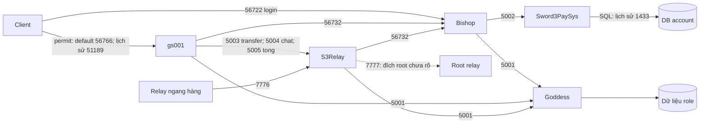

# U-02 — Tổng hợp truyền tải và các exe server

## TOM TAT 5 DONG
1. PARTIAL phần bàn giao U-02: khảo sát tĩnh hoàn tất, nhưng Git từ chối ghi index.lock ngoài worktree.
2. Phân biệt 51189 lịch sử/56766 mặc định, outer36/full18, client VN10 Hz/nhánh update; xác nhận source có CmdLane và mâu thuẫn flush unsigned.
3. Đầu ra: `JX1_OPS/DESIGN/TRUYEN-TAI-VA-EXE-SERVER.md`, báo cáo này và mục Kết quả task U-02.
4. Chưa đo runtime, chưa build/test game, không chạy VM/exe/mạng; binary, ABI, listener và hiệu năng hiện tại chưa xác minh.
5. Chưa có commit SHA: `D:/jx1-reports/.git/worktrees/U-02/index.lock` báo `Permission denied`; BỊ CHẶN – CHƯA PUSH, cần PM xử lý quyền metadata Git.

Trạng thái toàn task: **PARTIAL** — nội dung khảo sát tĩnh hoàn tất, nhưng chưa thể commit do metadata Git ngoài worktree bị từ chối quyền ghi. Ngày: 17/11/2026.

liên quan: `../DESIGN/TRUYEN-TAI-VA-EXE-SERVER.md`, `A-01-ban-do-tien-trinh.md`, `A-06-bang-goi-tin.md`, `K-01-ban-do-truyen-tin-hieu.md`, `H-13-tick-do-tre-don.md`, `../DESIGN/TOI-UU-120FPS.md`.

## Phạm vi, nguồn và phương pháp

- Chỉ ghi hai file trong `vung_file` và mục `Kết quả` của `JX1_OPS/TASKS/U-02.md`, theo yêu cầu trực tiếp của chủ dự án. Không sửa source/cấu hình/báo cáo nguồn/mục lục tri thức.
- Đã đọc mục lục tri thức trước nguồn chủ đề; đọc A-01, phần tổng kết/khác biệt và ID liên quan của A-06, K-01, TOI-UU-120FPS. Đọc chọn lọc SERVER05, SERVER14; đọc SERVER30, SERVER37, SERVER43 và phần liên quan H-13 để đối chiếu tick, ô lệnh, flush, client Coco.
- Chỉ mở source khi cần phân biệt nhánh hoặc kiểm tra khác biệt báo cáo. GS001-MAP dùng để định vị; không xem bản đồ là bằng chứng. `D:/JX-source/server/graphify-out/GRAPH_REPORT.md` không tồn tại tại đường dẫn kiểm; dùng tìm symbol/trích đoạn trực tiếp, không tạo lại graph.
- Skill đã dùng: `jx1-knowledge`, `jx1-report`, `jx1-parameters`, `jx1-read-server`, `jx1-read-client`. Không có phân công agent phụ hay tác vụ bên ngoài.
- Nhãn **ĐÃ XÁC MINH — NGUỒN** là đọc tĩnh hiện tại; **ĐÃ XÁC MINH — TÀI LIỆU** là dẫn lại nội dung báo cáo, chưa lặp phép đo; **GIẢ THUYẾT** là đề xuất/tác động dự kiến. Runtime toàn bộ **CHƯA XÁC MINH**.

| Ký hiệu file:dòng | Gốc tuyệt đối |
|---|---|
| S | `D:/JX-source/server/jxOnline/gameserver/Sources` |
| G | `D:/JX-source/server/jxOnline/gateway/Sources` |
| GH | `D:/JX-source/server/jxOnline/gateway/Headers` |
| O | `C:/Jx1CocoV3/Folder/Client2912-20260116T044348Z-3-001/Client2912/Client/Classes` |
| H | `C:/Jx1CocoV3/SwordOnline/SwordOnline/jxOnline/gameserver/Headers` — header A-06, chưa xác định có dùng build S |
| R | `JX1_OPS/REPORTS` trong U-02 |

Không có commit nguồn/binary được task ghim. Các cây trên được lấy từ báo cáo đã chỉ định; không nhập chung phiên bản, không xác nhận trùng exe/APK đang triển khai.

## DA XAC MINH

| Kết quả | Mức bằng chứng và file:dòng |
|---|---|
| Vai trò PaySys, Goddess, S3Relay, Bishop, GS; tuyến login rồi socket gameplay riêng | **TÀI LIỆU:** `R/K-01-ban-do-truyen-tin-hieu.md:51`, `:52`, `:53`, `:54`, `:55`, `:56`, `:119`. **NGUỒN:** client lấy endpoint permit, nối GS, gửi GUID, đóng Bishop ở `O/gameui/KSelPlayer.cpp:1117`, `:1122`, `:1134`, `:1149`, `:1150`. |
| Bảng cổng phân biệt mặc định/lịch sử và root outgoing | **NGUỒN:** `GH/ServerPort.h:4`, `:5`, `:6`, `:7`, `:8`, `:9`, `:10`, `:11`, `:12`, `:13`; `S/MultiServer/GameServer/KSOServer.cpp:725`, `:728`; `G/MultiServer/S3Relay/Global.cpp:395`, `:402`, `:411`, `:418`. **TÀI LIỆU:** listener cũ `SERVER/05-c2-chay-server.md:24`, không phải phép kiểm U-02. |
| Gói tiêu biểu hai chiều: login/select/GUID, walk/run/skill, world/HP/skillcast, chat/relay, ping | **TÀI LIỆU:** A-06 `:168`, `:173`, `:176`, `:180`, `:188`, `:189`, `:199`, `:246`, `:360`, `:371`, `:372`, `:373`, `:404`, `:418`, `:497`, `:501`; K-01 `:120`, `:121`, `:200`. Chưa khẳng định sizeof hay toàn bộ route của mọi ID. |
| TCP framing gồm WORD chiều dài tổng; nhiều record trong dữ liệu nhận | **NGUỒN:** `O/network/SocketClient.cpp:203`, `:212`; `O/network/ClientStage.cpp:140`, `:157`, `:160`, `:172`, `:283`; `O/gamescene/KgameWorld.cpp:5126`, `:5142`, `:5145`. Không chép giá trị khóa/payload thực. |
| Outer18/36 tách khỏi core18; có half movement | **NGUỒN:** `S/MultiServer/GameServer/KSOServer.cpp:91`, `:1445`, `:1447`; `S/Core/Src/CoreServerShell.cpp:2227`, `:2238`, `:2263`; `S/Core/Src/KRegion.cpp:1113`, `:1115`. |
| Lấy mẫu NPC trước Activate, counter lẻ/reset; HP phần nghìn | **NGUỒN:** `S/Core/Src/KRegion.cpp:1138`, `:1141`, `:1147`; `S/Core/Src/KNpc.cpp:8193`, `:8212`. Chưa đo trễ HP hoặc số nổi. |
| Source hiện có CmdLane có điều kiện, TTL ms, busy discard, khác mô tả ô đơn cũ | **NGUỒN:** `S/Core/Src/KNpc.cpp:6644`, `:6656`, `:6657`, `:6658`, `:6733`, `:6764`, `:6788`, `:6792`, `:6817`, `:6891`; **TÀI LIỆU cũ:** `SERVER/37-phan-tich-command-slot.md:6`, `:31`. |
| Flush có mâu thuẫn unsigned/sentinel -1, không đủ kết luận 9 Hz trên dây | **NGUỒN:** `S/MultiServer/GameServer/KSOServer.cpp:4383`, `:4384`; `S/MultiServer/Heaven/ServerStage.cpp:429`, `:443`, `:445`; source nạp DLL `S/MultiServer/GameServer/KSOServer.cpp:77`. |
| Encode trong đường flush Heaven GS hiện hoạt động, khác mô tả K-01/H-13 | **NGUỒN:** `S/MultiServer/Heaven/ServerStage.cpp:483` comment, `:488` hoạt động, `:497` Write; **TÀI LIỆU đối chiếu:** K-01 `:102`, H-13 `:60`. Không suy nguyên nhân/thời điểm thay đổi. |
| Client VN10 Hz và nhánh update là hai đường khác nhau; gate18 đầu update đã comment | **NGUỒN:** `O/vn/gamescence/KgameWorldVN.cpp:362`, `:3553`, `:3582`; `O/gamescene/KgameWorld.cpp:5059`, `:5067`, `:5102`, `:5119`, `:5633`; `O/AppDelegate.cpp:119`. |
| Một số trường HP khác int/__int64 giữa header O và H | **NGUỒN:** `O/gamecore/KProtocol.h:355`, `:1211`, `:1216`; `H/KProtocol.h:364`, `:1264`, `:1269`. **CHƯA XÁC MINH:** ABI/compiler và cặp header build thực tế. |
| Baseline cũ 18,000 Hz lúc rảnh là dữ liệu có điều kiện; đề án full36 chưa cài trong báo cáo đó | **TÀI LIỆU:** `SERVER/30-phan-tich-nhip-xu-ly-jx1.md:32` (14 phút, 0 người); `SERVER/43-nghien-cuu-36hz.md:8`, `:23`. U-02 không lặp các phép đo cũ. |

## Sơ đồ quan hệ chính

**[ĐÃ XÁC MINH — NGUỒN/TÀI LIỆU theo bảng trên]** Mũi tên là hướng mở kết nối, dữ liệu trả về cùng socket. Root chưa xác định exe; không coi đây là trạng thái mạng hiện tại.

## MỤC SỔ THÔNG SỐ

Mọi hàng dưới là **ĐÃ XÁC MINH — NGUỒN**, riêng hàng ghi lịch sử là **TÀI LIỆU, CHƯA ĐỐI CHIẾU RUNTIME**. Không có số đo mới. Đổi an toàn là đánh giá cho task tương lai; CẨN THẬN cần kiểm bản copy và hai đầu liên kết, KHÔNG nghĩa không đổi độc lập trong phạm vi hiểu biết này. Không có hàng được coi là đã được phép thay cấu hình.

| Nhóm | Tên/hằng số | file:dòng | Giá trị | Đơn vị | Ảnh hưởng | Đổi an toàn (CÓ/CẨN THẬN/KHÔNG) | Nguồn đo |
|---|---|---|---|---|---|---|---|
| Cổng | ACCSVR_ACCOUNT_VERIFY_PORT | GH/ServerPort.h:4 | 5002 | TCP port | Bishop→PaySys | CẨN THẬN | Đọc macro, listener chưa đo |
| Cổng | ROLEDBSVR_ROLEDB_PORT | GH/ServerPort.h:5; S/MultiServer/GameServer/KSOServer.cpp:733 | 5001 | TCP port | Dữ liệu nhân vật | CẨN THẬN | Đọc source/default, hiệu lực chưa đo |
| Cổng | GATEWAY_USER_VERIFY_PORT / GATEWAY_GAMESVR_SERVICE_PORT | GH/ServerPort.h:6, :7; S/MultiServer/GameServer/KSOServer.cpp:731 | 56722 / 56732 | TCP port | Client / GS, Relay vào Bishop | CẨN THẬN | Đọc macro/default, không đọc config Bishop |
| Cổng | GameServer/Port; g_nPort | S/MultiServer/GameServer/KSOServer.cpp:306, :725, :727, :728 | default 56766; g_nPort có thể ghi đè | TCP port | Endpoint GS quảng bá trong permit | CẨN THẬN | Đọc tĩnh, config/giá trị lưu chưa kiểm |
| Cổng | RELAY_GAMESVR_SERVICE_PORT / CHATSERVICE / TONGSERVICE | GH/ServerPort.h:9, :10, :11; G/MultiServer/S3Relay/Global.cpp:466, :478, :491 | 5003 / 5004 / 5005 | TCP port | Transfer / chat / bang hội | CẨN THẬN | Đọc source, chưa đo listener |
| Cổng | RELAY_SIBLING_PORT / RELAY_ROUTE_PORT | GH/ServerPort.h:12, :13; G/MultiServer/S3Relay/Global.cpp:402, :418 | 7776 nhận peer / 7777 đích root | TCP port | Relay ngang hàng / root | CẨN THẬN | Đọc source, topology và root exe chưa rõ |
| Lịch sử | Cổng SQL / GS | R/A-01-ban-do-tien-trinh.md:14; SERVER/05-c2-chay-server.md:24 | 1433 / 51189 | TCP port | Mốc triển khai cũ | CẨN THẬN | Nguồn gián tiếp, CHƯA ĐỐI CHIẾU hiện tại |
| Tick | g_nLogicFps / LogicFps | S/MultiServer/GameServer/KSOServer.cpp:91, :1445 | default 18; nhận 18 hoặc 36 | lượt outer/s mục tiêu | Pacing vòng ngoài | KHÔNG | Đọc source, chưa đo hiệu lực |
| Tick | GAME_FPS / JxHalfLoop | S/Core/Src/CoreServerShell.cpp:2227, :2237, :2238, :2263 | 18 full; outer36 xen half/full | lượt/s thiết kế | Logic combat khác half movement | KHÔNG | Đọc source; T=1000/18≈55,56 ms là suy đổi |
| Timer | Sleep | S/MultiServer/GameServer/KSOServer.cpp:1458, :1468 | 0 / 1 | ms tham số | Nhường CPU khi chờ gate | CẨN THẬN | Đọc source, không phải wakeup đo được |
| Lệnh | CmdLane Enable / TtlActMs / TtlMoveMs / BufferBusy | S/Core/Src/KNpc.cpp:6644, :6656, :6657, :6658, :6659 | default 1 / 250 / 120 / 0 | bool / ms / ms / bool | Bật làn, loại quá hạn, giữ ACT khi bận | CẨN THẬN | Đọc default; config hiệu lực chưa đọc |
| Lệnh | Clamp TTL ACT và MOVE | S/Core/Src/KNpc.cpp:6662, :6663, :6664, :6665 | 30–1000 | ms | Chặn TTL ngoài giới hạn code | CẨN THẬN | Đọc source; clamp không chứng minh gameplay an toàn |
| Sync | NormalSync parity/reset | S/Core/Src/KRegion.cpp:1138, :1147 | counter lẻ; reset khi >2*N | lượt full | Thường cách 2 lượt, biên 3 nếu N ổn định | CẨN THẬN | Đọc source; ≈9 Hz thông thường, chưa đo |
| HP wire | _CalcPercent(..., 1000) | S/Core/Src/KNpc.cpp:8212 | 1000 | phần nghìn HPmax | Lượng tử mẫu HP, có thể gộp biến thiên | KHÔNG | Đọc source, chưa kiểm ABI hai đầu |
| Flush | Điều kiện SendPackToClient | S/MultiServer/GameServer/KSOServer.cpp:4383, :4384; S/MultiServer/Heaven/ServerStage.cpp:429, :443, :445 | outer18≈9; outer36≈36; sentinel -1→unsigned | lời gọi/s mục tiêu | Lịch flush, còn mâu thuẫn chọn client | CẨN THẬN | Đọc source, không là Hz trên dây |
| Client | setAnimationInterval | O/AppDelegate.cpp:119 | 1/60 | s/frame mục tiêu | Render khoảng 60 FPS theo thiết kế | CẨN THẬN | Đọc default, FPS thực chưa đo |
| Client | Gate logic / schedule VN | O/gamescene/KgameWorld.cpp:5633; O/vn/gamescence/KgameWorldVN.cpp:362 | 18 logic / 0,1 s VN | lượt/s / s | Logic khác lịch đọc queue theo nhánh | CẨN THẬN | Đọc hai nhánh; build/APK chưa chốt |
| MOVE | defMAX_PLAYER_SEND_MOVE_FRAME | O/gamecore/GameDataDef.h:29; O/gamecore/CoreShell.cpp:5034, :5103; R/K-01-ban-do-truyen-tin-hieu.md:128 | 5 | lượt Active | Nhánh chạm đất; 18/5=3,6 Hz nếu Active18 | CẨN THẬN | Source gate + điều kiện tăng counter dẫn lại K-01; chưa đo |
| Framing | s_len_protocol / headlength | O/network/ClientStage.cpp:140, :157, :283 | sizeof WORD=2 trong profile đang mô tả; tổng gồm header | byte | Tách frame TCP | KHÔNG | Đọc source; binary/ABI chưa xác nhận |

## ĐỀ XUẤT TỐI ƯU

**[GIẢ THUYẾT — CHƯA TRIỂN KHAI]** Bảng đầy đủ ở mục 7 của DESIGN, theo thứ tự rủi ro tăng dần: (0) chốt build/ABI và baseline metadata; (1) queue client VN theo update có ngân sách; (2) MOVE theo thời gian và đổi hướng; (3) thử TCP_NODELAY khi đúng build chưa bật; (4) nội suy phần vẽ có đo trễ thêm; (5) xác minh sentinel/DLL trước tối ưu flush; (6) giảm sync dư theo vùng/trạng thái có snapshot phục hồi; (7) tối ưu dịch vụ/DB nếu trace chứng minh chờ; (8) đổi protocol/full tick sau cùng.

Mỗi đề xuất ghi điểm đo, p50/p95/p99 hoặc byte/CPU/frame time phù hợp và điều kiện không mất lệnh/trạng thái. Không hứa lợi ích theo ms hay số người tối đa. 90/120 FPS là lộ trình thiết kế được dẫn từ `JX1_OPS/DESIGN/TOI-UU-120FPS.md:16`, không phải kết quả đạt trong U-02.

## CHUA XAC MINH

- Exe, Heaven DLL và APK có khớp source/header nào; macro `_SERVER`, ABI/sizeof/offsetof/packing, profile kiến trúc thực tế. Các khác biệt enum/layout trong A-06 vẫn cần đối chiếu binary, không sửa mù theo header.
- Listener/config hiệu lực, root/peer relay, socket trực tiếp S3Relay→PaySys; tiến trình `S3RelayServer.exe`; chính sách reconnect/kick và độ bền save. Không truy mạng hay DB/dump để suy hiện trạng.
- Tick/FPS thực, CPU/GPU, wakeup, bandwidth/segment/flush, tải NPC/player và mọi latency từng chặng/p50/p95/p99. Không đo thì ghi chưa đo, không thay bằng 0.
- Nhánh VN hay gamescene nào đang chạy, TCP_NODELAY hiệu lực, CmdLane bật hay tắt, luồng flush thực có dùng implementation đang đọc không. Không gán 1000 Hz từ Sleep(1), combat36 từ outer36 hoặc Hz TCP từ số lần gọi flush.
- Không build, test game, chạy client/server/exe, VM, kết nối mạng, bắt gói, đo tải hoặc thử tắt dịch vụ. Chỉ kiểm tra tính nhất quán tài liệu và trích source; không nhận build/test game đạt.

## Kiểm tra tài liệu, lỗi và bàn giao

- Git đầu lượt: `git status --short --branch` trả `## task/U-02`, không có local thay đổi; giữ nguyên branch, không checkout/reset/clean. Không lặp kiểm tra Git status.
- Lỗi thực: `rg : The term 'rg' is not recognized`; thử một lần, chuyển Get-ChildItem/Select-String trong đúng thư mục, không cài công cụ.
- Đầu ra gộp quá dài bị cắt; trích lại các đoạn cần bằng số dòng, không đọc thêm toàn cây. Một biểu thức ghép hai đường dẫn PowerShell thành một chuỗi làm báo MISSING giả; sửa thành Join-Path từng relative path và đọc được cả hai file, không tạo file hoặc kết luận thiếu nguồn từ lần lỗi.
- Get-Content cho source dài trả session đang chạy; tiếp tục nhận đủ kết quả, sau đó dùng ReadAllLines cho trích đoạn cần thiết. Đây không phải test runtime hoặc lỗi game. Không có lỗi nào thử quá ba lần.
- Một lần apply_patch cập nhật bàn giao không khớp câu trong báo cáo; đọc lại đúng các dòng cần thay và cập nhật được. Không thay source, không phát sinh file phụ.
- Kiểm cấu trúc/nội dung tài liệu đạt: đúng 5 dòng tóm tắt, một Mermaid trong mỗi tài liệu, các mục bắt buộc hiện diện, không có mẫu bí mật; không phải test game. Diff của đúng ba file được rà một lượt ở bước bàn giao; không sửa mục lục tri thức hoặc báo cáo nguồn.
- `git add -- JX1_OPS/DESIGN/TRUYEN-TAI-VA-EXE-SERVER.md JX1_OPS/REPORTS/U-02.md JX1_OPS/TASKS/U-02.md` thất bại trước khi stage: `fatal: Unable to create 'D:/jx1-reports/.git/worktrees/U-02/index.lock': Permission denied`. Không có SHA, không push. Không thay quyền/credential/config hoặc tìm cách vòng qua metadata.
- **BỊ CHẶN – CHƯA PUSH.** PM cần bảo đảm phiên/worktree được cấp quyền ghi metadata Git nằm ngoài `D:\JX-wt\U-02`; sau đó stage đúng ba file task và commit trên `task/U-02`. Nội dung hiện giữ local, chưa stage hoặc commit.

## Hàng đề xuất cho MUC-LUC-TRI-THUC (PM gộp)

| Chủ đề | Báo cáo / tài liệu | File, hàm chính | Độ chắc |
|---|---|---|---|
| Truyền tải, vai trò exe server, cổng, gói tin, tick và thứ tự tối ưu | `DESIGN/TRUYEN-TAI-VA-EXE-SERVER.md`, `REPORTS/U-02.md`; liên quan A-01, A-06, K-01, SERVER30/37/43 | `KSOServer.cpp::Breathe/MainLoop`, `KNpc.cpp::CmdLaneReceive/CmdLaneProc`, `KRegion.cpp::NewRegActivate`, `Heaven/ServerStage.cpp::SendPackToClient`, client `KgameWorld`/`KgameWorldVN` | khảo sát tĩnh có đối chiếu file:dòng; runtime/ABI chưa xác minh |

PM chỉ cần gộp hàng trên và cập nhật mục “Báo cáo chờ tổng hợp” khi tiếp nhận; U-02 không sửa file mục lục ngoài vùng đã duyệt.
