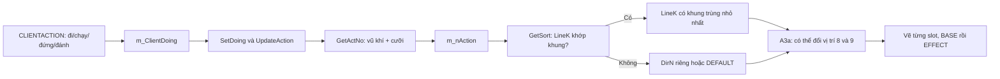

# U-03 — Thứ tự vẽ theo hành động, hướng và khung

## TÓM TẮT 5 DÒNG
1. PARTIAL: khảo sát tĩnh client bản A và dữ liệu nữ, không sửa mã hay chạy game, VM, executable hoặc mạng.
2. Nữ có 45 mục hành động, mỗi mục được lập đủ 8 hướng; đã ghi bảng DEFAULT, 297 dòng LineK và luật chọn bảng.
3. Đầu ra: `JX1_OPS/DESIGN/BANG-THU-TU-VE.md`; dữ liệu riêng `D:\JX-wt\_data\nu-decoded-utf8.ini` không được chép hay commit.
4. CHƯA XÁC MINH số m_nAction/mục INI của tình huống thương A3a và nội dung bảng nam; không có kiểm thử runtime.
5. BỊ CHẶN – CHƯA PUSH: `git add` không tạo được index.lock (Permission denied); chưa có SHA. PM cần commit trong môi trường được phép ghi git metadata.

liên quan: [QUY-LUAT-VE-BO-PHAN.md](../DESIGN/QUY-LUAT-VE-BO-PHAN.md), [BUG-001.md](../BUGS/BUG-001.md), [J-04](J-04-lop-chong-nhan-vat.md), chỉ thị #093 mục 6.

## Phạm vi và phương pháp

Đọc task U-03, các nguồn được task dẫn, ba skill JX1 liên quan và mục lục tri thức. Dùng client bản A tại `D:\JX-build\qh9A`; chỉ đọc các file `Classes/gamecore` và `Classes/vn/gamecore` cần cho luồng hành động, chọn bảng và vẽ. Nguồn dữ liệu nữ là file UTF-8 ngoài repo mà task cấp. Không đọc, ghi hoặc commit dữ liệu gốc đã giải mã ngoài workspace; chỉ dẫn đường dẫn, số dòng và SHA-256 để truy vết.

Nguồn dẫn đường được kiểm tra trên đĩa: `D:\JX-build\qh9A\Classes\graphify-out\.graphify_root` trỏ root `.`; `GRAPH_REPORT.md` ghi lớp `KNpcResNode.cpp`. Graphify chỉ dùng điều hướng, mọi kết luận bên dưới đối chiếu lại mã thật. Task yêu cầu đọc client bản A nhưng tên file nguồn không có trong checkout rời; chỉ sử dụng dữ liệu riêng U-03 đã chỉ định, không dùng qh7 hay client Android.

Ký hiệu trong trích dẫn: **A** = `D:\JX-build\qh9A`; **G** = `A/Classes/gamecore`; **V** = `A/Classes/vn/gamecore`; **N** = `D:\JX-wt\_data\nu-decoded-utf8.ini`; **N:dòng** là số dòng tính từ đầu file. SHA-256 đọc được: N = `ffd0a5551595784e392227963580b117fcd0437b1f4c58f50e9a6184c9dd462d`; V/KNpcResVN.cpp = `2b642b268aa1f89fbe1181d48348a44e76933a4d3c0be75971727c4b67b4b41e`; G/KNpcResNode.cpp = `cd748986b6d17de50d5d9fd1d4aa3a3fbecc650db0a441d96b7694ff796fb09e`; G/KNpcRes.cpp = `137974c9951cfcd9a546c98541ec65f18a657db220722bccaf86e8fd1a3e95c7`.

## ĐÃ XÁC MINH

### Kết quả dữ liệu nữ

- N:1..25 là `[DEFAULT]` với 24 dòng Dir; file có 46 section tổng cộng, tức 45 mục hành động.
- Có 152 dòng `DirN` hoạt động, trong đó 128 dòng thuộc mục hành động; mỗi hành động được mở rộng thành đủ 8 hướng bằng `DEFAULT` tại hướng thiếu.
- Có 297 dòng `LineK` trên 45 mục; mỗi dòng chứa số khóa khung và đúng 12 mã bộ phận. Khóa khung L có miền 0..119.
- So sánh từng chuỗi cơ sở sau khi bù hướng thiếu: 45/45 hành động khác nhau ở ba cặp gương 1↔7, 2↔6, 3↔5; cả ba cặp trong DEFAULT cũng khác. Tất cả 360 chuỗi cơ sở (45×8) được lập ở tài liệu thiết kế.
- Đã giữ nguyên thứ tự vị trí trong dữ liệu trước phép đổi mã 8↔9 của A3a. Không đổi chỗ hay diễn giải vị trí như một kết luận hình ảnh.

### Luồng từ trạng thái tới bảng vẽ

- `G/KNpc.h:104-122` định nghĩa `CLIENTACTION` liên tục từ 0: đứng chiến đấu 0, đứng 1/2, đi chiến đấu 3, đi thường 4, chạy chiến đấu 5, chạy thường 6, bị thương 7, chết 8, đánh 9/10, phép 11, ngồi 12.
- `G/KNpc.cpp:2871-2898` đặt đi bộ thành `cdo_fightwalk` hoặc `cdo_walk`; `G/KNpc.cpp:2159-2184` đặt chạy thành 5/6. `G/KNpc.cpp:2053-2090,2094-2110` đặt đứng thành 0 hoặc 1/2. `G/KNpc.cpp:2494-2505` chọn đánh thường 9/10.
- `G/KNpc.cpp:6096-6097` gửi `m_ClientDoing` vào `KNpcRes::SetDoing` rồi `KNpcResVN::Draw`. `G/KNpcRes.cpp:1656-1665` gán `m_nDoing`; :1684-1700 lấy action qua `GetActNo` theo trạng thái, loại vũ khí ở lớp BASE và cờ cưỡi.
- `G/KNpcResNode.cpp:592-605` chọn bảng ánh xạ không cưỡi/cưỡi; :319-369 đọc tên bảng từ các cột `武器行为关联表1/2` và tên file thứ tự từ cột `动作贴图顺序表`; :335-337, :357-359 chuyển tên hành động sang số qua `CActionName::GetActionNo`. Số dòng hành động bắt đầu tại 0 theo :695-706, :714-724.
- `G/KNpcResNode.cpp:612-630` chuyển sang `CSortTable::GetSort`; `V/KNpcResVN.cpp:205` gọi `GetnSort(m_nAction,nCurDirNo,nCurFrameNo,...)`. V:460-493 đi lần lượt qua slot sort, hai lớp sprite và giao danh sách ảnh cho renderer.

Sơ đồ chuỗi bằng chứng:

### Luật tải và tra bảng

- `G/KNpcResNode.cpp:21` định nghĩa `MAX_SORT_DIR=16`; :1238-1242 và :1320-1327 chỉ nạp `DEFAULT/Dir1..Dir16`. Dir17..24 có dữ liệu nhưng mã này không đọc. Dir9..16 được nạp; chưa có bằng chứng chúng là bảng dành riêng cho cưỡi.
- :1255 bỏ qua hành động không có section. :1343-1357 nạp hướng riêng và chép hướng cùng số từ DEFAULT nếu hướng ấy bị thiếu. Nó không kế thừa section đứng ngay trước trong file.
- :1271-1294 và :1363-1373 duyệt `Line1,Line2,...` liên tục, dừng tại khóa đầu tiên thiếu. Vì vậy `FreeRun` thiếu `Line10` ở N:284 làm `Line11=52` không được nạp.
- :1422-1436 hoặc :1452-1466 so `nFrameNo` với số L lưu trong từng LineK; lần khớp đầu trả kết quả, nếu không khớp thì dùng DirN tương ứng (:1438-1446, :1468-1477).
- Có ba khung trùng trong các dòng liên tục đã nạp: MeleeWCut L=60 (Line2 thắng Line3, N:354-355), MeleeWMagic L=8 (Line8 thắng Line9, N:384-385), MeleeWRun L=50 (Line13 thắng Line14, N:510-511). Các dòng cuối có K lớn hơn bị che, dù thứ tự văn bản trong file có thể đảo.
- Trong 297 dòng, 296 đi qua quy tắc K liên tục; trừ ba dòng trùng có K hợp lệ còn 293 khóa có thể thắng theo cấu trúc. Đây là kiểm tra dữ liệu và luật mã, không phải bằng chứng các section đã được nạp ở runtime.
- Dòng ghi `DirNum=26` và `UnitNum=11` ở N:26-27 không thay đổi giới hạn: phần đọc `DirNum` tại G/KNpcResNode.cpp:1316 đang comment.

### Hướng và khung tuyệt đối

`V/KNpcResVN.cpp:60-68` tạo chỉ số hướng và khung cho từng SPR đang tồn tại. Đặt D = tổng hướng của SPR (fallback 1 nếu D<=0), F = totalFrames/D, d = lượng tử hóa hướng từ nDir theo miền 64, và r = F×nCurFrame/nAllFrame. `nCurFrameNo=d×F+r`. Chia số nguyên; nhánh trên dùng khi nAllFrame>0. G/KNpcRes.cpp:267-271 có cùng công thức.

Vì GetSort so trực tiếp `nCurFrameNo`, khóa L có thể rơi vào hướng d>0 nếu F<=L<8F; khi đó d=floor(L/F), r=L mod F. Ví dụ phép tính minh họa, không phải metadata SPR đo được: RangeWWalk Line1 L=31 với F=12 cho d=2,r=7; RangeWRun Line3 L=48 với F=12 cho d=4,r=0; MeleeWDie Line10 L=119 với F=16 cho d=7,r=7. Như vậy số đầu LineK **có thể** khớp hướng khác 0 theo công thức mã; chưa thể khẳng định các ví dụ là khóa trúng thực tế của asset. F thực tế của A3a chưa biết. FreeWalk L=8/9/10 (N:265-267) cũng là ứng viên tùy F; với F=12 cả ba nằm ở hướng 0. Nếu F>119, mọi khóa hiện có của N nằm trong hướng 0.

### Thứ tự 12 mã và hành động

N:1-9 cho DEFAULT của nữ; toàn bộ tám chuỗi được chép ở tài liệu thiết kế. Dữ liệu chứa đúng 12 mã: `0,1,4,5,6,7,8,9,12,13,14,16`. Source khai báo tối đa 6 nhóm, 4 slot mỗi nhóm (`G/KNpcResNode.h:23-25`); nhóm thân thể được khai báo ở `G/CoreUseNameDef.h:8-15`. Thứ tự các mã là thứ tự sort, không phải ID nhóm hay thứ tự số tăng.

Các mục hành động liên quan theo tên file N:

| Nhóm tên INI | Đi | Chạy | Đứng | Đánh/phép |
|---|---|---|---|---|
| Free | FreeWalk | FreeRun | FreeStand1/2/3 | FreeAttack, FreeMagic |
| MeleeW | MeleeWWalk | MeleeWRun | MeleeWStand | MeleeWCut, MeleeWPuncture, MeleeWMagic |
| RangeW | RangeWWalk | RangeWRun | RangeWStand | RangeWCut, RangeWPuncture, RangeWMagic |
| DoubleW | DoubleWWalk | DoubleWRun | DoubleWStand | DoubleWPound, DoubleWPull, DoubleWMagic |
| Ride | RideWalk | RideRun | RideStand/1/2 | RideCut, RidePuncture, RideMagic |

Có `RangeWWalk` ở N:518 và `RangeWRun` ở N:530; ghi chú trong DESIGN/QUY-LUAT-VE-BO-PHAN.md:15 đã lỗi thời ở chỗ cho rằng RangeWWalk không có. Sự tồn tại trong INI không chứng minh action ánh xạ tới tên đó.

A3a có thêm khối trong V:208-214: nếu không cưỡi, hướng 0..3 và cờ `/sdcard/jxlayeroff` không tồn tại, tìm mã 8/9 trong bảng rồi hoán đổi vị trí. Khối này không giới hạn theo hành động đi bộ. `SORTIN` được ghi ở V:216-219 sau hoán đổi. Các bảng tài liệu là dữ liệu INI trước phép biến đổi này; chưa xác nhận ảnh pixel hoặc bản APK cài.

V:53-68 cập nhật cặp hướng/khung cho từng slot và lớp đang có sprite. Sau vòng lặp, V:197-205 truyền cặp giá trị cuối vào `GetnSort`; chưa có metadata để xác định sprite nào quyết định khóa này trong tình huống A3a.

## CHƯA XÁC MINH

- Không tìm thấy trong `D:\JX-build\qh9A` các file rời `人物类型.txt`, `动作编号表.txt`, hai bảng liên kết hành động theo vũ khí/cưỡi, hoặc bảng thành phần của nhân vật. Vì vậy chưa chốt `m_nAction` và section INI nào được tra khi nhân vật nữ cầm thương đi bộ, chạy, đứng hoặc đánh.
- Chưa có `男主角贴图顺序表.ini` trong nguồn rời đã kiểm. Task U-03 và DESIGN/QUY-LUAT-VE-BO-PHAN.md:4 ghi gián tiếp rằng file nam chỉ có `[DEFAULT]`; chưa kiểm từng dòng.
- Theo mã, nếu file nam quả thực chỉ có DEFAULT, mọi action sẽ dùng cùng bảng hướng mặc định vì action không có `nActOff` riêng (G/KNpcResNode.cpp:1255, :1404). Điều đó không khẳng định thứ tự nam giống nữ hoặc BUG-001 xảy ra ở nhân vật nam.
- Chưa đo F, tổng hướng/khung và danh sách SPR/layer cuối cùng của tình huống A3a; chưa kiểm bản tài nguyên trên APK cài, ảnh tám hướng, hay runtime. Các dòng LineK có số học tiềm năng ở hướng khác 0 chưa đủ để kết luận dữ liệu được tác giả viết sai.
- BUG-001.md:6-10 ghi số đứng `act=38` và việc sửa A3a, nhưng chưa nối được 38 tới tên mục khi thiếu bảng action/vũ khí. Không quy lỗi từ dữ liệu tĩnh.
- Tên cột mã đọc ở bản A là `动作贴图顺序表` (G/KNpcResNode.cpp:366; G/CoreUseNameDef.h:61). Task/ghi chú cũ ghi `人物贴图顺序表`; không có file 人物类型.txt để xác nhận header thực tế.

## MỤC SỔ THÔNG SỐ

Các giá trị source dưới đây là hằng số/công thức tĩnh; thông số dữ liệu là số đếm từ file N. Chúng không phải số đo runtime và không cấp quyền thay đổi client.

| Nhóm | Tên/hằng số | File:dòng | Giá trị | Đơn vị | Ảnh hưởng | Đổi an toàn | Nguồn |
|---|---|---|---:|---|---|---|---|
| Dữ liệu | Section nữ | N:1-548 | 46 | section | DEFAULT và hành động có thể có trong ini | KHÔNG | Đếm file UTF-8 |
| Dữ liệu | Hành động nữ | N:29-545 | 45 | mục | Tên cần liên kết với action index | KHÔNG | Đếm section; chưa xác nhận danh sách action |
| Dữ liệu | Dòng hướng đang hoạt động | N:2-539 | 152 | dòng DirN | Bảng hướng khai báo; hướng thiếu fallback DEFAULT | KHÔNG | Đếm file; loại chú thích |
| Dữ liệu | LineK tồn tại / liền K | N:39-513 | 297 / 296 | dòng | Khóa K thiếu làm dừng nạp các K sau | KHÔNG | Đếm và áp quy tắc C++ |
| Cấu trúc | `MAX_SORT_DIR` | G/KNpcResNode.cpp:21 | 16 | hướng | Số hướng bảng mà loader đọc | KHÔNG | Hằng số source |
| Cấu trúc | `MAX_BODY_PART × MAX_BODY_PART_SECT` | G/KNpcResNode.h:23-25 | 6×4 = 24 | slot | Kích thước tối đa bảng part | KHÔNG | Hằng số source |
| Cấu trúc | `emNPCRES_PART_LAYER_COUNT` | G/CoreUseNameDef.h:20-24 | 2 | lớp | BASE và EFFECT | KHÔNG | Enum source |
| Cấu trúc | `MAX_ACTION` | G/KNpcResNode.h:27 | 128 | action | Giới hạn mảng tên và bảng tra | KHÔNG | Hằng số source |
| Điều hướng | Hướng logic đầu vào | V/KNpcResVN.cpp:42-46,60-67 | 64 | đơn vị/hướng vòng | Lượng tử hóa hướng theo metadata SPR | CẨN THẬN | Biểu thức source |
| Điều hướng | Bù lượng tử hóa | V/KNpcResVN.cpp:42,63 | 32/D | đơn vị | Làm tròn hướng; D là số hướng SPR | CẨN THẬN | Biểu thức source |
| Thứ tự vẽ | Khóa LineK | G/KNpcResNode.cpp:1422-1426,1452-1456 | So bằng nhau với `nFrameNo` | frame tuyệt đối | Ghi đè bảng hướng nếu khớp | KHÔNG | Mã source |
| Biến đổi A3a | Hoán đổi slot 8↔9 | V/KNpcResVN.cpp:208-214 | Hướng 0..3, không cưỡi | slot | Đổi vị trí hai mã sort sau tra bảng | KHÔNG | Mã source; runtime chưa kiểm |

## Lỗi công cụ, kiểm tra và bàn giao

- `rg` không có trong PATH ở worktree. Đã chuyển sang `Select-String`/PowerShell và tìm file bằng `Get-ChildItem` giới hạn trong qh9A; không cài công cụ.
- Một lượt liệt kê đệ quy đầu tiên trả dư nhiều đường dẫn và bị cắt output; thu hẹp ngay sau đó theo đúng tên file, không dùng đầu ra bị cắt làm căn cứ.
- Đối chiếu tĩnh đã chạy bằng JavaScript trong phiên: phân tích 46 section, xác nhận 360 chuỗi hướng cơ sở, 297 LineK, 296 K liên tục, ba cặp khóa trùng, một gap ở FreeRun; tất cả 12 mã trong các chuỗi nằm trong danh sách dự kiến. Đây là kiểm tra trích xuất/cấu trúc, không phải kiểm thử chương trình game.
- Chưa chạy test, build, client, executable, VM hoặc mạng theo phạm vi task. Không xác minh runtime.
- Bước PM cần làm khi có tài nguyên bản A tương ứng: đối chiếu `人物类型.txt`, `动作编号表.txt`, hai bảng liên kết vũ khí và bảng nam; sau đó chọn đúng SPR để lấy F và xác định `m_nAction)/mục INI của tình huống cầm thương đi bộ. Không cần thay mã để hoàn thành bước tài liệu này.

Dòng đề xuất để PM thêm vào `JX1_OPS/DESIGN/MUC-LUC-TRI-THUC.md`:

| Thứ tự vẽ bộ phận theo hành động/hướng/khung | `DESIGN/BANG-THU-TU-VE.md`, U-03; `BUGS/BUG-001.md` | `KNpcResVN.cpp::Draw`, `KNpcResNode.cpp::GetSort`, nữ: `女主角贴图顺序表.ini` | bảng nữ và luật tĩnh **chắc**; action thực tế/nam/runtime **chưa xác minh** |

## Trạng thái

**PARTIAL** — đã hoàn tất bảng dữ liệu nữ, đối xứng chuỗi, luật loader/lookup và đối chiếu luồng action trong mã bản A. Mục action thực tế của nữ cầm thương, nội dung nam và dữ liệu runtime còn thiếu nguồn.

**BỊ CHẶN – CHƯA PUSH:** `git add -- JX1_OPS/DESIGN/BANG-THU-TU-VE.md JX1_OPS/REPORTS/U-03.md JX1_OPS/TASKS/U-03.md` thất bại: `fatal: Unable to create 'D:/jx1-reports/.git/worktrees/U-03/index.lock': Permission denied`. Chưa stage, chưa commit, không có SHA. PM cần stage và commit ba file trên từ môi trường có quyền ghi common Git metadata. Không push.

