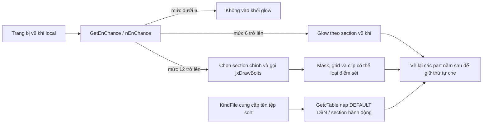

TÓM TẮT 1: [THẤY] PARTIAL — mã bản A xác định luồng tĩnh lấy cấp cường hóa của vũ khí đang mặc và các ngưỡng glow/sét.
TÓM TẮT 2: [THẤY] Glow bắt đầu từ +6: +6–11 trắng, +12–14 vàng, từ +15 xanh điện; mã và màu nằm trong C++.
TÓM TẮT 3: [THẤY] Sét được gọi từ +12; +15 xét nhiều cung ứng viên và cường độ cao hơn, nhưng mask/điều kiện có thể bỏ draw.
TÓM TẮT 4: [CHƯA KIỂM] Bảng item và tệp 女主角贴图顺序表.ini không có trong root bản A; chưa xác định cột dữ liệu item hoặc giá trị sort thực.
TÓM TẮT 5: [CHƯA KIỂM] Không build/test, chạy exe/VM hay mạng; nhịp ngoài worktree bị chặn ghi, không có commit/push.

# W-01a — Dữ liệu hiệu ứng vũ khí: cường hóa, glow, sét và thứ tự vẽ

Loại: khảo sát
Chủ đề: Xác định tĩnh nguồn cấp cường hóa vũ khí, quy tắc glow/sét và luồng nạp bảng thứ tự vẽ trong mã client bản A.
Từ khóa: hiệu ứng vũ khí, cường hóa, glow, tia sét, nEnChance, GetEnChance, jxDrawBolts, 女主角贴图顺序表.ini, KNpcResVN
Trạng thái: PARTIAL — mã bản A có đủ luồng kích hoạt và ngưỡng; thiếu bảng item cùng INI để đối chiếu cột/khóa và giá trị sort.
Độ phủ: 7/7 tệp mã/shader đã chọn trong source A được đọc tĩnh; 0/2 bảng vũ khí và 0/1 INI được nêu trong task có mặt trong root qh9A; luồng nạp sort 1/1 được đối chiếu.
Liên quan: H-04, H-14-mat-khung-hieu-ung, K-02-du-lieu-ini, K-03a, DESIGN/QUY-LUAT-VE-BO-PHAN.md.
Cần tôi quyết định: không

## Phạm vi và độ phủ

| Phần tử phạm vi | Kết quả/độ phủ | Bằng chứng |
|---|---|---|
| Cấp cường hóa của vũ khí được dùng làm điều kiện hiệu ứng | [THẤY] Đã phủ luồng trong mã; chưa xác định cột cấu hình dữ liệu tạo giá trị này | D:/JX-build/qh9A/Classes/vn/gamecore/KNpcResVN.cpp:503-512; D:/JX-build/qh9A/Classes/gamecore/KItem.h:117,372 |
| Mốc +6/+12/+15 và màu glow | [THẤY] Đã phủ tĩnh | D:/JX-build/qh9A/Classes/vn/gamecore/KNpcResVN.cpp:514-522 |
| Mã sét và khác biệt +12/+15 | [THẤY] Đã phủ tĩnh; số cung là ứng viên trước các điều kiện lọc, không phải số draw chắc chắn | D:/JX-build/qh9A/Classes/vn/gamecore/KNpcResVN.cpp:556-618; D:/JX-build/qh9A/Classes/gamescene/KgameWorld.cpp:15025-15029,15087-15114,15188-15229 |
| Shader glow | [THẤY] Đã phủ hai shader trong source A | D:/JX-build/qh9A/Resources/Shaders/glow.fsh:5-10; D:/JX-build/qh9A/Resources/Shaders/glow.vsh:1-9 |
| Cột item/khóa trong dữ liệu vật phẩm | [TÀI LIỆU] Báo cáo cũ nêu; [CHƯA KIỂM] chưa phủ dữ liệu gốc; tài liệu K-03a chỉ nêu các cột ItemGenre/DetailType/ParticularType/Level làm nhóm/loại/cấp item, không chứng minh cột nào ghi hiệu ứng glow | JX1_OPS/REPORTS/K-03a.md:75,77-80 |
| Tệp và giá trị thực của bảng sort | [THẤY] Mã nạp tệp; [CHƯA KIỂM] chưa phủ nội dung INI; mã chỉ cho thấy tên tệp được lấy từ KindFile rồi ghép RES_INI_FILE_PATH để nạp | D:/JX-build/qh9A/Classes/gamecore/KNpcResNode.cpp:365-369,1201-1215 |
| Cấu trúc khóa mà bộ đọc sort chấp nhận | [THẤY] Đã phủ một phần ở mã: DEFAULT/Dir1…DirN và section theo tên action; các giá trị trong INI cụ thể chưa kiểm | D:/JX-build/qh9A/Classes/gamecore/KNpcResNode.cpp:1219-1242,1320-1356 |
| Dữ liệu item/INI được task nêu | [CHƯA KIỂM] Không có trong root qh9A sau kiểm tra đường dẫn/tên đã lọc; không mở nguồn ngoài phạm vi để thay thế | JX1_OPS/TASKS/W-01a.md:15-16 |

## Giải mã tên

| Tên gốc | Mã hóa | Chữ đúng UTF-8 | Nguồn file:dòng |
|---|---|---|---|
| 女主角贴图顺序表.ini | UTF-8 trong tên được task ghi; encoding của file nguồn chưa kiểm | Bảng thứ tự ảnh ghép/bộ phận nhân vật nữ chính | JX1_OPS/TASKS/W-01a.md:15 |
| Không có tên riêng nhân vật, NPC, bản đồ hoặc vật phẩm được xác minh trong lượt này | Không áp dụng | Không áp dụng | Phạm vi source đã đọc ở bảng trên |

## Sắp theo cấu trúc game

| Cấu trúc | Thứ tự/quan hệ xác minh được | Giới hạn |
|---|---|---|
| Dữ liệu item | K-03a mô tả ItemGenre → DetailType → ParticularType và Level cho bảng vũ khí; không có bảng item bản A tại root qh9A để nối record cụ thể với hiệu ứng | Chưa thể sắp tên/mã từng vũ khí hay kết luận cột dữ liệu nào điều khiển glow |
| Sort bộ phận | GetSort nhận action, direction và frame; bộ đọc nạp các hướng DirN mặc định và section theo action. KNpcResVN duyệt m_nSortTable rồi gom các phần thuộc vùng section vũ khí | Chưa có INI để liệt kê thứ tự part cụ thể theo hướng/khung |
| Hiệu ứng | Glow vẽ lại section vũ khí; từ cấp 12 chọn section dominant để neo sét; sau mỗi section vẽ lại part theo sau nó nhằm giữ che lớp | Đây là quan hệ trong source, không xác nhận thứ tự runtime hoặc kết quả hình ảnh |

## Bằng chứng và kết quả

### [THẤY] Nguồn cấp cường hóa và ngưỡng glow

KNpcResVN::Draw chạy khối này cho nhân vật người chơi local khi không ở menu. Mỗi chu kỳ cập nhật, mã lấy chỉ số trang bị tại slot itempart_weapon rồi gọi GetEnChance() để có mức đang dùng. Nếu g_jxTrace được bật, một cờ thử có thể thay cấp theo tên file; đây là nhánh chẩn đoán, không phải nguồn cấp thật (D:/JX-build/qh9A/Classes/vn/gamecore/KNpcResVN.cpp:495-512).

Mã bật glow từ cấp 6. Các khoảng là 6–11 màu trắng với s=0,35; 12–14 màu vàng với s=0,65; từ 15 màu xanh điện với s=1. Màu RGB và alpha/gain được đặt trực tiếp trong C++; pulse là 0,9 + 0,1 × sin(t_ms × 0,006) (D:/JX-build/qh9A/Classes/vn/gamecore/KNpcResVN.cpp:514-522). Các nguồn này chưa chỉ ra một cột trong file item; nEnChance là trường trong common item attributes, còn GetEnChance() trả trường đó (D:/JX-build/qh9A/Classes/gamecore/KItem.h:117,372).

Glow được gom theo section vũ khí đang có trong m_nSortTable; mỗi section có các lượt vẽ lệch tâm để tạo cộng sáng. Khi qua section dominant, code gọi jxDrawBolts; sau section hiện tại, nó vẽ lại các part theo sau để chúng che hiệu ứng (D:/JX-build/qh9A/Classes/vn/gamecore/KNpcResVN.cpp:540-546,550-586,587-626). Đây là đường mã tĩnh, không phải xác nhận hiệu ứng nhìn thấy trên client đang chạy.

### [THẤY] Sét và shader

jxDrawBolts định nghĩa trực tiếp 16 pha, 10 cung và 96 cấu trúc spark trong C++; timer lấy pha theo khoảng 50.000 micro giây. Từ +15, step=1 và intensity=1, xét đủ 10 chỉ số cung; mức +12 đến +14 dùng step=2 và intensity=0,6, xét 5 chỉ số cung. Cung vẫn có thể rỗng hoặc bị loại bởi điều kiện mask/grid/clip, nên không diễn giải các con số này thành số tia luôn được vẽ. Mảng s_spk[96] được khởi tạo, nhưng vòng vẽ hạt nhỏ hiện có điều kiện j < 0, nên không gửi hạt qua vòng đó; vòng cung sét là nhánh riêng (D:/JX-build/qh9A/Classes/gamescene/KgameWorld.cpp:15025-15035,15087-15114,15154-15156,15188-15209).

Glow shader được khởi tạo theo tên Shaders/glow trong KgameWorld.cpp:9042-9047. Fragment shader nhân RGB texture với u_glow.rgb và u_glow.a, giữ alpha texture; vertex shader chuyển vị trí qua CC_PMatrix và truyền tọa độ texture (D:/JX-build/qh9A/Resources/Shaders/glow.fsh:5-10; D:/JX-build/qh9A/Resources/Shaders/glow.vsh:1-9). Không có bảng hiệu ứng glow/sét trong hai shader này.

### [THẤY] Luồng nạp thứ tự vẽ

KNpcResNode lấy tên tệp sort từ một trường của KindFile, lưu tên rồi gọi GetcTable (D:/JX-build/qh9A/Classes/gamecore/KNpcResNode.cpp:365-369). GetcTable ghép RES_INI_FILE_PATH với tên tệp và gọi Load; bộ đọc CSortTable nhận các khóa Dir1… dưới DEFAULT, sau đó đọc section theo tên action khi có dữ liệu riêng (D:/JX-build/qh9A/Classes/gamecore/KNpcResNode.cpp:1201-1215,1219-1242,1320-1356). GetSort được gọi với action, direction và frame (D:/JX-build/qh9A/Classes/gamecore/KNpcResNode.cpp:627-628).

Tên INI cụ thể được task nêu là 女主角贴图顺序表.ini, nhưng không tìm thấy file đó trong root D:/JX-build/qh9A; không thể chép giá trị DirN hoặc xác nhận khác biệt theo action/hướng. DESIGN/QUY-LUAT-VE-BO-PHAN.md cũng cảnh báo bảng trước đó chưa được đối chiếu độc lập với file INI/source được chỉ định (JX1_OPS/DESIGN/QUY-LUAT-VE-BO-PHAN.md:1-4).

### [TÀI LIỆU] Tệp dữ liệu vật phẩm

K-03a ghi bảng meleeweapon.txt có 70 dòng item và rangeweapon.txt có 30 dòng ở nguồn G; báo cáo ghi các trường G/D/P/L là ItemGenre/DetailType/ParticularType/Level và phân biệt chúng với ID instance. Đây là tham chiếu tài liệu cũ, không phải tệp item gốc bản A được mở trong task này (JX1_OPS/REPORTS/K-03a.md:41-44,75-80). Vì vậy không kết luận rằng một trong các cột đó lựa chọn màu/hiệu ứng; bằng chứng source A chỉ xác nhận cấp dùng lúc vẽ đi qua nEnChance/GetEnChance().

## MỤC SỔ THÔNG SỐ

| Nhóm | Tên/hằng số | file:dòng | Giá trị | Đơn vị | Ảnh hưởng | Đổi an toàn | Nguồn đo |
|---|---|---|---|---|---|---|---|
| Vật phẩm | nEnChance / GetEnChance | D:/JX-build/qh9A/Classes/gamecore/KItem.h:117,372 | Trường mức cường hóa; giá trị thực lấy từ vật phẩm đang mặc | cấp | Đầu vào nhánh glow/sét | CẨN THẬN | Đọc source tĩnh; không đo runtime |
| Glow | Ngưỡng cấp | D:/JX-build/qh9A/Classes/vn/gamecore/KNpcResVN.cpp:514-521 | 6 / 12 / 15 | cấp cường hóa | Bật glow và đổi màu/gain | CẨN THẬN | Đọc source tĩnh |
| Glow | s theo cấp | D:/JX-build/qh9A/Classes/vn/gamecore/KNpcResVN.cpp:517 | 0,35 / 0,65 / 1,0 | hệ số | Gain theo ba mức | CẨN THẬN | Đọc source tĩnh |
| Glow | RGB | D:/JX-build/qh9A/Classes/vn/gamecore/KNpcResVN.cpp:519-521 | +6 trắng (1;1;1); +12 vàng (1;0,8;0,35); +15 xanh điện (0,55;0,8;1) | RGB | Màu glow | CẨN THẬN | Đọc source tĩnh |
| Glow | Pulse | D:/JX-build/qh9A/Classes/vn/gamecore/KNpcResVN.cpp:518 | 0,9 + 0,1 × sin(t_ms × 0,006) | hệ số; thời gian ms | Điều biến alpha/gain | CẨN THẬN | Đọc source tĩnh; chu kỳ không đo |
| Glow | Vị trí vẽ | D:/JX-build/qh9A/Classes/vn/gamecore/KNpcResVN.cpp:551-553,587-600 | 9 offset khởi tạo, tâm + các trục/chéo; bán kính 0,8 + s | offset/hệ số | Số lượt và độ lan glow; nhánh A2 có gộp/bỏ lượt | CẨN THẬN | Đọc source tĩnh |
| Sét | Mảng hiệu ứng | D:/JX-build/qh9A/Classes/gamescene/KgameWorld.cpp:15029-15035,15154-15156 | 16 pha; 10 cung; 96 entry spark; vòng vẽ spark đang tắt | pha/cung/entry | Cấu trúc hiệu ứng; entry spark không được vẽ qua vòng j < 0 | CẨN THẬN | Đọc source tĩnh |
| Sét | Step và intensity | D:/JX-build/qh9A/Classes/gamescene/KgameWorld.cpp:15088-15091 | +12: step 2, intensity 0,6; +15: step 1, intensity 1,0 | chỉ số/hệ số | Số cung ứng viên và độ sáng | CẨN THẬN | Đọc source tĩnh |
| Sét | Pha thời gian | D:/JX-build/qh9A/Classes/gamescene/KgameWorld.cpp:15091 | 50.000 | micro giây | Chọn frame hiệu ứng; chưa tương đương FPS đo | CẨN THẬN | Đọc source tĩnh |
| Mask | Guard cơ bản | D:/JX-build/qh9A/Classes/gamescene/KgameWorld.cpp:15087-15114 | R tối thiểu 8; mask tối thiểu 8; grid tối đa 200×200; GRD=3 | tọa độ/điểm/pixel | Không đạt thì sét có thể return/bỏ draw | CẨN THẬN | Đọc source tĩnh |

## Đề xuất tối ưu

Chưa đề xuất thay đổi mã hoặc dữ liệu. Nếu sau này có đủ đúng INI và item data được chỉ định, đối chiếu các cột khóa với nEnChance và kiểm các chuỗi DEFAULT/DirN theo action/hướng trước khi mô tả bảng hiệu ứng. Mọi thay đổi hoặc test runtime cần một task có phạm vi tương ứng.

## ĐÃ XÁC MINH

- Source A được chỉ định là D:/JX-build/qh9A; các file source thực có mặt: KItem.h, KNpcResNode.cpp, KNpcResVN.cpp, KgameWorld.cpp, glow.fsh và glow.vsh. KItem.cpp được đọc đoạn EnChance để phân biệt trường cường hóa và logic setter.
- Đọc trực tiếp source tại các file:dòng trong bảng trên. Kết luận về màu/ngưỡng và lệnh gọi sét là kết luận source tĩnh.
- Các ghi chép H-04/H-14/K-02/K-03a được tra trước để định vị; Graphify report trong Classes/graphify-out không có hit liên quan các symbol đã tìm, nên kết luận dựa trên source mở trực tiếp.
- Git status duy nhất trước ghi nhận nhánh task/W-01a và không có thay đổi hiện hữu.
- Không sửa mã, INI, APK hoặc nguồn dữ liệu. Không có build/test/runtime thực chạy.

## CHƯA XÁC MINH

- Không tìm thấy meleeweapon.txt, rangeweapon.txt hoặc 女主角贴图顺序表.ini trong root qh9A theo các tên/path đã lọc; chưa kiểm tra file ngoài root được task cho phép.
- Chưa xác định cột trong dữ liệu item nào ánh xạ tới nEnChance, hoặc có trường cấu hình hiệu ứng riêng trong dữ liệu khác.
- Chưa biết đúng tên tệp sort thực tế được KindFile trả về, giá trị DirN, các section/action cụ thể hay thứ tự part thực theo hướng/khung.
- Chưa xác minh client runtime, hình ảnh hiệu ứng, tần suất mất khung, hiệu ứng trên vũ khí khác, FPS/RAM hoặc provenance của APK.
- Chưa chạy build, exe, VM, test game hoặc mạng vì task chỉ cho đọc tĩnh.
- Không ghi được D:/JX-wt/W-01a.nhip: hệ thống từ chối ghi ngoài writable root; không đổi quyền hoặc tìm cách vượt sandbox.
- rg không có trong PATH; báo lỗi một lần và dùng PowerShell với bộ lọc tên/path. Không cài công cụ.

## Bàn giao

Trạng thái PARTIAL. Báo cáo này giữ riêng điều thấy trực tiếp trong mã, nội dung được dẫn từ tài liệu cũ và dữ liệu chưa kiểm. Không có commit SHA vì prompt yêu cầu Tổng quan commit; chưa push.

Dòng đề nghị PM gộp mục lục tri thức: Hiệu ứng glow/sét +6/+12/+15 và luồng thứ tự vẽ — W-01a; KNpcResVN.cpp, KgameWorld.cpp, KNpcResNode.cpp, KItem.h; khảo sát tĩnh, thiếu item data/INI nên ánh xạ cấu hình còn chưa kiểm.

Kỹ năng đã đọc theo yêu cầu: jx1-retrofit, jx1-read-server, jx1-read-client, jx1-parameters, jx1-knowledge, jx1-report.

## Phát hiện khi chuẩn hóa, lỗi/cách thử/kết quả

| Vấn đề | Cách thử/bằng chứng | Kết quả |
|---|---|---|
| rg không sẵn dùng | Lệnh rg ban đầu trả lỗi CommandNotFoundException | Chuyển sang kiểm tra theo đường dẫn/tên bằng PowerShell; không cài |
| INI và bảng item vắng khỏi root bản A | Kiểm tra tên file/path đã nêu trong task và bảng weapon; không mở toàn cây | Đánh dấu thiếu nguồn; không thay bằng root ngoài phạm vi |
| Graphify không giúp định vị phần này | Kiểm GRAPH_REPORT tại Classes/graphify-out theo symbol; không có kết quả khớp | Mở trực tiếp các symbol/file cần thiết trong source A |
| Ghi nhịp ngoài writable root bị từ chối | WriteAllText tới D:/JX-wt/W-01a.nhip trả Access denied | Không tạo file nhịp, không đổi quyền hoặc bypass; báo PM |
| Nhiệm vụ ghi kết quả vào task | Task khai báo vung_file chỉ có báo cáo, trong khi prompt cũng yêu cầu mục Kết quả ở cuối task | Chỉ thêm đúng mục Kết quả được yêu cầu vào task; không chỉnh trường/nội dung khác |
| Xung đột encoding của source comments | Một số comment CJK hiển thị lỗi khi đọc UTF-8 | Không dùng comment lỗi encoding làm dữ kiện; dùng symbol, giá trị C++ và đường dẫn thực có |

### Kết quả cuối

W-01a: PARTIAL. Đã lập báo cáo khảo sát tĩnh và ghi nhận nguồn cấp nEnChance/GetEnChance(), ngưỡng glow/sét +6/+12/+15, shader và luồng nạp sort. Còn thiếu 2 bảng vũ khí và INI thứ tự ảnh trong root qh9A nên chưa xác định cột cấu hình/giá trị sort cụ thể. Không chạy build/exe/VM/mạng; không commit/push. Kỹ năng đã đọc theo yêu cầu: jx1-retrofit, jx1-read-server, jx1-read-client, jx1-parameters, jx1-knowledge, jx1-report.
