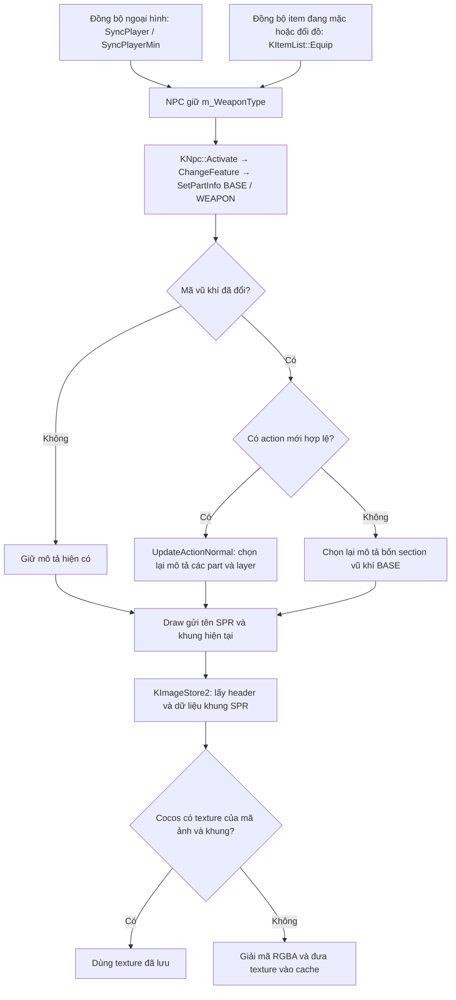

TÓM TẮT 1 [NGUỒN] Đã lần đủ luồng tĩnh bản A: đồng bộ trang bị hoặc ngoại hình ghi mã vũ khí vào NPC, rồi lượt cập nhật NPC chuyển mã sang bộ tài nguyên.
TÓM TẮT 2 [NGUỒN] Đổi mã vũ khí tải lại mô tả riêng của vũ khí nếu động tác giữ nguyên, hoặc mô tả các bộ phận khi bảng ánh xạ cho ra động tác khác.
TÓM TẮT 3 [NGUỒN] `SetSprFile` giữ tên và metadata. Khi vẽ, kho SPR dùng mã tên ảnh, còn Cocos giữ texture theo cặp mã ảnh và khung.
TÓM TẮT 4 [NGUỒN] Glow và sét dùng lại khung vũ khí đang vẽ. Bộ nhớ cấp cường hóa 2 giây là trạng thái riêng của khâu vẽ hiệu ứng.
TÓM TẮT 5 [CHƯA KIỂM] Chưa chạy build, APK, exe, VM hay mạng. File nhịp ngoài worktree bị từ chối quyền ghi. Tổng quan sẽ commit phần bàn giao.

# W-01b — Hiệu ứng vũ khí: client nhận trang bị và nạp sprite

Loại: khảo sát\
Chủ đề: Luồng từ trang bị nhân vật đến mô tả tài nguyên NPC và texture vũ khí trong client bản A.\
Từ khóa: vũ khí, trang bị, sprite, SPR, `m_WeaponType`, `KNpcRes`, `SetPartInfo`, `KImageStore2`, `CCTextureCache`\
Trạng thái: PARTIAL — hoàn tất khảo sát tĩnh và bàn giao tài liệu. File nhịp ngoài worktree bị chặn quyền ghi.\
Độ phủ: 5/5 hạng mục khảo sát tĩnh trong bảng dưới. Khung asset cụ thể và hành vi trên thiết bị chưa được kiểm.\
Liên quan: [H-04](H-04.md), [L-01](L-01-lam-muot-hinh-anh.md), [L-02](L-02.md), [L-03](L-03-quy-trinh-dung-apk.md), [K-02 nhân vật](K-02-nhan-vat.md), [Mục lục tri thức](../DESIGN/MUC-LUC-TRI-THUC.md).\
Cần tôi quyết định: không.

## Phạm vi và độ phủ

[THẤY] Nguồn trực tiếp là client bản A tại `D:/JX-build/qh9A`. Các đường dẫn `Classes/...` dưới đây tính từ root đó. Dòng nguồn là dòng vật lý từ 1. [TÀI LIỆU] Các báo cáo cũ dùng để định vị và ghi rõ giới hạn của từng bản.

| Hạng mục | Độ phủ | Mỏ neo file:dòng |
|---|---|---|
| Nhận item, đổi đồ và nhận ngoại hình | Đã phủ [THẤY] | `Classes/gamecore/KProtocolProcess.cpp:1819`, `:2976`, `:3098`, `:5249` |
| Cập nhật NPC res và điều kiện tra lại | Đã phủ [THẤY] | `Classes/gamecore/KNpc.cpp:726`, `:6096`; `Classes/gamecore/KNpcRes.cpp:1672`, `:1791` |
| Bảng đường dẫn và metadata SPR | Đã phủ [THẤY] | `Classes/gamecore/KNpcResNode.cpp:179`, `:201`, `:232`, `:547`, `:982` |
| Đọc khung, tìm cache và tạo texture | Đã phủ [THẤY] | `Classes/gamescene/KgameWorld.cpp:9000`, `:8133`; `Classes/engine/Kgetinidata.cpp:120`, `:160`, `:378` |
| Bàn giao sprite cho glow và sét | Đã phủ [THẤY] | `Classes/vn/gamecore/KNpcResVN.cpp:493`, `:524`, `:613`, `:618` |
| Tên SPR của món cụ thể, member PAK và số đo thiết bị | Chưa phủ [CHƯA KIỂM] | `JX1_OPS/REPORTS/K-02-nhan-vat.md:99`; loader có nhánh SPR/PAK tại `Classes/engine/KPakFile.cpp:37` |

## Giải mã tên

| Tên gốc | Mã hóa | Chữ đúng / nghĩa | Nguồn file:dòng |
|---|---|---|---|
| `MainMan` | ASCII | Mẫu nhân vật nam [THẤY] | `Classes/gamecore/KNpc.cpp:10766` |
| `MainLady` | ASCII | Mẫu nhân vật nữ [THẤY] | `Classes/gamecore/KNpc.cpp:10774` |
| `itempart_weapon`, `emNPCRES_PART_WEAPON` | ASCII | Ô trang bị vũ khí và nhóm tài nguyên vũ khí [THẤY] | `Classes/gamecore/KItemList.cpp:1221`; `Classes/gamecore/CoreUseNameDef.h:12` |
| `emNPCRES_PART_LAYER_BASE`, `emNPCRES_PART_LAYER_EFFECT` | ASCII | Lớp nền và lớp hiệu ứng của bảng tài nguyên part [THẤY] | `Classes/gamecore/CoreUseNameDef.h:22` |
| `_effect.txt` | ASCII | Hậu tố bảng mô tả dành cho lớp EFFECT [THẤY] | `Classes/gamecore/KNpcResNode.cpp:159`, `:171` |

[CHƯA KIỂM] Chưa xác định tên gốc của từng món và từng asset thực nạp. Tài liệu này dùng tên ký hiệu trong code và không trích literal legacy hiển thị lỗi chữ.

## Sắp theo cấu trúc game

| Bậc | Cách tra |
|---|---|
| Ô vũ khí → mã ngoại hình | [THẤY] Món có mã res dương được ưu tiên, tiếp đến ánh xạ món hoàng kim/bạch kim nếu có kết quả, cuối cùng là ánh xạ loại chi tiết, phân loại và cấp món. `Classes/gamecore/KItemList.cpp:1221`, `:1251`. |
| Nhân vật → nhóm vũ khí → section | [THẤY] Nhóm vũ khí có chỉ số 2. Với 4 section mỗi nhóm, dải vũ khí là 8–11. Từng section có thể có BASE và EFFECT. `Classes/gamecore/CoreUseNameDef.h:8`, `:20`; `Classes/gamecore/KNpcResNode.h:23`; `Classes/gamecore/KNpcRes.cpp:1835`. |
| Section và lớp → động tác và mã ngoại hình → tên SPR | [THẤY] Node lưu mô tả theo từng lớp và section, tra ô theo công thức `nEquipNo * m_nActionKind + nActionNo`. `Classes/gamecore/KNpcResNode.cpp:201`, `:547`, `:997`. |
| Động tác → hướng và khung → texture | [THẤY] Draw chọn khung từ metadata của part, chuyển tên và khung vào primitive, rồi yêu cầu texture. `Classes/gamecore/KNpcRes.cpp:282`, `:675`, `:685`, `:701`; `Classes/gamescene/KgameWorld.cpp:9000`. |

## Luồng source

| Bước | Kết quả đọc tĩnh | Bằng chứng file:dòng |
|---|---|---|
| Nhận item của nhân vật cục bộ | [THẤY] Nhánh thêm item trong `s2cSyncItem` ghi `m_Res` vào item, gọi `KItemList::Add` với ô/vị trí nhận. Nếu vị trí đã ghi là `pos_equip`, `Add` gọi `Equip`. Khi nhận kết quả đổi đồ, s2cpautoMovecallback chuyển qua `AutoEquip`, rồi gọi `Equip` ở nhánh lấy món từ túi và đưa món cũ về túi. | `Classes/gamecore/KProtocolProcess.cpp:1709`, `:1808`, `:1819`, `:5217`, `:5249`; `Classes/gamecore/KItemList.cpp:177`, `:335`, `:2371`, `:2374` |
| Cập nhật ngoại hình từ món | [THẤY] `Equip` chọn mã res theo thứ tự ở bảng trên, ghi vào `Npc[nNpcIdx].m_WeaponType` và cập nhật `m_EquipItem`. `UnEquip` ô vũ khí trả type về kết quả `GetWeaponRes(0,0,0)`. Phụ kiện có mã res dương cũng có nhánh ghi đè ngoại hình vũ khí. | `Classes/gamecore/KItemList.cpp:1157`, `:1221`, `:1318`, `:1334`, `:1621`, `:1635` |
| Nhận ngoại hình NPC người chơi | [THẤY] `SyncPlayer` và `SyncPlayerMin` tìm NPC theo ID và gán trực tiếp `WeaponType` vào `m_WeaponType` khi tìm thấy NPC. | `Classes/gamecore/KProtocolProcess.cpp:55`, `:2961`, `:2976`, `:3083`, `:3098` |
| Chuyển trạng thái sang NPC res | [THẤY] `Activate` kiểm tra region, cập nhật trạng thái cưỡi, rồi gọi `ChangeFeature` với type hiện hành. `ChangeFeature` gọi `SetPartInfo` cho lớp BASE của các nhóm trang bị, trong đó có WEAPON. Đường vẽ còn cập nhật `SetDoing(m_ClientDoing)` trước `Draw`. | `Classes/gamecore/KNpc.cpp:595`, `:718`, `:723`, `:726`, `:6096`; `Classes/gamecore/KNpcRes.cpp:1762`, `:1779` |
| Khởi tạo node và mô tả | [THẤY] `KNpcRes::Init` lấy node qua `AddNpcRes`, đặt action/type ban đầu về 0 và chuẩn bị các section có khai báo ở hai lớp. `AddNpcRes` tái sử dụng node trùng tên NPC, chỉ đọc lại bảng khi phải tạo node mới. Node đọc bảng loại NPC, mô tả phần thân, bảng tên SPR và bảng metadata. EFFECT dùng tên có hậu tố `_effect.txt`. | `Classes/gamecore/KNpcRes.cpp:64`, `:71`, `:76`, `:111`; `Classes/gamecore/KNpcResList.cpp:57`, `:89`; `Classes/gamecore/KNpcResNode.cpp:37`, `:75`, `:144`, `:179`, `:201` |
| Gắn mô tả vào NPC | [THẤY] `SetPartInfo` tra tên, tổng frame, số hướng và interval theo section, layer, action và type. `GetFileName` chuyển chuỗi mặc định rỗng cho `CRESINFO::GetName`. Khi ô bảng thiếu hoặc chỉ số sai, hàm tên sao chép giá trị mặc định. `SetSprFile` xóa trạng thái khi tên rỗng và bỏ qua khi tên trùng. Với tên mới, hàm lưu tên, mã tên, metadata và timer. | `Classes/gamecore/KNpcRes.cpp:1835`, `:1851`; `Classes/gamecore/KNpcResNode.cpp:547`, `:559`, `:570`, `:581`, `:982`, `:1001`; `Classes/gamecore/KSprControl.cpp:17`, `:37` |
| Lấy khung và tạo texture khi vẽ | [THẤY] `Draw` chuyển tên, mã và frame sang `getIniDataForGame(RU_T_IMAGE)`. Nhánh này đưa tên và frame vào `ccgetTxtData`, tới `findinidata_one`. Loader lấy header/frame SPR trước khi tra texture Cocos. Khi thiếu texture, hàm giải mã khung thành RGBA và tạo texture dưới cùng khóa. | `Classes/gamecore/KNpcRes.cpp:675`, `:684`, `:701`; `Classes/vn/gamecore/KNpcResVN.cpp:476`, `:493`; `Classes/gamescene/KgameWorld.cpp:8133`, `:8189`, `:8980`, `:9000`; `Classes/engine/Kgetinidata.cpp:120`, `:157`, `:378` |
| Chuyển sang glow và sét | [THẤY] Nhánh VN chỉ lấy cấp glow cho NPC local ngoài menu. Nó đọc cấp từ món ở ô vũ khí, giữ kết quả trong biến tĩnh và dùng lại tên, mã, frame của các section vũ khí khi gửi lượt glow. Lượt sét dùng hình chữ nhật của section chính nếu có. | `Classes/vn/gamecore/KNpcResVN.cpp:495`, `:502`, `:514`, `:524`, `:613`, `:618` |

## Khi nào tra lại mô tả và nạp lại dữ liệu

| Điều kiện | Hành vi thấy trong source | Bằng chứng file:dòng |
|---|---|---|
| Type lớp BASE vũ khí giữ nguyên | [THẤY] `SetPartInfo` trả sớm theo `nType`. Đổi mã màu hoặc cờ đổi loại tên riêng lẻ không vượt qua điều kiện này. | `Classes/gamecore/KNpcRes.cpp:1815`, `:1819` |
| Type vũ khí đổi, action mới hợp lệ và khác trước | [THẤY] `UpdateAction` tính action theo doing, type vũ khí BASE và trạng thái cưỡi. `UpdateActionNormal` tra lại tối đa 5 nhóm × 4 section × 2 lớp, cùng bóng. NPC thường dùng doing trực tiếp. NPC đặc biệt dùng bảng đang cưỡi hoặc không cưỡi. | `Classes/gamecore/KNpcRes.cpp:1684`, `:1695`, `:1705`, `:1746`; `Classes/gamecore/KNpcResNode.cpp:592` |
| Type vũ khí đổi, action trùng hoặc kết quả tra action âm | [THẤY] `UpdateAction` trả false. `SetPartInfo` tiếp tục chọn lại mô tả ở bốn section của WEAPON BASE theo action đang giữ. | `Classes/gamecore/KNpcRes.cpp:1690`, `:1695`, `:1826`, `:1835`, `:1851` |
| Doing hoặc trạng thái cưỡi đổi | [THẤY] `SetDoing` hoặc `SetRideHorse` gọi `UpdateAction` sau khi giá trị đầu vào đổi. Việc tra toàn bộ mô tả còn tùy action mới. `UpdateAction` có đối số `bForce` để bỏ qua so sánh action trùng nếu được truyền true. | `Classes/gamecore/KNpcRes.cpp:1656`, `:1672`, `:1695`, `:1885` |
| Đổi hoặc bỏ mặt nạ | [THẤY] `Activate` có nhánh gọi `ReSetRes`. Nhánh trở về ngoại hình gốc chạy `Remove → Init → ChangeFeature`. Nhánh hóa trang chạy `Remove → Init` với loại res mẫu hóa trang. Đây là điểm khởi tạo lại trạng thái NPC res. | `Classes/gamecore/KNpc.cpp:686`, `:10756`, `:10794`, `:10817` |
| Chỉ đổi khung hoặc hướng lúc vẽ | [THẤY] Draw chọn một frame khác từ SPR hiện hành. Frame mới có thể dẫn đến yêu cầu nạp dữ liệu hoặc tạo texture, tùy mỗi tầng cache. | `Classes/gamecore/KNpcRes.cpp:282`, `:293`, `:685`; `Classes/ImageStore/KImageStore2.cpp:253`; `Classes/engine/Kgetinidata.cpp:160` |

## Cache nằm ở đâu

| Tầng | Khóa và cách dùng lại | Khi đọc hoặc tạo lại | Bằng chứng file:dòng |
|---|---|---|---|
| Bảng mô tả tài nguyên | [THẤY] `g_NpcResList` dùng tên loại NPC để tìm `KNpcResNode`. `m_acResInfo[layer][section]` giữ bảng tên và metadata theo action và loại trang bị. | [THẤY] `AddNpcRes` khởi tạo node khi tên chưa có trong danh sách. | `Classes/gamecore/KNpc.cpp:10795`; `Classes/gamecore/KNpcResList.cpp:57`, `:89`; `Classes/gamecore/KNpcResNode.cpp:201` |
| Trạng thái sprite từng NPC | [THẤY] `m_asPartInfo[layer][part]` giữ type, còn `m_cNpcImage[layer][section]` giữ `KSprControl` gồm tên, mã tên, hướng và frame. | [THẤY] Đổi action/type có thể tra lại bảng. Nếu kết quả trả cùng tên, `SetSprFile` giữ nguyên trạng thái. `Release` chỉ xóa trạng thái của bộ điều khiển đó. | `Classes/gamecore/KNpcRes.h:113`, `:119`; `Classes/gamecore/KSprControl.cpp:17`, `:49` |
| Header và dữ liệu khung SPR | [THẤY] `m_ImageStore` toàn cục là `KImageStore2`. `GetImage` tạo mã từ tên, tìm trong `m_pObjectList` và đánh dấu tham chiếu. Với ảnh có bảng offset, frame lấy từ vùng đã nạp. Với tải từng frame, mỗi frame có vùng dữ liệu riêng. | [THẤY] Thiếu mục ảnh thì gọi `LoadImage → SprGetHeader`. Nếu tải từng frame và mục frame chưa có dữ liệu thì gọi `SprGetFrame`, kể cả khi header đã có. `CheckBalance` có thể giải phóng ảnh hoặc frame chưa được tham chiếu trong chu kỳ. Các hàm `FreeImage` và `Free` cũng giải phóng dữ liệu của kho. | `Classes/engine/Kgetinidata.cpp:15`; `Classes/ImageStore/KImageStore2.cpp:75`, `:94`, `:172`, `:238`, `:253`, `:474`, `:663`; `Classes/engine/KPakFile.cpp:37`, `:114` |
| Texture Cocos | [THẤY] Khóa dạng `%u-%d` ghép mã ảnh của kho SPR với chỉ số frame. Hàm kiểm texture sau bước lấy được header và dữ liệu frame. | [THẤY] Thiếu khóa texture thì giải mã RGBA và lưu texture. Nếu dữ liệu SPR không lấy được, hàm trả rỗng trước khi kiểm khóa texture. [CHƯA KIỂM] Chưa xác định thời điểm texture bị dọn trong một phiên chạy. | `Classes/engine/Kgetinidata.cpp:120`, `:123`, `:160`, `:168`, `:378` |
| Giá trị cấp glow | [THẤY] `s_wLevel` và `s_wNext` thuộc nhánh vẽ VN. Giá trị làm mới khi tới hạn trong một lượt vẽ đủ điều kiện. | [THẤY] Mỗi lần làm mới đặt hạn kế tiếp sau 2.000.000 µs. Trong lần làm mới, code đọc ô vũ khí và có nhánh ép mức khi trace bật. Đây là điều kiện cập nhật cấp dùng để vẽ glow. | `Classes/vn/gamecore/KNpcResVN.cpp:496`, `:498`, `:502`, `:505`, `:507` |

## Mục sổ thông số

| Nhóm | Tên/hằng số | file:dòng | Giá trị | Đơn vị | Ảnh hưởng | Đổi an toàn | Nguồn đo |
|---|---|---|---:|---|---|---|---|
| NPC res | `MAX_BODY_PART`, `MAX_BODY_PART_SECT`, `MAX_PART` | `Classes/gamecore/KNpcResNode.h:23` | 6 × 4 = 24 | nhóm × section | Sức chứa mô tả part | KHÔNG | [THẤY] Tĩnh |
| NPC res | `emNPCRES_PART_COUNT`, `emNPCRES_PART_LAYER_COUNT` | `Classes/gamecore/CoreUseNameDef.h:8`, `:20` | 5, 2 | nhóm, lớp | Vòng cập nhật action hiện hành | KHÔNG | [THẤY] Enum |
| Metadata | Mặc định khi đọc ô `SectInfoFile` | `Classes/gamecore/KNpcResNode.cpp:232` | 16, 8, 1 | frame, hướng, interval | Giá trị mặc định khi đọc bảng. Đơn vị thời gian thực của interval chưa đo. | CẨN THẬN | [THẤY] Tĩnh |
| Metadata | Mặc định từ lời gọi getter ở `SetPartInfo` | `Classes/gamecore/KNpcRes.cpp:1854` | 16, 16, 0 | frame, hướng, interval | Giá trị truyền vào getter khi chọn mô tả part | CẨN THẬN | [THẤY] Tĩnh |
| Cache SPR | `ISBP_BALANCE_NUM_DEF`, `ISBP_CHECK_POINT_DEF` | `Classes/ImageStore/KImageStore2.h:254`; `Classes/ImageStore/KImageStore2.cpp:213`, `:731` | 384, 384 | ảnh, lượt truy cập | Giá trị khởi tạo cho hai điều kiện gọi kiểm cân bằng, đều dùng so sánh lớn hơn | CẨN THẬN | [THẤY] Tĩnh, 256 + 128 |
| Cache SPR | Nhánh trả sớm trong `CheckBalance` | `Classes/ImageStore/KImageStore2.cpp:479` | 1024 | ảnh | Nhánh ngoài WIN32 trả sớm khi số ảnh dưới ngưỡng. WIN32 còn xét bộ nhớ khả dụng. | CẨN THẬN | [THẤY] Tĩnh |
| Glow | Hạn cập nhật `s_wNext` | `Classes/vn/gamecore/KNpcResVN.cpp:502` | 2.000.000 = 2 | µs = giây | Khoảng thời gian dùng lại giá trị cấp giữa hai lần lấy trong đường vẽ đủ điều kiện | CẨN THẬN | [THẤY] Tĩnh |

## Đối chiếu tài liệu cũ

| Nguồn | Phần dùng cho W-01b |
|---|---|
| H-04 | [TÀI LIỆU] Giữ các kết luận lịch sử glow/sét và giới hạn ghép source với APK. Bản A có mốc cấp glow tương ứng và cùng cơ chế giữ cấp 2 giây. Dùng dòng bản A để dẫn thay cho dòng snapshot. `JX1_OPS/REPORTS/H-04.md:106`, `:113`; `Classes/vn/gamecore/KNpcResVN.cpp:502`, `:517`. |
| L-01 | [TÀI LIỆU] Mô tả giải mã frame thành RGBA và điểm lên texture. Ghi nhận chưa thấy symbol glow/sét thuộc root khảo sát gốc của L-01. Phần chuẩn hóa L-01 ghi các symbol tương ứng ở bản A. `JX1_OPS/REPORTS/L-01-lam-muot-hinh-anh.md:1`, `:211`; `Classes/engine/Kgetinidata.cpp:378`; `Classes/vn/gamecore/KNpcResVN.cpp:618`. |
| L-02 | [TÀI LIỆU] Dùng các mỏ neo của bản A để tìm đường texture. xBRZ và khóa cache tách mode là thiết kế dự kiến trong tài liệu. Khóa tại loader đã kiểm của bản A dùng mã ảnh và frame. `JX1_OPS/REPORTS/L-02.md:34`, `:51`; `Classes/engine/Kgetinidata.cpp:160`. |
| L-03 | [TÀI LIỆU] Dùng để xác định giới hạn giữa source bản A với APK đã dựng ở lượt khác. Không lặp các bước dựng hay kiểm artifact trong phạm vi khảo sát tĩnh này. `JX1_OPS/REPORTS/L-03-quy-trinh-dung-apk.md:23`, `:55`. |
| K-02 nhân vật | [TÀI LIỆU] Kế thừa phạm vi bộ phận, section và layer. Báo cáo cũ chưa xác định member SPR trong PAK và chưa đo metadata của asset cụ thể. `JX1_OPS/REPORTS/K-02-nhan-vat.md:58`, `:60`, `:100`. |

## Đã xác minh / Chưa xác minh

- **Đã xác minh [THẤY].** Cả đường item và đường ngoại hình đọc từ đồng bộ client đều nối được tới `m_WeaponType`. Đã đối chiếu việc thay mô tả theo action/type, đường yêu cầu khung và từng tầng cache đến chỗ tạo texture bằng các mỏ neo trên.
- **Chưa xác minh [CHƯA KIỂM].** Chưa xác định đường dẫn/member SPR thực của một món cụ thể, giá trị frame/hướng của asset đó, cache hit/miss trong phiên chạy, độ trễ khi đổi trang bị hoặc hình ảnh sau khi cài APK. Không chạy build, APK, exe, VM, mạng hay kiểm thử game.
- **Phạm vi phía server [TÀI LIỆU].** W-01b bắt đầu tại handler client. Phần phía phát gói và nguồn asset server nằm ngoài phạm vi bản A của task. K-02 là dẫn chiếu gián tiếp cho giới hạn asset đóng gói. `JX1_OPS/TASKS/W-01b.md:13`; `JX1_OPS/REPORTS/K-02-nhan-vat.md:100`.

## Phát hiện khi chuẩn hóa

- [THẤY] `ISBP_BALANCE_NUM_DEF` và `ISBP_CHECK_POINT_DEF` tính ra 384, dù chú thích bên cạnh lệnh gán trong constructor ghi 484. Các giá trị trong bảng lấy từ biểu thức khai báo. `Classes/ImageStore/KImageStore2.h:254`; `Classes/ImageStore/KImageStore2.cpp:731`.
- [THẤY] `SetAction` có một khối chọn SPR nằm trong comment. Đường active đi qua `UpdateAction`. `Classes/gamecore/KNpcRes.cpp:1457`, `:1469`, `:1470`.
- [TÀI LIỆU] L-01 và L-03 có hậu tố trong tên file thực tế. H-04, L-01..L-03 và K-02 được dẫn chiếu tại chỗ, không cập nhật kết luận cũ.

## Đề xuất tối ưu

[CHƯA KIỂM] Khi có lượt đo được duyệt, dùng một món mẫu và ghi riêng mã ngoại hình, action, section, tên SPR, frame, lượt trượt kho SPR và lượt tạo texture. So sánh lần đầu mặc với lần mặc lại cùng món để xác định công đoạn gây chậm trước khi cân nhắc đổi cache. Điểm đo hiện có quanh bước lấy SPR và tạo texture. `Classes/engine/Kgetinidata.cpp:119`, `:379`.

## Bàn giao

- Kiểm tra Git trước ghi cho thấy nhánh `task/W-01b` sạch. Báo cáo cũ và mã bản A được đọc tại chỗ. Kiểm tra `graphify-out/.graphify_root` và `graphify-out/GRAPH_REPORT.md` ở root bản A không thấy hai tệp. `rg` không khả dụng nên dùng `Select-String` và các đoạn nguồn theo symbol. Một số kết quả dò rộng bị cắt, phần kết luận dùng đoạn đọc có mỏ neo cụ thể.
- Ghi `D:/JX-wt/W-01b.nhip` bằng `Add-Content` ở mốc khảo sát bị lỗi `Access to the path is denied`. Đường dẫn nằm ngoài worktree được cấp quyền ghi. Các mốc file nhịp chưa thực hiện được. Tổng quan có thể ghi nhận thiếu file nhịp khi nhận bàn giao.
- Trạng thái khảo sát tĩnh đã hoàn tất. Báo cáo và mục **Kết quả cuối** của task bàn giao tại worktree cho Tổng quan. Chưa stage, commit hoặc push theo yêu cầu. Chưa có SHA.
- Dòng đề xuất cho mục lục tri thức: *Nạp sprite vũ khí bản A | W-01b, K-02, H-04 | `m_WeaponType → SetPartInfo → KImageStore2 → CCTextureCache` | đã kiểm source, chưa đo runtime*.
- Kỹ năng đã dùng: `jx1-retrofit`, `jx1-read-server` (xác định giới hạn phía server), `jx1-read-client`, `jx1-parameters`, `jx1-knowledge`, `jx1-report`.
