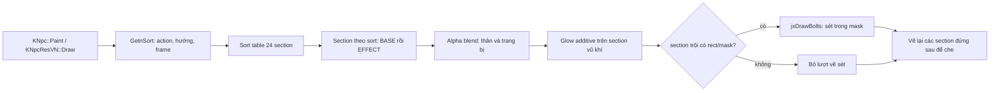

TÓM TẮT 1: [NGUỒN] PARTIAL — đã đối chiếu tĩnh đường vẽ nhân vật và các lớp vũ khí trong client bản A `D:/JX-build/qh9A`.
TÓM TẮT 2: [NGUỒN] Sort chọn section theo action/hướng/frame; mỗi section duyệt BASE rồi EFFECT; nhánh đổi 8↔9 kiểm tra không cưỡi và hướng 0–3, không kiểm tra action đi bộ.
TÓM TẮT 3: [NGUỒN] Glow vũ khí được vẽ lại bằng additive blend; tia sét được gọi riêng nếu section trội có rect/mask đạt điều kiện source.
TÓM TẮT 4: [NGUỒN] [TÀI LIỆU] BUG-002 vẫn chưa rõ nguyên nhân và chưa tái hiện trong lần thử LD được ghi; J-01..J-05 giữ nguyên các giới hạn asset/runtime.
TÓM TẮT 5: [CHƯA KIỂM] Không build/test, chạy game/exe, VM hay mạng; không có runtime/capture. Chưa ghi được `.nhip` ngoài writable root; không commit.

# W-01c — Hiệu ứng vũ khí: thứ tự lớp và điều kiện vẽ

Loại: khảo sát
Chủ đề: Truy dấu đường vẽ thân, vũ khí, glow và tia sét trong client bản A.
Từ khóa: hiệu ứng vũ khí, weapon, glow, sét, bolt, BASE, EFFECT, KNpcResVN, GetnSort
Trạng thái: PARTIAL — cơ chế source đã đối chiếu; sort/asset và hiển thị runtime theo nhân vật cụ thể chưa xác minh.
Độ phủ: đã phủ 7/7 nhóm cơ chế tĩnh trong phạm vi; chưa phủ bảng sort/SPR cụ thể và runtime.
Liên quan: BUG-002, J-01, J-02, J-03, J-04, J-05, H-04, H-14, DESIGN/QUY-LUAT-VE-BO-PHAN.md
Cần tôi quyết định: không

## Quan hệ chính

## Phạm vi và độ phủ

Root mã được task chỉ định: `A = D:/JX-build/qh9A/Classes`. [THẤY] Graphify có tại `A/graphify-out`; sentinel `.graphify_root:1` ghi `.` (đường tương đối, không phải chứng nhận root tuyệt đối). Đã tra các nhóm liên quan ở `A/graphify-out/GRAPH_REPORT.md:997-999,1081-1083,1233-1235,1361-1363`; chúng định vị resource/action/state, chưa đủ mô tả pass glow/sét. Chỉ kết luận bằng source hiện tại, không tạo/cập nhật graph.

Danh sách đọc giới hạn từ task: chuẩn báo cáo, task W-01c, sáu skill được yêu cầu, mục lục tri thức/công cụ để định vị, BUG-002 và J-01..J-05; mã bản A gồm `gamecore/{CoreUseNameDef.h,KNpc.h,KNpc.cpp,KNpcRes.cpp,KNpcResNode.h,KNpcResNode.cpp}`, `vn/gamecore/{KNpcResVN.h,KNpcResVN.cpp}`, `gamescene/KgameWorld.cpp` và các đoạn Graphify nói trên. H-04/H-14 và tài liệu quy luật vẽ chỉ kiểm tồn tại để dẫn liên quan, không dùng như bằng chứng đã đọc. Không mở source/server hay root cũ.

| Phần tử | Kết quả | Bằng chứng / giới hạn |
|---|---|---|
| Đường gọi renderer | THẤY — `KNpc` giữ `KNpcResVN`; `KNpc::Paint` gọi `SetDoing` rồi `Draw`. | `A/gamecore/KNpc.h:824`; `A/gamecore/KNpc.cpp:6096-6097`. |
| Bảng sort | THẤY — `GetnSort` ủy quyền bảng NPC đặc biệt cho `CSortTable::GetSort`; mặc định theo hướng, có ngoại lệ theo frame/action. NPC thường chỉ trả một section. | `A/gamecore/KNpcResNode.cpp:612-630,1390-1454`. Chưa đọc bảng sort tài nguyên của NPC/action cụ thể. |
| Thân và trang bị | THẤY — vòng vẽ duyệt sort table; với mỗi section đi lần lượt layer BASE rồi EFFECT và bỏ layer không có tên ảnh. Sau đó gửi danh sách sang `getIniDataForGame`. | `A/vn/gamecore/KNpcResVN.cpp:459-493`. Thứ tự section thực phụ thuộc bảng sort được nạp. |
| Chỉnh thứ tự vũ khí | THẤY — sau `GetnSort`, nhánh bật mặc định đổi vị trí section 8 và 9 khi NPC không cưỡi, hướng đã lượng tử hóa thuộc 0–3; có thể tắt bằng file cờ `/sdcard/jxlayeroff`. Không có điều kiện action đi bộ trong predicate. | `A/vn/gamecore/KNpcResVN.cpp:204-215`. Chưa xác minh tần suất/kết quả trên thiết bị. |
| Glow | THẤY — chỉ chạy cho player local ngoài menu, lấy cấp cường hóa từ weapon; ngưỡng +6, +12, +15. Thu các section weapon theo sort, phát nhiều lượt additive, rồi vẽ lại các section phía sau để che. | `A/vn/gamecore/KNpcResVN.cpp:495-522,540-548,600-626`. Không xác minh item/asset cụ thể. |
| Tia sét | THẤY — được gọi sau glow tại section trội nếu có rect; helper tự bỏ khi kích thước, mask, grid hoặc chiều dài kiếm không đạt ngưỡng. | `A/vn/gamecore/KNpcResVN.cpp:554-584,617-626`; `A/gamescene/KgameWorld.cpp:15025-15103,15132`. Không xác minh hình thực tế. |
| Alpha/blend | THẤY — record đặt `Color_b.a=255` rồi gán `Color_dw=0` và style Alpha; không được dùng riêng số 255 làm alpha cuối. Renderer đặt blend thường `SRC_ALPHA, ONE_MINUS_SRC_ALPHA`, additive dùng `SRC_ALPHA, ONE` cùng uniform `u_glow`. | `A/gamecore/KNpcRes.cpp:166-175`; `A/gamescene/KgameWorld.cpp:14993-15002`. Chưa lần định nghĩa union màu hoặc đọc shader để chốt alpha pixel cuối. |

## Ai vẽ gì, theo thứ tự nào, đọc tệp nào

[THẤY] Bảng dưới là chuỗi chính thân → glow → sét → che lại. Trước batch thân còn có các lượt state đầu, state thân sau trong khoảng `[BackStart,BackEnd)`, state chân và special (`A/vn/gamecore/KNpcResVN.cpp:259-366,420-434`). Sau khối glow/sét có state thân trước khi ngoài khoảng đó (`:663-684`). Không gộp aura/state, layer EFFECT và glow procedural thành cùng một lớp.

| Thứ tự | Thành phần | Điều kiện vẽ/bỏ | Nguồn hiện tại |
|---:|---|---|---|
| 1 | `KNpcResVN::Draw` cập nhật hướng/khung cho shadow và từng section/layer. | Trả sớm nếu hướng/action-frame âm hoặc thiếu resource/world. | `A/vn/gamecore/KNpcResVN.cpp:21-70`; caller `A/gamecore/KNpc.cpp:6096-6097`. |
| 2 | Sort table chọn chuỗi section; nhánh chỉnh sửa có thể đổi chỗ 8↔9. | `GetnSort` lỗi thì dừng; chỉnh 8↔9 chỉ khi không cưỡi, hướng 0–3 và cờ tắt không tồn tại. | `A/vn/gamecore/KNpcResVN.cpp:204-215`; `A/gamecore/KNpcResNode.cpp:612-630,1390-1454`. |
| 3 | Bóng và các section thân/trang bị; mỗi section phát BASE trước EFFECT. | Chỉ section hợp lệ; layer có tên ảnh mới thêm vào batch. | `A/vn/gamecore/KNpcResVN.cpp:437-493`; định nghĩa layer `A/gamecore/CoreUseNameDef.h:19-25`. |
| 4 | Batch nền được gửi renderer với alpha blend. | Render style được khởi tạo Alpha; màu/texture cụ thể còn phụ thuộc resource và shader. | `A/gamecore/KNpcRes.cpp:166-175`; `A/gamescene/KgameWorld.cpp:14993-15002`. |
| 5 | Glow phát lại section vũ khí, theo đúng frame hiện tại; thứ tự section theo sort. | Chỉ player local ngoài menu, có cấp vũ khí ít nhất +6 và section vũ khí có ảnh; additive blend. | `A/vn/gamecore/KNpcResVN.cpp:495-522,540-548,600-616`. |
| 6 | Sét procedural vẽ trong mask của section trội; sau đó các section phía sau được vẽ lại để che glow/sét, lặp theo từng section vũ khí. | Chỉ gọi nếu đã chụp rect; helper còn yêu cầu `R >= 8`, `mask >= 8`, grid tối đa 200×200 hợp lệ và `abs(span) >= 6`. | `A/vn/gamecore/KNpcResVN.cpp:554-584,617-626`; `A/gamescene/KgameWorld.cpp:15084-15103,15132,15152-15155,15286-15287`. |

Các chỉ số trên là điều kiện/mặc định source. “Bị bỏ” ở đây chỉ mô tả nhánh return/continue có trong mã; không khẳng định là biểu hiện của BUG-002.

### Tệp được đọc và nơi phát lệnh vẽ

- [THẤY] Tên bảng sort lấy từ `KindFile` rồi truyền `GetcTable` tại `A/gamecore/KNpcResNode.cpp:365-369`; đường tên ảnh và metadata của layer EFFECT đổi sang hậu tố `_effect.txt` tại `:149-171`. Các bảng cụ thể đang nạp chưa được mở; không suy tên bảng từ báo cáo root cũ.
- [THẤY] `SetPartInfo` lấy tên SPR và metadata theo part/action/type/layer tại `A/gamecore/KNpcRes.cpp:1835-1858`. Vòng `RU_T_IMAGE` duyệt record theo thứ tự và gọi `ccgetTxtData(szImage,nFrame,...)`; tên ảnh trống hoặc texture thiếu thì bỏ record (`A/gamescene/KgameWorld.cpp:8980-9003`).
- [THẤY] Rect texture được đổi sang tọa độ màn hình tại `A/gamescene/KgameWorld.cpp:9007-9009`; lượt additive chụp rect/mask và chọn `Shaders/glow.vsh`/`Shaders/glow.fsh` tại `:9032-9047`. Sau đó gọi `setInRect_temp` tại `:9088`, hàm này phát `glDrawElements` tại `:15007-15013`; đây là bằng chứng thứ tự lời gọi trực tiếp, không phải số đo GPU/runtime.
- [THẤY] Sét không lấy một SPR hoạt ảnh riêng ở helper đã đọc: nó tạo texture RGBA 8×8 và dùng cùng tên shader glow (`A/gamescene/KgameWorld.cpp:15065-15082`). [CHƯA KIỂM] Chưa đọc nội dung hai shader hoặc asset SPR/PAK; chưa lần sâu loader `ccgetTxtData`.
- [THẤY] Glow dùng frame weapon hiện tại; từ +12 có lượt đo alpha 0 lấy mask, chọn section có nhiều mẫu mask nhất (`A/vn/gamecore/KNpcResVN.cpp:524-584`). Nhánh `g_jxA2` bỏ bốn offset chéo và gộp offset nguyên trùng (`:587-599`): không mặc định mọi lần đều vẽ chín lượt. Gate ẩn `/sdcard/jxhide_<section>` nằm trong vòng batch thân (`:464`), còn bộ thu glow (`:540-546`) không đọc cờ đó; chưa xác minh trạng thái cờ trên thiết bị.

## Gộp BUG-002 và J-01..J-05

Mọi hàng dưới đây là [TÀI LIỆU], không tái nhận số liệu/đo thử cũ là kết quả W-01c. Chỉ nối ý nghĩa với khúc vẽ, giữ nguyên kết luận cũ.

| Nguồn | Nội dung giữ lại | Liên hệ với khúc vẽ / giới hạn |
|---|---|---|
| `JX1_OPS/BUGS/BUG-002.md:1-6` | Báo hiện tượng khung hiệu ứng nhảy ở bản A2; lần thử LD +15 chưa thấy nhảy; nguyên nhân chưa biết. | Rect/mask và dedupe là giả thuyết trong hồ sơ, không phải nguyên nhân đã xác minh. Chưa chứng minh qh9A là binary A2 trên điện thoại. |
| `JX1_OPS/REPORTS/J-01-animation-nhan-vat-tran.md:1-5` | PARTIAL về loader/schema và chọn khung; thiếu cặp asset đúng provenance để chứng minh đủ frame. | Cùng tiến độ action không bảo đảm cùng chỉ số/hình pixel giữa các layer; W-01c xác nhận công thức chia nguyên từng part tại `A/vn/gamecore/KNpcResVN.cpp:53-68`. |
| `JX1_OPS/REPORTS/J-02-animation-quai-npc.md:25-42` | Metadata NPC/action và fallback chưa chứng minh SPR tồn tại hoặc hiển thị đúng. | NPC thường có đường một section (`A/gamecore/KNpcResNode.cpp:615-623`); không áp glow local-player cho mọi quái/NPC. Không đọc lại dữ liệu server ngoài root task. |
| `JX1_OPS/REPORTS/J-03-hoat-anh-ky-nang.md:1-6` | State/aura, niệm, missile có vòng đời và cách chọn frame riêng; alias đầu ra metadata vẫn là điểm cần kiểm. | EFFECT của part, aura/state và sét procedural là ba cơ chế riêng; các pass state trước/sau thân đã đối chiếu ở bảng trên. Không tái kiểm toàn bộ skill/missile. |
| `JX1_OPS/REPORTS/J-04-lop-chong-nhan-vat.md:1-5` | Sort không cố định; sức chứa hai layer/24 section không chứng minh mọi slot có asset, cánh/EFFECT đang hiện. | Bản A vẫn có enum năm nhóm và ChangeFeature chỉ cấp BASE; glow riêng không đồng nghĩa layer EFFECT được nạp. |
| `JX1_OPS/REPORTS/J-05-cat-khung-animation.md:1-6` | Ánh xạ tick nguyên có thể bỏ/lặp chỉ số; chưa có tỷ lệ khung rơi runtime. | Không quy hiện tượng mất sét thành cắt khung nhân vật; sét tự dùng `nowUs/50000` tại `A/gamescene/KgameWorld.cpp:15091`. |

## Sắp theo cấu trúc game

Thứ tự cấu trúc dưới đây là nhóm phần cơ thể và layer; thứ tự che phủ cuối cùng được lấy từ sort table theo action, hướng và frame, không thể thay bằng một chuỗi cố định cho mọi tư thế.

| Nhóm phần | Section | Layer trong section | Trạng thái |
|---|---:|---|---|
| Mũ/đầu (`HELM`) | 0–3 | BASE → EFFECT | THẤY sức chứa; asset từng ô chưa kiểm. |
| Áo/thân (`ARMOR`) | 4–7 | BASE → EFFECT | THẤY sức chứa; asset từng ô chưa kiểm. |
| Vũ khí (`WEAPON`) | 8–11 | BASE → EFFECT | THẤY sức chứa; section 8/9 có nhánh đổi thứ tự theo điều kiện nêu trên. |
| Ngựa (`HORSE`) | 12–15 | BASE → EFFECT | THẤY sức chứa; resource runtime chưa kiểm. |
| Phi phong (`MANTLE`) | 16–19 | BASE → EFFECT | THẤY sức chứa; resource runtime chưa kiểm. |
| Phần dự trữ ngoài enum 5 nhóm hiện hành | 20–23 | Chưa khẳng định được layer/resource được nạp qua đường hiện hành | CHƯA KIỂM; `MAX_BODY_PART=6`, nhưng enum `KE_NPCRES_PART` hiện có 5 nhóm. |

Sức chứa 6×4 và 24 section lấy từ `A/gamecore/KNpcResNode.h:23-25`; enum 5 nhóm và 2 layer lấy từ `A/gamecore/CoreUseNameDef.h:8-24`. Đường `ChangeFeature` cấp BASE cho 5 nhóm hiện hành ở `A/gamecore/KNpcRes.cpp:1762-1785`; việc này không chứng minh layer EFFECT hoặc section 20–23 có dữ liệu đang hiển thị.

## Giải mã tên

Không có tên riêng tài nguyên, NPC hay bản đồ được dùng làm kết luận. Các nhãn phần cơ thể dưới đây là diễn giải thuật ngữ từ identifier ASCII; comment legacy không dùng để giải mã vì console hiển thị mojibake.

| Tên gốc trong source | Mã hóa | Chữ đúng / diễn giải | Nguồn file:dòng |
|---|---|---|---|
| `emNPCRES_PART_HELM` | ASCII identifier | mũ/đầu | `A/gamecore/CoreUseNameDef.h:10` |
| `emNPCRES_PART_ARMOR` | ASCII identifier | áo/thân | `A/gamecore/CoreUseNameDef.h:11` |
| `emNPCRES_PART_WEAPON` | ASCII identifier | vũ khí | `A/gamecore/CoreUseNameDef.h:12` |
| `emNPCRES_PART_HORSE` | ASCII identifier | ngựa | `A/gamecore/CoreUseNameDef.h:13` |
| `emNPCRES_PART_MANTLE` | ASCII identifier | phi phong | `A/gamecore/CoreUseNameDef.h:14` |
| `emNPCRES_PART_LAYER_BASE` / `..._EFFECT` | ASCII identifier | lớp nền / lớp hiệu ứng | `A/gamecore/CoreUseNameDef.h:20-24` |

## Mục sổ thông số

Đây là giá trị/điều kiện đọc tĩnh, không phải số đo runtime; không điều chỉnh thông số trong task này.

| Nhóm | Tên/hằng số | file:dòng | Giá trị | Đơn vị | Ảnh hưởng | Đổi an toàn | Nguồn đo |
|---|---|---|---:|---|---|---|---|
| Cấu trúc | `MAX_BODY_PART`, `MAX_BODY_PART_SECT`, `MAX_PART` | `A/gamecore/KNpcResNode.h:23-25` | 6, 4, 24 | nhóm, section/nhóm, section | Sức chứa resource | KHÔNG | source tĩnh |
| Layer | `emNPCRES_PART_LAYER_COUNT` | `A/gamecore/CoreUseNameDef.h:20-24` | 2 | layer | BASE và EFFECT | CẨN THẬN | source tĩnh |
| Glow | Ngưỡng source | `A/vn/gamecore/KNpcResVN.cpp:514-522` | +6 / +12 / +15 | cấp cường hóa | Bật/tăng mức glow | CẨN THẬN | source tĩnh; item thật chưa kiểm |
| Glow | Cache cấp | `A/vn/gamecore/KNpcResVN.cpp:498-512` | 2,000,000 | microsecond | Tần suất làm mới cấp lấy từ weapon item | CẨN THẬN | source tĩnh |
| Sét | `JX_FR`, bước frame | `A/gamescene/KgameWorld.cpp:15029,15088-15093` | 16 frame; 50,000 | frame; microsecond/frame | Nhịp hoạt ảnh tính theo `nowUs` | CẨN THẬN | source tĩnh; chưa đo hiển thị |
| Sét | Ngưỡng mask/rect | `A/gamescene/KgameWorld.cpp:15087-15103,15132` | `R >= 8`, `mask >= 8`, `abs(span) >= 6`, grid ≤ 200×200 | điểm ảnh/mẫu | Điều kiện return hoặc bỏ vẽ | CẨN THẬN | source tĩnh |

## Đã xác minh

- [THẤY] `KNpc` dùng renderer `KNpcResVN`; đường gọi vẽ hiện tại là `A/gamecore/KNpc.h:824`, `A/gamecore/KNpc.cpp:6096-6097`.
- [THẤY] Sort được tính ở `A/gamecore/KNpcResNode.cpp:612-630,1390-1454`; renderer VN áp dụng nhánh đổi 8↔9 tại `A/vn/gamecore/KNpcResVN.cpp:204-215`.
- [THẤY] Thứ tự hai layer và batch thân tại `A/vn/gamecore/KNpcResVN.cpp:459-493`; glow/sét/che lại tại `:495-626`.
- [THẤY] Blend thường và additive tại `A/gamescene/KgameWorld.cpp:14993-15002`; điều kiện helper sét tại `:15084-15103,15132`.
- [TÀI LIỆU] BUG-002 ghi đã thử trên LD ở +15 nhưng chưa tái hiện; nguyên nhân gốc chưa biết. Các khả năng lệch tọa độ và dedupe A2 vẫn là giả thuyết, không được chuyển thành kết luận.
- [TÀI LIỆU] J-01, J-02, J-03, J-04, J-05 đều nêu giới hạn về asset, cấu hình thực nạp hoặc runtime; giữ nguyên kết luận cũ, không sửa các báo cáo đó.

## Chưa xác minh

- Thứ tự sort thực của nhân vật/action/hướng/frame cụ thể, vì chưa đọc bảng sort và asset SPR tương ứng.
- Hình/base/effect thực tế được nạp cho từng section, số layer hiện diện, alpha pixel và kết quả blend trên thiết bị.
- Trạng thái nhánh 8↔9 trên runtime; tệp cờ `/sdcard/jxlayeroff` và các nhánh `g_jxTrace` chỉ được ghi nhận từ source.
- Có hay không rect/mask hợp lệ ở cảnh tái hiện BUG-002, số khung bị bỏ và nguyên nhân thực của hiện tượng “nhảy”.
- Không chạy test/build/game/exe/VM/mạng; không có kết quả runtime để báo.

## Phát hiện khi tổng hợp

- J-04 mô tả glow qua root cũ `D:/JX-source/client`; task W-01c chỉ định `D:/JX-build/qh9A`. Bản A qh9A hiện có khối glow/sét trong `Classes/vn/gamecore/KNpcResVN.cpp:495-626`; phát hiện khác root này không dùng để sửa kết luận cũ.
- Graphify có artifact dưới `qh9A/Classes/graphify-out`; lượt đầu kiểm nhầm cấp `qh9A` nên không thấy. Đã sửa ghi nhận sau khi kiểm đúng đường; sentinel tương đối và graph chỉ được dùng định vị như mục phạm vi.
- Task ghi `vung_file` chỉ gồm báo cáo; theo chỉ thị trực tiếp trong prompt, đã nối một mục `Kết quả` cuối task, không đổi metadata hay phần nội dung khác. Không tạo TSV chỉ mục ngoài vùng file được giao.
- Đường nhịp `D:\JX-wt\W-01c.nhip` nằm ngoài writable root `D:\JX-wt\W-01c`; không tạo hoặc ghi ra ngoài sandbox.

## Đề xuất tối ưu và bàn giao

Kiểm tra thực chạy: đọc source và tài liệu cục bộ, đối chiếu file:dòng; kiểm Markdown, số dòng tóm tắt và UTF-8 không BOM. Không phải test game. Lỗi công cụ: `rg` không có → dùng PowerShell giới hạn file; đọc mặc định gây mojibake → đọc UTF-8 cho tài liệu và tách comment legacy khỏi token source; output báo cáo cũ bị cắt → chỉ lấy đoạn có bằng chứng đã thấy, bổ sung đúng đoạn cần. Không cài tool, không chạy exe/VM/mạng hay thử vượt sandbox. Hai lỗi mô tả trong bản nháp (vị trí Graphify và giới hạn action của nhánh 8↔9) đã được sửa trước bàn giao; báo cáo cũ không thay đổi.

Chưa đề xuất sửa code. Bước tiếp theo cho người tổng hợp là giữ riêng ba tầng: sort table/resource đã nạp, pass glow/sét trong source, và quan sát runtime; tái hiện BUG-002 cần ghi cùng nhân vật, vũ khí, action, hướng, frame, rect/mask và trạng thái cờ. Tài liệu thiết kế đích `JX1_OPS/DESIGN/HIEU-HIEU-UNG-VU-KHI.md` chưa tồn tại trong worktree; Sonnet/PM có thể gộp kết quả sau.

Đề xuất mục lục tri thức để PM gộp: `W-01c | tổng hợp | Thứ tự lớp thân/vũ khí và glow/sét | weapon, glow, bolt, BASE, EFFECT, KNpcResVN | PARTIAL | 7/7 nhóm source tĩnh; runtime chưa đo | BUG-002, J-01..J-05, H-04, H-14`.

Trạng thái cuối: **PARTIAL** — khảo sát source và tổng hợp tài liệu hoàn tất; bảng sort/asset/runtime chưa kiểm. Đã ghi kết quả cuối task; file nhịp ngoài workspace không ghi được trong sandbox. Không commit/push theo yêu cầu.

Kỹ năng đã dùng: `jx1-retrofit`, `jx1-read-client`, `jx1-parameters`, `jx1-knowledge`, `jx1-report`. Đã đọc `jx1-read-server`; không áp dụng vì task chỉ định khảo sát client.
