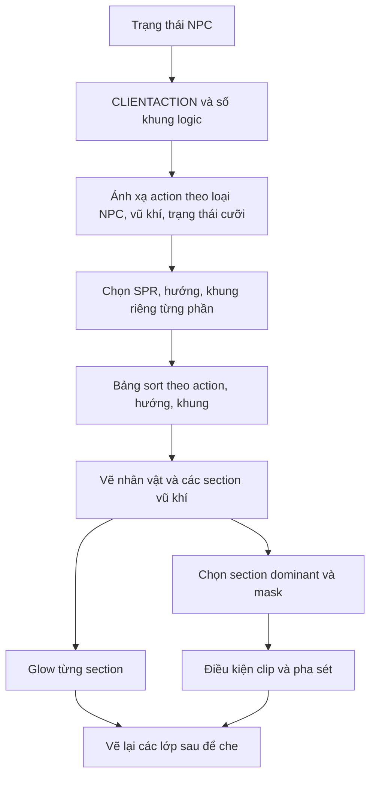

TÓM TẮT 1 [NGUỒN] PARTIAL — Đã truy vết tĩnh bản A qh9A từ trạng thái hành động đến vẽ hiệu ứng; chưa kết luận nguyên nhân gốc.
TÓM TẮT 2 [NGUỒN] Đứng/đi/chạy/đánh/ngồi chọn hành động và số khung logic; mỗi phần SPR được ánh xạ khung theo hướng và số khung riêng.
TÓM TẮT 3 [NGUỒN] Glow/sét đi qua section vũ khí, thứ tự lớp, mask và lưới giới hạn; gate góc H-14 không còn return trong source qh9A.
TÓM TẮT 4 [CHƯA KIỂM] BUG-002 chưa tái hiện trên LD theo hồ sơ; chưa có vũ khí, action, hướng, khung SPR cụ thể hoặc capture để xác định giả thuyết đúng.
TÓM TẮT 5 [NGUỒN] Không sửa mã/INI/APK, không build/chạy client/exe/VM/mạng; không commit/push. File nhịp ngoài workspace không ghi được do giới hạn sandbox.

# W-01d — Hiệu ứng vũ khí: khúc animation/khung và giả thuyết lỗi

Loại: khảo sát
Chủ đề: Truy vết chọn action, ánh xạ khung SPR, sắp lớp vũ khí, glow/sét và giả thuyết có phép kiểm không sửa mã.
Từ khóa: hiệu ứng vũ khí, cắt khung, SPR, cdo_stand, cdo_run, cdo_attack, cdo_sit, KNpcResVN, jxDrawBolts, BUG-002
Trạng thái: PARTIAL — khảo sát tĩnh và giả thuyết hoàn tất; thiếu file nhịp ngoài workspace, asset mục tiêu và chứng cứ runtime.
Độ phủ: đã phủ 12/14 mục tài liệu/source trong phạm vi; chưa phủ metadata của asset cụ thể và runtime/capture.
Liên quan: [L-01](L-01-lam-muot-hinh-anh.md), [L-02](L-02.md), [L-03](L-03-quy-trinh-dung-apk.md), [J-05](J-05-cat-khung-animation.md), [H-04](H-04-hieu-ung-vu-khi.md), [H-14](H-14-mat-khung-hieu-ung.md), [BUG-002](../BUGS/BUG-002.md).
Cần tôi quyết định: không

## Sơ đồ luồng



## Phạm vi và độ phủ

Nguồn mã được giao: `D:/JX-build/qh9A` (bản A theo task). Graphify không có trong root này (`graphify-out/GRAPH_REPORT.md`, `graph.json`, `.graphify_root` đều không tồn tại). Các báo cáo lịch sử là tài liệu định vị, không thay chứng cứ source hiện tại.

| # | Phần tử | Kết quả | Căn cứ |
|---:|---|---|---|
| 1 | L-01 — làm mượt hình ảnh | [TÀI LIỆU] Đã đọc; báo cáo ghi lúc đó chưa tìm được đường hiệu ứng trong phạm vi khảo sát, không dùng thay xác minh qh9A. | `JX1_OPS/REPORTS/L-01-lam-muot-hinh-anh.md:4,182` |
| 2 | L-02 — thử render/subpixel | [TÀI LIỆU] Đã đọc; có ghi chú `jxDrawBolts`, nhưng đánh giá dưới đây dựa trên source qh9A đọc lại. | `JX1_OPS/REPORTS/L-02.md:50-51,81` |
| 3 | L-03 — quy trình APK | [TÀI LIỆU] Đã đọc; nội dung là quy trình dựng/phát hành, không cung cấp chứng cứ chọn khung. | `JX1_OPS/REPORTS/L-03-quy-trinh-dung-apk.md:41-55` |
| 4 | BUG-002 đúng phạm vi | [TÀI LIỆU] Đã đọc; báo cáo lỗi tia sét nhảy khỏi vũ khí, nguyên nhân chưa biết và chưa tái hiện được trên LD. | `JX1_OPS/BUGS/BUG-002.md:1-6` |
| 5 | Hồ sơ trùng mã BUG-002 trong TEST | [TÀI LIỆU] Đã đọc để phân biệt; đây là fixture giao thức ID `0xff`, không phải lỗi animation vũ khí. | `JX1_OPS/REPORTS/TEST/BUG-002.md:23-37` |
| 6 | J-05 — cắt khung animation | [TÀI LIỆU] Đã đọc; mô tả tick/frame nguyên và giới hạn chưa đo runtime. | `JX1_OPS/REPORTS/J-05-cat-khung-animation.md:51-56,81-87` |
| 7 | H-14 — mất khung glow/sét | [TÀI LIỆU] Đã đọc; các giả thuyết historical được đối chiếu riêng với qh9A bên dưới. | `JX1_OPS/REPORTS/H-14-mat-khung-hieu-ung.md:119-133,375-376` |
| 8 | H-04 — mốc glow/sét | [TÀI LIỆU] Đã đọc; các mốc +6/+12/+15 là ghi chép cũ, không xác nhận APK/thiết bị hiện tại. | `JX1_OPS/REPORTS/H-04-hieu-ung-vu-khi.md:56-67` |
| 9 | Trạng thái → hành động client | [THẤY] Đã đối chiếu các nhánh đứng, đi, chạy, đánh, ngồi trong qh9A. | `D:/JX-build/qh9A/Classes/gamecore/KNpc.h:104-122`; `KNpc.cpp:2053-2110,2159-2183,2246-2263,2460-2515,2871-2898` |
| 10 | Bản đồ hành động và nạp tài nguyên theo phần | [THẤY] Đã đối chiếu `SetDoing`, `UpdateAction`, bảng action thường/đặc biệt và dữ liệu part/weapon. | `D:/JX-build/qh9A/Classes/gamecore/KNpc.cpp:6090-6097`; `KNpcRes.cpp:1656-1723`; `KNpcResNode.cpp:547-607` |
| 11 | Tiến khung và ánh xạ SPR | [THẤY] Đã đối chiếu chia nguyên theo frame logic, hướng và từng sprite part; đã đọc nhánh `GetNextFrame` dự phòng. | `D:/JX-build/qh9A/Classes/vn/gamecore/KNpcResVN.cpp:36-68,140-151`; `Classes/gamecore/KSprControl.cpp:79-94,297-373` |
| 12 | Sort, glow, mask và sét | [THẤY] Đã đối chiếu source hiện tại từ sort đến các điều kiện vẽ sét. | `D:/JX-build/qh9A/Classes/vn/gamecore/KNpcResVN.cpp:205-219,460-493,495-618`; `Classes/gamescene/KgameWorld.cpp:15025-15152,15286-15287` |
| 13 | Metadata của vũ khí/action/hướng/khung lỗi | [CHƯA KIỂM] BUG-002 không nêu item, action, hướng hoặc frame SPR cụ thể; task không chỉ định asset để mở. | `JX1_OPS/BUGS/BUG-002.md:3-6` |
| 14 | Capture, tái hiện, FPS/dt và đối chiếu APK | [CHƯA KIỂM] Không chạy theo giới hạn task; hồ sơ hiện có cũng chưa tái hiện lỗi. | `JX1_OPS/BUGS/BUG-002.md:4-6`; `JX1_OPS/REPORTS/H-14-mat-khung-hieu-ung.md:165-170` |

## Truy vết action và khung

[THẤY] `KNpc::Draw` chuyển `m_ClientDoing` vào `m_DataRes.SetDoing`, sau đó truyền `m_Frames.nTotalFrame` và `m_Frames.nCurrentFrame` vào Draw. `WaitForFrame` tăng frame logic từng bước và đặt lại về 0 khi đạt tổng số khung. Đây là logic source; nhịp thực gọi chưa đo. (`KNpc.cpp:3837-3845,6090-6097`.)

| Trạng thái | Hành động client | Số khung logic / chuyển trạng thái | Chứng cứ |
|---|---|---|---|
| Đứng | `cdo_fightstand`; ngoài chế độ chiến đấu chọn `cdo_stand` hoặc `cdo_stand1`; `OnStand` chọn lại sau một vòng. | `m_StandFrame`; khi vào đứng đặt khung hiện tại về 0. | [THẤY] `KNpc.cpp:2053-2110`; `KNpc.h:104-122` |
| Đi bộ | `cdo_fightwalk` hoặc `cdo_walk`. | Theo `m_WalkFrame * m_WalkSpeed / m_CurrentWalkSpeed + 1`; đặt lại khung khi mới chuyển sang đi. | [THẤY] `KNpc.cpp:2871-2898` |
| Chạy | `cdo_fightrun` hoặc `cdo_run`. | Mặc định `m_RunFrame`; nếu tốc độ đổi thì tính lại tổng khung theo tốc độ chạy gốc/hiện tại; đặt lại khi mới chuyển sang chạy. | [THẤY] `KNpc.cpp:2159-2204` |
| Đánh / dùng skill | `cdo_attack` hoặc `cdo_attack1`; skill có thể chọn action riêng, nếu action vượt miền thì fallback `cdo_magic`. | Tổng khung đánh/niệm có thể được tính theo tốc độ hiện tại; chia nguyên. | [THẤY] `KNpc.cpp:2377-2489,2494-2515` |
| Ngồi | `cdo_sit`. | `m_SitFrame`; đặt khung hiện tại về 0 khi bắt đầu ngồi. | [THẤY] `KNpc.cpp:2246-2266`; `KNpc.h:104-122` |

[THẤY] `KNpcRes::SetDoing` chỉ xử lý khi `nDoing` đổi, rồi `UpdateAction` gọi `GetActNo(m_nDoing, weaponType, rideState)`. NPC thường dùng trực tiếp `nDoing`; NPC đặc biệt tra bảng riêng khi cưỡi/không cưỡi. Khi action hợp lệ đổi, `UpdateActionNormal` nạp tên SPR, tổng frame, tổng hướng và interval riêng cho từng part/layer. Nếu action lookup trả số âm, `UpdateAction` trả thất bại; nếu action mới bằng action cũ thì không nạp lại. Không có chứng cứ việc này xảy ra ở BUG-002. (`KNpcRes.cpp:1656-1723`; `KNpcResNode.cpp:547-607`.)

[THẤY] Với `nAllFrame > 0`, `KNpcResVN::Draw` lượng tử hóa hướng từ hướng 64 mức sang số hướng của SPR, rồi tính frame của từng phần bằng công thức chia nguyên:

```text
frameSPR = dir * (totalFrames / totalDirs)
         + (totalFrames / totalDirs) * logicFrame / actionFrames
```

SPR từng phần có thể có số hướng/khung khác nhau. Trong vòng duyệt, `nCurDirNo` và `nCurFrameNo` được gán lại theo từng phần; sau vòng đó, `GetnSort` nhận cặp giá trị còn lại. Khi không có `nAllFrame`, code dùng `SetCurDir64` và `GetNextFrame`. `GetNextFrame` tăng một khung nếu đồng hồ game khác timer; nhánh này không tích lũy số interval bị trễ. Đây là đường dự phòng, không kết luận nó điều khiển action vũ khí đang báo lỗi. (`KNpcResVN.cpp:36-68,140-151,205-206`; `KSprControl.cpp:79-94,342-373`.)

[THẤY] `GetnSort(action, direction, frame)` có thể trả thất bại khiến `KNpcResVN::Draw` dừng trước khi vẽ phần còn lại. Qh9A còn đổi thứ tự hai section 8/9 ở hướng 0–3 khi nhân vật không cưỡi ngựa. Thứ tự cuối phụ thuộc action/hướng/frame và cấu hình sort; không thể suy từ thứ tự z cố định. (`KNpcResVN.cpp:205-215`; `KNpcResNode.cpp:612-630`.)

## Đường glow và sét trong qh9A

[THẤY] Khối glow chỉ chạy cho nhân vật local ngoài menu, lấy cấp cường hóa, và bắt đầu từ cấp 6. Ở cấp từ 12, code thu mask/rect riêng cho từng section vũ khí, chọn `domSec` có nhiều điểm mask nhất, rồi giữ mask/rect của section đó. Mỗi section nhận các lượt glow; sét chỉ được gọi tại section dominant khi có rect. Sau mỗi section, code vẽ lại các part đứng sau nó để che. (`KNpcResVN.cpp:495-522,540-585,600-626`.)

[THẤY] `jxDrawBolts` chạy pha theo đồng hồ `fr=(nowUs/50000)%16`, độc lập với `m_Frames.nCurrentFrame`. Hàm có thể bỏ toàn bộ lượt khi bán kính nhỏ hơn 8, mask ít hơn 8 điểm, lưới vượt 200×200/không hợp lệ, hoặc trục kiếm ngắn hơn 6 pixel. Từng chấm sau đó còn phải qua lưới, khoảng dọc trục và bề ngang. Mẫu arc có thể có `A.n == 0`; đây là nguồn trống theo pha trong thuật toán, không phải bằng chứng action SPR bị mất frame. (`KgameWorld.cpp:15025-15114,15116-15152,15188-15234`.)

[TÀI LIỆU] H-14 từng ưu tiên giả thuyết gate góc đổi nhanh. [THẤY] Trong qh9A, đoạn 15135–15144 chỉ tính `dth`, đánh dấu biến không dùng và cập nhật state; không còn nhánh từ chối khung ở đây. Các guard mask/grid/span vẫn còn. Vì vậy gate góc trong bản lịch sử không phải nguyên nhân đang hoạt động trong đoạn qh9A được đọc; điều này không chứng minh APK nào đang chạy đúng source qh9A. (`KgameWorld.cpp:15087-15102,15132-15144`; H-14:121-127,375.)

## Giả thuyết lỗi và phép kiểm không sửa mã

Mọi giả thuyết dưới đây là [CHƯA KIỂM], không phải nguyên nhân gốc. Các phép kiểm là kế hoạch tĩnh hoặc đối chiếu tư liệu có sẵn; không chạy game/exe, không sửa mã.

| ID | Giả thuyết [CHƯA KIỂM] | Căn cứ [THẤY] | Cách kiểm không sửa mã |
|---|---|---|---|
| H1 | Action/resource mapping của trạng thái, loại vũ khí hoặc trạng thái cưỡi không có đúng SPR/metadata; action lookup thất bại hoặc giữ action cũ có thể hiện nhầm animation/khung. | `KNpcRes::UpdateAction` xét `nNewAction < 0` và bỏ nạp khi action không đổi; `GetActNo` có nhánh bảng theo weapon/horse. `KNpcRes.cpp:1672-1702`; `KNpcResNode.cpp:592-607`. | Khi có item cụ thể, đọc đúng một bảng resource được action/file dẫn tới; đối chiếu action id, tên SPR, frame/dir/interval của body và từng weapon section. Không sửa bảng hay mã. |
| H2 | Chênh số khung logic và số khung SPR làm phép chia nguyên bỏ qua/lặp frame; body và weapon có thể chọn các frame nguồn khác nhau. | `KNpcResVN.cpp:36-68` tính frame riêng từng phần bằng chia nguyên; `KNpc.cpp:3837-3845` tăng frame logic từng bước. J-05 cũng ghi đây là khả năng tĩnh, chưa đo (`J-05:51-56,83-87`). | Đọc metadata của cùng item/action/hướng khi đã xác định; lập bảng cho từng `logicFrame` và chỉ số SPR theo công thức, rồi xem có chỉ số bỏ/lặp hoặc chênh với thân. Không cần build hay thay source. |
| H3 | Bảng sort/per-part order làm vũ khí hoặc hiệu ứng bị thân/part sau che, tạo cảm giác nhảy/mất khung khi hướng/action đổi. | Sort nhận cặp direction/frame cuối vòng part; source còn hoán đổi section 8/9 ở một số hướng và vẽ lại part phía sau weapon section. `KNpcResVN.cpp:205-215,460-493,619-626`; `KNpcResNode.cpp:612-630`. | Với action/hướng cụ thể, tính sort table từ bảng resource hiện có và đối chiếu frame SPR có sẵn hoặc capture/log đã tồn tại; tách trường hợp không có lệnh vẽ khỏi trường hợp đã vẽ nhưng bị che. |
| H4 | Mask/rect của section dominant thay đổi theo khung; PCA/clip chọn neo hoặc bỏ các điểm, khiến sét đổi vị trí hay biến mất khi vũ khí xoay. | `KNpcResVN.cpp:540-585,617-618` chọn dominant theo số điểm mask; `KgameWorld.cpp:15087-15114,15116-15152` có ngưỡng mask/grid/span và suy trục từ mask. | Nếu có dữ liệu mask/capture sẵn, đối chiếu rect, dominant section, số điểm và silhouette kiếm giữa các frame liền kề; chỉ đọc dữ liệu. Không tạo trace mới hoặc sửa code trong task này. |
| H5 | Pha sét theo đồng hồ tường và cấu trúc shape không đồng bộ action frame; một số pha không có arc, nhìn như khung chớp dù action SPR vẫn tiến bình thường. | `KgameWorld.cpp:15027-15035,15091,15049-15055,15195-15196,15243-15245`; pha lấy theo 50 ms, `A.n` có thể bằng 0. | Trên video/capture đã có, so cùng một pose/action qua pha 16 bước và xem sét lặp theo 50 ms/chu kỳ 16 pha hay khớp theo frame action. Không chạy client hay ghi thêm log. |

## Giải mã tên

Không có tên riêng cụ thể của kỹ năng, trang bị, quái, NPC hoặc bản đồ trong các nguồn được dùng. Các hàng sau giải nghĩa mã trạng thái ASCII, không phải tên riêng game.

| Tên gốc | Mã hóa | Chữ đúng | Nguồn file:dòng |
|---|---|---|---|
| `cdo_stand`, `cdo_stand1`, `cdo_fightstand` | ASCII identifier | đứng, tư thế đứng thay thế, đứng chiến đấu | `D:/JX-build/qh9A/Classes/gamecore/KNpc.h:104-122`; `KNpc.cpp:2053-2110` |
| `cdo_walk`, `cdo_fightwalk` | ASCII identifier | đi bộ, đi bộ chiến đấu | `D:/JX-build/qh9A/Classes/gamecore/KNpc.h:104-122`; `KNpc.cpp:2871-2898` |
| `cdo_run`, `cdo_fightrun` | ASCII identifier | chạy, chạy chiến đấu | `D:/JX-build/qh9A/Classes/gamecore/KNpc.h:104-122`; `KNpc.cpp:2159-2184` |
| `cdo_attack`, `cdo_attack1`, `cdo_magic`, `cdo_sit` | ASCII identifier | đánh, biến thể đánh, phép, ngồi | `D:/JX-build/qh9A/Classes/gamecore/KNpc.h:104-122`; `KNpc.cpp:2460-2489,2246-2266` |
| Không có tên riêng kỹ năng/trang bị/quái/NPC/bản đồ được trích | Không áp dụng | Không áp dụng | `JX1_OPS/BUGS/BUG-002.md:1-6`; source qh9A nêu ở phạm vi trên |

## Sắp theo cấu trúc game

| Thứ tự cấu trúc | Dữ liệu/luồng |
|---|---|
| 1. Trạng thái NPC | đứng/đứng chiến đấu/đứng thay thế → đi bộ → chạy → đánh/skill → ngồi; mỗi trạng thái chọn action client và tổng khung logic. |
| 2. Hành động tài nguyên | action logic → action id theo NPC thường/đặc biệt, loại vũ khí, trạng thái cưỡi → tên SPR và metadata của từng part/layer. |
| 3. Hướng và khung | hướng 64 mức → hướng có trong SPR → frame theo phần nguyên của frame logic trên tổng frame action. |
| 4. Bộ phận nhân vật | sort table theo action/hướng/frame → các section vũ khí và lớp nằm trước/sau thân. |
| 5. Hiệu ứng vũ khí | glow cho section vũ khí → mask/rect dominant → pha sét độc lập → vẽ lại lớp phía sau để che. |

## MỤC SỔ THÔNG SỐ

| Nhóm | Tên/hằng số | File:dòng | Giá trị | Đơn vị | Ảnh hưởng | Đổi an toàn | Nguồn đo |
|---|---|---|---|---|---|---|---|
| Action | `m_Frames.nTotalFrame` | `KNpc.cpp:2060,2170-2175,2246-2263,2460-2489,2880-2883` | theo trạng thái/tốc độ; chưa có số runtime | frame logic | mẫu số ánh xạ action sang SPR | KHÔNG trong task này | source tĩnh; chưa đo runtime |
| SPR | `m_nTotalFrame`, `m_nTotalDir` | `KNpcRes.cpp:1717-1720`; `KNpcResVN.cpp:60-68` | lấy riêng theo part/action; chưa biết asset mục tiêu | frame/hướng | quyết định khung nguồn và dải từng hướng | KHÔNG trong task này | source; chưa đọc asset mục tiêu |
| SPR | `m_dwInterval` | `KSprControl.cpp:304-330,342-373` | tối thiểu 1 ở các nhánh tiến khung | tick/thời gian | điều khiển nhánh `ChangeCurFrame`; `GetNextFrame` chỉ tăng một khung khi timer đổi | KHÔNG trong task này | source tĩnh |
| Sét | `JX_FR`, pha `fr` | `KgameWorld.cpp:15027-15035,15091` | 16 pha; mỗi pha 50.000 µs; chu kỳ 800.000 µs | pha, µs | lịch sét chạy theo đồng hồ, độc lập frame action | KHÔNG trong task này | source; chu kỳ là phép tính từ source |
| Sét | các guard mask/grid/span | `KgameWorld.cpp:15087-15102,15132` | R<8; mask<8; lưới tối đa 200×200; span<6 | pixel/điểm | có thể bỏ cả lượt vẽ sét | KHÔNG trong task này | source; không có số đo mask của asset mục tiêu |

## ĐỀ XUẤT TỐI ƯU

[CHƯA KIỂM] Chưa đề xuất sửa mã. Bước phân biệt tiếp theo cần tên item hoặc một capture đã có, action/hướng/frame triệu chứng và nguồn APK/build tương ứng. Khi đủ dữ liệu, đối chiếu trước action/resource, chỉ số frame, sort, dominant mask và lệnh vẽ/occlusion; mỗi lần kiểm tra giữ nguyên source và không trộn các giả thuyết.

## Đã xác minh / Chưa xác minh

- [THẤY] Source tĩnh bản A `D:/JX-build/qh9A`: luồng trạng thái/action, ánh xạ frame SPR, sort theo action/hướng/frame, khối glow/section và điều kiện gọi sét; xem các đoạn `KNpc.cpp`, `KNpcRes.cpp`, `KNpcResNode.cpp`, `KNpcResVN.cpp`, `KSprControl.cpp`, `KgameWorld.cpp` đã dẫn.
- [TÀI LIỆU] `JX1_OPS/BUGS/BUG-002.md:4-6` ghi đã thử trên LD nhưng chưa thấy nhảy xa; nguyên nhân chưa biết. `JX1_OPS/REPORTS/TEST/BUG-002.md:23-37` là fixture giao thức riêng.
- [THẤY] Gate góc được nêu trong H-14 không còn bỏ frame trong đoạn qh9A `KgameWorld.cpp:15135-15144`; các guard mask/grid/span vẫn đang có.
- [CHƯA KIỂM] Không có item/action/dir/frame SPR mục tiêu, metadata asset, APK/source provenance hoặc capture runtime trong phạm vi lượt này. Không chạy build, game/client/exe, VM hay mạng theo task.

## Bàn giao

- Trạng thái: PARTIAL — báo cáo khảo sát tĩnh hoàn thành; asset mục tiêu/runtime và sidecar nhịp chưa xác minh/không ghi được.
- File sửa trong worktree: `JX1_OPS/REPORTS/W-01d.md`; đã thêm mục kết quả cuối vào `JX1_OPS/TASKS/W-01d.md` theo yêu cầu.
- Chưa commit/push; task không yêu cầu commit. Không sửa mã nguồn, INI, APK, kết luận các báo cáo cũ hoặc `docs-analysis/BAI_HOC.md`.
- Kỹ năng đã dùng: jx1-retrofit, jx1-read-server, jx1-read-client, jx1-parameters, jx1-knowledge, jx1-report.
