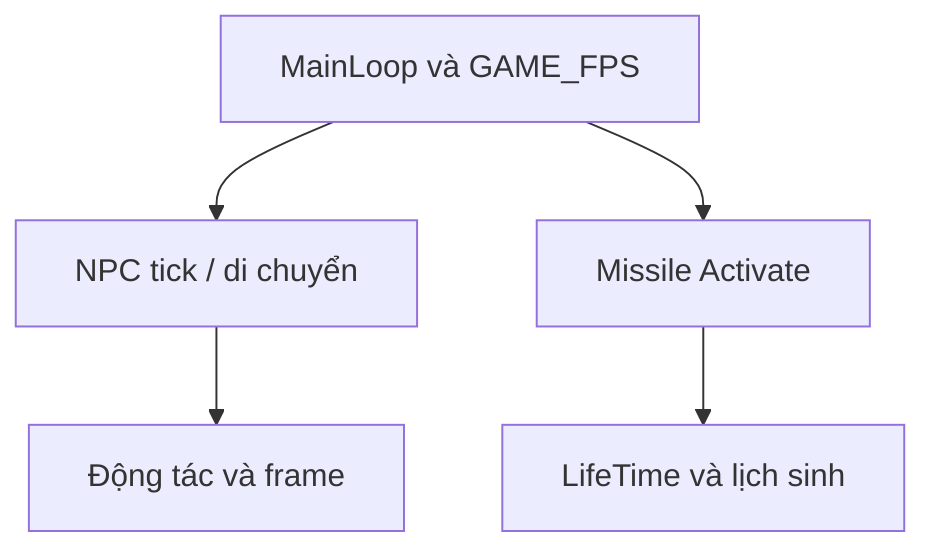

## TÓM TẮT 5 DÒNG
1. DONE [NGUỒN] — X-02 ngày 17/11/2026: đã đọc source SwordOnline, lập SỔ THÔNG SỐ tick/di chuyển/missile và đối chiếu H-13.
2. [NGUỒN] SwordOnline cố định GAME_FPS=18 ở outer/core; một bước logic danh định 1000/18 ≈ 55,56 ms, runtime CHƯA ĐO.
3. [NGUỒN] Di chuyển dùng tốc độ mỗi bước, kẹp theo cellWidth−1; missile kẹp Speed=32, tuổi đạn tăng theo Activate, phát chiêu tại mốc nguyên 60% frame.
4. [NGUỒN] H-13 khảo sát bản D:\JX-source có sửa 36 Hz/half-loop; bản SwordOnline không có các nhánh đó tại sáu file đã kiểm tra, không được gộp hai phiên bản.
5. [NGUỒN] Chỉ tạo báo cáo này; không sửa source/cấu hình, không VM/exe/build/test/mạng, không ghi khóa; không commit/push vì không được yêu cầu.

# X-02 — Tick, di chuyển và lịch missile phía server
Loại: khảo sát
Chủ đề: Đối chiếu hằng số tick, chuyển động NPC và lịch sống/phát của missile giữa hai source server.
Từ khóa: server, tick, GAME_FPS, NPC, missile, MoveSpeed, 36 Hz, half-loop, H-13, X-02
Trạng thái: DONE — kết luận lịch sử theo SwordOnline và H-13; không tái kiểm tra hai source ngoài root R-07b.
Độ phủ: báo cáo gốc dẫn 12/12 tệp source; R-07b chưa tái xác minh 12/12 tệp vì không có các đường dẫn C++ tương ứng trong root gs được phép.
Liên quan: JX1_OPS/REPORTS/H-13-tick-do-tre-don.md, JX1_OPS/DESIGN/MUC-LUC-TRI-THUC.md
Cần tôi quyết định: không

## Phạm vi và độ phủ

| Tệp dưới Sources được báo cáo gốc dẫn | Độ phủ lịch sử / bằng chứng gián tiếp | Đối chiếu tại root gs trong R-07b |
|---|---|---|
| `MultiServer/GameServer/KSOServer.cpp` | Đã phủ gate outer: `KSOServer.cpp:90,1433-1466` | Chưa phủ; `MultiServer/GameServer/KSOServer.cpp` không hiện diện |
| `Engine/Src/KTimer.cpp` | Đã phủ đơn vị thời gian: `KTimer.cpp:132,135-136` | Chưa phủ; `Engine/Src/KTimer.cpp` không hiện diện |
| `Core/Src/CoreServerShell.cpp` | Đã phủ core tick: `CoreServerShell.cpp:2227,2250` | Chưa phủ; đường dẫn tương ứng không hiện diện |
| `Core/Src/KNpc.cpp` | Đã phủ NPC/động tác/di chuyển: `KNpc.cpp:60,76-80,3449-3460,6342-6371` | Chưa phủ; đường dẫn tương ứng không hiện diện |
| `Core/Src/KSubWorld.cpp` | Đã phủ đồng hồ world: `KSubWorld.cpp:271,281` | Chưa phủ; đường dẫn tương ứng không hiện diện |
| `Core/Src/KSubWorldSet.cpp` | Đã phủ đồng hồ chung: `KSubWorldSet.cpp:612` | Chưa phủ; đường dẫn tương ứng không hiện diện |
| `Core/Src/KRegion.cpp` | Đã phủ parity sync: `KRegion.cpp:1106-1127` | Chưa phủ; đường dẫn tương ứng không hiện diện |
| `Core/Src/KNpcTemplate.cpp` | Đã phủ default loader: `KNpcTemplate.cpp:663-669` | Chưa phủ; đường dẫn tương ứng không hiện diện |
| `Core/Src/KGameglobalSet.cpp` | Đã phủ loader hệ số attack: `KGameglobalSet.cpp:89` | Chưa phủ; đường dẫn tương ứng không hiện diện |
| `Core/Src/KMissle.cpp` | Đã phủ tuổi/tốc độ/follow: `KMissle.cpp:229-230,389-497,705-865` | Chưa phủ; đường dẫn tương ứng không hiện diện |
| `Core/Src/KSkills.cpp` | Đã phủ lịch sinh đạn/cooldown: `KSkills.cpp:1776-1777,3018-3038,3279-3309` | Chưa phủ; đường dẫn tương ứng không hiện diện |
| `Core/Src/KSkillList.cpp` | Đã phủ mốc cast ban đầu: `KSkillList.cpp:83-84` | Chưa phủ; đường dẫn tương ứng không hiện diện |

Bảng kiểm kê đầy đủ 12 tệp source được X-02 dẫn, gồm 10 tệp từng so byte và 2 tệp bổ sung KTimer/KGameglobalSet; không suy tổng số tệp toàn server. Root đối chiếu R-07b là `C:/Jx1CocoV3/Folder/ServerNew-20260116T043145Z-3-001/ServerNew/_bin_v2_/gs`. Kết luận lịch sử vẫn theo S/H bên dưới, chưa tái xác minh source hay runtime ở root hiện tại. Mã hóa báo cáo: UTF-8 không BOM; encoding các source lịch sử chưa kiểm lại, không mặc định GBK/TCVN3.

## Phạm vi và bằng chứng

Task: `JX1_OPS/TASKS/X-02.md`, nhánh đã kiểm tra một lần: `task/X-02`. Trạng thái ban đầu chỉ có task này untracked; không có báo cáo X-02 để tiếp tục. Giữ nguyên task và mọi dữ liệu có sẵn. Chỉ ghi `JX1_OPS/REPORTS/X-02.md`.

Quy ước đường dẫn:

| Ký hiệu | Gốc |
|---|---|
| S | `C:\Jx1CocoV3\SwordOnline\SwordOnline\jxOnline\gameserver\Sources` — nguồn SwordOnline task yêu cầu |
| H | `D:\JX-source\server\jxOnline\gameserver\Sources` — nguồn dùng trong H-13 |
| R | `JX1_OPS/REPORTS/H-13-tick-do-tre-don.md` — tài liệu đối chiếu trong worktree |

`file:dòng` dưới đây dùng dòng vật lý tách theo LF. Chỉ trích symbol/biểu thức cần thiết; comment tiếng Trung có byte không giải mã được bằng UTF-8 không được dùng để xác định đơn vị. Các phép đổi ms là tính toán theo nhịp thiết kế 18 Hz, **không phải kết quả đo**, không xác nhận binary gs001 đang chạy khớp source. Không đọc giá trị credential hay nội dung cấu hình chứa khóa.

## SỔ THÔNG SỐ

### Tick và frame logic

| Thông số/biểu thức | Giá trị | Đơn vị và ý nghĩa | Bằng chứng |
|---|---|---|---|
| GAME_FPS outer | 18 | lượt MainLoop/s theo gate thời gian | `S/MultiServer/GameServer/KSOServer.cpp:90` |
| GAME_FPS core | 18 | frame/s quy ước riêng của core; không chia sẻ macro outer | `S/Core/Src/CoreServerShell.cpp:2227` |
| Gate Breathe | `1000*m_nGameLoop <= GetElapse()*GAME_FPS` | GetElapse là ms; bước danh định ≈55,56 ms | `S/MultiServer/GameServer/KSOServer.cpp:1441`, `:1442`; `S/Engine/Src/KTimer.cpp:132`, `:135`, `:136` |
| Sleep sau MainLoop | 0 | tham số Sleep; nhường lịch CPU, không phải tick 0 ms | `S/MultiServer/GameServer/KSOServer.cpp:1450`, `:1451` |
| Sleep khi chưa đến gate | 1 | tham số Sleep nhánh Windows; không bảo đảm thức chính xác sau 1 ms | `S/MultiServer/GameServer/KSOServer.cpp:1463`, `:1466` |
| Reset counter/timer | 1512000 | lượt outer; chia 18 = 84000 s danh định, không phải đủ 86400 s/ngày | `S/MultiServer/GameServer/KSOServer.cpp:1433`, `:1435`, `:1437` |
| Chu kỳ thống kê outer | 1080 | lượt; 60 s danh định ở 18 Hz | `S/MultiServer/GameServer/KSOServer.cpp:1453` |
| FRAME2TIME | 18 | số frame quy ước cho 1 s | `S/Core/Src/KNpc.cpp:78`; dùng modulo ở `:1442` |
| GAME_UPDATE_TIME | 10 | frame/lần kiểm tra ở các nhánh dùng modulo; ≈555,56 ms, không phải 10 ms | `S/Core/Src/KNpc.cpp:80`, `:1618`, `:1954`, `:3513` |
| Đồng hồ thế giới | `++m_dwCurrentTime` | +1/frame logic ở world hợp lệ; đồng hồ chung cũng +1/MainLoop | `S/Core/Src/KSubWorld.cpp:271`, `:281`; `S/Core/Src/KSubWorldSet.cpp:612` |
| Bộ đếm NPC | `++m_LoopFrames` | +1/lượt Activate vượt qua các guard, không mặc định mọi NPC đều hoạt động | `S/Core/Src/KNpc.cpp:951`, `:955`, `:960` |
| Nhịp NormalSync NPC | `counter & 1`; reset khi `counter > 2*N` | counter tăng mỗi lượt vùng active; thường cách 2 lượt, tại vòng reset với N ổn định có thể cách 3 lượt | `S/Core/Src/KRegion.cpp:1106`, `:1117`, `:1118`, `:1125`, `:1126`, `:1127` |

Luồng nguồn gốc: `CoreServerShell::Breathe` gọi thẳng `g_SubWorldSet.MainLoop()` (`S/Core/Src/CoreServerShell.cpp:2250`); vòng đang hoạt động duyệt world tại `S/Core/Src/KSubWorldSet.cpp:601`, `:603`. Trong vùng, NPC Activate ở `S/Core/Src/KRegion.cpp:1120`, missile Activate ở `:1179`, player Active ở `:1191`. Những nhánh bị guard/không active có thể không nhận đủ 18 lần xử lý; không suy số lượt runtime từ macro.

### Di chuyển và động tác

| Thông số/biểu thức | Giá trị | Đơn vị và ý nghĩa | Bằng chứng |
|---|---|---|---|
| FIND_PATH_DISTANCE | 1 | hệ số nhân displacement, không phải chu kỳ timer | `S/Core/Src/KNpc.cpp:76`, `:6370`, `:6371` |
| Min CurrentRunSpeed | 10 | đơn vị tọa độ map/bước; kẹp khi CurrentRunSpeed khác 0 trong DoRun | `S/Core/Src/KNpc.cpp:3449`, `:3451`, `:3452` |
| Runattack cộng tốc độ | +50 rồi −50 | đơn vị map/bước; cộng tạm quanh ServeMove | `S/Core/Src/KNpc.cpp:3523`, `:3526`, `:3527`, `:3528` |
| Kẹp ServeMove | `MoveSpeed <= 0` → DoStand; `>= cellWidth` → `cellWidth−1` | đơn vị map/bước; không coi 31 trong comment là hằng số độc lập đã xác minh | `S/Core/Src/KNpc.cpp:6342`, `:6344`, `:6347`, `:6348` |
| Tọa độ fixed point | `<<10` | 1024 phần/đơn vị map trong biểu diễn; không phải tốc độ ×1024 thực | `S/Core/Src/KNpc.cpp:6360`, `:6361` |
| Run animation | `RunFrame*RunSpeed/CurrentRunSpeed`, có nhánh dùng RunFrame | frame động tác; chia nguyên, không quyết định riêng quãng đường/bước | `S/Core/Src/KNpc.cpp:3454`, `:3455`, `:3457`, `:3460` |
| WalkSpeed / RunSpeed loader | 5 / 10 mặc định | đơn vị map/bước; bị dữ liệu NPC ghi đè | `S/Core/Src/KNpcTemplate.cpp:666`, `:669` |
| WalkFrame / RunFrame loader | 15 / 15 mặc định | frame động tác; bị dữ liệu NPC ghi đè | `S/Core/Src/KNpcTemplate.cpp:663`, `:664` |
| HurtFrame loader | 10 mặc định | frame cơ sở; không mặc định thời gian hurt luôn 10 tick | `S/Core/Src/KNpcTemplate.cpp:665`; công thức hurt riêng tại `S/Core/Src/KNpc.cpp:3008` |
| AttackSpeed / CastSpeed loader | 20 / 20 mặc định | được nạp vào AttackFrame/CastFrame, tức frame cơ sở | `S/Core/Src/KNpcTemplate.cpp:667`, `:668` |
| naAttackSpeed / nbAttackSpeed | biến từ NpcAttackSpeed | hệ số trong `AttackFrame*a/(b+CurrentAttackSpeed)` hoặc công thức Cast; số 100 khởi tạo local bị ghi đè trước sử dụng | `S/Core/Src/KNpc.cpp:3791`, `:3792`, `:3793`, `:3814`, `:3829`; loader `S/Core/Src/KGameglobalSet.cpp:89` |
| ATTACKACTION_EFFECT_PERCENT | 60 | % frame động tác; kiểm tra bằng `current == total*60/100`, chia nguyên | `S/Core/Src/KNpc.cpp:60`, `:3984`, `:3989`, `:4016`, `:6854` |
| WaitForFrame | `current++`, reset 0 khi đạt total | +1/lượt gọi; frame nhỏ có thể không đi qua mốc 60% như phép tính thời gian liên tục | `S/Core/Src/KNpc.cpp:6845`, `:6846`, `:6848` |

Walk dùng `ServeMove(m_CurrentWalkSpeed)` tại `S/Core/Src/KNpc.cpp:3542`, `:3543`; Run chọn walk khi hết stamina, runattack hoặc run tại `:3521`, `:3522`, `:3527`, `:3532`. Với chuyển động đều và không bị chặn, tốc độ danh định = khoảng cách mỗi bước ×18; không dùng công thức này cho quỹ đạo đặc thù, mất lượt, va chạm hoặc animation.

### Missile và lịch sinh đạn

| Thông số/biểu thức | Giá trị | Đơn vị và ý nghĩa | Bằng chứng |
|---|---|---|---|
| LifeTime loader | 0 mặc định | lượt tuổi đạn; giá trị thật tùy dữ liệu missile | `S/Core/Src/KMissle.cpp:229` |
| Speed loader | 0 mặc định | đơn vị map/bước bay tuyến tính; tùy dữ liệu missile | `S/Core/Src/KMissle.cpp:230`, `:767`, `:768` |
| Kẹp Speed | `>32` → 32 | trần tham số tốc độ trước ZAxisMove/va chạm; không bảo đảm mọi quỹ đạo có displacement ≤32 | `S/Core/Src/KMissle.cpp:705`, `:706`, `:708`, `:710` |
| Tăng tuổi | `m_nCurrentLife++` | +1/Activate đến cuối hàm; nhánh hết tuổi có increment riêng rồi return | `S/Core/Src/KMissle.cpp:497`; `:408`, `:410` |
| Mốc bắt đầu bay | `CurrentLife == StartLifeTime` | lượt tuổi; PrepareFly/DoFly khi đúng mốc | `S/Core/Src/KMissle.cpp:414`, `:416`, `:425` |
| Mốc hết tuổi | `CurrentLife >= LifeTime` | lượt tuổi; xử lý nổ/vanish có điều kiện trạng thái | `S/Core/Src/KMissle.cpp:389`, `:391`, `:406` |
| StartLifeTime | `nWaitTime + GetMissleGenerateTime(...)` | lượt logic chờ; nhánh sinh đạn cộng mốc này vào LifeTime | `S/Core/Src/KSkills.cpp:1776`, `:1777` |
| WaitTime / MslsGenerateData loader | 0 / 0 mặc định | lượt logic; Data có ý nghĩa theo mode sinh đạn | `S/Core/Src/KSkills.cpp:3038`, `:3029` |
| MslsGenerate loader | 0 mặc định | mã mode, không phải Hz/ms | `S/Core/Src/KSkills.cpp:3028` |
| Lịch sinh đạn | NULL: Wait; SAMETIME: Wait+Data; ORDER: Wait+nNo*Data | lượt logic; random/center dùng công thức riêng | `S/Core/Src/KSkills.cpp:3279`, `:3284`, `:3289`, `:3295`, `:3297`, `:3302`, `:3309` |
| FlyEventTime loader | 0 mặc định | chu kỳ lượt bay khi FlyEvent bật; 0 dẫn DoVanish, không modulo 0 | `S/Core/Src/KSkills.cpp:3026`; `S/Core/Src/KMissle.cpp:442`, `:444`, `:446`, `:450` |
| Nhịp chỉnh hướng đuổi mục tiêu | `m_nTempParam1++ >= 8`, reset 0 | nhánh line/parabola có follow: từ counter 0, điều kiện đạt ở lượt thứ 9 (≈500 ms nếu 18 lượt/s liên tục); 8 không phải ms | `S/Core/Src/KMissle.cpp:142`, `:735`, `:738`, `:746`, `:748` |
| Circle | `Speed+30` | hệ số trong hiệu sin/cos; +30 không phải độ trễ | `S/Core/Src/KMissle.cpp:796`, `:804`, `:805` |
| Helix | `Speed+CurrentLife+50` | hệ số quỹ đạo phụ thuộc tuổi; không diễn giải +50 thành ms hoặc tốc độ cố định | `S/Core/Src/KMissle.cpp:854`, `:864`, `:865` |
| TimePerCast / TimePerCastOnHorse loader | 0 / 0 mặc định | lượt cooldown; cộng với đồng hồ world khi đặt mốc lần cast tiếp theo | `S/Core/Src/KSkills.cpp:3018`, `:3019`; `S/Core/Src/KNpc.cpp:3647`, `:3684` |
| NextCastTime / NextHorseCastTime khởi tạo | 180 / 180 | mốc frame game ban đầu, không phải cooldown 10 s cho mọi skill | `S/Core/Src/KSkillList.cpp:83`, `:84` |

## Đối chiếu H-13

Đối chiếu trực tiếp bằng `Get-FileHash -Algorithm SHA256` trên 10 file liên quan ở S/H, không chạy mã game:

| Kết quả nội dung | File tương đối Sources |
|---|---|
| Giống từng byte | `Core/Src/KMissle.cpp`, `Core/Src/KSkills.cpp`, `Core/Src/KNpcTemplate.cpp`, `Core/Src/KSkillList.cpp` |
| Khác | `MultiServer/GameServer/KSOServer.cpp`, `Core/Src/CoreServerShell.cpp`, `Core/Src/KNpc.cpp`, `Core/Src/KSubWorldSet.cpp`, `Core/Src/KSubWorld.cpp`, `Core/Src/KRegion.cpp` |

Khác biệt có ý nghĩa:

- **Tick:** H có `g_nLogicFps=18` và GAME_FPS trỏ biến (`H/MultiServer/GameServer/KSOServer.cpp:91`, `:93`). S dùng hằng 18 tại `:90`. Không suy giá trị cấu hình runtime từ cả hai.
- **36 Hz:** H đọc LogicFps một lần, nhận 36 thì gọi JxHalfLoop xen kẽ rồi return (`H/Core/Src/CoreServerShell.cpp:2237`, `:2238`); S gọi MainLoop trực tiếp (`S/Core/Src/CoreServerShell.cpp:2250`). Tìm `LogicFps|JxHalf|g_nJxLogicFps` tại sáu file khác nêu trên của S cho 0 kết quả mỗi file. Kết luận 36 Hz của H-13 áp dụng bản H có sửa, không áp dụng nguyên trạng S.
- **Di chuyển nửa bước:** H có `nSpeed>>1` trong JxHalfMove (`H/Core/Src/KNpc.cpp:6348`), cộng 50 cho runattack (`:6344`). S không có hàm này; `S/Core/Src/KNpc.cpp:6333` là ServeMove, kẹp ở `:6347`. Không sao chép số dòng KNpc của H sang S sau điểm tách này.
- **Missile:** trần 32, Circle +30, Helix +tuổi+50, WaitTime/lifetime xác nhận phù hợp sổ H-13; hai file missile/skill giống byte. Bổ sung nhịp follow `counter++ >=8` và phân biệt mốc tuổi với thời lượng chờ.
- **Đơn vị:** H-13 liệt kê dữ liệu mẫu từ `_bin_v2_/gs/Settings`; X-02 chỉ xác minh default loader/source, không coi số mẫu đó là hằng số hoặc giá trị gs001 đang chạy. Tương tự `naAttackSpeed/nbAttackSpeed=100` không được xác nhận hiệu lực chỉ từ khai báo local.
- **Đồng bộ:** S dùng counter parity trước NPC.Activate và trước vòng missile, tương ứng mô hình H-13 nhưng số dòng khác. Không khẳng định NPC sync luôn đúng 9 lần/s vì reset counter có thể tạo khoảng cách 3 lượt.

## Đã xác minh / Chưa xác minh, kiểm chứng, lỗi đã xử lý và bàn giao

- Đã đọc trực tiếp source cần thiết, trích file:dòng và kiểm tra nội dung hai bản bằng SHA-256 trên đúng 10 file; không dùng H-13 thay cho xác minh nguồn SwordOnline.
- Lệnh tìm kiếm đầu tiên lỗi: `rg : The term 'rg' is not recognized as the name of a cmdlet, function, script file, or operable program.` Khắc phục bằng `git ls-files`, `Select-String` và trích dòng PowerShell; không cài công cụ, không thử lại lỗi rg.
- Get-Content mặc định hiển thị tiếng Việt sai mã; đọc lại đúng các đoạn H-13 cần thiết bằng `-Encoding UTF8`. Một số đầu ra dài bị cắt; đã thu hẹp theo file/range/symbol để lấy bằng chứng cần thiết. Byte comment cũ không giải mã được không ảnh hưởng biểu thức ASCII đã trích.
- **CHƯA XÁC MINH:** runtime tick/jitter, giá trị cấu hình/bảng dữ liệu hiệu lực, binary triển khai, tốc độ/độ trễ thực. Không build/test/kết nối vì task chỉ đọc; không có kết quả PASS runtime.
- **Blocker còn lại:** không có cho phạm vi khảo sát tĩnh. Không tạo script phụ, khóa/lock file, snapshot hoặc sửa source/cấu hình.
- **Trạng thái: DONE.** Commit SHA: không có; chưa stage/commit/push vì người dùng chỉ yêu cầu báo cáo local. Không có lỗi push, không gọi GitHub hay sửa credential/config.

## Phát hiện khi chuẩn hóa

- X-02 dựa trên source SwordOnline và báo cáo H-13 từ các phiên bản khác với root server R-07b. Root server hiện được task chỉ định không có những tệp `Core/Src` và `MultiServer/.../KSOServer.cpp` mà X-02 dẫn. Bảng phạm vi ghi nhận nội dung đã có trong báo cáo gốc; việc xác nhận lại mã nguồn theo task R-07b chưa thực hiện được, nên giữ nguyên kết luận cũ.
