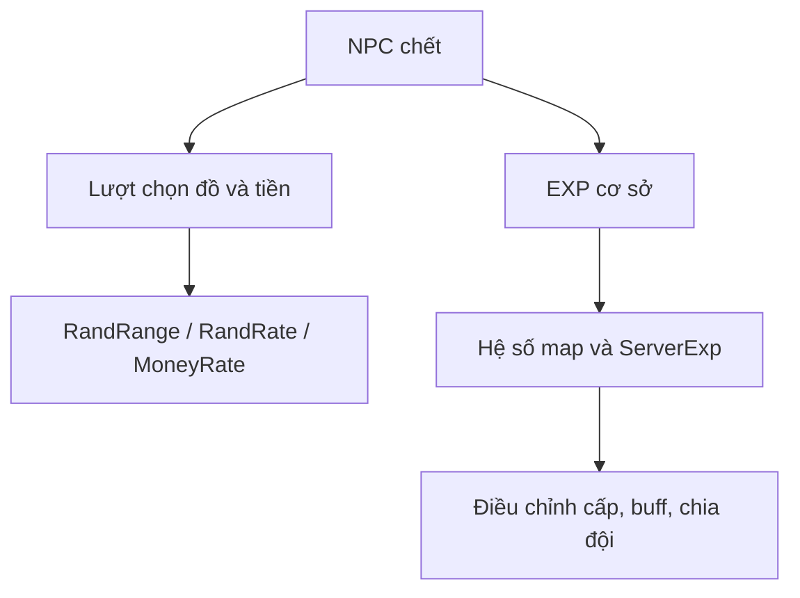

## TÓM TẮT 5 DÒNG
TÓM TẮT 1/5 — Đã khảo sát tĩnh hệ số chọn đồ và nhận EXP ở server source; không sửa mã. [NGUỒN]
TÓM TẮT 2/5 — RandRange là miền số nguyên; RandRate là trọng số slot, không phải % trực tiếp. [NGUỒN]
TÓM TẮT 3/5 — MoneyRate dùng thang 100 điểm; số lần thử rơi phụ thuộc nTypeNum hoặc đối số script. [NGUỒN]
TÓM TẮT 4/5 — EXP có ExpRate, hệ số map, ServerExp + mission 27, điều chỉnh chênh cấp và buff x2. [NGUỒN]
TÓM TẮT 5/5 — Kết quả khớp điểm chính A-17; cấu hình triển khai/runtime chưa xác minh. [CHƯA KIỂM] Giới hạn: không chạy build/test, exe hoặc VM.

# X-04 — Hằng số tỷ lệ rơi đồ và EXP server
Loại: khảo sát
Chủ đề: Khảo sát tĩnh tham số chọn vật phẩm rơi, tiền và các lớp tính EXP của server.
Từ khóa: rơi đồ, loot, RandRange, RandRate, MoneyRate, EXP, ExpRate, ServerExp, A-17, X-04
Trạng thái: DONE — kết luận lịch sử theo source server được báo cáo; config/runtime chưa xác minh.
Độ phủ: đã kiểm kê 10/10 phần tử (8 source, 1 bảng dữ liệu, 1 báo cáo đối chiếu); R-07b đối chiếu 2/10 phần tử, chưa tái xác minh 8 source C++.
Liên quan: JX1_OPS/REPORTS/A-17-roi-do-boss-trang-bi.md, JX1_OPS/DESIGN/MUC-LUC-TRI-THUC.md
Cần tôi quyết định: không

## Phạm vi và độ phủ

| Phần tử được báo cáo gốc dẫn | Độ phủ lịch sử / bằng chứng gián tiếp | Đối chiếu tại nguồn được phép trong R-07b |
|---|---|---|
| `KNpcTemplate.cpp` | Đã phủ loader tỷ lệ rơi: `KNpcTemplate.cpp:164-198,319-340,697-700` | Chưa phủ; không có `Core/Src/KNpcTemplate.cpp` tại root gs |
| `KNpc.cpp` | Đã phủ lượt rơi, chọn slot và phạt chết: `KNpc.cpp:2472-2474,11774-11779,12175-12190,12897-13048` | Chưa phủ; không có `Core/Src/KNpc.cpp` tại root gs |
| `KMath.h` | Đã phủ phép random: `KMath.h:376,382` | Chưa phủ; root gs không có cây source Engine; X-04 gốc chưa chỉ rõ đường dẫn header đầy đủ |
| `KGameglobalSet.cpp` | Đã phủ LuckyRate/ExpRate: `KGameglobalSet.cpp:90,117` | Chưa phủ; không có `Core/Src/KGameglobalSet.cpp` tại root gs |
| `KNpcDeathCalcExp.cpp` | Đã phủ EXP cơ sở/map: `KNpcDeathCalcExp.cpp:135,138,190,215` | Chưa phủ; không có `Core/Src/KNpcDeathCalcExp.cpp` tại root gs |
| `KNpcSet.cpp` | Đã phủ hệ số map: `KNpcSet.cpp:686-687` | Chưa phủ; không có `Core/Src/KNpcSet.cpp` tại root gs |
| `KPlayer.cpp` | Đã phủ EXP người chơi/đội/kỹ năng: `KPlayer.cpp:3026-3056,3109-3159` | Chưa phủ; không có `Core/Src/KPlayer.cpp` tại root gs |
| `KNpc.h` | Đã phủ MAX_PERCENT: `KNpc.h:64` | Chưa phủ; không có `Core/Src/KNpc.h` tại root gs |
| `Settings/droprate/npcdroprate110.ini` | Đã dẫn ví dụ thông qua A-17 | Đã phủ dữ liệu tĩnh tại root gs: `Settings/droprate/npcdroprate110.ini:2-5,15,335`; không xác nhận loader/runtime |
| `JX1_OPS/REPORTS/A-17-roi-do-boss-trang-bi.md` | Đã đối chiếu kết luận lịch sử | Đã đọc phần dữ liệu: `JX1_OPS/REPORTS/A-17-roi-do-boss-trang-bi.md:61-70`; không chạy lại khảo sát A-17 |

Đơn vị kiểm kê là 10 phần tử được X-04 dẫn, không phải toàn bộ hệ thống EXP hay mọi bảng rơi. Root dữ liệu R-07b là `C:/Jx1CocoV3/Folder/ServerNew-20260116T043145Z-3-001/ServerNew/_bin_v2_/gs`. Mã hóa báo cáo: UTF-8 không BOM; phần trích file ini là ASCII, chưa xác định encoding toàn tệp nguồn hoặc các source lịch sử; không tự nhận GBK/TCVN3.

Trạng thái: **DONE** — khảo sát source tĩnh ngày 17/11/2026. Không sửa mã, không dùng VM, không chạy build/game, không đọc hoặc ghi khóa. Các giá trị cấu hình nêu dưới đây là mặc định trong lời gọi đọc config, không phải giá trị đang chạy.

## SO THONG SO

| Nhóm | Tham số / giá trị | Đơn vị và ý nghĩa trong source | Vị trí |
|---|---|---|---|
| Trang bị | `RandRange` → `nMaxRandRate`, mặc định 0 | Cận miền số nguyên cho lượt chọn slot; `g_Random(nMaxRandRate)` | `KNpcTemplate.cpp:164,319`; `KNpc.cpp:12908` |
| Trang bị | `RandRate` → `nRate`, mặc định 0 | Trọng số nguyên của từng slot; chọn khi số ngẫu nhiên nằm trong khoảng cộng dồn của slot | `KNpcTemplate.cpp:198,340`; `KNpc.cpp:12921,12927` |
| Trang bị | `nTypeNum`, mặc định 2; fallback 3 nếu không dương | Số lượt thử trong nhánh rơi thường; không đồng nghĩa số món chắc chắn rơi vì mỗi lượt còn có thể không chọn được slot | `KNpcTemplate.cpp:177,328`; `KNpc.cpp:12069,12161,12183-12190` |
| Tiền | `MoneyRate`, mặc định 2 | Thang phần trăm 0–100 theo `g_Random(100) < nPercent`; kiểm tra trong từng lượt tiền | `KNpcTemplate.cpp:166,321`; `KMath.h:376,382`; `KNpc.cpp:12175-12180` |
| Chất lượng đồ | `MagicRate`, mặc định 0; `LuckyRate`, mặc định 100 | Không phải xác suất chọn slot. `MagicRate`/may mắn tham gia sinh thuộc tính; `LuckyRate` là cận cho phép so hai lượt random | `KNpcTemplate.cpp:165,320`; `KGameglobalSet.cpp:90`; `KNpc.cpp:13018,13030,13048` |
| EXP quái | `ServerConfig.ExpRate`, mặc định 1 (`nExpSale`) | Hệ số nguyên nhân EXP cơ sở của NPC trước khi gọi `AddExp` | `KGameglobalSet.cpp:117`; `KNpcDeathCalcExp.cpp:135,138,190,215` |
| EXP bản đồ | `nExpSale` của map, chỉ gán khi > 0 | Nếu map cung cấp giá trị dương, gán thành `Npc.IsJinYan`; giá trị này tiếp tục nhân EXP quái | `KNpcSet.cpp:686-687`; `KNpcDeathCalcExp.cpp:190,215` |
| EXP người chơi | `GameOption.ServerExp`, mặc định 1, cộng `GetMissionValue(27)` | Tổng là hệ số nguyên nhân thêm ở `AddSelfExp`; không có mẫu số % tại công thức này | `KPlayer.cpp:3114-3116` |
| EXP theo cấp | Chênh cấp `d`; mẫu số 200; `295 - 19*d` | Nếu người chơi ≥ cấp quái và cấp quái ≥100: giảm `nExp*d/200`. Trường hợp khác: d≤5 giữ nguyên; d=6..15 nhân `(295-19*d)/200`; d≥16 nhận tối thiểu 1 EXP | `KPlayer.cpp:3109-3139` |
| Buff EXP | `m_CurrentUpExp` → ×2 | Nhân đôi kết quả sau điều chỉnh cấp khi cờ buff đang bật | `KPlayer.cpp:3141-3142` |
| EXP kỹ năng | `Skill120Rate`, mặc định 0; `MAX_PERCENT=100` | EXP kỹ năng bằng `nGetExp * Skill120Rate / 100` khi rate khác 0 | `KPlayer.cpp:3156-3159`; `KNpc.h:64` |
| Chia EXP đội | `k = 100 + 15*nTotalPlayer` | Điểm phần trăm dùng để chia theo cấp từng người, sau đó nhân EXP và chia 100; không phải hệ số EXP quái | `KPlayer.cpp:3026-3043,3053-3056` |
| Giới hạn nhận EXP | `ServerExpLimit`, mặc định 1 | Đơn vị điểm EXP trong bộ đếm đã lưu; nhánh dừng khi giá trị trước cộng lớn hơn limit (`>`), nên đây không phải hệ số tỷ lệ | `KPlayer.cpp:3145-3151` |
| Mất EXP khi chết | 2% hoặc 4% EXP mốc cấp, chia qua `MAX_PERCENT=100` | Nhánh phạt riêng: cấp ≤10 dùng `(LevelExp/100)*2`; cấp >10 dùng `(LevelExp/100)*4` | `KNpc.cpp:11774-11779`; `KNpc.h:64` |

EXP cơ sở lấy từ `Npc.m_Experience`; đường phân phối quái thường gọi `KNpcDeathCalcExp::CalcExp()` (`KNpc.cpp:2472-2474`). Do đó EXP nhận là kết quả của nhiều lớp nêu trên, không thể suy ra một tỷ lệ runtime duy nhất chỉ từ một hằng số.

## Đối chiếu A-17

- Khớp với A-17: loader ánh xạ `Main.RandRange` vào `nMaxRandRate` và từng `RandRate` vào `nRate`; hàm `LoseSingleItem` bốc trong miền đó rồi xét khoảng trọng số cộng dồn. A-17 đã thống kê ví dụ `npcdroprate110.ini`: Count 52, RandRange 1.000.000, tổng RandRate 68.000. Tỷ lệ 6,8% chỉ là tổng khoảng trọng số cho một lượt chọn theo giả định phân phối đều; không phải tỷ lệ mỗi lần hạ boss, vì có nhiều lượt thử, slot đã rơi bị bỏ qua và còn điều kiện/modifier.
- Khớp với điểm cảnh báo A-17: đọc `DropRateFile` trong loader NPC bị comment (`KNpcTemplate.cpp:697-700`), nên ô dữ liệu này tự nó không chứng minh bảng đã được gắn. A-17 cũng lưu ý đường gắn bảng bằng script cần xét riêng.
- Phần mới của X-04: mã có `MoneyRate` theo thang 100 và nhiều hệ số nhận EXP; A-17 tập trung bảng rơi, không xác lập giá trị config đang chạy hoặc phép nhân EXP theo cấp/map.
- Không đưa `KNpc_backup.cpp` hay bản `LoseSingleItem` cũ nằm trong comment vào kết luận; đường hiện hành được gọi khi NPC thường chết tại `KNpc.cpp:2474`, hàm đang hoạt động ở `KNpc.cpp:12897`.

## Đã xác minh / Chưa xác minh, giới hạn và bàn giao

Chỉ xác nhận logic trong source được đọc. Chưa xác minh file cấu hình thực tế, giá trị mission/map, source có khớp binary/dữ liệu triển khai hay kết quả runtime; không chạy test/build theo chỉ thị. `rg` không có trong PATH (`CommandNotFoundException`); đã dùng `git ls-files`, PowerShell `Select-String` và đọc các đoạn source có mục tiêu để hoàn tất mà không cài công cụ.

Commit SHA: chưa có; task chỉ yêu cầu báo cáo. Chưa push vì không được yêu cầu và không cần mạng cho khảo sát này.

## Phát hiện khi chuẩn hóa

- Báo cáo gốc dẫn mã C++ server, nhưng thư mục server được chỉ định cho R-07b không có Core/Src/KNpc.cpp, KNpcTemplate.cpp, KPlayer.cpp hoặc các tệp C++ tương ứng. Không chạy thư viện/executable; giữ nguyên kết luận lịch sử và ghi tái kiểm chứng source là chưa xác minh.
- Bảng dữ liệu hiện có `Settings/droprate/npcdroprate110.ini:2-5,15` ghi Count=52, RandRange=1.000.000, MagicRate=1, MoneyRate=5, nTypeNum=2; `[53]` ở dòng 335. Đây là giá trị trong tệp dữ liệu được đọc, khác lớp với default loader MoneyRate=2 được X-04 nêu; không thay số cũ hoặc suy bảng này đang được gắn. Chưa tính lại tổng RandRate hay tỷ lệ 6,8% của A-17.
