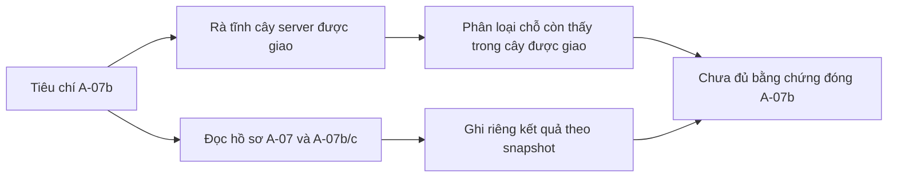

TÓM TẮT 1: [NGUỒN][THẤY] XD-A07b DONE — đã đối chiếu từng tiêu chí A-07b với cây server được giao và hồ sơ cũ; xem bảng tiêu chí.
TÓM TẮT 2: [NGUỒN][THẤY] Quét tĩnh 1.013 tệp, thu 6.744 dòng ứng viên; đọc và phân loại đủ 12/12 dòng trong nhóm lời gọi chọn trước ở `MultiServer/GameServer/KSOServer.cpp`.
TÓM TẮT 3: [NGUỒN][THẤY] Trong nhóm 12 có 7 lời gọi thu hẹp địa chỉ mà Core dùng lại, 2 lời gọi thu hẹp địa chỉ mà Core bỏ qua, 1 giá trị số và 2 chú thích; `Core/Src/KSortScript.cpp:328` riêng vẫn lưu handle vào `long`.
TÓM TẮT 4: [NGUỒN][TÀI LIỆU] A-07b ghi sửa 23 tệp và build được 4 thành phần, nhưng gs001 lỗi liên kết; A-07c ghi build đủ và PE `0x8060` trên snapshot kế thừa, xem `A-07b-ep-con-tro.md:72–77,156–158` và `A-07c-link-gs001.md:52–56,94–109`.
TÓM TẮT 5: [CHƯA KIỂM] Chưa xác nhận snapshot đã sửa, số lỗi còn lại toàn server hoặc runtime; XD-A07b chỉ đọc tĩnh, không chạy build, exe, VM hay kết nối mạng.

# XD-A07b — Đối chiếu việc A-07b: cắt con trỏ 64 → 32 bit

Loại: khảo sát\
Chủ đề: Kiểm tra bằng chứng sửa ép con trỏ và handle của gs001 trên Windows x64.\
Từ khóa: con trỏ, handle, pointer truncation, gs001, x64, LLP64, DWORD, A-07b, HighEntropyVA\
Trạng thái: DONE cho XD-A07b — mỗi vế đã có bằng chứng hoặc giới hạn; việc cha chưa đủ bằng chứng để đóng.\
Độ phủ: 4/4 nhóm tiêu chí được đối chiếu; trong kiểm kê mã, 12/12 dòng của nhóm lời gọi chọn trước đã phân loại, chưa đếm được số lỗi còn lại của toàn cây hoặc snapshot đã sửa.\
Liên quan: [Task A-07b](../TASKS/A-07b.md), [A-07](A-07-goc-re-crash-gs001.md), [A-07b](A-07b-ep-con-tro.md), [A-07c](A-07c-link-gs001.md), [A-07d](A-07d-breakpoint.md), [A-07e](A-07e-rtc.md), [Chuẩn báo cáo](../DESIGN/CHUAN-BAO-CAO.md).\
Cần tôi quyết định: không đối với XD-A07b.

## Phạm vi và độ phủ

[THẤY] `S/` là `C:/Jx1CocoV3/SwordOnline/SwordOnline/jxOnline/gameserver/Sources`, cây đọc trực tiếp. Tên tệp không đủ để nhận diện revision: `S/MultiServer/GameServer/KSOServer.cpp:960` và `S/Core/Src/KSortScript.cpp:328` còn kiểu hẹp, khác hai dấu vết baseline ghi ở `A-07b-ep-con-tro.md:83`. Không gán các phát hiện ở `S/` cho snapshot A-07b/A-07c. Báo cáo cũ được đối chiếu ở kho báo cáo task chỉ định và dẫn theo tên tệp. `GS001-MAP.md:1–2,8` chỉ giúp định vị; không tìm thấy `GRAPH_REPORT.md` ở `S/graphify-out` và `S/../graphify-out`, nên lần trực tiếp trong mã.

| Tiêu chí việc cha | Độ phủ và bằng chứng |
|---|---|
| Quét `S`, `Core` và phần dùng chung: cast, handle, callback, log, kích thước con trỏ và hàm thiếu prototype (`A-07b.md` trong `TASKS`:21) | [THẤY] Đã kiểm kê 8 thư mục trong `S/` với 6 nhóm mẫu, gồm `MultiServer` và `Core`. [TÀI LIỆU] Lượt A-07b đếm 1.151 tệp và 6.169 hit, gồm cả header ngoài `Sources`; báo không thấy C4013 trong tệp C được build (`A-07b-ep-con-tro.md:75,85,152,171`). [CHƯA KIỂM] Độ phủ mọi biểu thức, prototype, header ngoài cây và mọi cấu hình dịch. |
| Phân loại mọi chỗ và sửa chỗ chắc chắn/có thể (`TASKS/A-07b.md:22`) | [THẤY] Đã phân loại 12 dòng của nhóm lời gọi và đối chiếu các mẫu riêng bên dưới; cây này vẫn có chỗ thu hẹp. [TÀI LIỆU] Báo cáo cũ có bảng 23 tệp, nhóm an toàn, danh sách tồn đọng và ghi 23/23 tệp khớp snapshot của lượt đó (`A-07b-ep-con-tro.md:93–146,171`). [CHƯA KIỂM] Chưa có đối chiếu trực tiếp mã trước/sau trên đúng revision đã sửa hoặc tổng số chỗ chưa xử lý của revision đó; XD không sửa mã. |
| Build VS2022 v143 x64; nếu thành công, ghi SHA-256 và `DllCharacteristics` của gs001 (`TASKS/A-07b.md:23`) | [TÀI LIỆU] `build-debug-a07.ps1:85–90` chỉ dẫn tham số build. A-07b ghi LuaLibDll, Engine, Common, CoreServer build được; gs001 compile qua nhưng vướng `LNK2001` (`ms64.lib`, `__imp___iob_func`) và `LNK1120`; không sinh gs001 mới (`A-07b-ep-con-tro.md:76,150–158`). A-07c ghi 5/5 build thành công trên snapshot kế thừa, SHA-256 `0c14250622f79ee2db90653ce769afb3f48d5005641662cc880f451f6dbfbe5c`, cờ `0x8060` (`A-07c-link-gs001.md:52–56,94–109`). [CHƯA KIỂM] Không chạy build, đọc PE hoặc tính hash mới. |
| Báo cáo, danh sách chưa sửa, mục chưa kiểm và commit A-07b (`TASKS/A-07b.md:24–25`) | [THẤY] Có `A-07b-ep-con-tro.md` với bảng sửa, mục nghi ngờ/chưa sửa và mục Chưa kiểm (`:87–115,133–146,183–188`). [TÀI LIỆU] Lượt gốc bị từ chối tạo `index.lock`; A-07c ghi HEAD `8fde733` kế thừa A-07b (`A-07b-ep-con-tro.md:191–207`, `A-07c-link-gs001.md:52`). [CHƯA KIỂM] Chưa đối chiếu commit việc cha, nội dung commit và revision của cây `S/` với nhau. |

[THẤY] Kiểm kê bằng `Get-ChildItem` và `Select-String -LiteralPath ... -Pattern ...` trên phần mở rộng `c`, `cc`, `cpp`, `cxx`, `h`, `hh`, `hpp`, `hxx`, `inl`, `ipp`, `inc`; loại thư mục `Debug`, `Release`, `x64`, `ipch`, `.git` và tệp có basename chỉ bí mật. Không đọc cấu hình, dump hay binary. Mẫu tìm cast kiểu hẹp, API handle, từ khóa callback, format `%x/%d/%i/%u`, kích thước con trỏ hoặc dung lượng bộ nhớ cố định, và trường kiểu số có tên gợi ý địa chỉ. Đơn vị đếm là dòng `file:dòng` riêng trong hợp của 6 mẫu; bỏ dòng bắt đầu bằng `//`, `/*`, `*` sau khoảng trắng. Chú thích trong dòng và giữa khối nhiều dòng vẫn có thể khớp. Đây là kiểm kê từ khóa; không dùng số hit làm số lỗi hay lấy chênh lệch với 6.169 hit lịch sử làm số lỗi mới.

| Thư mục dưới `S/` | Tệp đã quét | Dòng ứng viên duy nhất |
|---|---:|---:|
| `MultiServer` | 92 | 198 |
| `Core` | 266 | 3.342 |
| `Engine` | 325 | 566 |
| `Library` | 57 | 79 |
| `AutoUpdateRes` | 233 | 2.429 |
| `FilterText` | 6 | 7 |
| `FilterTextTest` | 3 | 0 |
| `MySql` | 31 | 123 |
| **Tổng** | **1.013** | **6.744** |

[THẤY] Lệnh quét báo `files=1013; union=6744; line_comments=951; errors=0`. Kiểm kê riêng trong `KSOServer.cpp`, dùng `Select-String` với mẫu `\b(?:OperationRequest(?:Info)?|GetGameData(?:Info|_New)?)\s*\([^;]*?\(\s*(?:unsigned\s+int|int|DWORD|unsigned\s+long|long|ULONG|UINT)\s*\)` và cùng bộ lọc đầu dòng: 37 dòng khớp, bỏ 25 dòng chú thích ở đầu dòng, đọc bằng tay cả 12 dòng còn lại. Trong nhóm này: đã rà **12/12**, còn **0** dòng chưa phân loại và **9** chỗ có ép địa chỉ hẹp trong mã chưa bị comment; Core dùng lại địa chỉ ở 7 chỗ và bỏ qua ở 2 chỗ. Còn **6.732** dòng ứng viên ngoài nhóm 12, có lấy mẫu nhưng chưa phân loại từng dòng; tổng chỗ còn phải sửa trên server **chưa đếm được**.

## Giải mã tên

Không áp dụng: báo cáo dùng tên thành phần và ký hiệu kỹ thuật ASCII trong mã, không có tên riêng kỹ năng, trang bị, NPC, quái hay bản đồ cần chuyển GBK/TCVN3. Tài liệu lưu UTF-8 không BOM; giữ nguyên tên ký hiệu, không suy bảng mã của từng tệp nguồn từ chữ chú thích hiển thị.

## Sắp theo cấu trúc game

Các bằng chứng dưới đây xếp theo đường đi của dữ liệu: khởi tạo và nạp script, trao đổi giữa GameServer/Core khi xử lý bản đồ, nhân vật và bang hội, rồi hạ tầng dùng chung. Không có tập dữ liệu vật phẩm, kỹ năng hoặc bản đồ để phân cấp thêm.

## Đã xác minh — chi tiết trong cây được giao

### Khởi tạo và nạp script

- [THẤY] `S/MultiServer/GameServer/KSOServer.cpp:943–960` đưa `IServer*` qua `unsigned int`; `S/Core/Src/CoreServerShell.h:217` khai báo tham số hẹp và `S/Core/Src/CoreServerShell.cpp:2048,2059–2060` đổi lại thành con trỏ. Trên Windows x64, địa chỉ có bit cao khác 0 không thể đi qua kiểu đích này mà giữ nguyên.
- [THẤY] `S/Core/Src/KSortScript.cpp:328,332,369,371` giữ kết quả `_findfirst` trong `long` rồi đưa lại cho `_findnext`/`_findclose`. Đây là chỗ thu hẹp handle trong mô hình Windows x64; không suy giá trị handle thực đã xuất hiện.
- [THẤY] Mốc thứ ba trong A-07, `S/MultiServer/GameServer/KSOServer.cpp:4966`, gọi `PreparePlayerForLoginFailed(nIndex)`; tại dòng đó không ép con trỏ sang số. [TÀI LIỆU] `A-07-goc-re-crash-gs001.md:92,99,200–205` ghi đây là ứng viên riêng về shell chưa sẵn sàng và giữ giả thuyết cắt con trỏ cho khác biệt HighEntropyVA. XD-A07b không thay đổi kết luận hoặc coi đó là lần xác minh crash mới.

### Nhóm 12 lời gọi GameServer → Core

Mọi dòng bên trái dưới đây thuộc `S/MultiServer/GameServer/KSOServer.cpp`; phần Core là `S/Core/Src/CoreServerShell.cpp`. “Dùng lại” mô tả hành vi của nhánh trong mã nếu được gọi; chưa xác minh đường chạy tới đó.

| Dòng | Phân loại và bằng chứng |
|---|---|
| `:960`, `:1712` | [THẤY] 2 chỗ chắc chắn thu hẹp địa chỉ qua `OperationRequest` nếu địa chỉ vượt 32 bit: khởi tạo server và nội dung phát thông báo; Core `:2048,2056–2060` dựng lại con trỏ. |
| `:4120`, `:5326`, `:6652` | [THẤY] 3 chỗ cùng loại ở bộ đệm bản đồ, tài khoản và tên nhân vật. Core `:1184,1201–1214,1273–1285` chuyển lại `uParam` thành con trỏ để dùng bộ đệm. `:6652` nằm sau chốt `:6642–6643`; chưa coi là đường chạy được. |
| `:6600`, `:6734` | [THẤY] 2 chỗ cùng loại ở yêu cầu mời vào bang và kiểm tra quyền; Core `:1189–1196,1397–1404` sử dụng cấu trúc từ địa chỉ nhận được. |
| `:6641`, `:6763` | [THẤY] 2 địa chỉ biến `DWORD` cũng bị ép xuống `unsigned int`, nhưng nhánh Core `:1723–1731` trả ID qua kết quả, không dùng `uParam`. Cả hai lời gọi bỏ kết quả trả về và kiểm tra biến đã khởi tạo 0 (`:6640–6643`, `:6762–6764`). Ghi riêng lỗi hợp đồng dữ liệu; không tính thành chỗ Core dùng lại địa chỉ bị cắt. |
| `:4242` | [THẤY] Đối số được Core dùng làm chỉ số nhiệm vụ trong `SetMissionValue` (`:2053–2054`), không dựng lại thành địa chỉ trên đường gọi này. |
| `:4344`, `:6350` | [THẤY] `:4344` có cast trong chú thích nội dòng, dữ liệu thật đi qua `strdata` (Core `:1954–1955`); `:6350` ở trong khối chú thích `:6342–6352`. |

### Giá trị trả về, Lua và thư viện dùng chung

| Nhóm | Mẫu đối chiếu ngoài nhóm 12 |
|---|---|
| Địa chỉ trả về | [THẤY] Nhánh bang hội `S/Core/Src/CoreServerShell.cpp:1184–1186,1329–1339` trả địa chỉ tên qua `int`; `S/MultiServer/GameServer/KSOServer.cpp:2019–2027` giữ trong `TongBase` rồi đổi lại để sao chép. Đây là đường trả về, tách khỏi 7 đường tham số ở trên. |
| Định dạng log | [THẤY] `S/Core/Src/KInventory.h:9` khai báo `int* m_pArray`, `S/Core/Src/KInventory.cpp:660,666` truyền nó vào `%d`; `S/Engine/Src/KForBitGua.cpp:190` ép base address sang `DWORD` khi in. Phân loại lỗi địa chỉ trong log, không gán nguyên nhân crash. |
| Callback và lưu con trỏ | [THẤY] `S/Engine/Src/KStepLuaScript.cpp:296,397` đưa địa chỉ trạng thái Lua qua định dạng `d` và `unsigned int`; `S/MultiServer/Common/OpaqueUserData.h:26–28,44–60` còn fallback `LONG` và accessor số hẹp. Fallback có điều kiện; chưa xác nhận cấu hình chọn nhánh. Ngược lại, completion key đi qua `ULONG_PTR` ở `S/MultiServer/Common/SocketServer.cpp:354,441` và `S/MultiServer/Common/IOCompletionPort.cpp:66,78–85,95–101`; không đánh đồng `LPARAM`/`WPARAM` của SDK x64 với tham số tự khai báo 32 bit. |
| Lua, LZO và adapter cũ | [THẤY] `S/Core/Src/LuaFuns.cpp:1,123` và `S/Engine/Src/LuaFuns.cpp:1,147` còn ép địa chỉ trạng thái qua `unsigned int` trong `USEOLD`; `S/Core/Src/ScriptFuns.cpp:9803–9807` dùng type tag số như địa chỉ (chiều số → con trỏ). `S/Engine/Src/KCodecLzo.cpp:64,213` còn tính hiệu địa chỉ qua `unsigned` và cấp vùng nhớ cố định. Adapter `S/Core/Src/S3PDBConnection.h:38`, `S/Core/Src/S3PDBConnection.cpp:72,103` và bản Engine cùng dòng lưu địa chỉ kết quả vào `DWORD`; `S/MySql/Include/mysql.h:51`, `my_global.h:124,133` có giả định về độ rộng. Kích hoạt các nhánh và ABI đi kèm chưa kiểm. |
| Giá trị số truyền trên gói tin | [THẤY] `S/MultiServer/Common/Buffer.cpp:271,369–371,426–428,469,485` khai báo, đóng gói và đọc lại trường số `lnUserData`. Đây là trường 32 bit có chủ ý trong luồng đã xem; không mở rộng trường giao thức chỉ vì nó khớp một mẫu kiểm kê. |

## Mục sổ thông số

| Nhóm | Tên/hằng số | Nguồn | Giá trị | Đơn vị | Ảnh hưởng | Đổi an toàn | Nguồn đo |
|---|---|---|---:|---|---|---|---|---|
| Windows x64 | `void*`, `intptr_t`, `size_t` | `A-07-goc-re-crash-gs001.md:104` | 8 | byte | Giữ đủ độ rộng địa chỉ hoặc kích thước theo nền tảng | CẨN THẬN | Tài liệu LLP64; không đo mới |
| Windows x64 | `unsigned int`, `int`, `long`, `DWORD` | `A-07-goc-re-crash-gs001.md:100,104`; `S/Core/Src/CoreServerShell.h:217,231` | 4 | byte | Dùng được cho giá trị số đúng miền; không mang đủ địa chỉ x64 | CẨN THẬN | Tài liệu và chữ ký đọc tĩnh |
| LZO | Vùng làm việc cấp cố định | `S/Engine/Src/KCodecLzo.cpp:213`; `A-07b-ep-con-tro.md:101` | 65.536 ở cây `S/`; 131.072 nếu 16.384 phần tử × 8 byte trên x64 | byte | Dung lượng bảng mục con trỏ phụ thuộc độ rộng phần tử | CẨN THẬN | Đọc tĩnh giá trị hiện tại; phép tính dựa trên số phần tử trong hồ sơ cũ; chưa đo runtime |
| PE | `DllCharacteristics` của gs001 A-07c | `A-07c-link-gs001.md:108–109` | `0x8060` | mặt nạ bit | Có HighEntropyVA và DynamicBase trong artifact được ghi nhận | KHÔNG trong task này | Hồ sơ đọc PE lịch sử; chưa đọc PE mới |

## Chưa kiểm

- [CHƯA KIỂM] Tình trạng từng chỗ trong revision A-07b đã sửa, header dùng chung ngoài `Sources`, các nhánh biên dịch thực tế, khai báo hàm C qua macro/include, và số lỗi còn lại. `Select-String` không phân tích kiểu, macro, các dòng nối hoặc mọi chú thích. Client Cocos không phải đích build gs001; không quét `Classes` để suy rộng kết quả server. Rủi ro client x64 được ghi riêng ở `A-07b-ep-con-tro.md:137–138`.
- [CHƯA KIỂM] Không chạy compiler, linker, `dumpbin`, exe, VM, thử mạng hay kiểm thử gameplay. Không có hash/PE mới. Địa chỉ thực, crash HighEntropyVA, đường gọi bang hội, LZO, `USEOLD` và ABI vendor chưa được xác minh trong XD-A07b (`A-07b-ep-con-tro.md:183–188`). Dấu hiệu runtime ở `A-07c-link-gs001.md:133–138`, A-07d và A-07e là mốc riêng.

## Đề xuất tối ưu và bàn giao

- Đối chiếu commit/revision A-07b và manifest 23 tệp mà `A-07b-ep-con-tro.md:169–171` nêu, rồi rà phần còn lại bằng kiểu dữ liệu, đường gọi và cấu hình dịch thực. Dùng chữ ký chứa đủ độ rộng ở cả bên gọi và bên nhận; giữ nguyên các trường ID trên đường truyền khi chúng chỉ mang giá trị số. Nếu dùng A-07c/A-07e làm bằng chứng kế thừa, gắn đúng revision, log, hash và PE của artifact tương ứng.
- Định vị nguồn: máy không có `rg`, dùng `Select-String` thay thế. Lần lọc tên tệp bằng `Get-ChildItem -Include` trả dư mục, nên chỉ dùng đường dẫn đã biết và mẫu giới hạn theo phần mở rộng để đếm. Đọc tài liệu bằng UTF-8 rõ ràng sau khi PowerShell hiển thị sai dấu ở lượt đầu.
- Chỉ bàn giao báo cáo và mục **Kết quả** trong task XD-A07b. Không thêm TSV, không stage/commit/push theo giao việc; Tổng quan thực hiện commit. Tệp nhịp `D:/JX-wt/XD-A07b.nhip` ngoài vùng được phép ghi; các mốc được báo trong trao đổi.
- Đề xuất dòng cho mục lục (PM gộp): `| Crash gs001, rà cắt con trỏ | XD-A07b | gs001, x64, 64 → 32 bit, handle | Đối chiếu cây nguồn và hồ sơ A-07b/c |`.
- Kỹ năng đã dùng: `jx1-retrofit`, `jx1-read-server`, `jx1-read-client` (xác định phạm vi), `jx1-parameters`, `jx1-knowledge`, `jx1-report`.

CHƯA ĐẠT vì cây được giao còn điểm thu hẹp đã xác nhận, chưa đối chiếu được revision A-07b đã sửa và phần ứng viên còn lại; A-07b chưa link được gs001, còn build thành công có bằng chứng là của snapshot A-07c.
