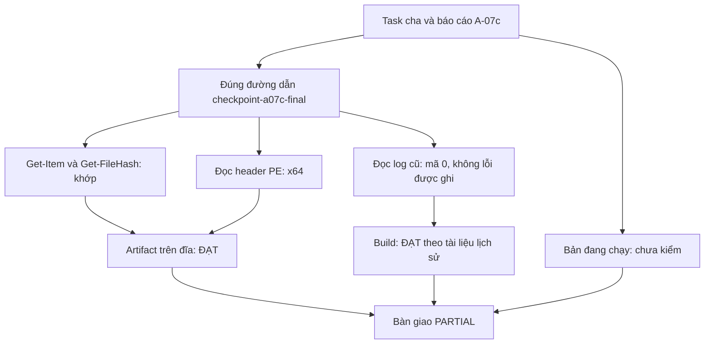

TÓM TẮT 1: [NGUỒN][THẤY] PARTIAL — đã kiểm tra tĩnh sản phẩm A-07c; chưa đủ bằng chứng xác nhận không đè bản đang chạy (K1–K3; mục 6).
TÓM TẮT 2: [NGUỒN][THẤY] gs001.exe tồn tại, dài 1.346.560 byte, PE x64; SHA-256 khớp chính xác báo cáo cũ (K1–K3; A-07c-link-gs001.md:103–108).
TÓM TẮT 3: [NGUỒN][TÀI LIỆU] Log snapshot ghi cả năm project mã 0 và build_errors rỗng; đây là bằng chứng build lịch sử, không phải lần build mới (results.json:2–6; a07c-verification.json:10).
TÓM TẮT 4: [CHƯA KIỂM] Chưa kiểm binary/process đang vận hành hoặc trạng thái VM; chưa thể kết luận vế không đè bản đang chạy ĐẠT (A-07c-link-gs001.md:133–142; mục 6).
TÓM TẮT 5: [CHƯA KIỂM] Không build, chạy exe/DLL, VM hay mạng; không commit/push theo yêu cầu, Tổng quan nhận bàn giao; tệp nhịp ngoài sandbox không được ghi (mục 9–10).

# XD-A07c — Kiểm sản phẩm build gs001 x64 của A-07c

Loại: khảo sát
Chủ đề: Đối chiếu artifact A-07c với báo cáo và phân biệt bằng chứng trên đĩa, log lịch sử, trạng thái vận hành chưa kiểm.
Từ khóa: sản phẩm build, liên kết, gs001.exe, x64, SHA-256, checkpoint-a07c-final, PE32+, không ghi đè
Trạng thái: PARTIAL — kiểm xong artifact trên đĩa; vế không đè bản đang chạy chưa đủ bằng chứng để đóng việc cha.
Độ phủ: đã phủ 5 trên tổng 6 vế kiểm tra; 4 vế bằng quan sát/thao tác lượt này, 1 vế bằng tài liệu build lịch sử; 1 vế chưa phủ (bảng mục 2).
Liên quan: `JX1_OPS/TASKS/XD-A07c.md`; `JX1_OPS/TASKS/A-07c.md`; `JX1_OPS/REPORTS/A-07c-link-gs001.md`; `JX1_OPS/DESIGN/CHUAN-BAO-CAO.md`.
Cần tôi quyết định: không — phần vận hành chưa kiểm để Tổng quan nhận bằng chứng sẵn có hoặc giao việc có quyền phù hợp.

## 1. Sơ đồ chính



## 2. Phạm vi và độ phủ

[TÀI LIỆU] Sáu vế dưới đây được tách từ `JX1_OPS/TASKS/XD-A07c.md:20–21` và tiêu chí cha `JX1_OPS/TASKS/A-07c.md:19–23`. “CHƯA ĐẠT” vì thiếu bằng chứng không đồng nghĩa đã phát hiện ghi đè hoặc artifact sai.

| Vế | Độ phủ | Kết luận | Mức bằng chứng và căn cứ |
|---|---|---|---|
| Artifact tồn tại đúng thư mục build được dẫn | Đã phủ | ĐẠT | [THẤY] K1 trả đúng FullName của snapshot, Length = 1346560; đối chiếu `JX1_OPS/REPORTS/A-07c-link-gs001.md:103–106`. |
| Kiến trúc x64 | Đã phủ | ĐẠT | [THẤY] K3: MZ = 0x5A4D, PE = 0x00004550, Machine = 0x8664, OptionalMagic = 0x020B; đối chiếu báo cáo cũ dòng 108. |
| SHA-256 khớp báo cáo | Đã phủ | ĐẠT | [THẤY] K2 khớp đủ 64 ký tự tại báo cáo cũ dòng 107 và `a07c-verification.json:3`. |
| Không đè bản đang chạy | Chưa phủ | CHƯA ĐẠT — thiếu bằng chứng hiện tại | [CHƯA KIỂM] File còn trong checkpoint không chứng minh chưa từng được chép đi. Báo cáo cũ dòng 56, 88 ghi không deploy ở mốc build; dòng 133–142 ghi các mốc PM thử/khôi phục sau đó. Không đọc trạng thái VM hoặc process. |
| 0 lỗi link | Đã phủ theo tài liệu lịch sử | ĐẠT — theo tài liệu, chưa tái build | [TÀI LIỆU] `results.json:2–6` đều bằng 0; `a07c-verification.json:10` ghi build_errors = []; báo cáo cũ dòng 96 ghi 0 lỗi compile/link. |
| Không chạy exe trong lượt XD-A07c | Đã phủ | ĐẠT — trong phạm vi lượt kiểm tra này | [THẤY] Chỉ thực hiện lệnh đọc K1–K5 và ghi tài liệu. [TÀI LIỆU] Không hiểu thành “binary chưa từng chạy”: báo cáo cũ dòng 133–142 đã ghi các lần PM chạy VM. |

## 3. Giải mã tên

[TÀI LIỆU] Phạm vi là kiểm artifact build, không khảo sát kỹ năng, trang bị, quái, NPC hoặc bản đồ (`JX1_OPS/TASKS/XD-A07c.md:20`). Không có tên riêng thuộc các nhóm đó cần giải mã GBK/TCVN3. Các định danh kỹ thuật giữ nguyên:

| Tên gốc | Mã hóa | Chữ đúng UTF-8 / ý nghĩa | Nguồn file:dòng |
|---|---|---|---|
| gs001.exe | ASCII trong báo cáo UTF-8 | Tệp thực thi máy chủ được kiểm tra | `JX1_OPS/REPORTS/A-07c-link-gs001.md:103` |
| checkpoint-a07c-final | ASCII trong báo cáo UTF-8 | Snapshot build cuối của A-07c | `JX1_OPS/REPORTS/A-07c-link-gs001.md:100–116` |
| x64 / PE32+ | ASCII trong báo cáo UTF-8 | Kiến trúc và định dạng PE của artifact | `JX1_OPS/REPORTS/A-07c-link-gs001.md:108` |

## 4. Sắp theo cấu trúc game

[TÀI LIỆU] Không áp dụng phân nhóm phái/nhánh/cấp học, bộ trang bị hoặc bản đồ vì task chỉ kiểm sản phẩm build (`JX1_OPS/TASKS/XD-A07c.md:20`). Nội dung đi theo cấu trúc sản phẩm: artifact máy chủ → định danh/kiến trúc → bằng chứng link → ranh giới triển khai.

## 5. Nguồn và kết quả lệnh thực chạy

[THẤY] Kiểm tra Git đầu lượt bằng `git status --short --branch`: trả `## task/XD-A07c`, không có dòng thay đổi. Báo cáo `JX1_OPS/REPORTS/XD-A07c.md` chưa tồn tại; không có phần báo cáo cũ cần làm lại. Lần đọc đầu thiếu chỉ định UTF-8 hiển thị sai dấu; đã đọc lại chuẩn/task bằng `-Encoding UTF8`, không sửa nội dung nguồn.

[TÀI LIỆU] Danh sách tài liệu nghiệp vụ đã đọc, ngoài sáu skill được người dùng chỉ định:

| Tệp | Mục đích | Phạm vi đã đọc |
|---|---|---|
| `JX1_OPS/DESIGN/CHUAN-BAO-CAO.md` | Khuôn báo cáo, nhãn và giới hạn sửa | Dòng 1–33 |
| `JX1_OPS/TASKS/XD-A07c.md` | Mục tiêu, vùng ghi, nguồn, quyền | Dòng 1–26 trước khi bổ sung kết quả |
| `JX1_OPS/TASKS/A-07c.md` | Tiêu chí sản phẩm build của việc cha | Dòng 1–28 |
| `JX1_OPS/REPORTS/A-07c-link-gs001.md` | Đường dẫn artifact, hash, mốc build và bổ sung PM | Dòng 1–160 |

[THẤY] Đường dẫn rút gọn `REPORTS/A-07c-link-gs001.md` trong task con không tồn tại tại gốc worktree. Đã dùng đúng đường dẫn `JX1_OPS/REPORTS/A-07c-link-gs001.md` được task cha dòng 21 chỉ định; không quét thư mục hoặc tìm repo khác.

[THẤY] Mốc kiểm artifact: **2026-11-19T03:08:25+07:00**, từ `Get-Date -Format 'yyyy-MM-ddTHH:mm:sszzz'`. Các alias dưới đây chỉ rút gọn đường dẫn, không đổi nguồn:

```powershell
$base = 'D:\JX-wt\A-07c\server\jxOnline\gameserver\Sources\A07b\checkpoint-a07c-final'
$artifact = Join-Path $base 'out\gs001.exe'
```

| Mã | Lệnh/thao tác thực chạy | Kết quả |
|---|---|---|
| K1 | `Test-Path -LiteralPath $artifact -PathType Leaf`; `Get-Item -LiteralPath $artifact` lấy FullName, Length, LastWriteTime, Attributes | [THẤY] Nhánh tồn tại được thực hiện; FullName đúng artifact nêu trên; Length = 1346560 byte; LastWriteTime = 2026-11-17 02:54:45 theo giờ máy; Attributes = Archive. Timestamp chỉ là metadata, không chứng minh lịch sử deploy. |
| K2 | `Get-FileHash -LiteralPath $artifact -Algorithm SHA256` | [THẤY] `0C14250622F79EE2DB90653CE769AFB3F48D5005641662CC880F451F6DBFBE5C`; khớp báo cáo, khác biệt hoa/thường không đổi giá trị hash. |
| K3 | `[System.IO.File]::OpenRead($artifact)` và BinaryReader, chỉ đọc header theo đoạn dưới | [THẤY] MZ = 0x5A4D; PEOffset = 272; Signature = 0x00004550; Machine = 0x8664; OptionalMagic = 0x020B; DllCharacteristics = 0x8060. Không nạp/chạy binary. |
| K4 | `Get-Content -LiteralPath (Join-Path $base 'logs\results.json') -Encoding UTF8 -TotalCount 400` | [THẤY] Đọc được 7 dòng; [TÀI LIỆU] LuaLibDll, Engine, Common, CoreServer, GameServer đều ghi 0 ở dòng 2–6. |
| K5 | `Get-Content -LiteralPath (Join-Path $base 'logs\a07c-verification.json') -Encoding UTF8 -TotalCount 400` | [THẤY] Đọc được 13 dòng; [TÀI LIỆU] bytes/hash/machine/optional_header/dll_characteristics ở dòng 2–6 khớp K1–K3; build_errors ở dòng 10 là mảng rỗng. |

[THẤY] Phần đọc header của K3 đã thực chạy trực tiếp trong PowerShell, không tạo parser/script phụ; reader và stream được đóng trong `finally`:

```powershell
$stream = [System.IO.File]::OpenRead($artifact)
$reader = [System.IO.BinaryReader]::new($stream)
try {
    $mz = $reader.ReadUInt16()
    $stream.Position = 0x3c
    $peOffset = $reader.ReadUInt32()
    $stream.Position = $peOffset
    $signature = $reader.ReadUInt32()
    $machine = $reader.ReadUInt16()
    $stream.Position = $peOffset + 24
    $magic = $reader.ReadUInt16()
    $stream.Position = $peOffset + 94
    $dllFlags = $reader.ReadUInt16()
} finally {
    $reader.Dispose()
    $stream.Dispose()
}
```

## 6. Vế không đè bản đang chạy và các mốc lịch sử

[TÀI LIỆU] Mốc build gốc ghi “chưa deploy hay đè bản đang chạy” ở `JX1_OPS/REPORTS/A-07c-link-gs001.md:56`; helper tắt post-build copy/deploy trên bản sao ở dòng 88. Đây là lời ghi nhận lịch sử, chưa phải phép đo hiện tại của XD-A07c.

[TÀI LIỆU] Cùng báo cáo có các bổ sung PM: thử build trong VM lúc 03:05, ngày 2026-11-17 ở dòng 133–136; bổ sung 03:30 ghi lỗi breakpoint và khôi phục bộ ổn định ở dòng 138–142. Phần bổ sung sau làm rõ giới hạn của phát biểu “chưa chạy” tại mốc build, không cho phép suy ra trạng thái vận hành ngày 2026-11-19.

[CHƯA KIỂM] K1–K3 chỉ xác nhận file trong snapshot còn tồn tại và đúng hash. Chưa có đối chiếu hash/đường dẫn executable của process đang chạy với bộ ổn định hoặc biên bản triển khai/khôi phục hiện tại. Không kết nối VM hoặc đọc process runtime để lấy thêm bằng chứng vì task cấm VM/mạng (`JX1_OPS/TASKS/XD-A07c.md:24`). Vì vậy vế này **CHƯA ĐẠT về bằng chứng**, không kết luận đã xảy ra ghi đè.

## 7. Mục sổ thông số

| Nhóm | Tên/hằng số | file:dòng hoặc lệnh | Giá trị | Đơn vị | Ảnh hưởng | Đổi an toàn | Nguồn đo |
|---|---|---|---|---|---|---|---|
| Định danh artifact | Length | K1; báo cáo A-07c dòng 106 | 1346560 | byte | Đối chiếu sản phẩm build | KHÔNG — task chỉ đọc | [THẤY] Đọc metadata trực tiếp |
| Định danh artifact | SHA-256 | K2; báo cáo A-07c dòng 107 | `0c14250622f79ee2db90653ce769afb3f48d5005641662cc880f451f6dbfbe5c` | Chuỗi hash 256 bit | Chốt đúng nội dung artifact | KHÔNG — task chỉ đọc | [THẤY] Get-FileHash thực chạy |
| Kiến trúc artifact | Machine / OptionalMagic | K3; báo cáo A-07c dòng 108 | 0x8664 / 0x020B | Mã PE | Xác nhận x64 / PE32+ | KHÔNG — task chỉ đọc | [THẤY] Đọc byte header |
| Cờ artifact | DllCharacteristics | K3; báo cáo A-07c dòng 109 | 0x8060 | Bitmask | Đối chiếu cờ của đúng artifact, không suy ổn định runtime | KHÔNG — task chỉ đọc | [THẤY] Đọc byte header |
| Build lịch sử | Exit code của 5 project | `$base\logs\results.json:2–6` | 0 cho từng project | Mã kết thúc | Bằng chứng hỗ trợ link lịch sử | KHÔNG — không sửa log | [TÀI LIỆU] Log snapshot, chưa chạy lại build |

## 8. Đã xác minh / Chưa kiểm

### Đã xác minh

- [THẤY] Đã kiểm file thật tại đúng đường dẫn snapshot; metadata, hash và header khớp báo cáo gốc (K1–K3).
- [THẤY] Hai log được dẫn tồn tại và đọc được (K4–K5). [TÀI LIỆU] Nội dung log hỗ trợ kết quả build lịch sử; không coi việc đọc log là tái chạy build.
- [THẤY] Kiểm tra tài liệu đã chạy: giải mã UTF-8 nghiêm ngặt thành công, không BOM, đúng 5 dòng TÓM TẮT, không thiếu mục bắt buộc đã kiểm, 6 dấu mở/đóng khối mã. `git diff --check -- JX1_OPS/TASKS/XD-A07c.md` trả 0. Kiểm file mới bằng `git diff --no-index --check -- /dev/null JX1_OPS/REPORTS/XD-A07c.md` trả 1 khi so với file rỗng, không phát thông báo lỗi khoảng trắng; không coi mã 1 này là kết quả build/test game.
- [THẤY] Trong lượt XD-A07c không sửa source, cấu hình, artifact hoặc báo cáo cũ; không chạy VM, exe/DLL, build hoặc lệnh mạng. Chỉ ghi báo cáo này và mục Kết quả của task theo chỉ định người dùng.

### Chưa kiểm

- [CHƯA KIỂM] Chưa xác minh trạng thái không ghi đè đối với bản đang vận hành hiện tại; chưa đo hash process/binary runtime (mục 6).
- [CHƯA KIỂM] Chưa tái build, đọc lại toàn bộ log compile/link, audit shim 97 lời gọi hoặc kiểm disassembly. Số 97 và tính tương thích shim vẫn chỉ là tài liệu cũ tại `JX1_OPS/REPORTS/A-07c-link-gs001.md:74–78`.
- [CHƯA KIỂM] Không kiểm stdout, crypto, độ ổn định, lỗi AV/breakpoint hoặc phục hồi VM. Không đổi kết luận PARTIAL của báo cáo cũ (`JX1_OPS/REPORTS/A-07c-link-gs001.md:12,127–142`).
- [CHƯA KIỂM] Không diễn giải “chưa chạy exe” thành chưa từng có ai chạy artifact: tài liệu PM đã ghi chạy sau mốc build (báo cáo cũ dòng 133–142).

## 9. Lỗi, giới hạn và đề xuất tối ưu

| Sự việc | Cách xử lý trong lượt | Kết quả / bước tiếp |
|---|---|---|
| [THẤY] Đọc đầu bằng Get-Content không chỉ định encoding hiển thị sai dấu | Đọc lại chuẩn/task bằng `-Encoding UTF8` một lần | Đọc đúng tiếng Việt; không sửa file nguồn. |
| [THẤY] Đường dẫn báo cáo rút gọn ở task con không tồn tại | Dùng đường dẫn cụ thể đã được task cha dòng 21 chỉ ra | Đọc được đầy đủ 160 dòng báo cáo; không tìm rộng. |
| [CHƯA KIỂM] Không ghi `D:\JX-wt\XD-A07c.nhip` | Không thử ghi vượt sandbox; đường dẫn nằm ngoài writable root `D:\JX-wt\XD-A07c` | Tiến độ được thông báo trong hội thoại. Không có lỗi ghi giả lập hoặc tệp nhịp thay thế. |
| [CHƯA KIỂM] Thiếu bằng chứng không đè bản đang chạy | Giữ kết luận có điều kiện, không dùng metadata snapshot thay chứng cứ vận hành | Tổng quan bổ sung bằng chứng hiện có; nếu cần thao tác mới, giao việc được duyệt phù hợp. |

[TÀI LIỆU] Đề xuất tối ưu: khi Tổng quan đóng việc cha, lưu riêng hash artifact build, bộ thử và bộ phục hồi kèm thời điểm/phạm vi; báo cáo cũ dòng 133–142 có nhiều mốc/bộ chạy, cần giữ tách bạch. Không đề xuất đổi tham số hoặc mã game từ đợt kiểm này.

## 10. Bàn giao

[THẤY] Đầu ra nằm tại `JX1_OPS/REPORTS/XD-A07c.md`; đã bổ sung `## Kết quả` cuối `JX1_OPS/TASKS/XD-A07c.md` theo yêu cầu trực tiếp. Không tạo TSV ngoài `vung_file`; Tổng quan có thể lấy hàng chỉ mục đề xuất dưới đây để gộp theo chuẩn báo cáo dòng 30.

| file | loại | chủ đề | từ khóa | trạng thái | độ phủ | liên quan |
|---|---|---|---|---|---|---|
| `JX1_OPS/REPORTS/XD-A07c.md` | khảo sát | Kiểm sản phẩm build gs001 A-07c | sản phẩm build, gs001, x64, SHA-256, không ghi đè | PARTIAL | 5/6 vế; còn bằng chứng bản đang chạy | `JX1_OPS/TASKS/A-07c.md`; `JX1_OPS/REPORTS/A-07c-link-gs001.md` |

[THẤY] Không stage/commit/push theo yêu cầu; chưa có SHA mới. Tổng quan review và commit hộ. Kết luận bàn giao: **artifact tồn tại/x64/hash ĐẠT; 0 lỗi link ĐẠT theo tài liệu lịch sử; không chạy exe trong lượt kiểm ĐẠT; vế chưa đè bản đang chạy CHƯA ĐẠT về bằng chứng. Trạng thái PARTIAL.**

Kỹ năng đã dùng: `jx1-retrofit` (khuôn và bảo toàn kết luận cũ); `jx1-read-server`, `jx1-read-client` (ranh giới đọc tĩnh, không suy runtime; không mở source vì không cần); `jx1-parameters` (sổ thông số artifact); `jx1-knowledge` (nhãn mức chắc, sơ đồ và liên kết; không mở thêm mục lục ngoài nguồn task); `jx1-report` (tóm tắt, giới hạn, bàn giao). Không dùng các skill để mở rộng quyền sửa/chạy.
