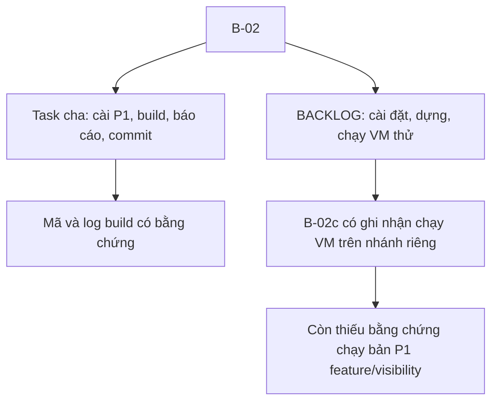

## TÓM TẮT 5 DÒNG

TÓM TẮT 1: [NGUỒN] [THẤY] XD-B02 đã đối chiếu đủ các vế của task cha và BACKLOG. `JX1_OPS/TASKS/B-02.md:19–30`, `JX1_OPS/TASKS/BACKLOG.md:37`.\
TÓM TẮT 2: [NGUỒN] [THẤY] Mã P1 có các điểm móc chính, công tắc mặc định tắt và API Lua. `Core/Src/KRegion.cpp:2247–2300`, `Core/Src/KVisibility.cpp:107–121`, `Settings/visibility.ini:1–5`, `Core/Src/ScriptFuns.cpp:25705–25728`.
TÓM TẮT 3: [NGUỒN] [THẤY] Ba log gốc: `Get-Content -Tail 8` cho kết quả 0 Error(s); reflog `feature/visibility` ghi commit B-02 và rebase đến `c85cc1a`. `REPORTS/B-02-loc-hien-thi.md:42–69`, `logs/refs/heads/feature/visibility:2–3`.
TÓM TẮT 4: [CHƯA KIỂM] **B-02 CHƯA ĐẠT theo BACKLOG** vì thiếu bằng chứng chạy VM thử cho bản P1 trên `feature/visibility`. Lần thử có ghi nhận dùng bản B-02c của nhánh khác. `JX1_OPS/REPORTS/B-02b-build-tren-a07e.md:4–8`, `JX1_OPS/REPORTS/B-02c-build-va-thu.md:4–8`.\
TÓM TẮT 5: [CHƯA KIỂM] Lượt này chỉ đối chiếu tĩnh/tài liệu; không build mới, chạy exe/client, VM hay test mạng theo phạm vi `JX1_OPS/TASKS/XD-B02.md:20–26`. Commit báo cáo do tổng quan xử lý.

# XD-B02 — Đối chiếu tiêu chí đóng B-02

Loại: tổng hợp\
Chủ đề: Đối chiếu bộ lọc hiển thị P1 trong gs001 và bằng chứng build, chạy thử của B-02.\
Từ khóa: lọc hiển thị, B-02, gs001, ViewerCanSee, VisGroup, REMOVE, Enabled, VM thử\
Trạng thái: DONE — XD-B02 hoàn tất đối chiếu. B-02 chưa đạt theo BACKLOG.\
Độ phủ: 14/14 vế đã đối chiếu trong bảng (11 vế task cha, 3 vế BACKLOG).\
Liên quan: [B-02](../TASKS/B-02.md), [BACKLOG](../TASKS/BACKLOG.md#L37), [B-01](../DESIGN/B-01-LOC-HIEN-THI.md), [A-05](A-05-diem-tuong-tac-gs001.md), [O-01](O-01-duyet-B-02.md), [B-02 gốc](B-02-loc-hien-thi.md), [Tóm tắt diff](B-02-tom-tat-diff.md), [B-02b](B-02b-build-tren-a07e.md), [B-02c](B-02c-build-va-thu.md), [B-02d](B-02d-review-tinh.md).\
Cần tôi quyết định: có — PM cần xác nhận bản chạy thử được chấp nhận để đóng dòng BACKLOG.

## Phạm vi và độ phủ

**THẤY** là đọc mã, log hoặc metadata tại chỗ. **TÀI LIỆU** là kết quả do báo cáo cũ ghi lại. **CHƯA KIỂM** chỉ phần chưa có bằng chứng hoặc chưa được thử trong phạm vi đã nêu.

Đường dẫn `Core/Src/…` và `Settings/…` tính từ `D:/JX-wt/B-02/server/jxOnline/gameserver/Sources` của worktree được chỉ định tại `JX1_OPS/TASKS/B-02.md:8`. Ref đọc tại chỗ trỏ tới `c85cc1a8653a26ff1aa28984c1b903e019cc5751`. Dòng mã là dòng hiện tại của tệp trên đĩa. Dẫn chiếu tài liệu dùng tệp UTF-8 trong worktree XD-B02.

| # | Vế tiêu chí | Độ phủ và bằng chứng | Phần còn thiếu |
|---|---|---|---|
| 1 | Hàm chính sách và cờ người chơi/NPC (`TASKS/B-02.md:21`) | Đã phủ. **THẤY** `ViewerCanSee` xét chủ/tổ đội của chủ, NPC thường, bản thân, Bot, Open và nhóm. `Core/Src/KVisibility.cpp:178–196`, `Core/Src/KPlayer.h:258–260`, `Core/Src/KNpc.h:341`. | **CHƯA KIỂM** hành vi thực tế của Bot, tổ đội và hảo hữu. |
| 2 | Điểm móc chính trước khi gửi, `KRegion::BroadCast` (`TASKS/B-02.md:22`) | Đã phủ. **THẤY** phân loại gói, xử lý riêng REMOVE và chọn gửi qua bộ lọc hoặc đường gửi cũ. `Core/Src/KRegion.cpp:2247–2248`, `:2297–2300`. | **CHƯA KIỂM** gói gửi ở runtime. |
| 3 | Gửi thẳng NPC/người chơi, yêu cầu `SyncNpc` (`TASKS/B-02.md:22`) | Đã phủ. **THẤY** kiểm quyền đồng bộ và gọi bộ lọc ở các nhánh gửi thẳng. `Core/Src/KNpc.cpp:7963`, `:8018`, `:8124`, `Core/Src/KNpcSet.cpp:1289`. | **CHƯA KIỂM** chuỗi yêu cầu đồng bộ từ client thật. |
| 4 | Phát toàn bản đồ và đổi bản đồ (`TASKS/B-02.md:22`) | Đã phủ. **THẤY** `BroadCasts` gọi bộ lọc khi bật. `ChangeWorld` phát REMOVE ở vùng lân cận rồi gửi `WORLD_SYNC` cho chính người đổi bản đồ. Sổ đã thấy của người đó được xóa sau khi đóng gói thành công. `Core/Src/KSubWorld.cpp:2384–2393`, `:1783–1786`, `Core/Src/KNpc.cpp:15307–15311`, `:15337`, `:15400`. | **CHƯA KIỂM** đổi bản đồ/chuyển server và lỗi gửi. |
| 5 | Đồng bộ đối tượng `KObj` (`TASKS/B-02.md:22`) | Đã phủ. **THẤY** ADD gửi thẳng mang lớp `visObject` dùng chung. Trạng thái, hướng, xóa và bẫy đi qua `BroadCast`. `Core/Src/KObj.cpp:1457–1458`, `:1474–1475`, `:1510`, `:1552`, `:1589`, `:1628`, `Core/Src/KVisibility.cpp:180`. | **CHƯA KIỂM** đối tượng và kịch bản sở hữu ở runtime. |
| 6 | REMOVE cho người xem đã được gửi ADD (`TASKS/B-02.md:23`) | Đã phủ. **THẤY** đường region xét người xem hợp lệ còn kết nối đã có ID trong sổ, vượt giới hạn vùng/số lượng/trạng thái ngủ. `PackVisibilityData` cập nhật sổ khi đóng gói thành công và bỏ REMOVE với ID chưa ghi ở bản P1. `Core/Src/KVisibility.cpp:153–161`, `:239–260`. | **CHƯA KIỂM** client nhận gói, ADD đi ngoài các điểm móc hoặc lỗi gửi. O-01 đặt luật REMOVE rộng hơn, xem phần bên dưới. |
| 7 | Cấu hình đọc khi khởi động, mặc định tắt và giữ đường gửi gốc (`TASKS/B-02.md:24`) | Đã phủ. **THẤY** khởi tạo gọi `InitVisibility`, thiếu tệp giữ trạng thái tắt, mẫu để `Enabled=0`. Đường region đã đọc truyền nguyên buffer/kích thước cho hàm gửi cũ khi tắt. `Core/Src/KCore.cpp:257`, `Core/Src/KVisibility.cpp:107–121`, `Settings/visibility.ini:1–5`, `Core/Src/KRegion.cpp:2297–2300`. | **CHƯA KIỂM** đối chứng gói tin và hành vi toàn luồng với bản gốc. |
| 8 | API Lua và làm mới hiển thị (`TASKS/B-02.md:25`) | Đã phủ. **THẤY** đăng ký đủ `SetVisGroup`, `GetVisGroup`, `JoinActivityGroup`, `LeaveActivityGroup`, `IsBotPlayer`, `RefreshVisibility`. Hàm làm mới xét cả hai chiều. `Core/Src/ScriptFuns.cpp:25705`, `:25723–25728`, `Core/Src/KVisibility.cpp:280–288`. | **CHƯA KIỂM** lời gọi Lua từ hoạt động thật. |
| 9 | Giới hạn P1, ngoài P2/P3 và giữ `GetRelation` (`TASKS/B-02.md:26`) | Đã phủ. **TÀI LIỆU** báo cáo B-02 gốc ghi giữ `GetRelation` và để P2/P3 ngoài task. B-02c có ba điểm chặn P2 trên nhánh riêng. `REPORTS/B-02-loc-hien-thi.md:5`, `:82`, `REPORTS/B-02c-build-va-thu.md:4`, `REPORTS/B-02d-review-tinh.md:69`, `:81–84`. | **CHƯA KIỂM** toàn bộ diff B-02 qua Git trong lượt này. |
| 10 | Compile hoặc ghi lệnh/lỗi và nộp báo cáo đủ mục (`TASKS/B-02.md:27–30`) | Đã phủ. **THẤY** `REPORTS/B-02-loc-hien-thi.md:3–8` có đủ 5 dòng tóm tắt, `:10–27` liệt kê tệp/dòng, `:29–37` ghi cách bật/tắt, `:49–66` ghi lệnh build và `:77–82` ghi mục chưa kiểm. Ba log gốc đều ghi 0 lỗi, chi tiết bên dưới. | **CHƯA KIỂM** build mới tại HEAD. |
| 11 | Commit trên `feature/visibility`, tiêu đề bắt đầu B-02 (`TASKS/B-02.md:30`) | Đã phủ. **TÀI LIỆU** báo cáo chính từng ghi lỗi khi stage. **THẤY** reflog nhánh sau đó có commit `8ef7430` với tiêu đề bắt đầu bằng B-02 và rebase lên ref hiện tại `c85cc1a`. `REPORTS/B-02-loc-hien-thi.md:84–91`, `REPORTS/B-02-tom-tat-diff.md:2`, `logs/refs/heads/feature/visibility:2–3`. | **CHƯA KIỂM** trạng thái GitHub/push. |
| 12 | BACKLOG: cài đặt gs001 trên nhánh riêng (`TASKS/BACKLOG.md:37`) | Đã phủ. **THẤY** mã P1 và metadata `feature/visibility`, theo các vế 1–8 và 11. | **CHƯA KIỂM** hành vi runtime. |
| 13 | BACKLOG: dựng (`TASKS/BACKLOG.md:37`) | Đã phủ. **THẤY** log build gốc như vế 10. **TÀI LIỆU** B-02b ghi 5 dự án exit 0 sau khi rebase tại `c85cc1a`. `REPORTS/B-02b-build-tren-a07e.md:4–8`. | **CHƯA KIỂM** log chi tiết của lần build B-02b. |
| 14 | BACKLOG: chạy VM thử (`TASKS/BACKLOG.md:37`) | Đã phủ bằng đối chiếu, thiếu bằng chứng cho nhánh B-02. **TÀI LIỆU** B-02b ghi chưa chạy VM. B-02c ghi đã khởi động gs001 trên VM với `Enabled=0` và sống ít nhất 207 giây, từ commit `026c628` của `feature/visibility-c`. **THẤY** ref nhánh B-02c trỏ đúng commit đó. `REPORTS/B-02b-build-tren-a07e.md:4–8`, `REPORTS/B-02c-build-va-thu.md:4–8`, `refs/heads/feature/visibility-c:1`. | **CHƯA KIỂM** không có ghi nhận chạy VM cho bản P1 trên `feature/visibility` trong nguồn được giao. Cần bằng chứng theo bản hoặc xác nhận của PM rằng lần thử B-02c được chấp nhận cho dòng BACKLOG. |

## Giải mã tên

Bảng giữ tên gốc đã dẫn. Báo cáo không trích tên kỹ năng, trang bị, NPC, quái hay tên bản đồ cụ thể.

| Tên gốc | Mã hóa tại nguồn | Chữ đúng (UTF-8) | Nguồn file:dòng |
|---|---|---|---|
| `Solo` | ASCII trong tệp mẫu | Chế độ ẩn giữa người chơi thật, có ngoại lệ theo cấu hình | `DESIGN/B-01-LOC-HIEN-THI.md:31–34`, `Core/Src/KVisibility.cpp:192–196` |
| `Group` | ASCII trong tệp mẫu | Chế độ nhóm | `Settings/visibility.ini:9`, `DESIGN/B-01-LOC-HIEN-THI.md:33` |
| `Open` | ASCII trong mã | Chế độ hiển thị như gốc | `Core/Src/KVisibility.cpp:130–132`, `DESIGN/B-01-LOC-HIEN-THI.md:34` |
| `Map_0` | ASCII trong tệp mẫu | Mục mẫu, chưa xác định bản đồ hoạt động thực tế | `Settings/visibility.ini:7–9`, `REPORTS/B-02-loc-hien-thi.md:32` |

## Sắp theo cấu trúc game

Đối chiếu theo bản đồ (Solo/Group/Open), rồi theo nguồn hiển thị (người chơi thật, Bot, hảo hữu, NPC/quái và đối tượng dùng chung). Các tuyến ADD/REMOVE thuộc vòng đời thực thể. Nguồn chỉ mô tả chính sách và điểm móc, nên chưa lập được danh sách theo từng bản đồ hoặc hoạt động thực tế. `DESIGN/B-01-LOC-HIEN-THI.md:12–39`, `Core/Src/KVisibility.cpp:178–196`.

## Mục sổ thông số

| Nhóm | Tên | File:dòng | Giá trị | Đơn vị | Ảnh hưởng | Đổi an toàn | Nguồn đo |
|---|---|---|---|---|---|---|---|
| Công tắc | `Enabled` | `Settings/visibility.ini:3`, `Core/Src/KVisibility.cpp:109–119` | 0 mặc định | 0/1 | Chọn đường gửi cũ hoặc bộ lọc khi khởi động | CẨN THẬN | **THẤY** từ cấu hình mẫu và mã |
| Bot | `BotsVisibleToAll` | `Settings/visibility.ini:4`, `Core/Src/KVisibility.cpp:120`, `:184–192` | 1 mặc định | 0/1 | Miễn lọc cho Bot, luật hảo hữu được xét trước | CẨN THẬN | **THẤY** từ cấu hình mẫu và mã |
| Tổ đội | `PartyMutualVisible` | `Settings/visibility.ini:5`, `Core/Src/KVisibility.cpp:121`, `:194` | 0 mặc định | 0/1 | Cho phép người cùng tổ đội thấy nhau khi bật | CẨN THẬN | **THẤY** từ cấu hình mẫu và mã |
| Nhóm | `MaxVisible` | `Settings/visibility.ini:13`, `Core/Src/KVisibility.cpp:136–137` | 60 mặc định, giới hạn 1 đến `MAX_PLAYER - 1` | Người chơi thật/nhóm | Đặt trần phân nhóm | CẨN THẬN | **THẤY** từ cấu hình mẫu và mã, chưa thử ở ngưỡng |

## Đã xác minh

- **THẤY** Đọc đuôi `Core.log`, `Common.log` và `GameServer.log` trong `.b02-build/logs/` bằng `Get-Content -Tail 8` và lọc dòng tổng kết. Kết quả cả ba có `0 Error(s)`, số cảnh báo lần lượt 22, 35 và 0. Lệnh MSBuild và ngữ cảnh log được lưu tại `REPORTS/B-02-loc-hien-thi.md:42–69`.
- **THẤY** Sau khi `git -C D:/JX-wt/B-02 log` báo `detected dubious ownership`, đọc trực tiếp `HEAD:1`, `refs/heads/feature/visibility:1` và reflog trong kho Git nguồn bằng PowerShell. Xác nhận nhánh, SHA và sự kiện commit/rebase mà không đổi cấu hình Git. `rg` không có trong phiên, các đối chiếu theo tên tệp dùng `Get-ChildItem -Filter` và `Select-String`.
- **THẤY** Đối chiếu client theo đúng gốc `C:/Jx1CocoV3/Folder/Client2912-20260116T044348Z-3-001/Client2912/Client/Classes`. Khi tra ID trả về 0, `ConformIdx` loại khỏi nhánh xóa NPC. Nhánh còn lại vẫn có thể gọi `FreeAllSprite` nếu chỉ số của bản thân cũng bằng 0 và có thế giới game. `gamecore/KProtocolProcess.cpp:623–642`, `gamecore/KPlayer.cpp:769–773`. Đối chiếu trên tệp mã, chưa đối chiếu với client của lần chạy VM.
- **TÀI LIỆU** B-02b ghi lần build sau rebase và B-02c ghi lần build cùng lần chạy VM. B-02d ghi nhận kiểm tĩnh luật REMOVE mới, các vấn đề F1–F5 và phần chưa nghiệm thu O-01/B-01. `REPORTS/B-02b-build-tren-a07e.md:4–8`, `REPORTS/B-02c-build-va-thu.md:4–8`, `REPORTS/B-02d-review-tinh.md:16–75`.

## Chưa kiểm

- **CHƯA KIỂM** Chưa chạy build, exe, client, VM, kết nối mạng hoặc test runtime trong XD-B02. Quy định chỉ đọc và không chạy trong `TASKS/XD-B02.md:20–26`.
- **CHƯA KIỂM** Chưa có đối chứng `Enabled=0` với bản gốc. Chưa có kết quả cho Solo, nhóm/tổ đội, Bot, ngưỡng nhóm, đổi bản đồ, ADD/REMOVE và đo tick/băng thông. Lần chạy VM của B-02c chỉ có kết quả khởi động và thời gian sống tối thiểu. `DESIGN/B-01-LOC-HIEN-THI.md:68–76`, `REPORTS/O-01-duyet-B-02.md:8–14`, `REPORTS/B-02c-build-va-thu.md:6–8`, `REPORTS/B-02d-review-tinh.md:63–84`.
- **CHƯA KIỂM** Hiệu lực của REMOVE với ID lạ ở các trạng thái chuyển bản đồ và lỗi gửi. O-01 yêu cầu chỉ chặn khi chưa gửi ADD **và** hiện không thấy. B-02d ghi luật rộng hơn ở B-02c và rủi ro khi mất dấu sau lỗi gửi. `REPORTS/O-01-duyet-B-02.md:8–9`, `REPORTS/B-02d-review-tinh.md:47–52`, `:67–68`.

## Phát hiện khi đối chiếu

- **THẤY** Tóm tắt diff mô tả `KObj::SyncAdd` là lọc theo chủ. Tệp tại worktree B-02 đánh dấu `visObject` dùng chung ở cả hai biến thể ADD và helper cho qua lớp này. Hai báo cáo B-02 gốc và B-02d cũng mô tả object dùng chung. `REPORTS/B-02-tom-tat-diff.md:17`, `Core/Src/KObj.cpp:1457–1458`, `:1474–1475`, `Core/Src/KVisibility.cpp:180`, `REPORTS/B-02-loc-hien-thi.md:39`, `REPORTS/B-02d-review-tinh.md:93`.
- **TÀI LIỆU** Báo cáo B-02 gốc ghi lỗi stage tại thời điểm lập báo cáo. Tóm tắt diff và reflog xác nhận đã có commit sau mốc báo cáo đó. Các kết luận lịch sử được giữ nguyên. `REPORTS/B-02-loc-hien-thi.md:84–91`, `REPORTS/B-02-tom-tat-diff.md:2`, `logs/refs/heads/feature/visibility:2–3`.

## Bàn giao

**Kết luận B-02 CHƯA ĐẠT theo BACKLOG vì còn thiếu bằng chứng chạy VM thử cho bản P1 trên `feature/visibility`.** Tiêu chí build, hồ sơ và commit trong task cha đã có bằng chứng. PM có thể xác nhận bản nào được dùng để nghiệm thu dòng BACKLOG và gắn bằng chứng chạy vào đúng bản đó. Điều kiện O-01 được theo dõi riêng theo báo cáo B-02d.

XD-B02 đã bàn giao báo cáo và mục Kết quả của task. Tổng quan thực hiện commit. Lệnh `Add-Content` ghi `D:/JX-wt/XD-B02.nhip` bị từ chối với `Access to the path 'D:\JX-wt\XD-B02.nhip' is denied` do tệp nằm ngoài workspace; mốc bắt đầu đã báo trong cuộc trò chuyện. Vùng giao không gồm tệp chỉ mục TSV. Hàng đề xuất cho `DESIGN/MUC-LUC-TRI-THUC.md:20` là `XD-B02 | Đối chiếu tiêu chí B-02 | Visibility, P1, gs001 | DONE (đối chiếu), B-02 chưa đạt theo BACKLOG`.

Kỹ năng đã dùng: jx1-retrofit, jx1-read-server, jx1-read-client, jx1-parameters, jx1-knowledge, jx1-report.
