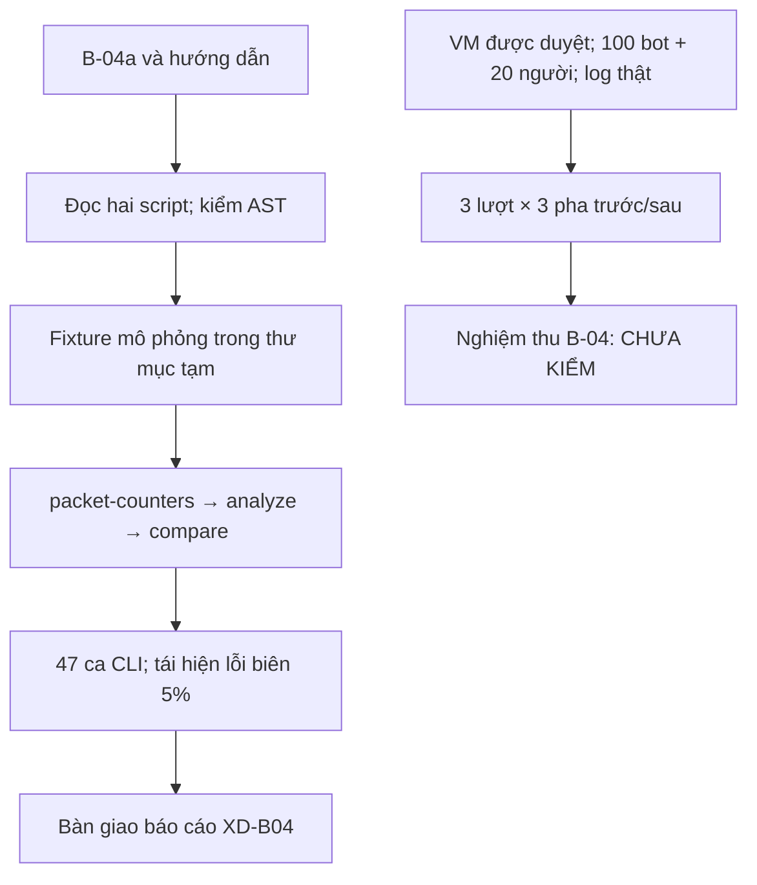

TÓM TẮT 1: [NGUỒN][THẤY] DONE phần đối chiếu offline XD-B04; B-04 vẫn thiếu phép đo trước/sau thật (JX1_OPS/TASKS/B-04.md:4–8).
TÓM TẮT 2: [NGUỒN][THẤY] Hai AST thành công; 47 ca CLI python -I gồm 13 exit 0 và 34 exit 2 dự kiến; C15 tái hiện lỗi biên 5% (mục 3–4, phụ lục A).
TÓM TẮT 3: [NGUỒN][THẤY] Đầu ra: báo cáo này và Kết quả cuối task; không sửa mã hay kết luận B-04a (JX1_OPS/TASKS/XD-B04.md:20–26; báo cáo B-04a:78–85).
TÓM TẮT 4: [CHƯA KIỂM] Thiếu log tick, CPU COMPLETE, byte thật và 9 pha đủ 100 bot + 20 người; ngưỡng 5%/5 điểm phần trăm vẫn là đề xuất (hướng dẫn B-04a:155–174).
TÓM TẮT 5: [CHƯA KIỂM] Không build, chạy collector/VM/exe game/mạng; không commit/push theo yêu cầu; PM cần xử lý lỗi biên và tổ chức đo thật. Nhịp ngoài worktree bị từ chối ghi (mục 7).

# XD-B04 — Đối chiếu bộ đo tick và phần trước/sau còn thiếu của B-04

Loại: kiểm thử
Chủ đề: Kiểm offline bộ đo B-04a và xác định bằng chứng còn thiếu để đóng B-04.
Từ khóa: nhịp máy chủ, tick, băng thông, bandwidth, CPU, gs001, B-04, B-04a, O-01, compare
Trạng thái: DONE — hoàn tất đối chiếu offline; B-04 chưa đủ điều kiện đóng, có lỗi biên cần xử lý.
Độ phủ: 7/7 hạng mục offline đã đối chiếu; 47 ca CLI và 2 AST; 0/9 pha đo runtime thật.
Liên quan: JX1_OPS/TASKS/B-04.md; JX1_OPS/REPORTS/B-04a-bo-do-tick-bang-thong.md; JX1_OPS/TESTER/B-04a-HUONG-DAN.md; JX1_OPS/DESIGN/B-01-LOC-HIEN-THI.md; JX1_OPS/REPORTS/B-02c-build-va-thu.md
Cần tôi quyết định: có — PM chốt ngưỡng, giao xử lý lỗi biên và phê duyệt điều kiện đo VM riêng.
Thời điểm kiểm: 19/11/2026, khoảng 03:38 +07:00.
Quy ước: [THẤY] = đọc trực tiếp/lệnh thực chạy; [TÀI LIỆU] = nội dung tài liệu, không xác nhận runtime; [CHƯA KIỂM] = chưa có bằng chứng. Đường dẫn tính từ gốc worktree; tên ngắn B-04a/hướng dẫn được ánh xạ tại mục 2.



## 1. Phạm vi và độ phủ

| Hạng mục | Độ phủ | Bằng chứng / giới hạn |
|---|---|---|
| Offline 1 — nguồn và tiêu chí | Đã phủ | [THẤY] Task B-04:4–8; báo cáo B-04a:50–85; B-01:65–76; B-02c:3–8; đường dẫn mục 2 |
| Offline 2 — AST Python | Đã phủ | [THẤY] ast.parse exit 0; mục 3 |
| Offline 3 — AST PowerShell | Đã phủ | [THẤY] ParseFile 0 lỗi; không chạy collector; mục 3 |
| Offline 4 — packet-counters | Đã phủ | [THẤY] P01–P08: 8 ca; phụ lục A; `JX1_OPS/TOOLS/b04a_metrics.py:37–71` |
| Offline 5 — analyze | Đã phủ | [THẤY] A01–A23: 23 ca; phụ lục A; `JX1_OPS/TOOLS/b04a_metrics.py:74–158` |
| Offline 6 — compare | Đã phủ, có lỗi biên | [THẤY] C01–C16: 16 ca; mục 4; `JX1_OPS/TOOLS/b04a_metrics.py:161–191` |
| Offline 7 — đầu ra/kết quả task | Đã phủ | [THẤY] Báo cáo này và `JX1_OPS/TASKS/XD-B04.md:28–32`; đọc lại sau ghi |
| Runtime — collector CPU thật | Chưa phủ | [CHƯA KIỂM] Cần PID trong VM được duyệt; hướng dẫn:41–59 |
| Runtime — ma trận trước/sau | Chưa phủ, 0/9 pha | [CHƯA KIỂM] Chưa đủ dữ liệu/điều kiện thật; hướng dẫn:14–39,155–174 |

[THẤY] “Đã phủ” nghĩa là đã kiểm, không phải mọi hành vi bộ đo đều đúng. C15 xác nhận hai ô FAIL sai tại cùng một lỗi biên; không tuyên bố 47/47 ca đạt nghiệp vụ.

### Giải mã tên

[THẤY] Không có tên kỹ năng, trang bị, quái, NPC hay bản đồ cần giải mã GBK/TCVN3 trong phạm vi này. Các tên kỹ thuật giữ nguyên:

| Tên gốc | Mã hóa | Chữ đúng / nghĩa tiếng Việt | Nguồn file:dòng |
|---|---|---|---|
| `gs001` | ASCII trong tài liệu UTF-8 | Tiến trình máy chủ bộ thu CPU nhắm tới | `JX1_OPS/TOOLS/b04a_cpu.ps1:13–14` |
| `original` | ASCII trong tài liệu UTF-8 | Bản gốc không bộ lọc | `JX1_OPS/TESTER/B-04a-HUONG-DAN.md:25–26` |
| `disabled` | ASCII trong tài liệu UTF-8 | Bản có bộ lọc, Enabled=0 | `JX1_OPS/TESTER/B-04a-HUONG-DAN.md:25–26` |
| `enabled` | ASCII trong tài liệu UTF-8 | Cùng bản có bộ lọc, Enabled=1 Solo | `JX1_OPS/TESTER/B-04a-HUONG-DAN.md:25–26` |
| `packet-counters`, `analyze`, `compare` | ASCII trong mã UTF-8 | Đếm byte phiên, phân tích, đối chiếu | `JX1_OPS/TOOLS/b04a_metrics.py:194–221` |
| `O-01` | ASCII trong tài liệu UTF-8 | Điều kiện 100 bot + 20 người thật được hướng dẫn dẫn lại | `JX1_OPS/TESTER/B-04a-HUONG-DAN.md:14–16` |

### Sắp theo cấu trúc game

[TÀI LIỆU] Xếp theo luồng vận hành máy chủ: điều kiện tải → CPU/tick/byte theo phiên → ba biến thể → đối chiếu → nghiệm thu (hướng dẫn:23–153). Không có dữ liệu phái/nhánh kỹ năng/bộ trang bị để phân loại.

## 2. Nguồn đã đọc và điểm tiếp tục

[THẤY] Ban đầu `git status --short --branch` chỉ in `## task/XD-B04`, không có thay đổi; báo cáo XD-B04 chưa tồn tại. Không có phần dở phải làm lại.

| Nguồn | Phần dùng |
|---|---|
| `JX1_OPS/DESIGN/CHUAN-BAO-CAO.md` | Khuôn, giữ kết luận cũ, giải mã tên và cấu trúc game |
| `JX1_OPS/TASKS/XD-B04.md:19–26` | Mục tiêu, quyền, đầu ra và Kết quả cuối task |
| `JX1_OPS/TASKS/B-04.md:4–8` | B-04 active, chưa đo trước/sau |
| `JX1_OPS/REPORTS/B-04a-bo-do-tick-bang-thong.md:28–85` | Gọi ngắn là báo cáo B-04a; đầu ra, AST cũ, giới hạn và kết luận |
| `JX1_OPS/TOOLS/b04a_metrics.py:1–231` | Đọc toàn mã, kiểm ba CLI offline |
| `JX1_OPS/TOOLS/b04a_cpu.ps1:1–56` | Đọc toàn collector; chỉ kiểm AST |
| `JX1_OPS/TESTER/B-04a-HUONG-DAN.md:1–174` | Gọi ngắn là hướng dẫn; hợp đồng dữ liệu, lệnh, ngưỡng |
| `JX1_OPS/DESIGN/B-01-LOC-HIEN-THI.md:65–76` | Đo trước/sau; Enabled=0 tương đương gốc; “không tăng đáng kể” |
| `JX1_OPS/REPORTS/B-02c-build-va-thu.md:3–8` | Giới hạn bằng chứng runtime cũ, chỉ đọc tài liệu |
| `JX1_OPS/DESIGN/MUC-LUC-TRI-THUC.md:14` | Tra đúng dòng tick, không đọc cả kho |
| Sáu `.agents/skills/jx1-*/SKILL.md` được yêu cầu | Đã nạp retrofit, read-server, read-client, parameters, knowledge, report |

[THẤY] Task không có đề mục Nguồn riêng: bắt đầu từ B-04/B-04a được chỉ định rồi mở đúng bộ đo/tiêu chí được dẫn. `JX1_OPS/BACKLOG.md` và `BACKLOG.md` không có trong worktree (Test-Path=False); không suy nội dung #170, không dò kho khác. Không đọc Q-27/O-01 gốc; điều kiện tương ứng chỉ là [TÀI LIỆU] dẫn lại theo hướng dẫn.

[THẤY] Không cần đọc source client/server hay Graphify để kiểm CLI này, không nhận xét runtime game từ mã bộ đo. Không quét đệ quy root source. Không tạo chỉ mục TSV ngoài vùng_file; mục 8 có dòng đề xuất cho PM.

## 3. Lệnh và kết quả thực chạy

### 3.1. Chạy lại toàn bộ lệnh kiểm B-04a đã ghi

[THẤY] B-04a chỉ ghi hai AST đã chạy, chưa chạy collector/analyzer/compare (báo cáo B-04a:50–61). XD-B04 chạy lại cả hai:

```powershell
python -I -c "import ast,pathlib; p=pathlib.Path('JX1_OPS/TOOLS/b04a_metrics.py'); ast.parse(p.read_text(encoding='utf-8')); print('Python AST: OK (no script execution)')"
$tokens=$null; $parseErrors=$null
$null=[System.Management.Automation.Language.Parser]::ParseFile(
  (Join-Path (Get-Location) 'JX1_OPS/TOOLS/b04a_cpu.ps1'),
  [ref]$tokens, [ref]$parseErrors)
```

[THẤY] Python exit 0, `Python AST: OK (no script execution)`. PowerShell `PowerShell AST: OK (no script execution); errors=0`; lệnh bao ngoài exit 0. Không dot-source hay chạy collector.

### 3.2. Ba CLI xử lý offline

[THẤY] Trình kiểm phụ lục A chạy trong bộ nhớ bằng `python -I -c`, gọi từng CLI qua `[sys.executable, "-I", script, ...]`. Chỉ stdlib/thư mục TemporaryDirectory; không log/CPU/capture thật. 47 lệnh con hoàn tất, wrapper exit 0, thư mục tạm tự dọn. Các lệnh mẫu gốc: hướng dẫn:126,138,146–147; tham số và đường dẫn fixture thực chạy ở phụ lục A. Không chạy lệnh collector cần VM ở hướng dẫn:48–51.

| Ca | Nội dung / kết quả thực chạy |
|---|---|
| P01 | [THẤY] Exit 0; 240 hàng = 120 phiên × 2 mép; phiên im lặng giữ 0; đúng mép [60,660) |
| P02–P08 | [THẤY] 7 exit 2: roster trùng; events đảo thời gian; byte âm; hướng sai; phiên lạ; cửa sổ 299 s; output có sẵn |
| A01–A03 | [THẤY] original/disabled/enabled exit 0; assert các chỉ số và 120 dòng sessions |
| A04 | [THẤY] 36 Hz mô phỏng riêng, exit 0, 21.600 tick; không so chéo Hz hay đổi cấu hình game |
| A05–A11 | [THẤY] 7 exit 2: regex thiếu nhóm; 9.719 tick; CPU gap; CPU 101%; khoảng CPU 0; phủ 539 s; timestamp tick trùng |
| A12–A14 | [THẤY] 3 exit 2: 99 bot; 19 human; cửa sổ 299 s |
| A15–A21 | [THẤY] 7 exit 2: thiếu mép; mép trùng; mép 61; counter giảm; tên phiên sai; byte âm; thư mục output có sẵn |
| A22–A23 | [THẤY] 2 exit 0 tại biên 90%: 9.720/10.800 tick; CPU 540/600 s |
| C01–C02 | [THẤY] original→disabled và disabled→enabled exit 0; mỗi CSV có 4 PASS trên fixture được chọn |
| C03–C09 | [THẤY] 7 exit 2 khi lần lượt khác pair_id, hz, bots, humans, window_s, warmup_s, byte_basis |
| C10–C12 | [THẤY] 3 exit 2: enabled→original; summary 2 lượt; output có sẵn |
| C13 | [THẤY] Exit 0; baseline tick/byte 0 tạo 2 CHUA_KIEM |
| C14 | [THẤY] Exit 0 nhưng cả 4 hàng FAIL khi vượt ngưỡng/ngân sách; exit 0 chỉ chứng minh tạo CSV |
| C15 | [THẤY] Exit 0; đúng 5% tick/byte bị FAIL, đúng 5 điểm phần trăm CPU PASS; mục 4 |
| C16 | [THẤY] Exit 0; override 3% tick, 0,5 điểm phần trăm CPU, 0% byte → FAIL/FAIL/PASS/PASS |

[THẤY] P=8 + A=23 + C=16 = 47; 13 exit 0 + 34 exit 2 dự kiến. Mọi exit 2 được assert thông báo đã lọc và không phản chiếu chuỗi đánh dấu fixture. Không mở rộng nhận định này thành bảo đảm mọi log thật. C15 ghi nhận lỗi, không chứng nhận chức năng đạt.

### 3.3. Số liệu mô phỏng kiểm phép tính

[THẤY] 10.800 tick/600 s ở 18 Hz; 95% mẫu bằng 2×scale ms, 5% bằng 60×scale ms. CPU gồm khoảng 200 s và 400 s để kiểm trung bình có trọng số. Một dòng log không khớp được đếm nhưng không xuất nội dung (A01–A03; `JX1_OPS/TOOLS/b04a_metrics.py:33–34,93–114,138–154`).

| Chỉ số mô phỏng | original | disabled | enabled |
|---|---:|---:|---:|
| Tick count | 10.800 | 10.800 | 10.800 |
| Mean / P95 / max tick (ms) | 4,9 / 2 / 60 | 5,096 / 2,08 / 62,4 | 5,194 / 2,12 / 63,6 |
| Tick quá ngân sách (%) | 5 | 5 | 5 |
| CPU mean / max (%) | 30 / 40 | 31 / 41 | 32 / 42 |
| CPU coverage (s) | 600 | 600 | 600 |
| Tổng byte / byte mỗi giây | 60 / 0,1 | 60 / 0,1 | 60 / 0,1 |
| Phiên / dòng bị bỏ qua | 120 / 1 | 120 / 1 | 120 / 1 |

[THẤY] Byte fixture P01: bot001 rx 100 trước t=60; thêm 20 tại t=60, thêm 30 tại t=659,9, thêm 1.000 tại t=660 bị loại; hiệu counter =50 byte. human001 tx=10; 118 phiên khác 0. Tổng 60/600=0,1 byte/s.

[CHƯA KIỂM] human001..human020 chỉ là alias tạo trong fixture. Không có người chơi/bot/600 s chạy server thật. PASS C01/C02 không thay O-01.

## 4. Phát hiện khi đối chiếu / chuẩn hóa

### F-01 — Tăng đúng 5% có thể bị kết luận FAIL

[THẤY] C15 dùng summary cùng điều kiện ghép cặp, original→disabled, ngưỡng mặc định 5:

| Metric | Trước → sau mô phỏng | Tăng toán học | change CSV thực | Status |
|---|---|---|---|---|
| tick_p95_ms | 2 → 2,1 ms | 5% | 5.000000000000004 | FAIL |
| bytes_per_s | 100 → 105 byte/s | 5% | 5.000000000000004 | FAIL |
| cpu_mean_percent | 30 → 35% | 5 điểm phần trăm | 5.0 | PASS |
| tick_p95_budget_ms | 2,1 ms ở 18 Hz | ≤55,555… ms | budget 55.55555555555556 | PASS |

[THẤY] `JX1_OPS/TOOLS/b04a_metrics.py:181–182` tính `100 * (later / before - 1)` bằng float rồi so trực tiếp `change <= limit`, không có dung sai. Hướng dẫn:165–167 quy định tăng ≤5% được đạt, nên hai FAIL trên không khớp quy tắc số học. Đã tái hiện CLI thật; không chỉ suy từ source.

[THẤY] Giữ nguyên kết luận B-04a DONE phần viết bộ đo, CHƯA KIỂM runtime (báo cáo B-04a:78–85). B-04a chưa từng công bố đã thử biên này. Chỉ thêm phát hiện mới, không sửa mã hay tài liệu cũ.

[CHƯA KIỂM] Chưa sửa/kiểm hồi quy F-01. Cần task mã riêng và thống nhất cách so số thập phân/dung sai trước khi dùng verdict sát ngưỡng; không tăng ngưỡng sau khi thấy kết quả.

## 5. Mục sổ thông số

[TÀI LIỆU] Đây là hợp đồng/mặc định bộ đo hoặc đề xuất, không phải số đo runtime; không cấp quyền đổi.

| Nhóm | Tên/hằng số | file:dòng | Giá trị | Đơn vị | Ảnh hưởng | Đổi an toàn | Nguồn đo |
|---|---|---|---|---|---|---|---|
| Tải | bots / humans | `JX1_OPS/TOOLS/b04a_metrics.py:76–77,208–209` | 100 / 20 | phiên | Chỉ đếm alias, không xác minh người thật | KHÔNG trong task | [THẤY] A12/A13; [TÀI LIỆU] hướng dẫn:14–16 |
| Nhịp | hz | `JX1_OPS/TOOLS/b04a_metrics.py:207` | 18 hoặc 36 | Hz | Mẫu dự kiến/ngân sách | CẨN THẬN | [THẤY] A01/A04 mô phỏng; [CHƯA KIỂM] build thật |
| Budget | 1000/hz | `JX1_OPS/TOOLS/b04a_metrics.py:150,186–190` | 55,555… / 27,777… | ms | So P95, đếm vượt budget; không chứng minh scheduler cadence | CẨN THẬN | [THẤY] Công thức, C15 |
| Cửa sổ | warmup / duration / window | `JX1_OPS/TOOLS/b04a_metrics.py:75–77,210–211` | 60 / 660 / 600; window≥300 | s | duration là mốc kết thúc từ t=0 | CẨN THẬN | [THẤY] A14/P07; hướng dẫn:32–39 |
| Độ phủ | tick / CPU | `JX1_OPS/TOOLS/b04a_metrics.py:96–97,113–114` | ≥90% | mẫu / thời gian | Loại thiếu dưới biên | CẨN THẬN | [THẤY] A06/A10/A22/A23 |
| CPU | delta CPU / wall / cores ×100 | `JX1_OPS/TOOLS/b04a_cpu.ps1:16–17,29,35–41` | mẫu ~1 s | % CPU process / logical CPU | Không phải CPU tổng VM | CẨN THẬN | [THẤY] Đọc tĩnh/AST; [CHƯA KIỂM] collector thật |
| Byte | byte_basis | `JX1_OPS/TOOLS/b04a_metrics.py:153–154,166,213` | socket_payload hoặc wire | byte | Không trộn lớp/đầu capture | CẨN THẬN | [THẤY] C09; [CHƯA KIỂM] capture thật |
| Ngưỡng | tick / byte growth | `JX1_OPS/TOOLS/b04a_metrics.py:173–185,218,220` | 5 / 5, đề xuất | % tương đối | Lỗi F-01 ở biên | CẨN THẬN | [THẤY] C15; [TÀI LIỆU] hướng dẫn:155–167 |
| Ngưỡng | cpu_growth_pp | `JX1_OPS/TOOLS/b04a_metrics.py:175,219` | 5, đề xuất | điểm phần trăm | Khác tăng 5% tương đối | CẨN THẬN | [THẤY] C15: 30→35 PASS |
| Ma trận | lượt × pha | `JX1_OPS/TESTER/B-04a-HUONG-DAN.md:25–39` | 3 × 3 | pha thật | Không gộp che lượt trượt | KHÔNG trong task | [TÀI LIỆU]; [CHƯA KIỂM] 0/9 pha |

## 6. Đã xác minh / Chưa kiểm

### Đã xác minh

- [THẤY] Hai AST và 47 lệnh CLI đã chạy; dữ liệu mô phỏng/assert số học tại mục 3, toàn trình kiểm ở phụ lục A.
- [THẤY] So khớp bảy khóa và hai hướng biến thể; không tự chứng thực nguồn dữ liệu (`JX1_OPS/TOOLS/b04a_metrics.py:161–190`). C14 xác nhận exit 0 vẫn có thể chứa FAIL.
- [TÀI LIỆU] B-01:65–76 yêu cầu đo trước/sau và “không tăng đáng kể”, không có ngưỡng số được duyệt. B-04a/hướng dẫn:155–174 ghi 5%/5 điểm phần trăm là đề xuất, giữ nguyên trạng thái đó.

### Chưa kiểm — phần trước/sau cần VM

| Phần thiếu | Bằng chứng cần bổ sung | Nguồn yêu cầu |
|---|---|---|
| [CHƯA KIỂM] Tải thật | 100 bot + 20 người thật ổn định; cùng vùng nhìn, hành động, nhóm/MaxVisible, tài nguyên VM | Hướng dẫn:14–16,25–39 |
| [CHƯA KIỂM] Tick thật | Duration xử lý từng tick; semantic/regex/encoding xác nhận; không dùng khoảng cách dòng console/FPS. Thiếu thì cần task instrumentation riêng | Hướng dẫn:61–86 |
| [CHƯA KIỂM] CPU thật | Đúng PID/đời process, cores, cpu-meta.json COMPLETE; analyzer không tự đọc metadata này | `JX1_OPS/TOOLS/b04a_cpu.ps1:13–17,28–54`; `JX1_OPS/TOOLS/b04a_metrics.py:98–114`; hướng dẫn:53–59 |
| [CHƯA KIỂM] Byte thật | Counter/capture một điểm; cùng lớp/chính sách retransmit; hướng client; đủ phiên im lặng; không reset/drop/nhân đôi | Hướng dẫn:88–133 |
| [CHƯA KIỂM] Đồng hồ/liên tục | Cùng t=0 lệch ≤1 s; giải thích dòng bị bỏ qua, kiểm gap/coverage; không nối phiên sau restart | Hướng dẫn:32–39,77–86 |
| [CHƯA KIỂM] Ma trận trước/sau | 3 lượt × original/disabled/enabled = 9 pha; 660 s/pha có warmup 60 s; 6 đối chiếu = 2/lượt, giữ kết quả từng lượt | Hướng dẫn:25–39,143–174 |
| [CHƯA KIỂM] Hành vi | Enabled=0 so gói/ảnh với gốc; Enabled=1 gameplay thật riêng; bằng byte không chứng minh tương đương | `JX1_OPS/DESIGN/B-01-LOC-HIEN-THI.md:68–76`; hướng dẫn:168–169 |
| [CHƯA KIỂM] Nghiệm thu | PM chốt ngưỡng trước đo; xử lý và kiểm hồi quy F-01 | Hướng dẫn:155–174; mục 4 |

[TÀI LIỆU] B-02c chỉ dẫn lại sống ≥207 s ở Enabled=0, vẫn ghi chưa so gốc/chưa đủ tải (`JX1_OPS/REPORTS/B-02c-build-va-thu.md:6–8`). Không nâng thành kết quả B-04.

[CHƯA KIỂM] Không build game, không chạy collector/exe game/server, không VM/mạng/socket/capture; không đọc khóa/mật khẩu/dump tài khoản. PowerShell collector chỉ parse; chạy thật ngoài quyền lượt này.

## 7. Lỗi thao tác, cách thử và kết quả

| Lỗi / giới hạn | Cách xử lý / kết quả |
|---|---|
| [THẤY] Đọc chuẩn/task lần đầu hiện sai dấu | Sau đó dùng Encoding UTF8/Console.OutputEncoding UTF8; không chữa nội dung tệp gốc |
| [THẤY] rg không có: CommandNotFoundException | Chuyển một lần sang Select-String/Get-ChildItem -File -Filter '*B-04*' đúng thư mục; không cài/quét rộng |
| [THẤY] Nhịp `D:\JX-wt\XD-B04.nhip` | Một lần File.WriteAllText ở mốc bắt đầu bị `Access to the path 'D:\JX-wt\XD-B04.nhip' is denied.`. Ngoài writable root; không đổi quyền/thử lách/ghi thay thế ngoài phạm vi. Các mốc xong offline/sắp xong báo qua hội thoại; cần điều phối ghi nhịp ngoài worktree |
| [THẤY] Trình kiểm inline lần đầu SyntaxError dòng 9 | PowerShell làm mất dấu nháy qua native argv; thân kiểm chưa chạy, chưa tạo fixture. Lần hai dùng base64 trong bộ nhớ, python -I, 47 ca hoàn tất exit 0; không tạo script phụ |
| [THẤY] Một lần dựng yêu cầu ghi lỗi cú pháp JavaScript | Xảy ra trước khi tool ghi được gọi; không có ghi dở. Đổi cách đóng chuỗi và thực hiện ghi một lần |
| [THẤY] Thiếu BACKLOG local | Ghi thiếu, dùng nguồn task/B-04a; không suy #170 |
| [THẤY] F-01 | Tái hiện C15, chỉ báo cáo; chưa sửa vì ngoài vùng_file |

## 8. Đề xuất tối ưu và bàn giao

- [THẤY] Chưa có số đo runtime để đề xuất tối ưu hiệu năng game. Ưu tiên tính đúng bộ đo: task riêng xử lý F-01, hồi quy đúng/sát 5%, baseline 0 và tick budget; chưa thực hiện.
- [TÀI LIỆU] PM chuẩn bị log/CPU/counter thật, ngưỡng được duyệt, ma trận và quyền VM/exe riêng theo hướng dẫn:8–39,155–174. Fixture không được tính thành lượt đo thật.
- [THẤY] Chỉ ghi báo cáo này và nối Kết quả task theo yêu cầu cụ thể; không đổi frontmatter, nguồn hoặc báo cáo cũ.
- [THẤY] Commit SHA chưa tạo; không stage/commit/push vì Tổng quan commit hộ. Không thử GitHub/mạng, không có bằng chứng push hay lỗi push; bàn giao local.
- [TÀI LIỆU] Dòng chỉ mục đề xuất PM gộp: `JX1_OPS/REPORTS/XD-B04.md | kiểm thử | Đối chiếu bộ đo B-04a, thiếu trước/sau B-04 | tick, CPU, bandwidth, O-01, F-01 | DONE offline, B-04 CHƯA ĐẠT | 47 CLI + 2 AST, 0/9 pha thật | B-04a; B-01; B-02c`. Không tự sửa mục lục/TSV ngoài vùng_file.

Kỹ năng đã dùng: jx1-retrofit; jx1-read-server; jx1-read-client; jx1-parameters; jx1-knowledge; jx1-report. Hai skill đọc source nạp để giữ ranh giới tĩnh/runtime; không mở source game không cần thiết.

## Phụ lục A — Trình kiểm offline đã chạy

[THẤY] Đây là nguyên trình kiểm chạy thành công ở lần hai. Chạy từ gốc worktree; dữ liệu tự tạo đều mô phỏng, được dọn trong thư mục tạm. Base64 chỉ giữ nguyên dấu nháy khi qua PowerShell, không truyền dữ liệu ra mạng.

```powershell
[Console]::OutputEncoding = [System.Text.UTF8Encoding]::new($false)
$code = @'
import csv,json,math,pathlib,subprocess,sys,tempfile
script=pathlib.Path("JX1_OPS/TOOLS/b04a_metrics.py").resolve()
checks=[]
observations=[]
with tempfile.TemporaryDirectory(prefix="XD-B04-offline-") as td:
    root=pathlib.Path(td)
    def csvfile(name,fields,data):
        p=root/name
        with p.open("w",encoding="utf-8",newline="") as f:
            w=csv.DictWriter(f,fieldnames=fields);w.writeheader();w.writerows(data)
        return p
    def read(p):
        with p.open(encoding="utf-8-sig",newline="") as f:return list(csv.DictReader(f))
    def run(name,args,code=0):
        p=subprocess.run([sys.executable,"-I",str(script),*map(str,args)],capture_output=True,text=True,encoding="utf-8")
        assert p.returncode==code,(name,p.returncode,p.stdout[:200],p.stderr[:200])
        if code==2:assert p.stderr.startswith("B-04a: invalid/incomplete input or output conflict (") and "PRIVATE_SENTINEL" not in p.stderr,(name,p.stderr)
        checks.append({"id":name,"exit":p.returncode})
        return p
    sessions=[f"bot{i:03}" for i in range(1,101)]+[f"human{i:03}" for i in range(1,21)]
    rr=[{"session_id":s} for s in sessions]
    roster=csvfile("roster.csv",["session_id"],rr)
    ef=["elapsed_s","session_id","direction","bytes"]
    er=[dict(elapsed_s=t,session_id=s,direction=d,bytes=b) for t,s,d,b in [(59.9,"bot001","rx",100),(60,"bot001","rx",20),(60.5,"human001","tx",10),(659.9,"bot001","rx",30),(660,"bot001","rx",1000)]]
    events=csvfile("events.csv",ef,er)
    counters=root/"counters.csv"
    pc=["packet-counters","--roster",roster,"--events",events,"--out",counters]
    run("P01",pc)
    packetrows=read(counters)
    assert len(packetrows)==240
    pr={(r["session_id"],float(r["elapsed_s"])):(int(r["rx_bytes"]),int(r["tx_bytes"])) for r in packetrows}
    assert pr[("bot001",60)]==(100,0) and pr[("bot001",660)]==(150,0)
    assert pr[("human001",660)]==(0,10) and pr[("bot100",660)]==(0,0)
    cf=["elapsed_s","interval_s","cpu_percent"]
    def cpu(name,shift=0):
        return csvfile(name,cf,[dict(elapsed_s=60,interval_s=60,cpu_percent=0),dict(elapsed_s=260,interval_s=200,cpu_percent=10+shift),dict(elapsed_s=660,interval_s=400,cpu_percent=40+shift)])
    cp=cpu("cpu.csv")
    def tick(name,hz=18,scale=1,count=None):
        n=600*hz if count is None else count
        lines=["PRIVATE_SENTINEL synthetic ignored line","elapsed_s=0.000000 tick_ms=999"]
        lines += [f"elapsed_s={60+i/hz:.6f} tick_ms={(2 if i<int(600*hz*.95) else 60)*scale:.6f}" for i in range(n)]
        lines += ["elapsed_s=660.000000 tick_ms=999"]
        p=root/name;p.write_text("\n".join(lines)+"\n",encoding="utf-8");return p
    ticks=tick("tick.log")
    regex=r"elapsed_s=(?P<elapsed_s>\d+(?:\.\d+)?) tick_ms=(?P<tick_ms>\d+(?:\.\d+)?)"
    def aa(out,variant="original",tickpath=ticks,cpupath=cp,packetpath=counters,hz=18):
        return ["analyze","--run-id","synthetic-"+variant,"--pair-id","SYNTHETIC-r1","--variant",variant,"--hz",hz,"--tick-log",tickpath,"--tick-regex",regex,"--cpu",cpupath,"--packets",packetpath,"--byte-basis","socket_payload","--out",root/out]
    summaries={}
    for idx,(variant,scale,shift) in enumerate([("original",1,0),("disabled",1.04,1),("enabled",1.06,2)],1):
        a=aa(variant,variant,tick(variant+".log",scale=scale),cpu(variant+"-cpu.csv",shift))
        run("A0"+str(idx),a)
        result=read(root/variant/"summary.csv")[0];summaries[variant]=result
        for field,value in {"tick_count":10800,"tick_mean_ms":4.9*scale,"tick_p95_ms":2*scale,"tick_max_ms":60*scale,"tick_over_budget_percent":5,"cpu_mean_percent":30+shift,"cpu_max_percent":40+shift,"cpu_coverage_s":600,"total_bytes":60,"bytes_per_s":.1,"ignored_log_lines":1}.items():
            assert math.isclose(float(result[field]),value,rel_tol=1e-10,abs_tol=1e-10),(field,result[field],value)
        sr=read(root/variant/"sessions.csv")
        assert len(sr)==120 and sum(int(x["total_bytes"]) for x in sr)==60
    def ca(before,after,out):
        return ["compare","--before",before,"--after",after,"--out",root/out]
    for i,(b,a) in enumerate([("original","disabled"),("disabled","enabled")],1):
        out="compare"+str(i)+".csv"
        run("C0"+str(i),ca(root/b/"summary.csv",root/a/"summary.csv",out))
        cr=read(root/out);assert len(cr)==4 and all(x["status"]=="PASS" for x in cr)
    run("A04",aa("hz36",tickpath=tick("tick36.log",hz=36),hz=36))
    assert int(read(root/"hz36"/"summary.csv")[0]["tick_count"])==21600
    def replace(args,key,value):
        a=args.copy();a[a.index(key)+1]=value;return a
    badroster=csvfile("duplicate-roster.csv",["session_id"],rr[:-1]+[rr[0]])
    run("P02",replace(pc,"--roster",badroster),2)
    for name,data in [("P03",list(reversed(er))),("P04",[dict(er[0],bytes=-1)]),("P05",[dict(er[0],direction="bad")]),("P06",[dict(er[0],session_id="PRIVATE_SENTINEL")])]:
        run(name,replace(pc,"--events",csvfile(name+".csv",ef,data)),2)
    run("P07",pc+["--duration","359"],2)
    run("P08",pc,2)
    base=aa("invalid")
    for name,key,value in [("A05","--tick-regex","tick_ms=(.*)"),("A06","--tick-log",tick("short.log",count=9719)),("A07","--cpu",csvfile("cpu-gap.csv",cf,[dict(elapsed_s=60,interval_s=59,cpu_percent=1)])),("A08","--cpu",csvfile("cpu-over.csv",cf,[dict(elapsed_s=60,interval_s=60,cpu_percent=101)])),("A09","--cpu",csvfile("cpu-zero.csv",cf,[dict(elapsed_s=60,interval_s=0,cpu_percent=1)])),("A10","--cpu",csvfile("cpu-539.csv",cf,[dict(elapsed_s=60,interval_s=60,cpu_percent=0),dict(elapsed_s=599,interval_s=539,cpu_percent=30)]))]:
        run(name,replace(base,key,value),2)
    duplog=root/"duplicate.log";duplog.write_text("elapsed_s=60 tick_ms=2\nelapsed_s=60 tick_ms=2\n",encoding="utf-8")
    run("A11",replace(base,"--tick-log",duplog),2)
    run("A12",base+["--bots","99"],2)
    run("A13",base+["--humans","19"],2)
    run("A14",base+["--duration","359"],2)
    pf=["elapsed_s","session_id","rx_bytes","tx_bytes"]
    for name,data in [("A15",packetrows[:-1]),("A16",packetrows+[packetrows[0]]),("A17",[dict(r,elapsed_s=61) if j==0 else r for j,r in enumerate(packetrows)]),("A18",[dict(r,rx_bytes=99) if r["session_id"]=="bot001" and float(r["elapsed_s"])==660 else r for r in packetrows]),("A19",[dict(r,session_id="PRIVATE_SENTINEL") if j==0 else r for j,r in enumerate(packetrows)]),("A20",[dict(r,rx_bytes=-1) if j==0 else r for j,r in enumerate(packetrows)])]:
        run(name,replace(base,"--packets",csvfile(name+".csv",pf,data)),2)
    run("A21",aa("original"),2)
    run("A22",replace(aa("coverage90"),"--tick-log",tick("coverage90.log",count=9720)))
    run("A23",replace(aa("cpu90"),"--cpu",csvfile("cpu90.csv",cf,[dict(elapsed_s=60,interval_s=60,cpu_percent=0),dict(elapsed_s=600,interval_s=540,cpu_percent=30)])))
    sf=list(summaries["original"])
    def summary(name,row,count=1):return csvfile(name,sf,[row]*count)
    b=summaries["original"];a=summaries["disabled"]
    for idx,field in enumerate(("pair_id","hz","bots","humans","window_s","warmup_s","byte_basis"),3):
        altered=dict(a);altered[field]="DIFFERENT"
        run("C"+str(idx).zfill(2),ca(root/"original"/"summary.csv",summary("mismatch-"+field+".csv",altered),"unused.csv"),2)
    run("C10",ca(root/"enabled"/"summary.csv",root/"original"/"summary.csv","unused.csv"),2)
    run("C11",ca(summary("two.csv",b,2),root/"disabled"/"summary.csv","unused.csv"),2)
    run("C12",ca(root/"original"/"summary.csv",root/"disabled"/"summary.csv","compare1.csv"),2)
    zero=dict(b,tick_p95_ms=0,bytes_per_s=0)
    run("C13",ca(summary("zero.csv",zero),root/"disabled"/"summary.csv","zero-result.csv"))
    zr=read(root/"zero-result.csv")
    assert [x["status"] for x in zr if x["metric"] in ("tick_p95_ms","bytes_per_s")]==["CHUA_KIEM","CHUA_KIEM"]
    high=dict(a,tick_p95_ms=60,cpu_mean_percent=36,bytes_per_s=.2)
    run("C14",ca(root/"original"/"summary.csv",summary("high.csv",high),"high-result.csv"))
    assert all(x["status"]=="FAIL" for x in read(root/"high-result.csv"))
    edgebase=dict(b,tick_p95_ms=2,bytes_per_s=100)
    edgeafter=dict(a,tick_p95_ms=2.1,cpu_mean_percent=35,bytes_per_s=105)
    run("C15",ca(summary("edge-base.csv",edgebase),summary("edge-after.csv",edgeafter),"edge-result.csv"))
    edge=read(root/"edge-result.csv")
    assert [(x["metric"],x["status"]) for x in edge][:3]==[("tick_p95_ms","FAIL"),("cpu_mean_percent","PASS"),("bytes_per_s","FAIL")]
    observations.append({"finding":"exact_5_percent_false_FAIL","rows":edge})
    run("C16",ca(root/"original"/"summary.csv",root/"disabled"/"summary.csv","override.csv")+["--tick-growth-percent","3","--cpu-growth-pp","0.5","--byte-growth-percent","0"])
    assert [x["status"] for x in read(root/"override.csv")]==["FAIL","FAIL","PASS","PASS"]
    report={"scope":"SYNTHETIC_OFFLINE_ONLY_NOT_RUNTIME","cli_checks":len(checks),"exit_0":sum(c["exit"]==0 for c in checks),"expected_exit_2":sum(c["exit"]==2 for c in checks),"checks":checks,"synthetic_summaries":summaries,"observations":observations,"temp_cleanup":"TemporaryDirectory context completed; no persistent fixture"}
print(json.dumps(report,ensure_ascii=True,indent=2))

'@
$encoded = [Convert]::ToBase64String([Text.Encoding]::UTF8.GetBytes($code))
python -I -c "import base64;exec(base64.b64decode('$encoded'))"
$testExit=$LASTEXITCODE
Write-Output ('OFFLINE_HARNESS_EXIT=' + $testExit)
exit $testExit
```

[THẤY] Kết quả đã thực chạy: cli_checks=47, exit_0=13, expected_exit_2=34, OFFLINE_HARNESS_EXIT=0; exact_5_percent_false_FAIL có hai hàng FAIL với change=5.000000000000004. TemporaryDirectory kết thúc bình thường.

CHƯA ĐẠT vì B-04 còn thiếu phép đo trước/sau thật trên VM đủ tải và ngưỡng được duyệt; bộ đo có lỗi biên F-01 chưa sửa.

