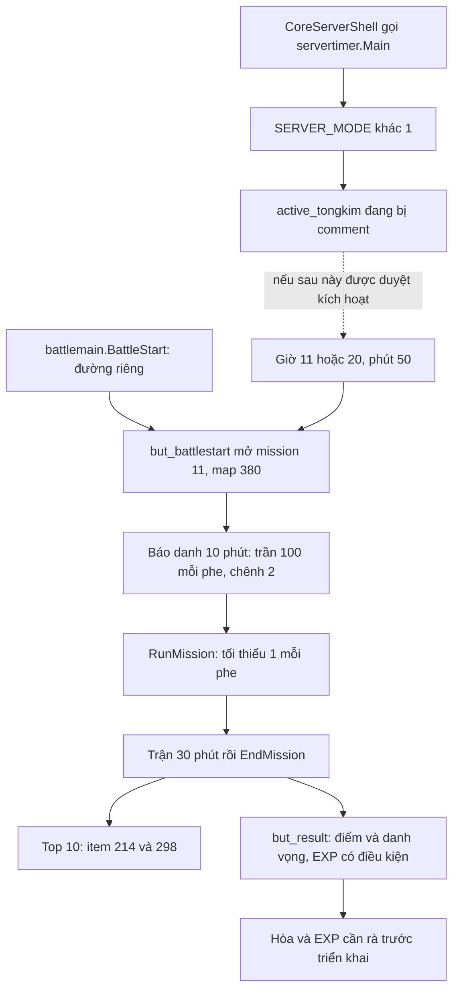

TÓM TẮT 5 DÒNG
1. [NGUỒN][THẤY] Đã khảo sát tĩnh mission 11/TNL, lịch mở, điều kiện vào và đường thưởng; [CHƯA KIỂM] tài liệu gọi tắt “D4” chưa định danh được.
2. [NGUỒN][THẤY] TNL có trần 100 người/phe, chênh 2, tối thiểu 1/phe; lịch dự kiến 11:50 và 20:50, báo danh 10 phút rồi đánh 30 phút, nhưng lời gọi tự động bị comment.
3. [NGUỒN][THẤY] Có điểm, danh vọng, EXP có điều kiện và quà top 10; phát hiện bất nhất ở đường hòa/EXP, đã ghi nguồn và câu hỏi chủ quyết trong báo cáo này.
4. [CHƯA KIỂM] Chưa xác minh bản đang chạy, D4, hiệu lực bật/tắt, sức tải và thưởng thực nhận; báo cáo không thay kết luận A-16, B-03 hoặc D-01.
5. [CHƯA KIỂM] Không build/test game, VM/exe/mạng; không commit/push theo yêu cầu. Ghi .nhip bị Access denied; bàn giao local để Tổng quan gộp.

# XD-B05 — Chuẩn bị B-05: Tống Kim, công tắc và giới hạn cần chủ đặt
Loại: khảo sát
Chủ đề: Đối chiếu mã/script Tống Kim và chuẩn bị lựa chọn về bật hoạt động, số người, lịch, phí và thưởng.
Từ khóa: Tống Kim, Songjin, battlesongjin, Battle, mission 11, báo danh, phần thưởng, MaxVisible, visibility
Trạng thái: PARTIAL — nội dung mã/script và câu hỏi đã hoàn tất; nguồn “D4” chưa định danh được, nhịp ngoài workspace bị chặn.
Độ phủ: 7/8 nhóm nguồn/nghiệp vụ đã phủ; 1/8 chưa phủ là D4. Không coi khảo sát tĩnh là nghiệm thu vận hành.
Liên quan: `JX1_OPS/REPORTS/A-16-tong-kim.md`, `JX1_OPS/REPORTS/B-03-test-visibility.md`, `JX1_OPS/REPORTS/D-01-bang-hoat-dong.md`, `JX1_OPS/DESIGN/B-01-LOC-HIEN-THI.md`.
Cần tôi quyết định: có — xem bảng câu hỏi; cần PM chỉ đường dẫn chính xác của D4 để khép nguồn còn thiếu.

[THẤY] Sơ đồ dựa trên `SG/Core/Src/CoreServerShell.cpp:2231–2240`, `G/script/servertimer.lua:9–17,36,52,141–164`, `T/battlemain.lua:1–5`, `T/butcher/head.lua:91–106,152–259`, `T/butcher/mission.lua:107–161`, `T/butcher/timerboard.lua:23–48`.

## 1. Phạm vi và danh sách tệp cần đọc

[THẤY] Nhánh kiểm đầu lượt: `task/XD-B05`; `git status --short --branch` chỉ trả tên nhánh, không có thay đổi. `JX1_OPS/REPORTS/XD-B05.md` chưa có nên không có báo cáo cũ phải làm lại. Lệnh chỉ đọc/cập nhật tài liệu, không thực thi mã game.

Quy ước nguồn để mọi dẫn chiếu `file:dòng` dưới đây có thể tra lại:
- `G` = `C:/Jx1CocoV3/Folder/ServerNew-20260116T043145Z-3-001/ServerNew/_bin_v2_/gs` — gói script/settings A-16 dẫn; XD-B05 mở trực tiếp các tệp liên quan, chỉ đọc.
- `T` = `G/script/tnlteam/mission/battlesongjin`.
- `SG` = `C:/Jx1CocoV3/SwordOnline/SwordOnline/jxOnline/gameserver/Sources` — đúng root server task cho phép; không thay bằng root `D:/JX-source` mà A-16 từng dùng.
- `C` = `C:/Jx1CocoV3/Folder/Client2912-20260116T044348Z-3-001/Client2912/Client/Classes` — đúng root client task cho phép.
- `R` = `JX1_OPS/REPORTS`; `D` = `JX1_OPS/DESIGN` trong worktree này.

| Nhóm nguồn/nghiệp vụ | Độ phủ | Danh sách tệp và điểm đọc |
|---|---|---|
| 1. Chuẩn, task, B-03 | Đã phủ | [THẤY] `D/CHUAN-BAO-CAO.md`; task XD-B05; `R/B-03-test-visibility.md:1–106`; `D/MUC-LUC-TRI-THUC.md` chỉ để định vị. |
| 2. D4 | Chưa phủ | [CHƯA KIỂM] Task không cho tên tệp. Lọc tên D4/D-04 ở REPORTS trong worktree và kho báo cáo được chỉ định, cùng kiểm các đường literal D4 trong DESIGN/DECISIONS, không định vị được; không tự coi D-01 hoặc B-01 là D4. |
| 3. Tài liệu Tống Kim và hiển thị | Đã phủ phần liên quan | [TÀI LIỆU] `R/A-16-tong-kim.md`; `R/D-01-bang-hoat-dong.md:48–62`; `D/B-01-LOC-HIEN-THI.md:6–10,12–63`; sổ tay Tống Kim chỉ dùng các đoạn định vị có dẫn nguồn. |
| 4. Bảng mission, công tắc và lịch | Đã phủ tĩnh | [THẤY] `G/settings/Task/missions.txt:12`; `G/settings/TimerTask.txt:40–41`; `G/script/servertimer.lua:1–58,122–128,141–165`; `G/script/lib/worldlibrary.lua:8`; `T/battlemain.lua:1–5`. |
| 5. Điều kiện vào / số người / thời lượng | Đã phủ tĩnh | [THẤY] `T/battlehead.lua:11–18,100–182,225–259,439–462`; `T/battlejoin.lua:1–130`; `T/butcher/head.lua:1–10,71–123,303–404`; `T/butcher/mission.lua:100–171`; `T/butcher/timerboard.lua:1–51`. |
| 6. Điểm và phần thưởng | Đã phủ đường phát thưởng chính | [THẤY] `T/butcher/head.lua:127–279`; `T/battlehead.lua:439–542`; `T/battleaward.lua:1–25`. Chưa đối chiếu bảng item hoặc mọi hiệu ứng sự kiện được include. |
| 7. API server/client | Đã phủ điểm nối cần thiết | [THẤY] `SG/Core/Src/ScriptFuns.cpp:7464–7486,8283–8372,22707–22745,22850–22916`; `SG/Core/Src/KMission.cpp:86–107`; `SG/Core/Src/CoreServerShell.cpp:2231–2246`; `C/gamecore/GameDataDef.h:428`; `C/gamecore/KProtocolProcess.cpp:2283–2308`. |
| 8. Biến thể để tránh gộp nhầm | Đã phủ đối chiếu hẹp | [THẤY] `G/script/battles/marshal/head.lua:31`, `G/script/battles/butcher/head.lua:29`, `G/script/battles/guozhan/head.lua:33`, `G/script/battles/battlehead.lua:244–245`; `G/script/header/tongkim.lua:3,9–35`. Không khảo sát hết nhánh cũ. |

[THẤY] Danh sách đọc được thu hẹp từ task → A-16/B-03 → các include/symbol trực tiếp. Không liệt kê đệ quy toàn `Folder/`, `SwordOnline/` hoặc `D:/JX-wt/`; chỉ kiểm cây con `T` có tên hoạt động rõ ràng. Không sửa A-16/B-03/D-01, không tạo `_CHIMUC` hay sửa mục lục ngoài vùng được giao.

## 2. Giải mã tên

[THẤY] Chuỗi tiếng Việt cũ được giữ nguyên khi trích; phần chữ đúng là diễn giải TCVN3, không sửa byte nguồn. Mã API/đường dẫn là ASCII; báo cáo đầu ra UTF-8 không BOM. Không có nhu cầu giải mã tên Hán mới để kết luận task.

| Tên gốc / định danh | Mã hóa | Chữ đúng / giới hạn | Nguồn |
|---|---|---|---|
| `Tèng Kim` | TCVN3 | Tống Kim | `T/battlehead.lua:469` |
| `D¹ng thøc Cõu s¸t` | TCVN3 | Dạng thức Cừu sát | `T/butcher/head.lua:101` |
| `Songjin`, `battlesongjin`, `BattleStart` | ASCII | Định danh nhánh/API Tống Kim, không phải tên bản đồ | `T/battlemain.lua:1–4`; `G/settings/Task/missions.txt:12` |
| `tong kim bi bao` / ID `214` | ASCII trong comment | Comment ghi “Tống Kim bí bảo”; [CHƯA KIỂM] tên hiển thị thực của item | `T/battlehead.lua:497` |
| `Ruong Quy 30p` / ID `298` | ASCII trong comment | Comment ghi “Rương Quý 30p”; [CHƯA KIỂM] tên và tác dụng thực của item | `T/battlehead.lua:501` |

## 3. Sắp theo cấu trúc game và công tắc

### 3.1. Hoạt động → mission → bản đồ

- [THẤY] Bảng mission nối ID 11 tới `T/butcher/mission.lua`; tệp đó include `T/butcher/head.lua`, đặt `MISSION_ID=11`, `TIMER_BOARD=39`. Bảng TimerTask trỏ 39 tới timer trận, 40 tới timer cá nhân. Có bản ghi không chứng minh timer đang chạy (`G/settings/Task/missions.txt:12`; `G/settings/TimerTask.txt:40–41`; `T/butcher/mission.lua:3`; `T/butcher/head.lua:5–7`).
- [THẤY] Nhóm bản đồ khai báo 378/379/380, nhưng `but_battlestart()` chọn phần tử thứ 3, mở map 380 và đặt cấp chiến trường 3. Hàm tên gần giống `but_battlestart__()` mới duyệt toàn nhóm; không coi ba map đều được mở (`T/battlehead.lua:138–141`; `T/butcher/head.lua:71–106`).
- [THẤY] Đường vào TNL gọi `AddMSPlayer`, không gọi `JoinMission` tại điểm thêm phe. Server có binding `LuaAddMissionPlayer` gọi `pMission->AddPlayer`; API `JoinMission` là đường khác tra script rồi gọi callback. Không thay các tên API cho nhau (`T/butcher/head.lua:380`; `SG/Core/Src/ScriptFuns.cpp:22881–22913,22728–22739`; `SG/Core/Src/KMission.cpp:86–107`).

### 3.2. Bật hoạt động: có nhiều lớp, chưa thấy công tắc tổng dạng Enabled

| Lớp | Điều đọc thấy | Ý nghĩa cho B-05 |
|---|---|---|
| Scheduler C++ | [THẤY] Tìm `script/servertimer.lua`, gọi `Main` khi điều kiện game-time và giây hệ thống thỏa (`SG/Core/Src/CoreServerShell.cpp:2231–2240`). | Chỉ ra caller tĩnh; chưa xác nhận binary/nhịp thực tế. |
| Chế độ server | [THẤY] `SERVER_MODE=0`, nhánh chứa lời gọi Tống Kim nằm trong `SERVER_MODE ~= 1` (`G/script/lib/worldlibrary.lua:8`; `G/script/servertimer.lua:36–52`). | Đây là cấu hình chung; không đề nghị đổi mode chỉ để mở Tống Kim vì có thể ảnh hưởng nhánh khác. |
| Lời gọi lịch | [THẤY] `--active_tongkim()` đang comment ở dòng 52. Thân hàm tồn tại và gọi mở trận tại dòng 157 (`G/script/servertimer.lua:52,141–164`). | Nút nối lịch tự động ở vị trí này bị ngắt; không suy toàn bộ hoạt động chắc chắn tắt. |
| Đường riêng | [THẤY] `BattleStart()` gọi thẳng `but_battlestart()` (`T/battlemain.lua:3–4`). | Có đường mở riêng không qua kiểm giờ trong thân hàm này; caller/GM/menu thực tế chưa kiểm. |
| Trạng thái mission | [THẤY] Báo danh=1, đang đánh=2, kết thúc=3; NPC từ chối state 0/3 hoặc maptype 0 (`T/butcher/mission.lua:108,115,159`; `T/battlejoin.lua:18–21,40–45`). | Biến trạng thái gameplay không đồng nghĩa công tắc vận hành lâu dài. |

[CHƯA KIỂM] Muốn bật ở môi trường thử sau này cần xác nhận bản nạp, dependency/include, map 380, lịch và khả năng đóng/khôi phục. XD-B05 không bỏ comment, đổi mode hay gọi bất kỳ hàm game nào.

### 3.3. Báo danh → chia phe → vào trận

- [THẤY] Tối đa 100 người/phe; kiểm số hiện tại `>=100` trước thêm. Phe đang đông hơn hoặc bằng chênh 2 bị từ chối; phe ít hơn vẫn qua bước cân bằng nếu không vướng điều kiện khác (`T/battlehead.lua:180–182`; `T/butcher/head.lua:333–355`). [CHƯA KIỂM] Tính nguyên tử khi nhiều yêu cầu đồng thời và tổng thực tế; con số 200 người/map chỉ là tổng suy ra của hai trần 100, không phải bằng chứng sức tải.
- [THẤY] Tối thiểu 1 người mỗi phe; `RunMission` đóng trận nếu một phe ít hơn ngưỡng. Không lấy comment “mặc định 0/150” thay giá trị gán hiện tại 1/100 (`T/battlehead.lua:180–182,248–250`; `T/butcher/mission.lua:117–137`).
- [THẤY] `but_join` kiểm phe gốc/hiện tại khác 0, tiền đủ 200.000, chỉ nhận camp 1/2, có kiểm đổi phe lượt cũ, thêm phe rồi gọi `Pay(200000)` (`T/butcher/head.lua:9,303–400`). [CHƯA KIỂM] Tiền thực trừ, lỗi thêm người và tính nhất quán hoàn tiền.
- [THẤY] NPC kiểm cấp theo hàm: đúng 40 trả 0; 41–79 trả 1; 80–119 và ≥120 trả 3. Map báo danh 324 trả 0, 323 trả 1, 325 trả 3; khác lời thoại nói từ cấp 40. Với đường mở map 380/cấp 3, không được tuyên bố mọi cấp ≥40 đều vào được (`T/battlehead.lua:225–245`; `T/battlejoin.lua:8–16`).
- [THẤY] Cửa NPC chặn khi đang đánh và thời gian còn lại `< 4*60` giây, dù comment gần đó nói 5 phút. `signupbattle()` gọi thẳng `but_join` và không lặp kiểm thời gian tại thân hàm này; chưa chứng minh mọi đường callback có cùng chốt thời gian (`T/butcher/head.lua:10,303–404`; `T/battlejoin.lua:48–55,119–121`).

### 3.4. Lịch và thời lượng

[THẤY] `TIME_GAME_MISSION[1]={11,20}` và điều kiện phút 50 → lịch được viết là 11:50, 20:50 theo đồng hồ mà `GetTimeNow()` trả; `MAP_GAME_MISSION[1]={380}`. Đây là nội dung hàm khi được gọi, không phải lịch đang vận hành (`G/script/servertimer.lua:9–17,25,147–157`).

[THẤY] Script quy đổi 18 frame/giây, nhịp thông báo 20 giây, báo danh 10 phút, chiến đấu 30 phút: `SJ_TIMER_1=360`, `SJ_TIMER_2=30` lượt callback, `SJ_TIMER_3=90` lượt callback. Các phép tính là suy ra trực tiếp từ hằng số, chưa đo tốc độ timer (`T/battlehead.lua:11–17`; `T/butcher/timerboard.lua:4–5,23–27,47–48`; `SG/Core/Src/ScriptFuns.cpp:22850–22872`).

[CHƯA KIỂM — SUY TÍNH] Nếu lịch đó được bật và nhịp 18 frame/giây đúng: báo danh 11:50–12:00, đánh 12:00–12:30; báo danh 20:50–21:00, đánh 21:00–21:30. Không dùng múi giờ máy người đọc làm múi giờ server; chưa đo trễ hoặc lời gọi lặp trong phút 50.

### 3.5. Phần thưởng theo đường thực thi

| Tầng thưởng | Điều kiện và giá trị thấy trong mã | Giới hạn cần chủ biết |
|---|---|---|
| Điểm kết quả | [THẤY] Khai báo thắng 500, thua 300, hòa 400 (`T/battlehead.lua:103–105`). Đường thắng/thua thực dùng `500*s` / `300*s`, với `s=sj_gettimerspec()` (`T/butcher/head.lua:202–219`). | [THẤY] Mission khởi tạo `s=1`; helper ép giá trị ≤0 về 1 (`T/butcher/mission.lua:109`; `T/battlehead.lua:457–462`). [CHƯA KIỂM] Nhánh hòa không dùng hằng 400 tại các điểm đã đọc; xem mục phát hiện. |
| Danh vọng | [THẤY] Người thắng được gọi `AddRepute(3*s)` (`T/butcher/head.lua:214–223`). | Chưa xác minh cộng thực nhận/giới hạn dữ liệu. |
| EXP phe thắng | [THẤY] Chỉ gọi `BenThang` nếu giá trị điểm vừa cộng `n_point>=2000`; giờ 12 gọi 5.000.000 EXP, giờ 21 gọi 10.000.000 EXP (`T/butcher/head.lua:127–136,219–226`; `T/battlehead.lua:448–454`). | [THẤY] `n_point` là điểm vừa cộng, không phải tổng điểm cá nhân. Với `s=1`, 500<2000 nên không qua điều kiện; không hứa có EXP chỉ vì tích lũy cá nhân vượt 2000. |
| EXP phe thua | [THẤY] Ngưỡng gọi cũng 2000; thân có mức 3.000.000/6.000.000 theo `nHr` 12/21 (`T/butcher/head.lua:139–147,202–209`). | [THẤY] Hàm không lấy giờ/khai báo local `nHr` như phe thắng; phụ thuộc biến ngoài hàm chưa kiểm. Với `s=1`, 300<2000. |
| Top 10 | [THẤY] Duyệt tối đa 10 người hiện diện, sắp theo `TASKID_TOTALPOINT`; mỗi người có lời gọi tạo item 214 và 298, khóa cả hai (`T/battlehead.lua:465–505,508–522,531–541`). | Tên hiển thị/mapping item chưa đối chiếu. Không thấy chốt điểm tối thiểu ngay trong hàm phát top; không coi đây là cơ chế chống AFK đã đủ. |
| Hạn item 214 | [THẤY] `SetItemUseTimeNew(...,60*24*1)`; native đọc tham số phút, cộng vào phút hiện tại (`T/battlehead.lua:497–499`; `SG/Core/Src/ScriptFuns.cpp:7469–7484`). | Đối số là 1440 phút (=24 giờ); [CHƯA KIỂM] chuẩn hóa ngày/giờ và hết hạn thực tế. Item 298 không có lời gọi đặt hạn ở đoạn này. |
| Top 1–3 lúc giờ 21 | [THẤY] Gán `TASK_PLAYER_DHTK` lần lượt 1/2/3, gọi skill state 541 với tham số thời lượng `108*2`; ghi ladder 380 cho top 10 (`T/battlehead.lua:470–493`). | Chưa xác minh đơn vị thời lượng state/tên hiệu ứng; không tự suy 216 là giây. |
| Hàm thưởng mở rộng / bảng đồ mẫu | [THẤY] `sj_battle_award` chỉ lặp và đổi `PlayerIndex` ở level 3, chưa có lệnh cấp quà trong thân; `TB_AWARD_ITEMS` có khai báo nhưng các lệnh random/AddItem kế bên là comment (`T/battleaward.lua:3–25`; `T/butcher/head.lua:49–68`). | Không lấy tên “award” hoặc bảng khai báo làm bằng chứng phát đồ ngẫu nhiên đang hoạt động. |

[THẤY] `sj_battle_rankaward` được gọi trước xử lý thắng/thua; `RunMission` có thể đóng khi thiếu người. Vì vậy cần kiểm riêng quà top trong trận bị hủy, không chỉ kiểm thưởng đội thắng (`T/butcher/head.lua:234–259`; `T/butcher/mission.lua:117–137,157–161`). [CHƯA KIỂM] Chưa chứng minh thực nhận hoặc khả năng lợi dụng.

## 4. Mục sổ thông số

Mọi hàng là dữ liệu đọc tĩnh; không hàng nào cấp quyền sửa. “CẨN THẬN” nghĩa chưa đủ bằng chứng về giới hạn runtime/khôi phục để xác nhận đổi an toàn.

| Nhóm | Tên/hằng số | file:dòng | Giá trị | Đơn vị | Ảnh hưởng | Đổi an toàn | Nguồn đo |
|---|---|---|---|---|---|---|---|
| Hoạt động | `MISSION_ID`, `TIMER_BOARD` | `T/butcher/head.lua:5–7` | 11;39 | ID | Nối mission/timer | CẨN THẬN | THẤY, đọc tĩnh |
| Mở tự động | `active_tongkim()` | `G/script/servertimer.lua:52` | Lời gọi comment | trạng thái mã | Ngắt đường lịch ở vị trí này | CẨN THẬN | THẤY, đọc tĩnh |
| Chế độ chung | `SERVER_MODE` | `G/script/lib/worldlibrary.lua:8`; `G/script/servertimer.lua:36` | 0; nhánh `~=1` | mode | Điều kiện scheduler, không phải nút riêng Tống Kim | CẨN THẬN | THẤY, đọc tĩnh |
| Lịch/map | `TIME_GAME_MISSION[1]`, `MAP_GAME_MISSION[1]` | `G/script/servertimer.lua:10,17,148` | 11/20 giờ, phút 50; map 380 | giờ/map ID | Chọn thời điểm/bản đồ khi được gọi | CẨN THẬN | THẤY, chưa đo đồng hồ |
| Nhịp | `SJ_FRAME2TIME`, `SJ_ANOUNCE_TIME` | `T/battlehead.lua:11–17` | 18;20 | frame/giây;giây | Quy đổi timer | CẨN THẬN | THẤY, quy ước script |
| Thời lượng | `SJ_BAOMING_TIME`, `SJ_MATCH_TIME` | `T/battlehead.lua:13–17` | 10;30 | phút | Báo danh/trận | CẨN THẬN | THẤY, đọc tĩnh |
| Đóng cửa muộn | `LIMIT_TIME_CUOI_TRAN_TK` | `T/butcher/head.lua:10`; `T/battlejoin.lua:48–55` | 4; so sánh `<240` | phút;giây | Chặn cửa NPC cuối trận | CẨN THẬN | THẤY, không lấy comment 5 phút |
| Số người TNL | `MAX_MEMBERCOUNT` | `T/battlehead.lua:180`; `T/butcher/head.lua:333` | 100 | người/phe | Trần admission, không phải sức tải đo | CẨN THẬN | THẤY, đọc tĩnh |
| Tối thiểu | `LIMIT_MIN_PLAYER` | `T/battlehead.lua:181,248–250`; `T/butcher/mission.lua:120` | 1 | người/phe | Thiếu một phe thì đóng | CẨN THẬN | THẤY, đọc tĩnh |
| Cân bằng TNL | `LIMIT_CHENH_LECH` | `T/battlehead.lua:182`; `T/butcher/head.lua:345,351` | 2 | người chênh | Chặn vào phe đang đông | CẨN THẬN | THẤY, đọc tĩnh |
| Phí | `PHIBAODANH` | `T/butcher/head.lua:9,310,400` | 200.000 | tiền game | Kiểm tiền/trừ phí | CẨN THẬN | THẤY, chưa đo |
| Nhánh cũ | `MAX_MEMBERCOUNT`; `BALANCE_MAMCOUNT` | `G/script/battles/marshal/head.lua:31`; `G/script/battles/butcher/head.lua:29`; `G/script/battles/guozhan/head.lua:33`; `G/script/battles/battlehead.lua:244` | 150;5 | người/phe;chênh | Thuộc nhánh khác TNL | CẨN THẬN | THẤY, chỉ đối chiếu |
| Điểm kết quả | `BATTLES_WINGAME_POINT`, `LOSE`, `TIE` | `T/battlehead.lua:103–105`; `T/butcher/head.lua:202–219,250–252` | 500;300;400 | điểm cơ sở | Hòa cần rà đường dùng | CẨN THẬN | THẤY, không hứa 400 thực nhận |
| Hệ số thưởng | `SJ_VARV_SPEC` | `T/butcher/mission.lua:109`; `T/battlehead.lua:457–462` | Khởi tạo 1; ≤0 trả 1 | hệ số | Nhân điểm/danh vọng | CẨN THẬN | THẤY, không suy mọi override |
| Danh vọng | `n_repute` | `T/butcher/head.lua:215,222` | `3*s` | điểm danh vọng | Phe thắng | CẨN THẬN | THẤY, đọc tĩnh |
| EXP | Ngưỡng `n_point`; mức giờ 12/21 | `T/butcher/head.lua:127–147,208–209,225–226` | ≥2000; thắng 5/10 triệu; thua 3/6 triệu | điểm cộng/EXP | Điều kiện/biến giờ bất nhất | CẨN THẬN | THẤY, chưa chạy |
| Top/quà | Vòng top; item; thời hạn | `T/battlehead.lua:474–503`; `SG/Core/Src/ScriptFuns.cpp:7470–7484` | 10;214/298;214 có 1440 phút | người/ID/phút | Quà xếp hạng và khóa | CẨN THẬN | THẤY, mapping item chưa kiểm |
| Điểm chiến đấu | `BONUS_KILLPLAYER`, `BONUS_KILLNPC` | `T/battlehead.lua:107–109` | 75;1 | điểm cơ sở | Hằng số khai báo, chưa lần toàn cách cộng | CẨN THẬN | THẤY, không coi là đầy đủ luật |
| Hiển thị đề xuất | `Enabled`, `Mode`, `MaxVisible` | `D/B-01-LOC-HIEN-THI.md:23–39` | 0;Solo/Group/Open;ví dụ 60 | cờ/chế độ/người nhóm | Thiết kế hiển thị, khác trần phe | CẨN THẬN | TÀI LIỆU, chưa chứng minh cài đặt |
| Chiến báo client | `MISSION_STATNUM` | `C/gamecore/GameDataDef.h:428`; `C/gamecore/KProtocolProcess.cpp:2297–2306` | 10 | ô hạng | Không phải trần phe hoặc nhóm nhìn | CẨN THẬN | THẤY, đọc tĩnh |

## 5. Liên hệ B-03: phân biệt ba loại trần

- [TÀI LIỆU] B-01 thiết kế `visibility.ini`: `Enabled=0` mặc định tắt lọc, `Mode=Solo/Group/Open`, ví dụ `MaxVisible=60`; nhóm đầy thì tạo nhóm con mới. Đây là thiết kế, không phải cấu hình game đã xác nhận có hiệu lực (`D/B-01-LOC-HIEN-THI.md:23–42`).
- [TÀI LIỆU] B-03 chỉ kiểm fixture ba phiên; trần 2/1 là dữ liệu ca thử. Combat và mời đội vẫn TODO, tick/băng thông ngoài B-03; không dùng PASS offline để nghiệm thu trận đông người (`R/B-03-test-visibility.md:38–43,50–75`).
- [THẤY] Tìm đúng bốn symbol `JoinActivityGroup|LeaveActivityGroup|SetVisGroup|GetVisGroup` trong `SG/Core/Src/ScriptFuns.cpp` trả 0 dòng. Đây chỉ là kết quả âm trong một tệp; không khẳng định thiếu ở toàn source/binary và không đổi `AddMSPlayer` thành API visibility.
- [THẤY/TÀI LIỆU] Phải tách **100 người/phe** (admission TNL), **60 người/nhóm** (ví dụ thiết kế visibility) và **10 ô hạng** (client); nguồn tương ứng là `T/battlehead.lua:180`, `D/B-01-LOC-HIEN-THI.md:37`, `C/gamecore/GameDataDef.h:428`.
- [CHƯA KIỂM — ĐỀ XUẤT] Nếu B-05 áp dụng lọc hiển thị, chủ phải chốt cách đưa đối thủ hai phe vào cùng nhóm con, có tách điểm/bản trận hay không và xử lý khi nhóm đầy. Chỉ tách người theo cap mà giữ một điểm phe chung có thể tạo trận người chơi không nhìn thấy đối thủ; đây là rủi ro thiết kế cần kiểm, không phải lỗi runtime đã chứng minh (`D/B-01-LOC-HIEN-THI.md:13–21,37–42,63`; `T/butcher/head.lua:235–249`).

## 6. Câu hỏi cần chủ quyết

Mọi khuyến nghị trong bảng là [CHƯA KIỂM — ĐỀ XUẤT], không phải lệnh thay config hoặc cho phép chạy thử trong XD-B05.

| Câu hỏi ngắn | 2–3 lựa chọn | Khuyến nghị và căn cứ |
|---|---|---|
| Q1. Lấy nhánh nào làm cơ sở B-05? | A. Mission 11/TNL; B. `script/battles` cũ; C. Chờ xác nhận bản nạp. | Dùng A để chuẩn bị vì bảng mission dẫn trực tiếp; trước bật thực tế phải hoàn thành C. Không chuyển con số 150/5 từ B sang TNL (`G/settings/Task/missions.txt:12`; `T/battlehead.lua:180–182`). |
| Q2. Mở bằng cách nào ở giai đoạn được duyệt tiếp theo? | A. Chưa mở mới; B. Mở thủ công một trận trên bản copy thử; C. Kích hoạt lịch tự động. | B sau khi có quyền thử và phương án đóng; chưa chọn C ngay vì caller lịch đang comment và chưa nghiệm thu quà (`G/script/servertimer.lua:52`; `T/battlemain.lua:3–4`; `T/butcher/head.lua:109–123`). |
| Q3. Dùng lịch nào? | A. 11:50 và 20:50, 10+30 phút; B. Chỉ 20:50; C. Chủ chỉ lịch khác. | A làm baseline so nguồn; chủ quyết lịch vận hành/múi giờ trước triển khai, kiểm tác động tới EXP/top theo giờ 12/21 (`G/script/servertimer.lua:10,148`; `T/butcher/head.lua:131–146`). |
| Q4. Trần phe và cân bằng? | A. 100/phe, chênh 2; B. Hạ trần riêng cho môi trường thử, vẫn chênh 2; C. Chủ chỉ cặp giá trị khác. | Giữ A trong hồ sơ nguồn; B khi giao thử tải tăng dần. Chưa có số đo để chứng nhận A an toàn hoặc đề nghị nâng lên 150 (`T/battlehead.lua:180–182`; `R/B-03-test-visibility.md:40,43`). |
| Q5. Có áp dụng visibility ngay không? | A. Giữ hành vi gốc ở giai đoạn đầu; B. Group, dùng 60/nhóm như ví dụ; C. Chủ đặt cap và cách chia trận riêng. | A để tách nghiệm thu gameplay trước; muốn B/C cần duyệt thiết kế đối thủ/điểm chung và xác minh code/API. Tắt lọc hiển thị không có nghĩa tắt Tống Kim (`D/B-01-LOC-HIEN-THI.md:19,23–42`; `R/B-03-test-visibility.md:38–43`). |
| Q6. Chốt phí và cửa báo danh? | A. 200.000, giữ logic nguồn; B. Miễn phí riêng bản thử; C. Chủ đặt phí/cấp/cửa cuối trận khác. | A làm baseline; kiểm mốc cấp 40/80 và 4 phút cuối trước áp dụng. Nếu chọn B chỉ chỉnh trên bản copy trong task được giao riêng (`T/butcher/head.lua:9–10,310,400`; `T/battlehead.lua:225–245`; `T/battlejoin.lua:48–55`). |
| Q7. Điểm và EXP xử lý thế nào? | A. Giữ điểm 500/300, treo quyết định hòa/EXP; B. Chốt hòa 400 và yêu cầu sửa rõ logic; C. Chủ chỉ bảng mới. | A để đối chiếu, B là mục cần duyệt nếu muốn hằng hòa có hiệu lực. Chưa phát hành lời hứa EXP trước rà ngưỡng 2000 và biến giờ phe thua (`T/battlehead.lua:103–105,448–462`; `T/butcher/head.lua:139–147,202–252`). |
| Q8. Phát quà top và thưởng trận hủy? | A. Top 10 hiện tại, 214+298; B. Chỉ thưởng sau trận hợp lệ và có điều kiện tham gia/điểm do chủ đặt; C. Chủ đặt lại danh sách/số lượng/hạn. | B về chính sách trước mở rộng; giá trị điều kiện cần chủ chốt. Phải đối chiếu bảng item, túi đầy, trận hủy và hạn 214 trước phát thật (`T/battlehead.lua:465–505`; `T/butcher/mission.lua:117–137`; `T/butcher/head.lua:234–239`). |

## 7. Phát hiện khi chuẩn hóa / đối chiếu

1. [THẤY] **400 điểm hòa mới là hằng khai báo, chưa có đường chi riêng trong đoạn thực thi đã đọc.** `but_gameover` gọi `but_result(n_level,0)` khi hòa, nhưng `but_result` vẫn mặc định phe thua=2, truy vấn winners với group 0, rồi dùng công thức thắng/thua. Tìm `BATTLES_TIEGAME_POINT` trong cây `T` chỉ ra dòng khai báo. Cần test semantics group 0 và tránh cộng trùng; chưa kết luận số thực nhận (`T/butcher/head.lua:152–155,167,179,202–231,250–252`; `T/battlehead.lua:105`).
2. [THẤY] **Ngưỡng EXP so điểm vừa cộng.** Helper trả đúng đối số cộng; với hệ số khởi tạo 1, 500/300 không tới 2000. `BenThua` còn đọc `nHr` mà không lấy giờ trong hàm. Không kết luận mọi global bằng nil hoặc người chơi thực tế không bao giờ có EXP (`T/battlehead.lua:448–462`; `T/butcher/mission.lua:109`; `T/butcher/head.lua:127–147,202–226`).
3. [THẤY] **Top được xử lý trước phân thắng/thua.** Chưa thấy kiểm trận hợp lệ hoặc điểm tối thiểu ngay tại vòng cấp item; thiếu người có thể đi đường CloseMission → EndMission → gameover. Cần xác minh trận hủy có cấp quà hay không (`T/butcher/mission.lua:120–137,157–161`; `T/butcher/head.lua:234–259`; `T/battlehead.lua:474–503`).
4. [THẤY] **Tên biến truyền thưởng mở rộng không khớp tham số.** `but_result(n_level,n_wincamp)` gọi `sj_battle_award(...,wincamp)`; helper hiện chưa có lệnh thưởng. Chưa suy lỗi phát quà thực tế vì chưa xác minh biến global hoặc biến thể được nạp (`T/butcher/head.lua:152,231`; `T/battleaward.lua:3–25`).
5. [THẤY/TÀI LIỆU] **Khác biệt với D-01 cần giữ nguyên lịch sử.** D-01 ghi tại `R/D-01-bang-hoat-dong.md:52` rằng dòng 125 của servertimer có 1 dấu nháy ASCII, nguy cơ chuỗi chưa đóng. Tệp hiện đọc có `return "T©n Thñ"`, đếm trực tiếp có **2** dấu nháy; chưa tái hiện phát hiện cũ trên tệp hiện tại. Không sửa kết luận D-01, không suy Lua hiện tại toàn bộ hợp lệ, không chạy parser game (`G/script/servertimer.lua:123–128`; lệnh đếm ký tự dòng 125 trả `ASCII_QUOTES=2`).
6. [THẤY] **Không gộp nhánh header với TNL.** Header chứa cặp lịch `{13,1},{19,1},{21,2}` nhưng include `script/feature/tongkim/LIMITED_1_ACCOUNT.lua` không có file rời ở đường literal đã kiểm. Giữ như nhánh riêng chưa xác minh, không lấy lịch/điểm từ đó áp TNL (`G/script/header/tongkim.lua:3,9–24`; `Test-Path` exact include trả False).

## 8. Đã xác minh / Chưa xác minh

### Đã xác minh
- [THẤY] Đọc trực tiếp các script TNL, hằng số, cửa vào, lịch và đường thưởng theo bảng phạm vi/sổ thông số; nguồn là nội dung tệp trên đĩa với dòng hiện tại.
- [THẤY] Nối được các binding server cần thiết: mission/timer/thêm phe; đơn vị phút của hàm đặt hạn item; guard chiến báo client tại các dòng nêu ở mục 1 và 4.
- [TÀI LIỆU] B-03 là kiểm fixture offline, không phải nghiệm thu hoạt động Tống Kim; giữ nguyên kết luận và giới hạn trong `R/B-03-test-visibility.md:1–6,38–43`.

## Chưa kiểm
- [CHƯA KIỂM] Nguồn D4 chưa định danh; cần PM bổ sung đúng đường dẫn hoặc mã tài liệu. Không thay bằng báo cáo khác và không quét toàn kho để đoán.
- [CHƯA KIỂM] Binary đang nạp gói nào, override từ PAK/include động, scheduler thực chạy, caller của `BattleStart`, trạng thái mở/đóng hiện hành và đồng hồ/múi giờ server.
- [CHƯA KIỂM] Atomicity/capacity đồng thời; callback vào muộn; phí và hoàn tiền; từng luồng chết/rời/vào lại; EXP, hòa, top/đồng điểm, chống AFK, phát lặp hoặc trận hủy.
- [CHƯA KIỂM] Mapping/tên/tác dụng item 214/298, thành công tạo vật phẩm và túi đầy; thời hạn thực tế; tính an toàn `nItemIdx` trước các lệnh khóa/đặt hạn. Các đường `settings/item/mineitem.txt`, `mineitem.ini`, `settings/mineitem.txt` đã thử đều không có; không tìm đoán rộng hơn.
- [CHƯA KIỂM] Tác động include sự kiện và `RoiVatPhamEvTet(50)` trong đường rời trận; không tự coi đó là phần thưởng cuối trận (`T/butcher/head.lua:3,298`).
- [CHƯA KIỂM] Cài đặt/runtime visibility; kết quả tìm 0 API chỉ giới hạn `SG/Core/Src/ScriptFuns.cpp`. Không dùng fixture B-03 để suy thực thi gameplay.
- [CHƯA KIỂM] Không build, chạy game, thực thi Lua, VM/exe, mạng hoặc quét tài khoản/khóa/dump. Không có kết quả test game PASS do XD-B05 tạo.

## 9. Đề xuất tối ưu và kiểm thử bàn giao

[CHƯA KIỂM — ĐỀ XUẤT] Thứ tự ưu tiên cho task sau: chốt nhánh/nạp script và lịch → xử lý/duyệt semantics hòa/EXP → kiểm thưởng và trận hủy → nghiệm thu vòng đời hai phe với số ít → đo sức tải tăng dần → mới ghép visibility. Không dùng đổi `SERVER_MODE` làm công tắc riêng; không nâng cap chỉ vì có hằng 150 ở nhánh cũ (nguồn mục 3–7).

| Ca đề xuất, CHƯA CHẠY | Nội dung cần đối chiếu khi được giao quyền riêng |
|---|---|
| TK-B05-01 | Xác nhận phiên bản và lịch; mở riêng rồi đóng; kiểm state, map 380, không mở lặp trong phút 50 (`G/script/servertimer.lua:147–164`; `T/butcher/head.lua:91–123`). |
| TK-B05-02 | 0/1 mỗi phe, 99/100 mỗi phe và chênh 1/2; thử đồng thời ở ngưỡng, ghi cả quân số trước/sau (`T/butcher/mission.lua:117–137`; `T/butcher/head.lua:333–380`). |
| TK-B05-03 | Cấp 39/40/41/79/80/119/120, map báo danh 323/324/325, còn 241/240/239 giây; kiểm các callback riêng (`T/battlehead.lua:225–245`; `T/battlejoin.lua:48–55,119–121`). |
| TK-B05-04 | Tiền 199.999/200.000/200.001, vào thất bại, rời/vào lại; đối chiếu tiền trừ thật (`T/butcher/head.lua:310,359–400`). |
| TK-B05-05 | Thắng/thua/hòa; tổng cá nhân cao nhưng điểm cộng 500/300; hệ số và ngưỡng EXP 2000; giờ 12/21, biến giờ phe thua (`T/butcher/head.lua:127–231,250–252`). |
| TK-B05-06 | Top 0/1/9/10/11 người, đồng điểm, trận hủy, thiếu phe, túi đầy; kiểm item 214/298, khóa/hạn, không phát lặp (`T/battlehead.lua:465–541`; `T/butcher/head.lua:234–239`). |
| TK-B05-07 | Chỉ sau có code visibility được duyệt: hai phe cùng nhóm/khác nhóm, cap nhóm, đối thủ biến mất, ADD/REMOVE khi ra vào, combat/AoE và tick; giữ riêng cap phe/cap nhóm/top (`D/B-01-LOC-HIEN-THI.md:13–42,63`; `R/B-03-test-visibility.md:38–43`). |

## 10. Lỗi, cách thử và kết quả kiểm tra tài liệu

- [THẤY] Ghi `D:/JX-wt/XD-B05.nhip` ở mốc bắt đầu trả `UnauthorizedAccessException / Access to the path ... is denied`; đường này ở ngoài writable root. Script còn in chuỗi `NHIP_WRITE=OK` do lỗi PowerShell không kết thúc lệnh: **chuỗi đó không phải bằng chứng ghi thành công**. Không lặp ghi mốc lớn vào đường bị chặn, không sửa quyền/credential/config để vượt hạn chế; mốc đọc và sắp bàn giao được cập nhật qua hội thoại.
- [THẤY] `rg` không có qua `Get-Command rg`; dùng `Select-String`/đọc khoảng dòng trong đúng file/cây hoạt động, không cài công cụ. Một số đường header/UI dự kiến từ dẫn chiếu cũ không tồn tại ở path đã thử; không dùng chúng làm bằng chứng.
- [THẤY] Lượt đọc đầu sai dấu do encoding mặc định; đọc lại UTF-8 cho tài liệu, giữ byte script gốc khi đọc chuỗi legacy. Một lệnh sửa bản nháp lỗi parse vì dấu nháy trong PowerShell; lỗi xảy ra trước ghi và đã thay bằng here-string/chuỗi đơn.
- [THẤY] Kiểm tóm tắt lần đầu đếm nhầm cả danh sách trong thân; sửa kiểm chỉ 7 dòng đầu, được đúng 5 dòng. Kiểm cuối gồm UTF-8 không BOM, đúng 5 dòng tóm tắt, Mermaid, sổ thông số, câu hỏi chủ quyết, mục Chưa kiểm, Kết quả task, đường dẫn nguồn và diff; đây là kiểm tài liệu, không phải test game.

## 11. Bàn giao

[THẤY] Chỉ tạo/cập nhật `JX1_OPS/REPORTS/XD-B05.md` và mục Kết quả cuối `JX1_OPS/TASKS/XD-B05.md` theo yêu cầu trực tiếp; không thay metadata task, source/config hay kết luận báo cáo cũ. Không ghi `_CHIMUC`, mục lục tri thức hoặc `BAI_HOC` vì ngoài vùng được giao.

[CHƯA KIỂM] Trạng thái **PARTIAL** chỉ vì D4 chưa định danh và nhịp ngoài worktree bị chặn; các nội dung tĩnh công tắc, số người, giờ, phần thưởng và lựa chọn chủ đã có. Tổng quan/PM cung cấp D4 để bổ sung phần đó; không cần đọc lại phần đã có bằng chứng. Không yêu cầu quyết định gameplay để hoàn tất phần ghi báo cáo này.

[THẤY] Không stage/commit/push theo yêu cầu “Tổng quan commit hộ”; chưa có SHA mới hoặc bằng chứng GitHub. Kết quả giữ local. Lỗi ghi .nhip không đồng nghĩa Git commit/push bị thử rồi thất bại.

[CHƯA KIỂM — ĐỀ XUẤT] Dòng để PM gộp vào mục lục, không ghi file khác: `Tống Kim: công tắc, lịch, cap và thưởng | REPORTS/XD-B05.md | mission 11; servertimer; battlehead; butcher/head; visibility | khảo sát tĩnh, thiếu nguồn D4`.

liên quan: `R/A-16-tong-kim.md`, `R/B-03-test-visibility.md`, `R/D-01-bang-hoat-dong.md`, `D/B-01-LOC-HIEN-THI.md`, `D/CHUAN-BAO-CAO.md`.

Kỹ năng đã dùng: jx1-retrofit, jx1-read-server, jx1-read-client, jx1-parameters, jx1-knowledge, jx1-report.
