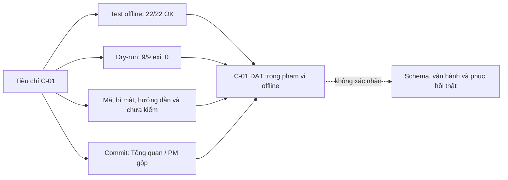

TÓM TẮT 1: [NGUỒN][THẤY] `python -I -m unittest discover -s JX1_OPS/TOOLS/jxadm -v` → exit 0, 22/22 test, OK, 0,095 giây theo unittest.
TÓM TẮT 2: [NGUỒN][THẤY] 9/9 biến thể dry-run ở bảng lệnh đều exit 0; số dấu `?` khớp số tham số theo test đã chạy tại `JX1_OPS/TOOLS/jxadm/test_jxadm.py:69-93`.
TÓM TẮT 3: [NGUỒN][THẤY] Đọc toàn bộ hai tệp Python không thấy credential thật; test sinh bí mật lúc chạy và che output: `JX1_OPS/TOOLS/jxadm/test_jxadm.py:63-64,132-139,250-299`.
TÓM TẮT 4: [NGUỒN][TÀI LIỆU] Đã đối chiếu 6/6 vế; commit giao Tổng quan theo chỉ đạo hiện tại và ngoại lệ PM gộp tại `JX1_OPS/TASKS/C-01.md:26,37-38`; giữ nguyên báo cáo C-01 cũ.
TÓM TẮT 5: [CHƯA KIỂM] Schema/runtime/restore thật còn thiếu tại `JX1_OPS/REPORTS/C-01-jxadm.md:67`; không chạy build game, exe game, VM, SQL hay mạng; không tạo SHA/push, Tổng quan commit hộ.

# XD-C01 — Kiểm tiêu chí jxadm

Loại: kiểm thử
Chủ đề: Tái kiểm offline công cụ quản lý tài khoản jxadm theo từng vế tiêu chí C-01.
Từ khóa: tài khoản, account, jxadm, C-01, dry-run, SQL, unittest, is_bot, sao lưu
Trạng thái: DONE — hoàn tất kiểm tiêu chí offline; commit bàn giao Tổng quan theo chỉ đạo hiện tại.
Độ phủ: đã đối chiếu 6/6 vế; kiểm 7/7 loại lệnh với 9/9 biến thể dry-run và 1 trường hợp từ chối Main VM.
Liên quan: `JX1_OPS/TASKS/XD-C01.md`; `JX1_OPS/TASKS/C-01.md`; `JX1_OPS/REPORTS/C-01-jxadm.md`; `JX1_OPS/DESIGN/CHUAN-BAO-CAO.md`.
Cần tôi quyết định: không.

## Sơ đồ chính



## Phạm vi và độ phủ

[TÀI LIỆU] Sáu vế lấy từ `JX1_OPS/TASKS/C-01.md:25-28`. “Đúng SQL” được đối chiếu với kế hoạch trong mã, test và bảng/cột A-02 mô tả; không có nghĩa câu SQL đã chạy thành công trên SQL Server thật.

| Vế tiêu chí | Đã phủ / chưa phủ | Nhãn và bằng chứng | Kết quả |
|---|---|---|---|
| 1. Test offline pass | Đã phủ | THẤY — L1 | 22/22 test, OK, exit 0. |
| 2. Dry-run in đúng SQL | Đã phủ | THẤY — L2–L10; `JX1_OPS/TOOLS/jxadm/test_jxadm.py:69-118` | Đúng bảng/cột theo kế hoạch; tham số tách khỏi SQL; backup là yêu cầu adapter, không có SQL. |
| 3. Không bí mật trong mã | Đã phủ trong mã được giao | THẤY — đọc `JX1_OPS/TOOLS/jxadm/jxadm.py:1-332`, `JX1_OPS/TOOLS/jxadm/test_jxadm.py:1-303`; L1 | Không thấy mật khẩu/khóa/tài khoản thật; test dùng fixture, giá trị ngẫu nhiên hoặc đầu vào không hợp lệ. |
| 4. Báo cáo mô tả lệnh | Đã phủ | THẤY — `JX1_OPS/REPORTS/C-01-jxadm.md:11-39`; L2–L10 | Có ví dụ, hành vi và giới hạn của 7 loại lệnh. |
| 5. Điều chưa kiểm ghi rõ | Đã phủ | THẤY — `JX1_OPS/REPORTS/C-01-jxadm.md:57-67`; mục Chưa kiểm dưới đây | Schema sống, adapter, khóa/online, is_bot, khôi phục đều được ghi chưa kiểm. |
| 6. Commit hoặc ghi lỗi để PM gộp | Đã phủ theo ngoại lệ | TÀI LIỆU — `JX1_OPS/TASKS/C-01.md:26,37-38`; người dùng: “Không cần commit: Tổng quan commit hộ.” | C-01 đã ghi lỗi stage và bước PM gộp; XD-C01 không phải tạo commit mới. Thiếu SHA không phải vế trượt trong lượt này. |

## Giải mã tên

[THẤY] Không có tên kỹ năng, trang bị, quái, NPC hoặc bản đồ cần giải mã. Các định danh liên quan là ASCII trong tệp UTF-8; không có tên GBK/TCVN3 cần chuyển mã.

| Tên gốc | Mã hóa | Chữ đúng UTF-8 | Nguồn file:dòng |
|---|---|---|---|
| jxadm | ASCII/UTF-8 | jxadm — công cụ quản lý tài khoản | `JX1_OPS/TOOLS/jxadm/jxadm.py:1-5` |
| Account_Info | ASCII/UTF-8 | Account_Info — hồ sơ tài khoản | `JX1_OPS/TOOLS/jxadm/jxadm.py:123-124` |
| Account_Habitus | ASCII/UTF-8 | Account_Habitus — hạn và quyền chơi | `JX1_OPS/TOOLS/jxadm/jxadm.py:125-128` |
| Account_BotMetadata / is_bot | ASCII/UTF-8 | Account_BotMetadata / is_bot — metadata bot đề xuất | `JX1_OPS/TOOLS/jxadm/jxadm.py:146-154` |
| Berkeley DB / roledb | ASCII/UTF-8 | Berkeley DB / roledb — lưu trữ nhân vật theo tài liệu nền | `JX1_OPS/REPORTS/C-01-jxadm.md:37,55` |
| Main VM | ASCII/UTF-8 | Main VM — đích bị chặn | `JX1_OPS/TOOLS/jxadm/jxadm.py:22,35-36` |

## Sắp theo cấu trúc game

| Nhóm cấu trúc | Thành phần | Độ chắc / độ phủ |
|---|---|---|
| Tài khoản → hồ sơ/mật khẩu | create, lock, unlock, reset-password → Account_Info | THẤY — kế hoạch SQL, che bí mật, test adapter giả. |
| Tài khoản → hạn/quyền chơi | create → Account_Habitus | THẤY — cột và fixture; schema/hạn thật chưa kiểm. |
| Tài khoản → quan sát phiên | online → iClientID, dLoginDate, dLogoutDate | THẤY — SELECT quan sát, không suy số người online từ tên cột. |
| Tài khoản → phân loại bot | mark-bot → Account_BotMetadata.is_bot | THẤY — true/false; TÀI LIỆU — bảng mới đề xuất, chưa triển khai. |
| Nhân vật → sao lưu môi trường | backup-characters → yêu cầu adapter Berkeley DB | THẤY — dry-run/adapter giả; chưa copy hoặc khôi phục dữ liệu thật. |

## Nguồn và phạm vi thực hiện

- [THẤY] Ban đầu `git status --short --branch` chỉ in `## task/XD-C01`, không có thay đổi local. Báo cáo XD-C01 chưa tồn tại nên tạo mới; đã đọc chuẩn trước task.
- [THẤY] Nguồn chính: chuẩn báo cáo, task XD-C01, task C-01, báo cáo C-01, jxadm.py và test_jxadm.py. Chỉ mở bổ sung A-02 được báo cáo nền dẫn tới và dòng mục lục liên quan; không quét cây source.
- [TÀI LIỆU] Bảng/cột đối chiếu tại `D:/jx1-ops-wt/JX1_OPS/REPORTS/A-02-luong-dang-nhap.md:118-127,153-162`: Account_Info, Account_Habitus và metadata bot đề xuất. Không tái kiểm source game hoặc schema sống để nâng mức bằng chứng.
- [THẤY] Chỉ ghi báo cáo và mục Kết quả cuối task XD-C01 theo yêu cầu trực tiếp. Không vá mã vì không có vế offline thất bại; không sửa báo cáo hoặc kết luận lịch sử C-01.

## Lệnh đã chạy và kết quả thật

[THẤY] Chạy tại `D:\JX-wt\XD-C01` ngày 19/11/2026. Ngày 17–18/11 trong lệnh là fixture giữ từ C-01, không phải ngày thực hiện. Tất cả lệnh dùng `python -I` và dữ liệu tổng hợp.

| ID | Lệnh đầy đủ | Kết quả thực |
|---|---|---|
| L1 | `python -I -m unittest discover -s JX1_OPS/TOOLS/jxadm -v` | exit 0; Ran 22 tests in 0.095s; OK. |
| L2 | `python -I JX1_OPS/TOOLS/jxadm/jxadm.py create --account offline_fixture --begin 2026-11-17T00:00:00 --end 2026-11-18T00:00:00 --dry-run` | exit 0; mode dry-run; 3 statement: kiểm tồn tại, INSERT Account_Info, INSERT Account_Habitus; cPassword được che. |
| L3 | `python -I JX1_OPS/TOOLS/jxadm/jxadm.py lock --account offline_fixture --dry-run` | exit 0; 1 UPDATE Account_Info.cPassword, lọc cAccName bằng tham số. |
| L4 | `python -I JX1_OPS/TOOLS/jxadm/jxadm.py unlock --account offline_fixture --dry-run` | exit 0; cùng UPDATE như L3; giá trị mật khẩu chưa gán, không kết nối. |
| L5 | `python -I JX1_OPS/TOOLS/jxadm/jxadm.py reset-password --account offline_fixture --dry-run` | exit 0; cùng UPDATE như L3; giá trị mật khẩu chưa gán, không kết nối. |
| L6 | `python -I JX1_OPS/TOOLS/jxadm/jxadm.py online --dry-run` | exit 0; SELECT cAccName, iClientID, dLoginDate, dLogoutDate từ Account_Info. |
| L7 | `python -I JX1_OPS/TOOLS/jxadm/jxadm.py online --account offline_fixture --dry-run` | exit 0; SELECT như L6 thêm WHERE cAccName = ?. |
| L8 | `python -I JX1_OPS/TOOLS/jxadm/jxadm.py mark-bot --account offline_fixture --value true --dry-run` | exit 0; kiểm tài khoản và upsert Account_BotMetadata.is_bot; test kiểm tham số true = 1. |
| L9 | `python -I JX1_OPS/TOOLS/jxadm/jxadm.py mark-bot --account offline_fixture --value false --dry-run` | exit 0; cùng cấu trúc L8; test kiểm tham số false = 0. |
| L10 | `python -I JX1_OPS/TOOLS/jxadm/jxadm.py backup-characters --source D:/offline_fixture/database --destination D:/offline_fixture_backup --dry-run` | exit 0; yêu cầu adapter, không có trường statements; không đọc/copy file. |
| L11 | `python -I JX1_OPS/TOOLS/jxadm/jxadm.py lock --account offline_fixture --host 192.168.1.50 --dry-run` | Từ chối: `jxadm: Main VM 192.168.1.50 is blocked`; bắt trực tiếp `$LASTEXITCODE` xác nhận Python exit 2. |

### SQL và hành vi

- [THẤY] Mỗi statement có số dấu `?` bằng số tham số; không nhúng tài khoản/mật khẩu vào SQL. INSERT Account_Info dùng `(cAccName,cPassword,iClientID)`; Account_Habitus dùng `(cAccName,iFlag,dBeginDate,dEndDate,iLeftSecond,nExtPoint,iClientID)`. `JX1_OPS/TOOLS/jxadm/jxadm.py:117-130`; `JX1_OPS/TOOLS/jxadm/test_jxadm.py:69-93`.
- [THẤY] Khóa/mở/reset dùng `UPDATE [Account_Info] SET [cPassword] = ? WHERE [cAccName] = ?;`. Online chỉ quan sát phiên; metadata bot không tái dùng cờ hạn chơi. `JX1_OPS/TOOLS/jxadm/jxadm.py:131-155`; `JX1_OPS/TOOLS/jxadm/test_jxadm.py:95-118`.
- [THẤY] Test adapter SQL kiểm commit, rollback khi INSERT lỗi hoặc rowcount 0/2, đóng tài nguyên; thiếu mật khẩu bị từ chối trước connect. Đều dùng đối tượng giả trong bộ nhớ. `JX1_OPS/TOOLS/jxadm/test_jxadm.py:22-59,143-180`.
- [THẤY] Backup không có trường statements, khác với mảng SQL rỗng; test kiểm assertNotIn đối với trường này. `JX1_OPS/TOOLS/jxadm/test_jxadm.py:200-211`.

### Rà bí mật và giới hạn mạng

- [THẤY] Đã đọc toàn bộ hai tệp Python, không thấy credential thật. LOCK_MARKER là 32 dấu `!`, được chú thích là marker ngoài miền MD5, không phải mật khẩu lưu sẵn. `JX1_OPS/TOOLS/jxadm/jxadm.py:22-24`.
- [THẤY] CLI nhận tên biến môi trường hoặc getpass; không có tùy chọn mật khẩu trực tiếp/file; Secret che preview/repr. Test sinh giá trị bằng secrets.token_hex(16), không dùng credential thật. `JX1_OPS/TOOLS/jxadm/jxadm.py:57-83,284-313`; `JX1_OPS/TOOLS/jxadm/test_jxadm.py:63-64,132-139,250-299`.
- [THẤY] Test CLI vá socket.create_connection và socket.getaddrinfo để báo lỗi nếu bị gọi; adapter SQL/backup đều giả. CLI chỉ tạo kế hoạch và in JSON, không dispatch adapter. `JX1_OPS/TOOLS/jxadm/test_jxadm.py:143-180,200-236`; `JX1_OPS/TOOLS/jxadm/jxadm.py:296-332`.
- [THẤY] Main VM và các dạng alias/IP mapped bị từ chối trước adapter; Main VM bị từ chối trước prompt. `JX1_OPS/TOOLS/jxadm/test_jxadm.py:182-193,222-226,274-280`; L1/L11 xác nhận.

## MỤC SỔ THÔNG SỐ

| Nhóm | Tên/hằng số | file:dòng | Giá trị | Đơn vị | Ảnh hưởng | Đổi an toàn (CÓ/CẨN THẬN/KHÔNG) | Nguồn đo |
|---|---|---|---|---|---|---|---|
| Rào chắn | MAIN_VM | `JX1_OPS/TOOLS/jxadm/jxadm.py:22,27-37` | 192.168.1.50 | địa chỉ IP | Chặn trước password/adapter, kể cả IPv4-mapped. | KHÔNG — không thay rào chắn trong task này. | Đọc tĩnh + L1/L11. |
| CLI | dry-run / host mặc định | `JX1_OPS/TOOLS/jxadm/jxadm.py:276-278` | True / 127.0.0.1 | cờ / địa chỉ IP | Chỉ in kế hoạch; host là dữ liệu trong kế hoạch. | CẨN THẬN — thay host không cấp quyền kết nối. | L1–L10; không đo runtime. |
| Khóa | LOCK_MARKER | `JX1_OPS/TOOLS/jxadm/jxadm.py:23,132-136` | 32 dấu `!` | ký tự | Đề xuất vô hiệu hóa đối chiếu MD5 thông thường. | CẨN THẬN — schema/super-password chưa kiểm. | Đọc tĩnh + test kế hoạch L1. |
| Dữ liệu mẫu | BEGIN/END | `JX1_OPS/TOOLS/jxadm/test_jxadm.py:17-19` | 2026-11-17T00:00:00 / 2026-11-18T00:00:00 | ngày giờ fixture | Kiểm create với begin < end. | CẨN THẬN — không suy thành hạn hoặc múi giờ thật. | L1/L2; không quy đổi thành số đo runtime. |

## Đã xác minh

- [THẤY] L1 đạt 22/22; L2–L10 đều exit 0; L11 bị từ chối với mã Python 2. Đây là kết quả offline thực chạy ngày 19/11/2026.
- [THẤY] Mã, test, báo cáo hiện có đủ bằng chứng đối chiếu từng vế; không cần vá mã để đạt tiêu chí offline.
- [TÀI LIỆU] Giữ nguyên kết luận lịch sử PARTIAL và lỗi stage tại `JX1_OPS/REPORTS/C-01-jxadm.md:3,80-93`. Kết luận kiểm lại của XD-C01 tính ngoại lệ PM gộp tại `JX1_OPS/TASKS/C-01.md:26,37-38` và chỉ đạo không commit hiện tại; không viết lại lịch sử.

## Chưa kiểm

- [CHƯA KIỂM] Schema SQL sống, owner, kiểu/chiều dài/collation, NULL/default/trigger/unique/FK, hỗ trợ THROW, driver và rowcount thực. “SQL đúng” dừng ở kế hoạch offline và bảng/cột từ tài liệu A-02.
- [CHƯA KIỂM] Hiệu lực khóa/mở/reset, super-password, encoding ngoài ASCII, phiên online, tác dụng is_bot, múi giờ và hạn chơi thật.
- [CHƯA KIỂM] Adapter thật, Berkeley DB thật, copy/hash manifest/khôi phục. Không mở account, roledb hoặc dump tài khoản.
- [CHƯA KIỂM] Không build game, chạy exe game/VM hoặc kết nối SQL/server/mạng; không kiểm source server/client để kết luận runtime.
- [CHƯA KIỂM] Không xác minh SHA/push C-01 mới; chỉ ghi lỗi stage lịch sử từ báo cáo. Tổng quan commit hộ; XD-C01 không thử git add/commit/push.

## Lỗi, cách thử và kết quả

- Ghi nhịp `D:\JX-wt\XD-C01.nhip` một lần bằng Set-Content bị `Access to the path 'D:\JX-wt\XD-C01.nhip' is denied.` Chưa ghi được nhịp; đường dẫn nằm ngoài writable root. Không retry/đổi quyền hoặc dùng công cụ khác để vượt chặn.
- Lô điều phối 8 dry-run lần đầu lỗi JavaScript `SyntaxError: missing ) after argument list` trước khi gọi lệnh con; sửa ghép chuỗi rồi chạy lại một lần, cả 8 đạt; cộng create thành 9 biến thể.
- Công cụ lệnh ban đầu trả exit 1 cho chặn Main VM; chạy lại đúng lệnh, bắt ngay `$LASTEXITCODE` cho `python_exit=2`. Wrapper thoát 0 để in kết quả; exit 1 ban đầu thuộc lớp chạy lệnh, không ghi nhầm thành mã Python.
- Hai lần dùng patch không thành công: lần đầu khai báo hai thao tác cùng đường dẫn bị từ chối cú pháp; lần sau báo không ghi được tệp. Đã đọc lại xác nhận báo cáo còn nguyên; chuyển về WriteAllText UTF-8 đã hoạt động trong workspace, không thay quyền hoặc vị trí ghi.
- Bản thảo từng coi thiếu SHA là đánh trượt; đã đọc lại ngoại lệ PM gộp và chỉ đạo hiện tại, sửa kết luận XD-C01 trước bàn giao. Không sửa kết luận C-01 cũ.
- Không có lỗi test/CLI cần vá mã. Việc chưa có nhịp được bàn giao như giới hạn, không coi là kiểm thử kỹ thuật đã chạy.

## Đề xuất tối ưu

[TÀI LIỆU] Tổng quan gộp tài liệu và commit theo chỉ đạo hiện tại. Chỉ mở task vận hành riêng nếu cần kiểm schema, adapter hoặc phục hồi; chưa có căn cứ thay tham số game hay sửa mã từ kết quả offline này.

## Bàn giao

- [THẤY] Đầu ra: `JX1_OPS/REPORTS/XD-C01.md` và mục Kết quả cuối `JX1_OPS/TASKS/XD-C01.md`; UTF-8 không BOM.
- [THẤY] Không stage/commit/push, không có SHA mới trong XD-C01. **BỊ CHẶN – CHƯA PUSH** là ghi nhận Git lịch sử C-01 tại `JX1_OPS/REPORTS/C-01-jxadm.md:80-93`, không phải lỗi Git mới của XD-C01.
- [TÀI LIỆU] Đã xem dòng mục lục liên quan `JX1_OPS/DESIGN/MUC-LUC-TRI-THUC.md:20`. Hàng chỉ mục dưới đây đề xuất PM gộp; không tạo tệp _CHIMUC hoặc sửa mục lục ngoài vùng ghi.

```tsv
file	loại	chủ đề	từ khóa	trạng thái	độ phủ	liên quan
JX1_OPS/REPORTS/XD-C01.md	kiểm thử	Kiểm tiêu chí offline jxadm	tài khoản,account,jxadm,C-01,dry-run,SQL,unittest,is_bot	DONE	6/6 vế; 7/7 lệnh; 9/9 biến thể dry-run	JX1_OPS/TASKS/C-01.md;JX1_OPS/REPORTS/C-01-jxadm.md
```

Kỹ năng đã dùng: jx1-retrofit (khuôn/giữ lịch sử), jx1-parameters (sổ thông số), jx1-knowledge (mức chắc/cấu trúc), jx1-report (bàn giao); đã nạp jx1-read-server và jx1-read-client theo yêu cầu, không cần đọc source game để kiểm tiêu chí offline.

C-01 ĐẠT
