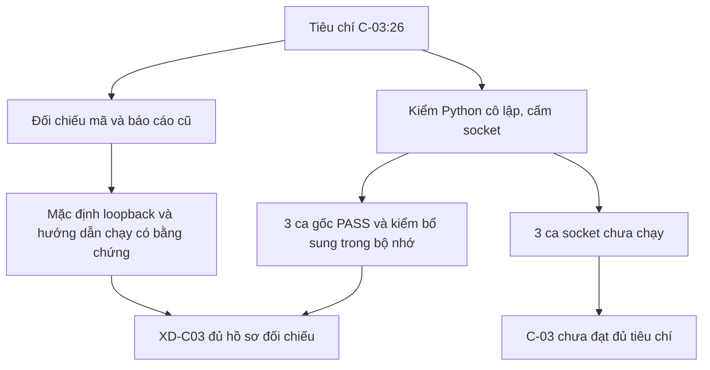

TÓM TẮT 1 [NGUỒN] [THẤY] XD-C03 DONE về đối chiếu đủ 6 vế tiêu chí C-03; việc cha chưa đủ điều kiện đóng (`JX1_OPS/TASKS/C-03.md:25–28`; lệnh K1 bên dưới).
TÓM TẮT 2 [NGUỒN] [THẤY] K1 PASS 3/3 ca không socket; K2 đạt kiểm tra mặc định loopback và handler trong bộ nhớ; K3 biên dịch 3/3 tệp, không thấy mẫu credential đã quét.
TÓM TẮT 3 [NGUỒN] [THẤY] Đầu ra là báo cáo này và mục Kết quả cuối task; không sửa mã hoặc kết luận cũ; nhánh ban đầu `task/XD-C03` sạch (lệnh `git status --short --branch`).
TÓM TẮT 4 [CHƯA KIỂM] Ba ca socket và commit chưa được xác minh lại; không commit theo yêu cầu bàn giao Tổng quan; ghi nhịp ngoài worktree bị Access denied (mục Lỗi, cách thử và kết quả).
TÓM TẮT 5 [CHƯA KIỂM] Chưa chạy build, exe game, VM, mạng, server/SQL thật hoặc điện thoại; chỉ chạy Python cô lập, chặn socket, không sinh bytecode (K1–K3).
# XD-C03 — Đối chiếu tiêu chí đóng C-03: jxweb
Loại: kiểm thử
Chủ đề: Đối chiếu từng vế tiêu chí jxweb bằng nguồn hiện tại và kiểm tra Python không mạng.
Từ khóa: quản trị nội bộ, kiểm thử offline, jxweb, C-03, XD-C03, loopback, dry-run, ActionGuard
Trạng thái: DONE — XD-C03 đã ghi bằng chứng hoặc phần thiếu cho từng vế; C-03 chưa đạt đủ tiêu chí.
Độ phủ: đã đối chiếu 6/6 vế tại C-03:26; chạy 3/6 ca gốc, 3/6 ca chưa chạy vì cần socket; đọc đủ 3/3 tệp trong jxweb.
Liên quan: `JX1_OPS/TASKS/XD-C03.md`; `JX1_OPS/TASKS/C-03.md`; `JX1_OPS/REPORTS/C-03-jxweb.md`; `JX1_OPS/DESIGN/CHUAN-BAO-CAO.md`; `JX1_OPS/DESIGN/MUC-LUC-TRI-THUC.md:20`.
Cần tôi quyết định: có — nếu cần kiểm đủ suite gốc, cần cho phép kiểm thử socket loopback; Tổng quan thực hiện commit theo yêu cầu người giao.

Ngày kiểm: 19/11/2026; mốc giờ máy khi tổng hợp: `2026-11-19 03:12:11 +07:00` (lệnh `Get-Date -Format 'yyyy-MM-dd HH:mm:ss zzz'`).

## Sơ đồ đối chiếu



## Phạm vi và độ phủ

[TÀI LIỆU] Sáu vế dưới đây tách trực tiếp từ `JX1_OPS/TASKS/C-03.md:26`; lệnh suite gốc nằm ở dòng 28. “Đã phủ” nghĩa là đã đối chiếu và ghi phần đạt/thiếu, không đồng nghĩa đã đạt vế đó.

| Vế | Độ phủ | Kết quả và nhãn | Bằng chứng hiện tại / phần thiếu |
|---|---|---|---|
| 1. Test offline pass | Đã phủ; chưa đạt đầy đủ | [THẤY] K1 PASS 3/3 ca không socket. [CHƯA KIỂM] 3 ca gốc còn lại chưa chạy; không nhận 6/6 PASS trong lượt này. | K1: `Ran 3 tests in 0.016s`, `OK`, exit 0. Ba ca cần socket: `test_jxweb.py:58–114`. |
| 2. Không bí mật trong mã | Đã phủ, trong phạm vi mã đã đọc | [THẤY] K3 kiểm đủ 3 tệp hiện có, 0 phát hiện theo hai nhóm mẫu; đối chiếu thủ công thấy tên biến môi trường và giá trị fixture test, không thấy credential thật trong các tệp này. | K3; `app.py:35`, `app.py:148–150`; `test_jxweb.py:49–56,76–83`. Không chứng nhận lịch sử Git/cấu hình ngoài phạm vi. |
| 3. Bind mặc định 127.0.0.1 | Đã phủ; đạt ở mã và kiểm trong bộ nhớ | [THẤY] Hằng số, parser, đối tượng ứng dụng, factory và main đều giữ mặc định loopback. [CHƯA KIỂM] Chưa bind socket thật. | `app.py:32`, `app.py:179`, `app.py:368–388`, `app.py:392–403`; K2 PASS, constructor server được thay bằng đối tượng giả. |
| 4. Báo cáo mô tả cách chạy | Đã phủ; có hướng dẫn | [TÀI LIỆU] Báo cáo cũ có lệnh chạy mặc định, chọn fixture/cổng và giới hạn triển khai. [THẤY] K2 kiểm nhánh main với server giả. | `JX1_OPS/REPORTS/C-03-jxweb.md:25–39`; `app.py:392–417`; K2. Không khởi động dashboard thật. |
| 5. Điều chưa kiểm ghi “chưa kiểm” | Đã phủ; có ghi | [TÀI LIỆU] Báo cáo cũ liệt kê dữ liệu thật, SQL, tải, triển khai và adapter chưa kiểm. [THẤY] Báo cáo này bổ sung mục Chưa kiểm. | `JX1_OPS/REPORTS/C-03-jxweb.md:53–57`; mục Chưa kiểm dưới đây. |
| 6. Commit nhánh hiện tại, tiêu đề C-03; nếu bị chặn thì bàn giao | Đã phủ; chưa xác minh hoàn tất commit | [TÀI LIỆU] Báo cáo cũ ghi lỗi metadata Git và chưa có SHA. [CHƯA KIỂM] Lượt này không thử stage/commit/push theo chỉ dẫn mới; Tổng quan commit hộ. | `JX1_OPS/REPORTS/C-03-jxweb.md:59–72`; không có SHA mới, không có bằng chứng push trong lượt này. |

## Giải mã tên

[THẤY] Không có tên kỹ năng, trang bị, quái, NPC hoặc bản đồ game trong phần khảo sát này; không phát sinh dữ liệu GBK/TCVN3. K3 xác nhận ba tệp jxweb đọc được UTF-8 không BOM. Các định danh công cụ được giữ nguyên:

| Tên gốc | Mã hóa | Chữ đúng UTF-8 / nghĩa | Nguồn file:dòng |
|---|---|---|---|
| `jxweb` | ASCII/UTF-8 | Công cụ web nội bộ; không đổi tên gốc | `JX1_OPS/TASKS/C-03.md:24` |
| `jxadm` | ASCII/UTF-8 | Công cụ tạo kế hoạch dry-run được jxweb nạp | `JX1_OPS/TOOLS/jxweb/app.py:56–65` |
| `JX1` | ASCII/UTF-8 | Định danh dự án hiển thị trên dashboard | `JX1_OPS/TOOLS/jxweb/app.py:230` |

## Sắp theo cấu trúc game

[THẤY] Task thuộc lớp công cụ vận hành, không khảo sát nội dung game nên không có phái/nhánh/cấp học, bộ trang bị hoặc bản đồ để sắp. Tổ chức bằng chứng theo luồng: quan sát giả → xác thực hành động → handler hiển thị → cấu hình khởi động (`app.py:73–189`, `app.py:271–417`).

## Nguồn đã đọc và cách giới hạn đọc

[THẤY] Danh sách nguồn được chốt từ XD-C03: task cha và báo cáo C-03; mở tiếp đúng các tệp mã báo cáo dẫn tới. Không quét các cây client/server game.

| Tệp | Phần đã đối chiếu / lý do |
|---|---|
| `JX1_OPS/DESIGN/CHUAN-BAO-CAO.md` | Khuôn báo cáo, nhãn xác minh và quy tắc giữ kết luận cũ |
| `JX1_OPS/TASKS/XD-C03.md` | Mục tiêu, giới hạn chỉ ghi đầu ra, ghi Kết quả cuối task |
| Sáu `.agents/skills/jx1-*/SKILL.md` được người giao chỉ định | Nạp đúng retrofit/read-server/read-client/parameters/knowledge/report; không mở các tài liệu nguồn game không liên quan |
| `JX1_OPS/TASKS/C-03.md:21–28` | Mục tiêu, từng vế tiêu chí, lệnh test |
| `JX1_OPS/REPORTS/C-03-jxweb.md:1–73` | Kết quả lịch sử, cách chạy, phần chưa kiểm, lỗi commit cũ |
| `JX1_OPS/DESIGN/MUC-LUC-TRI-THUC.md:18–22` | Chỉ tìm mục liên quan jxweb/C-03 bằng tìm chuỗi |
| `JX1_OPS/TOOLS/jxweb/app.py:1–417` | Đọc hai đoạn, tối đa 400 dòng/lần; kiểm luồng bind, token và handler |
| `JX1_OPS/TOOLS/jxweb/test_jxweb.py:1–118` | Tách ba ca không socket và ba ca cần socket |
| `JX1_OPS/TOOLS/jxweb/__init__.py:1–23` | Kiểm API export và phạm vi ba tệp |
| `JX1_OPS/TOOLS/jxadm/jxadm.py:1–332` | Dependency do `app.py:59` dẫn tới; nhánh online chỉ tạo kế hoạch tại dòng 137–155; không gọi CLI lấy bí mật |

[THẤY] K3 liệt kê không đệ quy đúng thư mục jxweb: chỉ có `__init__.py`, `app.py`, `test_jxweb.py`. Không đọc biến môi trường thật, tệp khóa/mật khẩu hoặc dump tài khoản; kiểm bổ sung K2 dùng token sinh tạm trong bộ nhớ và không in giá trị.

## Lệnh và kết quả thực chạy

[THẤY] K1–K3 chạy từ `D:\JX-wt\XD-C03` bằng `python -I -B -`: `-I` cô lập đường dẫn môi trường Python, `-B` ngăn ghi `.pyc`. K1/K2 cài audit hook từ chối mọi sự kiện `socket.*`; `-I` tự nó không phải chốt chặn mạng. Mã kiểm chạy inline, không tạo tệp script phụ.

### K1 — Ba ca gốc không dùng socket

Lệnh đã chạy:

```powershell
@'
import sys
from pathlib import Path

def no_network(event, args):
    if event.startswith('socket.'):
        raise RuntimeError('XD-C03: network disabled')
sys.addaudithook(no_network)

import unittest
root = Path('JX1_OPS/TOOLS/jxweb').resolve()
sys.path.insert(0, str(root))
from test_jxweb import JxWebTests
names = [
    'test_bind_host_is_loopback_only_and_main_vm_is_blocked',
    'test_jxadm_provider_stays_dry_run',
    'test_action_guard_requires_token_and_two_steps',
]
suite = unittest.TestSuite(JxWebTests(name) for name in names)
result = unittest.TextTestRunner(verbosity=2).run(suite)
print('XD-C03 selected=3 total_original=6 deferred_socket_tests=3')
print('network_policy=socket audit events denied; bytecode_write=False')
sys.exit(0 if result.wasSuccessful() else 1)
'@ | python -I -B -
```

Kết quả: ba tên ca trên đều `... ok`; `Ran 3 tests in 0.016s`; `OK`; `XD-C03 selected=3 total_original=6 deferred_socket_tests=3`; exit 0. Không có ca bị lỗi hoặc skip trong ba ca được chọn.

[CHƯA KIỂM] Không chạy nguyên lệnh `python -I -m unittest discover -s JX1_OPS/TOOLS/jxweb -v` vì ba ca tại `test_jxweb.py:58–114` tạo socket; không giả nhận kết quả K1 là toàn suite. [TÀI LIỆU] Kết quả cũ `Ran 6 tests in 1.054s / OK` chỉ là bằng chứng lịch sử tại `JX1_OPS/REPORTS/C-03-jxweb.md:43–48`.

### K2 — Mặc định khởi động và handler không qua TCP

Lệnh đã chạy:

```powershell
@'
import sys
from pathlib import Path

def no_network(event, args):
    if event.startswith('socket.'):
        raise RuntimeError('XD-C03: network disabled')
sys.addaudithook(no_network)

import contextlib
import inspect
import io
import json
import secrets
from email.message import Message
from unittest.mock import patch
sys.path.insert(0, str(Path('JX1_OPS/TOOLS/jxweb').resolve()))
import app

assert app.DEFAULT_BIND_HOST == '127.0.0.1'
assert app._parser().parse_args([]).host == '127.0.0.1'
assert inspect.signature(app.create_server).parameters['host'].default == '127.0.0.1'
fixture = {'server': {'status': 'unverified', 'mode': 'fixture'}, 'accounts': [{'name': 'offline_fixture'}]}
dashboard = app.DashboardApp(app.StaticStatusProvider(fixture))
assert dashboard.bind_host == '127.0.0.1'
assert dashboard.writer is None
class FakeServer:
    def __init__(self, address, handler):
        self.server_address = address
        self.server_port = address[1]
    def serve_forever(self):
        pass
    def server_close(self):
        pass
with patch.object(app, 'ThreadingHTTPServer', FakeServer):
    assert app.create_server(provider=app.StaticStatusProvider(fixture)).server_address == ('127.0.0.1', 8765)
    assert app.create_server(provider=app.StaticStatusProvider(fixture), host='::1', port=0).server_address == ('::1', 0)
with patch.object(app, 'create_server', return_value=FakeServer(('127.0.0.1', 8765), None)) as factory:
    with contextlib.redirect_stdout(io.StringIO()):
        assert app.main([]) == 0
    assert factory.call_args.kwargs['host'] == '127.0.0.1'
    assert factory.call_args.kwargs['port'] == 8765
print('PASS default chain: constant/parser/DashboardApp/create_server/main; server constructor mocked, no bind')

handler_type = app.make_handler(dashboard)
def invoke(method, path, body=None, token=None):
    handler = object.__new__(handler_type)
    handler.command = method
    handler.path = path
    handler.request_version = 'HTTP/1.1'
    handler.requestline = method + ' ' + path + ' HTTP/1.1'
    handler.headers = Message()
    encoded = b'' if body is None else json.dumps(body).encode('utf-8')
    handler.headers['Content-Length'] = str(len(encoded))
    if token is not None:
        handler.headers['X-JXWEB-ACTION-TOKEN'] = token
    handler.rfile = io.BytesIO(encoded)
    handler.wfile = io.BytesIO()
    getattr(handler, 'do_' + method)()
    head, payload = handler.wfile.getvalue().split(b'\r\n\r\n', 1)
    status = int(head.split(b' ', 2)[1])
    return status, head, payload
status, headers, page = invoke('GET', '/')
assert status == 200 and b'name="viewport"' in page and b'offline_fixture' in page
assert b'font-size:18px' in page
assert b'Content-Security-Policy:' in headers
assert invoke('GET', '/api/status')[0] == 200
assert invoke('GET', '/healthz')[0] == 200
assert invoke('GET', '/missing')[0] == 404
assert invoke('POST', '/missing', {})[0] == 404
assert invoke('POST', '/api/actions', {'action': 'refresh', 'step': 'prepare'})[0] == 403
fixture_token = secrets.token_urlsafe(24)
with patch.object(app.os, 'environ', {app.ACTION_TOKEN_ENV: fixture_token}):
    status, _, payload = invoke('POST', '/api/actions', {'action': 'refresh', 'step': 'prepare'}, fixture_token)
    assert status == 202
    confirmation = json.loads(payload)['challenge']
    action = {'action': 'refresh', 'step': 'confirm', 'challenge': confirmation}
    assert invoke('POST', '/api/actions', action, fixture_token)[0] == 501
    assert invoke('POST', '/api/actions', action, fixture_token)[0] == 403
print('PASS in-memory handlers: HTML/status/healthz=200; missing=404; token=403; prepare=202; no writer=501; reuse=403')
print('LIMIT no TCP, HTTP transport, actual bind, browser or phone verified')
'@ | python -I -B -
```

Kết quả, exit 0:

```text
PASS default chain: constant/parser/DashboardApp/create_server/main; server constructor mocked, no bind
PASS in-memory handlers: HTML/status/healthz=200; missing=404; token=403; prepare=202; no writer=501; reuse=403
LIMIT no TCP, HTTP transport, actual bind, browser or phone verified
```

[THẤY] Đây là kiểm tra bổ sung trực tiếp logic với luồng byte trong RAM, không thay thế ba ca transport/bind của suite gốc. Viewport/cỡ chữ chỉ được kiểm bằng chuỗi HTML, không phải xác nhận hiển thị trên thiết bị (`app.py:226–241`).

### K3 — Phạm vi tệp, biên dịch trong bộ nhớ và mẫu bí mật

Lệnh đã chạy:

```powershell
@'
import ast
import re
from pathlib import Path
root = Path('JX1_OPS/TOOLS/jxweb')
paths = [root / name for name in ('app.py', 'test_jxweb.py', '__init__.py')]
listed = sorted(path.name for path in root.iterdir() if path.is_file())
print('top_level_files=' + ','.join(listed))
suspicious = []
for path in paths:
    raw = path.read_bytes()
    source = raw.decode('utf-8')
    assert not raw.startswith(b'\xef\xbb\xbf'), path.name
    compile(source, str(path), 'exec', dont_inherit=True)
    for node in ast.walk(ast.parse(source)):
        if isinstance(node, ast.Constant) and isinstance(node.value, str):
            value = node.value
            if re.search(r'-----BEGIN (?:RSA |EC |OPENSSH )?PRIVATE KEY-----', value) or re.search(r'(?i)\b(?:password|passwd|pwd|api[_-]?key)\s*[:=]\s*[^\s;]+', value):
                suspicious.append(f'{path.as_posix()}:{node.lineno}')
print('compile=PASS 3/3; UTF-8-no-BOM=PASS 3/3; pyc_written=0')
print('private-key/credential-literal-pattern hits=' + str(len(suspicious)))
for location in suspicious:
    print(location + ' (value withheld)')
print('REVIEW app.py:35 environment variable name; app.py:148-150 token read at runtime; test_jxweb.py:49-56,76-83 test-only literals')
print('LIMIT bounded lexical scan plus source review; no history, environment values or external configuration scanned')
'@ | python -I -B -
```

Kết quả, exit 0: `top_level_files=__init__.py,app.py,test_jxweb.py`; `compile=PASS 3/3; UTF-8-no-BOM=PASS 3/3; pyc_written=0`; `private-key/credential-literal-pattern hits=0`. Giới hạn đúng như dòng `LIMIT` trong lệnh; không dùng kết quả 0 phát hiện để khẳng định tuyệt đối không có mọi dạng bí mật.

## Mục sổ thông số

| Nhóm | Tên/hằng số | file:dòng | Giá trị | Đơn vị | Ảnh hưởng | Đổi an toàn | Nguồn đo |
|---|---|---|---|---|---|---|---|
| Khởi động | `DEFAULT_BIND_HOST` | `JX1_OPS/TOOLS/jxweb/app.py:32,371,394` | `127.0.0.1` | IP loopback | Giới hạn địa chỉ mặc định; validator còn chặn địa chỉ ngoài loopback | KHÔNG trong task này | Đọc tĩnh và K1/K2; chưa bind thật |
| Khởi động | `DEFAULT_PORT` | `JX1_OPS/TOOLS/jxweb/app.py:33,372,395` | 8765 | cổng TCP | Cổng mặc định nếu vận hành được duyệt | CẨN THẬN; không được sửa ở đây | Đọc tĩnh, K2 với server giả; không có listener thật |
| Hành động | `ttl_seconds` mặc định | `JX1_OPS/TOOLS/jxweb/app.py:131,158–169` | 300 | giây theo đồng hồ đơn điệu | Thời hạn challenge; ca K1 dùng 60 giây riêng cho fixture | CẨN THẬN; chưa đo hết hạn trong lượt này | Đọc tĩnh; không phải số đo runtime |
| HTTP | `MAX_REQUEST_BYTES` | `JX1_OPS/TOOLS/jxweb/app.py:36,327–329` | 16 × 1024 = 16384 | byte | Giới hạn body POST | CẨN THẬN; không sửa | Đọc tĩnh; chưa kiểm biên dung lượng |

## Đã xác minh / Chưa xác minh

### Đã xác minh

- [THẤY] K1 chạy 3 ca gốc đạt, gồm kiểm loopback/chặn địa chỉ cấm, provider dry-run và token/xác nhận một lần; chỉ nhập/call mã đã đọc (`test_jxweb.py:33–56`).
- [THẤY] K2 kiểm đầy đủ chuỗi mặc định loopback tới nhánh main bằng server giả; handler chạy trong RAM cho kết quả như mục K2 (`app.py:301–357`, `app.py:368–417`).
- [THẤY] K3 biên dịch và kiểm UTF-8 ba tệp, 0 mẫu credential bị phát hiện; đối chiếu nguồn thấy token được lấy lúc chạy qua tên biến môi trường (`app.py:35,148–150`).
- [TÀI LIỆU] Hướng dẫn chạy và giới hạn vận hành đã có trong báo cáo cha (`JX1_OPS/REPORTS/C-03-jxweb.md:25–39,53–57`). Không sửa nội dung lịch sử hoặc nâng kết luận PARTIAL cũ ở dòng 3.

### Chưa kiểm

- [CHƯA KIỂM] `test_http_status_html_and_action_endpoint`, `test_http_rejects_nonexistent_path`, `test_ipv6_loopback_server_can_bind`: chưa chạy nguyên bản vì mở socket (`test_jxweb.py:58–114`). Chưa có kết quả chạy lại suite 6/6.
- [CHƯA KIỂM] Listener/bind IPv4, IPv6 thật; truyền tải HTTP; cổng đang dùng; hiển thị trên điện thoại/trình duyệt, tải, Tailscale/reverse proxy, SQL/server/account thật và write adapter thật. Không suy runtime từ mã hoặc mock (`app.py:386,403–408`; báo cáo cha dòng 53–57).
- [CHƯA KIỂM] Hết hạn challenge, các biên JSON/body và mọi nhánh bảo mật còn lại chưa được kiểm mới toàn diện. Không coi K2 là audit an ninh đầy đủ (`app.py:169,327–336`).
- [CHƯA KIỂM] Commit đáp ứng tiêu đề C-03 và push hiện tại: không chạy thao tác Git ghi hoặc kiểm GitHub trong lượt này. Bằng chứng lỗi Git cũ chỉ có trong báo cáo cha dòng 61–67.

## Phát hiện khi chuẩn hóa

- [TÀI LIỆU] Báo cáo cha ghi 6/6 PASS và PARTIAL vì commit bị chặn (`JX1_OPS/REPORTS/C-03-jxweb.md:3,43–48,59–67`). [THẤY] Ba ca có socket vẫn tồn tại trong mã hiện tại (`test_jxweb.py:58–114`); lượt kiểm không mạng này chỉ tái xác minh được 3/6. Đây là khác biệt về phạm vi kiểm, không phải bằng chứng bác bỏ kết quả lịch sử.
- [THẤY] Lần đọc đầu qua PowerShell không chỉ rõ UTF-8 làm tiếng Việt hiển thị sai; đọc lại task và chuẩn với `-Encoding utf8` trả chữ đúng. Không có bằng chứng tệp gốc hỏng, không ghi lại hoặc đổi mã hóa nguồn.
- [TÀI LIỆU] Mục tiêu XD-C03 có câu vá mã, nhưng phạm vi và yêu cầu trực tiếp chỉ cho phép báo cáo/Kết quả, cấm sửa mã. Áp dụng giới hạn chặt hơn: không vá mã; không phát hiện lỗi trong các kiểm tra đã chạy (task XD-C03, mục Mục tiêu và Phạm vi).

## Lỗi, cách thử và kết quả

| Vấn đề | Cách thử thực tế | Kết quả / xử lý |
|---|---|---|
| Không ghi được nhịp ngoài worktree | Một lần `Set-Content -LiteralPath 'D:\JX-wt\XD-C03.nhip' -Value $s -Encoding UTF8`; `$s` chứa giờ hiện tại, bước bắt đầu, 3% | `Access to the path 'D:\JX-wt\XD-C03.nhip' is denied`, `UnauthorizedAccessException`, exit 1. Không đổi quyền, không dùng đường vòng hoặc lặp lại lệnh ghi. Các mốc tiến độ tiếp theo báo trong trao đổi; tệp nhịp chưa tạo được. |
| Thiếu `rg` | Một lần tìm `jxweb\|C-03` trong đúng tệp mục lục | `The term 'rg' is not recognized`; chuyển `Select-String -LiteralPath ... -Pattern 'jxweb\|C-03' -Context 2,2`, lấy được dòng 20; không cài công cụ. |
| Kiểm tra hồ sơ qua pipeline PowerShell | Lần đầu mã kiểm có chữ Việt đi qua pipeline mặc định, báo `AssertionError` ở phép so sánh năm dòng tóm tắt | Chạy lại cùng kiểm tra với `$OutputEncoding = [System.Text.UTF8Encoding]::new($false)` và `python -I -X utf8 -B -`: PASS mã hóa hai tệp, năm dòng tóm tắt, bốn dòng Kết quả, ba khối lệnh biên dịch được và cấu trúc bảng/fence. Chỉ chỉnh mã hóa tiến trình kiểm; không đổi cấu hình hệ thống hoặc tệp nguồn. |
| Không thể xác nhận suite gốc trong giới hạn không mạng | Đọc trước cả `test_jxweb.py`; không khởi chạy ba ca socket | K1 chạy riêng ba ca an toàn; K2 bổ sung kiểm trong RAM. Không có lỗi test thực chạy, không có vá mã; cần quyền loopback nếu muốn kiểm transport thật. |

## Đề xuất tối ưu

[THẤY] Có thể giao việc tiếp tách ca logic không socket khỏi ca transport và bật chốt chặn mạng trong test; căn cứ ba ca logic ở `test_jxweb.py:33–56` và ba ca socket ở dòng 58–114. Đây chỉ là đề xuất cho phạm vi sau, chưa sửa suite hoặc coi là điều kiện mới của C-03.

## Bàn giao

- [THẤY] Chỉ tạo `JX1_OPS/REPORTS/XD-C03.md` và thêm mục Kết quả ở `JX1_OPS/TASKS/XD-C03.md`; không sửa mã, báo cáo C-03 cũ, BAI_HOC, mục lục hoặc tệp khác. Không tạo `_CHIMUC/XD-C03.tsv` vì ngoài vùng được phép; đề xuất hàng bên dưới để Tổng quan gộp.
- [CHƯA KIỂM] Chưa có SHA mới, chưa stage/commit/push theo yêu cầu “Không cần commit: Tổng quan commit hộ”. Trạng thái **BỊ CHẶN – CHƯA PUSH** trong báo cáo cha là sự kiện lịch sử, không nhận là lần thử Git mới.
- [TÀI LIỆU] Bước tiếp: Tổng quan xem báo cáo này, xử lý quyền ghi nhịp nếu cần, giao kiểm loopback khi được duyệt rồi chạy lại lệnh gốc tại C-03:28; sau đó commit hồ sơ theo chỉ dẫn người giao. Không đề nghị kết nối VM/SQL để thay thế tiêu chí offline.

Hàng chỉ mục đề xuất, chưa ghi ra tệp hoặc mục lục:

```tsv
file	loại	chủ đề	từ khóa	trạng thái	độ phủ	liên quan
JX1_OPS/REPORTS/XD-C03.md	kiểm thử	Đối chiếu tiêu chí đóng C-03 jxweb	quản trị nội bộ,jxweb,C-03,XD-C03,loopback,dry-run	DONE (XD-C03); C-03 chưa đạt	6/6 vế có đối chiếu; 3/6 ca gốc chạy lại	JX1_OPS/TASKS/C-03.md;JX1_OPS/REPORTS/C-03-jxweb.md
```

Kỹ năng đã dùng: `jx1-retrofit`, `jx1-read-server`, `jx1-read-client`, `jx1-parameters`, `jx1-knowledge`, `jx1-report` — đã nạp đủ sáu; áp dụng khuôn, giữ kết luận cũ, nguồn hiện tại và giới hạn đọc tĩnh; không phát sinh khảo sát client/server game.

C-03 CHƯA ĐẠT vì chưa chạy lại đủ 6/6 ca gốc trong giới hạn không mạng (3 ca cần socket) và chưa xác minh hoàn tất vế commit; đã bàn giao rõ các phần thiếu cho Tổng quan.
