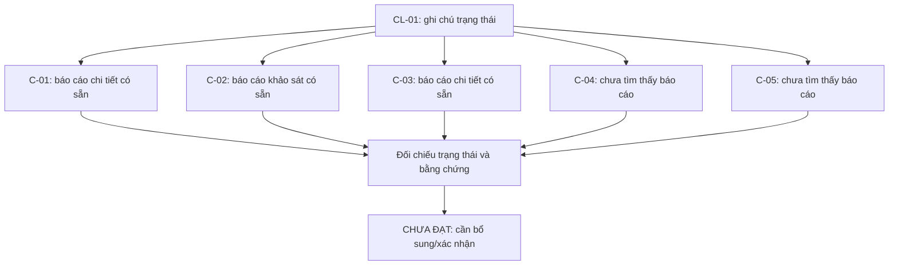

# TÓM TẮT 5 DÒNG
[TÀI LIỆU] Ghi chú CL-01 nêu C01/C03 đạt, C02/C04/C05 chờ chủ (D:/jx1-ops-wt/JX1_OPS/TASKS/CL-01.md:5).
[TÀI LIỆU] Báo cáo C-01 và C-03 đều ghi PARTIAL dù có test offline đạt: 22 test và 6 test (C-01-jxadm.md:1-3,71; C-03-jxweb.md:1-3,47).
[TÀI LIỆU] C-02 ghi khảo sát DONE, đồng thời liệt kê quyết định thiết kế còn cần chốt (C-02-co-is-bot.md:76-89).
[CHƯA KIỂM] Không tìm thấy báo cáo chi tiết C-04/C-05 trong danh sách lọc; chưa thể xác nhận lý do chờ chủ (lệnh và kết quả ở “Nguồn đã kiểm tra”).
[THẤY] Đầu ra JX1_OPS/REPORTS/XD-CL01.md; không commit theo yêu cầu. Kết luận CHƯA ĐẠT do thiếu nguồn C-04/C-05 và trạng thái C-01/C-03 chưa thống nhất.

# XD-CL01 — Đối chiếu C01..C05

Loại: tổng hợp  
Chủ đề: Đối chiếu tình trạng các ca C01..C05 thuộc CL-01  
Từ khóa: đóng việc, CL-01, C01..C05, jxadm, is_bot, jxweb  
Trạng thái: PARTIAL — thiếu bằng chứng chi tiết C-04/C-05 và cần làm rõ chênh lệch trạng thái  
Độ phủ: 3/5 ca có báo cáo chi tiết tương ứng trong kho đã kiểm tra; 2/5 ca chưa tìm thấy báo cáo chi tiết  
Liên quan: JX1_OPS/TASKS/CL-01.md; JX1_OPS/REPORTS/C-01-jxadm.md; JX1_OPS/REPORTS/C-02-co-is-bot.md; JX1_OPS/REPORTS/C-03-jxweb.md  
Cần tôi quyết định: có — cần chủ xác nhận ý nghĩa “đạt” của C-01/C-03, chốt các quyết định còn mở của C-02, và cung cấp căn cứ C-04/C-05.

## Nguồn đã kiểm tra

| Nguồn | Kết quả đọc |
|---|---|
| D:/jx1-ops-wt/JX1_OPS/TASKS/CL-01.md | [TÀI LIỆU] Ghi chú trạng thái tại dòng 5 nêu C01+C03 đạt, C02/C04/C05 chờ chủ. |
| D:/jx1-ops-wt/JX1_OPS/REPORTS/C-01-jxadm.md | [TÀI LIỆU] Báo cáo C-01; phần mã offline/test và giới hạn runtime; tự ghi PARTIAL, commit bị chặn (dòng 1-3, 67, 80-88). |
| D:/jx1-ops-wt/JX1_OPS/REPORTS/C-02-co-is-bot.md | [TÀI LIỆU] Báo cáo khảo sát C-02; ghi khảo sát DONE, runtime chưa kiểm, còn bước thiết kế/triển khai (dòng 76-89). |
| D:/jx1-ops-wt/JX1_OPS/REPORTS/C-03-jxweb.md | [TÀI LIỆU] Báo cáo C-03; ghi nhận 6 test offline đạt, tự ghi PARTIAL và commit bị chặn (dòng 1-3, 47, 53-68). |
| Báo cáo C-04/C-05 | [THẤY] Test-Path cho JX1_OPS/REPORTS/C04.md và C05.md trong worktree trả False. Tại D:/jx1-ops-wt/JX1_OPS/REPORTS, Test-Path các tên C04.md/C05.md và lọc Get-ChildItem -File theo ^C-?0[1-5]($|[-_ .]) không có C-04/C-05. |

Lệnh tra tên đã dùng: kiểm tra Test-Path cho tên báo cáo C01..C05 chuẩn; sau đó liệt kê tệp trực tiếp trong REPORTS với bộ lọc ^C-?0[1-5]($|[-_ .]). [THẤY] Kết quả lọc có C-01-jxadm.md, C-02-co-is-bot.md, C-03-jxweb.md và C01-C03-TEST36.md; không có C-04/C-05. Tệp tổng hợp C01-C03-TEST36.md không được đọc vì không phải một trong các báo cáo cá thể được giao. Không quét cây thư mục mã nguồn.

## Đối chiếu từng ca

| Ca | Kết quả trong ghi chú CL-01 | Bằng chứng trong báo cáo chi tiết | Lý do / giới hạn |
|---|---|---|---|
| C-01 | [TÀI LIỆU] “đạt” theo CL-01.md:5. | [TÀI LIỆU] Báo cáo tự ghi PARTIAL: phần mã offline hoàn tất, commit bị chặn; không xác nhận hiệu lực server (C-01-jxadm.md:1-3). Ghi nhận 22 test offline OK (C-01-jxadm.md:71) và lỗi quyền metadata Git khi stage (C-01-jxadm.md:80-88). | [CHƯA KIỂM] “Đạt” có thể chỉ phần offline, nhưng nguồn không xác định điều này. Báo cáo chứng minh phần offline theo chính báo cáo, không chứng minh runtime/ nghiệm thu server. Cần chủ xác nhận tiêu chí “đạt” của CL-01. |
| C-02 | [TÀI LIỆU] “chờ chủ” theo CL-01.md:5. | [TÀI LIỆU] Báo cáo ghi khảo sát DONE và nêu bước tiếp theo (C-02-co-is-bot.md:76-89). | [TÀI LIỆU] Các điểm cần chốt gồm cờ theo tài khoản hay nhân vật, khóa khu vực và quy tắc đổi tên/xóa/tái tạo (C-02-co-is-bot.md:39,78). [CHƯA KIỂM] Không thấy ghi nhận phản hồi của chủ trong báo cáo đã đọc; không suy đoán thêm lý do chờ. |
| C-03 | [TÀI LIỆU] “đạt” theo CL-01.md:5. | [TÀI LIỆU] Báo cáo tự ghi PARTIAL, mã/test offline hoàn tất nhưng commit bị chặn (C-03-jxweb.md:1-3,59-68); ghi nhận 6 test đạt (C-03-jxweb.md:47). | [CHƯA KIỂM] Có bằng chứng phần offline theo báo cáo; không có bằng chứng chạy dịch vụ, kết nối dữ liệu thật hoặc runtime. Cần chủ xác nhận “đạt” có giới hạn ở offline hay không. |
| C-04 | [TÀI LIỆU] “chờ chủ” theo CL-01.md:5. | [THẤY] Không tìm thấy báo cáo C-04 trong tên tệp chuẩn hoặc kết quả lọc thư mục đã nêu ở trên. | [CHƯA KIỂM] Không có căn cứ chi tiết để xác định lý do ca chờ chủ ngoài ghi chú CL-01. |
| C-05 | [TÀI LIỆU] “chờ chủ” theo CL-01.md:5. | [THẤY] Không tìm thấy báo cáo C-05 trong tên tệp chuẩn hoặc kết quả lọc thư mục đã nêu ở trên. | [CHƯA KIỂM] Không có căn cứ chi tiết để xác định lý do ca chờ chủ ngoài ghi chú CL-01. |

## Phạm vi và độ phủ

| Phần tử phạm vi | Đã phủ | Chưa phủ / giới hạn |
|---|---|---|
| Mục tiêu CL-01 và trạng thái tổng hợp | [TÀI LIỆU] Đã đọc bản CL-01 tại kho báo cáo chỉ đọc, status_note ở dòng 5. | [CHƯA KIỂM] Không có phần thân làm rõ tiêu chí “đạt” hoặc lý do chờ chủ; tệp CL-01 không có trong worktree XD-CL01. |
| C-01 | [TÀI LIỆU] Đã đọc báo cáo cá thể C-01. | [CHƯA KIỂM] Không chạy lại test, không kiểm commit hoặc runtime; chỉ ghi theo báo cáo. |
| C-02 | [TÀI LIỆU] Đã đọc báo cáo khảo sát C-02. | [CHƯA KIỂM] Không kiểm quyết định của chủ hoặc triển khai thực tế. |
| C-03 | [TÀI LIỆU] Đã đọc báo cáo cá thể C-03. | [CHƯA KIỂM] Không chạy lại test hoặc khởi động dịch vụ. |
| C-04, C-05 | [THẤY] Đã kiểm tra tên chuẩn và bộ lọc tên trực tiếp trong thư mục được chỉ định. | [CHƯA KIỂM] Thiếu báo cáo chi tiết và căn cứ về lý do chờ chủ. |
| Client, VM, executable, mạng | [THẤY] Không thực hiện thao tác nào thuộc các nhóm này. | [CHƯA KIỂM] Không xác minh hành vi client hoặc runtime. |

## Giải mã tên

Không có tên kỹ năng, trang bị, quái, NPC hoặc bản đồ trong nội dung đối chiếu cần giải mã. jxadm, is_bot và jxweb là nhãn công cụ/thuộc tính trong các báo cáo nguồn; giữ nguyên cách viết nguồn.

## Sắp theo cấu trúc game

Không áp dụng: tài liệu này đối chiếu trạng thái ca công việc, không tổng hợp dữ liệu kỹ năng, trang bị, quái, NPC hoặc bản đồ.

## Đã xác minh

- [THẤY] Nhánh hiện tại là task/XD-CL01, working tree sạch trước khi ghi (lệnh git status --short --branch, kết quả ## task/XD-CL01).
- [TÀI LIỆU] CL-01 ghi C01/C03 đạt và C02/C04/C05 chờ chủ (D:/jx1-ops-wt/JX1_OPS/TASKS/CL-01.md:5).
- [TÀI LIỆU] C-01 ghi PARTIAL, offline hoàn tất, hiệu lực server chưa xác minh (D:/jx1-ops-wt/JX1_OPS/REPORTS/C-01-jxadm.md:1-3,67,80-88).
- [TÀI LIỆU] C-02 ghi khảo sát DONE, runtime chưa kiểm và commit bị chặn (D:/jx1-ops-wt/JX1_OPS/REPORTS/C-02-co-is-bot.md:76-89).
- [TÀI LIỆU] C-03 ghi PARTIAL, 6 test offline OK, commit bị chặn (D:/jx1-ops-wt/JX1_OPS/REPORTS/C-03-jxweb.md:1-3,47,53-68).

## Chưa kiểm

- [CHƯA KIỂM] Không có báo cáo chi tiết C-04/C-05 trong kho được chỉ định; lý do chờ chủ không thể đối chiếu.
- [CHƯA KIỂM] Chưa xác nhận với chủ việc C-01/C-03 được tính “đạt” dù báo cáo ca ghi PARTIAL.
- [CHƯA KIỂM] Chưa có bằng chứng phản hồi/quyết định của chủ cho C-02.
- [CHƯA KIỂM] Không chạy client, executable, VM, mạng, test/build hoặc runtime theo phạm vi task. Kết quả test được trích từ báo cáo nguồn, không chạy lại.
- [THẤY] Không tạo/cập nhật được D:/JX-wt/XD-CL01.nhip: lệnh Set-Content bị Access denied; đường dẫn nằm ngoài vùng ghi được cấp.
- [THẤY] Đã ghi mục Kết quả cuối tệp JX1_OPS/TASKS/XD-CL01.md theo yêu cầu; không sửa CL-01 tại kho nguồn chỉ đọc.

## Phát hiện khi đối chiếu

- [TÀI LIỆU] Ghi chú CL-01 gọi C-01 và C-03 là “đạt”, trong khi cả hai báo cáo cá thể ghi PARTIAL và đều nêu commit bị chặn. [CHƯA KIỂM] Tài liệu chưa xác định “đạt” có nghĩa hoàn tất phần offline hay nghiệm thu toàn ca.
- [TÀI LIỆU] C-02 được ghi “chờ chủ” ở CL-01 nhưng báo cáo C-02 ghi khảo sát DONE và có bước thiết kế cần chốt. [CHƯA KIỂM] Không có bằng chứng phản hồi của chủ trong các nguồn đọc.
- [THẤY] Không tìm thấy báo cáo C-04/C-05 theo tên lọc đã nêu; không điền kết luận thay bằng suy đoán.
- [THẤY] Không sửa hoặc thay kết luận nào trong báo cáo nguồn.

## Kiểm tra và bàn giao

- [THẤY] Task này chỉ đọc tài liệu và lập báo cáo; không chạy test/build hoặc client.
- [THẤY] git status --short --branch trước khi ghi: ## task/XD-CL01; không có thay đổi local ban đầu. Không stage/commit theo yêu cầu.
- [THẤY] Báo cáo được lưu UTF-8 không BOM; diff được xem một lần sau khi ghi.
- [THẤY] Kỹ năng đã dùng: jx1-retrofit, jx1-read-server, jx1-read-client, jx1-parameters, jx1-knowledge, jx1-report.
- liên quan: JX1_OPS/TASKS/CL-01.md; JX1_OPS/REPORTS/C-01-jxadm.md; JX1_OPS/REPORTS/C-02-co-is-bot.md; JX1_OPS/REPORTS/C-03-jxweb.md

## Kết quả

[TÀI LIỆU] CL-01 ghi C01/C03 đạt, C02/C04/C05 chờ chủ; C-01/C-03 chi tiết vẫn ghi PARTIAL.
[THẤY] Báo cáo đối chiếu đã tạo tại JX1_OPS/REPORTS/XD-CL01.md; không commit theo yêu cầu.
[CHƯA KIỂM] Cần chủ làm rõ tiêu chí C-01/C-03, quyết định C-02 và cung cấp căn cứ C-04/C-05.

CHƯA ĐẠT vì thiếu báo cáo chi tiết C-04/C-05, thiếu lý do chờ chủ có nguồn xác nhận, và trạng thái C-01/C-03 còn chưa thống nhất.
