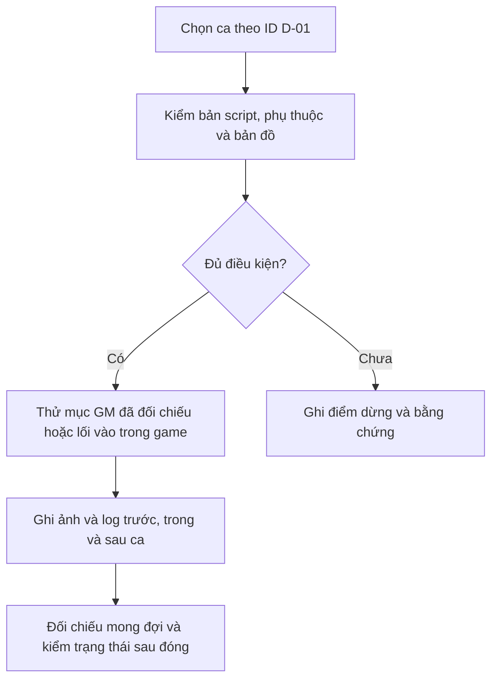

TÓM TẮT 1 — [NGUỒN][TÀI LIỆU] Kế hoạch D-02 bao phủ 27/27 nhánh của bảng D-01 (`R:62–88`).
TÓM TẮT 2 — [NGUỒN][THẤY] Menu vật phẩm GM có mục mở cho sáu nhánh, đối chiếu tại `M:1682,1697–1712`.
TÓM TẮT 3 — [NGUỒN][THẤY] `OpenVA` mở hai nhánh Vượt ải. Hai hàm mang tên Câu cá cũng gọi Vượt ải (`M:2256–2278`).
TÓM TẮT 4 — [CHƯA KIỂM] Mỗi ca có điều kiện bản đồ, kết quả mong đợi và cách thu bằng chứng. Hành vi trong game chưa được kiểm tra (`R:90–97`).
TÓM TẮT 5 — [CHƯA KIỂM] Chỉ đọc tĩnh. Chưa build, chạy exe, VM, mạng hay lệnh game. Tổng quan phụ trách commit.

# XD-D02 — Kế hoạch thử hoạt động bằng GM

Loại: thiết kế  
Chủ đề: Kế hoạch thử từng hoạt động D-01 bằng vật phẩm GM hoặc lối vào trong game.  
Từ khóa: hoạt động, lệnh GM, gmroleitem, tbOpenMissionGame, bản đồ, SubWorld, mission, D-01, D-02  
Trạng thái: DONE — hoàn tất kế hoạch tĩnh.  
Độ phủ: 27/27 nhánh trong D-01 có kế hoạch. Trong đó 6/27 nối được với mục mở trong menu GM bằng đọc tĩnh.  
Liên quan: `JX1_OPS/TASKS/D-01.md`, `JX1_OPS/REPORTS/D-01-bang-hoat-dong.md`, `JX1_OPS/TASKS/D-02.md`, `JX1_OPS/DESIGN/HIEU-LENH-GM.md`.  
Cần tôi quyết định: không.

## Phạm vi và độ phủ

| Nhóm trong game | ID D-01 | Độ phủ | Nguồn |
|---|---|---|---|
| Đồng bản, thi đấu và chiến trường | 01–04, 14–22, 24 | Đã phủ 14/14 ca kế hoạch | [TÀI LIỆU] `R:62–65,75–83,85` |
| Sự kiện thế giới và xếp hạng | 05–08, 23, 25–27 | Đã phủ 8/8 ca kế hoạch | [TÀI LIỆU] `R:66–69,84,86–88` |
| Nhiệm vụ và thưởng | 09–13 | Đã phủ 5/5 ca kế hoạch | [TÀI LIỆU] `R:70–74` |
| Chạy các ca trên bản triển khai | 01–27 | Chưa phủ 27/27 | [CHƯA KIỂM] `JX1_OPS/TASKS/XD-D02.md:20–26` |

## Giải mã tên

Các tên Việt lấy từ D-01 được giữ theo Markdown UTF-8. Bảng giữ các định danh gốc để đối chiếu nhánh và bổ sung chữ Hán có căn cứ.

| Tên gốc | Mã hóa | Chữ đúng UTF-8 | Nguồn file:dòng |
|---|---|---|---|
| `擂台赛`, `攻城战`, `渡船`, `fenglingdu` | GBK (CP936), ASCII | Lôi đài (擂台赛), Công thành chiến (攻城战), đò ngang (渡船, legacy), Phong Lăng Độ (`fenglingdu`) | [THẤY] `G/Settings/Task/missions.txt:2–5,11` · [TÀI LIỆU] `R:63,77–78` |
| `宋金战场pk战`, `宋金战场pk大战`, `battlesongjin` | GBK (CP936), ASCII | Tống Kim PK (宋金战场pk战 / 宋金战场pk大战), Tống Kim tnlteam | [THẤY] `G/Settings/Task/missions.txt:6,12` · [TÀI LIỆU] `R:62,79` |
| `过关斩将`, `challangeoftime` | GBK (CP936), ASCII | Quá Quan Trảm Tướng (过关斩将), Vượt ải / Thách thức thời gian | [THẤY] `G/Settings/Task/missions.txt:7,10` · [TÀI LIỆU] `R:64,80` |
| `封神竞技`, `攻城拔寨`, `襄阳`, `巴陵活动`, `巴陵` | GBK (CP936) | Phong Thần thi đấu (封神竞技), Công Thành Bạt Trại (攻城拔寨), Tương Dương (襄阳), Hoạt động Ba Lăng (巴陵活动), Ba Lăng (巴陵) | [THẤY] `G/Settings/Task/missions.txt:8–9,15–20` · [TÀI LIỆU] `R:42,81–84` |
| `liendau/dondau`, `yandibaozang`, `kiem_mon_quan`, `bw` | ASCII | Liên đấu đơn, Viêm Đế Bảo Tàng, Kiếm Môn Quan, thi đấu `bw` (chưa rõ tên Việt vì thiếu script nhánh) | [THẤY] `G/Settings/Task/missions.txt:13–14,21–34` · [TÀI LIỆU] `R:65,75–76,85` |
| `hoadang`, `demhuyhoang`, `bosstieuhk`, `active_xh_duatop` | ASCII | Hoa đăng, Đêm Huy Hoàng, Boss tiểu Hoàng Kim, Đua top / xếp hạng thế giới | [TÀI LIỆU] `R:66–69` |
| `task_hang_ngay`, `thien_bao_kho`, `van_tieu`, `cauca`, `System/activity` | ASCII | Nhiệm vụ hằng ngày tại Lễ Quan, Thiên Bảo Khố, Vận tiêu, Câu cá, Nhận thưởng hoạt động/online. Tên gốc của NPC Lễ Quan chưa đối chiếu. | [TÀI LIỆU] `R:70–74` |
| `zhongqiudengmi`, `active_somayman`, `baihutang` / `bach_ho` / `bai_hu` | ASCII | Hoa đăng legacy, Số may mắn, Bạch Hổ Đường (ba từ khóa tìm kiếm). Chưa có tên hiển thị của các nhánh này. | [TÀI LIỆU] `R:43,46,86–88` |
| Nhãn nhiệm vụ của menu GM | Tiếng Việt legacy, chưa xác minh bảng mã | Chưa giải mã nguyên văn do lỗi ký tự. Callback ASCII giữ nguyên ở bảng ca. | [THẤY] `M:1699–1708` |

## Sắp theo cấu trúc game

Các ca đi theo ba nhóm trong bảng phạm vi. Mỗi biến thể legacy, mission và cụm bản đồ giữ ID riêng để so với D-01 (`R:25,62–88`).

## Nguồn và cách dùng bảng

| Ký hiệu | Tệp và gốc đọc |
|---|---|
| `R` | `D:/jx1-ops-wt/JX1_OPS/REPORTS/D-01-bang-hoat-dong.md` (UTF-8). Task nền `D:/jx1-ops-wt/JX1_OPS/TASKS/D-01.md:21–28`. |
| `G/`, `M` | `C:/Jx1CocoV3/Folder/ServerNew-20260116T043145Z-3-001/ServerNew/_bin_v2_/gs/` theo `R:19–25`. `M` là `G/script/mineitem/gmroleitem.lua`. Đọc token Lua/cấu hình bằng CP936. |
| `S/` | `C:/Jx1CocoV3/SwordOnline/SwordOnline/jxOnline/gameserver/Sources/`. |
| `C/` | `C:/Jx1CocoV3/Folder/Client2912-20260116T044348Z-3-001/Client2912/Client/Classes/`. |

- **[THẤY]** đã đối chiếu tệp gốc, **[TÀI LIỆU]** dẫn kết quả cũ, **[CHƯA KIỂM]** là điều kiện chưa xác nhận hoặc ca dự kiến. Phân loại D-01 giữ nguyên (`R:29–35,62–88`).
- [THẤY] Mục mở trong vật phẩm GM vào `tbOpenMissionGame` sau bước kiểm `CHECKGM()`. Đối chiếu theo callback ASCII. [CHƯA KIỂM] Mã vật phẩm, cách cấp và nhãn hiển thị trên client thử (`M:1613–1624,1682,1690–1712`).
- [THẤY] Server lấy SubWorld của nhân vật làm bối cảnh script và có đường nạp thư mục cùng `script.txt`. Client VN có điểm gửi ô chat `KgameWorldVN::onsendCallback`. Các ca dưới dùng vật phẩm GM hoặc NPC. Tập lệnh console của bản thử còn [CHƯA KIỂM] (`S/Core/Src/KPlayer.cpp:7997–8016,8042–8058`, `S/Core/Src/KSortScript.cpp:219–242`, `C/vn/gamescence/KgameWorldVN.cpp:4359`, `JX1_OPS/DESIGN/HIEU-LENH-GM.md:46–51`).
- [THẤY] Tám lời gọi lịch bị chú thích, dòng 125 của timer có một dấu nháy kép ASCII và mode trên đĩa là 0. [CHƯA KIỂM] Lua có nạp được ở bản thử và lịch có chạy không. Ghi ca lịch riêng với ca mở bằng menu (`G/script/servertimer.lua:36–58,123–128`, `G/script/lib/worldlibrary.lua:8`).
- [CHƯA KIỂM — cách thu bằng chứng] Mỗi ca ghi ID, phiên bản, giờ server, map/SubWorld, nhân vật hoặc phe thử, bước đã làm, mong đợi, thực tế và kết quả `ĐẠT`, `KHÔNG ĐẠT` hoặc `CHƯA THỬ`. Ghép ảnh trước/sau với log đã lọc theo cùng mốc giờ. Khi thiếu map hoặc phụ thuộc, lưu đúng điểm dừng. Trước ca tiếp theo, kiểm kết thúc và trạng thái sau đóng (`R:48–58,90–97`).

## Danh sách ca D-02

### Đồng bản, thi đấu và chiến trường

| ID và hoạt động | Mục GM hoặc lối vào | Điều kiện bản đồ | Kết quả mong đợi [CHƯA KIỂM] | Bằng chứng cần thu [CHƯA KIỂM] |
|---|---|---|---|---|
| 01 · Tống Kim tnlteam, mission 11 | [THẤY] `songjin` → `but_battlestart`, `endsongjin` → `but_battleclose` (`M:1703–1704,2097–2107`). | [TÀI LIỆU] Map 380 (`R:62`). [THẤY] Hàm chọn map từ `TAB_GAME_MAP[n_type][3]`, đối chiếu map thực (`G/script/tnlteam/mission/battlesongjin/butcher/head.lua:91–119`). | Hai phe báo danh, tham gia trận để ghi điểm, chốt kết quả, nhận thưởng và đóng. Ca lịch riêng vào phút 50. | Ảnh hai phe, điểm trước/sau, thưởng và log mở/đóng. |
| 02 · Phong Lăng Độ tnlteam, mission 10 | [THẤY] `OpenPLD` / `ClosePLD` → `fld_start_mission` / `fld_close_mission` (`M:1699–1700,2208–2218`). | [THẤY] Map thuyền 337, hàm tra SubWorld trước khi gọi mission (`G/script/tnlteam/mission/fenglingdu/head.lua:6,25–29,43–58`). | Báo danh, lên thuyền, các đợt thủy tặc và rời thuyền sau đóng. Ca lịch thử riêng vào phút 00 (`R:63`). | Ảnh bến, trên thuyền, đợt quái, log đóng và điểm trả nhân vật. |
| 03 · Vượt ải / Thách thức thời gian, mission 9 và 17 | [THẤY] `OpenVA` gọi `start_mission` và `chuangguan30_start_mission`. `CloseVA` chỉ gọi `close_mission` của nhánh thường. Xác nhận cách kết thúc nhánh 17 trước khi mở (`M:1701–1702,2256–2268`). | [THẤY] Map 464–471 của mission 9, map 957 của mission 17 (`G/script/tnlteam/mission/challangeoftime/head.lua:4,17–28,183–191,653–677,688–695`). | Đội báo danh, qua ải. Kiểm hết giờ, thưởng và đóng riêng cho mỗi nhánh. | Log map, mission và timer từng nhánh, ảnh đội, ải, thưởng và trạng thái sau đóng. |
| 04 · Liên đấu đơn, mission 12/13 | [THẤY] `OpenLienDau` / `CloseLienDau` → `liendau_openmission` / `liendau_closemission` (`M:1706–1707,2110–2117`). | [THẤY] Hội trường 396 và đấu trường 397 (`G/script/tnlteam/mission/liendau/dondau/head.lua:129–135,164–165,189–219`). [TÀI LIỆU] Đối chiếu `Include` lúc khởi động (`R:41,65`). | Hai người báo danh, ghép cặp, vào đấu trường, chốt khi thắng/thua hoặc hết giờ, kiểm thưởng và đóng hai mission. | Log nạp phụ thuộc, ảnh ghép cặp, đấu trường, kết quả và rời 396/397. |
| 14 · Kiếm Môn Quan, mission 31 | [CHƯA KIỂM] Mục GM. Xác minh đường vào và thư viện Huy Hoàng trước. [THẤY] `kmq_gameover` để đối chiếu khi kết thúc (`G/script/tnlteam/kiem_mon_quan/mission.lua:3–24,41`). | [THẤY] `MAP_KMQ={995}` (`G/script/tnlteam/kiem_mon_quan/lib_kmq.lua:11–13,55–72`). [TÀI LIỆU] Thiếu phụ thuộc (`R:44,75`). | Qua các đợt, timer, chết/rời, thưởng và dọn NPC. | Log phụ thuộc hoặc từng đợt, ảnh bộ đếm và trạng thái sau dọn NPC. |
| 15 · Viêm Đế Bảo Tàng | [CHƯA KIỂM] Mục GM. Tìm đường đăng ký đội sau khi đủ `activitysys` ([TÀI LIỆU] `R:44,76`). | [THẤY] Map chờ 851/852, map trận 853–862 (`G/Settings/Task/missions.txt:21–32`). | Chuyển map, qua các đợt và boss, chốt trận. So EXP và vật phẩm riêng vì hai lời gọi thưởng được báo là chú thích. | Log phụ thuộc, ảnh map chờ/trận, EXP và túi trước/sau. |
| 16 · Lôi đài legacy, mission 1/2 | [CHƯA KIỂM] Mục GM. Tìm đường báo danh sau khi đối chiếu tên và PAK ([TÀI LIỆU] `R:42,77`). | [THẤY] Mission 1/2 (`G/Settings/Task/missions.txt:2–3`). [CHƯA KIỂM] Map và file chạy. | Hai bên đăng ký, đếm giờ, đấu và đóng sau kết quả. | Log tìm script hoặc ảnh báo danh, timer và kết quả. |
| 17 · Công thành chiến legacy | [CHƯA KIỂM] Mục GM. Xác minh đường `攻城战` của nhánh legacy ([TÀI LIỆU] `R:42,78`). | [THẤY] Map 221 (`G/Settings/Task/missions.txt:4`). | Phe công/thủ, điều kiện chiếm, hết giờ và reset. | Ảnh mục tiêu trước/sau, điểm hai phe và log reset. |
| 18 · Tống Kim PK legacy | [CHƯA KIỂM] Mục GM. Xác minh script và lối báo danh riêng ([TÀI LIỆU] `R:42,79`). | [THẤY] Map 378 (`G/Settings/Task/missions.txt:6`). | Thử phe, điểm, giới hạn thời gian và đóng nhánh legacy. | Log script/map 378, ảnh hai phe và kết quả. |
| 19 · Quá Quan Trảm Tướng legacy | [CHƯA KIỂM] Mục GM. Tìm lối mở `过关斩将` ([TÀI LIỆU] `R:42,80`). | [THẤY] Map 515 (`G/Settings/Task/missions.txt:7`). | Qua từng cửa, chết/hết giờ, hoàn thành cửa cuối và nhận thưởng. | Ảnh từng cửa, lần thất bại và log thưởng. |
| 20 · Phong Thần thi đấu legacy, mission 7 | [CHƯA KIỂM] Mục GM. Xác minh `封神竞技` và lối báo danh ([TÀI LIỆU] `R:42,81`). | [THẤY] Mission 7 (`G/Settings/Task/missions.txt:8`). [CHƯA KIỂM] Map. | Báo danh, timer, kết quả từng phe và rời trận. | Log khởi tạo hoặc lỗi, ảnh timer và kết quả hai phe. |
| 21 · Công Thành Bạt Trại legacy, mission 8 | [CHƯA KIỂM] Mục GM. Xác minh `攻城拔寨` trong script/PAK ([TÀI LIỆU] `R:42,82`). | [THẤY] Mission 8 (`G/Settings/Task/missions.txt:9`). [CHƯA KIỂM] Map. | Báo danh, chiếm mục tiêu, chốt kết quả và đóng. | Log mission, ảnh mục tiêu và bản đồ sau đóng. |
| 22 · Tương Dương, nhóm legacy | [CHƯA KIỂM] Mục GM. Nối `襄阳` với đúng hoạt động và lối vào ([TÀI LIỆU] `R:42,83`). | [THẤY] Map 78/1/11/37/80/162 cùng trỏ một script. Chọn một map đã nạp và ghi các map chưa thử (`G/Settings/Task/missions.txt:15–20`). | Xác định tên hiển thị, thử đăng ký, timer và kết thúc. | Ảnh tên hiển thị, log map và mission trước/sau. |
| 24 · Thi đấu bw, mission 32 | [CHƯA KIỂM] Mục GM. Định vị file mission và hai callback timer của bản triển khai ([TÀI LIỆU] `R:45,85`). | [THẤY] Mission 32 (`G/Settings/Task/missions.txt:34`). [CHƯA KIỂM] Map. | Manager mở báo danh, thi đấu, timer và kết thúc. | Danh sách file hoặc lỗi nạp, ảnh báo danh và log dọn mission. |

### Sự kiện thế giới và xếp hạng

| ID và hoạt động | Mục GM hoặc lối vào | Điều kiện bản đồ | Kết quả mong đợi [CHƯA KIỂM] | Bằng chứng cần thu [CHƯA KIỂM] |
|---|---|---|---|---|
| 05 · Hoa đăng subject | [CHƯA KIỂM] Mục GM. Xác minh đường lịch vào `release_hoadang` và điều kiện của `hoadang_open` (`G/script/subject/hoadang/lib.lua:59–89`, `R:66`). | [THẤY] Map 2, 21, 193 trong `HOADANG_NPC` (`G/script/subject/hoadang/lib.lua:12–16`). | NPC xuất hiện, trả lời đúng/sai, giới hạn lượt, hết hạn và kiểm tái tạo trong một cửa sổ giờ. | Ảnh NPC/câu hỏi, đúng/sai, lượt còn lại và ảnh trước/sau hết hạn. |
| 06 · Đêm Huy Hoàng | [THẤY] Menu gọi `addhhh` và GM Include `event.lua` (`M:15,1705`, `G/script/subject/demhuyhoang/event.lua:192–218`). | [THẤY] Kiểm các map ở phần tử `[2]` của `HUYHOANG_THAP`, `HUYHOANG_TRUNG`, `HUYHOANG_CAO`, `HUYHOANG_HK` (`G/script/subject/demhuyhoang/event.lua:192–218`). | Mở một đợt, thu hoạch, kiểm giới hạn và hết hạn. Ca lịch riêng theo mốc D-01 (`R:67`). | Ảnh NPC, túi trước/sau thu hoạch, lần vượt giới hạn và hết hạn. |
| 07 · Boss tiểu Hoàng Kim | [THẤY] Menu gọi `releasebosstieu` và GM Include file boss (`M:16,1708`, `G/script/subject/bosstieuhk/bosstieuhk.lua:49–60`). | [THẤY] Kiểm map chọn qua `POSITION_ARRAY` đã nạp, đối chiếu nơi boss xuất hiện (`G/script/subject/bosstieuhk/bosstieuhk.lua:8–20,49–60`). | Boss xuất hiện đúng vị trí. Hạ boss kiểm đồ rơi và dùng ca riêng kiểm hết hạn. Ca lịch 18:10/22:10 (`R:68`). | Ảnh NPC trên map, lần hạ và đồ rơi, lần hết hạn và log tạo đợt. |
| 08 · Đua top / xếp hạng thế giới | [CHƯA KIỂM] Mục GM. Dùng lối xếp hạng của bản thử sau khi xác minh timer và mode (`R:52–53,69`). | [THẤY] Toàn thế giới, nhánh kiểm mode 1. Tệp đọc là mode 0 (`G/script/lib/worldlibrary.lua:8`, `G/script/servertimer.lua:55–58`). [CHƯA KIỂM] Map đặt người thử. | Thay đổi cấp/EXP bằng ca thử, đối chiếu thứ hạng và thông báo đầu giờ. | Log mode/timer, ảnh cấp/EXP và thứ hạng trước/sau, giờ thông báo. |
| 23 · Boss Ba Lăng legacy | [CHƯA KIỂM] Mục GM. Xác minh phụ thuộc và đường vào `makeDL` ([TÀI LIỆU] `R:42,84`). | [TÀI LIỆU] Map 53 (`G/script/task/balinboss.lua:5–16`, dẫn tại `R:84`). | Mở một đợt, báo danh, tạo boss, kiểm chết/rơi đồ và dọn đợt. | Log phụ thuộc hoặc đợt spawn, ảnh map 53 trước/sau và đồ rơi. |
| 25 · Bộ câu đố Hoa đăng legacy | [CHƯA KIỂM] Mục GM và trình nạp bảng. Tìm liên kết NPC/vật phẩm với bảng ([TÀI LIỆU] `R:46,86`). | [CHƯA KIỂM] Map của NPC legacy. ID 05 dùng bảng riêng (`R:86`). | So câu hỏi và đáp án hiển thị với một hàng đã biết, thử trả lời đúng/sai. | Log bản dữ liệu/mục nạp, ảnh câu hỏi và hai kết quả. |
| 26 · Số may mắn | [CHƯA KIỂM] Mục GM và hàm triển khai. [THẤY] `active_somayman` là lời gọi được chú thích (`G/script/servertimer.lua:49–50`, `R:46,87`). | [CHƯA KIỂM] Map và lối vào nếu có. | Tìm được script và nơi gọi. Khi đủ nguồn, thử ghi số, công bố và nhận thưởng theo luật bản thử. | Kết quả tìm script/alias, ảnh số đăng ký, kết quả và lịch sử nhận. |
| 27 · Bạch Hổ Đường | [CHƯA KIỂM] Mục GM, NPC và script. Lần theo UI hoặc tên đã xác nhận ([TÀI LIỆU] `R:43,88`). | [CHƯA KIỂM] Map. | Nối tên với bản đồ và lối vào. Khi đủ dữ liệu, thử vào, qua giai đoạn và thoát theo luật bản thử. | Ảnh tên NPC/bản đồ hoặc log truy tìm, sau đó ghi trạng thái chuyển giai đoạn và rời. |

### Nhiệm vụ và nhận thưởng

| ID và hoạt động | Mục GM hoặc lối vào | Điều kiện bản đồ | Kết quả mong đợi [CHƯA KIỂM] | Bằng chứng cần thu [CHƯA KIỂM] |
|---|---|---|---|---|
| 09 · Nhiệm vụ hằng ngày tại Lễ Quan | [CHƯA KIỂM] Mục GM. Vào menu nhận/trả của Lễ Quan, kiểm có vào `NhanHDNVHNGAY` ([TÀI LIỆU] `R:70`). | [CHƯA KIỂM] Map NPC Lễ Quan. Chuẩn bị map tương ứng với các điều kiện (`R:70`). | Thử đủ 8 boss sát thủ, 750 điểm Tống Kim, 1 PK, 1 Vượt ải và 1 Phong Lăng Độ. Thử thiếu từng điều kiện và nhận lại. | Ảnh từng bộ đếm, menu, túi/thưởng và lần bị từ chối. |
| 10 · Thiên Bảo Khố | [CHƯA KIỂM] Mục GM. Dùng lối nhận của đội trưởng sau khi xác minh các đoạn chuỗi lỗi trên bản thử ([TÀI LIỆU] `R:71`). | [TÀI LIỆU] Map 395 có NPC, rương và trap (`G/script/subject/thien_bao_kho/thienbaokho.lua:16–24,55–73`, dẫn tại `R:71`). | Mở rương đúng/sai thứ tự, chết/thoát, trả thưởng và reset. | Log nạp Lua, ảnh đội trưởng nhận, thứ tự rương, thất bại/thưởng và reset. |
| 11 · Vận tiêu subject | [THẤY] `batdau` sinh xe và ghi task, `timxe` đọc task (`M:170–198`). [CHƯA KIỂM] Đường menu tới hai hàm phụ. Ca chính theo NPC Tiêu đầu và `vantieu` ([TÀI LIỆU] `R:72`). | [CHƯA KIỂM] Map đầu và đích của script triển khai. Hàm phụ sinh xe ở vị trí nhân vật (`M:185–198`). | Nhận tiêu, tới đích, kiểm phí/thưởng, tiêu bị phá và hết giờ. | Ảnh menu, xe lúc nhận/đến, hết giờ và túi/tiền trước/sau. |
| 12 · Câu cá tnlteam | [THẤY] `MoCauCa` / `TatCauCa` gọi hàm Vượt ải. Mục menu có tên Câu cá bị chú thích và trỏ callback khác (`M:1683–1684,2271–2278`). [CHƯA KIỂM] Mục GM cho Câu cá. Dùng cần/lưới sau khi xác minh script ([TÀI LIỆU] `R:73`). | [CHƯA KIỂM] Bãi câu/map hợp lệ và lối thu hoạch. | Xác minh nạp script, có tiến độ/thu hoạch và từ chối nhận sớm. | Log lỗi nạp hoặc ảnh dùng vật phẩm, thời gian chờ và túi trước/sau. |
| 13 · Nhận thưởng hoạt động/online | [CHƯA KIỂM] Mục GM. Theo UI/NPC thật tới `main` hoặc `main11` ([TÀI LIỆU] `R:74`). | [CHƯA KIỂM] Map/NPC hoặc lối vào qua UI. | Ghi thông báo bảo trì nếu vào `main`. Nếu vào `main11`, kiểm từng nhánh thưởng và giới hạn mỗi ngày. | Ảnh đường vào và thông báo, túi trước/sau và lần thử nhận lại. |

## Mục sổ thông số

| Nhóm | Tên/hằng số | file:dòng | Giá trị | Đơn vị | Ảnh hưởng | Đổi an toàn | Nguồn đo |
|---|---|---|---|---|---|---|---|
| Phong Lăng Độ | `PREPARE_TIME`, `MATCH_TIME` | `G/script/tnlteam/mission/fenglingdu/head.lua:12–14` | 5 và 25 | phút theo chú thích | Báo danh và thời gian trên thuyền | CẨN THẬN | [THẤY] Đọc tĩnh |
| Vượt ải | `TIME_SIGNUP`, `TIME_MATCH`, `CHUANGGUAN30_TIME_LIMIT` | `G/script/tnlteam/mission/challangeoftime/head.lua:9–14,22–28` | 1, 35 và 30 | phút theo chú thích/công thức | Mốc báo danh, trận thường và 30 ải | CẨN THẬN | [THẤY] Đọc tĩnh |
| Hoa đăng / Đêm Huy Hoàng / boss tiểu | Đối số `SetNpcTimeout` | `G/script/subject/hoadang/lib.lua:85–87`, `G/script/subject/demhuyhoang/event.lua:4,192–218`, `G/script/subject/bosstieuhk/bosstieuhk.lua:55–60` | 900 / 300 / 1800 | dự kiến giây, [CHƯA KIỂM] đơn vị của API trên bản chạy | Kiểm lúc NPC hết hạn | CẨN THẬN | [THẤY] Hằng đọc tĩnh |
| Xếp hạng | `SERVER_MODE` | `G/script/lib/worldlibrary.lua:8`, `G/script/servertimer.lua:55–58` | 0 trên đĩa, nhánh đua top kiểm 1 | mã chế độ | Nhánh cập nhật xếp hạng | KHÔNG trong task này | [THẤY] Đọc tĩnh |

## Đã xác minh

- [THẤY] Sáu mục mở đã nối từ menu đến callback trong `M:15–16,1682,1697–1712,2097–2117,2208–2218,2256–2278`. Chi tiết map 957 của nhánh 17 và map 397 của Liên đấu bổ sung điều kiện cho kế hoạch theo `R:64–65`.
- [THẤY] `Test-Path -LiteralPath` trả `False` với `G/script/tnlteam/missions/liendau/dondau/npc_liendau.lua`, `G/script/tnlteam/qua_huy_hoang/lib_huyhoang.lua`, `G/script/activitysys/g_activity.lua` và `G/script/missions/bw/bwmission.lua`. Điểm tham chiếu và giới hạn nằm tại `R:41,44–45,50`.

## Chưa kiểm

- [CHƯA KIỂM] Cách cấp vật phẩm GM, đúng bản client/server, đường nạp PAK/đĩa, tên byte legacy, map/SubWorld thực, lệnh console và các mục mở chưa đủ nguồn trong bảng (`R:50,90–97`, `JX1_OPS/DESIGN/HIEU-LENH-GM.md:46–51`).
- [CHƯA KIỂM] Toàn bộ kết quả mong đợi. Chưa build/test game, chạy GM, exe, VM hoặc mạng theo `JX1_OPS/TASKS/XD-D02.md:20–26`.

## Đề xuất thứ tự thử

[CHƯA KIỂM — kế hoạch] Ưu tiên 01/02/04 để kiểm vật phẩm GM và thao tác đóng. Chạy 03 sau khi có cách kết thúc riêng mission 17. Ghi kết quả theo lịch của 05–08 và lý do dừng từng ca thiếu script hoặc bản đồ (`M:1697–1712,2256–2268`, `R:48–58,90–97`).

## Bàn giao

- Kiểm tài liệu theo 27 ID D-01, dẫn nguồn, mục bắt buộc và UTF-8 không BOM. Máy thiếu `rg` nên dùng PowerShell. Phần cuối bảng D-01 được lấy lại sau khi đầu ra gộp bị cắt. `JX1_OPS/BACKLOG.md` tại kho chỉ đọc không tồn tại, phạm vi lấy từ task XD-D02 và bảng D-01.
- Tổng quan phụ trách commit. D-02 điền kết quả thực theo từng ID. Tệp nhịp `D:/JX-wt/XD-D02.nhip` ở ngoài vùng ghi của phiên, tiến độ được báo trong hội thoại.
- Đề xuất thêm `REPORTS/XD-D02.md` vào hàng “Bạn bè, đồng bản, hoạt động” ở `JX1_OPS/DESIGN/MUC-LUC-TRI-THUC.md:19` với mô tả “kế hoạch thử 27 nhánh D-01, chưa chạy”.
- Kỹ năng đã dùng: `jx1-retrofit`, `jx1-read-server`, `jx1-read-client`, `jx1-parameters`, `jx1-knowledge`, `jx1-report`.
