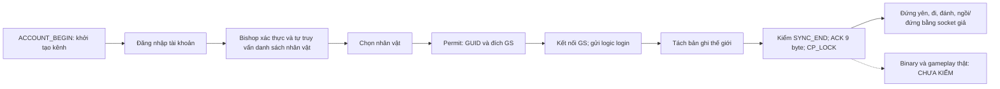

TÓM TẮT 5 DÒNG
1. [NGUỒN][THẤY] DONE — đối chiếu đủ 5/5 vế tiêu chí E-01 tại JX1_OPS/TASKS/E-01.md:26-29; kết luận chỉ áp dụng mốc offline.
2. [NGUỒN][THẤY] K1 chạy lại 76 test: OK, 0.185 giây, exit 0; gồm 29 test E-01 và 12 test E-01b; không có sự kiện socket/tiến trình con.
3. [NGUỒN][THẤY] Đầu ra là báo cáo này và mục Kết quả của task XD-E01; K2 rà 14 tệp Python, không phát hiện bí mật thật trong phạm vi kiểm tĩnh.
4. [CHƯA KIỂM] ABI/binary, khóa ứng dụng đúng binary, đăng nhập và gameplay thật vẫn chưa kiểm; giới hạn 81 ID đồng bộ chưa hỗ trợ giữ nguyên theo E-01b:111-116.
5. [NGUỒN][THẤY] Không build/chạy exe game/server/VM/mạng, không tạo commit/push; K3 thấy commit gộp E-01 đã có; tệp nhịp ngoài sandbox bị từ chối ghi, Tổng quan nhận bàn giao local.

# XD-E01 — Đối chiếu tiêu chí đóng E-01: client Python offline

Loại: kiểm thử
Chủ đề: Chạy lại kiểm offline và đối chiếu từng vế tiêu chí E-01 với mã đăng nhập hiện có.
Từ khóa: client Python, Bot, đăng nhập, Bishop, KSelPlayer, worldsync, CLIENT_SYNC_END, CP_LOCK, E-01, XD-E01
Trạng thái: DONE — đủ bằng chứng cho 5/5 vế tiêu chí offline; không xác nhận Bot online.
Độ phủ: đã phủ 5 trên tổng 5 vế tiêu chí tại JX1_OPS/TASKS/E-01.md:27; K1 chạy 76 test thuộc 9 lớp; K2 rà 14 tệp Python.
Liên quan: JX1_OPS/TASKS/XD-E01.md; JX1_OPS/TASKS/E-01.md; JX1_OPS/REPORTS/E-01-thieu-giao-thuc.md; JX1_OPS/REPORTS/E-01b-thieu-giao-thuc.md; JX1_OPS/DESIGN/CHUAN-BAO-CAO.md.
Cần tôi quyết định: không — Tổng quan commit theo phân công; runtime cần task và quyền riêng.

## Sơ đồ chính

## Nguồn đọc và quy ước bằng chứng

- [THẤY] Ngày kiểm: 19/11/2026, múi giờ +07:00. Git đầu lượt trả `## task/XD-E01`, không có thay đổi local; chưa có báo cáo XD-E01. Phạm vi: `JX1_OPS/TASKS/XD-E01.md:7-12,19-27`.
- [TÀI LIỆU] Nguồn chính chốt trước khi lần mã: `JX1_OPS/DESIGN/CHUAN-BAO-CAO.md:6-30`; `JX1_OPS/TASKS/E-01.md:21-29`; hai báo cáo E-01/E-01b được task dẫn. Không mở mọi báo cáo, workflow, STATE hoặc bản đồ toàn kho.
- [THẤY] Nguồn dẫn tiếp cần để kiểm: `JX1_OPS/BOT/README.md:3-16`; 14 tệp Python K2 liệt kê; các đoạn C++ trong bảng gói. Không sửa mã. Không tạo parser/script phụ trên đĩa.
- [THẤY] THẤY = lệnh thực chạy hoặc mã hiện tại đã đọc; TÀI LIỆU = bằng chứng lịch sử dẫn lại; CHƯA KIỂM = chưa có chạy/đo tương ứng. Không dùng test tự dựng thay runtime.
- [THẤY] BOT kiểm UTF-8 bằng K2. Symbol C++ được dùng là ASCII; comment có chữ lỗi khi giải mã không được dùng để suy tên hay ngữ nghĩa. Không suy encoding đường truyền từ encoding nguồn.

| Tiền tố | Root chỉ đọc cho mọi dẫn nguồn rút gọn |
| --- | --- |
| C/ | `C:/Jx1CocoV3/Folder/Client2912-20260116T044348Z-3-001/Client2912/Client/Classes/` |
| B/ | `C:/Jx1CocoV3/SwordOnline/SwordOnline/jxOnline/gateway/Sources/MultiServer/Bishop/` |
| GH/ | `C:/Jx1CocoV3/SwordOnline/SwordOnline/jxOnline/gateway/Headers/` |
| SH/ | `C:/Jx1CocoV3/SwordOnline/SwordOnline/jxOnline/gameserver/Headers/` |
| SS/ | `C:/Jx1CocoV3/SwordOnline/SwordOnline/jxOnline/gameserver/Sources/` |

## Phạm vi và độ phủ — từng vế “Tiêu chí xong”

[TÀI LIỆU] Căn cứ xét đóng là `JX1_OPS/TASKS/E-01.md:27`. Câu này cho phép server thật “chưa kiểm”; không bắt buộc đã đăng nhập online thành công. Mục tiêu online ở `JX1_OPS/TASKS/E-01.md:22` được tách khỏi tiêu chí offline.

| Vế tiêu chí | Đã phủ / chưa phủ | Bằng chứng và kết quả |
| --- | --- | --- |
| Test offline pass, ghi lệnh/kết quả | Đã phủ — ĐẠT | [THẤY] K1: 76 test, OK, exit 0, không có sự kiện I/O bị chặn, không ghi bytecode. Gốc lệnh: `JX1_OPS/TASKS/E-01.md:29`. |
| Có báo cáo thiếu giao thức | Đã phủ — ĐẠT | [THẤY] Hai báo cáo tồn tại và đã đọc. Danh mục thiếu: `JX1_OPS/REPORTS/E-01-thieu-giao-thuc.md:90-103` và `JX1_OPS/REPORTS/E-01b-thieu-giao-thuc.md:107-116`. Đối chiếu hiện tại ở bảng gói bên dưới. |
| Không có bí mật trong mã | Đã phủ — ĐẠT trong phạm vi rà tĩnh | [THẤY] K2 rà 14 tệp: không thấy marker khóa riêng/token đã dò; literal liên quan đăng nhập chỉ ở fixture `JX1_OPS/BOT/test_bot.py:25-31`. CLI lấy dữ liệu qua môi trường tại `JX1_OPS/BOT/cli.py:45-64`; không đọc giá trị môi trường hoặc kho tài khoản. |
| Chưa chạy server thật thì ghi “chưa kiểm” | Đã phủ — ĐẠT nghĩa vụ ghi giới hạn; runtime chưa phủ | [THẤY] `JX1_OPS/BOT/README.md:3,43-45` vẫn ghi chưa kiểm; báo cáo này có mục “Chưa kiểm”. K1 dùng socket giả `JX1_OPS/BOT/test_bot.py:199-228,268-290`. |
| Commit trên nhánh, tiêu đề bắt đầu E-01; Git bị chặn thì ghi để PM gộp | Đã phủ — ĐẠT bằng commit gộp hiện có | [THẤY] K3 từ HEAD thấy `20c1054 E-01 xong (gop): client Bot, 29 test offline` và `62a8d15 E-01b: bo tach ban ghi dong bo the gioi, 41 test offline`. [TÀI LIỆU] Lỗi commit worker gốc đã ghi `JX1_OPS/TASKS/E-01.md:36`. Không tạo commit mới theo lệnh người dùng. |

## Giải mã tên

[THẤY] Không khảo sát tên riêng kỹ năng, trang bị, quái, NPC hoặc bản đồ nên không có tên GBK/TCVN3 cần chuyển tự. Không đưa tên tài khoản/nhân vật fixture vào báo cáo. Tên kỹ thuật giữ nguyên ASCII:

| Tên gốc | Mã hóa | Chữ đúng/ý nghĩa UTF-8 | Nguồn file:dòng |
| --- | --- | --- | --- |
| Bishop | ASCII, tên tiến trình | Cổng xác thực/chuyển nhân vật sang GS | `B/GamePlayer.cpp:734-738,2433` |
| KSelPlayer | ASCII, tên lớp | Màn hình chọn nhân vật | `C/gameui/KSelPlayer.cpp:1063,1176` |
| gs001 | ASCII, tên GS trong tài liệu | Máy chủ game mục tiêu; chưa kết nối | `JX1_OPS/TASKS/E-01.md:22` |
| CLIENT_SYNC_END | ASCII, tên struct | Kết thúc đồng bộ, ACK theo profile nguồn | `SH/KProtocol.h:1321-1326` |
| CP_LOCK / c2s_cplock | ASCII, ID kỹ thuật | Gói gửi sau ACK đồng bộ | `C/gamecore/KProtocolProcess.cpp:3360-3365` |

## Sắp theo cấu trúc game

[THẤY] Xếp theo phiên chơi: kênh truyền → tài khoản → danh sách nhân vật → chọn nhân vật → chuyển GS → đồng bộ → hành động. Không có danh mục phái/trang bị/bản đồ trong task. Thứ tự bám `B/GamePlayer.cpp:734-738`, `C/gameui/KSelPlayer.cpp:1181-1190`, `JX1_OPS/BOT/session.py:136-192`.

## Lệnh kiểm thực chạy

### K1 — Unittest offline, không tạo bytecode

[THẤY] Chạy tại `D:\JX-wt\XD-E01`. Dùng cùng `unittest.defaultTestLoader.discover('JX1_OPS/BOT')` như `python -I -m unittest discover -s JX1_OPS/BOT -v` tại task:29; thêm `-B` và audit hook trong tiến trình kiểm, không sửa test.

~~~powershell
@'
import collections, runpy, sys, unittest
sys.stdout.reconfigure(encoding='utf-8')
sys.stderr.reconfigure(encoding='utf-8')
blocked = []
def offline_guard(event, args):
    if event.startswith('socket.') or event in ('subprocess.Popen', 'os.system'):
        blocked.append(event)
        raise RuntimeError('OFFLINE_GUARD: forbidden external I/O')
sys.addaudithook(offline_guard)
suite = unittest.defaultTestLoader.discover('JX1_OPS/BOT')
def leaves(node):
    if isinstance(node, unittest.TestSuite):
        for child in node:
            yield from leaves(child)
    else:
        yield node
counts = collections.Counter(test.__class__.__name__ for test in leaves(suite))
print('TEST_CLASSES=' + repr(dict(sorted(counts.items()))), flush=True)
result = unittest.TextTestRunner(verbosity=2).run(suite)
print('OFFLINE_GUARD_EVENTS=' + str(len(blocked)))
print('BYTECODE_DISABLED=' + str(sys.dont_write_bytecode))
sys.exit(0 if result.wasSuccessful() and not blocked else 1)
'@ | python -I -B -
"TEST_EXIT=$LASTEXITCODE"
~~~

~~~text
TEST_CLASSES={'BehaviorTests': 12, 'ChannelSessionTests': 10, 'CryptoTests': 5,
'FramingTests': 5, 'LogoutTests': 4, 'PacketTests': 9, 'PopulationTests': 12,
'RoleVectorsTests': 7, 'WorldSyncTests': 12}
Ran 76 tests in 0.185s
OK
OFFLINE_GUARD_EVENTS=0
BYTECODE_DISABLED=True
TEST_EXIT=0
~~~

[THẤY] E-01 = Framing 5 + Crypto 5 + Packet 9 + ChannelSession 10 = 29; E-01b = WorldSync 12. Discover hiện tại tự tìm thêm 35 test (Behavior 12, RoleVectors 7, Logout 4, Population 12). Không dùng 76 viết lại số lịch sử 29/41 tại `JX1_OPS/REPORTS/E-01-thieu-giao-thuc.md:117-120` và `JX1_OPS/REPORTS/E-01b-thieu-giao-thuc.md:123-126`.

### K2 — Rà tĩnh thư viện và vị trí literal, không in giá trị

[THẤY] Lệnh thực chạy; chỉ đọc BOT, không đọc credential, môi trường, cấu hình tài khoản, dump hoặc log:

~~~powershell
@'
import ast, pathlib, re, sys
sys.stdout.reconfigure(encoding='utf-8')
root = pathlib.Path('JX1_OPS/BOT')
files = sorted(root.rglob('*.py'))
local = {p.stem for p in files} | {'jx1bot', 'population'}
imports, candidates, markers = set(), [], []
for path in files:
    source = path.read_text(encoding='utf-8')
    tree = ast.parse(source, filename=str(path))
    for node in ast.walk(tree):
        if isinstance(node, ast.Import):
            imports.update(a.name.split('.')[0] for a in node.names)
        elif isinstance(node, ast.ImportFrom) and node.level == 0 and node.module:
            imports.add(node.module.split('.')[0])
        if isinstance(node, (ast.Assign, ast.AnnAssign)):
            value = node.value
            if isinstance(value, ast.Constant) and isinstance(value.value, (str, bytes, int)) and value.value:
                targets = node.targets if isinstance(node, ast.Assign) else [node.target]
                names = [n.id for target in targets for n in ast.walk(target) if isinstance(n, ast.Name)]
                if any(re.search(r'account|password|client_key|server_key|token|secret', name, re.I) for name in names):
                    candidates.append(str(path).replace('\\','/') + ':' + str(node.lineno))
    if re.search(r'-----BEGIN (?:RSA |EC |OPENSSH )?PRIVATE KEY-----|gh[pousr]_[A-Za-z0-9]{20,}|AKIA[0-9A-Z]{16}', source):
        markers.append(str(path))
print('PYTHON_FILES=' + str(len(files)))
print('SCANNED=' + ', '.join(str(p.relative_to(root)).replace('\\','/') for p in files))
print('NON_STDLIB_NON_LOCAL_IMPORTS=' + repr(sorted(imports - sys.stdlib_module_names - local)))
print('CREDENTIAL_LITERAL_LOCATIONS_NO_VALUES=' + repr(candidates))
print('PRIVATE_KEY_TOKEN_MARKER_FILES=' + repr(markers))
print('UTF8_AST=OK; no credential values printed; static checks do not prove external secret absence')
'@ | python -I -B -
"STATIC_EXIT=$LASTEXITCODE"
~~~

~~~text
PYTHON_FILES=14
NON_STDLIB_NON_LOCAL_IMPORTS=[]
CREDENTIAL_LITERAL_LOCATIONS_NO_VALUES=['JX1_OPS/BOT/test_bot.py:28',
'JX1_OPS/BOT/test_bot.py:29', 'JX1_OPS/BOT/test_bot.py:31']
PRIVATE_KEY_TOKEN_MARKER_FILES=[]
UTF8_AST=OK; no credential values printed; static checks do not prove external secret absence
STATIC_EXIT=0
~~~

[THẤY] Tập K2 dưới `JX1_OPS/BOT/`: `__init__.py, behavior.py, cli.py, crypto.py, framing.py, packets.py, population/__init__.py, population/test_population.py, session.py, test_behavior.py, test_bot.py, test_roles_logout.py, test_worldsync.py, worldsync.py`. Candidate trùng fixture được đánh dấu tự dựng tại `JX1_OPS/BOT/test_bot.py:25`. Đây là rà tĩnh có giới hạn, không chứng minh mọi dạng bí mật bị ngụy trang đều vắng mặt.

### K3 — Commit đã gộp, chỉ đọc Git

~~~powershell
git log -n 4 --format='%h %s' --grep='^E-01' -- 'JX1_OPS/BOT' 'JX1_OPS/REPORTS/E-01-thieu-giao-thuc.md'
~~~

~~~text
62a8d15 E-01b: bo tach ban ghi dong bo the gioi, 41 test offline
20c1054 E-01 xong (gop): client Bot, 29 test offline
~~~

[THẤY] Lệnh thành công, exit 0; lịch sử thuộc HEAD nhánh hiện tại, không phải commit XD-E01 tạo, không phải bằng chứng push GitHub.

## Đối chiếu gói đăng nhập Bishop/KSelPlayer với BOT hiện tại

[THẤY] Xét luồng chọn nhân vật đã có. ID số là hằng BOT tại `JX1_OPS/BOT/packets.py:18-37`; tên gốc/nhánh nguồn được đọc trực tiếp. Enum client: `C/gamecore/KProtocolDef.h:36-55,248-251,292,308`; Bishop dùng tên login khác ở `GH/KProtocolDef.h:251`. Không nhầm ý nghĩa giữa hai hướng truyền.

| Bước phiên chơi | Gói/độ dài theo profile BOT | Đối chiếu nguồn hiện tại và mức thiếu |
| --- | --- | --- |
| Khởi tạo mỗi kênh | ACCOUNT_BEGIN 0x20, payload 32 byte | [THẤY] `JX1_OPS/BOT/crypto.py:12,30-36`, `JX1_OPS/BOT/session.py:77-82`; K1 CryptoTests 5 đạt. Có codec. [TÀI LIỆU] Nguồn transport được dẫn ở `JX1_OPS/REPORTS/E-01-thieu-giao-thuc.md:80`, lượt này không tái đọc transport C++. |
| Gửi tài khoản | C2S 65, KLoginAccountInfo, payload 147 byte | [THẤY] `B/GamePlayer.cpp:818-856` nhận các trường; `JX1_OPS/BOT/packets.py:83-97`, `JX1_OPS/BOT/session.py:141-148` đã gửi. MD5 hoa có test `JX1_OPS/BOT/test_bot.py:127-134`. |
| Nhận kết quả tài khoản | S2C 65, payload 147 byte | [THẤY] `B/GamePlayer.cpp:1384-1399` phát s2c_login; `JX1_OPS/BOT/packets.py:100-113` đã kiểm header/kết quả/identity/version. |
| Danh sách nhân vật | S2C 55; 14 + 1 + 67 × N byte | [THẤY] `B/GamePlayer.cpp:734-738,1421-1427,1495-1497`: Bishop tự truy vấn role server rồi chuyển kết quả. Struct: `C/gamecore/KProtocol.h:1800-1809,1819-1826`. BOT `JX1_OPS/BOT/packets.py:124-141` đã kiểm nDataLen/count/độ dài; không thấy thiếu request role-list từ Bot trong nhánh này. |
| Chọn nhân vật | C2S 108, tagDBSelPlayer, payload 65 byte | [THẤY] `C/gameui/KSelPlayer.cpp:1181-1190` gửi; `B/GamePlayer.cpp:1523-1545` nhận/chuyển truy vấn; `JX1_OPS/BOT/packets.py:178-181`, `JX1_OPS/BOT/session.py:151-155` đã có. |
| Quyền vào GS | S2C 52, tagNotifyPlayerLogin, payload 184 byte | [THẤY] `B/GamePlayer.cpp:2420-2433` chuyển permit; `C/gameui/KSelPlayer.cpp:1073-1083,1105-1122` kiểm rồi nối GS; struct `C/gamecore/KProtocol.h:1557-1586`. BOT `JX1_OPS/BOT/packets.py:191-200`, `JX1_OPS/BOT/session.py:156-160` đã xử lý. |
| Vào GS bằng GUID | C2S 66, tagLogicLogin, payload 17 byte | [THẤY] `C/gameui/KSelPlayer.cpp:1128-1134` giữ GUID gửi GS; `SS/Core/Src/KProtocol.cpp:173` có layout nhận; `JX1_OPS/BOT/packets.py:203-206`, `JX1_OPS/BOT/session.py:160-164` đã có. |
| Kết thúc đồng bộ | S2C 67 rồi C2S 67, mỗi payload 9 byte | [THẤY] `C/gamecore/KProtocolProcess.cpp:3332-3354` kiểm IsLogin/khóa rồi ACK; `SH/KProtocol.h:1321-1326`, `SS/Core/Src/KProtocol.cpp:174` dùng struct. BOT `JX1_OPS/BOT/session.py:172-192`; K1 WorldSyncTests 12 đạt. Chưa kiểm khóa ứng dụng đúng binary. |
| Khóa điều khiển sau sync | C2S 124, CP_LOCK, payload 5 byte | [THẤY] `C/gamecore/KProtocolProcess.cpp:3360-3365` gửi is_Mobile=1; `JX1_OPS/BOT/session.py:189-192` đã gửi sau ACK. |

[THẤY] Không phát hiện gói bắt buộc còn thiếu trong các bước cơ bản đã đối chiếu; không có vế tiêu chí offline thất bại cần gán một “gói đăng nhập còn thiếu”. Không suy đủ mọi nhánh, mọi record hay tương thích binary. K1 `test_source_profile_flow_and_actions_offline` tại `JX1_OPS/BOT/test_bot.py:277-290` chỉ xác nhận phiên giả/byte hành động.

[THẤY] Phần tách đồng bộ thiếu ở mốc E-01 đã được bổ sung: `JX1_OPS/BOT/worldsync.py:24-44,47-73` có bảng fixed/variable, từ chối unknown; `JX1_OPS/BOT/session.py:176` dùng bộ tách. [TÀI LIỆU] E-01b ghi 50 fixed + 25 variable = 75/156 ID; 81 ID chưa hỗ trợ ở `JX1_OPS/REPORTS/E-01b-thieu-giao-thuc.md:35-37,113`. [CHƯA KIỂM] Không có trace runtime để biết ID nào trong 81 ID xuất hiện khi đăng nhập cụ thể; không gọi tất cả là gói đăng nhập bắt buộc còn thiếu.

## Mục sổ thông số

| Nhóm | Tên/hằng số | file:dòng | Giá trị | Đơn vị | Ảnh hưởng | Đổi an toàn | Nguồn đo |
| --- | --- | --- | --- | --- | --- | --- | --- |
| Khung | Độ dài ngoài | `JX1_OPS/BOT/framing.py:10-13` | Header 2; payload 1..65533 | byte | Khác length record GS | KHÔNG — hợp đồng wire | [THẤY] Đọc tĩnh; K1 FramingTests |
| Tài khoản | LOGIN.size / version | `JX1_OPS/BOT/packets.py:40,50,96-97` | 147 / 1 | byte payload / phiên bản | Profile login | KHÔNG — cần bằng chứng tương thích | [THẤY] K1; chưa đo binary |
| Nhân vật | ROLE_HEADER / ROLE | `JX1_OPS/BOT/packets.py:41-42,124-133` | 14 / 67; count thêm 1 | byte | nDataLen = 1 + 67 × N | KHÔNG — hợp đồng wire | [THẤY] Đọc tĩnh/K1 |
| Đồng bộ | SYNC / CP_LOCK | `JX1_OPS/BOT/packets.py:45`; `JX1_OPS/BOT/session.py:189-191` | 9 / 5 | byte payload | ACK trước CP_LOCK, chưa cộng header ngoài | KHÔNG — không dò fallback | [THẤY] Nguồn/K1 |
| Nhịp | SERVER_HZ | `JX1_OPS/BOT/session.py:21,199-206` | 18 | hành động/giây theo limiter | Đồng hồ giả không đo tick GS | CẨN THẬN | [THẤY] K1 test_18hz_action_spacing |
| Tiếp nhận | MAX_ONLINE | `JX1_OPS/BOT/session.py:20,37-39` | 100; quan sát 0..99 | phiên | Không đếm online/giữ chỗ nguyên tử | CẨN THẬN | [THẤY] K1 kiểm guard; runtime chưa đo |

## Đã xác minh / Chưa xác minh

### Đã xác minh

- [THẤY] K1: 76 test đạt, không tạo socket/tiến trình con qua audit hook, không tạo bytecode. K2: 14 tệp UTF-8 parse được, import tĩnh chỉ thuộc thư viện chuẩn hoặc mô-đun local.
- [THẤY] Luồng Bishop/KSelPlayer và chỗ nối BOT có file:dòng trong bảng gói; đứng yên/trả ping/đi/đánh/ngồi-đứng được kiểm bằng socket giả tại `JX1_OPS/BOT/test_bot.py:277-290,317-345`.
- [THẤY] K3 thấy commit gộp E-01/E-01b; yêu cầu tài liệu/ghi giới hạn runtime được đối chiếu đủ theo bảng 5 vế.

### Chưa kiểm

- [CHƯA KIỂM] Chưa chạy đăng nhập/permit/GUID/ACK/hành động với server thật; chưa chứng minh sát thương, tới đích, online hoặc DB lưu nhân vật. Tiêu chí `JX1_OPS/TASKS/E-01.md:27` cho phép ghi rõ giới hạn này.
- [CHƯA KIỂM] ABI/sizeof binary GS chưa xác minh; khác biệt 55/31 và 227/223 byte là bằng chứng lịch sử tại `JX1_OPS/REPORTS/E-01b-thieu-giao-thuc.md:79,83,111`, không được test tự dựng giải quyết.
- [CHƯA KIỂM] Chưa xác minh nguồn/giá trị khóa ứng dụng đúng binary; chỉ đọc phép kiểm tại `C/gamecore/KProtocolProcess.cpp:3340-3351`, không lấy/ghi khóa thật.
- [CHƯA KIỂM] Encoding/region/map runtime, nội dung record bị bỏ qua: `JX1_OPS/REPORTS/E-01b-thieu-giao-thuc.md:115-116`. Không đọc cấu hình tài khoản/dump/mạng để bổ khuyết.
- [CHƯA KIỂM] Chưa có bằng chứng GitHub về push trong lượt; không kiểm mạng và không nhận đã push.

## Phát hiện khi đối chiếu và lỗi/cách thử/kết quả

| Phát hiện/lỗi | Cách thử/kết quả | Xử lý/bước tiếp |
| --- | --- | --- |
| [THẤY] Tiếng Việt hiển thị sai ở lần đọc đầu | PowerShell mặc định đọc chuẩn/task bị mojibake; đọc lại đúng hai tệp bằng `-Encoding UTF8` thành công | Không đổi nguồn; đầu ra UTF-8 không BOM. |
| [THẤY] `rg` không được nhận diện | Một lần, CommandNotFoundException | Dùng Select-String/Get-Content theo tệp/đoạn; không cài. |
| [THẤY] Nhịp ngoài writable root | `Set-Content -LiteralPath 'D:\JX-wt\XD-E01.nhip' ...` trả Access denied / UnauthorizedAccessException | Nhịp bị chặn; không đổi ACL/vượt sandbox hoặc thử đường dẫn thay thế. Mốc nguồn xong, test xong, đối chiếu xong và sắp bàn giao thông báo trong phiên. Tổng quan xử lý nhịp ngoài sandbox nếu cần. |
| [THẤY] Chuỗi dựng lệnh tạo báo cáo lần đầu | SyntaxError trước khi gọi công cụ ghi; không có tệp được tạo từ lần đó | Sửa cách biểu diễn chuỗi, tạo lại báo cáo; không sửa nguồn. |
| [THẤY] Hai phép kiểm đọc lại báo cáo báo AssertionError | Literal tiếng Việt qua stdin PowerShell bị đổi thành dấu hỏi; phép đếm chuỗi Kết quả còn tính cả câu chỉ dẫn trong task | Nội dung UTF-8 đọc lại đúng; sửa bộ kiểm dùng mã Unicode và đếm nguyên dòng tiêu đề. Không phải lỗi test BOT hoặc lỗi nội dung báo cáo. |
| [THẤY/TÀI LIỆU] Git gốc từng bị chặn, nay có commit gộp | K3 thấy 20c1054/62a8d15; lịch sử lỗi `JX1_OPS/TASKS/E-01.md:36`, `JX1_OPS/REPORTS/E-01b-thieu-giao-thuc.md:139-145` | Không đổi PARTIAL lịch sử hoặc nhận lỗi cũ là lỗi Git mới của XD-E01. |
| [THẤY/TÀI LIỆU] Role list nay kiểm nDataLen | `JX1_OPS/BOT/packets.py:124-133` so với giới hạn lịch sử `JX1_OPS/REPORTS/E-01-thieu-giao-thuc.md:99,176` | Ghi khác thời điểm, không sửa báo cáo cũ/khẳng định runtime. |
| [THẤY] Kiểm thử trong lượt | K1/K2 exit 0; không test nào thất bại | Không sửa test/mã hoặc chạy lại phép kiểm đã đạt khi không có thay đổi. |

## Đề xuất tối ưu và bàn giao

- [THẤY] XD-E01 hoàn tất mốc đối chiếu offline; không cần viết lại mã. Việc tiếp nên xác minh ABI/nhánh runtime theo task riêng được duyệt, tập trung giới hạn `JX1_OPS/REPORTS/E-01b-thieu-giao-thuc.md:107-116`.
- [THẤY] Chỉ tạo `JX1_OPS/REPORTS/XD-E01.md` và thêm Kết quả vào `JX1_OPS/TASKS/XD-E01.md` theo chỉ định. Không tạo TSV ngoài vùng giao. Hàng chỉ mục đề xuất cho Tổng quan: `JX1_OPS/REPORTS/XD-E01.md | kiểm thử | đóng tiêu chí offline E-01 | Bot, Bishop, KSelPlayer, worldsync, E-01 | DONE | 5/5 vế; 76 test | E-01-thieu-giao-thuc.md; E-01b-thieu-giao-thuc.md`.
- [THẤY] Không stage/commit/push trong XD-E01; chưa có SHA mới. Tổng quan commit hai tệp đã lọc. SHA ở K3 là lịch sử, không phải kết quả commit lượt này.
- [THẤY] Kỹ năng đã dùng: `jx1-retrofit, jx1-read-server, jx1-read-client, jx1-parameters, jx1-knowledge, jx1-report` từ `.agents/skills/`. Quy tắc chỉ mục/commit chung của skill được giới hạn bởi vùng tệp và chỉ định không commit.
- [THẤY] Kết luận chỉ xét “Tiêu chí xong” tại `JX1_OPS/TASKS/E-01.md:27`; không đổi PARTIAL lịch sử, không xác nhận mục tiêu online tại dòng 22 đã chạy đạt.

E-01 ĐẠT
