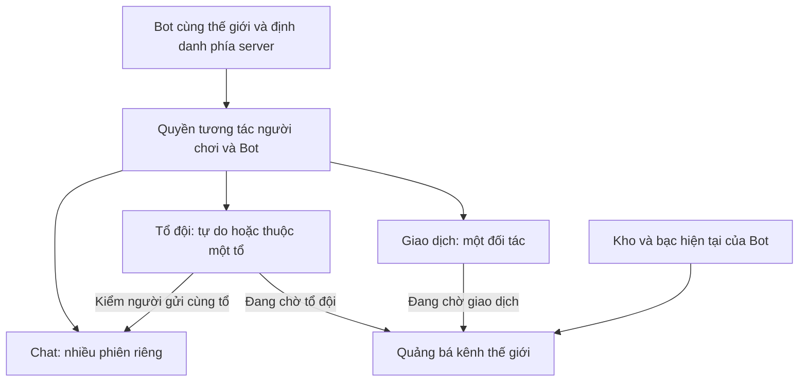

TÓM TẮT 1: [NGUỒN][TÀI LIỆU] DONE phần chuẩn bị XD-E04. Bảng phủ 11 nhóm yêu cầu và khái niệm lấy từ thiết kế xã hội Bot, kèm hai nhóm tham chiếu và một nhóm mở rộng (D:11–123,188–201).
TÓM TẮT 2: [NGUỒN][THẤY] Đã định vị đường chat qua GameServer, các gói mời/rời tổ đội và vòng đời giao dịch gốc. Các quy tắc riêng của Bot còn thiếu bằng chứng (S/MultiServer/GameServer/KSOServer.cpp:3610–3650 và S/Core/Src/KProtocolProcess.cpp:221–272).
TÓM TẮT 3: [NGUỒN][TÀI LIỆU] Đề xuất thứ tự: định danh và quyền tương tác → tổ đội → chat → giao dịch → quảng bá. Sáu chiều trạng thái làm căn cứ phân rã, còn các quyết định ở phần 7 của thiết kế để mở (D:96–123,174–186).
TÓM TẮT 4: [CHƯA KIỂM] Chưa xác nhận phiên chat song song, chính sách Bot khi có tranh chấp, vòng đời khi rớt kết nối, phát tin theo kho thật hay mức tải (D:125–172).
TÓM TẮT 5: [CHƯA KIỂM] Chỉ đọc tĩnh, chưa build, chạy exe, VM, mạng hoặc test gameplay. Tổng quan nhận phần commit. Mốc nhịp ngoài worktree bị từ chối quyền ghi.

# XD-E04 — Bảng khoảng cách thiết kế xã hội Bot

Loại: thiết kế
Chủ đề: Đối chiếu quy tắc tương tác Bot dùng chung với gói tin, hàm máy chủ và khoảng trống trước E-04.
Từ khóa: Bot, chat mật, tổ đội, party, giao dịch, trade, quảng bá, Tong, XD-E04
Trạng thái: DONE — hoàn tất bảng đối chiếu và đề xuất thứ tự trong phạm vi chuẩn bị.
Độ phủ: đã phủ 11/11 nhóm đối chiếu rút từ thiết kế, gồm 10 nhóm hành vi/nền và một nhóm gợi ý trạng thái. Hai nhóm tham chiếu và một nhóm mở rộng nằm riêng.
Liên quan: `DESIGN/BOT/SHARED_BOT_SOCIAL_AND_INTERACTION_SYSTEM.md`, `JX1_OPS/DESIGN/SO-TAY-BAN-BE-ONLINE.md`, `JX1_OPS/DESIGN/SO-TAY-HOP-THOAI-NPC.md`, `JX1_OPS/DESIGN/SO-TAY-GIAO-DICH-KHO.md`.
Cần tôi quyết định: có, ở giai đoạn đặc tả E-04 cho 10 điểm mở của thiết kế. XD-E04 đã bàn giao được.

[TÀI LIỆU] Sơ đồ mô tả các quan hệ yêu cầu và phụ thuộc giữa tính năng. Thiết kế để mở chính sách kết hợp chat, tổ đội và giao dịch khi Bot đang bận. `D:24–43,52–83,96–123,174–186`.

## Phạm vi và độ phủ

**Quy ước nguồn.** `D` = `DESIGN/BOT/SHARED_BOT_SOCIAL_AND_INTERACTION_SYSTEM.md` tính từ gốc worktree. `S` = `C:/Jx1CocoV3/SwordOnline/SwordOnline/jxOnline/gameserver/Sources`. `C` = `C:/Jx1CocoV3/Folder/Client2912-20260116T044348Z-3-001/Client2912/Client/Classes`. `ST28`, `ST31`, `ST26` lần lượt là `SO-TAY-BAN-BE-ONLINE.md`, `SO-TAY-HOP-THOAI-NPC.md`, `SO-TAY-GIAO-DICH-KHO.md` trong kho tham chiếu `D:/jx1-ops-wt/JX1_OPS/DESIGN`. `GS` = `S/MultiServer/GameServer/KSOServer.cpp`, `P` = `S/Core/Src/KProtocolProcess.cpp`, `K` = `S/Core/Src/KPlayer.cpp`, `CP` = `C/gamecore/KProtocolProcess.cpp`. Root source theo `JX1_OPS/TASKS/XD-E04.md:20–26`.

**Nhãn.** [THẤY] là bằng chứng đã xem ở mã hoặc thao tác vừa thực hiện. [TÀI LIỆU] là quy tắc thiết kế, kết quả dẫn lại hoặc đề xuất. [CHƯA KIỂM] là hợp đồng Bot, đường mã hoặc hành vi chưa xác nhận. “Đã phủ” trong bảng nghĩa là hàng đã được đối chiếu và nêu phần thiếu.

| # | Tính năng theo cấu trúc game | Gói tin/hàm có bằng chứng | Khoảng cách cần xử lý ở E-04 |
|---|---|---|---|
| 1 | **Thế giới → Bot dùng chung.** Nhiều người có thể gặp cùng Bot, tiến trình từng người tách riêng. Đã phủ. [TÀI LIỆU] `D:17–22,159–165`. | [THẤY] Client có `s2c_syncnpc`, `s2c_syncnpcminplayer`, `s2c_npcremove`. Server có `KRegion::BroadCast` gửi cho người nhận có kết nối. `CP:56–64`, `S/Core/Src/KRegion.cpp:2223–2277`. | [CHƯA KIỂM] Cần định danh Bot phía server, một thực thể nhất quán và quy tắc phân phối thêm/cập nhật/xóa. Chưa có bằng chứng các gói hiện tại duy trì cùng Bot cho hai người và giữ riêng tiến trình. |
| 2 | **Thế giới → Cách ly người thật với nhau.** Ẩn nhân vật và chặn tương tác trực tiếp, gồm trade, PK, tổ đội. Đã phủ. [TÀI LIỆU] `D:13–22,159–167,188–197`. | [THẤY] Có điểm lọc phát sóng và các điểm tiếp nhận tương tác tổ đội/trade. Các điểm cần rà cho PK gồm `c2s_npcskill` → `NpcSkillCommand`, `c2s_playerapplysetpk` → `PlayerApplySetPK`, và các nhánh PK thường/thù địch. `P:215,230,273–274`. [TÀI LIỆU] Bản đồ GS001 dẫn `KVisibility` ở một nhánh. `S/Core/Src/KRegion.cpp:2223–2277`, `P:221–229,251–259`, `JX1_OPS/CONTEXT-PACK/GS001-MAP.md:3–4`. | [CHƯA KIỂM] Chưa xác nhận chính sách đã thực thi ở snapshot này. Cần đối chiếu đường gửi trực tiếp và handler PK trước khi kết luận, kể cả khi client không thấy mục tiêu. |
| 3 | **Chat → Nhiều phiên chat mật cùng Bot.** Phiên độc lập, chat không chiếm khóa tổ đội hoặc giao dịch. Đã phủ. [TÀI LIỆU] `D:28–32,98–109,115–119,129–132`. | [THẤY] `c2s_extendchat` định tuyến sang `m_pChatClient`. Nhánh `chat_someonechat` xử lý tin riêng gửi đi. `ChatMessageProcess` gọi `ChatSpecMan` để lọc danh sách đen và gửi `s2c_extendchat`. `GS:1697–1705,2848–2876,3613–3650`, `CP:204,4292`. | [CHƯA KIỂM] Cần cơ chế nhận và trả lời theo từng người gửi, giám sát việc lưu ngữ cảnh riêng và kiểm ca hai người cùng chat. Phần danh sách đen chỉ có bằng chứng cho đường chat đã xem. |
| 4 | **Chat → Từ chối chat mật ngoài tổ đội.** Dùng thông báo “Tôi đang ở trong một party khác.” Đã phủ. [TÀI LIỆU] `D:33–35,131,145`. | [THẤY] Có đường tin mật `ChatSpecMan` và gói đồng bộ tổ đội `s2c_teamselfinfo`, `s2c_teamaddmember`, `s2c_teamleave`. `GS:2848–2876`, `CP:79–88`. | [CHƯA KIỂM] Cần kiểm cùng tổ theo trạng thái server tại thời điểm xử lý và chọn đường trả đúng người gửi. Chưa định vị hàm từ chối Bot hoặc hợp đồng thông báo. |
| 5 | **Tổ đội → Mời, nhận lời, gia nhập một tổ.** Người ngoài không chiếm Bot đã thuộc tổ. Đã phủ. [TÀI LIỆU] `D:52–56,115–118,142–148`. | [THẤY] `c2s_teaminviteadd` → `TeamInviteAdd` → `m_cTeam.InviteAdd`. `c2s_teamreplyinvite` → `TeamReplyInvite`. Đường xin vào/nhận thành viên có `c2s_teamapplyadd`, `c2s_teamacceptmember` → `S2CSendAddTeamInfo`, `AddTeamMember`. Client nhận `s2c_teaminviteadd` và cập nhật thành viên. `P:221–229,257–259,5642–5649,5832–5855`, `CP:85–88,121`. | [CHƯA KIỂM] Cần điểm phân xử phía server khi hai tổ mời cùng lúc và điều kiện Bot nhận lời. Thiết kế chưa chốt ưu tiên. `D:182,184`. |
| 6 | **Tổ đội → Rời tổ và trở về chờ.** Cập nhật nhất quán trước khi nhận lời mời mới. Đã phủ. [TÀI LIỆU] `D:57–64,121,146–148`. | [THẤY] `c2s_teamapplyleave` → `PlayerApplyLeaveTeam` → `KPlayer::LeaveTeam`. Có tuyến kick/đổi đội trưởng/giải tán và `s2c_teamleave` phía client. `P:226–229,5652–5654`, `K:2026–2040`, `CP:86–88`. | [CHƯA KIỂM] Cần chuyển Bot về chờ sau cập nhật thành viên. Điều kiện khi đội trưởng thoát, giải tán hoặc rớt kết nối còn mở. `D:177,186`. |
| 7 | **Giao dịch → Mời, nhận lời, đặt đồ/bạc và khóa một đối tác.** Đã phủ. [TÀI LIỆU] `D:37–41,113–120,134–140`. | [THẤY] `c2s_tradeapplystart` → `TradeApplyStart` và `s2c_tradeapplystart`. `c2s_tradereplystart` → `c2sTradeReplyStart` → `StartTrade` cho hai bên khi đi tới nhánh đồng ý. `c2s_trademovemoney` và `c2s_tradedecision` đi qua `TradeMoveMoney`, `TradeDecision`. [TÀI LIỆU] Đường đặt đồ cần đối chiếu với `PlayerMoveItem` và kiểm tra khay trade. `P:237,251–255,272,5812–5824,6206–6208`, `K:6605–6653,7054–7113`, `ST26:46–51,103–106`. | [CHƯA KIỂM] Điều kiện khoảng cách và bận của legacy chưa chứng minh khóa độc quyền Bot ở thời điểm cấp quyền. Cần xác minh đường đặt đồ, kiểm quyền cả hai phía và ca hai yêu cầu cạnh nhau. |
| 8 | **Giao dịch → Xác nhận, hủy, giải phóng và phục hồi.** Đã phủ. [TÀI LIỆU] `D:39–41,120–123,135–140`. | [THẤY] `TradeDecision` có xử lý khóa, hủy, xác nhận. Nhánh hủy khôi phục khay, giải phóng cả hai phía và gửi `s2c_tradedecision`. Đoạn kết có lời gọi lưu từng nhân vật. `K:6734–6800,7027–7036`. [TÀI LIỆU] Đối chiếu giới hạn lưu/phục hồi của sổ tay. `ST26:46–52,103–106`. | [CHƯA KIỂM] Cần bằng chứng giải phóng khóa Bot đúng một lần khi hoàn tất, hủy, mất kết nối, hết hạn hoặc khởi động lại. Chưa xác nhận tính nhất quán lưu hai nhân vật hay thời gian chờ. |
| 9 | **Quảng bá → Tìm tổ đội khi chờ, dừng khi đã vào tổ.** Đã phủ. [TÀI LIỆU] `D:57–64,70–75,150–155`. | [THẤY] Đường `c2s_extendchat` nhận loại `chat_channelchat`. Nhánh `ChatGroupMan` phát `s2c_extendchat` cho người nhận được phép. `GS:2790–2843,3613–3646`. | [CHƯA KIỂM] Chưa định vị ID kênh thế giới và đường phát từ Bot dùng chung. Cần bộ lập lịch đọc trạng thái chờ, nội dung đa dạng, giới hạn tần suất và hủy tin khi điều kiện thay đổi. |
| 10 | **Quảng bá → Tìm giao dịch khi chờ, dựa trên đồ/bạc đang sở hữu.** Đã phủ. [TÀI LIỆU] `D:42–50,77–83,150–155`. | [THẤY] Có đường gửi chat kênh và kiểm bạc khi đưa vào trade. [TÀI LIỆU] Sổ tay phân biệt túi, bạc và kho cá nhân. `GS:3613–3646`, `K:6640–6653`, `ST26:46–51`. | [CHƯA KIỂM] Cần đọc trạng thái và kho có thẩm quyền phía server lúc soạn và lúc phát. Nếu món đã mất hoặc Bot hết chờ thì hủy tin. Tin rao chưa cấp quyền trade và không tự đặt đồ/bạc. `D:79–83,153–155`. |
| 11 | **Trạng thái → Sáu chiều độc lập và kiểm soát ở server.** Hiện diện, chat, giao dịch, tổ đội, ý định xã hội, lịch sử tương tác. Đã phủ như khái niệm thiết kế. [TÀI LIỆU] `D:96–123`. | [THẤY] Các đường mã hiện có thuộc các hệ khác nhau, gồm `m_cTeam`, `m_cTrade` và tuyến chat. `P:5832–5855`, `K:6734–6786`, `GS:3613–3622`. | [CHƯA KIỂM] Cần đặc tả quyền chuyển trạng thái, đồng thời, yêu cầu lặp và phục hồi. Kiểu lưu, schema và API vẫn là quyết định mở. `D:111,115–123,186`. |

| Ngoài 11 nhóm | Gói/hàm và giới hạn sử dụng |
|---|---|
| **Bạn bè, online, danh sách đen — tham chiếu cho chat.** | [THẤY] `c2s_extendfriend` → `m_pTongClient`. Có `friend_c2s_asksyncfriendlist`, `friend_s2c_repsyncfriendlist`, `friend_s2c_friendstate`, lời mời và trả lời. [TÀI LIỆU] Chiều về dùng `s2c_extendfriend`. [CHƯA KIỂM] Lưu danh sách đen và quan hệ ở Relay. Phần này làm căn cứ đối chiếu quan hệ và lọc chat, với phạm vi Bot do thiết kế chốt sau. `GS:3613–3629`, `C/gamecore/KTongProtocol.h:97–114`, `CP:4378–4412,4430,4464,4482`, `ST28:72–98,122–134`, `D:24–64`. |
| **Thoại NPC — tham chiếu cho tương tác có lựa chọn.** | [THẤY] `c2s_dialognpc` → `DialogNpc` → script `main`. Lua đăng ký `Say`, `SayNew`, `Talk`. `DoScriptAction` gửi `s2c_scriptaction`. `c2s_playerselui` → `PlayerSelUI` → `ProcessPlayerSelectFromUI` → callback đã lưu. [CHƯA KIỂM] Áp dụng cho Bot nếu có yêu cầu menu trong đặc tả. `P:241,256,5757–5759,5827–5829`, `K:8785–8823,9524–9546`, `S/Core/Src/ScriptFuns.cpp:25676–25683`, `ST31:92–120,128–134`, `D:24–64`. |
| **Tính cách, thói quen và lịch hoạt động — hướng mở rộng.** | [TÀI LIỆU] Thiết kế nêu các kiểu luyện cấp, săn đồ, thích giao dịch, ít nói và có lịch riêng. [CHƯA KIỂM] Chưa có hợp đồng dữ liệu hay gói riêng. Hoãn đặc tả tới khi chốt yêu cầu. `D:85–94`. |

## Giải mã tên

| Tên gốc | Mã hóa | Chữ đúng UTF-8 | Nguồn file:dòng |
|---|---|---|---|
| Đường Môn Phi Đao | UTF-8 của thiết kế | Đường Môn Phi Đao | [TÀI LIỆU] `D:46,50`. Chỉ có trong ví dụ rao đồ, chưa đối chiếu tên Hán hoặc mã vật phẩm. |
| Ngũ Độc | UTF-8 của thiết kế | Ngũ Độc | [TÀI LIỆU] `D:47,50). Chỉ có trong ví dụ rao đồ, chưa đối chiếu tên Hán hoặc bản ghi trang bị. |
| `party` | ASCII | Tổ đội | [TÀI LIỆU] `D:52–64`. |
| `Tong`, `S3Relay` | ASCII | Dịch vụ quan hệ và dịch vụ chuyển tiếp theo sổ tay | [THẤY] `GS:3615–3622`. [TÀI LIỆU] `ST28:49–53,98–100`. |

## Sắp theo cấu trúc game

[TÀI LIỆU] Bảng đi từ thế giới và quyền nhìn thấy sang chat, tổ đội, giao dịch và hoạt động chủ động. Hai ví dụ trang bị nằm trong nhóm quảng bá giao dịch. Thiết kế chưa xác định mã món hoặc danh sách theo bộ để sắp sâu hơn. `D:11–83`.

## Thứ tự triển khai đề xuất

| Ưu tiên | Việc và điều kiện hoàn thành trước khi sang phần phụ thuộc |
|---|---|
| 1 | [TÀI LIỆU] **Định danh Bot, hiện diện chung và quyền tương tác** (#1–2, #11). Định nghĩa nguồn trạng thái phía server, chặn tương tác trực tiếp giữa người thật và kiểm quyền ngay tại các đường xử lý. Kiểm hai người gặp cùng Bot và tiến trình vẫn riêng. `D:13–22,96–123,159–167,188–197`. |
| 2 | [TÀI LIỆU] **Tổ đội và trả Bot về chờ** (#5–6). Dùng đường tổ đội hiện có làm điểm khảo sát, chốt phân xử hai lời mời và các lý do rời tổ. Trạng thái thành viên phía server là đầu vào cho chat và quảng bá. `P:221–229,257–259`, `D:115–123,142–148,177,182`. |
| 3 | [TÀI LIỆU] **Chat mật độc lập và từ chối ngoài tổ** (#3–4). Kiểm hai người chat cùng Bot, phản hồi đúng người, đúng câu từ chối và không đổi trạng thái giao dịch/tổ đội. `D:28–35,129–132,145`, `GS:2848–2876`. |
| 4 | [TÀI LIỆU] **Giao dịch độc quyền và giải phóng** (#7–8). Chốt ai giữ quyền theo trạng thái server, kết quả từng bước, hủy và phục hồi trước khi dùng tài sản. Kiểm cạnh tranh hai người và đối chiếu cả hai phía sau hoàn tất/hủy. `D:115–123,134–140`, `K:6734–6800,7027–7036,7054–7113`. |
| 5 | [TÀI LIỆU] **Quảng bá thế giới và kiểm thử tải** (#9–10). Nối trạng thái chờ và dữ liệu kho khi đã có hợp đồng phía server. Kiểm dừng tin cũ, giới hạn tần suất và đa dạng nội dung. Đối chiếu người chơi mô phỏng với lưu lượng client thật khi có task được phép kiểm thử. `D:70–83,150–172,183`. |

## Mục sổ thông số

| Nhóm | Tên hoặc hằng số | File:dòng | Giá trị | Đơn vị | Ảnh hưởng | Đổi an toàn | Nguồn đo |
|---|---|---|---|---|---|---|---|
| Giao dịch Bot | Số đối tác đồng thời | `D:37–41,115–120` | [TÀI LIỆU] 1 | người chơi/Bot | Điều kiện cấp quyền | KHÔNG trong phạm vi XD-E04, quy tắc đã chốt | Thiết kế |
| Tổ đội Bot | Số tổ đồng thời | `D:54–57,115–121` | [TÀI LIỆU] 1 | tổ/Bot | Điều kiện nhận lời mời | KHÔNG trong phạm vi XD-E04, quy tắc đã chốt | Thiết kế |
| Luồng thoại tham chiếu | `MAX_ANSWERNUM` | `S/Core/Src/KPlayer.h:31`, `ST31:155` | [THẤY] 16 | lựa chọn/menu theo sổ tay | Giới hạn dựng menu | CẨN THẬN, cần rà cả hai đầu | Đọc tĩnh |
| Chat/quảng bá | Giới hạn phiên, chu kỳ và giới hạn gửi | `D:29–31,73–75,183` | [CHƯA KIỂM] Chưa chốt | phiên/Bot, thời gian, số tin | Tải và trải nghiệm | CẨN THẬN | Chưa đo |
| Giao dịch/tổ đội | Thời gian chờ giữa các lượt và khi bị gián đoạn | `D:120–123,177–178` | [CHƯA KIỂM] Chưa chốt | thời gian | Quyền tương tác sau khi bị gián đoạn | CẨN THẬN | Chưa đo |

## Đề xuất tối ưu

[TÀI LIỆU] Mỗi bước cấp hoặc trả quyền cần có trạng thái trước/sau, người được quyền, kết quả thấy được từ hai phía và ca QA tương ứng. Dùng kiểm tra phía server tại thời điểm cấp quyền để tránh lấy trạng thái do client hiển thị làm căn cứ. Khi đánh giá tải, đối chiếu kịch bản chat, tổ đội, giao dịch và quảng bá với các phiên thực hiện hành động. `D:113–172`.

## Đã xác minh

- [THẤY] Đã đọc thiết kế tại gốc worktree và đối chiếu đủ 11 nhóm theo các mục 1–4. Đã đưa ca QA và tải ở mục 5–6 vào thứ tự làm, giữ 10 điểm mở ở mục 7. `D:11–186`.
- [THẤY] Đã đối chiếu các điểm định tuyến và hàm chủ chốt trực tiếp tại hai root task cho phép. Bản đồ GS001 dùng để định vị. Không có Graphify tại hai root được kiểm tra. `GS:3610–3650`, `P:221–272,5637–5654,5757–5759,5812–5855,6206–6208`, `CP:56–121,204,4378–4482`.
- [TÀI LIỆU] Giữ mức xác minh của ba sổ tay, đặc biệt vòng đời quan hệ tại relay, API `Sel` riêng, luồng thư và phục hồi giao dịch khi đứt kết nối. `ST28:122–134`, `ST31:170–178`, `ST26:46–52`.

## Chưa kiểm

- [CHƯA KIỂM] Định danh và quyền Bot/nhân vật thật, tính nhất quán của thực thể dùng chung, đường PK và đường gửi trực tiếp. Chưa chứng minh các quy tắc Bot đã hiện hữu ở source hoặc chạy đúng trên binary. `D:13–22,159–167`.
- [CHƯA KIỂM] Các quyết định 1–3 ở phần 7 gồm điều kiện rời tổ/giải tán/rớt kết nối, thời gian nghỉ và chat mật trong lúc giao dịch. `D:174–179`.
- [CHƯA KIỂM] Các quyết định 4–6 gồm quảng bá giao dịch khi đang trong tổ, giao dịch với thành viên cùng tổ và ưu tiên khi nhiều người cùng yêu cầu. `D:180–182`.
- [CHƯA KIỂM] Các quyết định 7–10 gồm tần suất và chống spam, điều kiện từ chối theo đặc điểm Bot, hoạt động đồng thời trong tổ và lưu/phục hồi sau khởi động lại. `D:183–186`.
- [CHƯA KIỂM] ID và hạn mức kênh thế giới, hợp đồng ACK/timeout, tính tương thích binary, đường lưu quan hệ và kết quả các ca QA. Chưa build hoặc chạy test game, exe, VM và mạng theo phạm vi đọc tĩnh. `D:125–172`, `JX1_OPS/TASKS/XD-E04.md:23–26`.

## Bàn giao

- [THẤY] Lúc đầu tìm bản thiết kế dưới `JX1_OPS`. Kiểm lại bằng đường dẫn tính từ gốc và `git ls-files` đã định vị đúng tệp. Hai lệnh PowerShell kiểm tên tệp ban đầu lỗi cú pháp, đã chạy lại thành công. `rg` không có trong môi trường nên dùng `Select-String` và tìm theo tên giới hạn trong DESIGN/REPORTS. Thử tìm `ScriptFuns.h` ở `Core/Src` báo không có tệp, đối chiếu binding trực tiếp trong `ScriptFuns.cpp:25676–25683`.
- [THẤY] Lần ghi nhịp đầu vào `D:\JX-wt\XD-E04.nhip` trả về `Access to the path is denied`. Đường dẫn nằm ngoài vùng được ghi của phiên, các mốc nhịp chưa được lưu. Lần thêm mục Kết quả bằng `Add-Content -Encoding utf8NoBOM` bị phiên PowerShell từ chối tham số, đã dùng ghi nối UTF-8 tương thích để giữ nguyên phần task cũ.
- [TÀI LIỆU] Đầu ra ở báo cáo này và mục Kết quả cuối task. Tổng quan nhận commit theo chỉ dẫn. Chưa có SHA hoặc push.
- [TÀI LIỆU] Dòng đề xuất cho mục lục/chỉ mục: **Thiết kế xã hội Bot dùng chung** → `JX1_OPS/REPORTS/XD-E04.md` → chat, tổ đội, giao dịch, quảng bá, quyền tương tác → khảo sát tĩnh. Độ phủ 11/11 nhóm phân tích, trạng thái DONE cho XD-E04. Dòng này để PM gộp, trong phạm vi chỉ ghi báo cáo và Kết quả task. `JX1_OPS/DESIGN/MUC-LUC-TRI-THUC.md:19–20`.

Kỹ năng đã dùng: jx1-retrofit, jx1-read-server, jx1-read-client, jx1-parameters, jx1-knowledge, jx1-report.
