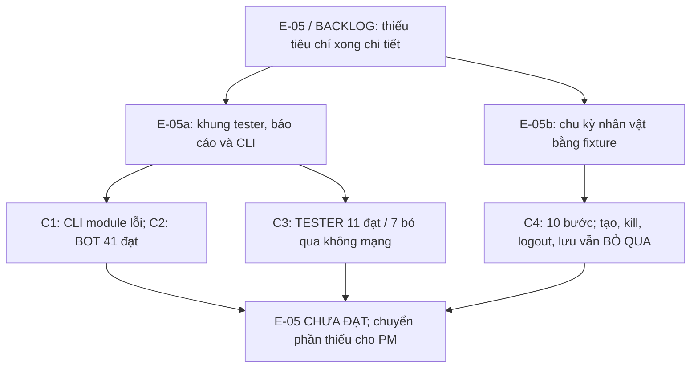

TÓM TẮT 1. [NGUỒN] [THẤY] DONE phần đối chiếu XD-E05: đã lập bằng chứng/thiếu sót cho 9 vế tiêu chí con, 5 mục tiêu khung và 10 bước; tiêu chí cha không có trong tệp được chỉ định (`JX1_OPS/TASKS/E-05.md:8`).
TÓM TẮT 2. [NGUỒN] [THẤY] BOT đạt 41/41; TESTER thuộc E-05 có 11 đạt, 7 bỏ qua theo giới hạn không mạng; CLI isolated module vẫn lỗi tìm package (C1–C3 bên dưới).
TÓM TẮT 3. [NGUỒN] [THẤY] Đầu ra `JX1_OPS/REPORTS/XD-E05.md`; bốn bước tạo nhân vật/kill/logout/lưu trạng thái vẫn BỎ QUA khi gọi trực tiếp; chưa đủ đóng E-05 (C4).
TÓM TẮT 4. [CHƯA KIỂM] Chưa có “xong khi” chi tiết của cha trong BACKLOG; chưa chạy 7 test socket, gameplay thật hoặc đo lại 30 giây; giữ nguyên kết luận E-05a PARTIAL và E-05b DONE trong phạm vi fixture (`JX1_OPS/REPORTS/E-05a-khung-tester.md:13`, `JX1_OPS/REPORTS/E-05b-kich-ban-full-cycle.md:13`).
TÓM TẮT 5. [CHƯA KIỂM] Không build/chạy exe game/server/VM/mạng; không commit/push theo yêu cầu, Tổng quan commit hộ; ghi `.nhip` bị Access denied ngoài sandbox, chưa khắc phục quyền (lỗi L2).

# XD-E05 — Đối chiếu điều kiện đóng E-05 và BACKLOG #170
Loại: kiểm thử
Chủ đề: Đánh giá bằng chứng offline của khung tester và chu kỳ nhân vật, xác định phần còn thiếu trước khi đóng E-05.
Từ khóa: kiểm thử, tester, TESTER, BOT, E-05, full_cycle, smoke_login, isolated CLI, BACKLOG, lưu nhân vật
Trạng thái: DONE — hoàn tất báo cáo đối chiếu XD-E05; việc cha E-05 CHƯA ĐẠT; tệp nhịp ngoài worktree bị chặn.
Độ phủ: đã đối chiếu 9/9 vế tiêu chí con, 5/5 mục tiêu khung, 10/10 bước chu kỳ; chưa đếm được tiêu chí cha vì nguồn không có nội dung này. Đây là độ phủ đối chiếu, không phải tỷ lệ chức năng đạt.
Liên quan: `JX1_OPS/TASKS/XD-E05.md`, `JX1_OPS/TASKS/E-05.md`, `JX1_OPS/TASKS/E-05a.md`, `JX1_OPS/TASKS/E-05b.md`, `JX1_OPS/TASKS/BACKLOG.md`, `JX1_OPS/REPORTS/E-05a-khung-tester.md`, `JX1_OPS/REPORTS/E-05b-kich-ban-full-cycle.md`, `JX1_OPS/DESIGN/CHUAN-BAO-CAO.md`
Cần tôi quyết định: có — PM cần khôi phục/xác nhận tiêu chí cha và xử lý tiêu chí CLI trước khi đóng E-05; không cần quyết định để hoàn thành báo cáo này.

## Sơ đồ chính



## Phạm vi, danh sách nguồn và độ phủ

- [THẤY] Nguồn đầu vào từ task: chuẩn báo cáo, `TASKS/E-05.md`, hai báo cáo E-05a/b; từ dẫn chiếu của các tệp này mới mở thêm `TASKS/BACKLOG.md`, `TASKS/E-05a.md`, `TASKS/E-05b.md`, `TESTER/README.md`, `TESTER/{bootstrap,run,core,reporting,scenarios,test_tester,test_full_cycle}.py` và `BOT/{test_bot,test_worldsync}.py`. Chỉ tra hàng chủ đề Bot trong `DESIGN/MUC-LUC-TRI-THUC.md:20`; không đọc cả kho báo cáo hay nguồn game. Căn cứ phạm vi: `JX1_OPS/TASKS/XD-E05.md:20`–`:26`.
- [THẤY] Đọc thêm đúng bản `D:/jx1-ops-wt/JX1_OPS/TASKS/E-05.md:1`–`:8` và tra E-05 trong `D:/jx1-ops-wt/JX1_OPS/TASKS/BACKLOG.md:65`, là kho chỉ đọc đã được task cho phép. Bản cha cũng chỉ có 8 dòng; BACKLOG cũng ghi “Bot trong hoạt động”. Không tìm kho khác.
- [THẤY] Git đầu lượt: `git status --short --branch` → `## task/XD-E05`, không có dòng thay đổi; báo cáo XD-E05 chưa tồn tại. Không có phần dở để làm lại. Nguồn văn bản đọc bằng UTF-8; không chuyển đổi nội dung tệp cũ.

### Tiêu chí cha: thiếu nguồn chi tiết, không tự thay bằng tiêu chí con

| Phần tử | Đã phủ / chưa phủ | Bằng chứng và phần thiếu |
|---|---|---|
| Mục “Tiêu chí xong” của E-05 | Chưa phủ nội dung tiêu chí; đã xác minh nguồn thiếu | [THẤY] `JX1_OPS/TASKS/E-05.md:1`–`:8` chỉ có metadata và chỉ dẫn sang BACKLOG/REPORTS; bản kho chỉ đọc nêu trên cũng vậy. |
| Dòng “xong khi” E-05 trong BACKLOG #170 | Chưa có để trích chính xác | [THẤY] `JX1_OPS/TASKS/BACKLOG.md:59`–`:65`: bảng chỉ có ID/Việc/Cấp/Ai, E-05 ghi “Bot trong hoạt động”; nhóm #170 tại `:102`–`:118` không có E-05. Không đồng nhất “Bot trong hoạt động” với khung tester. |
| Nguồn thay thế có thể đối chiếu | Đã phủ như bằng chứng phụ, không nhận là nguyên văn cha | [TÀI LIỆU] `JX1_OPS/TASKS/E-05a.md:20`–`:30`, `JX1_OPS/TASKS/E-05b.md:15`–`:18`; hai bảng dưới tách đủ các vế con và bước hành trình. |

### Chín vế “Tiêu chí xong” có thể đọc được ở hai task con

| Vế và nguồn tiêu chí | Đã phủ / chưa phủ; kết quả | Bằng chứng / phần còn thiếu |
|---|---|---|
| A1. Unittest TESTER đạt, gồm BUG không trùng, timeout, che bí mật — `JX1_OPS/TASKS/E-05a.md:30` | Đã kiểm một phần; chưa đủ bộ | [THẤY] C3: 11 đạt, 7 bỏ qua trên tập E-05a/b; BUG/timeout/redaction có chạy. Ba test socket của E-05a chưa chạy; không nhận là toàn bộ discovery hiện tại đạt. |
| A2. Giữ 41 test BOT đạt — `JX1_OPS/TASKS/E-05a.md:30` | Đã phủ, đạt | [THẤY] C2: 41/41, 0 lỗi/0 bỏ qua; `test_bot.py` + `test_worldsync.py` là đúng tập 41 của báo cáo gốc. |
| A3. README ngắn ở TESTER — `JX1_OPS/TASKS/E-05a.md:30` | Đã phủ, có | [THẤY] `JX1_OPS/TESTER/README.md:13`–`:41` có lệnh chạy/giới hạn CLI; `:43`–`:91` có API, BUG và khóa ghi. |
| A4. Báo cáo E-05a có tóm tắt 5 dòng — `JX1_OPS/TASKS/E-05a.md:30` | Đã phủ, đạt cấu trúc | [THẤY] C4 kiểm đủ năm dòng; `JX1_OPS/REPORTS/E-05a-khung-tester.md:1`–`:6`. Không nâng PARTIAL thành DONE. |
| A5. Commit nếu Git cho phép, bị chặn thì ghi rõ — `JX1_OPS/TASKS/E-05a.md:30` | Đã phủ bằng tài liệu lịch sử | [TÀI LIỆU] `JX1_OPS/REPORTS/E-05a-khung-tester.md:118`–`:126` ghi lỗi index.lock và bàn giao PM; không chạy lại stage/commit, không xác nhận lịch sử đã push. XD-E05 được yêu cầu không commit. |
| B1. Unittest TESTER đạt, thêm full_cycle fixture — `JX1_OPS/TASKS/E-05b.md:18` | Đã đọc đủ; chưa chạy lại fixture | [TÀI LIỆU] `JX1_OPS/REPORTS/E-05b-kich-ban-full-cycle.md:108`–`:124`: 18/18 lịch sử, gồm bốn test mới. [CHƯA KIỂM] Bốn test đều cần loopback, bị bỏ qua C3; C4 chỉ kiểm logic bằng mock. |
| B2. Giữ 41 test BOT đạt — `JX1_OPS/TASKS/E-05b.md:18` | Đã phủ, đạt | [THẤY] C2 dùng chung, không chạy lặp hai lần. |
| B3. Báo cáo E-05b có tóm tắt và bảng bước/BỎ QUA/gói cần bổ sung — `JX1_OPS/TASKS/E-05b.md:18` | Đã phủ, có | [THẤY] C4 kiểm tóm tắt; bảng `JX1_OPS/REPORTS/E-05b-kich-ban-full-cycle.md:74`–`:85` liệt kê đủ 10 bước và phần thiếu. |
| B4. Gs001 thật ghi CHƯA KIỂM — `JX1_OPS/TASKS/E-05b.md:18` | Đã phủ, có giới hạn | [TÀI LIỆU] `JX1_OPS/REPORTS/E-05b-kich-ban-full-cycle.md:130`, `:151`; không có phép đo server thật trong lượt XD-E05. |

### Năm mục tiêu khung cần lưu ý khi đóng cha

| Mục tiêu nguồn `JX1_OPS/TASKS/E-05a.md` | Đã phủ / chưa phủ | Bằng chứng hiện tại |
|---|---|---|
| 1. Scenario/Step, bot độc lập, bắt lỗi, timeout (`:22`) | Đã kiểm core offline; không có bảo đảm thời gian thực cứng | [THẤY] `JX1_OPS/TESTER/core.py:14`–`:39`, `:201`–`:272`; C3 có test độc lập/exception/timeout đạt. Giới hạn hệ điều hành ghi tại `JX1_OPS/TESTER/README.md:6`–`:11`. |
| 2. Bảng bot × bước, thời gian, log, hex ≤256 byte có hướng/ID (`:23`) | Đã phủ core/report không mạng; lỗi gói qua socket chưa chạy lại | [THẤY] `JX1_OPS/TESTER/core.py:119`–`:132`, `JX1_OPS/TESTER/reporting.py:113`–`:124`; C3 kiểm giới hạn 256 byte và che thông tin. Body hex bị thay bằng 00 có chủ ý, không phải capture phát lại. |
| 3. BUG-NNN tăng số, khử trùng BUG mở, tái hiện lần N (`:24`) | Đã phủ, đạt kiểm tra hiện tại | [THẤY] C3 `test_bug_dedup_open_only_max_number_and_history` đạt; `JX1_OPS/TESTER/test_tester.py:292`–`:313`, `JX1_OPS/TESTER/reporting.py:64`–`:91`. |
| 4. smoke_login bằng máy chủ giả (`:25`) | Chưa chạy lại vì cần socket | [TÀI LIỆU] `JX1_OPS/REPORTS/E-05a-khung-tester.md:92`–`:99` có 15/15 bước PASS lịch sử; [THẤY] `JX1_OPS/TESTER/test_tester.py:217`–`:227` dùng `fake_server`, bị bỏ qua C3. |
| 5. CLI nguyên văn `python -I -m ...`, cấu hình sai exit 2 (`:26`) | Chưa đạt cú pháp nguyên văn; kiểm cấu hình sai đạt | [THẤY] C1 lỗi `ModuleNotFoundError`; C3 `test_missing_invalid_cli_config_no_socket` đạt. `JX1_OPS/TESTER/run.py:8`–`:14` chỉ bootstrap khi chạy file trực tiếp; không sửa/cài môi trường. |

## Giải mã tên

| Tên gốc | Mã hóa | Chữ đúng | Nguồn file:dòng |
|---|---|---|---|
| Không có tên riêng kỹ năng, trang bị, quái, NPC hoặc bản đồ cụ thể trong phạm vi | UTF-8 cho tài liệu và nhãn kỹ thuật | Không áp dụng GBK/TCVN3; `bot01..bot05`, RUN, SKILL là bí danh/nhãn kỹ thuật, không suy thành tên game | [THẤY] `JX1_OPS/TESTER/scenarios.py:128`–`:135`, `:171`–`:181` |

## Sắp theo cấu trúc game: chu kỳ nhân vật

[THẤY] Bảng theo hành trình đăng nhập → nhân vật → vào thế giới → di chuyển/chiến đấu → thoát/vào lại/lưu. Không có danh mục kỹ năng theo phái hoặc quái theo bản đồ để phân loại; các ID/tọa độ trong mock chỉ thuộc fixture (`JX1_OPS/TESTER/scenarios.py:128`–`:135`).

| Bước | Đã phủ / chưa phủ và nhãn bằng chứng | Phần thiếu cụ thể, nguồn hiện tại |
|---|---|---|
| login | Đã phủ logic BOT bằng C2; toàn hội thoại fixture chưa chạy lại | [TÀI LIỆU] Lịch sử fixture PASS: `JX1_OPS/REPORTS/E-05b-kich-ban-full-cycle.md:76`. [THẤY] Luồng hiện tại `JX1_OPS/TESTER/scenarios.py:65`–`:83`; chưa chứng minh login thật. |
| create_character | Đã kiểm và xác nhận BỎ QUA, chưa tạo | [THẤY] C4; `JX1_OPS/TESTER/scenarios.py:86`–`:89`. Thiếu request/response, mã kết quả và cập nhật role list trong chính full_cycle; không suy từ module khác. |
| enter_game | Đã phủ logic BOT C2; phiên fixture chưa chạy lại | [THẤY] `JX1_OPS/TESTER/scenarios.py:92`–`:116` kiểm permit/sync; [TÀI LIỆU] lịch sử tại `JX1_OPS/REPORTS/E-05b-kich-ban-full-cycle.md:78`. ABI/runtime thật chưa kiểm. |
| walk_30s | Đã kiểm gọi một RUN + hold(30) bằng mock; chưa đo lại 30 s | [THẤY] C4; `JX1_OPS/TESTER/scenarios.py:126`–`:130`. Thiếu xác nhận vị trí/di chuyển liên tục; test thời gian thật bị bỏ qua tại `JX1_OPS/TESTER/test_full_cycle.py:148`–`:169`. |
| attack_one | Đã kiểm đúng một lệnh SKILL tới mục tiêu tổng hợp bằng mock | [THẤY] C4; `JX1_OPS/TESTER/scenarios.py:133`–`:135`. Chưa chứng minh chọn quái thật, hit hoặc kill. |
| verify_kill | Đã kiểm và xác nhận BỎ QUA | [THẤY] C4; `JX1_OPS/TESTER/scenarios.py:138`–`:139`. Cần giải mã NPC/skill/sát thương/death và liên kết đúng mục tiêu; các record cần bổ sung chỉ dẫn lại từ `JX1_OPS/REPORTS/E-05b-kich-ban-full-cycle.md:81`, chưa xác minh source game. |
| logout | Đã kiểm đóng đối tượng và BỎ QUA xác nhận ứng dụng | [THẤY] C4; `JX1_OPS/TESTER/scenarios.py:142`–`:148`. Thiếu request/response logout và xác nhận lưu; đóng TCP không đủ. |
| reenter | Đã đọc luồng, chưa chạy lại hội thoại | [THẤY] `JX1_OPS/TESTER/scenarios.py:151`–`:157`: login/enter lần hai, phụ thuộc nhân vật; [TÀI LIỆU] lịch sử `JX1_OPS/REPORTS/E-05b-kich-ban-full-cycle.md:83`. |
| verify_role | Đã kiểm mock bằng/khác; khác gây assertion | [THẤY] C4; `JX1_OPS/TESTER/scenarios.py:160`–`:164`. Chỉ so sánh role list, chưa xác minh toàn bộ nhân vật. |
| verify_persistence | Đã kiểm và xác nhận BỎ QUA | [THẤY] C4; `JX1_OPS/TESTER/scenarios.py:167`–`:168`. Thiếu snapshot/giải mã vị trí, HP, trang bị, hành trang và xác nhận lưu sau logout. |

## Lệnh offline đã chạy và kết quả thật

[THẤY] Chạy từ `D:\JX-wt\XD-E05`, ngày 19/11/2026. `-I` giữ chế độ isolated; thêm `-B` để không ghi `.pyc` vào nguồn. Chỉ test có sẵn, không tạo script phụ, không sửa mã; file báo cáo/BUG do unit test tạo trong `TemporaryDirectory` rồi tự dọn (`JX1_OPS/TESTER/test_tester.py:275`–`:322`). Các bộ mới ngoài E-05 như visibility/real_login không thuộc lượt chạy này. Hook audit chặn mọi sự kiện `socket.*` ở tiến trình chạy lệnh; worker chỉ thực thi các callable không socket đã đọc tại `JX1_OPS/TESTER/test_tester.py:176`–`:213`. Hook không được nhận là bảo vệ kế thừa vào worker spawn.

### C1 — CLI module isolated

```powershell
python -I -B -m JX1_OPS.TESTER.run --help
```

[THẤY] Exit Python **1**: `Error while finding module specification for 'JX1_OPS.TESTER.run' (ModuleNotFoundError: No module named 'JX1_OPS')`. `-B` không sửa đường tìm package; tiêu chí nguyên văn `-I -m` chưa đạt. Khớp lỗi lịch sử `JX1_OPS/REPORTS/E-05a-khung-tester.md:111`; không suy CLI file trực tiếp cũng hỏng.

### C2 — Đúng 41 test BOT của E-05, không socket thật

```powershell
$code = @'
import sys, unittest
events = []
def audit(event, args):
    if event.startswith("socket."):
        events.append(event)
        raise RuntimeError("XD-E05: network disabled")
sys.addaudithook(audit)
loader = unittest.TestLoader()
suite = loader.discover("JX1_OPS/BOT", pattern="test_bot.py")
suite.addTests(loader.discover("JX1_OPS/BOT", pattern="test_worldsync.py"))
result = unittest.TextTestRunner(verbosity=1).run(suite)
print("NETWORK_AUDIT_EVENTS=" + str(len(events)))
print("SUMMARY ran=%d passed=%d skipped=%d failures=%d errors=%d" % (result.testsRun, result.testsRun-len(result.skipped)-len(result.failures)-len(result.errors), len(result.skipped), len(result.failures), len(result.errors)))
sys.exit(0 if result.wasSuccessful() else 1)
'@
$code | python -I -B -
```

[THẤY] `Ran 41 tests in 0.158s` → `OK`; `SUMMARY ran=41 passed=41 skipped=0 failures=0 errors=0`; `NETWORK_AUDIT_EVENTS=0`; exit Python **0**. Các connector thử nghiệm trả `MemorySocket`, không mở endpoint thật (`JX1_OPS/BOT/test_bot.py:199`–`:219`, `:268`–`:275`, `JX1_OPS/BOT/test_worldsync.py:40`–`:45`). Không nhận đây là toàn bộ test BOT mới hơn hiện có trong thư mục.

### C3 — TESTER của E-05a/b, loại bảy test cần mạng

```powershell
$code = @'
import sys, unittest
for stream in (sys.stdout, sys.stderr):
    stream.reconfigure(encoding='utf-8', errors='backslashreplace')
events = []
def audit(event, args):
    if event.startswith('socket.'):
        events.append(event)
        raise RuntimeError('XD-E05: network disabled')
sys.addaudithook(audit)
loader = unittest.TestLoader()
suite = loader.discover('JX1_OPS/TESTER', pattern='test_tester.py')
import test_tester
for name in ('test_smoke_five_bots_sequential_and_parallel', 'test_malformed_fake_packet_creates_bug_and_hex', 'test_isolated_cli_end_to_end'):
    setattr(test_tester.TesterTests, name, unittest.skip('XD-E05: fixture opens loopback socket; no-network scope')(getattr(test_tester.TesterTests, name)))
full = loader.discover('JX1_OPS/TESTER', pattern='test_full_cycle.py')
import test_full_cycle
test_full_cycle.FullCycleTests.__unittest_skip__ = True
test_full_cycle.FullCycleTests.__unittest_skip_why__ = 'XD-E05: full-cycle fixture opens loopback socket; no-network scope'
suite.addTests(full)
result = unittest.TextTestRunner(verbosity=2).run(suite)
print('NETWORK_AUDIT_EVENTS=' + str(len(events)))
print('SUMMARY ran=%d passed=%d skipped=%d failures=%d errors=%d' % (result.testsRun, result.testsRun-len(result.skipped)-len(result.failures)-len(result.errors), len(result.skipped), len(result.failures), len(result.errors)))
sys.exit(0 if result.wasSuccessful() else 1)
'@
python -I -B -c $code
```

[THẤY] Lần chạy cuối: `Ran 18 tests in 1.863s`; `OK (skipped=7)`; `SUMMARY ran=18 passed=11 skipped=7 failures=0 errors=0`; `NETWORK_AUDIT_EVENTS=0`; exit Python **0**. Skip được đặt trong bộ nhớ của lệnh, không sửa file test. Không coi 7 skip là đạt.

[THẤY] Mười một test đạt: `test_abrupt_worker_exit_is_fail`, `test_bot_ranges_and_invalid_step`, `test_bug_dedup_open_only_max_number_and_history`, `test_environment_and_key_redaction`, `test_exception_isolates_bot_and_skips_remaining`, `test_missing_invalid_cli_config_no_socket`, `test_report_lock_refuses_concurrent_write`, `test_secret_redaction_across_worker_report_and_bug`, `test_skip_and_false`, `test_state_preserved_and_independent`, `test_timeout_kills_worker_and_keeps_evidence` (`JX1_OPS/TESTER/test_tester.py:229`–`:343`).

[CHƯA KIỂM] Bảy test socket không chạy: ba tên trong vòng lặp C3 và bốn test `FullCycleTests`: `test_cli_full_cycle_two_bots_real_30_seconds`, `test_missing_character_skips_without_guessing`, `test_changed_character_fails_verification`, `test_redirect_main_is_rejected_without_external_socket` (`JX1_OPS/TESTER/test_full_cycle.py:148`–`:202`). Giới hạn task hiện tại cấm mạng, dù task con lịch sử cho fixture loopback; ưu tiên giới hạn hiện tại (`JX1_OPS/TASKS/XD-E05.md:24`).

### C4 — Gọi trực tiếp logic chu kỳ bằng mock và kiểm tóm tắt

```powershell
$code = @'
import sys, unittest
from pathlib import Path
from types import SimpleNamespace
from unittest.mock import Mock
for stream in (sys.stdout, sys.stderr):
    stream.reconfigure(encoding='utf-8', errors='backslashreplace')
events = []
def audit(event, args):
    if event.startswith('socket.'):
        events.append(event)
        raise RuntimeError('XD-E05: network disabled')
sys.addaudithook(audit)
sys.path.insert(0, str(Path('JX1_OPS/TESTER').resolve()))
import test_tester
from JX1_OPS.TESTER import scenarios as s
from JX1_OPS.TESTER.core import SkipStep
from JX1_OPS.BOT.session import State
assert len(s.FULL_CYCLE.steps) == 10
print('FULL_CYCLE_STEPS=' + ','.join(step.name for step in s.FULL_CYCLE.steps))
for name in ('create_cycle', 'kill_cycle', 'persistence_cycle'):
    context = SimpleNamespace(state={'role': None})
    try:
        getattr(s, name)(context)
        raise AssertionError('Expected SkipStep: ' + name)
    except SkipStep as exc:
        print(name + '=BO_QUA; ' + str(exc))
closed = []
context = SimpleNamespace(state={'session': SimpleNamespace(close=lambda: closed.append(True))}, log=lambda text: None)
try:
    s.logout_cycle(context)
    raise AssertionError('Expected SkipStep: logout_cycle')
except SkipStep as exc:
    assert closed == [True]
    print('logout_cycle=BO_QUA; ' + str(exc))
session = Mock(state=State.IN_GAME)
context = SimpleNamespace(state={'session': session}, log=lambda text: None)
s.walk_cycle(context)
session.run.assert_called_once_with(100, 200, 1)
session.hold.assert_called_once_with(30)
s.skill_cycle(context)
session.skill.assert_called_once_with(1, -1, 1)
print('WALK_SKILL_MOCK=PASS; RUN + hold(30) + one SKILL; no real elapsed-time/movement/kill proof')
context.state.update(initial_role=('synthetic', 1), role=('synthetic', 1))
s.verify_cycle(context)
context.state['role'] = ('synthetic', 2)
try:
    s.verify_cycle(context)
    raise RuntimeError('Changed role must fail')
except AssertionError:
    print('VERIFY_ROLE_EQUAL_AND_CHANGED=PASS; role list only')
for filename in ('E-05a-khung-tester.md', 'E-05b-kich-ban-full-cycle.md'):
    path = Path('JX1_OPS/REPORTS') / filename
    text = path.read_text(encoding='utf-8')
    assert 'TÓM TẮT 5 DÒNG' in text
    assert all(any(line.startswith(str(n) + '.') for line in text.splitlines()[:8]) for n in range(1, 6))
    print('REPORT_SUMMARY_5_LINES=PASS; ' + filename)
assert not events
print('NETWORK_AUDIT_EVENTS=0')
'@
python -I -B -c $code
```

[THẤY] Exit Python **0**; đủ 10 tên bước theo bảng hành trình; `create_cycle`, `kill_cycle`, `persistence_cycle`, `logout_cycle` đều in `BO_QUA` kèm lý do; `WALK_SKILL_MOCK=PASS`; `VERIFY_ROLE_EQUAL_AND_CHANGED=PASS`; hai dòng `REPORT_SUMMARY_5_LINES=PASS`; `NETWORK_AUDIT_EVENTS=0`. Đây là xác nhận logic nhánh/mock, không phải chạy phiên game hay đo thời gian 30 giây.

## Mục sổ thông số

| Nhóm | Tên/hằng số | file:dòng | Giá trị | Đơn vị | Ảnh hưởng | Đổi an toàn (CÓ/CẨN THẬN/KHÔNG) | Nguồn đo |
|---|---|---|---|---|---|---|---|
| Bot | `workers` | `JX1_OPS/TESTER/core.py:207`, `JX1_OPS/TESTER/run.py:44` | 1..5 | process đồng thời | Cách ly bot; không phải tải server đã đo | CẨN THẬN | [THẤY] đọc tĩnh |
| Timeout | `Step.timeout` mặc định | `JX1_OPS/TESTER/core.py:18` | 3 | giây/bước | Thời hạn hữu hạn; C3 test timeout dùng 0,15 s | CẨN THẬN | [THẤY] nguồn + C3, không đo hard real-time |
| Log gói | Giới hạn lưu hex | `JX1_OPS/TESTER/core.py:129`–`:132` | 256 | byte/gói | Chỉ giữ ID, body che 00 | KHÔNG — giữ hợp đồng che dữ liệu trong task này | [THẤY] nguồn + C3 test timeout/redaction |
| Di chuyển | `hold` / timeout bước | `JX1_OPS/TESTER/scenarios.py:129`, `:175` | 30 / 35 | giây | Giữ phiên / thời hạn watchdog; không chứng minh đi liên tục | CẨN THẬN | [THẤY] C4 xác nhận đối số mock; chưa đo lại 30 s |
| Độ phủ fixture | Bước FULL_CYCLE | `JX1_OPS/TESTER/scenarios.py:171`–`:181` | 10 | bước | Có bốn bước chủ động BỎ QUA khi có role | CẨN THẬN | [THẤY] nguồn + C4; 6 PASS/4 BỎ QUA là lịch sử báo cáo E-05b:69 |

## Phần còn thiếu cần chuyển vào “xong khi” của E-05

[THẤY] Không có nguyên văn “xong khi” cha để sửa/trích chính xác: `JX1_OPS/TASKS/E-05.md:8`, `JX1_OPS/TASKS/BACKLOG.md:65`. Danh sách sau là phần thiếu rút từ nguồn con, **đề nghị PM đối chiếu khi bổ sung tiêu chí cha**, không giả làm nội dung BACKLOG đã duyệt:

1. [CHƯA KIỂM] Khôi phục nội dung/mục “Tiêu chí xong” E-05 và dòng “xong khi” tương ứng BACKLOG; xác nhận E-05 đóng khung tester hay “Bot trong hoạt động”. Không thể suy số vế cha từ chín vế con.
2. [THẤY] Xử lý tiêu chí CLI isolated module đang lỗi C1: cần một phương án đóng gói/khởi chạy được duyệt và bằng chứng lệnh nguyên văn đạt; hoặc PM thay tiêu chí sang CLI file trực tiếp. XD-E05 không sửa môi trường (`JX1_OPS/TASKS/E-05a.md:26`, `JX1_OPS/TESTER/README.md:36`–`:41`).
3. [CHƯA KIỂM] Nếu giữ yêu cầu toàn bộ unittest TESTER đạt: cần lượt được phép loopback để chạy đủ ba test smoke/CLI/gói lỗi và bốn test full-cycle, ghi số test/lệnh/exit thật. Lượt này chỉ có 11 đạt/7 bỏ qua, không tái xác nhận 18/18 lịch sử (`JX1_OPS/TASKS/E-05a.md:30`, `JX1_OPS/TASKS/E-05b.md:18`).
4. [THẤY] Nếu cha yêu cầu chu kỳ nhân vật hoàn chỉnh: full_cycle hiện vẫn thiếu nhánh tạo nhân vật, xác nhận di chuyển, kết quả đánh chết quái, logout ứng dụng và snapshot/xác nhận lưu; bảng hành trình chỉ rõ từng phần. BỎ QUA hợp lệ trong E-05b (`JX1_OPS/TASKS/E-05b.md:16`) không tự chứng minh các chức năng này đã chạy. Không kết luận các module phát triển về sau cũng thiếu, vì không khảo sát chúng.

## Đã xác minh / Chưa xác minh

### Đã xác minh

- [THẤY] C1–C4 là lệnh đã chạy; 41 BOT đạt, 11 TESTER đạt, bảy test socket chủ động bỏ qua; lỗi CLI module vẫn tái hiện. Lượt sửa cách chạy cuối không sửa sản phẩm.
- [THẤY] Đã đọc file/dòng hiện tại của khung tester, báo cáo, kịch bản và tiêu chí con; các bảng phân biệt bằng chứng mới với kết quả lịch sử. Tất cả nguồn mã được mở đều thuộc TESTER/BOT Python, không mở source game/server/client canonical.
- [TÀI LIỆU] E-05a giữ PARTIAL do CLI/Git lịch sử; E-05b giữ DONE trong giới hạn fixture/BỎ QUA đã được cho phép (`JX1_OPS/REPORTS/E-05a-khung-tester.md:13`, `JX1_OPS/REPORTS/E-05b-kich-ban-full-cycle.md:13`). Đánh giá cha dưới đây không thay kết luận cũ.

### Chưa kiểm

- [CHƯA KIỂM] Nguyên văn tiêu chí cha và “xong khi” E-05 không có trong nguồn được chỉ định; không tự chế tiêu chuẩn nghiệm thu.
- [CHƯA KIỂM] Bảy test socket; toàn bộ discovery TESTER/BOT hiện tại ngoài hai nhóm E-05; CLI file trực tiếp end-to-end; 30 s thực ở lần chạy này; build, exe game/server, VM, mạng, đăng nhập/gameplay/kill/lưu dữ liệu gs001 thật.
- [CHƯA KIỂM] Source client/server thật, binary/ABI/gói tin thật, capture, tài khoản và dữ liệu lưu. Các chỗ dẫn giao thức chưa giải mã chỉ là tài liệu E-05b, không xác nhận lại mức thiếu của toàn bộ BOT hiện nay.
- [CHƯA KIỂM] Commit/push lượt cũ, quyền Git hiện tại và tệp nhịp ngoài sandbox; không thử stage/push/đổi quyền hoặc quét credential.

## Lỗi, cách thử và kết quả

| Mã | Lỗi/cách thử | Kết quả và giới hạn |
|---|---|---|
| L1 | PowerShell đọc đầu lượt thiếu `-Encoding UTF8`, chữ hiện sai | [THẤY] Đọc lại chuẩn/task bằng UTF-8 thành công; không sửa encoding tệp nguồn. Các lần đọc sau chỉ lấy đoạn cần thiết. |
| L2 | Ghi mốc bắt đầu bằng `File.WriteAllText('D:\JX-wt\XD-E05.nhip', …)` | [THẤY] `Access to the path 'D:\JX-wt\XD-E05.nhip' is denied.` Chỉ thử một lần; nằm ngoài writable root, không nâng quyền/đổi ACL/ghi đường vòng. Các mốc sau thông báo trong phiên, chưa ghi được tệp nhịp theo yêu cầu. |
| L3 | Không có `rg`; đường suy ra `JX1_OPS/BACKLOG.md` cũng không tồn tại | [THẤY] Báo thiếu `rg` một lần, dùng Select-String/Get-Content giới hạn tệp; `git ls-files -- '*BACKLOG*'` định vị đúng `JX1_OPS/TASKS/BACKLOG.md`. `BACKLOG.md` gốc và `D:/jx1-ops-wt/JX1_OPS/BACKLOG.md` không có; không quét đệ quy thư mục lớn. |
| L4 | C3 lần đầu dùng `$code \| python -I -B -`: Windows spawn nạp `<stdin>` | [THẤY] `OSError: [Errno 22] Invalid argument: ...<stdin>`; `Ran 18 tests in 0.707s`, 6 đạt/5 thất bại/7 bỏ qua, exit Python 1. Lỗi runner; không dùng case worker-exit vô tình đạt để kết luận. |
| L5 | Chuyển C3 sang `python -I -B -c $code` nhưng chuỗi còn dấu nháy kép | [THẤY] PowerShell làm mất nháy: `if event.startswith(socket.):` → `SyntaxError`, exit Python 1, chưa chạy test. Dùng nháy đơn trong chuỗi Python, chạy lại đúng C3: 11 đạt/7 bỏ qua/0 lỗi, exit 0. Không tạo script phụ hoặc sửa test. |
| L6 | C1 tìm package trong isolated module mode | [THẤY] ModuleNotFoundError, exit 1; giữ là phần chưa đạt của sản phẩm/đóng gói, khác lỗi runner L4/L5 đã xử lý. |
| L7 | Kiểm cấu trúc đầu ra ban đầu báo hai lỗi giả | [THẤY] Bộ kiểm inline coi đường BACKLOG đã ghi là không tồn tại như nguồn phải có, rồi đếm cả chuỗi “## Kết quả” được trích trong hướng dẫn task. Chỉ sửa bộ kiểm: loại đúng đường thiếu đã ghi nhận, đếm heading đầu dòng; lượt cuối `QA=PASS`, exit Python 0. Không cần sửa cấu trúc tài liệu để né kiểm tra. |

## Đề xuất tối ưu và bàn giao

- [THẤY] Ưu tiên khôi phục tiêu chí cha và chốt CLI; sau đó mới đặt lượt test có quyền loopback. Không đề xuất cân chỉnh game từ các số đo unittest; không cần làm lại báo cáo cũ (`JX1_OPS/TASKS/E-05a.md:26`–`:30`, `JX1_OPS/TASKS/E-05b.md:16`–`:18`).
- [THẤY] Chỉ tạo báo cáo này và thêm mục Kết quả vào task XD-E05 theo `JX1_OPS/TASKS/XD-E05.md:26`; không sửa BACKLOG, báo cáo cũ, source, cấu hình hoặc `docs-analysis/BAI_HOC.md`. Không tạo `_CHIMUC/XD-E05.tsv` vì ngoài `vung_file` tại `JX1_OPS/TASKS/XD-E05.md:13`.
- [THẤY] Đã đọc lại hai đầu ra, xem diff nội dung một lượt: task chỉ thêm bốn dòng kết quả; báo cáo là tệp mới (`git diff --no-index -- NUL JX1_OPS/REPORTS/XD-E05.md` exit 1 nghĩa là có nội dung mới). Kiểm inline bằng `python -I -B -c` đã đạt UTF-8 không BOM, đúng năm dòng tóm tắt, Mermaid, nguồn tồn tại trừ đầu vào thiếu đã ghi rõ, kết luận cuối và bốn dòng Kết quả task; lỗi bộ kiểm L7 đã xử lý.
- [THẤY] Bàn giao chỉ mục để PM gộp, không ghi file ngoài vùng: `JX1_OPS/REPORTS/XD-E05.md | kiểm thử | Đối chiếu đóng E-05 | tester, BOT, full_cycle, CLI, BACKLOG | DONE đối chiếu; E-05 CHƯA ĐẠT | 9 vế con + 5 mục tiêu + 10 bước; cha thiếu tiêu chí | E-05a, E-05b, TASKS/BACKLOG.md`.
- [THẤY] Không stage/commit/push theo yêu cầu hiện tại; chưa có SHA mới, Tổng quan commit hộ. Trạng thái ghi nhịp: **BỊ CHẶN — CHƯA GHI ĐƯỢC NHỊP** do L2; không phải lỗi push và không thử push. Mốc hoàn tất phần đọc/kiểm offline lấy từ `Get-Date`: **2026-11-19 03:12:49 +07:00**; phần đối chiếu ước tính 90% tại mốc đó, còn ghi/soát báo cáo và task.
- [THẤY] Kỹ năng đã nạp: jx1-retrofit, jx1-read-server, jx1-read-client, jx1-parameters, jx1-knowledge, jx1-report. Áp dụng retrofit để giữ kết luận cũ, knowledge để liên kết/nhãn nguồn, parameters để ghi sổ, report để bàn giao; hai skill đọc source chỉ áp dụng rào chắn không suy runtime, không mở thêm source game vì không cần cho mục tiêu này.

## Kết luận

E-05 CHƯA ĐẠT vì thiếu tiêu chí xong chi tiết của cha trong task/BACKLOG, CLI isolated module vẫn lỗi, và chưa tái kiểm đủ TESTER trong giới hạn không mạng; các bước tạo nhân vật, xác nhận kill, logout ứng dụng và lưu trạng thái của full_cycle vẫn BỎ QUA.
