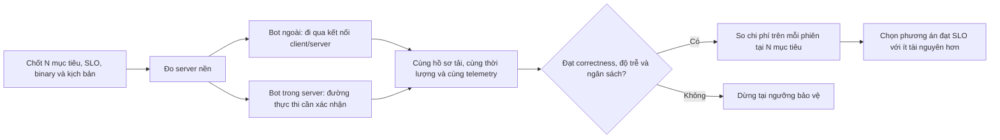

TÓM TẮT 5 DÒNG (1..5)
1. [TÀI LIỆU] PARTIAL: đã lập kế hoạch so Bot ngoài và Bot trong server từ báo cáo E-*; thư mục thiết kế gốc DESIGN/BOT không có trong kho tài liệu đã chỉ định.
2. [ĐỀ XUẤT — CHƯA KIỂM] Phương án đo gồm tải nền, tăng dần số phiên, giữ tải và so cùng kịch bản; chưa có số đo runtime.
3. [ĐỀ XUẤT — CHƯA KIỂM] Đã ghi các chỉ số tài nguyên, độ trễ, ổn định phiên và ngưỡng khởi đầu; ngưỡng chưa được PM phê duyệt.
4. [CHƯA KIỂM] Chưa xác định N mục tiêu, ngân sách máy/SLO, tính đúng của ABI và giao thức trong binary; cần PM quyết định các đầu vào.
5. [THẤY] Chỉ đọc tài liệu/source tĩnh; không chạy test, build, exe, VM hoặc mạng; không có commit/push theo yêu cầu.

# XD-E06 — Kế hoạch đo tải và tiêu chí chuyển Bot vào server

Loại: thiết kế
Chủ đề: Kế hoạch so sánh Bot chạy ngoài với Bot trong server bằng cùng tải và tiêu chí định lượng.
Từ khóa: Bot ngoài, Bot trong server, tải, population, concurrency, GS, session, E-06
Trạng thái: PARTIAL — có kế hoạch đo được; tài liệu DESIGN/BOT gốc thiếu và chưa có N mục tiêu/SLO để chốt ngưỡng.
Độ phủ: đã đọc phần liên quan của 14/14 báo cáo E-*; đã kiểm tĩnh 2/2 nguồn client/server được phép; chưa đọc được 0/1 thư mục DESIGN/BOT; chưa đo runtime 0/2 phương án.
Liên quan: JX1_OPS/REPORTS/E-01-thieu-giao-thuc.md; E-01b-thieu-giao-thuc.md; E-02-hanh-vi-bot.md; E-03-dieu-phoi-dan-so.md; E-05a-khung-tester.md; E-05b-kich-ban-full-cycle.md; E-07-goi-tao-nhan-vat-logout.md; E-08-goi-danh-quai-xac-nhan-kill.md; E-09a-real-login-allowlist.md; E-10-bot-tao-role-logout-offline.md; E-11-hoi-mau-vat-pham-doi-ban-do.md; E-12-khao-sat-goi-tuong-tac.md; E-13-dispatcher-p1.md; E-13b-watchdog.md; JX1_OPS/DESIGN/CHUAN-BAO-CAO.md.
Cần tôi quyết định: có — PM cần chốt N_peak, ngân sách tài nguyên/SLO và mức fidelity bắt buộc của Bot trong server trước khi chạy.

## Sơ đồ phương án

## Phạm vi và độ phủ

| Phần tử | Trạng thái | Bằng chứng và giới hạn |
|---|---|---|
| Thiết kế Bot gốc trong DESIGN/BOT | Chưa phủ | [THẤY] `Test-Path -LiteralPath 'D:/jx1-ops-wt/JX1_OPS/DESIGN/BOT'` → `False`. E-12 nhắc đến tài liệu `DESIGN/BOT/SHARED_BOT_SOCIAL_AND_INTERACTION_SYSTEM.md` tại `JX1_OPS/REPORTS/E-12-khao-sat-goi-tuong-tac.md:15`, nhưng thư mục cha không có; không suy nội dung thiết kế từ liên kết này. |
| Báo cáo E-* | Đã phủ phần cần cho kế hoạch | [THẤY] `Get-ChildItem -LiteralPath 'D:/jx1-ops-wt/JX1_OPS/REPORTS' -File -Filter 'E-*'` → 14 file trực tiếp; đã đọc tóm tắt và các đoạn liên quan đến tải, lifecycle, tester, giao thức và giới hạn qua `Select-String` giới hạn trong 14 file này. Không coi kết quả test lịch sử là kết quả của lượt này. |
| Bot ngoài | Đã có mô tả/fixture, chưa đo server thật | [TÀI LIỆU] E-01 ghi luồng Bishop→gs001, giới hạn hành động 18/giây và chưa có phép đo online tại `JX1_OPS/REPORTS/E-01-thieu-giao-thuc.md:59,62`. E-05a mô tả tiến trình riêng theo Bot và chạy tuần tự/song song 1..5 trong tester offline tại `JX1_OPS/REPORTS/E-05a-khung-tester.md:3,36`. |
| Bot trong server | Chưa có thiết kế/định nghĩa đường chạy để xác minh | [CHƯA KIỂM] Không có tài liệu DESIGN/BOT tại đường dẫn task để xác định Bot sẽ gọi API nào, bỏ qua tầng nào, hay tiêu thụ chung tài nguyên nào. Phải chốt thiết kế trước phép so sánh. |
| Luồng tải và kịch bản | Có cơ sở offline, chưa xác nhận runtime | [TÀI LIỆU] E-05b ghi fixture giữ phiên 30 giây và một SKILL, đồng thời nêu rõ không xác minh gameplay thật tại `JX1_OPS/REPORTS/E-05b-kich-ban-full-cycle.md:4,6`. E-02 giữ hồi máu và kill credit ở CHƯA KIỂM tại `JX1_OPS/REPORTS/E-02-hanh-vi-bot.md:5,39-42`. |
| Giao thức đồng bộ | Cần xác nhận trước đo so sánh | [THẤY] Client source có kiểm IsLogin/clientKey và gửi `CLIENT_SYNC_END` tại `C:/Jx1CocoV3/Folder/Client2912-20260116T044348Z-3-001/Client2912/Client/Classes/gamecore/KProtocolProcess.cpp:3332-3354`; server source có một nhánh gửi một byte tại `C:/Jx1CocoV3/SwordOnline/SwordOnline/jxOnline/gameserver/Sources/Core/Src/KProtocolProcess.cpp:3647-3662`. E-01b cũng ghi ABI/binary chưa xác minh tại `JX1_OPS/REPORTS/E-01b-thieu-giao-thuc.md:5`. Không kết luận binary chạy thật có bất tương thích. |
| Đo tài nguyên/độ trễ thực tế | Chưa phủ | [CHƯA KIỂM] Không có số CPU, RAM, nhịp vòng lặp, thông lượng hoặc p95/p99 trong nguồn đã đọc. Task này chỉ lập kế hoạch, không chạy tải. |

## Hai phương án cần so sánh

### Bot chạy ngoài server

- [TÀI LIỆU] Dùng một client Bot tạo phiên riêng và đi qua luồng gateway/Bishop rồi game server; E-01 mô tả luồng và điều kiện phiên tại `JX1_OPS/REPORTS/E-01-thieu-giao-thuc.md:59`.
- [ĐỀ XUẤT — CHƯA KIỂM] Đo riêng CPU/RSS của máy chạy Bot và server, số socket/phiên, byte gửi/nhận, thời gian login/sync, lỗi giao thức và mức tăng độ trễ server. Đây là cách đo gần với tải kết nối client hơn nếu phiên và ABI đúng.
- [ĐỀ XUẤT — CHƯA KIỂM] Giới hạn: chi phí của máy Bot và đường mạng là một phần phép đo; báo cáo phải tách chúng khỏi CPU/RAM phía GS.

### Bot chạy trong server

- [CHƯA KIỂM] Chưa tìm được mô tả thiết kế trong đường dẫn đã nêu; chưa thể xác nhận đây là actor nội bộ, test hook, hay client protocol chạy trong process.
- [ĐỀ XUẤT — CHƯA KIỂM] Trước khi đo, ghi rõ điểm vào, vòng đời phiên, luồng/tác vụ sử dụng và liệu có đi qua Bishop, framing, mã hóa, kiểm tra sync, world update và network I/O không. Các tầng bị bỏ qua phải đánh dấu trong kết quả.
- [ĐỀ XUẤT — CHƯA KIỂM] Nếu đường nội bộ bỏ qua transport hoặc giao thức, chỉ so chi phí xử lý nghiệp vụ trên mỗi Bot; không dùng kết quả đó để tuyên bố chịu tải đầu-cuối tương đương Bot ngoài.

### Quy tắc chọn

- [ĐỀ XUẤT — CHƯA KIỂM] Chạy cùng N phiên, cùng phân phối kịch bản, cùng thời gian, cùng dữ liệu và cùng cấu hình máy. Dùng ba lượt lặp độc lập sau khi chốt binary/giao thức.
- [ĐỀ XUẤT — CHƯA KIỂM] Ưu tiên Bot ngoài cho kiểm tra sức chịu tải đầu-cuối nếu đạt SLO. Chọn Bot trong server cho mục tiêu tải nghiệp vụ nội bộ khi fidelity được ghi rõ và nó giảm ít nhất 15% CPU hoặc RSS trên mỗi phiên mà không làm xấu correctness/độ trễ quá ngưỡng.
- [CHƯA KIỂM] Mức tiết kiệm 15% là ngưỡng quyết định đề xuất, không phải số đo hay yêu cầu đã được PM phê duyệt.

## Kế hoạch đo đề xuất

1. [ĐỀ XUẤT — CHƯA KIỂM] Chốt môi trường staging được phép, phiên bản/hash binary, cấu hình máy, N_peak, ngân sách tài nguyên, SLO và tín hiệu đo vòng lặp server. Lưu baseline 15 phút không Bot; không dùng Main VM.
2. [ĐỀ XUẤT — CHƯA KIỂM] Kiểm một phiên, rồi tối đa 5 phiên ở mức đầu; E-05a có harness offline tuần tự/song song 1..5 (`JX1_OPS/REPORTS/E-05a-khung-tester.md:3,36`) nhưng không chứng minh runtime server. Sau đó ramp qua 25%, 50%, 75%, 100% N_peak, tăng theo từng nấc và giữ mỗi nấc ít nhất 5 phút.
3. [ĐỀ XUẤT — CHƯA KIỂM] Ở N_peak, giữ tải 30 phút; chạy ba lượt cho mỗi kiến trúc. Chạy thêm soak 60 phút nếu cả ba lượt đạt để phát hiện tăng RSS, mất phiên hoặc queue tích lũy.
4. [ĐỀ XUẤT — CHƯA KIỂM] Dùng workload tách lớp: login/sync/đứng yên và ping; RUN/giữ phiên; một SKILL có mục tiêu kiểm soát; reconnect/logout chỉ khi semantics được xác minh. E-05b có fixture RUN/30 giây/SKILL tại `JX1_OPS/REPORTS/E-05b-kich-ban-full-cycle.md:4,40`; không tính bước BỎ QUA là thành công thật.
5. [ĐỀ XUẤT — CHƯA KIỂM] Ramp theo phân bố Bot/map đã định trước, không bật đồng loạt. E-03 mô tả planner thay đổi trong cửa sổ 60 giây có jitter và mẫu map cap 60/50/20 tại `JX1_OPS/REPORTS/E-03-dieu-phoi-dan-so.md:4,40-42`; các số mẫu không phải giới hạn server.
6. [ĐỀ XUẤT — CHƯA KIỂM] Dừng nấc ngay khi vượt ngưỡng bảo vệ, ghi thời điểm, N active, chỉ số và nguyên nhân; không tự retry lỗi đăng nhập/giao thức. Lặp lại baseline nếu tải nền thay đổi giữa hai phương án.

## Tiêu chí đo và cửa quyết định ban đầu

Các con số dưới đây là ngưỡng khởi đầu để PM xem xét; không phải chuẩn hiện hành JX1 và chưa được kiểm bằng runtime.

| Chỉ số | Cách ghi | Cửa go/no-go đề xuất | Nguồn / độ chắc |
|---|---|---|---|
| Phiên hoạt động và đúng trạng thái | N yêu cầu, login thành công, vào IN_GAME, lỗi login/sync, disconnect bất ngờ; đếm trên từng nấc và mỗi lượt | Tỷ lệ vào đúng trạng thái ≥99%; lỗi giao thức/login ≤0.1% phiên; mọi phiên thiếu ACK/đúng trạng thái tính là lỗi | [ĐỀ XUẤT — CHƯA KIỂM]; E-01b:68,103 ghi các điều kiện sync/ACK, chưa xác minh binary |
| Login/sync/heartbeat latency | p50, p95, p99, max theo mili giây; tách login và sync; ping chỉ đo round trip nếu có phản hồi ghép đúng phiên | p95 ≤ baseline +10%; p99 ≤ baseline +20% tại N_peak | [ĐỀ XUẤT — CHƯA KIỂM]; chưa có SLO hoặc số đo lịch sử |
| Vòng lặp/tick server | Thời gian mỗi vòng theo mili giây, p50/p95/p99/max và tỷ lệ vượt chu kỳ; xác nhận định nghĩa tick ở binary trước đo | p95 ≤ baseline +10%; tỷ lệ vượt chu kỳ không tăng quá 1 điểm phần trăm | [ĐỀ XUẤT — CHƯA KIỂM]; nguồn đã đọc chưa định nghĩa chu kỳ runtime |
| CPU server | % CPU trung bình/p95 theo process và core được cấp trong cửa sổ 1 giây, tổng hợp theo 5 phút | Trung bình ≤70%, p95 ≤85% ngân sách CPU được PM giao | [ĐỀ XUẤT — CHƯA KIỂM]; chưa có baseline hay ngân sách máy |
| RAM/server và Bot driver | RSS/peak, bytes trên mỗi phiên đang hoạt động, và chênh lệch RSS giữa phút 45–60 của soak | Peak ≤80% ngân sách RAM; tăng RSS phút cuối ≤5% so với phút 45 | [ĐỀ XUẤT — CHƯA KIỂM]; chưa có số đo |
| Network/transport | socket mở, bytes/s và packets/s vào/ra, retransmit, queue/timeout nếu có; tách host Bot và GS | Throughput p95 ≤70% giới hạn interface được duyệt; không có xu hướng queue tăng qua ba nấc liên tiếp | [ĐỀ XUẤT — CHƯA KIỂM]; E-01:56-59 mô tả framing/phiên, không có throughput đo được |
| Hoạt động gameplay | RUN/SKILL đã gửi, event phản hồi có thể ghép phiên, lỗi hành động; không dùng riêng event NPC chết làm kill credit | Correctness ≥99% cho event đã xác định nghĩa; chưa có định danh killer thì không chấm tỷ lệ kill | [ĐỀ XUẤT — CHƯA KIỂM]; E-08:2-4 ghi death event thiếu killerID và kill credit chưa xác minh |
| Chi phí mỗi Bot | CPU-second/phiên-phút và RSS/phiên ở cùng N, cùng workload | Chỉ xét chuyển khi mọi SLO đạt và Bot trong server giảm ≥15% CPU hoặc RSS trên mỗi phiên | [ĐỀ XUẤT — CHƯA KIỂM]; 15% là lựa chọn tạm để PM quyết định |

## Mục sổ thông số

| Nhóm | Tên/tham số | file:dòng | Giá trị | Đơn vị | Ảnh hưởng | Đổi an toàn | Nguồn đo |
|---|---|---|---|---|---|---|---|
| Client Bot | Giới hạn hành động mỗi phiên | `JX1_OPS/REPORTS/E-01-thieu-giao-thuc.md:59` | 18 | hành động/giây | Giới hạn tốc độ action theo mô tả E-01; không phải năng lực xử lý server | CẨN THẬN | Giá trị ghi trong báo cáo; chưa đo runtime lượt này |
| Client Bot | Kiểm `--observed-online` trước khi thêm Bot | `JX1_OPS/REPORTS/E-01-thieu-giao-thuc.md:62` | 0..99 | online quan sát | Guard theo tham số người dùng; không phải giới hạn online đo được hay đặt chỗ nguyên tử | KHÔNG | Đọc báo cáo; không đọc mật khẩu/khóa |
| Population | Cap map mẫu | `JX1_OPS/REPORTS/E-03-dieu-phoi-dan-so.md:40-42` | 60 / 50 / 20 | Bot/map trong JSON mẫu | Minh họa cấu hình planner; không xác nhận map thật hoặc sức chứa | CẨN THẬN | Dữ liệu mẫu, chưa đo |
| Tester | N phiên harness | `JX1_OPS/REPORTS/E-05a-khung-tester.md:3,36` | 1..5 | Bot | Kiểm năng lực tester offline; không phải tải server thật | CẨN THẬN | Lịch sử báo cáo/test; không chạy lại |
| Full cycle fixture | Thời gian giữ phiên | `JX1_OPS/REPORTS/E-05b-kich-ban-full-cycle.md:4` | 30 | giây | Kịch bản fixture giữ phiên; không chứng minh thời gian ổn định runtime | CẨN THẬN | Lịch sử fixture; không chạy lại |
| Kế hoạch đề xuất | N_peak, số nấc, thời gian soak | Báo cáo này | Chờ PM chốt N_peak; nấc theo %; 60 | phiên; phút | Quy mô và độ dài phép thử | CẨN THẬN | Đề xuất, chưa chạy |

## Giải mã tên

| Tên gốc | Mã hóa | Chữ đúng | Nguồn file:dòng |
|---|---|---|---|
| Bishop, gs001 | UTF-8/ASCII | Giữ nguyên tên hệ thống; lần lượt là gateway và game server theo luồng E-01 | `JX1_OPS/REPORTS/E-01-thieu-giao-thuc.md:59` |
| Bot, TESTER, GS | UTF-8/ASCII | Thuật ngữ/viết tắt kỹ thuật; không phải tên riêng nhân vật trong game | `JX1_OPS/REPORTS/E-05a-khung-tester.md:8,11` |
| Tên kỹ năng, trang bị, quái, NPC hoặc bản đồ cụ thể | — | Không xuất hiện trong báo cáo này; không áp dụng | — |

## Sắp theo cấu trúc game

[TÀI LIỆU] Không có danh mục vật phẩm hay NPC để sắp theo map; kế hoạch nhóm theo luồng phiên: login/sync → idle → di chuyển → SKILL → thoát. E-05b ghi riêng RUN và một SKILL trong fixture tại `JX1_OPS/REPORTS/E-05b-kich-ban-full-cycle.md:21-27`; thao tác đó không định danh kỹ năng/game map cụ thể.

## Đề xuất tối ưu

- [ĐỀ XUẤT — CHƯA KIỂM] Tách process Bot-driver khỏi GS và log aggregate theo nấc để phân biệt tài nguyên sinh tải với tài nguyên game server; chỉ lưu số liệu/ID sự kiện đã che, không lưu credential, khóa hoặc payload đăng nhập.
- [ĐỀ XUẤT — CHƯA KIỂM] Dùng ramp có giới hạn, giữ mỗi nấc, và dừng tự động theo ngưỡng CPU/RAM/latency; không lấy cap hoặc con số trong JSON/fixture làm sức chứa.
- [CHƯA KIỂM] Trước khi chọn Bot trong server, cần bản thiết kế chỉ rõ điểm vào và các tầng được giữ/bỏ; nếu không, số đo không so được với Bot ngoài ở mức end-to-end.

## Đã xác minh / Chưa xác minh

### Đã xác minh

- [THẤY] Nhánh task hiện tại là `task/XD-E06`; lần kiểm tra Git trước khi ghi không hiện thay đổi có sẵn.
- [THẤY] `JX1_OPS/REPORTS/XD-E06.md` chưa tồn tại trước khi tạo; nguồn E-* nằm tại kho chỉ đọc `D:/jx1-ops-wt/JX1_OPS/REPORTS`.
- [THẤY] `D:/jx1-ops-wt/JX1_OPS/DESIGN/BOT` không tồn tại; hai cây source client/server được task cho phép tồn tại.
- [THẤY] Đọc tĩnh các đoạn source được trích dẫn ở trên; nội dung bình luận C++ hiển thị sai mã tiếng Việt trong PowerShell mặc định nên không dùng bình luận làm kết luận. Tên hàm/struct ASCII được trích ở mức định vị, không suy hành vi runtime.

### Chưa xác minh

- [CHƯA KIỂM] Thiết kế Bot trong server, phiên bản/hash binary, ABI/giao thức thực tế, N_peak và ngân sách tài nguyên/SLO.
- [CHƯA KIỂM] CPU, RAM, tick/loop, độ trễ, throughput, độ ổn định phiên, kill credit và mọi ngưỡng đề xuất trong báo cáo.
- [CHƯA KIỂM] Không chạy test/build, exe, VM hoặc mạng theo phạm vi task; kết quả test E-01..E-13b nếu được nhắc đến chỉ là lịch sử của các báo cáo nguồn.

## Bàn giao

Không commit hoặc push; task không yêu cầu. Báo cáo này là kế hoạch, không phải phê duyệt chạy đo. Bước tiếp theo: PM cung cấp/định vị DESIGN/BOT, chốt N_peak và SLO; sau đó giao task runtime riêng với môi trường được duyệt.

Kỹ năng đã dùng: jx1-retrofit, jx1-read-server, jx1-read-client, jx1-parameters, jx1-knowledge, jx1-report.

## Lỗi, cách thử và kết quả

- [THẤY] Ghi nhịp theo yêu cầu tới `D:\JX-wt\XD-E06.nhip` bị từ chối quyền ghi (Access denied); không thử vượt quyền hoặc ghi sang vị trí khác ngoài phạm vi.
- [THẤY] `rg` không dùng trong lượt này; dùng `Get-ChildItem`/`Select-String` với đường dẫn/file đã giới hạn. Không có test thất bại vì không chạy test.
