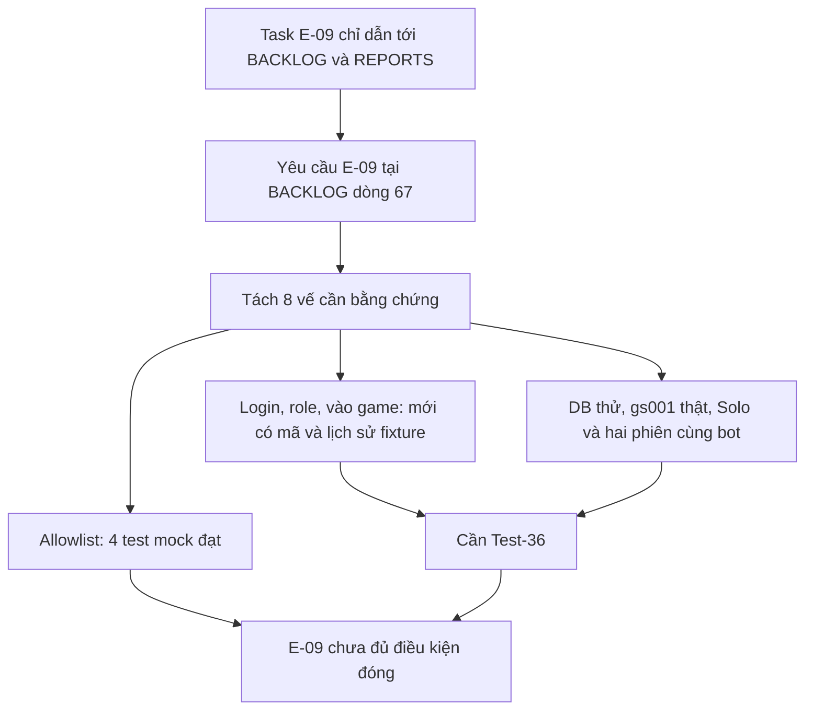

TÓM TẮT 1: [NGUỒN][THẤY] DONE phạm vi XD-E09: đã đối chiếu 8 vế từ yêu cầu E-09 tại `JX1_OPS/TASKS/BACKLOG.md:67`; chưa đủ bằng chứng đóng E-09.
TÓM TẮT 2: [THẤY] K1 chạy 4 test mock, 4/4 đạt trong 0.012 s; 0 lỗi/bỏ qua/sự kiện socket-DNS-tiến trình con (lệnh và kết quả tại `JX1_OPS/REPORTS/XD-E09.md:80–127`).
TÓM TẮT 3: [THẤY] Đầu ra là báo cáo này; mục Kết quả task đã ghi tại `JX1_OPS/TASKS/XD-E09.md:28–33`. Không thay báo cáo E-09a hoặc mã nguồn.
TÓM TẮT 4: [CHƯA KIỂM] 7/8 vế cần bằng chứng Test-36; 3/7 test E-09a dùng loopback không chạy lại (`JX1_OPS/TESTER/test_real_login.py:107`, `:133`, `:156`; phần bàn giao thiếu tại `JX1_OPS/REPORTS/XD-E09.md:164–185`).
TÓM TẮT 5: [CHƯA KIỂM] Không build/chạy exe game, VM hoặc mạng (`JX1_OPS/REPORTS/XD-E09.md:164–185`); không commit/push theo chỉ đạo task. PM tiếp nhận danh sách Test-36; chưa có SHA mới.

# XD-E09 — Đối chiếu tiêu chí đóng E-09 và kiểm lại bot allowlist
Loại: kiểm thử
Chủ đề: Kiểm lại allowlist hoàn toàn offline và phân biệt bằng chứng chuẩn bị với nghiệm thu BOT/TESTER thật.
Từ khóa: bot thử nghiệm, danh sách cho phép, allowlist, real_login, đăng nhập, Solo, Enabled, Test-36, E-09
Trạng thái: DONE — hoàn tất kiểm tra và ghi phần thiếu của XD-E09; E-09 CHƯA ĐẠT.
Độ phủ: đã đối chiếu 8/8 vế yêu cầu; 1/8 vế có bằng chứng đạt ở tầng cấu hình/offline, 7/8 chưa nghiệm thu thật; chạy lại 4/7 test E-09a.
Liên quan: `JX1_OPS/TASKS/E-09.md`, `JX1_OPS/TASKS/E-09a.md`, `JX1_OPS/TASKS/BACKLOG.md`, `JX1_OPS/REPORTS/E-09a-real-login-allowlist.md`, `JX1_OPS/DESIGN/CHUAN-BAO-CAO.md`.
Cần tôi quyết định: không — giao lại PM phần Test-36; báo cáo này không cấp quyền chạy VM hoặc mạng.

## Sơ đồ đối chiếu



## Phạm vi và độ phủ

[THẤY] `JX1_OPS/TASKS/E-09.md:1–8` không có mục “Tiêu chí xong”; dòng 8 dẫn nội dung sang BACKLOG và REPORTS. Bản cùng tên tại `D:/jx1-ops-wt/JX1_OPS/TASKS/E-09.md:1–8` cũng như vậy. Tra tên tệp bằng `git ls-files -- '*BACKLOG*' '*E-09*' '*Test-36*'` (exit 0) tìm được `JX1_OPS/TASKS/BACKLOG.md`; không cần đọc cả kho.

[TÀI LIỆU] Nguyên văn hàng E-09 tại `JX1_OPS/TASKS/BACKLOG.md:67`: “Chạy BOT/TESTER thật vào gs001 trên VM thử (Config cho phép đúng IP 192.168.56.150, tài khoản thử trong DB VM), kịch bản login→role→vào game; Enabled=1 Solo bằng 2 phiên + bot”. Tám vế dưới đây là cách tách hàng yêu cầu này để kiểm, không phải bổ sung tiêu chí mới. Phụ thuộc được hàng này ghi là E-07, E-08, B-02c; chưa tái thẩm định các việc đó.

| Vế | Nội dung cần chứng minh | Phạm vi đã phủ / bằng chứng | Kết quả nghiệm thu và phần thiếu |
|---|---|---|---|
| C1 | Config chỉ mở đúng đích thử khi opt-in; mặc định vẫn loopback | **Đã phủ offline — [THẤY]** K1: 4/4 đạt; mặc định/cổng/host/redirect kiểm ở `JX1_OPS/TESTER/core.py:43–64`, guard sát socket ở `JX1_OPS/TESTER/real_login.py:46–54`; test `JX1_OPS/TESTER/test_real_login.py:38–105` | Đạt ở tầng cấu hình và mock. Chưa khẳng định kết nối VM thành công; phần đó thuộc C2. |
| C2 | BOT/TESTER thật kết nối gs001 trên VM thử | **Chưa phủ runtime — [TÀI LIỆU]** `JX1_OPS/TASKS/E-09.md:5` ghi chưa chạy bot thật; giới hạn E-09a tại `JX1_OPS/REPORTS/E-09a-real-login-allowlist.md:136–138` | **[CHƯA KIỂM] Cần Test-36.** Thiếu phiên thực, xác nhận đúng máy đích và kết quả BOT/TESTER tới gs001. |
| C3 | Tài khoản thử tồn tại trong DB của VM | **Chưa phủ — [THẤY]** K1 chỉ kiểm thiếu/sai dữ liệu môi trường; test sinh dữ liệu tổng hợp trong RAM tại `JX1_OPS/TESTER/test_real_login.py:26–31`, `:95–105` | **[CHƯA KIỂM] Cần Test-36.** Thiếu xác nhận tài khoản thử trong DB và khớp nhân vật; không đọc DB/dump/credential trong XD-E09. |
| C4 | Login thật thành công | **Đã phủ đọc tĩnh, chưa phủ runtime — [THẤY]** `login_real` lấy cấu hình môi trường, mở gateway và kiểm response ở `JX1_OPS/TESTER/real_login.py:58–67` | **[CHƯA KIỂM] Cần Test-36.** Thiếu response đăng nhập thật đã được xác thực; K1 không chạy nhánh login dương. |
| C5 | Role thật đúng nhân vật yêu cầu | **Đã phủ đọc tĩnh, chưa phủ runtime — [THẤY]** `role_real` đối chiếu tên trong role list, thiếu thì FAIL, không tự tạo: `JX1_OPS/TESTER/real_login.py:70–75` | **[CHƯA KIỂM] Cần Test-36.** Thiếu role list thật và xác nhận nhân vật yêu cầu; không suy từ fixture. |
| C6 | Vào game thật sau permit và đồng bộ | **Đã phủ đọc tĩnh, chưa phủ runtime — [THẤY]** guard permit, logic login và chờ `IN_GAME`: `JX1_OPS/TESTER/real_login.py:78–95`; giữ phiên/đóng TCP ở `:98–110` | **[CHƯA KIỂM] Cần Test-36.** Thiếu permit/sync thật, ABI và trạng thái vào game; mục tiêu giữ 30 s trong mã chưa phải thời gian phiên thật đã đo. |
| C7 | `Enabled=1` và hành vi Solo đúng trên server thật | **Chưa phủ runtime — [TÀI LIỆU]** hàng yêu cầu `JX1_OPS/TASKS/BACKLOG.md:67`; README xác định visibility chỉ là fixture tại `JX1_OPS/TESTER/README.md:134–157` | **[CHƯA KIỂM] Cần Test-36.** Thiếu xác nhận cấu hình có hiệu lực và quan sát Solo trên server; XD-E09 không sửa/bật cấu hình. |
| C8 | Kiểm Solo bằng hai phiên người chơi cùng bot | **Chưa phủ runtime — [TÀI LIỆU]** yêu cầu `JX1_OPS/TASKS/BACKLOG.md:67`; ba phiên visibility trong fixture không login thật (`JX1_OPS/TESTER/README.md:136–150`) | **[CHƯA KIỂM] Cần Test-36.** Thiếu hai phiên người chơi đã đăng nhập cùng bot và kết quả nhìn thấy/ẩn theo Solo; một bot login không đủ C8. |

[THẤY] C1 có bằng chứng trực tiếp ở tầng offline; C2–C8 chưa có bằng chứng nghiệm thu thật trong nguồn đã đọc. “Đã phủ” ở bảng là đã kiểm tra tình trạng bằng chứng, không có nghĩa cả tám vế đã đạt. Không đổi kết luận cũ “DONE trong phạm vi code/offline” của `JX1_OPS/REPORTS/E-09a-real-login-allowlist.md:2–6`.

## Giải mã tên

| Tên gốc | Mã hóa | Chữ đúng UTF-8 | Nguồn file:dòng |
|---|---|---|---|
| Không phát sinh tên kỹ năng, trang bị, quái, NPC hoặc bản đồ cụ thể | Không áp dụng GBK/TCVN3 | Không có dữ liệu tên game cần giải mã; BOT, TESTER, Solo, Bishop, gs001 và Test-36 là nhãn kỹ thuật | `JX1_OPS/TASKS/BACKLOG.md:67`; `JX1_OPS/TESTER/README.md:159–176` |

## Sắp theo cấu trúc game

[THẤY] Bảng C1–C8 đi theo điều kiện kết nối → tài khoản → đăng nhập → nhân vật → vào game → tương tác Solo nhiều phiên, đúng luồng yêu cầu tại `JX1_OPS/TASKS/BACKLOG.md:67`. Không có dữ liệu cần xếp theo phái/nhánh/cấp học, bộ trang bị hoặc bản đồ.

## Nguồn đã đọc và giới hạn đọc

[THẤY] Danh sách bắt đầu từ hai nguồn nêu trong `JX1_OPS/TASKS/XD-E09.md:20`: task E-09 và báo cáo E-09a. Các tệp bổ sung chỉ dùng để truy tiêu chí, kiểm test trước khi chạy và kiểm bằng chứng trực tiếp:

| Nguồn | Phần đã đọc / mục đích |
|---|---|
| `JX1_OPS/DESIGN/CHUAN-BAO-CAO.md:1–33` | Khuôn báo cáo; UTF-8; giữ nguyên kết luận cũ |
| `JX1_OPS/TASKS/XD-E09.md:1–26`; `JX1_OPS/TASKS/E-09.md:1–8` | Quyền offline, đầu ra và tình trạng tiêu chí gốc |
| `JX1_OPS/REPORTS/E-09a-real-login-allowlist.md:1–165` | Sáu mảng kiểm, lịch sử 7/7 và giới hạn chưa chạy thật |
| `JX1_OPS/TASKS/BACKLOG.md:67`; `JX1_OPS/TASKS/E-09a.md:1–20` | Yêu cầu cha và phạm vi việc chuẩn bị; BACKLOG chỉ tìm đoạn liên quan |
| `JX1_OPS/TESTER/test_real_login.py:1–166`; `bootstrap.py:1–11` | Chọn bốn test mock, tách ba test có socket; cách bootstrap khi dùng `-I` |
| `JX1_OPS/TESTER/core.py:1–220`; `real_login.py:1–119`; `run.py:1–67` | Guard, redaction, các bước thật và kiểm cờ CLI |
| `JX1_OPS/TESTER/README.md:1–214` | Cách chạy, định nghĩa fixture, tham số và giới hạn |
| `JX1_OPS/TESTER/test_full_cycle.py:1–48`; `test_tester.py:1–65` | Chuỗi import của test và bằng chứng fixture thực sự tạo socket |
| `JX1_OPS/TESTER/scenarios.py:12–18`, `:55–73`; `visibility.py:60–69` | Guard loopback của scenario giả; chỉ tìm đoạn khớp |
| `JX1_OPS/BOT/session.py:16–39` | Đích/cổng và ngưỡng admission liên quan; chỉ tìm hằng số/hàm cần thiết |
| `JX1_OPS/DESIGN/MUC-LUC-TRI-THUC.md:1–25` | Định vị nhóm bot/tester, không dùng thay bằng chứng test |

[THẤY] Đã nạp sáu `SKILL.md` trong `.agents/skills/` được prompt chỉ định. Không mở source C++ client/server, Graphify hoặc file cấu hình game: không cần để trả lời phép kiểm allowlist, và không thể thay bằng chứng runtime bằng suy luận source. Mỗi lượt trích tối đa 400 dòng/tệp; không quét cây nguồn lớn.

## Kiểm chứng thực chạy

### K1 — Bốn test có sẵn, hoàn toàn mock

[THẤY] Chạy từ `D:\JX-wt\XD-E09`, nhánh `task/XD-E09`; Git status đầu lượt sạch. Mốc trước khi ghi báo cáo: `Get-Date -Format 'yyyy-MM-dd HH:mm:ss zzz'` trả `2026-11-19 03:11:15 +07:00`.

[THẤY] Lệnh dưới đây là lượt thành công, không tạo script phụ. `-I` cô lập Python; `-B` ngăn ghi bytecode. Môi trường chỉ giữ bốn đường dẫn hệ thống để import thư viện Windows; không truyền biến tài khoản/khóa. Audit hook chặn mọi sự kiện `socket.*` và tạo tiến trình được liệt kê, kể cả loopback. Các tên test lấy nguyên từ `JX1_OPS/TESTER/test_real_login.py:38`, `:67`, `:83`, `:95`.

```powershell
@'
import os
import sys
system_environment = {name: os.environ[name] for name in ('SystemRoot', 'WINDIR', 'TEMP', 'TMP') if name in os.environ}
os.environ.clear()
os.environ.update(system_environment)
sys.stdout.reconfigure(encoding='utf-8')
sys.stderr.reconfigure(encoding='utf-8')
blocked = []
def offline_guard(event, args):
    if event.startswith('socket.') or event in {'subprocess.Popen', 'os.system', 'os.spawn', 'os.posix_spawn'}:
        blocked.append(event)
        raise RuntimeError('XD-E09: forbidden network/process event')
sys.addaudithook(offline_guard)
sys.path.insert(0, r'D:\JX-wt\XD-E09')
sys.path.insert(0, r'D:\JX-wt\XD-E09\JX1_OPS\TESTER')
import unittest
from test_real_login import RealLoginTests
names = (
    'test_exact_allowlist_before_any_socket_or_dns',
    'test_opt_in_endpoints_use_guard_with_mock_only',
    'test_cli_rejects_unsafe_modes_without_worker',
    'test_missing_or_invalid_environment_before_socket',
)
suite = unittest.TestSuite(RealLoginTests(name) for name in names)
result = unittest.TextTestRunner(verbosity=2).run(suite)
print('XD-E09: tests=%d failures=%d errors=%d skipped=%d forbidden_events=%d' %
      (result.testsRun, len(result.failures), len(result.errors), len(result.skipped), len(blocked)))
print('XD-E09: isolated=%d dont_write_bytecode=%d environment=system_paths_only' %
      (sys.flags.isolated, sys.flags.dont_write_bytecode))
sys.exit(0 if result.wasSuccessful() and not blocked else 1)
'@ | python -I -B -
```

[THẤY] Kết quả thật: exit 0; bốn tên test trên đều `ok`:

```text
Ran 4 tests in 0.012s
OK
XD-E09: tests=4 failures=0 errors=0 skipped=0 forbidden_events=0
XD-E09: isolated=1 dont_write_bytecode=1 environment=system_paths_only
```

| Test thực chạy | Bằng chứng đạt và giới hạn |
|---|---|
| `test_exact_allowlist_before_any_socket_or_dns` | **[THẤY]** K1 đạt; mặc định từ chối VM, chặn host/alias/cổng/redirect sai, scenario giả từ chối VM; ba mock socket/DNS không được gọi (`JX1_OPS/TESTER/test_real_login.py:38–65`). |
| `test_opt_in_endpoints_use_guard_with_mock_only` | **[THẤY]** K1 đạt; hai endpoint đúng đi qua mock, handshake gọi hai lần; loopback không redirect sang VM (`JX1_OPS/TESTER/test_real_login.py:67–81`). Không có kết nối thật. |
| `test_cli_rejects_unsafe_modes_without_worker` | **[THẤY]** K1 đạt; bốn tổ hợp mode/host/cờ sai trả `SystemExit(2)` trước worker (`JX1_OPS/TESTER/test_real_login.py:83–93`). |
| `test_missing_or_invalid_environment_before_socket` | **[THẤY]** K1 đạt; thiếu biến hoặc sai định dạng cấu hình bị từ chối trước socket; dữ liệu thử chỉ trong RAM (`JX1_OPS/TESTER/test_real_login.py:95–105`). Không kiểm credential thật. |

### K2 — Lệnh lịch sử không chạy lại trong XD-E09

[TÀI LIỆU] `python -I -m unittest discover -s JX1_OPS/TESTER -p test_real_login.py -v` được báo cáo cũ ghi 7/7 đạt trong 30.751 s (`JX1_OPS/REPORTS/E-09a-real-login-allowlist.md:100–103`). Đây là kết quả lịch sử, không phải lượt XD-E09.

[CHƯA KIỂM] Không chạy nguyên lệnh K2 và toàn TESTER: ba test ở `JX1_OPS/TESTER/test_real_login.py:107–162` dùng `cycle_server`; fixture tạo socket/bind/listen tại `JX1_OPS/TESTER/test_full_cycle.py:25–30`. Loopback vẫn là hoạt động mạng, không thuộc quyền lượt này. Ba test chưa chạy lại gồm chuỗi CLI giữ 30 s/redaction, redirect permit sau Bishop loopback và thiếu role/dừng các bước sau. Không rút ngắn hold, thay fixture hoặc sửa test để nhận 7/7.

[TÀI LIỆU] Toàn suite lịch sử ban đầu 28/29, một assertion Markdown sai đã được sửa và test E-09a chạy lại đạt; không biến dữ kiện đó thành lỗi hiện tại hoặc kết quả chạy mới (`JX1_OPS/REPORTS/E-09a-real-login-allowlist.md:89–103`, `:130–132`).

## Mục sổ thông số

| Nhóm | Tên/hằng số | file:dòng | Giá trị | Đơn vị | Ảnh hưởng | Đổi an toàn | Nguồn đo |
|---|---|---|---|---|---|---|---|
| Policy | `allow_test_vm` | `JX1_OPS/TESTER/core.py:47–64` | Mặc định `False`; literal loopback được phép | cờ | Chỉ opt-in mới cho đích VM thử | KHÔNG — không mở rộng trong XD-E09 | [THẤY] Đọc tĩnh + K1 |
| Policy | Endpoint VM thử | `JX1_OPS/TESTER/core.py:61–62` | Host literal `192.168.56.150`; Bishop `56722`, game `51189` | IPv4/cổng TCP | Tách đúng pha; không DNS/redirect host | KHÔNG — giữ allowlist đã duyệt | [THẤY] Đọc tĩnh + K1 mock; chưa đo VM |
| Phiên | `hold_real` | `JX1_OPS/TESTER/real_login.py:98–105`, `:117` | Mục tiêu 30; timeout bước 35 | giây | Giữ TCP và xử lý PING theo BOT | CẨN THẬN — chưa đo phiên thật | [THẤY] Đọc tĩnh; [TÀI LIỆU] fixture cũ tại `JX1_OPS/REPORTS/E-09a-real-login-allowlist.md:117–119` |
| Admission | `MAX_ONLINE` / số online đầu vào | `JX1_OPS/BOT/session.py:20`, `:37–39` | Trần 100; đầu vào trước thêm bot là số nguyên 0..99 | phiên online | Chặn đầu vào vượt ngưỡng; không tự quan sát tổng server | CẨN THẬN — không dùng thay phép đo thực | [THẤY] Đọc tĩnh; giới hạn điều phối tại `JX1_OPS/TESTER/README.md:197–198` |
| Kết quả lượt này | K1 | Mục Kiểm chứng thực chạy trong báo cáo này | 4 đạt / 4 chạy; 3 test loopback chưa chạy | test | Chỉ chứng minh phạm vi mock | Không áp dụng | [THẤY] stdout/stderr và exit 0 của K1 |

## Đã xác minh

- **[THẤY]** Yêu cầu cha đã truy được tới đúng hàng BACKLOG, dù task trạng thái không chứa mục tiêu chi tiết (`JX1_OPS/TASKS/E-09.md:8`; `JX1_OPS/TASKS/BACKLOG.md:67`).
- **[THẤY]** K1 chạy bốn test nguyên trạng, đạt 4/4; audit hook không gặp sự kiện socket/DNS/tiến trình con. C1 đạt ở tầng offline; không có phiên bot thật trong phép chạy này.
- **[THẤY]** Mã năm bước có sẵn ở `JX1_OPS/TESTER/real_login.py:113–119`; tên `real_login` và trạng thái `IN_GAME` trong parser không tự chứng minh server thật đã nhận bot (`:95`, `:105`, `:110`).
- **[TÀI LIỆU]** E-09a chỉ hoàn tất chuẩn bị code/offline, chưa nghiệm thu VM/gameplay/lưu dữ liệu (`JX1_OPS/REPORTS/E-09a-real-login-allowlist.md:136–149`). Giữ nguyên kết luận và số liệu cũ.

## Chưa kiểm

| Phần thiếu cần bàn giao | Cần Test-36 | Bằng chứng cần có để xem xét đóng E-09 |
|---|---|---|
| C2 — BOT/TESTER tới gs001 thật | **Có** | Báo cáo phiên thực, đúng máy thử/endpoint, thời điểm và kết quả; không ghi payload auth hoặc credential |
| C3 — tài khoản thử trong DB VM | **Có** | Người có quyền xác nhận tồn tại/khớp tài khoản và nhân vật bằng ghi nhận đã che thông tin; không đưa dump/bí mật vào báo cáo |
| C4–C6 — login → role → vào game thật | **Có** | Kết quả từng bước thật, nhân vật đúng yêu cầu, đồng bộ vào game; thời gian giữ phiên thực nếu nghiệm thu luồng E-09a |
| C7–C8 — Enabled=1, Solo, hai phiên + bot | **Có** | Xác nhận cấu hình có hiệu lực; hai người chơi và bot cùng tham gia, quan sát hành vi Solo và ghi kết quả cụ thể theo yêu cầu |
| Ba test loopback E-09a và toàn regression suite | **Không bắt buộc Test-36 cho chính fixture**, nhưng cần quyền chạy socket loopback riêng | Chạy lại đúng suite khi được phép; không dùng fixture thay nghiệm thu các vế C2–C8 |
| ABI binary, gameplay, logout ứng dụng/lưu dữ liệu | **Có nếu nằm trong đợt nghiệm thu được duyệt** | Chưa đo trong XD-E09; đóng TCP không xác nhận logout ứng dụng/lưu (`JX1_OPS/TESTER/real_login.py:108–110`); không tự thêm thành tiêu chí cha ngoài hàng BACKLOG |

[CHƯA KIỂM] Không build, không chạy game/server exe, không khởi động/đổi trạng thái VM, không truy cập DB, không kết nối mạng thật hoặc loopback. Các bước Test-36 trên là bàn giao, không phải thao tác đã chạy hoặc tự động được phép chạy.

## Lỗi, cách thử và kết quả

| Vấn đề | Cách xử lý trong lượt | Kết quả / giới hạn |
|---|---|---|
| [THẤY] Lượt đọc đầu hiển thị sai dấu UTF-8 trong PowerShell | Dùng `Get-Content -Encoding UTF8` và đặt encoding đầu ra console | Đọc được đúng dấu; không đổi tệp nguồn vì lỗi hiển thị |
| [THẤY] `rg` không có (`Get-Command rg` không trả lệnh) | Dùng `Select-String`/đọc tệp có giới hạn; `git ls-files` chỉ lọc tên BACKLOG/E-09 | Không cài công cụ, không quét nguồn lớn |
| [THẤY] Task E-09 thiếu “Tiêu chí xong”; BACKLOG ở gốc repo/JX1_OPS không tồn tại | Theo dẫn chiếu dòng 8, tìm đúng tên tệp Git | Tìm được `JX1_OPS/TASKS/BACKLOG.md:67`; không còn thiếu nguồn yêu cầu cha |
| [THẤY] Lượt K1 đầu exit 1 trước khi chạy test: import `unittest.mock` → `asyncio.windows_events` → `_overlapped` báo `[WinError 10106] The requested service provider could not be loaded or initialized` | Lượt đầu dùng `os.environ.clear()` không giữ biến hệ thống; lượt thứ hai giữ riêng `SystemRoot`, `WINDIR`, `TEMP`, `TMP`, vẫn bỏ mọi biến credential và giữ audit hook | Lượt hai exit 0, 4/4 đạt. Không sửa Python, bảo mật, mạng hay môi trường máy mẹ; không coi lỗi import là test allowlist FAIL |
| [CHƯA KIỂM] Nhịp `D:\JX-wt\XD-E09.nhip` ở ngoài writable root `D:\JX-wt\XD-E09` của sandbox | Không ghi ngoài sandbox, không xin/vượt quyền; báo các mốc bắt đầu, xong kiểm thử, sắp hoàn tất trong trao đổi | Chưa có tệp nhịp bên ngoài; đây là giới hạn quyền được cung cấp, không phải lỗi ghi đã thực chạy |

## Đề xuất tối ưu

[TÀI LIỆU] Không đề xuất đổi code/cấu hình từ phép kiểm offline này. PM tách rõ nghiệm thu C2–C8 trên Test-36 với regression fixture; chỉ đóng E-09 sau khi bổ sung bằng chứng thật. Căn cứ: hàng yêu cầu `JX1_OPS/TASKS/BACKLOG.md:67` và giới hạn `JX1_OPS/TESTER/README.md:212–214`.

## Bàn giao

- **[THẤY]** DONE cho XD-E09: có ma trận 8 vế, lệnh/kết quả K1 và phần thiếu có nguồn; task cha vẫn chưa đạt. Chỉ ghi `JX1_OPS/REPORTS/XD-E09.md` và mục Kết quả cuối `JX1_OPS/TASKS/XD-E09.md` theo prompt.
- **[THẤY]** Không stage/commit/push theo yêu cầu “Tổng quan commit hộ”; không có SHA mới hoặc bằng chứng push GitHub. Không dùng nhãn bị chặn Git vì không thử commit/push.
- **[THẤY]** Không tạo `_CHIMUC/XD-E09.tsv` hoặc sửa mục lục vì ngoài vùng ghi task. Hàng đề nghị PM gộp: `JX1_OPS/REPORTS/XD-E09.md` | kiểm thử | Đối chiếu đóng E-09 và allowlist | bot, allowlist, real_login, Solo, Test-36 | DONE (XD-E09; E-09 chưa đạt) | 8/8 vế đối chiếu, 4/7 test chạy lại | E-09, E-09a, BACKLOG:67.
- **[THẤY]** Kỹ năng đã nạp: jx1-retrofit, jx1-read-server, jx1-read-client, jx1-parameters, jx1-knowledge, jx1-report. Kỹ năng đã dùng: giữ kết luận cũ/khuôn retrofit, giới hạn bằng chứng source của read-server/read-client, sổ thông số, nhãn tri thức và bàn giao report; không mở nguồn C++ ngoài nhu cầu.

## Kết luận cuối

E-09 CHƯA ĐẠT vì mới xác minh allowlist/config bằng 4 test mock; còn thiếu bằng chứng BOT/TESTER thật, tài khoản thử DB, login → role → vào game và Enabled=1 Solo bằng hai phiên + bot trên Test-36.
