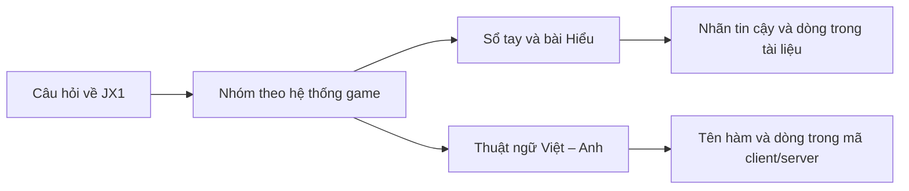

TÓM TẮT 1: [NGUỒN] [THẤY] Đã lập mục lục 28 sổ tay và 18 bài “Hiểu”, đủ 46/46 tên tệp thuộc hợp danh sách hai kho tại 03:49:56 ngày 19/11/2026 (UTC+7); 44 tệp chung và 2 tệp chỉ có ở kho chỉ đọc. Xem bảng Phạm vi và độ phủ.
TÓM TẮT 2: [NGUỒN] [TÀI LIỆU] Mỗi tệp có một dòng mô tả và nhãn độ tin cậy, giữ trạng thái cũ và tách các phần bổ sung theo nguồn.
TÓM TẮT 3: [NGUỒN] [THẤY] Có 30 thuật ngữ Việt–Anh–tên hàm, mỗi dòng trỏ đến tên hàm đã đối chiếu tại cùng phiên bản cây mã được task chỉ định.
TÓM TẮT 4: [NGUỒN] [THẤY] Báo cáo và mục Kết quả đã cập nhật thêm hai sổ tay còn thiếu khi tiếp tục; giữ bằng chứng ba mốc nhịp bị từ chối trong lượt trước. Xem Phát hiện khi chuẩn hóa.
TÓM TẮT 5: [CHƯA KIỂM] Chỉ đọc tĩnh và kiểm tra tài liệu. Chưa build, chạy game/exe, VM hay kết nối mạng. `JX1_OPS/TASKS/XD-H02.md:19–26`.

# XD-H02 — Mục lục các sổ tay và bảng thuật ngữ JX1

Loại: tổng hợp\
Chủ đề: Tra cứu theo hệ thống game, từ sổ tay đến thuật ngữ và vị trí trong mã.\
Từ khóa: JX1, sổ tay, thuật ngữ, nhân vật, bản đồ, NPC, Lua, KPlayer, XD-H02\
Trạng thái: PARTIAL — đạt tiêu chí nội dung của task. File nhịp ngoài worktree bị từ chối quyền ghi.\
Độ phủ: 46/46 tên tệp trong hợp danh sách hai kho tại mốc chốt và 30/30 thuật ngữ có hàm với vị trí nguồn.\
Liên quan: `JX1_OPS/DESIGN/MUC-LUC-TRI-THUC.md`, `JX1_OPS/DESIGN/CHUAN-BAO-CAO.md`, `JX1_OPS/CONTEXT-PACK/GS001-MAP.md`.\
Cần tôi quyết định: không.



## Phạm vi và độ phủ

| Phạm vi | Độ phủ | Bằng chứng |
|---|---:|---|
| `DESIGN/SO-TAY-*.md` | 28/28 | [THẤY] `Get-ChildItem -LiteralPath <DESIGN> -Filter 'SO-TAY-*.md' -File` trả 26 tên ở worktree, 28 tên ở kho chỉ đọc tại mốc chốt; hai tên thêm là `SO-TAY-BAN-BE-ONLINE.md` và `SO-TAY-AI-QUAI.md`. Các dòng riêng nằm trong mục lục dưới. |
| `DESIGN/HIEU-*.md` | 18/18 | [THẤY] `Get-ChildItem -LiteralPath <DESIGN> -Filter 'HIEU-*.md' -File` trả 18 tên ở mỗi kho, hai danh sách tên trùng nhau. Các dòng riêng nằm trong mục lục dưới. |
| Thuật ngữ Việt–Anh–tên hàm | 30/30 | [THẤY] Mỗi dòng có một định nghĩa hàm trong hai cây mã của task. Xem bảng thuật ngữ và quy ước đường dẫn. |
| Hợp danh sách hai kho khi tiếp tục | 46/46 | [THẤY] Hai lần `Compare-Object` lần lượt phát hiện `SO-TAY-BAN-BE-ONLINE.md` và `SO-TAY-AI-QUAI.md` chỉ có ở kho chỉ đọc; hợp tên tại 03:49:56 ngày 19/11/2026 (UTC+7) có 46 tên, gồm 44 tên chung. |
| `## Kết quả` ở cuối task | Đã phủ | [THẤY] `JX1_OPS/TASKS/XD-H02.md:28–32` ghi kết quả tài liệu, giới hạn nhịp và bàn giao. |
| Nhịp ngoài worktree | 0/3 mốc ghi được | [THẤY] Ba lần gọi `[IO.File]::AppendAllText` đều trả `Access to the path 'D:\JX-wt\XD-H02.nhip' is denied.` |

[THẤY] Kiểm kê tên tệp tại `JX1_OPS/DESIGN` của worktree và `D:/jx1-ops-wt/JX1_OPS/DESIGN`. Dòng nội dung trong mục lục trỏ về bản worktree, riêng sổ tay bạn bè và AI quái trỏ về kho chỉ đọc. Danh sách chốt tại 03:49:56 ngày 19/11/2026 (UTC+7) bằng lệnh lọc hai mẫu tên ở mỗi thư mục, hợp tên với `Sort-Object -Unique`: 28 sổ tay và 18 bài “Hiểu”. Phạm vi hai cây mã theo `JX1_OPS/TASKS/XD-H02.md:23–26`.

## Giải mã tên

| Tên gốc | Mã hóa | Chữ đúng và nghĩa tra cứu | Nguồn file:dòng |
|---|---|---|---|
| `JX1` | ASCII | JX1, tên dự án trong mục lục | `D/MUC-LUC-TRI-THUC.md:1` |
| `Tống Kim`, `Songjin` | UTF-8, ASCII | Tống Kim, tên hoạt động và cách ghi Latin trong sổ tay | `D/SO-TAY-TONG-KIM-BANG-HOI.md:8,12` |
| `Goddess` | ASCII | Goddess, thành phần lưu hồ sơ nhân vật | `D/SO-TAY-GODDESS-LUU-NHAN-VAT.md:7` |
| `S3Relay` | ASCII | S3Relay, thành phần chuyển tiếp giữa tiến trình | `D/SO-TAY-S3RELAY.md:7,89` |
| `Sword3PaySys` | ASCII | Sword3PaySys, thành phần được sổ tay tài khoản và thanh toán đề cập | `D/SO-TAY-TAI-KHOAN-PAYSYS.md:7` |

[TÀI LIỆU] Các tên trong bảng được giữ theo tài liệu UTF-8. Các định danh ASCII trong bảng thuật ngữ được giữ theo mã ở cột nguồn. Tên riêng nằm trong nội dung các tệp nguồn tra tại từng tệp.

## Sắp theo cấu trúc game

Các nhóm đi từ nhân vật, kỹ năng và chiến đấu đến trang bị, kinh tế, bản đồ, nhiệm vụ và xã hội. Nhóm hạ tầng gom gói tin, tiến trình và vận hành. Các bảng bên dưới là mục lục tệp và từ điển hàm. Muốn tra môn phái theo nhánh và cấp học, mở sổ tay kỹ năng ở dòng 89. Muốn tra NPC theo bản đồ, mở sổ tay quái, NPC và bản đồ ở dòng 39. `D/SO-TAY-KY-NANG.md:89`, `D/SO-TAY-QUAI-NPC-BAN-DO.md:39`.

## Mục lục 46 tài liệu

[THẤY] Mỗi dòng tương ứng một tệp đã kiểm tra tiêu đề, phạm vi hoặc giới hạn. [TÀI LIỆU] **Tĩnh** là tài liệu dẫn việc đọc mã hoặc dữ liệu. **Tổng hợp** là tài liệu dựa vào các báo cáo có sẵn. **Ghi nhận kiểm tra** là phép kiểm được tệp nguồn ghi lại. **DONE/PARTIAL** là trạng thái ghi trong nguồn. Mục không có trạng thái ở cột nhãn dùng mô tả mức bằng chứng. Dấu `D/` là `JX1_OPS/DESIGN/`; `R/` là `D:/jx1-ops-wt/JX1_OPS/DESIGN/` (chỉ đọc).

| Nhóm | Tệp | Nhãn độ tin cậy | Nội dung và giới hạn nổi bật | Nguồn |
|---|---|---|---|---|
| Nhân vật và giao diện | [SO-TAY-NHAN-VAT.md](../DESIGN/SO-TAY-NHAN-VAT.md#L7) | [TÀI LIỆU] Tĩnh · DONE | Các bộ phận nhân vật và cách client bản A vẽ từng lớp. | `D/SO-TAY-NHAN-VAT.md:7,15,111` |
| Nhân vật và giao diện | [SO-TAY-GIAO-DIEN.md](../DESIGN/SO-TAY-GIAO-DIEN.md#L8) | [TÀI LIỆU] Tĩnh · DONE | Màn chơi, cửa sổ, hộp thoại và cách giao diện nhận dữ liệu. | `D/SO-TAY-GIAO-DIEN.md:8,15,124` |
| Nhân vật và giao diện | [SO-TAY-TAI-NGUYEN-CLIENT.md](../DESIGN/SO-TAY-TAI-NGUYEN-CLIENT.md#L7) | [TÀI LIỆU] Tĩnh · PARTIAL | Định dạng PAK, SPR, INI và đường đọc tài nguyên. Thiếu thư mục công cụ PAK. | `D/SO-TAY-TAI-NGUYEN-CLIENT.md:7,12,91` |
| Nhân vật và giao diện | [HIEU-TAO-NHAN-VAT-MOI.md](../DESIGN/HIEU-TAO-NHAN-VAT-MOI.md#L7) | [TÀI LIỆU] Tĩnh · PARTIAL | Màn tạo nhân vật và nạp hồ sơ. Chưa rõ giá trị, đồ và nơi xuất phát lúc tạo. | `D/HIEU-TAO-NHAN-VAT-MOI.md:7,12,76` |
| Nhân vật và giao diện | [HIEU-BANG-SORT-VA-ITEM.md](../DESIGN/HIEU-BANG-SORT-VA-ITEM.md#L8) | [TÀI LIỆU] Tĩnh · DONE | Thứ tự vẽ nhân vật nữ và cột dữ liệu vũ khí. Chưa thấy bảng thực và ảnh SPR cụ thể. | `D/HIEU-BANG-SORT-VA-ITEM.md:8,13,63,66` |
| Nhân vật và giao diện | [HIEU-GAME-CHO-NGUOI-KHONG-LAP-TRINH.md](../DESIGN/HIEU-GAME-CHO-NGUOI-KHONG-LAP-TRINH.md#L1) | [TÀI LIỆU] Tổng hợp tĩnh | Bài nhập môn về nhân vật, kỹ năng, trang bị, kinh tế, bản đồ, nhiệm vụ và hiệu ứng. | `D/HIEU-GAME-CHO-NGUOI-KHONG-LAP-TRINH.md:1,66,68` |
| Môn phái, kỹ năng và chiến đấu | [SO-TAY-KY-NANG.md](../DESIGN/SO-TAY-KY-NANG.md#L7) | [TÀI LIỆU] Tổng hợp · DONE | Môn phái, nhánh kỹ năng, học, nâng và dùng chiêu. Ghi riêng các mục sót hoặc lệch tên. | `D/SO-TAY-KY-NANG.md:7,12,142` |
| Môn phái, kỹ năng và chiến đấu | [SO-TAY-KY-NANG-CAP.md](../DESIGN/SO-TAY-KY-NANG-CAP.md#L7) | [TÀI LIỆU] Tĩnh · DONE | Điểm nâng, cấp kỹ năng, khí công, bị động và chỉ số theo cấp. | `D/SO-TAY-KY-NANG-CAP.md:7,12,183` |
| Môn phái, kỹ năng và chiến đấu | [SO-TAY-PK-CHET-HOI-SINH.md](../DESIGN/SO-TAY-PK-CHET-HOI-SINH.md#L8) | [TÀI LIỆU] Tĩnh và tài liệu | Chế độ PK, thù, chết, hồi sinh, hồi máu. Chưa đối chiếu bản đang chạy. | `D/SO-TAY-PK-CHET-HOI-SINH.md:8,10,13` |
| Môn phái, kỹ năng và chiến đấu | [HIEU-MON-PHAI.md](../DESIGN/HIEU-MON-PHAI.md#L7) | [TÀI LIỆU] Tĩnh và tài liệu · DONE | Chọn phái và mở kỹ năng ban đầu. Chưa đủ căn cứ cho từng NPC, điều kiện gia nhập và chiêu đầu. | `D/HIEU-MON-PHAI.md:7,12,101` |
| Môn phái, kỹ năng và chiến đấu | [HIEU-CAP-KINH-NGHIEM.md](../DESIGN/HIEU-CAP-KINH-NGHIEM.md#L7) | [TÀI LIỆU] Tĩnh · DONE | Kinh nghiệm, lên cấp và điểm tiềm năng. Dữ liệu và hành vi khi chạy còn để mở. | `D/HIEU-CAP-KINH-NGHIEM.md:7,12,133` |
| Môn phái, kỹ năng và chiến đấu | [HIEU-CONG-THUC-SAT-THUONG.md](../DESIGN/HIEU-CONG-THUC-SAT-THUONG.md#L9) | [TÀI LIỆU] Tĩnh · DONE | Đầu vào và các bước tính sát thương, kèm ví dụ số theo phạm vi khảo sát. | `D/HIEU-CONG-THUC-SAT-THUONG.md:9,14,125` |
| Môn phái, kỹ năng và chiến đấu | [HIEU-BUFF-TRANG-THAI.md](../DESIGN/HIEU-BUFF-TRANG-THAI.md#L7) | [TÀI LIỆU] Tĩnh · DONE | Buff, trạng thái và thời gian hiệu lực. Chưa đo thời lượng cho từng kỹ năng. | `D/HIEU-BUFF-TRANG-THAI.md:7,12,163` |
| Môn phái, kỹ năng và chiến đấu | [HIEU-TRANG-THAI-CHIEN-DAU.md](../DESIGN/HIEU-TRANG-THAI-CHIEN-DAU.md#L7) | [TÀI LIỆU] Tĩnh · gốc PARTIAL, phần bổ sung DONE | Cờ chiến đấu và nhánh nút đánh. Bổ sung đã đọc bốn tệp nguồn, phép thử trong game còn mở. | `D/HIEU-TRANG-THAI-CHIEN-DAU.md:7,11,94,95,131` |
| Trang bị và kinh tế | [SO-TAY-TRANG-BI.md](../DESIGN/SO-TAY-TRANG-BI.md#L8) | [TÀI LIỆU] Tổng hợp · DONE | Nhóm trang bị, thuộc tính và mức bằng chứng về cường hóa, chế tạo. | `D/SO-TAY-TRANG-BI.md:8,13,104` |
| Trang bị và kinh tế | [SO-TAY-NGUA-PHI-PHONG.md](../DESIGN/SO-TAY-NGUA-PHI-PHONG.md#L7) | [TÀI LIỆU] Tĩnh · DONE | Ngựa, phi phong, mặt nạ, ấn giám, trang sức và ngoại hình. | `D/SO-TAY-NGUA-PHI-PHONG.md:7,12,163,168` |
| Trang bị và kinh tế | [SO-TAY-KINH-TE.md](../DESIGN/SO-TAY-KINH-TE.md#L7) | [TÀI LIỆU] Tổng hợp tĩnh | Tiền tệ, hàng bán và bảng rơi boss theo các báo cáo nguồn. | `D/SO-TAY-KINH-TE.md:7,106` |
| Trang bị và kinh tế | [SO-TAY-CUA-HANG.md](../DESIGN/SO-TAY-CUA-HANG.md#L7) | [TÀI LIỆU] Tĩnh · DONE | Bảng hàng, mở shop, giá mua, giá bán và loại tiền. Giá và hàng thực nạp còn mở. | `D/SO-TAY-CUA-HANG.md:7,12,164` |
| Trang bị và kinh tế | [SO-TAY-GIAO-DICH-KHO.md](../DESIGN/SO-TAY-GIAO-DICH-KHO.md#L7) | [TÀI LIỆU] Tĩnh · PARTIAL | Trao đồ và bạc, rương, gửi rút bạc. Chưa định vị luồng thư. | `D/SO-TAY-GIAO-DICH-KHO.md:7,11,148` |
| Trang bị và kinh tế | [HIEU-GIAO-DICH-KHO-DO.md](../DESIGN/HIEU-GIAO-DICH-KHO-DO.md#L7) | [TÀI LIỆU] Tĩnh · PARTIAL | Giao dịch, quầy cá nhân, shop và kho. Khối trạng thái ghi vướng quyền ghi file nhịp. | `D/HIEU-GIAO-DICH-KHO-DO.md:7,11,101` |
| Trang bị và kinh tế | [HIEU-DO-BEN-SUA-DO.md](../DESIGN/HIEU-DO-BEN-SUA-DO.md#L7) | [TÀI LIỆU] Tĩnh · PARTIAL | Hao mòn và sửa đồ. Còn thiếu script NPC và cấu hình thực. | `D/HIEU-DO-BEN-SUA-DO.md:7,12,185` |
| Trang bị và kinh tế | [HIEU-CAP-CUONG-HOA-LUA.md](../DESIGN/HIEU-CAP-CUONG-HOA-LUA.md#L8) | [TÀI LIỆU] Tĩnh · gốc PARTIAL, đã bổ sung | Từ Lua đổi cấp cường hóa đến dữ liệu nhận ở client. Phần bổ sung còn bỏ ngỏ khâu dựng và gửi gói. | `D/HIEU-CAP-CUONG-HOA-LUA.md:8,12,67,70` |
| Trang bị và kinh tế | [HIEU-CAP-CUONG-HOA-LUA-2.md](../DESIGN/HIEU-CAP-CUONG-HOA-LUA-2.md#L8) | [TÀI LIỆU] Tĩnh · DONE | Đường cấp cường hóa từ Lua qua đồng bộ đến tooltip và hiệu ứng vũ khí. | `D/HIEU-CAP-CUONG-HOA-LUA-2.md:8,12,75` |
| Trang bị và kinh tế | [HIEU-HIEU-UNG-VU-KHI.md](../DESIGN/HIEU-HIEU-UNG-VU-KHI.md#L1) | [TÀI LIỆU] Tổng hợp tĩnh và ghi nhận kiểm tra | Glow, tia sét, lớp vẽ và lịch sử kiểm tra bản A. Có bổ sung kiểm APK, chưa có video tái hiện. | `D/HIEU-HIEU-UNG-VU-KHI.md:1,3,9,112,115` |
| Bản đồ, quái và vật phẩm rơi | [SO-TAY-QUAI-NPC-BAN-DO.md](../DESIGN/SO-TAY-QUAI-NPC-BAN-DO.md#L8) | [TÀI LIỆU] Tổng hợp tĩnh | Danh mục bản đồ, mẫu quái, điểm sinh, NPC và tệp bản đồ, với giới hạn của từng phép đếm. | `D/SO-TAY-QUAI-NPC-BAN-DO.md:8,39,71,73,74` |
| Bản đồ, quái và vật phẩm rơi | [SO-TAY-AI-QUAI.md](D:/jx1-ops-wt/JX1_OPS/DESIGN/SO-TAY-AI-QUAI.md#L8) | [TÀI LIỆU] Tĩnh · PARTIAL | AI quái tìm mục tiêu, đuổi/đánh, bỏ chạy, tầm nhìn, tầm đánh và hồi sinh. Còn thiếu tọa độ điểm sinh từng bản đồ và kiểm tra khi chạy. | `R/SO-TAY-AI-QUAI.md:8,12–13,40–46,128–129` |
| Bản đồ, quái và vật phẩm rơi | [SO-TAY-ROI-DO.md](../DESIGN/SO-TAY-ROI-DO.md#L7) | [TÀI LIỆU] Tĩnh · DONE | Bảng rơi, trọng số, lượt chọn, điều kiện và nhánh Lua. Chưa đo tỉ lệ thực tế. | `D/SO-TAY-ROI-DO.md:7,12,88,99` |
| Bản đồ, quái và vật phẩm rơi | [HIEU-BAN-DO-TRAP.md](../DESIGN/HIEU-BAN-DO-TRAP.md#L7) | [TÀI LIỆU] Tĩnh · DONE | Bản đồ, cổng dịch chuyển, ô trap và đường gọi script. | `D/HIEU-BAN-DO-TRAP.md:7,12,181` |
| Bản đồ, quái và vật phẩm rơi | [HIEU-NAP-VA-CHUYEN-BAN-DO.md](../DESIGN/HIEU-NAP-VA-CHUYEN-BAN-DO.md#L7) | [TÀI LIỆU] Tĩnh · DONE | Nạp danh mục, tệp bản đồ, vùng và đồng bộ chuyển cảnh. | `D/HIEU-NAP-VA-CHUYEN-BAN-DO.md:7,12,183` |
| Bản đồ, quái và vật phẩm rơi | [HIEU-QUAI-HOI-SINH-VAT-PHAM-ROI.md](../DESIGN/HIEU-QUAI-HOI-SINH-VAT-PHAM-ROI.md#L8) | [TÀI LIỆU] Tĩnh · DONE | Điểm sinh, bộ đếm hồi, kinh nghiệm và bảng rơi. Chưa đo trên bản chạy. | `D/HIEU-QUAI-HOI-SINH-VAT-PHAM-ROI.md:8,13,81` |
| Nhiệm vụ, xã hội và sự kiện | [SO-TAY-NHIEM-VU.md](../DESIGN/SO-TAY-NHIEM-VU.md#L6) | [TÀI LIỆU] Tĩnh · PARTIAL | Biến nhiệm vụ, Lua và giao diện. Thiếu script để xác nhận nhận và trả nhiệm vụ. | `D/SO-TAY-NHIEM-VU.md:6,11,108` |
| Nhiệm vụ, xã hội và sự kiện | [SO-TAY-NHIEM-VU-LUA.md](../DESIGN/SO-TAY-NHIEM-VU-LUA.md#L7) | [TÀI LIỆU] Tổng hợp · DONE | Biến nhiệm vụ, tổ chức script Lua, đọc và ghi tiến độ. | `D/SO-TAY-NHIEM-VU-LUA.md:7,12,217` |
| Nhiệm vụ, xã hội và sự kiện | [SO-TAY-DONG-BAN.md](../DESIGN/SO-TAY-DONG-BAN.md#L7) | [TÀI LIỆU] Tĩnh và tài liệu · DONE | Đồng bạn, ô đồ, chỉ số và giao diện. Có mục riêng cho đề xuất thiết kế. | `D/SO-TAY-DONG-BAN.md:7,12,141` |
| Nhiệm vụ, xã hội và sự kiện | [SO-TAY-TO-DOI.md](../DESIGN/SO-TAY-TO-DOI.md#L7) | [TÀI LIỆU] Tĩnh · DONE | Lập tổ đội, mời thành viên, chia kinh nghiệm và quyền nhặt đồ. | `D/SO-TAY-TO-DOI.md:7,12,175` |
| Nhiệm vụ, xã hội và sự kiện | [SO-TAY-CHAT.md](../DESIGN/SO-TAY-CHAT.md#L8) | [TÀI LIỆU] Tĩnh · DONE | Các kênh chat, đường chuyển tin, độ dài và tần suất. Phạm vi nhận thực tế còn mở. | `D/SO-TAY-CHAT.md:8,13,76` |
| Nhiệm vụ, xã hội và sự kiện | [SO-TAY-BAN-BE-ONLINE.md](D:/jx1-ops-wt/JX1_OPS/DESIGN/SO-TAY-BAN-BE-ONLINE.md#L7) | [TÀI LIỆU] Tĩnh · DONE | Bạn bè, kẻ địch, danh sách đen, đồng bộ và trạng thái online/offline. Chưa kiểm nơi lưu quan hệ, giới hạn danh sách và độ trễ khi chạy. | `R/SO-TAY-BAN-BE-ONLINE.md:7,12–13,31–40,124–128` |
| Nhiệm vụ, xã hội và sự kiện | [SO-TAY-TONG-KIM-BANG-HOI.md](../DESIGN/SO-TAY-TONG-KIM-BANG-HOI.md#L8) | [TÀI LIỆU] Tĩnh và tài liệu · DONE | Tống Kim, bang hội, hoạt động và lửa trại. | `D/SO-TAY-TONG-KIM-BANG-HOI.md:8,13,169` |
| Nhiệm vụ, xã hội và sự kiện | [SO-TAY-THOI-GIAN-SU-KIEN.md](../DESIGN/SO-TAY-THOI-GIAN-SU-KIEN.md#L7) | [TÀI LIỆU] Tổng hợp · DONE | Mốc thời gian, lịch, sự kiện và cách Lua xử lý. | `D/SO-TAY-THOI-GIAN-SU-KIEN.md:7,12,120` |
| Hạ tầng và vận hành | [SO-TAY-GOI-TIN.md](../DESIGN/SO-TAY-GOI-TIN.md#L7) | [TÀI LIỆU] Tĩnh · DONE | Gói tin hai chiều, gửi và nhận, điều phối và giới hạn đã đối chiếu. | `D/SO-TAY-GOI-TIN.md:7,11,108` |
| Hạ tầng và vận hành | [SO-TAY-GODDESS-LUU-NHAN-VAT.md](../DESIGN/SO-TAY-GODDESS-LUU-NHAN-VAT.md#L7) | [TÀI LIỆU] Tĩnh · DONE | Vai trò Goddess, đường nạp và lưu hồ sơ nhân vật. | `D/SO-TAY-GODDESS-LUU-NHAN-VAT.md:7,12,171` |
| Hạ tầng và vận hành | [SO-TAY-S3RELAY.md](../DESIGN/SO-TAY-S3RELAY.md#L7) | [TÀI LIỆU] Tĩnh · DONE | Vai trò S3Relay trong liên lạc giữa các tiến trình. Chưa xác nhận triển khai. | `D/SO-TAY-S3RELAY.md:7,12,89` |
| Hạ tầng và vận hành | [SO-TAY-TAI-KHOAN-PAYSYS.md](../DESIGN/SO-TAY-TAI-KHOAN-PAYSYS.md#L7) | [TÀI LIỆU] Tĩnh · DONE | Tài khoản và vai trò Sword3PaySys. Luồng tạo tài khoản và hành vi khi chạy còn mở. | `D/SO-TAY-TAI-KHOAN-PAYSYS.md:7,12,144,151` |
| Hạ tầng và vận hành | [SO-TAY-TEP-CAU-HINH-GS.md](../DESIGN/SO-TAY-TEP-CAU-HINH-GS.md#L7) | [TÀI LIỆU] Tĩnh · PARTIAL | Các nhóm Settings trọng yếu và nơi mã đọc. Chưa kiểm kê hết hoặc biết tệp thực nạp. | `D/SO-TAY-TEP-CAU-HINH-GS.md:7,11,118,124` |
| Hạ tầng và vận hành | [SO-TAY-VONG-LAP-SERVER.md](../DESIGN/SO-TAY-VONG-LAP-SERVER.md#L8) | [TÀI LIỆU] Tĩnh và tài liệu | Tick danh định, vòng lặp bản đồ, cập nhật NPC và AI. Chưa đo nhịp thực. | `D/SO-TAY-VONG-LAP-SERVER.md:8,17,71` |
| Hạ tầng và vận hành | [HIEU-DANG-NHAP-VAO-GAME.md](../DESIGN/HIEU-DANG-NHAP-VAO-GAME.md#L7) | [TÀI LIỆU] Tĩnh · DONE | Các bước từ đăng nhập đến vào bản đồ. Chưa xác minh bản chạy. | `D/HIEU-DANG-NHAP-VAO-GAME.md:7,12,121` |
| Hạ tầng và vận hành | [HIEU-LENH-GM.md](../DESIGN/HIEU-LENH-GM.md#L7) | [TÀI LIỆU] Tĩnh · DONE | Các nhóm công cụ quản trị trong server và giới hạn bằng chứng về console. | `D/HIEU-LENH-GM.md:7,12,182` |

## Bảng thuật ngữ Việt–Anh–tên hàm

[THẤY] `C/` là gốc `C:/Jx1CocoV3/Folder/Client2912-20260116T044348Z-3-001/Client2912/Client/Classes/`. `S/` là gốc `C:/Jx1CocoV3/SwordOnline/SwordOnline/jxOnline/gameserver/Sources/`. Nguồn dẫn tại mỗi hàng là định nghĩa hàm hoặc đoạn liền kề đã đọc trong phiên này. Cột tiếng Anh là tên tra cứu theo nghĩa Việt. `JX1_OPS/TASKS/XD-H02.md:25`.

| # | Nhóm | Tiếng Việt | English | Tên hàm | Nguồn |
|---:|---|---|---|---|---|
| 1 | Nhân vật | Tạo nhân vật | Create character | `KuiNewPlayer::CreateRole` | [THẤY] `C/gameui/KuiNewPlayer.cpp:616,640` |
| 2 | Nhân vật | Đồng bộ nhân vật đang chơi | Current player sync | `KProtocolProcess::SyncCurPlayer` | [THẤY] `C/gamecore/KProtocolProcess.cpp:2150–2153` |
| 3 | Nhân vật | Gia nhập môn phái | Join faction | `KPlayerFaction::AddFaction` | [THẤY] `S/Core/Src/KPlayerFaction.cpp:76–81` |
| 4 | Nhân vật | Cộng kinh nghiệm | Add experience (EXP) | `KPlayer::AddExp` | [THẤY] `S/Core/Src/KPlayer.cpp:2936–2941` |
| 5 | Nhân vật | Lên cấp nhân vật | Character level up | `KPlayer::LevelUp` | [THẤY] `S/Core/Src/KPlayer.cpp:3264–3269` |
| 6 | Kỹ năng và chiến đấu | Thêm kỹ năng từ Lua | Grant skill from Lua | `LuaAddMagic` | [THẤY] `S/Core/Src/ScriptFuns.cpp:11091` |
| 7 | Kỹ năng và chiến đấu | Tăng cấp kỹ năng | Increase skill level | `KSkillList::IncreaseLevel` | [THẤY] `S/Core/Src/KSkillList.cpp:186–191` |
| 8 | Kỹ năng và chiến đấu | Thi triển kỹ năng | Cast skill | `KSkill::Cast` | [THẤY] `S/Core/Src/KSkills.cpp:456` |
| 9 | Kỹ năng và chiến đấu | Tính sát thương | Calculate damage | `KNpc::CalcDamage` | [THẤY] `S/Core/Src/KNpc.cpp:5067–5071` |
| 10 | Kỹ năng và chiến đấu | Đặt chế độ chiến đấu | Set combat mode | `KNpc::SetFightMode` | [THẤY] `S/Core/Src/KNpc.cpp:15328–15330` |
| 11 | Kỹ năng và chiến đấu | Xử lý khi chết | Death handling | `KNpc::OnDeath` | [THẤY] `S/Core/Src/KNpc.cpp:2571–2575` |
| 12 | Kỹ năng và chiến đấu | Hồi sinh quái hoặc NPC | NPC respawn | `KNpc::Revive` | [THẤY] `S/Core/Src/KNpc.cpp:13900–13905` |
| 13 | Trang bị và kinh tế | Mặc trang bị | Equip item | `KItemList::Equip` | [THẤY] `S/Core/Src/KItemList.cpp:1525–1529` |
| 14 | Trang bị và kinh tế | Tháo trang bị | Unequip item | `KItemList::UnEquip` | [THẤY] `S/Core/Src/KItemList.cpp:2061–2065` |
| 15 | Trang bị và kinh tế | Đồng bộ vật phẩm về client | Item sync | `KProtocolProcess::s2cSyncItem` | [THẤY] `C/gamecore/KProtocolProcess.cpp:1707–1710` |
| 16 | Trang bị và kinh tế | Mua hàng ở cửa hàng | Buy from shop | `KBuySell::Buy` | [THẤY] `S/Core/Src/KBuySell.cpp:281` |
| 17 | Trang bị và kinh tế | Bán đồ cho cửa hàng | Sell to shop | `KBuySell::Sell` | [THẤY] `S/Core/Src/KBuySell.cpp:601` |
| 18 | Trang bị và kinh tế | Mời giao dịch | Request trade | `KPlayer::TradeApplyStart` | [THẤY] `S/Core/Src/KPlayer.cpp:6605–6611` (nhận yêu cầu ở server) |
| 19 | Trang bị và kinh tế | Chuyển bạc giữa các ngăn | Transfer silver between rooms | `KItemList::ExchangeMoney` | [THẤY] `S/Core/Src/KItemList.cpp:3329–3332` |
| 20 | Trang bị và kinh tế | Tổng bạc túi và rương | Inventory and storage silver total | `KItemList::GetMoneyAmount` | [THẤY] `S/Core/Src/KItemList.cpp:3368–3370` |
| 21 | Bản đồ và NPC | Nạp bản đồ phía server | Load server map | `KSubWorld::LoadMapS` | [THẤY] `S/Core/Src/KSubWorld.cpp:811–818` |
| 22 | Bản đồ và NPC | Chuyển bản đồ | Change world | `KNpc::ChangeWorld` | [THẤY] `S/Core/Src/KNpc.cpp:14932–14938` |
| 23 | Bản đồ và NPC | Đồng bộ bản đồ về client | World sync | `KProtocolProcess::SyncWorld` | [THẤY] `C/gamecore/KProtocolProcess.cpp:3214–3218` |
| 24 | Bản đồ và NPC | Nạp bảng rơi của mẫu quái | Initialize NPC drop table | `KNpcTemplate::InitDropRate` | [THẤY] `S/Core/Src/KNpcTemplate.cpp:512–516` |
| 25 | Bản đồ và NPC | Thêm đối tượng chứa vật phẩm vào bản đồ | Add world item object | `KObjSet::Add` | [THẤY] `S/Core/Src/KObjSet.cpp:251–255` (bản nhận KObjItemInfo) |
| 26 | Nhiệm vụ và xã hội | Đọc biến nhiệm vụ | Get quest variable | `LuaGetTaskValue` | [THẤY] `S/Core/Src/ScriptFuns.cpp:4001–4005` |
| 27 | Nhiệm vụ và xã hội | Ghi biến nhiệm vụ | Set quest variable | `LuaSetTaskValue` | [THẤY] `S/Core/Src/ScriptFuns.cpp:4038–4043` |
| 28 | Nhiệm vụ và xã hội | Lập tổ đội | Create party | `KPlayer::CreateTeam` | [THẤY] `S/Core/Src/KPlayer.cpp:1817–1819` |
| 29 | Nhiệm vụ và xã hội | Tạo đồng bạn | Spawn companion | `KNpcSet::AddTongBan` | [THẤY] `S/Core/Src/KNpcSet.cpp:858` |
| 30 | Giao diện | Vẽ nhân vật hoặc NPC | Draw character or NPC | `KNpcRes::Draw` | [THẤY] `C/gamecore/KNpcRes.cpp:241–246` |

## Mục sổ thông số

| Nhóm | Tên/hằng số | File:dòng | Giá trị | Đơn vị | Ảnh hưởng | Đổi an toàn | Nguồn đo |
|---|---|---|---:|---|---|---|---|
| Vòng lặp server | `GAME_FPS` | `S/MultiServer/GameServer/KSOServer.cpp:90` | 18 | khung/giây danh định | Căn cứ danh định khi đọc bộ đếm theo khung | CẨN THẬN | [THẤY] Hằng số trong mã. [CHƯA KIỂM] Nhịp thực. |
| Quái và NPC | `ReviveFrame` | `S/Core/Src/KNpcTemplate.cpp:732` | 2.400 | khung | Giá trị dự phòng khi đọc bộ đếm hồi sinh từ mẫu | CẨN THẬN | [THẤY] Giá trị mặc định trong lệnh đọc. [CHƯA KIỂM] Giá trị thực nạp từng mẫu. |

## Đã xác minh

- [THẤY] Kiểm tĩnh đầu ra bằng PowerShell và Git. Đối chiếu tập 44 tên tệp với bảng, đếm 30 tên hàm, kiểm 5 dòng tóm tắt, 1 sơ đồ, mã hóa UTF-8 không BOM và 1 mục Kết quả ở cuối tệp task. Kiểm tra Git lần đầu báo khoảng trắng do CRLF trong báo cáo mới. Đã chuyển báo cáo sang LF và kiểm lại.
- [THẤY] Mở định nghĩa hàm trong cả cây client lẫn server. Nguồn định vị GS001 dùng để tìm khu vực NPC và hồi sinh. Các dòng bằng chứng trong bảng lấy từ mã hiện tại. `JX1_OPS/CONTEXT-PACK/GS001-MAP.md:3,5,7`, `S/Core/Src/KNpc.cpp:13900–13905`.
- [TÀI LIỆU] Hai mức kết luận của bài trạng thái chiến đấu nằm ở phần gốc và phần bổ sung. Bài cường hóa Lua cũng có phần bổ sung với các bước còn mở. Mục lục dẫn cả hai phần. `D/HIEU-TRANG-THAI-CHIEN-DAU.md:11,94–95,131`, `D/HIEU-CAP-CUONG-HOA-LUA.md:12,67–71`.

## Chưa kiểm

- [CHƯA KIỂM] Chưa build, chạy thử client/server, exe, VM hoặc kết nối mạng trong XD-H02. Chưa xác minh phiên bản đang triển khai, hành vi khi chạy, các số đo được dẫn lại hoặc toàn bộ chứng cứ mà 44 tệp tham chiếu. Chỉ so tên tệp giữa hai kho.
- [CHƯA KIỂM] Ba mốc nhịp bị giới hạn ghi ngoài worktree. Mốc bắt đầu thử ngay sau khi kiểm tra nhánh. Mốc đối chiếu danh mục thử lúc 03:37:53 ICT (55%) và mốc đối chiếu thuật ngữ thử lúc 03:39:18 ICT (90%). Cùng lỗi quyền ghi nằm trong bảng phạm vi.

## Phát hiện khi chuẩn hóa

- [THẤY] Checkpoint có sẵn ghi 44/44 tệp (26 sổ tay, 18 bài “Hiểu”). Lúc tiếp tục, `Compare-Object` phát hiện `SO-TAY-BAN-BE-ONLINE.md` ở kho chỉ đọc; lần kiểm sau bổ sung phát hiện thêm `SO-TAY-AI-QUAI.md`. Đã đọc đúng hai tệp bổ sung (`R/SO-TAY-BAN-BE-ONLINE.md:1–145`, `R/SO-TAY-AI-QUAI.md:1–145`), thêm hai dòng và cập nhật tổng hợp thành 46/46 tại mốc chốt; các kết luận chuyên môn của tài liệu nguồn được giữ nguyên.
- [THẤY] Kiểm tĩnh sau bổ sung: mục lục có 46 tên duy nhất, khớp hợp danh sách hai kho đã chốt lúc 03:49:56 ngày 19/11/2026 (UTC+7); bảng thuật ngữ vẫn đủ số thứ tự 1–30 và nguồn có nhãn; có 5 dòng tóm tắt, 1 sơ đồ Mermaid, mục Chưa kiểm và một mục Kết quả ở cuối task. Hai tệp đầu ra là UTF-8 không BOM.
- [THẤY] Phép kiểm sau lần bổ sung đầu trả `KhopHopHaiKho=false`; đối chiếu tên cho thấy `SO-TAY-AI-QUAI.md` vừa có trong kho chỉ đọc. Đã bổ sung tệp này và chốt danh sách 46 tên để kiểm lại theo cùng mốc. [CHƯA KIỂM] Tệp thêm sau mốc chốt thuộc lần cập nhật mục lục tiếp theo.
- [THẤY] Lệnh `rg` không có trong môi trường (`CommandNotFoundException`); đã dùng `Select-String -LiteralPath JX1_OPS/DESIGN/MUC-LUC-TRI-THUC.md` giới hạn kết quả, thấy nhóm bạn bè tại dòng 19. Không cài công cụ.
- [THẤY] Công cụ `apply_patch` báo `Failed to write file` với báo cáo; đọc lại xác nhận cả hai tệp chưa thay đổi, thuộc tính không chỉ đọc. Chuyển sang ghi UTF-8 bằng PowerShell trong cùng vùng được giao; kết quả xác nhận ở lần đọc lại sau ghi.
- [THẤY] Không thử lại lỗi ghi nhịp đã có đủ ba lần: `D:\JX-wt\XD-H02.nhip` nằm ngoài vùng ghi hiện hành. Trạng thái PARTIAL được giữ để Tổng quan xử lý phần nhịp và commit; không có commit/push trong lượt tiếp tục.
- [CHƯA KIỂM] Lượt tiếp tục chỉ đối chiếu hai tài liệu bổ sung; chưa kiểm lại source được sổ tay bạn bè và AI quái dẫn hoặc đọc lại toàn bộ chứng cứ của 44 tài liệu đã có. Nhãn [TÀI LIỆU] ở hai dòng mới phản ánh giới hạn này.

## Bàn giao

[THẤY] Đã ghi báo cáo và mục Kết quả của task. Commit và push để Tổng quan xử lý theo yêu cầu. Dòng chỉ mục dưới đây để Tổng quan gộp, vì `REPORTS/_CHIMUC/XD-H02.tsv` nằm ngoài vùng ghi của task. `JX1_OPS/TASKS/XD-H02.md:13,21,26`.

```tsv
file	loại	chủ đề	từ khóa	trạng thái	độ phủ	liên quan
JX1_OPS/REPORTS/XD-H02.md	tổng hợp	Mục lục sổ tay và thuật ngữ JX1	JX1, sổ tay, thuật ngữ, NPC, Lua, KPlayer, XD-H02	PARTIAL (chặn ghi nhịp)	46/46 tệp, 30/30 thuật ngữ	JX1_OPS/DESIGN/MUC-LUC-TRI-THUC.md
```

Kỹ năng đã dùng: jx1-retrofit, jx1-read-server, jx1-read-client, jx1-parameters, jx1-knowledge, jx1-report.

ĐẠT — tiêu chí tài liệu XD-H02 tại mốc chốt 03:49:56 ngày 19/11/2026 (UTC+7): đủ 46 tệp và 30 thuật ngữ có dẫn nguồn, ghi rõ phần chưa kiểm.
