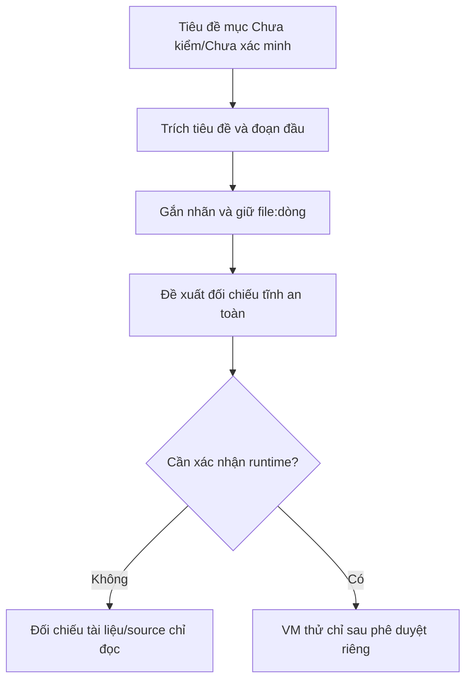

TÓM TẮT 5 DÒNG
1. [NGUỒN] PARTIAL — đã tìm các tiêu đề mục Chưa kiểm/Chưa xác minh trong 233 báo cáo và 75 tài liệu thiết kế Markdown trực tiếp.
2. [NGUỒN] Bảng gộp có 311 dòng, mỗi dòng giữ tiêu đề, trích đoạn mở đầu và JX1_OPS/.../file:dòng.
3. [NGUỒN] Mỗi dòng nêu cách kiểm tĩnh an toàn; bước runtime được đánh dấu cần VM có điều kiện và phê duyệt riêng.
[CHƯA KIỂM] Không xác nhận lại kết quả cũ, source với binary, dữ liệu nạp hoặc hành vi runtime; nội dung trong bảng là trạng thái tài liệu nguồn.
[CHƯA KIỂM] Không chạy build, executable, VM, mạng; chưa tạo chỉ mục TSV vì phạm vi tệp được giao chỉ có báo cáo XD-H03.

# XD-H03 — Gộp các mục chưa kiểm trong báo cáo và thiết kế

Loại: tổng hợp
Chủ đề: Lập danh mục các tiêu đề mục Chưa kiểm/Chưa xác minh trong kho báo cáo và thiết kế, kèm cách xác minh an toàn và nhu cầu VM.
Từ khóa: XD-H03, chưa kiểm, chưa xác minh, báo cáo, thiết kế, runtime, VM, JX1
Trạng thái: PARTIAL — lập đủ bảng tiêu đề và vị trí nguồn; chưa khai triển riêng mọi gạch đầu dòng bên trong từng mục.
Độ phủ: 308/308 tệp Markdown trực tiếp được truy vấn; 311 tiêu đề khớp truy vấn.
Liên quan: JX1_OPS/DESIGN/CHUAN-BAO-CAO.md; JX1_OPS/DESIGN/DANH-SACH-CHUA-KIEM.md; JX1_OPS/DESIGN/DANH-SACH-CHUA-KIEM-2.md
Cần tôi quyết định: không

## Phạm vi và độ phủ

| Phần tử phạm vi | Trạng thái | Bằng chứng |
|---|---|---|
| Báo cáo Markdown trực tiếp trong kho nguồn | Đã truy vấn 233 tệp | Select-String mẫu tiêu đề mở; bảng dưới giữ file:dòng. |
| Thiết kế Markdown trực tiếp trong kho nguồn | Đã truy vấn 75 tệp | Select-String mẫu tiêu đề mở; bảng dưới giữ file:dòng. |
| Nội dung chi tiết nằm trong các mục nguồn | Chưa trích đầy đủ từng gạch đầu dòng | Mỗi hàng kèm vị trí tiêu đề và đoạn mở đầu; xem phần nguồn còn lại theo file:dòng. |
| Kiểm chứng game, binary, runtime, VM hoặc mạng | Chưa thực hiện | Phạm vi chỉ đọc tài liệu; không suy kết quả chạy. |

## Danh sách gộp

| # | Nguồn | Điều chưa kiểm | Cách kiểm an toàn | Cần VM? |
|---:|---|---|---|---|
| 1 | JX1_OPS/REPORTS/A-01-ban-do-tien-trinh.md:73 | [CHƯA KIỂM] ## Chưa kiểm — - Kiểm lại cổng và tiến trình trên VM thử sau khi nó hoạt động lại (`jx_env_up.ps1` in danh sách cổng đang nghe). / - Ảnh hưởng của cổng 7777; mã nguồn server có khớp exe đang chạy hay không. (trích tối đa 3 dòng đầu; xem phần còn lại tại nguồn) | Đối chiếu chỉ đọc file:dòng và phiên bản; nếu câu hỏi còn phụ thuộc hành vi chạy, lập ca riêng trên bản thử cô lập với dữ liệu giả sau khi được duyệt. | Có điều kiện: chỉ khi bước sau phải xác nhận runtime; cần duyệt riêng |
| 2 | JX1_OPS/REPORTS/A-01-ban-do-tien-trinh.md:78 | [CHƯA KIỂM] ## Đã xác minh / Chưa xác minh — **ĐÃ XÁC MINH — R-01:** Đã đọc cấu trúc GS/gs001_cfg.ini:1, :5, :9, :13, :17, :21; chỉ trích tên section, không trích giá trị địa chỉ hoặc thông tin xác thực. Báo cáo được đọc UTF-8 nghiêm ngặt, lưu UTF-8 không BOM; bảo toàn phần thân gốc, gồm tóm tắt, kết … / **CHƯA XÁC MINH — R-01:** các phần ghi chưa phủ trong bảng; tính tương thích giữa nguồn lịch sử, dữ liệu hiện có và binary đang chạy; mọi kết quả build/test/VM cũ chưa được tái hiện. Các gốc source server hoặc checkpoint ngoài GS/CA không được đọc mở rộng t… (trích tối đa 3 dòng đầu; xem phần còn lại tại nguồn) | Đối chiếu chỉ đọc file:dòng và phiên bản; nếu câu hỏi còn phụ thuộc hành vi chạy, lập ca riêng trên bản thử cô lập với dữ liệu giả sau khi được duyệt. | Có điều kiện: chỉ khi bước sau phải xác nhận runtime; cần duyệt riêng |
| 3 | JX1_OPS/REPORTS/A-02-luong-dang-nhap.md:176 | [CHƯA KIỂM] ## Chưa kiểm — - **Runtime:** chưa kết nối client, Bishop, PaySys, Goddess hoặc gs; chưa xác nhận binary/config đang chạy, giá trị protocol, đóng gói/ABI hay phiên đăng nhập thực. Cơ sở cần xác minh: `R/16-khao-sat-bot-ai.md:46`; `R/44-dieu-tra-a2-thoat-som.md:13-18,42-47`. / [đã lược dòng có dấu hiệu chứa thông tin truy cập/cấu hình nhạy cảm] / - **DB nhân vật:** chưa mở `roledb`, xác nhận phiên bản Berkeley DB, backend DB/SQL thực dùng, header biên dịch, độ bền khi mất điện hay phần dữ liệu chưa flush (`Goddess/DBTable.cpp:40-42,218-234`; `Goddess/IDBRoleServer.cpp:941-947`; `GW/Lib/S3DBInterface… (trích tối đa 3 dòng đầu; xem phần còn lại tại nguồn) | Đối chiếu chỉ đọc file:dòng và phiên bản; nếu câu hỏi còn phụ thuộc hành vi chạy, lập ca riêng trên bản thử cô lập với dữ liệu giả sau khi được duyệt. | Có điều kiện: chỉ khi bước sau phải xác nhận runtime; cần duyệt riêng |
| 4 | JX1_OPS/REPORTS/A-02-luong-dang-nhap.md:196 | [CHƯA KIỂM] ## Đã xác minh / Chưa xác minh — **ĐÃ XÁC MINH — R-01:** Đã mở file client bản A tại CA/gameui/Klogin.cpp:480, :485 và CA/gameui/KSelPlayer.cpp:1073, :1083, :1128, :1129, :1134, :1176, :1185. Các vị trí này chỉ đối chiếu phía client, không chứng minh server tương thích. Báo cáo được đọc UT… / **CHƯA XÁC MINH — R-01:** các phần ghi chưa phủ trong bảng; tính tương thích giữa nguồn lịch sử, dữ liệu hiện có và binary đang chạy; mọi kết quả build/test/VM cũ chưa được tái hiện. Các gốc source server hoặc checkpoint ngoài GS/CA không được đọc mở rộng t… (trích tối đa 3 dòng đầu; xem phần còn lại tại nguồn) | Đối chiếu chỉ đọc file:dòng và phiên bản; nếu câu hỏi còn phụ thuộc hành vi chạy, lập ca riêng trên bản thử cô lập với dữ liệu giả sau khi được duyệt. | Có điều kiện: chỉ khi bước sau phải xác nhận runtime; cần duyệt riêng |
| 5 | JX1_OPS/REPORTS/A-03-kiem-ke-cau-hinh.md:156 | [CHƯA KIỂM] ## Chưa kiểm — - Bản runtime `C:\JX\ServerNew\_bin_v2_`: không có đường dẫn [E05]; chưa đếm file/thư mục con `gs/script`, bảng TAB, INI trong PAK hoặc số map gs001. / - Encoding/nội dung Lua/INI/bảng runtime, schema/số dòng/cột từng bảng; chưa trích PAK vì source không chứa PAK [E02]. / - Tham số khởi chạy, mode PAK/đĩa, danh sách/ưu tiên gói và việc exe khớp source (`G/Core/Src/KCore.cpp:249–265`; `G/Engine/Src/KPakFile.cpp:254–270`). (trích tối đa 3 dòng đầu; xem phần còn lại tại nguồn) | Đối chiếu chỉ đọc file:dòng và phiên bản; nếu câu hỏi còn phụ thuộc hành vi chạy, lập ca riêng trên bản thử cô lập với dữ liệu giả sau khi được duyệt. | Có điều kiện: chỉ khi bước sau phải xác nhận runtime; cần duyệt riêng |
| 6 | JX1_OPS/REPORTS/A-03-kiem-ke-cau-hinh.md:194 | [CHƯA KIỂM] ## Đã xác minh / Chưa xác minh — **ĐÃ XÁC MINH — R-01:** Kiểm kê file rời bằng Get-ChildItem -File -Recurse tại đúng ba thư mục GS/Settings, GS/script, GS/maps: Settings 2022 file (767 INI, 1240 TXT, 0 Lua, 0 TAB); script 4085 file (3 INI, 4029 Lua, 10 TXT, 0 TAB); maps 503 file (14 INI, 1… / **CHƯA XÁC MINH — R-01:** các phần ghi chưa phủ trong bảng; tính tương thích giữa nguồn lịch sử, dữ liệu hiện có và binary đang chạy; mọi kết quả build/test/VM cũ chưa được tái hiện. Các gốc source server hoặc checkpoint ngoài GS/CA không được đọc mở rộng t… (trích tối đa 3 dòng đầu; xem phần còn lại tại nguồn) | Đối chiếu chỉ đọc file:dòng và phiên bản; nếu câu hỏi còn phụ thuộc hành vi chạy, lập ca riêng trên bản thử cô lập với dữ liệu giả sau khi được duyệt. | Có điều kiện: chỉ khi bước sau phải xác nhận runtime; cần duyệt riêng |
| 7 | JX1_OPS/REPORTS/A-04-kien-truc-tong.md:81 | [CHƯA KIỂM] ## 6. Dựng lại và crash [NGUỒN, CHƯA KIỂM RUNTIME] — Exe gốc và bản tự dựng đều x64 (linker 10.00 / 14.44). Nghi vấn: `KSOServer.cpp:960`, `:4966`, `KSortScript.cpp:328`. Chưa có dump; thiếu `cdb.exe` ở host và VM. Câu hỏi "server tự dựng 36 Hz" của báo cáo 45 CHƯA TRẢ LỜI. (trích tối đa 3 dòng đầu; xem phần còn lại tại nguồn) | Đối chiếu chỉ đọc file:dòng và phiên bản; nếu câu hỏi còn phụ thuộc hành vi chạy, lập ca riêng trên bản thử cô lập với dữ liệu giả sau khi được duyệt. | Có điều kiện: chỉ khi bước sau phải xác nhận runtime; cần duyệt riêng |
| 8 | JX1_OPS/REPORTS/A-04-kien-truc-tong.md:84 | [CHƯA KIỂM] ## Chưa kiểm (tổng) — Số online thật chịu được; nguồn có khớp exe đang chạy không; tạo hàng loạt tài khoản/nhân vật; cổng 7777; mọi hành vi Bot trên server thật. (trích tối đa 3 dòng đầu; xem phần còn lại tại nguồn) | Đối chiếu chỉ đọc file:dòng và phiên bản; nếu câu hỏi còn phụ thuộc hành vi chạy, lập ca riêng trên bản thử cô lập với dữ liệu giả sau khi được duyệt. | Có điều kiện: chỉ khi bước sau phải xác nhận runtime; cần duyệt riêng |
| 9 | JX1_OPS/REPORTS/A-04-kien-truc-tong.md:88 | [CHƯA KIỂM] ## Đã xác minh / Chưa xác minh — **ĐÃ XÁC MINH — R-01:** Bản này ban đầu có BOM UTF-8. Đợt R-01 bỏ BOM khi ghi; phần thân, số liệu và các nhãn tin cậy cũ được giữ nguyên. Đối chiếu trực tiếp các điểm GS/CA nêu trong bảng, không suy runtime từ chúng. Báo cáo được đọc UTF-8 nghiêm ngặt, lưu … / **CHƯA XÁC MINH — R-01:** các phần ghi chưa phủ trong bảng; tính tương thích giữa nguồn lịch sử, dữ liệu hiện có và binary đang chạy; mọi kết quả build/test/VM cũ chưa được tái hiện. Các gốc source server hoặc checkpoint ngoài GS/CA không được đọc mở rộng t… (trích tối đa 3 dòng đầu; xem phần còn lại tại nguồn) | Đối chiếu chỉ đọc file:dòng và phiên bản; nếu câu hỏi còn phụ thuộc hành vi chạy, lập ca riêng trên bản thử cô lập với dữ liệu giả sau khi được duyệt. | Có điều kiện: chỉ khi bước sau phải xác nhận runtime; cần duyệt riêng |
| 10 | JX1_OPS/REPORTS/A-05-diem-tuong-tac-gs001.md:255 | [CHƯA KIỂM] ## Đã xác minh / Chưa xác minh — **ĐÃ XÁC MINH — R-01:** Đối chiếu đủ tám tiêu đề nhóm và các bảng bằng chứng của bản gốc. GS/gs001_cfg.ini:9, :13, :17 xác nhận có nhóm cấu hình relay tương ứng; không dùng source client để xác minh thuật toán server. Báo cáo được đọc UTF-8 nghiêm ngặt, lưu… / **CHƯA XÁC MINH — R-01:** các phần ghi chưa phủ trong bảng; tính tương thích giữa nguồn lịch sử, dữ liệu hiện có và binary đang chạy; mọi kết quả build/test/VM cũ chưa được tái hiện. Các gốc source server hoặc checkpoint ngoài GS/CA không được đọc mở rộng t… (trích tối đa 3 dòng đầu; xem phần còn lại tại nguồn) | Đối chiếu chỉ đọc file:dòng và phiên bản; nếu câu hỏi còn phụ thuộc hành vi chạy, lập ca riêng trên bản thử cô lập với dữ liệu giả sau khi được duyệt. | Có điều kiện: chỉ khi bước sau phải xác nhận runtime; cần duyệt riêng |
| 11 | JX1_OPS/REPORTS/A-06-bang-goi-tin.md:866 | [CHƯA KIỂM] ## Chưa kiểm — - Chưa build, chạy game, kết nối server/VM, quét binary hoặc bắt gói; không có lệnh build/test trong task. / - Chưa xác nhận source trùng binary đang chạy; không dùng việc đọc source để kết luận runtime. / - Chưa đo sizeof/offsetof bằng compiler/kiến trúc thực tế; các macro/typedef bên ngoài như NAME_LENGHT, TCHAR, UINT, GUID và #ifdef chưa được giải hết. C/S KProtocol.h:10-11/18-19 và C/S KRelayProtocol.h:12 có packing, nhưng đó chưa phải kiểm chứng ABI. (trích tối đa 3 dòng đầu; xem phần còn lại tại nguồn) | Đối chiếu chỉ đọc file:dòng và phiên bản; nếu câu hỏi còn phụ thuộc hành vi chạy, lập ca riêng trên bản thử cô lập với dữ liệu giả sau khi được duyệt. | Có điều kiện: chỉ khi bước sau phải xác nhận runtime; cần duyệt riêng |
| 12 | JX1_OPS/REPORTS/A-06-bang-goi-tin.md:876 | [CHƯA KIỂM] ## Đã xác minh / Chưa xác minh — **ĐÃ XÁC MINH — R-01:** SHA-256 CA/gamecore/KProtocolDef.h = 78cc6d34999b4ce8cfe1adfe13f358e15fcc4d9fc3985ec7bdacb752f2441810, khớp giá trị C trong báo cáo. Đã mở vị trí enum ở KProtocolDef.h:20, :218, :394, :410, :431, :440, :453, :474, :498, :524 và KTong… / **CHƯA XÁC MINH — R-01:** các phần ghi chưa phủ trong bảng; tính tương thích giữa nguồn lịch sử, dữ liệu hiện có và binary đang chạy; mọi kết quả build/test/VM cũ chưa được tái hiện. Các gốc source server hoặc checkpoint ngoài GS/CA không được đọc mở rộng t… (trích tối đa 3 dòng đầu; xem phần còn lại tại nguồn) | Đối chiếu chỉ đọc file:dòng và phiên bản; nếu câu hỏi còn phụ thuộc hành vi chạy, lập ca riêng trên bản thử cô lập với dữ liệu giả sau khi được duyệt. | Có điều kiện: chỉ khi bước sau phải xác nhận runtime; cần duyệt riêng |
| 13 | JX1_OPS/REPORTS/A-07-goc-re-crash-gs001.md:209 | [CHƯA KIỂM] ## Đã xác minh / Chưa xác minh — **ĐÃ XÁC MINH — R-01:** Chỉ đọc byte binary trong GS: gs001.exe 543232 byte, SHA-256 dd44d425e205fd482fd287144bdc3d95ad90f42bda92556a66c1214a463d4295; CoreServer.dll 1893376 byte, Engine.dll 1195520 byte, LuaLibDll.dll 350720 byte. Các kích thước và hash ex… / **CHƯA XÁC MINH — R-01:** các phần ghi chưa phủ trong bảng; tính tương thích giữa nguồn lịch sử, dữ liệu hiện có và binary đang chạy; mọi kết quả build/test/VM cũ chưa được tái hiện. Các gốc source server hoặc checkpoint ngoài GS/CA không được đọc mở rộng t… (trích tối đa 3 dòng đầu; xem phần còn lại tại nguồn) | Đối chiếu chỉ đọc file:dòng và phiên bản; nếu câu hỏi còn phụ thuộc hành vi chạy, lập ca riêng trên bản thử cô lập với dữ liệu giả sau khi được duyệt. | Có điều kiện: chỉ khi bước sau phải xác nhận runtime; cần duyệt riêng |
| 14 | JX1_OPS/REPORTS/A-07b-ep-con-tro.md:183 | [CHƯA KIỂM] ## Chua kiem — - Runtime HighEntropyVA, dia chi heap thuc, first-chance dump va dong crash goc: chua kiem; khong khang dinh cac sua nay da giai quyet crash van hanh. / - Round-trip LZO, heap tren bien 4 GiB, bang hoi/invite, LuaTestDropItem va callback/script USEOLD: chua chay do task cam chay exe. / - Cau hinh client, Linux, Win32, module Heaven/Rainbow binary, adapter MySQL va ABI vendor DLL/static libs: chua build/kiem runtime. (trích tối đa 3 dòng đầu; xem phần còn lại tại nguồn) | Đối chiếu chỉ đọc file:dòng và phiên bản; nếu câu hỏi còn phụ thuộc hành vi chạy, lập ca riêng trên bản thử cô lập với dữ liệu giả sau khi được duyệt. | Có điều kiện: chỉ khi bước sau phải xác nhận runtime; cần duyệt riêng |
| 15 | JX1_OPS/REPORTS/A-07b-ep-con-tro.md:212 | [CHƯA KIỂM] ## Đã xác minh / Chưa xác minh — **ĐÃ XÁC MINH — R-01:** Đối chiếu đủ 23 hàng file ở bảng thay đổi gốc và ba điểm baseline trong đoạn phạm vi. Không mở snapshot A-07b, checkpoint, source server hoặc thư viện vendor ngoài hai gốc R-01; các kết quả build/source-manifest giữ nhãn lịch sử. Báo… / **CHƯA XÁC MINH — R-01:** các phần ghi chưa phủ trong bảng; tính tương thích giữa nguồn lịch sử, dữ liệu hiện có và binary đang chạy; mọi kết quả build/test/VM cũ chưa được tái hiện. Các gốc source server hoặc checkpoint ngoài GS/CA không được đọc mở rộng t… (trích tối đa 3 dòng đầu; xem phần còn lại tại nguồn) | Đối chiếu chỉ đọc file:dòng và phiên bản; nếu câu hỏi còn phụ thuộc hành vi chạy, lập ca riêng trên bản thử cô lập với dữ liệu giả sau khi được duyệt. | Có điều kiện: chỉ khi bước sau phải xác nhận runtime; cần duyệt riêng |
| 16 | JX1_OPS/REPORTS/A-07c-link-gs001.md:127 | [CHƯA KIỂM] ## Chưa kiểm và bàn giao PM — Chưa chạy gs001 hoặc DLL sản phẩm; không kết nối VM/SQL/server. Chưa kiểm stdout runtime, đường lỗi MIRACL, crypto/round-trip, crash HighEntropyVA hoặc tương thích triển khai. Chưa build Win32, VS100 hoặc Debug gốc. DLL cùng snapshot đã rebuild; cần môi trư… / Không sửa task ops. Không stage/commit/push. PM review/stage đúng hai file sản phẩm và báo cáo này; thư mục ops đã untracked từ đầu, không gom toàn bộ nó. git diff --check thành công. (trích tối đa 3 dòng đầu; xem phần còn lại tại nguồn) | Đối chiếu chỉ đọc file:dòng và phiên bản; nếu câu hỏi còn phụ thuộc hành vi chạy, lập ca riêng trên bản thử cô lập với dữ liệu giả sau khi được duyệt. | Có điều kiện: chỉ khi bước sau phải xác nhận runtime; cần duyệt riêng |
| 17 | JX1_OPS/REPORTS/A-07c-link-gs001.md:145 | [CHƯA KIỂM] ## Đã xác minh / Chưa xác minh — **ĐÃ XÁC MINH — R-01:** Đọc đủ hai thay đổi sản phẩm, bảng năm project, hash artifact và hai phần bổ sung PM trong báo cáo gốc. GS/gs001.exe có SHA-256 dd44d425e205fd482fd287144bdc3d95ad90f42bda92556a66c1214a463d4295, khác hash A-07c được thân ghi; chỉ xác … / **CHƯA XÁC MINH — R-01:** các phần ghi chưa phủ trong bảng; tính tương thích giữa nguồn lịch sử, dữ liệu hiện có và binary đang chạy; mọi kết quả build/test/VM cũ chưa được tái hiện. Các gốc source server hoặc checkpoint ngoài GS/CA không được đọc mở rộng t… (trích tối đa 3 dòng đầu; xem phần còn lại tại nguồn) | Đối chiếu chỉ đọc file:dòng và phiên bản; nếu câu hỏi còn phụ thuộc hành vi chạy, lập ca riêng trên bản thử cô lập với dữ liệu giả sau khi được duyệt. | Có điều kiện: chỉ khi bước sau phải xác nhận runtime; cần duyệt riêng |
| 18 | JX1_OPS/REPORTS/A-07d-breakpoint.md:363 | [CHƯA KIỂM] ## Đã xác minh / Chưa xác minh — **ĐÃ XÁC MINH — R-01:** Kiểm đủ bốn vùng nguồn được báo cáo nêu, bốn hàng P1, bảng lịch, bảng pointer và phụ lục assertion trong bản gốc. Đọc trực tiếp GS/script/system/serverscript.lua:13 và GS/script/servertimer.lua:23 bằng symbol ASCII vì cả UTF-8/GBK ng… / **CHƯA XÁC MINH — R-01:** các phần ghi chưa phủ trong bảng; tính tương thích giữa nguồn lịch sử, dữ liệu hiện có và binary đang chạy; mọi kết quả build/test/VM cũ chưa được tái hiện. Các gốc source server hoặc checkpoint ngoài GS/CA không được đọc mở rộng t… (trích tối đa 3 dòng đầu; xem phần còn lại tại nguồn) | Đối chiếu chỉ đọc file:dòng và phiên bản; nếu câu hỏi còn phụ thuộc hành vi chạy, lập ca riêng trên bản thử cô lập với dữ liệu giả sau khi được duyệt. | Có điều kiện: chỉ khi bước sau phải xác nhận runtime; cần duyệt riêng |
| 19 | JX1_OPS/REPORTS/A-07e-rtc.md:170 | [CHƯA KIỂM] ## Đã xác minh / Chưa xác minh — **ĐÃ XÁC MINH — R-01:** Đối chiếu các heading và bảng dự án/map/artifact trong bản gốc; không đọc snapshot A-07e ngoài các gốc R-01, không chạy verifier/dumpbin/build. Hash máy hiện có tại GS là binary gốc O và khác hash gs001 build A-07e trong thân. Báo cá… / **CHƯA XÁC MINH — R-01:** các phần ghi chưa phủ trong bảng; tính tương thích giữa nguồn lịch sử, dữ liệu hiện có và binary đang chạy; mọi kết quả build/test/VM cũ chưa được tái hiện. Các gốc source server hoặc checkpoint ngoài GS/CA không được đọc mở rộng t… (trích tối đa 3 dòng đầu; xem phần còn lại tại nguồn) | Đối chiếu chỉ đọc file:dòng và phiên bản; nếu câu hỏi còn phụ thuộc hành vi chạy, lập ca riêng trên bản thử cô lập với dữ liệu giả sau khi được duyệt. | Có điều kiện: chỉ khi bước sau phải xác nhận runtime; cần duyệt riêng |
| 20 | JX1_OPS/REPORTS/A-08a-mon-phai-ky-nang.md:115 | [CHƯA KIỂM] ## Chưa kiểm — - Phái nào thực sự gia nhập được trên bản triển khai; số phái chơi được chưa chốt. Không lấy 16 mục cấu hình để cam kết 15 hảo hữu/người chơi hoặc lấy 11 mục header để kết luận chỉ có 11 phái trong game (các bất nhất nêu trên). / - Bộ kỹ năng đúng của Lý Tầm Hoan, Đào Hoa Đảo, Minh Giáo, Đoàn Thị, Tự sáng môn phái; nguồn/ánh xạ thay thế cho 1661 và 1702. Giữ tên/ID hiện có, không tự sửa canonical. / - Toàn bộ chuỗi skill con/Start/Fly/Collide/Vanished event, các ghi đè theo cấp, số lần va chạm, trần hitcount từng cấp, tầm hiệu lực cuối cùng và số mục tiêu khác nhau mỗi lần tung chiêu; nhãn đơn/AOE trong bảng là phân loại cấu trúc tĩnh. (trích tối đa 3 dòng đầu; xem phần còn lại tại nguồn) | Đối chiếu chỉ đọc file:dòng và phiên bản; nếu câu hỏi còn phụ thuộc hành vi chạy, lập ca riêng trên bản thử cô lập với dữ liệu giả sau khi được duyệt. | Có điều kiện: chỉ khi bước sau phải xác nhận runtime; cần duyệt riêng |
| 21 | JX1_OPS/REPORTS/A-08b-dong-ban.md:64 | [CHƯA KIỂM] ## Chưa kiểm — - Chưa chạy Lua/compiler, exe hoặc VM; chưa xác nhận bản PAK mà server thực tế nạp, nên chưa biết đường dẫn Hán tự và callback `partner.lua`/`tongyong.lua` nào có hiệu lực. / - Chưa xác minh runtime có nối các API `PARTNER_GetLevel`, `PARTNER_AddSkill`, `nNowExp` vào luồng EXP; chưa xác minh cách lưu/khôi phục đầy đủ level, skill practice, task value và item partner qua roledb. / - Chưa xác nhận độ thân mật của partner. Lửa trại/nướng cá/EXP theo giây không thuộc phân tích triển khai của A-08b; không kết luận chúng có hay không từ tập file partner. (trích tối đa 3 dòng đầu; xem phần còn lại tại nguồn) | Đối chiếu chỉ đọc file:dòng và phiên bản; nếu câu hỏi còn phụ thuộc hành vi chạy, lập ca riêng trên bản thử cô lập với dữ liệu giả sau khi được duyệt. | Có điều kiện: chỉ khi bước sau phải xác nhận runtime; cần duyệt riêng |
| 22 | JX1_OPS/REPORTS/A-08c-lua-trai-nuong-ca.md:98 | [CHƯA KIỂM] ## Chưa kiểm — - Runtime, bản exe/source khớp nhau, file được nạp từ đĩa hay PAK; khả năng loader xử lý tên Hán tự và tên mojibake (E01–E03). / - Nối skill 1705/1706, bảng skill trong archive/PAK, template NPC 2078 và asset lửa thực tế; chưa khẳng định NPC sinh đúng hình hoặc aura có hiệu lực (`G/script/item/huozhong.lua:71–84`; E02). / - Phạm vi/đối tượng aura, người ngoài đội có nhận EXP, x2 party, cộng dồn nhiều lửa, rời vùng/đăng xuất/qua cấp; chưa thử chống lạm dụng (`S/KNpc.cpp:1801–1817`; E02). (trích tối đa 3 dòng đầu; xem phần còn lại tại nguồn) | Đối chiếu chỉ đọc file:dòng và phiên bản; nếu câu hỏi còn phụ thuộc hành vi chạy, lập ca riêng trên bản thử cô lập với dữ liệu giả sau khi được duyệt. | Có điều kiện: chỉ khi bước sau phải xác nhận runtime; cần duyệt riêng |
| 23 | JX1_OPS/REPORTS/A-08d-kinh-nghiem.md:92 | [CHƯA KIỂM] ## Chưa kiểm — - Binary gs có khớp source này hay không; file level_exp.txt thực nạp, dữ liệu trong PAK, cấu hình hệ số và trần cấp có hiệu lực. Chưa kiểm VM/SQL/server, không suy runtime từ source. / - Nhịp 18 tick có đạt một giây thật dưới tải, callback mất/trễ/trùng, chi phí cấp EXP và đồng bộ gói mỗi giây cho nhiều người chơi. / - Lua engine thực nạp được script/timer không, lỗi nháy servertimer có xuất hiện trong bản triển khai không; chưa chạy Lua compiler. (trích tối đa 3 dòng đầu; xem phần còn lại tại nguồn) | Đối chiếu chỉ đọc file:dòng và phiên bản; nếu câu hỏi còn phụ thuộc hành vi chạy, lập ca riêng trên bản thử cô lập với dữ liệu giả sau khi được duyệt. | Có điều kiện: chỉ khi bước sau phải xác nhận runtime; cần duyệt riêng |
| 24 | JX1_OPS/REPORTS/A-09-dong-ban-nhieu-slot.md:152 | [CHƯA KIỂM] ## Chưa kiểm — - MAX_NPC trong bộ nhớ của exe triển khai; tên server truyền vào core, bản cấu hình thực nạp/PAK, binary khớp source. 100000 là kết quả source + cấu hình gs001 rời, không phải phép đo runtime. / - Tải 4 con/người, CPU/AI/đồng bộ, client 256 NPC nhìn thấy, quota NPC/đạn khi spawn đông; không có benchmark hoặc build/test. / - Tất cả bản client Cocos và giao thức của chúng, thư viện đóng/PAK; bảng symbol ở trên chỉ đầy đủ trong phạm vi source/runtime rời đã ghi. Project khác có thể biên dịch backup/copy. (trích tối đa 3 dòng đầu; xem phần còn lại tại nguồn) | Đối chiếu chỉ đọc file:dòng và phiên bản; nếu câu hỏi còn phụ thuộc hành vi chạy, lập ca riêng trên bản thử cô lập với dữ liệu giả sau khi được duyệt. | Có điều kiện: chỉ khi bước sau phải xác nhận runtime; cần duyệt riêng |
| 25 | JX1_OPS/REPORTS/A-10-lua-trai-boss.md:83 | [CHƯA KIỂM] ## Chưa kiểm — - Binary gs/client khớp source; ưu tiên đĩa/PAK, skill 1705/1706 ở archive/PAK, template 2078 và asset lửa thực tế; loader tên Hán tự/mojibake. Chưa khẳng định aura hay bán kính nhận EXP hoạt động (E01). / - Toàn bộ action/death script riêng, mọi bản đồ/boss spawn; nhánh môi trường/partner kết liễu, bảo đảm callback chỉ một lần mỗi vòng đời; mối liên hệ drop owner và đội được hưởng. / - Ý nghĩa x2, thời điểm xuất hiện/chết, bán kính lửa, số người tối thiểu, người ngoài đội, hảo hữu NPC có tính slot đội/hưởng EXP, chết/rời map/rời đội/đăng xuất; các luật này chưa chốt hoặc chưa kiểm runtime. (trích tối đa 3 dòng đầu; xem phần còn lại tại nguồn) | Đối chiếu chỉ đọc file:dòng và phiên bản; nếu câu hỏi còn phụ thuộc hành vi chạy, lập ca riêng trên bản thử cô lập với dữ liệu giả sau khi được duyệt. | Có điều kiện: chỉ khi bước sau phải xác nhận runtime; cần duyệt riêng |
| 26 | JX1_OPS/REPORTS/A-16-tong-kim.md:92 | [CHƯA KIỂM] ## CHƯA XÁC MINH — - Chưa chạy client/server, chưa build, chưa thử đăng nhập/hoạt động/gửi gói, chưa đo hiệu năng. Các ca bên dưới đều **CHƯA CHẠY** đúng giới hạn khảo sát tĩnh. / - Binary đang dùng bản script/settings nào, có override từ PAK hay thư viện Lua khác không; source `D:\JX-source` có khớp binary không; nhánh TNL/cũ/header nhánh nào thực sự được gọi. / - Định nghĩa/ý nghĩa thực của `JoinActivityGroup`; cần người giao task chỉ file/module hoặc bộ dữ liệu khác chứa symbol nếu muốn theo tiếp chính API này. Không coi thiếu symbol là blocker của báo cáo khảo sát hiện tại. (trích tối đa 3 dòng đầu; xem phần còn lại tại nguồn) | Đối chiếu chỉ đọc file:dòng và phiên bản; nếu câu hỏi còn phụ thuộc hành vi chạy, lập ca riêng trên bản thử cô lập với dữ liệu giả sau khi được duyệt. | Có điều kiện: chỉ khi bước sau phải xác nhận runtime; cần duyệt riêng |
| 27 | JX1_OPS/REPORTS/A-17-roi-do-boss-trang-bi.md:18 | [CHƯA KIỂM] ## CHƯA XÁC MINH — - Source có khớp binary và dữ liệu đang triển khai hay không; bảng nào được boss đang chạy sử dụng. / - Kết quả rơi đồ thực tế, tỉ lệ runtime, thao tác mặc trang bị và hiển thị trên client. (trích tối đa 3 dòng đầu; xem phần còn lại tại nguồn) | Đối chiếu chỉ đọc file:dòng và phiên bản; nếu câu hỏi còn phụ thuộc hành vi chạy, lập ca riêng trên bản thử cô lập với dữ liệu giả sau khi được duyệt. | Có điều kiện: chỉ khi bước sau phải xác nhận runtime; cần duyệt riêng |
| 28 | JX1_OPS/REPORTS/B-02-loc-hien-thi.md:77 | [CHƯA KIỂM] ## Chua kiem — - Chua chay 2 client + 1 bot, chua so goi Enabled=0 voi baseline; chi doi chieu nhanh disabled bang doc ma. / - Chua test runtime REMOVE/ADD khi doi nhom/party, teleport/random world, reconnect/slot reuse, min-sync/request full, queue send failure, bot chuyen thanh nguoi, owner ra/vao doi. / - Chua gan script hoat dong/bot/hao huu production vao cac API moi, chua test tran MaxVisible+1 tren client. (trích tối đa 3 dòng đầu; xem phần còn lại tại nguồn) | Đối chiếu chỉ đọc file:dòng và phiên bản; nếu câu hỏi còn phụ thuộc hành vi chạy, lập ca riêng trên bản thử cô lập với dữ liệu giả sau khi được duyệt. | Có điều kiện: chỉ khi bước sau phải xác nhận runtime; cần duyệt riêng |
| 29 | JX1_OPS/REPORTS/C-01-jxadm.md:57 | [CHƯA KIỂM] ## Căn cứ và điểm chưa kiểm — \\| Căn cứ \\| Áp dụng / giới hạn \\| / \\|---\\|---\\| / \\| `A-02-luong-dang-nhap.md:58-60,70-80,120` \\| MD5 viết hoa; hai bảng tài khoản; `iFlag=0` theo thời gian; `iClientID` chưa đủ chứng minh online. Không có bằng chứng cờ khóa chuyên dụng. \\| (trích tối đa 3 dòng đầu; xem phần còn lại tại nguồn) | Đối chiếu chỉ đọc file:dòng và phiên bản; nếu câu hỏi còn phụ thuộc hành vi chạy, lập ca riêng trên bản thử cô lập với dữ liệu giả sau khi được duyệt. | Có điều kiện: chỉ khi bước sau phải xác nhận runtime; cần duyệt riêng |
| 30 | JX1_OPS/REPORTS/C-03-jxweb.md:53 | [CHƯA KIỂM] ## Chưa kiểm — - Trạng thái server/account thực tế, schema SQL, driver, số phiên online và hành động ghi chưa kiểm; snapshot hiển thị rõ `unverified`/`dry-run`. / - Chưa chạy dưới tải, qua Tailscale, reverse proxy hay mạng ngoài; thiết kế chỉ cho phép bind loopback. / - Chưa có write adapter thật; không có thao tác ghi nào được gửi. (trích tối đa 3 dòng đầu; xem phần còn lại tại nguồn) | Đối chiếu chỉ đọc file:dòng và phiên bản; nếu câu hỏi còn phụ thuộc hành vi chạy, lập ca riêng trên bản thử cô lập với dữ liệu giả sau khi được duyệt. | Có điều kiện: chỉ khi bước sau phải xác nhận runtime; cần duyệt riêng |
| 31 | JX1_OPS/REPORTS/C01-C03-TEST36.md:21 | [CHƯA KIỂM] ## Chưa kiểm tra — - Goddess đọc CSDL nhân vật bằng đường nào (ODBC/DSN/tên DB), có cần DB riêng không: chưa đọc cấu hình. / - Test-36 từng có DB nhân vật không (có thể bị xóa/chưa khôi phục): chưa rõ. / - C03 (cổng permit thật): chưa tới. (trích tối đa 3 dòng đầu; xem phần còn lại tại nguồn) | Đối chiếu chỉ đọc file:dòng và phiên bản; nếu câu hỏi còn phụ thuộc hành vi chạy, lập ca riêng trên bản thử cô lập với dữ liệu giả sau khi được duyệt. | Có điều kiện: chỉ khi bước sau phải xác nhận runtime; cần duyệt riêng |
| 32 | JX1_OPS/REPORTS/D-01-bang-hoat-dong.md:90 | [CHƯA KIỂM] ## Chưa kiểm — - Toàn bộ runtime: bản script được exe nạp, ưu tiên PAK/đĩa, encoding tên đường trên VM, các map thực sự tải và lỗi nạp Lua. Không suy kết quả chạy từ source hoặc từ báo cáo A-01. / - Chưa biên dịch/kiểm cú pháp bằng Lua engine đúng phiên bản; các lỗi nháy là quan sát văn bản. Chưa phân tích toàn bộ phụ thuộc Include bắc cầu hoặc API mà binary thực sự cung cấp. / - Chưa xác minh hoàn chỉnh việc đăng ký, giá/phí, giới hạn ngày, phối hợp đội/phe, timer, phần thưởng, chống nhận trùng, khôi phục khi chết/thoát và dọn NPC cho từng dòng. (trích tối đa 3 dòng đầu; xem phần còn lại tại nguồn) | Đối chiếu chỉ đọc file:dòng và phiên bản; nếu câu hỏi còn phụ thuộc hành vi chạy, lập ca riêng trên bản thử cô lập với dữ liệu giả sau khi được duyệt. | Có điều kiện: chỉ khi bước sau phải xác nhận runtime; cần duyệt riêng |
| 33 | JX1_OPS/REPORTS/E-01-thieu-giao-thuc.md:164 | [CHƯA KIỂM] ## Đã xác minh / Chưa xác minh — - **ĐÃ XÁC MINH:** đã đọc đủ năm file mô-đun theo bảng phạm vi; các liên kết báo cáo tồn tại. Client bản A được phép đọc là `D:\JX-build\qh9A`; các root C/B/GH/SH/SS/H trong phần gốc là dẫn nguồn lịch sử, chưa được tái đối chiếu bằng root đó trong R-04a. / - **CHƯA XÁC MINH:** không chạy lại 29 test, CLI hay bất kỳ build/exe/VM/mạng nào; không nâng nhãn của ABI, đồng bộ, encoding, gameplay hoặc Git lịch sử. (trích tối đa 3 dòng đầu; xem phần còn lại tại nguồn) | Đối chiếu chỉ đọc file:dòng và phiên bản; nếu câu hỏi còn phụ thuộc hành vi chạy, lập ca riêng trên bản thử cô lập với dữ liệu giả sau khi được duyệt. | Có điều kiện: chỉ khi bước sau phải xác nhận runtime; cần duyệt riêng |
| 34 | JX1_OPS/REPORTS/E-01b-thieu-giao-thuc.md:107 | [CHƯA KIỂM] ## Thiếu hoặc chưa xác minh — đóng kết nối thay vì đoán — \\| Mục \\| Bằng chứng / giới hạn / bước tiếp \\| / \\| --- \\| --- \\| / \\| ABI/binary gs001 \\| Hai record normal lệch 55/31 và 227/223 như bảng trên. Chưa xác minh source nào khớp binary. Bot chọn layout GS rõ ràng; không suy từ offline pass rằng đăng nhập thực đã được. Xác minh sizeof/offsetof trong đúng build/bản copy VM trướ… (trích tối đa 3 dòng đầu; xem phần còn lại tại nguồn) | Đối chiếu chỉ đọc file:dòng và phiên bản; nếu câu hỏi còn phụ thuộc hành vi chạy, lập ca riêng trên bản thử cô lập với dữ liệu giả sau khi được duyệt. | Có điều kiện: chỉ khi bước sau phải xác nhận runtime; cần duyệt riêng |
| 35 | JX1_OPS/REPORTS/E-01b-thieu-giao-thuc.md:162 | [CHƯA KIỂM] ## Đã xác minh / Chưa xác minh — - **ĐÃ XÁC MINH:** bảng ID hiện có, chỗ nối parser và test nguồn; client bản A có bảng độ dài tại `D:\JX-build\qh9A\Classes\gamecore\KProtocol.cpp:14`, cách tra tại `CoreShell.cpp:2750` và nhánh tăng con trỏ tại `D:\JX-build\qh9A\Classes\gamescene\KgameWorl… / - **CHƯA XÁC MINH:** R-04a không chạy lại 41 test; không build, exe, VM, mạng, ABI/binary hay ACK runtime. Các root C/S/SS/H gốc không phải root server dữ liệu `gs` được giao cho R-04a, nên không tự chuyển bằng chứng lịch sử thành bằng chứng hiện tại. (trích tối đa 3 dòng đầu; xem phần còn lại tại nguồn) | Đối chiếu chỉ đọc file:dòng và phiên bản; nếu câu hỏi còn phụ thuộc hành vi chạy, lập ca riêng trên bản thử cô lập với dữ liệu giả sau khi được duyệt. | Có điều kiện: chỉ khi bước sau phải xác nhận runtime; cần duyệt riêng |
| 36 | JX1_OPS/REPORTS/E-02-hanh-vi-bot.md:108 | [CHƯA KIỂM] ## Giới hạn và các nhãn [CHƯA KIỂM] — - Chọn rõ profile GS LE/pack1; ABI binary/sizeof thực và Cocos nhận đúng / profile này [CHƯA KIỂM]. Không suy layout từ length hoặc fallback. / - 76 không có map ID; 77/91 cũng không có map ID. Bên gọi cung cấp context, (trích tối đa 3 dòng đầu; xem phần còn lại tại nguồn) | Đối chiếu chỉ đọc file:dòng và phiên bản; nếu câu hỏi còn phụ thuộc hành vi chạy, lập ca riêng trên bản thử cô lập với dữ liệu giả sau khi được duyệt. | Không cho đối chiếu tài liệu tĩnh |
| 37 | JX1_OPS/REPORTS/E-02-hanh-vi-bot.md:162 | [CHƯA KIỂM] ## Đã xác minh / Chưa xác minh — - **ĐÃ XÁC MINH:** file thật có decoder năm S2C ID, `attack_target`, `Hunt.feed`, `Hunt.step` và `Hunt.heal` như bảng phạm vi. `JX1_OPS/TASKS/E-02.md:11` cho phép TODO hồi máu khi thiếu giao thức; giữ trạng thái DONE offline và làm lộ phần chưa triển khai. / - **CHƯA XÁC MINH:** R-04a không chạy lại 65 test, không build/exe/VM/mạng; không đo ABI, hồi máu, respawn, ID reuse, hostility, range, cooldown hoặc kill credit. Không dùng source client bản A hay dữ liệu server `gs` để suy semantic chưa có bằng chứng tron… (trích tối đa 3 dòng đầu; xem phần còn lại tại nguồn) | Đối chiếu chỉ đọc file:dòng và phiên bản; nếu câu hỏi còn phụ thuộc hành vi chạy, lập ca riêng trên bản thử cô lập với dữ liệu giả sau khi được duyệt. | Có điều kiện: chỉ khi bước sau phải xác nhận runtime; cần duyệt riêng |
| 38 | JX1_OPS/REPORTS/E-03-dieu-phoi-dan-so.md:109 | [CHƯA KIỂM] ## Đã xác minh / Chưa xác minh — - **ĐÃ XÁC MINH:** bốn file của module hiện có; đủ ba map mẫu và 24 hệ số JSON; điều kiện trần, busy và ngân sách tại `JX1_OPS/BOT/population/__init__.py:139`. `G/Settings/MapList.ini:5` có key map số, không cung cấp ánh xạ các nhãn mẫu trong JSON. / - **CHƯA XÁC MINH:** không chạy lại 53 test, không build/exe/VM/mạng; chưa kiểm map thật, snapshot/ACK, người chơi thật, persistence hoặc nhiều worker. Số test gốc được giữ nguyên. (trích tối đa 3 dòng đầu; xem phần còn lại tại nguồn) | Đối chiếu chỉ đọc file:dòng và phiên bản; nếu câu hỏi còn phụ thuộc hành vi chạy, lập ca riêng trên bản thử cô lập với dữ liệu giả sau khi được duyệt. | Có điều kiện: chỉ khi bước sau phải xác nhận runtime; cần duyệt riêng |
| 39 | JX1_OPS/REPORTS/E-05a-khung-tester.md:146 | [CHƯA KIỂM] ## Đã xác minh / Chưa xác minh — - **ĐÃ XÁC MINH:** năm mục tiêu, code khung và đủ 15 ô PASS trong fixture đã lưu. Các liên kết TEST/BUG tồn tại. Mã hiện tại có bootstrap tại `JX1_OPS/TESTER/run.py:8` và các kịch bản thêm tại `JX1_OPS/TESTER/run.py:18`; chỉ ghi nhận có thay đổi sau mốc gốc. / - **CHƯA XÁC MINH:** không chạy lại TESTER 14/BOT 41 test, fixture, CLI -I -m, build, exe, VM hoặc mạng. Các kết quả thời gian, lỗi CLI và commit trong thân là lịch sử E-05a; chưa xác nhận gameplay thật. (trích tối đa 3 dòng đầu; xem phần còn lại tại nguồn) | Đối chiếu chỉ đọc file:dòng và phiên bản; nếu câu hỏi còn phụ thuộc hành vi chạy, lập ca riêng trên bản thử cô lập với dữ liệu giả sau khi được duyệt. | Có điều kiện: chỉ khi bước sau phải xác nhận runtime; cần duyệt riêng |
| 40 | JX1_OPS/REPORTS/E-05b-kich-ban-full-cycle.md:149 | [CHƯA KIỂM] ## Đã xác minh / Chưa xác minh — Đã xác minh: kết quả lịch sử trong báo cáo gốc ghi TESTER 18/18 và BOT 41/41, cùng test CLI full-cycle; xem `JX1_OPS/REPORTS/E-05b-kich-ban-full-cycle.md:109` và `:113`. Không chạy lại các test trong task retrofit. / Chưa xác minh: gs001 thật, gameplay, ACK logout ứng dụng, kill credit và dữ liệu persistence; xem giới hạn đã nêu tại `JX1_OPS/REPORTS/E-05b-kich-ban-full-cycle.md:85` và `:130`. (trích tối đa 3 dòng đầu; xem phần còn lại tại nguồn) | Đối chiếu chỉ đọc file:dòng và phiên bản; nếu câu hỏi còn phụ thuộc hành vi chạy, lập ca riêng trên bản thử cô lập với dữ liệu giả sau khi được duyệt. | Có điều kiện: chỉ khi bước sau phải xác nhận runtime; cần duyệt riêng |
| 41 | JX1_OPS/REPORTS/E-07-goi-tao-nhan-vat-logout.md:353 | [CHƯA KIỂM] ## Kết luận cho E-05b và phần chưa xác minh — Phần tạo role đã có đủ hợp đồng byte theo source profile để thiết kế fixture: / chờ role-list-ready, gửi 69 tới Bishop, nhận 157 bool, thành công tiếp tục / permit/game login; role list kiểm ở login sau. Không phụ thuộc echo tên từ (trích tối đa 3 dòng đầu; xem phần còn lại tại nguồn) | Đối chiếu chỉ đọc file:dòng và phiên bản; nếu câu hỏi còn phụ thuộc hành vi chạy, lập ca riêng trên bản thử cô lập với dữ liệu giả sau khi được duyệt. | Không cho đối chiếu tài liệu tĩnh |
| 42 | JX1_OPS/REPORTS/E-07-goi-tao-nhan-vat-logout.md:398 | [CHƯA KIỂM] ## Đã xác minh / Chưa xác minh — Đã xác minh trên client bản A: `c2s_newplayer` được gán trong `CreateRole` (`D:\JX-build\qh9A\Classes\gameui\KuiNewPlayer.cpp:641`); response struct có bool kết quả (`D:\JX-build\qh9A\Classes\gamecore\KProtocol.h:1511`); role list được đọc trong `ProcessRol… / Chưa xác minh: handler server/DB, kết quả lưu bền vững, runtime, ABI/sizeof và encoding tên có dấu. Server root được giao chỉ có data/runtime folders, không có `Sources`, `Headers` hoặc `Core` để đối chiếu code server. (trích tối đa 3 dòng đầu; xem phần còn lại tại nguồn) | Đối chiếu chỉ đọc file:dòng và phiên bản; nếu câu hỏi còn phụ thuộc hành vi chạy, lập ca riêng trên bản thử cô lập với dữ liệu giả sau khi được duyệt. | Có điều kiện: chỉ khi bước sau phải xác nhận runtime; cần duyệt riêng |
| 43 | JX1_OPS/REPORTS/E-08-goi-danh-quai-xac-nhan-kill.md:427 | [CHƯA KIỂM] ## Đã xác minh / Chưa xác minh — Đã xác minh trên client bản A: enum `s2c_syncnpc`/`s2c_syncnpcmin` và dispatch `SyncNpc`/`SyncNpcMin` (`D:\JX-build\qh9A\Classes\gamecore\KProtocolDef.h:64,65`, `KProtocolProcess.cpp:57,58`); dispatch hurt/death/skill-cast (`D:\JX-build\qh9A\Classes\gamecor… / Chưa xác minh: layout và handler server trên root task, ABI/binary, runtime và kill credit. Các test/vectors trong báo cáo gốc không được chạy lại trong retrofit. (trích tối đa 3 dòng đầu; xem phần còn lại tại nguồn) | Đối chiếu chỉ đọc file:dòng và phiên bản; nếu câu hỏi còn phụ thuộc hành vi chạy, lập ca riêng trên bản thử cô lập với dữ liệu giả sau khi được duyệt. | Có điều kiện: chỉ khi bước sau phải xác nhận runtime; cần duyệt riêng |
| 44 | JX1_OPS/REPORTS/E-09a-real-login-allowlist.md:156 | [CHƯA KIỂM] ## Đã xác minh / Chưa xác minh — Đã xác minh: báo cáo gốc ghi test E-09a chạy 7/7 (`JX1_OPS/REPORTS/E-09a-real-login-allowlist.md:102`) và regression suite trước sửa có 22 test cũ đạt (`:131`). Không chạy lại test trong task retrofit. / Chưa xác minh: VM/game server thật, ABI, gameplay, lưu dữ liệu và các kết nối mạng; không dùng nguồn ngoài hai root được task chỉ định. (trích tối đa 3 dòng đầu; xem phần còn lại tại nguồn) | Đối chiếu chỉ đọc file:dòng và phiên bản; nếu câu hỏi còn phụ thuộc hành vi chạy, lập ca riêng trên bản thử cô lập với dữ liệu giả sau khi được duyệt. | Có điều kiện: chỉ khi bước sau phải xác nhận runtime; cần duyệt riêng |
| 45 | JX1_OPS/REPORTS/E-10-bot-tao-role-logout-offline.md:124 | [CHƯA KIỂM] ## Phần chưa xác minh và bàn giao — Giữ nguyên các giới hạn E-07 **[CHƯA KIỂM]**: revision/binary và sizeof ABI; / encoding tên có dấu/round-trip DB; map/gender/series được runtime chấp nhận; / ảnh hưởng lỗi copy tên phía Bishop; role list thật sau create/re-login; (trích tối đa 3 dòng đầu; xem phần còn lại tại nguồn) | Đối chiếu chỉ đọc file:dòng và phiên bản; nếu câu hỏi còn phụ thuộc hành vi chạy, lập ca riêng trên bản thử cô lập với dữ liệu giả sau khi được duyệt. | Có điều kiện: chỉ khi bước sau phải xác nhận runtime; cần duyệt riêng |
| 46 | JX1_OPS/REPORTS/E-10-bot-tao-role-logout-offline.md:138 | [CHƯA KIỂM] ## Đã xác minh / Chưa xác minh — Đã xác minh trên client bản A: create role dùng `c2s_newplayer` tại `KuiNewPlayer.cpp:641`; response có `bSucceeded` tại `KProtocol.h:1511`; role-list parser tại `Klogin.cpp:1033`. Báo cáo gốc ghi test suite `Ran 76 tests` và 11 test E-10 (`JX1_OPS/REPORTS/… / Chưa xác minh: server thực, ABI/binary, codec thực, runtime tạo role và DB persistence. (trích tối đa 3 dòng đầu; xem phần còn lại tại nguồn) | Đối chiếu chỉ đọc file:dòng và phiên bản; nếu câu hỏi còn phụ thuộc hành vi chạy, lập ca riêng trên bản thử cô lập với dữ liệu giả sau khi được duyệt. | Có điều kiện: chỉ khi bước sau phải xác nhận runtime; cần duyệt riêng |
| 47 | JX1_OPS/REPORTS/E-11-hoi-mau-vat-pham-doi-ban-do.md:444 | [CHƯA KIỂM] ## Đã xác minh / Chưa xác minh (R-04c) — - **ĐÃ XÁC MINH:** đã đọc các vị trí Q/G-R trong bảng; thư mục `script/trap/thon/balang` có đúng 4 file đã liệt kê. Bốn cổng có `SetPos` và `SetFightState`; script bùa có lời gọi `UseTownPortal` tại dòng 21 và 60. / - **ĐÃ XÁC MINH:** tài liệu đầu vào đọc được bằng UTF-8 không BOM; các đoạn thêm được lưu cùng mã hóa. Lua được đọc theo GBK/CP936; comment C++ có mã hóa cũ/lẫn, chỉ dùng symbol và biểu thức ASCII để đối chiếu. / - **CHƯA XÁC MINH:** toàn bộ C++ server cũ, binary/ABI, dữ liệu thuốc và trap đóng gói, hành vi runtime; không chạy lại phép dựng vector của E-11, không build, exe, VM hoặc mạng trong R-04c. Các kết quả kiểm cũ ở trên là lịch sử E-11. (trích tối đa 3 dòng đầu; xem phần còn lại tại nguồn) | Đối chiếu chỉ đọc file:dòng và phiên bản; nếu câu hỏi còn phụ thuộc hành vi chạy, lập ca riêng trên bản thử cô lập với dữ liệu giả sau khi được duyệt. | Có điều kiện: chỉ khi bước sau phải xác nhận runtime; cần duyệt riêng |
| 48 | JX1_OPS/REPORTS/E-12-khao-sat-goi-tuong-tac.md:262 | [CHƯA KIỂM] ## Đã xác minh / Chưa xác minh (R-04c) — - **ĐÃ XÁC MINH:** đã mở các vị trí Q trong bảng, thấy đủ 11 dạng/symbol gói thuộc mẫu. Giới hạn tên, câu và prefix còn được định nghĩa tại `Q/GameDataDef.h:152`, `Q/GameDataDef.h:24`, `Q/GameDataDef.h:485`; đây là định nghĩa source. / - **ĐÃ XÁC MINH:** các tài liệu trong dòng Liên quan tồn tại. Báo cáo đầu vào là UTF-8 không BOM; comment header có mã hóa cũ/lẫn, các kết luận đối chiếu mới chỉ dùng token ASCII. Chưa xác định toàn bộ code page wire GBK/TCVN3/UTF-8. / - **CHƯA XÁC MINH:** server C++ lịch sử, guard đầy đủ, codec và runtime BOT; không chạy lại Python/vector, build, exe, VM hoặc mạng. Các dòng PASS và lỗi Git phía trên thuộc E-12, không phải phép kiểm hay lỗi mới của R-04c. (trích tối đa 3 dòng đầu; xem phần còn lại tại nguồn) | Đối chiếu chỉ đọc file:dòng và phiên bản; nếu câu hỏi còn phụ thuộc hành vi chạy, lập ca riêng trên bản thử cô lập với dữ liệu giả sau khi được duyệt. | Có điều kiện: chỉ khi bước sau phải xác nhận runtime; cần duyệt riêng |
| 49 | JX1_OPS/REPORTS/E-13-dispatcher-p1.md:115 | [CHƯA KIỂM] ## Chưa xác minh và bước PM — [CHƯA KIỂM] Hai task thật; Codex/provider; Scheduled Task launch/stop và cây con; / đọc log Codex thật; đường dẫn binary trong launcher; monitor heartbeat bên ngoài. / Launcher chưa hỗ trợ `--skip-git-repo-check`, dispatcher giữ nguyên giao diện có (trích tối đa 3 dòng đầu; xem phần còn lại tại nguồn) | Đối chiếu chỉ đọc file:dòng và phiên bản; nếu câu hỏi còn phụ thuộc hành vi chạy, lập ca riêng trên bản thử cô lập với dữ liệu giả sau khi được duyệt. | Có điều kiện: chỉ khi bước sau phải xác nhận runtime; cần duyệt riêng |
| 50 | JX1_OPS/REPORTS/E-13-dispatcher-p1.md:130 | [CHƯA KIỂM] ## Đã xác minh / Chưa xác minh (R-04c) — - **ĐÃ XÁC MINH:** 3 file nguồn và 11 định nghĩa kiểm thử P1 được định vị như bảng; giới hạn slot tại `JX1_OPS/TOOLS/dispatcher/dispatcher.py:504`, cổng ngân sách tại `JX1_OPS/TOOLS/dispatcher/dispatcher.py:309`, heartbeat tại `JX1_OPS/TOOLS/dispatcher/disp… / - **ĐÃ XÁC MINH:** các liên kết trong khối thông tin tồn tại; tài liệu và source công cụ được đọc UTF-8, báo cáo đầu vào không BOM. / - **CHƯA XÁC MINH:** không chạy lại 11 test, CLI giả, dispatcher, launcher, Scheduled Task, provider, build, exe hoặc VM. Các kết quả `Ran 11 tests` và `done: 5` ở thân gốc chỉ là bằng chứng do báo cáo E-13 ghi lại. (trích tối đa 3 dòng đầu; xem phần còn lại tại nguồn) | Đối chiếu chỉ đọc file:dòng và phiên bản; nếu câu hỏi còn phụ thuộc hành vi chạy, lập ca riêng trên bản thử cô lập với dữ liệu giả sau khi được duyệt. | Có điều kiện: chỉ khi bước sau phải xác nhận runtime; cần duyệt riêng |
| 51 | JX1_OPS/REPORTS/E-13b-watchdog.md:152 | [CHƯA KIỂM] ## Chưa kiểm và bàn giao — - **[CHƯA KIỂM]** Không chạy Codex thật, API thật, Task Scheduler thật, VM hoặc / exe game. Không đọc/ghi khóa thật và không có kết nối mạng trong kiểm thử. / - **[CHƯA KIỂM]** Chưa chứng minh `Stop-ScheduledTask` loại bỏ toàn bộ tiến trình (trích tối đa 3 dòng đầu; xem phần còn lại tại nguồn) | Đối chiếu chỉ đọc file:dòng và phiên bản; nếu câu hỏi còn phụ thuộc hành vi chạy, lập ca riêng trên bản thử cô lập với dữ liệu giả sau khi được duyệt. | Có điều kiện: chỉ khi bước sau phải xác nhận runtime; cần duyệt riêng |
| 52 | JX1_OPS/REPORTS/E-13b-watchdog.md:176 | [CHƯA KIỂM] ## Đã xác minh / Chưa xác minh (R-04c) — - **ĐÃ XÁC MINH:** bảng đã liệt kê 3 file và 15 định nghĩa P1b từ nguồn thật; 11 định nghĩa P1 được liên kết sang E-13. Source hiện hành có ngưỡng 300/600 giây tại `JX1_OPS/TOOLS/dispatcher/dispatcher.py:146`, ngưỡng sự cố tại `JX1_OPS/TOOLS/dispatcher/disp… / - **ĐÃ XÁC MINH:** báo cáo/source công cụ đọc được UTF-8; báo cáo đầu vào không BOM; các tài liệu Liên quan có thật. Không cần dùng dữ liệu game client/server cho mẫu file công cụ này. / - **CHƯA XÁC MINH:** không tái chạy suite 26 test, không sinh worker giả, không import dispatcher, không gọi API, Scheduled Task, build, exe hay VM. Các lần 22/23, 25/25 và 26/26 trong thân gốc là lịch sử E-13b được giữ nguyên. (trích tối đa 3 dòng đầu; xem phần còn lại tại nguồn) | Đối chiếu chỉ đọc file:dòng và phiên bản; nếu câu hỏi còn phụ thuộc hành vi chạy, lập ca riêng trên bản thử cô lập với dữ liệu giả sau khi được duyệt. | Có điều kiện: chỉ khi bước sau phải xác nhận runtime; cần duyệt riêng |
| 53 | JX1_OPS/REPORTS/G-01-campfire-design.md:127 | [CHƯA KIỂM] ## Ma trận test cho đợt triển khai sau — tất cả [CHƯA KIỂM] — Không chạy test/build trong task khảo sát. Các ca sau là tiêu chí cần kiểm trong môi trường thử riêng khi được duyệt: / \\| Ca \\| Kỳ vọng \\| / \\|---\\|---\\| (trích tối đa 3 dòng đầu; xem phần còn lại tại nguồn) | Đối chiếu chỉ đọc file:dòng và phiên bản; nếu câu hỏi còn phụ thuộc hành vi chạy, lập ca riêng trên bản thử cô lập với dữ liệu giả sau khi được duyệt. | Có điều kiện: chỉ khi bước sau phải xác nhận runtime; cần duyệt riêng |
| 54 | JX1_OPS/REPORTS/G-01-campfire-design.md:148 | [CHƯA KIỂM] ## Lỗi, cách xử lý và phần chưa xác minh — - `Cannot find path 'D:\JX-source\SwordOnline' because it does not exist.` Đã kiểm tra cha một lần, dùng `D:\JX-source\server\jxOnline` có cấu trúc gameserver/Sources. Sai lệch đường dẫn được giữ trong báo cáo, không sửa task gốc. / - `rg : The term 'rg' is not recognized ... CommandNotFoundException`. Không cài hay đổi môi trường; chuyển sang Get-ChildItem có giới hạn nhánh/file và Select-String. Không thử lại rg. / - Lần đọc đầu task thiếu chỉ định UTF8 làm tiếng Việt hiển thị sai; đã đọc lại đúng Encoding UTF8. Source/script legacy có comment sai bảng mã; bằng chứng hành vi lấy từ symbol/câu lệnh ASCII, không dịch đoán comment. (trích tối đa 3 dòng đầu; xem phần còn lại tại nguồn) | Đối chiếu chỉ đọc file:dòng và phiên bản; nếu câu hỏi còn phụ thuộc hành vi chạy, lập ca riêng trên bản thử cô lập với dữ liệu giả sau khi được duyệt. | Có điều kiện: chỉ khi bước sau phải xác nhận runtime; cần duyệt riêng |
| 55 | JX1_OPS/REPORTS/H-02-magic-attrib.md:244 | [CHƯA KIỂM] ## 7. Kiểm tra đã làm, lỗi công cụ và phần chưa xác minh — - Đã xác nhận worktree/branch một lần trước ghi; task có trong `TASKS/BACKLOG.md:89`; đọc nội dung task bằng UTF-8 và giữ nguyên phần task có sẵn. / - Đã trích trực tiếp cấu trúc, enum, roll, loader, caller kích hoạt và formatter; thống kê 5 bảng bằng `csv.reader` trong lệnh `python -I`, không tạo parser/script phụ trên đĩa. / - Lỗi công cụ: PowerShell mặc định hiển thị sai dấu khi đọc task; đọc lại với `-Encoding UTF8` khắc phục. `rg` không được nhận diện (`The term 'rg' is not recognized`), chuyển sang công cụ sẵn có. Python ban đầu gặp `UnicodeEncodeError: 'charmap' codec can'… (trích tối đa 3 dòng đầu; xem phần còn lại tại nguồn) | Đối chiếu chỉ đọc file:dòng và phiên bản; nếu câu hỏi còn phụ thuộc hành vi chạy, lập ca riêng trên bản thử cô lập với dữ liệu giả sau khi được duyệt. | Có điều kiện: chỉ khi bước sau phải xác nhận runtime; cần duyệt riêng |
| 56 | JX1_OPS/REPORTS/H-04-hieu-ung-vu-khi.md:62 | [CHƯA KIỂM] ## CHƯA XÁC MINH — - Mã nguồn client hiện tại có còn đúng qh7 không (đã có thêm sửa sau 14/11?). Cần sao lưu cả thư mục `D:\Android\b\Client` (hoặc tag git sau khi đưa vào repo riêng) trước khi sửa tiếp. / - Ghi chép chi tiết trong nhật ký Claude Code cũ (jsonl) chưa đọc; ChatGPT nhắc qh7 là mốc nghiệm thu, báo cáo 67 nói APK qh3/qh5/qh6 từng không thấy trong kho (nay thấy trong `serve`). / - Sét chưa xác nhận trên điện thoại thật (chỉ LDPlayer); FPS lâu dài chưa đo. (trích tối đa 3 dòng đầu; xem phần còn lại tại nguồn) | Đối chiếu chỉ đọc file:dòng và phiên bản; nếu câu hỏi còn phụ thuộc hành vi chạy, lập ca riêng trên bản thử cô lập với dữ liệu giả sau khi được duyệt. | Có điều kiện: chỉ khi bước sau phải xác nhận runtime; cần duyệt riêng |
| 57 | JX1_OPS/REPORTS/H-04.md:134 | [CHƯA KIỂM] ## CHUA XAC MINH — - Native APK qh7 được tạo từ snapshot/commit nào; shader khớp không chứng minh C++ khớp. H-14:36–40 còn ghi native artifact khác hash APK; lượt này không dùng kết quả đó như phép so native vừa chạy. / - Khác biệt đầy đủ giữa APK qh1..qh8; bản APK đầu tiên mất khung; quan hệ một-một giữa hậu tố backup và APK. qh4 có file/metadata nhưng chưa hash hoặc phân tích nội dung. / - Tình trạng điện thoại của sét cuối, cấp thật đang dùng, mọi loại vũ khí/hướng/cưỡi ngựa, tỷ lệ mất khung/FPS/RAM. Kết quả test cũ chỉ là ghi nhận theo R61–66; không đổi thành test đạt trong lượt này. (trích tối đa 3 dòng đầu; xem phần còn lại tại nguồn) | Đối chiếu chỉ đọc file:dòng và phiên bản; nếu câu hỏi còn phụ thuộc hành vi chạy, lập ca riêng trên bản thử cô lập với dữ liệu giả sau khi được duyệt. | Có điều kiện: chỉ khi bước sau phải xác nhận runtime; cần duyệt riêng |
| 58 | JX1_OPS/REPORTS/H-05-ui-cuong-hoa.md:134 | [CHƯA KIỂM] ## CHƯA XÁC MINH — - Lua thực tế và server binary đang dùng có khớp S hay không; không đọc/chạy bộ triển khai VM. / - APK đang cài có chứa thay đổi nút VN; cấu hình khởi tạo scene hiện tại, tài nguyên SPR/font/chuỗi dịch có đầy đủ hay không. / - Kích thước nền, số hàng/cột thực tế vùng give, hitbox, chồng lấn, scaling, notch, drag/touch trên thiết bị. (trích tối đa 3 dòng đầu; xem phần còn lại tại nguồn) | Đối chiếu chỉ đọc file:dòng và phiên bản; nếu câu hỏi còn phụ thuộc hành vi chạy, lập ca riêng trên bản thử cô lập với dữ liệu giả sau khi được duyệt. | Có điều kiện: chỉ khi bước sau phải xác nhận runtime; cần duyệt riêng |
| 59 | JX1_OPS/REPORTS/H-06-he-thong-an.md:186 | [CHƯA KIỂM] ## CHƯA XÁC MINH — - Chưa chạy build/test/runtime theo giới hạn task. / - Chưa chứng minh server exe khớp source; chưa kiểm tra PAK client hoặc UI hiển thị thực tế. / - Chưa kết luận công thức trong file backup/comment là logic đang chạy. (trích tối đa 3 dòng đầu; xem phần còn lại tại nguồn) | Đối chiếu chỉ đọc file:dòng và phiên bản; nếu câu hỏi còn phụ thuộc hành vi chạy, lập ca riêng trên bản thử cô lập với dữ liệu giả sau khi được duyệt. | Có điều kiện: chỉ khi bước sau phải xác nhận runtime; cần duyệt riêng |
| 60 | JX1_OPS/REPORTS/H-07-trang-suc-mat-na-phi-phong.md:175 | [CHƯA KIỂM] ## CHƯA XÁC MINH — - Chưa chạy bất kỳ build, unit test, game, APK, server, VM, kết nối mạng hay test hành vi nào. Các phát hiện là static evidence. / - Chưa chứng minh source trùng binary server/APK đang vận hành hoặc gói Settings rời là bản được nạp ưu tiên. Chưa giải nén/so PAK chứa `update10/settings/item/004` và SPR. / - Chưa xác minh NPC/menu nhận đang được gắn lên map, túi mặt nạ rơi/mua ở đâu, rate boss/shop đầy đủ, xác suất random, thao tác nâng bậc riêng và chi phí/tỷ lệ/trần. (trích tối đa 3 dòng đầu; xem phần còn lại tại nguồn) | Đối chiếu chỉ đọc file:dòng và phiên bản; nếu câu hỏi còn phụ thuộc hành vi chạy, lập ca riêng trên bản thử cô lập với dữ liệu giả sau khi được duyệt. | Có điều kiện: chỉ khi bước sau phải xác nhận runtime; cần duyệt riêng |
| 61 | JX1_OPS/REPORTS/H-08-tai-phu.md:179 | [CHƯA KIỂM] ## CHƯA XÁC MINH — - Chưa chạy build/test/runtime, chưa mở VM/kết nối mạng; không đọc DB, dump hoặc log người chơi. Không có kết quả PASS runtime. / - Chưa xác định điểm tài phú trang bị, hệ số cường hóa, mốc đổi phi phong, điều kiện mặc hay phần thưởng hạng. Không suy ra từ nhãn ngôn ngữ hoặc tên `FortuneRank`. / - Đã tìm các tên/symbol `wealth`, `fortune`, `caifu`, `rich/richer`, `财富/財富` trong source C/C++/header và các text/script cần thiết; tìm nhánh tiền bằng `MoneyStat`, nhánh trang bị bằng `Pifeng`. Không có nơi gọi `G_ITEM_FORTUNE_VALUE` trong source đã tìm. … (trích tối đa 3 dòng đầu; xem phần còn lại tại nguồn) | Đối chiếu chỉ đọc file:dòng và phiên bản; nếu câu hỏi còn phụ thuộc hành vi chạy, lập ca riêng trên bản thử cô lập với dữ liệu giả sau khi được duyệt. | Có điều kiện: chỉ khi bước sau phải xác nhận runtime; cần duyệt riêng |
| 62 | JX1_OPS/REPORTS/H-09.md:76 | [CHƯA KIỂM] ## Kiểm tra, lỗi và phần chưa xác minh — - Đã kiểm tra nhánh/status một lần trước ghi; đọc task, kiểm kê báo cáo và đọc đoạn có số dòng phục vụ trích dẫn. Kiểm tra tài liệu sau ghi bằng cấu trúc mục, đích link, giới hạn số dòng trích dẫn và diff; kết quả cuối ghi bên dưới. / - Lỗi công cụ: `rg : The term 'rg' is not recognized as the name of a cmdlet, function, script file, or operable program.` Chỉ thử một lần; dùng Get-ChildItem/Get-Content thay thế, không cài công cụ. / - Bộ lọc tên ban đầu chỉ khớp H-xx.md/I-xx.md nên không thấy các file có hậu tố. Đã liệt kê tên thực tế và lọc theo tiền tố; không kết luận nhầm rằng thiếu toàn bộ báo cáo. (trích tối đa 3 dòng đầu; xem phần còn lại tại nguồn) | Đối chiếu chỉ đọc file:dòng và phiên bản; nếu câu hỏi còn phụ thuộc hành vi chạy, lập ca riêng trên bản thử cô lập với dữ liệu giả sau khi được duyệt. | Có điều kiện: chỉ khi bước sau phải xác nhận runtime; cần duyệt riêng |
| 63 | JX1_OPS/REPORTS/H-10-phim-tat-thanh-nut.md:123 | [CHƯA KIỂM] ## CHƯA XÁC MINH — - **Phím gốc PC:** chưa có bảng mapping phím số/F1–F12/chuột được chứng minh bằng source UI PC. Tìm các mẫu `KEY_F1`, `VK_F1`, `DIK_F1`, `OnKeyDown`, `onKeyPressed`, `EventListenerKeyboard` trong các thư mục UI/world của C không có kết quả. `KKeyboard.cpp` … / - Chưa chứng minh 9 phần tử `ms_ShortcutSkills` được dùng làm phím nóng, hoặc UI thường 9 ô là bản PC nguyên gốc. / - Chưa xác nhận bản build đang dùng nhánh UI VN nào, đủ 8 nút phụ có hiển thị đồng thời hay không, tọa độ/chạm/cooldown/aura thực tế. (trích tối đa 3 dòng đầu; xem phần còn lại tại nguồn) | Đối chiếu chỉ đọc file:dòng và phiên bản; nếu câu hỏi còn phụ thuộc hành vi chạy, lập ca riêng trên bản thử cô lập với dữ liệu giả sau khi được duyệt. | Có điều kiện: chỉ khi bước sau phải xác nhận runtime; cần duyệt riêng |
| 64 | JX1_OPS/REPORTS/H-11-nut-he-thong-cai-dat.md:186 | [CHƯA KIỂM] ## CHƯA XÁC MINH — - Chưa build, chạy client/server, kết nối mạng/VM, thao tác UI hoặc thực thi script game; chưa có ca runtime PASS. / - Chưa chứng minh APK đang dùng source C, source O khớp binary, hoặc source V/B-02 đã được triển khai. Không khảo sát UI PC nguyên thủy ngoài source Cocos được giao. / - Chưa xác minh đường lưu vật lý, quyền ghi, ưu tiên file local/PAK ở bản chạy; dữ liệu resource không phải file cài đặt thực tế. (trích tối đa 3 dòng đầu; xem phần còn lại tại nguồn) | Đối chiếu chỉ đọc file:dòng và phiên bản; nếu câu hỏi còn phụ thuộc hành vi chạy, lập ca riêng trên bản thử cô lập với dữ liệu giả sau khi được duyệt. | Có điều kiện: chỉ khi bước sau phải xác nhận runtime; cần duyệt riêng |
| 65 | JX1_OPS/REPORTS/H-12-tu-dong-chien-dau.md:263 | [CHƯA KIỂM] ## CHƯA XÁC MINH — 1. Binary/APK thật khớp cây source nào, bộ file PAK nạp theo thứ tự nào, settings/profile nào đang có hiệu lực. / 2. Auto chạy đủ năm hành vi trên map thực; treo khi tắt app/mất mạng; xử lý reconnect, đổi map/ID tái sử dụng. / 3. Thời gian cooldown/frame thực, hạn chế cấp/VIP/map/script ngoài handler đã đọc; quy tắc thuốc và quyền nhặt server. (trích tối đa 3 dòng đầu; xem phần còn lại tại nguồn) | Đối chiếu chỉ đọc file:dòng và phiên bản; nếu câu hỏi còn phụ thuộc hành vi chạy, lập ca riêng trên bản thử cô lập với dữ liệu giả sau khi được duyệt. | Có điều kiện: chỉ khi bước sau phải xác nhận runtime; cần duyệt riêng |
| 66 | JX1_OPS/REPORTS/H-13-tick-do-tre-don.md:138 | [CHƯA KIỂM] ## CHƯA XÁC MINH — - **CHƯA ĐO** FPS/tick thực, RTT, mỗi đoạn latency, p50/p95/p99, jitter, CPU, số NPC/player/Bot thực, băng thông, số lần flush hoặc render FPS. / - Chưa xác minh gs001.exe/heaven.dll/client runtime khớp source C/S/O, cấu hình LogicFps hiệu lực, đường callback nhận socket và mọi callsite flush. Không mở VM hay chạy binary để kiểm tra. / - Chưa chốt thông số skill theo level/Lua/modifier, mọi loại melee/AoE/DoT hoặc đường HP của chính người chơi/PvP. Số nổi từ SyncNpcMin nêu trên chỉ được xác minh cho normal/partner khác nhân vật local. (trích tối đa 3 dòng đầu; xem phần còn lại tại nguồn) | Đối chiếu chỉ đọc file:dòng và phiên bản; nếu câu hỏi còn phụ thuộc hành vi chạy, lập ca riêng trên bản thử cô lập với dữ liệu giả sau khi được duyệt. | Có điều kiện: chỉ khi bước sau phải xác nhận runtime; cần duyệt riêng |
| 67 | JX1_OPS/REPORTS/H-14-mat-khung-hieu-ung.md:165 | [CHƯA KIỂM] ## CHƯA XÁC MINH — - Native APK qh7 có đúng gate/logic và source tương ứng nào; thiếu manifest build/source hash, artifact native còn lưu không khớp APK. / - Frame/action/hướng/item cụ thể bị mất, mức cường hóa thật, phần kiếm nào trước/sau thân; chưa có clip triệu chứng hoặc tên SPR/item trong prompt. / - Mask FBO, alpha theo frame, số edge, trạng thái texture/context, dominant section, actual GL blend/uniform, phần bị che thực trên LDPlayer. (trích tối đa 3 dòng đầu; xem phần còn lại tại nguồn) | Đối chiếu chỉ đọc file:dòng và phiên bản; nếu câu hỏi còn phụ thuộc hành vi chạy, lập ca riêng trên bản thử cô lập với dữ liệu giả sau khi được duyệt. | Có điều kiện: chỉ khi bước sau phải xác nhận runtime; cần duyệt riêng |
| 68 | JX1_OPS/REPORTS/H-15-dan-xuyen-quai-fps.md:109 | [CHƯA KIỂM] ## CHƯA XÁC MINH — - Chưa tái hiện; chưa đo FPS thực, số lần `KMissle::Activate`, bước tọa độ, collision/event, số gói hoặc máu quái. / - Chưa xác định skill cụ thể, kiểu di chuyển, giá trị `Speed`, `CollidRange`, `DmgRange`, `LifeTime`, `FlyEventTime`, `ClientSend` trong dữ liệu đang dùng. / - Chưa chứng minh build/source client gốc và server đang chạy khớp nhau; chưa xác minh mọi biến thể skill/protocol. (trích tối đa 3 dòng đầu; xem phần còn lại tại nguồn) | Đối chiếu chỉ đọc file:dòng và phiên bản; nếu câu hỏi còn phụ thuộc hành vi chạy, lập ca riêng trên bản thử cô lập với dữ liệu giả sau khi được duyệt. | Có điều kiện: chỉ khi bước sau phải xác nhận runtime; cần duyệt riêng |
| 69 | JX1_OPS/REPORTS/HG-01.md:84 | [CHƯA KIỂM] ## Chưa xác minh — - [CHƯA KIỂM] `CLAUDE.md` được task dẫn nhưng không có tại worktree; nhịp ngoài root chưa ghi. Phần thiếu nguồn được thay bằng đối chiếu nguồn có thật, không nhận đã đọc tệp thiếu. / - [CHƯA KIỂM] Binary/APK/PAK có khớp source, ABI/sizeof/byte protocol, cổng đang mở, map nạp thành công, thời gian/timeout/reconnect và điều kiện kiểm permit/ACK. Vị trí cần kiểm tiếp đã liệt kê trong tài liệu đích `:121–132`. / [đã lược dòng có dấu hiệu chứa thông tin truy cập/cấu hình nhạy cảm] (trích tối đa 3 dòng đầu; xem phần còn lại tại nguồn) | Đối chiếu chỉ đọc file:dòng và phiên bản; nếu câu hỏi còn phụ thuộc hành vi chạy, lập ca riêng trên bản thử cô lập với dữ liệu giả sau khi được duyệt. | Có điều kiện: chỉ khi bước sau phải xác nhận runtime; cần duyệt riêng |
| 70 | JX1_OPS/REPORTS/HG-02.md:74 | [CHƯA KIỂM] ## Chưa xác minh — - Ý nghĩa thật của bit 0x02, giá trị các trạng thái và thứ tự caller/callee. / - Nguyên nhân chính xác khiến nhân vật ngồi khi nhấn nút đánh ngoài trạng thái chiến đấu. / - Kết quả quan sát vung kiếm trên Test-36. (trích tối đa 3 dòng đầu; xem phần còn lại tại nguồn) | Đối chiếu chỉ đọc file:dòng và phiên bản; nếu câu hỏi còn phụ thuộc hành vi chạy, lập ca riêng trên bản thử cô lập với dữ liệu giả sau khi được duyệt. | Có điều kiện: chỉ khi bước sau phải xác nhận runtime; cần duyệt riêng |
| 71 | JX1_OPS/REPORTS/HG-02b.md:79 | [CHƯA KIỂM] ## Chưa xác minh — - [CHƯA KIỂM] Chưa xác nhận điểm gọi Lua được duyệt, luật bản đồ, trạng thái đồng bộ thực tế hoặc hoạt ảnh trên Test-36. Chưa chạy build, game, exe, VM, mạng hay thử nghiệm runtime. Kiểm tra thực hiện trong lượt này là kiểm tra tĩnh các dòng nguồn. / - [CHƯA KIỂM] Chưa đọc đường gọi từ giao diện hoặc phần triển khai của lệnh ngồi ngoài bốn tệp; kết luận áp dụng từ khi `mainSkillattack` tới nhánh đã trích, không khẳng định gói tin đã đến server hoặc hoạt ảnh đã phát trong game. (trích tối đa 3 dòng đầu; xem phần còn lại tại nguồn) | Đối chiếu chỉ đọc file:dòng và phiên bản; nếu câu hỏi còn phụ thuộc hành vi chạy, lập ca riêng trên bản thử cô lập với dữ liệu giả sau khi được duyệt. | Có điều kiện: chỉ khi bước sau phải xác nhận runtime; cần duyệt riêng |
| 72 | JX1_OPS/REPORTS/HG-03.md:46 | [CHƯA KIỂM] ## Chưa xác minh — Chưa biết trường được cập nhật, payload s2cSyncItem, bước đồng bộ thiếu hay nguồn client dựng “+N”. Không chạy build/test/exe/VM/mạng. (trích tối đa 3 dòng đầu; xem phần còn lại tại nguồn) | Đối chiếu chỉ đọc file:dòng và phiên bản; nếu câu hỏi còn phụ thuộc hành vi chạy, lập ca riêng trên bản thử cô lập với dữ liệu giả sau khi được duyệt. | Có điều kiện: chỉ khi bước sau phải xác nhận runtime; cần duyệt riêng |
| 73 | JX1_OPS/REPORTS/HG-03b.md:73 | [CHƯA KIỂM] ## Đã xác minh / Chưa xác minh — ĐÃ XÁC MINH: setter cộng delta vào EnChance hiện tại và gọi SynPlayerItem theo điều kiện; bộ nhận client chuyển m_EnChance vào quá trình tạo vật phẩm. / CHƯA XÁC MINH: payload thực tế do SynPlayerItem tạo/gửi, hàm định dạng tooltip “+N”, và hành vi runtime. Không suy hành vi runtime từ source. (trích tối đa 3 dòng đầu; xem phần còn lại tại nguồn) | Đối chiếu chỉ đọc file:dòng và phiên bản; nếu câu hỏi còn phụ thuộc hành vi chạy, lập ca riêng trên bản thử cô lập với dữ liệu giả sau khi được duyệt. | Có điều kiện: chỉ khi bước sau phải xác nhận runtime; cần duyệt riêng |
| 74 | JX1_OPS/REPORTS/HG-03c.md:49 | [CHƯA KIỂM] ## Đã xác minh / Chưa xác minh — `S/` và `C/` dùng hai gốc mã nguồn cố định của task, được khai triển ở phần đối chiếu từng bước của [tài liệu kết quả](../DESIGN/HIEU-CAP-CUONG-HOA-LUA-2.md). / - [THẤY] `SynPlayerItem` gửi mã `s2c_syncequipitem`. Bộ nhận tìm vật phẩm đã có theo ID và chỉ cập nhật cấp theo các nhánh đã ghi. Nếu ID chưa có hoặc đồ nằm ngoài các nhánh xử lý, cấp không được cập nhật qua lần đồng bộ đó. Tooltip dựng `+N` cho trang bị c… / - [TÀI LIỆU] HG-03b khảo sát luồng tạo vật phẩm qua `s2cSyncItem`. H-04 dẫn glow ở source qh9A. Hai báo cáo là căn cứ đối chiếu cho các đường đã ghi trước đó. (`HG-03b.md:58-64`, `H-04-hieu-ung-vu-khi.md:30-31,48-58`.) (trích tối đa 3 dòng đầu; xem phần còn lại tại nguồn) | Đối chiếu chỉ đọc file:dòng và phiên bản; nếu câu hỏi còn phụ thuộc hành vi chạy, lập ca riêng trên bản thử cô lập với dữ liệu giả sau khi được duyệt. | Có điều kiện: chỉ khi bước sau phải xác nhận runtime; cần duyệt riêng |
| 75 | JX1_OPS/REPORTS/HG-04.md:58 | [CHƯA KIỂM] ## Đã xác minh / Chưa xác minh — - **Đã xác minh.** Gốc đọc là `D:/Android/b/Client`. Đã lọc tên bằng PowerShell ở gốc và các vị trí tài nguyên ghi trong tài liệu HG-04. Đã đọc mục lục ZIP của hai APK có sẵn, mỗi APK theo UTF-8 và GBK. Cả hai lần đọc của từng APK cho 0 mục khớp tên cần tìm… / - **Đã xác minh.** `Resources/package.ini:5, 28` và `data/data/package.ini:30, 38` khai báo `update10.pak` và `setting.pak`. Không thấy bản tệp của hai gói ở các vị trí tài nguyên đã lọc. Không có bằng chứng gán bảng cụ thể cho một PAK. / - **Chưa xác minh.** Tiêu đề bảng thật, giá trị từng món, cấp cường hóa sinh ra ban đầu, tên SPR cụ thể, hành động đi bộ và kết quả trong game. Không chạy build, EXE, VM, test runtime hoặc kết nối mạng. `JX1_OPS/TASKS/HG-04.md:26–28`. (trích tối đa 3 dòng đầu; xem phần còn lại tại nguồn) | Đối chiếu chỉ đọc file:dòng và phiên bản; nếu câu hỏi còn phụ thuộc hành vi chạy, lập ca riêng trên bản thử cô lập với dữ liệu giả sau khi được duyệt. | Có điều kiện: chỉ khi bước sau phải xác nhận runtime; cần duyệt riêng |
| 76 | JX1_OPS/REPORTS/HG-05.md:8 | [CHƯA KIỂM] # HG-05 — Tổng hợp điều chưa kiểm tra — Loại: tổng hợp / Chủ đề: Tập hợp câu hỏi còn mở từ báo cáo và thiết kế JX1, không thay đổi kết luận cũ. / Từ khóa: chưa kiểm, runtime, dữ liệu nạp, giao thức, client, bản đồ, kỹ năng, tài nguyên (trích tối đa 3 dòng đầu; xem phần còn lại tại nguồn) | Đối chiếu chỉ đọc file:dòng và phiên bản; nếu câu hỏi còn phụ thuộc hành vi chạy, lập ca riêng trên bản thử cô lập với dữ liệu giả sau khi được duyệt. | Có điều kiện: chỉ khi bước sau phải xác nhận runtime; cần duyệt riêng |
| 77 | JX1_OPS/REPORTS/HG-05.md:49 | [CHƯA KIỂM] ## Chưa xác minh — - Không xác nhận độc lập các phát hiện trong báo cáo nguồn; các nhãn THẤY/TÀI LIỆU/CHƯA KIỂM phản ánh nội dung tài liệu, không phải kết quả mới. / - Không chạy build, test, exe, VM, client, server, SQL, mạng hoặc đo runtime. / - Không ghi được `D:\JX-wt\HG-05.nhip`: thao tác ghi bị `UnauthorizedAccessException` vì tệp nằm ngoài writable root `D:\JX-wt\HG-05`. Không thử đổi quyền hay lách giới hạn. (trích tối đa 3 dòng đầu; xem phần còn lại tại nguồn) | Đối chiếu chỉ đọc file:dòng và phiên bản; nếu câu hỏi còn phụ thuộc hành vi chạy, lập ca riêng trên bản thử cô lập với dữ liệu giả sau khi được duyệt. | Có điều kiện: chỉ khi bước sau phải xác nhận runtime; cần duyệt riêng |
| 78 | JX1_OPS/REPORTS/HG-05b.md:34 | [CHƯA KIỂM] ## Chưa xác minh — - Không kiểm tra lại game, bản chạy, PAK, DB, thiết bị, VM, mạng, hiệu năng hoặc kết quả test cũ; không chạy build/test/exe. / - Rà bổ sung giới hạn ở tóm tắt, phần đầu và nhãn tìm được; không đọc toàn bộ 41 báo cáo. Một số phần đầu được đọc lại khi chia nhóm. / - Có một lệnh PowerShell dùng Get-ChildItem -Recurse trên cây Classes và Sources để tìm hai tệp mã, vượt giới hạn Q-51. Tôi đã dừng việc tìm rộng; không dùng kết quả tìm rộng để lập luận về game. Tệp A-15c hiện ký tự lỗi khi đọc UTF-8, đã ghi nhận thay vì đ… (trích tối đa 3 dòng đầu; xem phần còn lại tại nguồn) | Đối chiếu chỉ đọc file:dòng và phiên bản; nếu câu hỏi còn phụ thuộc hành vi chạy, lập ca riêng trên bản thử cô lập với dữ liệu giả sau khi được duyệt. | Có điều kiện: chỉ khi bước sau phải xác nhận runtime; cần duyệt riêng |
| 79 | JX1_OPS/REPORTS/HG-06.md:64 | [CHƯA KIỂM] ## Đã xác minh / Chưa xác minh — **ĐÃ XÁC MINH:** [THẤY] Các khai báo và nhánh mã dẫn trong bảng độ phủ; active code được phân biệt với comment và nhánh `_SERVER`. Kiểm tra tài liệu sau ghi được ghi ở mục bàn giao bên dưới. / **CHƯA XÁC MINH:** [CHƯA KIỂM] Tổng số buff/ID/cấp, dữ liệu SPR/Settings/PAK thực nạp, binary/packing server, thời hạn offline/chuyển server/chết, số giây thực, đồng bộ dưới độ trễ. Không chạy test gameplay/build/exe/VM/mạng theo `JX1_OPS/TASKS/HG-06.md:25–… (trích tối đa 3 dòng đầu; xem phần còn lại tại nguồn) | Đối chiếu chỉ đọc file:dòng và phiên bản; nếu câu hỏi còn phụ thuộc hành vi chạy, lập ca riêng trên bản thử cô lập với dữ liệu giả sau khi được duyệt. | Có điều kiện: chỉ khi bước sau phải xác nhận runtime; cần duyệt riêng |
| 80 | JX1_OPS/REPORTS/HG-08.md:71 | [CHƯA KIỂM] ## Đã xác minh / Chưa xác minh — - **Đã xác minh.** Đã đọc các hàm và điểm gọi liệt kê trong bảng phạm vi. Kiểm bằng PowerShell với phép chia cắt về 0, thu được 82/165 máu ở ví dụ vật lý, 250/300 sau kháng trong ví dụ tương khắc và 300/250 trước/sau trong ví dụ nối với T-03. / - **Chưa xác minh.** Bản cài, dữ liệu đang nạp, tần suất chí mạng, tổng độc theo chu kỳ và kết quả thử trong game. Chưa thực hiện build, exe, VM hay mạng theo phạm vi HG-08. / - **Lỗi và cách xử lý.** `rg` không có trong môi trường. Đã chuyển sang `Select-String` và đọc giới hạn dòng. Hai tên đường dẫn dự kiến không khớp cây nguồn. Đã tìm được `CoreShell.cpp` và header dùng chung dưới `jxOnline/header`. Đường dẫn `D:/JX-wt/HG-08.… (trích tối đa 3 dòng đầu; xem phần còn lại tại nguồn) | Đối chiếu chỉ đọc file:dòng và phiên bản; nếu câu hỏi còn phụ thuộc hành vi chạy, lập ca riêng trên bản thử cô lập với dữ liệu giả sau khi được duyệt. | Có điều kiện: chỉ khi bước sau phải xác nhận runtime; cần duyệt riêng |
| 81 | JX1_OPS/REPORTS/HG-09.md:65 | [CHƯA KIỂM] ## Chưa xác minh — - Executable/source có trùng phiên bản không, WorldSet/PAK thực dùng, danh sách chính xác 28 ID trong Count và log runtime tương ứng. HG-09 không tái kiểm asset; K-02 cũng để giới hạn runtime ở `JX1_OPS/REPORTS/K-02-ban-do.md:173`. / - Từng ô trap gắn script nào, toàn bộ nhịp trigger, tài nguyên từng vùng, cơ chế phục hồi cảnh khi thiếu dữ liệu và handoff liên GS; các điểm dừng được ghi tại `JX1_OPS/DESIGN/HIEU-NAP-VA-CHUYEN-BAN-DO.md:113–115, :132, :148, :164, :187`. / - Không chạy build/test game, exe game, VM hoặc mạng. Không đo ABI, thời gian đổi bản đồ, FPS hay hiệu năng. (trích tối đa 3 dòng đầu; xem phần còn lại tại nguồn) | Đối chiếu chỉ đọc file:dòng và phiên bản; nếu câu hỏi còn phụ thuộc hành vi chạy, lập ca riêng trên bản thử cô lập với dữ liệu giả sau khi được duyệt. | Có điều kiện: chỉ khi bước sau phải xác nhận runtime; cần duyệt riêng |
| 82 | JX1_OPS/REPORTS/HG-10.md:60 | [CHƯA KIỂM] ## Chưa xác minh — - **[CHƯA KIỂM]** Hai bảng dữ liệu thực tế, giá trị kinh nghiệm từng cấp, mức tăng chỉ số từng hệ và literal header server còn thiếu. Không lấy ngưỡng khởi tạo 48 thay dữ liệu bảng. `S/KPlayer.cpp:60,161–162`; `S/KPlayerSet.cpp:19,1291–1322`. / - **[CHƯA KIỂM]** Cấu hình thật, giới hạn cấp từng người, luật Lua, script nâng riêng và mọi đường thưởng/đặt cấp khác. `S/KGameglobalSet.cpp:126`; `S/KPlayer.cpp:3235–3242,5405–5413,5483–5497`. / - **[CHƯA KIỂM]** Runtime và tính tương ứng source/binary; task không cho build, exe, VM hoặc mạng. Kết quả là khảo sát tĩnh, không có số đo hay kiểm thử game. (trích tối đa 3 dòng đầu; xem phần còn lại tại nguồn) | Đối chiếu chỉ đọc file:dòng và phiên bản; nếu câu hỏi còn phụ thuộc hành vi chạy, lập ca riêng trên bản thử cô lập với dữ liệu giả sau khi được duyệt. | Có điều kiện: chỉ khi bước sau phải xác nhận runtime; cần duyệt riêng |
| 83 | JX1_OPS/REPORTS/HG-11.md:65 | [CHƯA KIỂM] ## Đã xác minh / Chưa xác minh — - **Đã xác minh, mức tài liệu/source tĩnh:** hai báo cáo được giao đã đọc; mã server `KPlayerFaction.cpp` kiểm tra ID và mở kỹ năng theo cấu hình; client `KProtocolProcess.cpp` xử lý gói dữ liệu phái/kỹ năng. Đây không phải xác nhận runtime. / - **Chưa xác minh:** điều kiện gia nhập cụ thể, ánh xạ kỹ năng đầu theo từng phái, NPC/script hội thoại, phái thực sự mở ở runtime. / - **Kiểm tra:** đọc tĩnh có giới hạn tại `C:/Jx1CocoV3/Folder/Client2912-20260116T044348Z-3-001/Client2912/Client/Classes` và `C:/Jx1CocoV3/SwordOnline/SwordOnline/jxOnline/gameserver/Sources`; không chạy build/test game, exe, VM hay mạng. (trích tối đa 3 dòng đầu; xem phần còn lại tại nguồn) | Đối chiếu chỉ đọc file:dòng và phiên bản; nếu câu hỏi còn phụ thuộc hành vi chạy, lập ca riêng trên bản thử cô lập với dữ liệu giả sau khi được duyệt. | Có điều kiện: chỉ khi bước sau phải xác nhận runtime; cần duyệt riêng |
| 84 | JX1_OPS/REPORTS/HG-12.md:58 | [CHƯA KIỂM] ## Đã xác minh / Chưa xác minh — - **Đã xác minh:** đo bằng đọc tĩnh và đối chiếu `file:dòng`. Điểm hồi dùng tọa độ gốc (`KNpc.cpp:13903–13921`). Đã kiểm thân `LoseSingleItem` đang hoạt động ở `KNpc.cpp:12606` và loader được `InitDropRate` gọi ở `KNpcTemplate.cpp:547`, tránh nhầm các thân … / - **Chưa xác minh:** giá trị theo từng hàng mẫu và bảng thực gắn, nhánh Lua được gọi trong phiên, thời gian hồi thực đo, tỉ lệ rơi và EXP thực nhận. Không chạy build/test game, server, client, exe, VM hoặc mạng theo phạm vi duyệt. (trích tối đa 3 dòng đầu; xem phần còn lại tại nguồn) | Đối chiếu chỉ đọc file:dòng và phiên bản; nếu câu hỏi còn phụ thuộc hành vi chạy, lập ca riêng trên bản thử cô lập với dữ liệu giả sau khi được duyệt. | Có điều kiện: chỉ khi bước sau phải xác nhận runtime; cần duyệt riêng |
| 85 | JX1_OPS/REPORTS/HG-13.md:64 | [CHƯA KIỂM] ## Chưa xác minh và test — - Chưa có D-02 hoặc `C:/JX/sql/console.ps1`; chưa xác nhận tập lệnh và chốt quyền console. Phần `main` đã đọc không có bộ phân tích câu lệnh quản trị: `S/MultiServer/GameServer/GameServer.cpp:183-215`. / - Chưa đọc nội dung script Lua triển khai GM, script/menu gọi và tuyến gateway; chưa xác minh cấp quyền đang áp dụng, nhật ký, lưu bền tiền/cấp hoặc an toàn khi thoát tiến trình: `S/Core/Src/CoreServerShell.cpp:325`, `S/Core/Src/KProtocolProcess.cpp:8206-82… / - **Đã thực chạy:** kiểm Git đầu phiên; kiểm đường dẫn; tìm symbol và đọc đoạn bằng PowerShell; kiểm tra văn bản đầu ra và xem diff tài liệu. Đây là kiểm tra tài liệu, không phải test game. (trích tối đa 3 dòng đầu; xem phần còn lại tại nguồn) | Đối chiếu chỉ đọc file:dòng và phiên bản; nếu câu hỏi còn phụ thuộc hành vi chạy, lập ca riêng trên bản thử cô lập với dữ liệu giả sau khi được duyệt. | Có điều kiện: chỉ khi bước sau phải xác nhận runtime; cần duyệt riêng |
| 86 | JX1_OPS/REPORTS/HG-14.md:55 | [CHƯA KIỂM] ## Chưa xác minh và kiểm thử — - [CHƯA KIỂM] NPC thực, bản đồ/tọa độ, nội dung script, phí/nguyên liệu sửa đặc biệt, tệp hệ số thực và danh sách cấm sửa. / - [CHƯA KIỂM] Tác động đủ lên chiến đấu và đồng bộ ở 0; chưa kiểm hai enum liên quan ngoại lệ mặt nạ. Không đổi kết luận cũ hoặc sửa mã để làm hai phía giống nhau. / - [THẤY] Thực chạy: `git status --short --branch` một lần trước ghi; tìm tên tệp có lọc; `Select-String` và đọc các đoạn ngắn. Kiểm tài liệu cuối lượt dùng UTF-8 không BOM, năm dòng tóm tắt, Mermaid, mục Chưa kiểm, dẫn nguồn và so sánh thay đổi. (trích tối đa 3 dòng đầu; xem phần còn lại tại nguồn) | Đối chiếu chỉ đọc file:dòng và phiên bản; nếu câu hỏi còn phụ thuộc hành vi chạy, lập ca riêng trên bản thử cô lập với dữ liệu giả sau khi được duyệt. | Có điều kiện: chỉ khi bước sau phải xác nhận runtime; cần duyệt riêng |
| 87 | JX1_OPS/REPORTS/HG-14b.md:82 | [CHƯA KIỂM] ## Đã xác minh / Chưa xác minh — Xem nội dung của mục nguồn từ tiêu đề này tới tiêu đề kế tiếp. | Đối chiếu chỉ đọc file:dòng và phiên bản; nếu câu hỏi còn phụ thuộc hành vi chạy, lập ca riêng trên bản thử cô lập với dữ liệu giả sau khi được duyệt. | Có điều kiện: chỉ khi bước sau phải xác nhận runtime; cần duyệt riêng |
| 88 | JX1_OPS/REPORTS/HG-14b.md:90 | [CHƯA KIỂM] ### Chưa kiểm — - [CHƯA KIỂM] Chưa có Lua NPC, liên kết dữ liệu NPC/menu/bản đồ, phí/nguyên liệu sửa đặc biệt, cấu hình hệ số hoặc danh sách cấm thực nạp (S/ScriptFuns.cpp:26041–26048; S/KPlayer.cpp:10944–10952). / - [CHƯA KIỂM] Không chạy build/test game, exe, VM, mạng; không dùng Graphify trong lượt này. Các khác biệt client/server và hành vi khi độ bền 0 vẫn chưa kiểm runtime, giữ ghi chú cũ (JX1_OPS/DESIGN/HIEU-DO-BEN-SUA-DO.md:192–197; JX1_OPS/TASKS/HG-14b.md:27–… (trích tối đa 3 dòng đầu; xem phần còn lại tại nguồn) | Đối chiếu chỉ đọc file:dòng và phiên bản; nếu câu hỏi còn phụ thuộc hành vi chạy, lập ca riêng trên bản thử cô lập với dữ liệu giả sau khi được duyệt. | Có điều kiện: chỉ khi bước sau phải xác nhận runtime; cần duyệt riêng |
| 89 | JX1_OPS/REPORTS/HG-15.md:60 | [CHƯA KIỂM] ## Đã xác minh / Chưa xác minh — Xem nội dung của mục nguồn từ tiêu đề này tới tiêu đề kế tiếp. | Đối chiếu chỉ đọc file:dòng và phiên bản; nếu câu hỏi còn phụ thuộc hành vi chạy, lập ca riêng trên bản thử cô lập với dữ liệu giả sau khi được duyệt. | Có điều kiện: chỉ khi bước sau phải xác nhận runtime; cần duyệt riêng |
| 90 | JX1_OPS/REPORTS/HG-15.md:69 | [CHƯA KIỂM] ### Chưa kiểm — - **[CHƯA KIỂM]** Không build, chạy exe/game, VM, mạng, test trong game hay đo hiệu năng. Phạm vi cấm: `JX1_OPS/TASKS/HG-15.md:28–31`. / - **[CHƯA KIỂM]** Chưa tái kiểm danh sách 28 ID, bộ PAK, cấu hình khởi động, ánh xạ từng ô trap → Lua, tên hiển thị, nhịp kích hoạt hoặc chuyển GS. Điểm nối tiếp và nguồn được ghi ở `JX1_OPS/DESIGN/HIEU-BAN-DO-TRAP.md:187–194`. / - Không tạo hoặc cập nhật `D:/JX-wt/HG-15.nhip`: chính sách filesystem của phiên chỉ cho ghi trong `D:/JX-wt/HG-15` và thư mục tạm; không có quyền ghi tệp cạnh worktree. Không thử vượt sandbox, không có lỗi lệnh ghi bị từ chối để trích. Các mốc bắt đầu/đối … (trích tối đa 3 dòng đầu; xem phần còn lại tại nguồn) | Đối chiếu chỉ đọc file:dòng và phiên bản; nếu câu hỏi còn phụ thuộc hành vi chạy, lập ca riêng trên bản thử cô lập với dữ liệu giả sau khi được duyệt. | Có điều kiện: chỉ khi bước sau phải xác nhận runtime; cần duyệt riêng |
| 91 | JX1_OPS/REPORTS/HG-16.md:62 | [CHƯA KIỂM] ## Đã xác minh / Chưa xác minh — **Đã xác minh:** `Klogin` mở `KuiSelPlayer_new` ở lệnh đang dùng; `KSelPlayer` vẫn cho thấy đường chọn nhân vật cũ phù hợp A-02. Nhánh tạo mới chuyển từ màn chọn quê sang `KuiNewPlayer`; kết quả tạo và thông báo được phép vào GS là hai bước chờ khác nhau. G… / **Chưa xác minh:** Tệp Bishop/Goddess mà A-02 dẫn nằm ở root `gateway`, ngoài hai root đọc trực tiếp của HG-16 (`JX1_OPS/REPORTS/A-02-luong-dang-nhap.md:70-71`; `JX1_OPS/TASKS/HG-16.md:23-29`). Chưa có tệp Lua gốc và bảng/template tân thủ để chốt quy tắc cấ… / **Lỗi và cách xử lý:** `rg` không có trong shell; đã thay bằng `Select-String` và lọc tên trong các thư mục con đã biết. `Set-Content` ghi `D:\JX-wt\HG-16.nhip` trả `UnauthorizedAccessException` vì nằm ngoài vùng ghi của worktree; không có tệp nhịp do lượt … (trích tối đa 3 dòng đầu; xem phần còn lại tại nguồn) | Đối chiếu chỉ đọc file:dòng và phiên bản; nếu câu hỏi còn phụ thuộc hành vi chạy, lập ca riêng trên bản thử cô lập với dữ liệu giả sau khi được duyệt. | Có điều kiện: chỉ khi bước sau phải xác nhận runtime; cần duyệt riêng |
| 92 | JX1_OPS/REPORTS/I-01-cac-loai-diem.md:158 | [CHƯA KIỂM] ## CHƯA XÁC MINH — - Source và cây dữ liệu có khớp binary, overlay/PAK và cấu hình được nạp trên server thật hay không; không truy cập VM/server. / - HuoYueDu: thiếu script đích; chưa xác định role/task số dư, API gói riêng, nguồn nhận đầy đủ, tiêu điểm, hạn ngày/tuần, bảng thưởng. Cần bổ sung đúng bộ script/data của bản đích để khảo sát tiếp. / - EXP cấp 201..500 thiếu hàng trong file rời, xử lý GetInteger fallback thực tế; AddSelfExp không dùng guard PlayerMaxLevel như DirectAddExp. Cấu hình gốc có PlayerMaxLevel=200 tại gamesetting.ini:448, loader `S/KGameglobalSet.cpp:126`; không bảo đảm mọi đư… (trích tối đa 3 dòng đầu; xem phần còn lại tại nguồn) | Đối chiếu chỉ đọc file:dòng và phiên bản; nếu câu hỏi còn phụ thuộc hành vi chạy, lập ca riêng trên bản thử cô lập với dữ liệu giả sau khi được duyệt. | Có điều kiện: chỉ khi bước sau phải xác nhận runtime; cần duyệt riêng |
| 93 | JX1_OPS/REPORTS/I-02-vat-pham-ban.md:180 | [CHƯA KIỂM] ## CHƯA XÁC MINH — - Chưa chạy runtime/build/test; chưa xác nhận nội dung settings trong pak của client trùng dữ liệu server rời. / - Chưa chứng minh binary được build từ source đã đọc; mọi nhận định hành vi là theo source. / - Chưa kiểm tra đầy đủ template/giá hiệu lực của 326 trang bị và 1 truyền tống; 0 ID số dương thiếu dòng goods không đồng nghĩa mọi item sinh thành công. (trích tối đa 3 dòng đầu; xem phần còn lại tại nguồn) | Đối chiếu chỉ đọc file:dòng và phiên bản; nếu câu hỏi còn phụ thuộc hành vi chạy, lập ca riêng trên bản thử cô lập với dữ liệu giả sau khi được duyệt. | Có điều kiện: chỉ khi bước sau phải xác nhận runtime; cần duyệt riêng |
| 94 | JX1_OPS/REPORTS/I-03-khao-sat-quai-vat.md:203 | [CHƯA KIỂM] ## CHƯA XÁC MINH — - Source có khớp exe/server thực không; không build/test/game, không mạng/VM. / - Mật độ spawn runtime, world/region thực nạp, spawn Lua/event/respawn; đã đọc bản ghi hai PAK trong bộ nhớ nhưng 38 ID map chưa khớp .wor, chưa tính NPC_S.dat rời/.mps/fallback. / - Bốn LevelScript thiếu file rời có nằm trong script.pak không; 19 Kind trống/75 LevelScript trống có được spawn/dùng fallback thực không. (trích tối đa 3 dòng đầu; xem phần còn lại tại nguồn) | Đối chiếu chỉ đọc file:dòng và phiên bản; nếu câu hỏi còn phụ thuộc hành vi chạy, lập ca riêng trên bản thử cô lập với dữ liệu giả sau khi được duyệt. | Có điều kiện: chỉ khi bước sau phải xác nhận runtime; cần duyệt riêng |
| 95 | JX1_OPS/REPORTS/I-04-khao-sat-map.md:184 | [CHƯA KIỂM] ## CHƯA XÁC MINH — phần còn lại — 1. Chưa đọc PAK nên chưa biết .wor/region của mỗi ID có đủ, số và tọa độ quái, trap→script thực tế; chưa so dữ liệu client trong gói. Source có thể khác exe. / 2. Chưa có ma trận PK, giao dịch/cưỡi và cấp phù hợp cho toàn993 ID;789 ID thiếu loại. Riêng cấm cưỡi chưa có consumer đủ chắc. / 3. Graph MapTraffic chỉ bao phủ156 ID, chưa phải graph toàn thế giới; chưa giải Lua điều kiện/biến và trap. Năm cặp một chiều có thể có đường về qua cơ chế khác. (trích tối đa 3 dòng đầu; xem phần còn lại tại nguồn) | Đối chiếu chỉ đọc file:dòng và phiên bản; nếu câu hỏi còn phụ thuộc hành vi chạy, lập ca riêng trên bản thử cô lập với dữ liệu giả sau khi được duyệt. | Có điều kiện: chỉ khi bước sau phải xác nhận runtime; cần duyệt riêng |
| 96 | JX1_OPS/REPORTS/I-05-npc-chuc-nang.md:92 | [CHƯA KIỂM] ## CHƯA XÁC MINH — - Chưa chạy client/server, chưa kết nối VM; mọi điều kiện runtime và việc NPC thực sự xuất hiện đều chưa kiểm. / - Dữ liệu vùng/map dạng nhị phân không được giải mã trong khảo sát này, nên chưa có danh sách đầy đủ NPC thường trú, ID-template/map/tọa độ, script hội thoại và loại tương tác theo từng NPC. Client gốc đã được xác nhận ở đường dẫn nhưng chưa trích xuất dữ l… / - Chưa xác minh được template/map spawn của NPC kho, NPC hảo hữu hoặc tương tác hảo hữu với lửa trại. Không có căn cứ để kết luận template 2078 là NPC hảo hữu; bằng chứng hiện có chỉ cho thấy template được tạo làm lửa trại có thời hạn và gán script lửa trại. (trích tối đa 3 dòng đầu; xem phần còn lại tại nguồn) | Đối chiếu chỉ đọc file:dòng và phiên bản; nếu câu hỏi còn phụ thuộc hành vi chạy, lập ca riêng trên bản thử cô lập với dữ liệu giả sau khi được duyệt. | Có điều kiện: chỉ khi bước sau phải xác nhận runtime; cần duyệt riêng |
| 97 | JX1_OPS/REPORTS/I-06.md:78 | [CHƯA KIỂM] ## CHƯA XÁC MINH và điểm tiếp tục — - Các kết quả source/dữ liệu trong tài liệu chính đều dẫn lại báo cáo nguồn; I-06 không tái khảo sát độc lập và không xác nhận chúng khớp binary/PAK thực nạp. / - I-04/I-05 còn PARTIAL; I-07 tự ghi BLOCKED về backlog ở lượt nguồn. Giữ nguyên trạng thái đó; I-06 được giao trực tiếp và hoàn tất việc tổng hợp hiện có, không nhận thay phần thiếu. / - Chưa có đầu ra J-03/J-04/J-06; J-06 task done không đủ để xác nhận kết luận. Điểm tiếp tục là nhận báo cáo tương ứng và bổ sung ở lượt tài liệu sau. (trích tối đa 3 dòng đầu; xem phần còn lại tại nguồn) | Đối chiếu chỉ đọc file:dòng và phiên bản; nếu câu hỏi còn phụ thuộc hành vi chạy, lập ca riêng trên bản thử cô lập với dữ liệu giả sau khi được duyệt. | Có điều kiện: chỉ khi bước sau phải xác nhận runtime; cần duyệt riêng |
| 98 | JX1_OPS/REPORTS/I-06b.md:62 | [CHƯA KIỂM] ## CHUA XAC MINH — - Chưa có báo cáo J-06: chưa chốt cần/không cần khung giữa, số khung cần thêm, công sức hoặc chi phí APK/RAM/texture do thêm frame. Đây là phần còn thiếu của phạm vi J-01..J-06, không được thay bằng kế hoạch L-01. / - Chưa kiểm source/binary/asset đúng bản, header SPR thực nạp, bảng SORT, cadence, FPS/frame-time, duration/frame cuối, alias state hoặc cleanup owner trong game. Những nghi vấn của J-03/J-04 là bằng chứng tĩnh dẫn lại. / - Chưa triển khai A/B, shader xBRZ, phép chiếu float, target mật độ cao hay thay asset. Con số RAM 1→4 MiB/target là phép tính có điều kiện của L-01, không phải đo RAM hoặc dung lượng APK. (trích tối đa 3 dòng đầu; xem phần còn lại tại nguồn) | Đối chiếu chỉ đọc file:dòng và phiên bản; nếu câu hỏi còn phụ thuộc hành vi chạy, lập ca riêng trên bản thử cô lập với dữ liệu giả sau khi được duyệt. | Có điều kiện: chỉ khi bước sau phải xác nhận runtime; cần duyệt riêng |
| 99 | JX1_OPS/REPORTS/I-07-cac-loai-tien-te.md:138 | [CHƯA KIỂM] ## CHƯA XÁC MINH — - **Điều kiện tiếp tục:** PM bổ sung/xác nhận `I-07` trong backlog; bổ sung tài liệu I-02 hoặc xác nhận chưa có. Đây là blocker quy trình, không phải lỗi đọc source hoặc thiếu quyền mạng. / - Chưa kiểm tra UI client gốc, nhãn tiền trong túi/rương/cửa hàng, định dạng vạn/lượng, giới hạn ô nhập và tooltip khóa. Chỉ biết packet/source server nêu trên. / - Chưa xác minh ví bạc khóa độc lập, điểm hoạt động cụ thể, nguồn thưởng/giá đổi đầy đủ của danh vọng/phúc duyên/vinh dự/Tống Kim. (trích tối đa 3 dòng đầu; xem phần còn lại tại nguồn) | Đối chiếu chỉ đọc file:dòng và phiên bản; nếu câu hỏi còn phụ thuộc hành vi chạy, lập ca riêng trên bản thử cô lập với dữ liệu giả sau khi được duyệt. | Không cho đối chiếu tài liệu tĩnh |
| 100 | JX1_OPS/REPORTS/I-08-he-thong-nhiem-vu.md:70 | [CHƯA KIỂM] ## CHƯA XÁC MINH — Runtime, source có khớp binary/PAK thực nạp hay không, số nhiệm vụ hoạt động duy nhất theo loại, đầy đủ script nhiệm vụ đồng bạn, nhận/thưởng đồ thực tế, độ bền DB, ABI và kill credit Bot. Không build hoặc chạy TESTER trong task khảo sát tĩnh. (trích tối đa 3 dòng đầu; xem phần còn lại tại nguồn) | Đối chiếu chỉ đọc file:dòng và phiên bản; nếu câu hỏi còn phụ thuộc hành vi chạy, lập ca riêng trên bản thử cô lập với dữ liệu giả sau khi được duyệt. | Có điều kiện: chỉ khi bước sau phải xác nhận runtime; cần duyệt riêng |
| 101 | JX1_OPS/REPORTS/J-01-animation-nhan-vat-tran.md:112 | [CHƯA KIỂM] ## CHƯA XÁC MINH — `CHƯA ĐO` nghĩa là không có số liệu asset/runtime để điền. Trạng thái hướng của từng SPR cũng chưa xác định; “mọi hướng” bên dưới là yêu cầu kiểm tra theo danh sách `Directions` đọc từ từng asset, không mặc định 8 hay 16. / \\| Trạng thái yêu cầu \\| Số khung × hướng \\| Interval (ms)/FPS \\| File/format \\| Nam/nữ \\| Kích thước frame \\| O so với C: đủ khung? \\| / \\|---\\|---\\|---\\|---\\|---\\|---\\|---\\| (trích tối đa 3 dòng đầu; xem phần còn lại tại nguồn) | Đối chiếu chỉ đọc file:dòng và phiên bản; nếu câu hỏi còn phụ thuộc hành vi chạy, lập ca riêng trên bản thử cô lập với dữ liệu giả sau khi được duyệt. | Có điều kiện: chỉ khi bước sau phải xác nhận runtime; cần duyệt riêng |
| 102 | JX1_OPS/REPORTS/J-02-animation-quai-npc.md:84 | [CHƯA KIỂM] ## CHƯA XÁC MINH — - Client checkout không có `.pak` trong cây client, còn `Resources` không chứa SPR NPC. Config gốc tham chiếu `data/spr.pak` và resource package; không thể kiểm asset/frame decoded hay đối chiếu bản server metadata với client runtime. / - Chưa xác định `Kind=0` nào là sinh vật di động hay fixture/static; không đánh dấu nhóm min-1 là lỗi. `enemy181` (STT 447, mọi action khai 1 frame/1 hướng) là ứng viên thấp nhất theo metadata, chưa xác nhận là quái di động. / - Chưa xác minh action fallback khi thiếu tên/cột, loop/hold/direction ở engine, boss spawn runtime, chất lượng hình, FPS/chi phí; không build/test/game/exe, mạng hay VM. (trích tối đa 3 dòng đầu; xem phần còn lại tại nguồn) | Đối chiếu chỉ đọc file:dòng và phiên bản; nếu câu hỏi còn phụ thuộc hành vi chạy, lập ca riêng trên bản thử cô lập với dữ liệu giả sau khi được duyệt. | Có điều kiện: chỉ khi bước sau phải xác nhận runtime; cần duyệt riêng |
| 103 | JX1_OPS/REPORTS/J-03-hoat-anh-ky-nang.md:142 | [CHƯA KIỂM] ## CHƯA XÁC MINH — - Chưa đọc header SPR niệm/chém/hit hoặc chứng minh data mẫu khớp asset và Settings client nạp; thiếu số khung niệm/chém riêng đủ bằng chứng. / - Chưa có ma trận mọi skill/phái/series, biến thể level/event con, thời hạn buff hoặc mọi caller slot effect NPC. / - Chưa xác minh binary/build flags, nạp tài nguyên, duration thực, frame cuối, offscreen/FPS, đồng bộ server; không suy runtime từ source. (trích tối đa 3 dòng đầu; xem phần còn lại tại nguồn) | Đối chiếu chỉ đọc file:dòng và phiên bản; nếu câu hỏi còn phụ thuộc hành vi chạy, lập ca riêng trên bản thử cô lập với dữ liệu giả sau khi được duyệt. | Có điều kiện: chỉ khi bước sau phải xác nhận runtime; cần duyệt riêng |
| 104 | JX1_OPS/REPORTS/J-04-lop-chong-nhan-vat.md:103 | [CHƯA KIỂM] ## CHƯA XÁC MINH — - Bảng sort đã nạp cho nhân vật, action và hướng cụ thể; thứ tự occlusion chính xác theo từng khung SPR. / - Số frame, số hướng, frame interval và sự tương ứng pixel giữa các file SPR cụ thể. Source nạp các giá trị metadata theo từng resource; giá trị mặc định truyền vào hàm tra cứu không phải phép đo metadata. / - Hình thực tế shiping/yinjian, hiệu ứng ring/amulet/pendant ngoài switch Equip; asset nào đưa vào template khi bật `m_MaskType`. (trích tối đa 3 dòng đầu; xem phần còn lại tại nguồn) | Đối chiếu chỉ đọc file:dòng và phiên bản; nếu câu hỏi còn phụ thuộc hành vi chạy, lập ca riêng trên bản thử cô lập với dữ liệu giả sau khi được duyệt. | Có điều kiện: chỉ khi bước sau phải xác nhận runtime; cần duyệt riêng |
| 105 | JX1_OPS/REPORTS/JIBS-danh-gia-bot.md:87 | [CHƯA KIỂM] ## Đã xác minh / Chưa xác minh — - **ĐÃ XÁC MINH:** nội dung cả bảy mục trong báo cáo gốc, các điểm đọc tĩnh ở client và hai lời gọi Lua trong bảng. / - **CHƯA XÁC MINH:** mã C++ server và cấu hình lọc hiển thị của nhánh cũ, khả năng đăng nhập bot, mức tải, nguyên nhân lỗi A2, dữ liệu tài khoản và mức dùng CPU/RAM của VM. (trích tối đa 3 dòng đầu; xem phần còn lại tại nguồn) | Đối chiếu chỉ đọc file:dòng và phiên bản; nếu câu hỏi còn phụ thuộc hành vi chạy, lập ca riêng trên bản thử cô lập với dữ liệu giả sau khi được duyệt. | Có điều kiện: chỉ khi bước sau phải xác nhận runtime; cần duyệt riêng |
| 106 | JX1_OPS/REPORTS/K-01-ban-do-truyen-tin-hieu.md:11 | [CHƯA KIỂM] ## ĐÃ XÁC MINH / CHƯA XÁC MINH — - [BÁO CÁO] Luồng login: `JX1_OPS/REPORTS/A-02-luong-dang-nhap.md:32` đến `:64`. / - [NGUỒN] Các cổng liên dịch vụ mặc định: `D:/JX-source/server/jxOnline/gameserver/Sources/MultiServer/GameServer/KSOServer.cpp:307` đến `:311`, đọc cấu hình tại `:731` đến `:739`. / - [BÁO CÁO] Tick, ACT/MOVE, damage và batching: `JX1_OPS/REPORTS/H-13-tick-do-tre-don.md:25` đến `:80`. (trích tối đa 3 dòng đầu; xem phần còn lại tại nguồn) | Đối chiếu chỉ đọc file:dòng và phiên bản; nếu câu hỏi còn phụ thuộc hành vi chạy, lập ca riêng trên bản thử cô lập với dữ liệu giả sau khi được duyệt. | Không cho đối chiếu tài liệu tĩnh |
| 107 | JX1_OPS/REPORTS/K-02-am-thanh.md:387 | [CHƯA KIỂM] ## ĐÃ XÁC MINH / CHƯA XÁC MINH — ĐÃ XÁC MINH: metadata, header, cache/APK, tên cấu hình/schema trong giới hạn bảng phạm vi; các symbol/file:dòng được đối chiếu file thật bản A. Hai APK so đủ hash 103 entry; đủ tên khi chỉ định UTF-8. Danh mục cuối lượt được đọc lại, kiểm tổng với metadata. / CHƯA XÁC MINH: âm trong PAK/backup; toàn vẹn mọi frame/trang, duration/loudness; codec toàn bộ SDK; tên Việt chính thức và ánh xạ mọi âm; cấu hình/binary hiệu lực trên thiết bị; chất lượng/hành vi phát thật. Test game/build/full-decode chưa chạy; exe game/t… (trích tối đa 3 dòng đầu; xem phần còn lại tại nguồn) | Đối chiếu chỉ đọc file:dòng và phiên bản; nếu câu hỏi còn phụ thuộc hành vi chạy, lập ca riêng trên bản thử cô lập với dữ liệu giả sau khi được duyệt. | Có điều kiện: chỉ khi bước sau phải xác nhận runtime; cần duyệt riêng |
| 108 | JX1_OPS/REPORTS/K-02-ban-do.md:170 | [CHƯA KIỂM] ## Đã xác minh / Chưa xác minh — - **ĐÃ XÁC MINH** — PowerShell đọc metadata hai cây, header và chỉ mục của PAK server, toàn bộ 296 khung tìm thấy, 479 bảng phần tệp vùng rời, mẫu vùng nén và danh mục ZIP của hai APK. Đã đối chiếu đường dẫn, kích thước, số ID và số mẫu với mã ở các bảng trên. / - **CHƯA XÁC MINH** — Nội dung từng vùng PAK, hình ảnh từng tile, script của từng trap và lớp bản đồ tải ngoài hai APK chưa kiểm tra. Hai RAR chỉ được kiểm chữ ký và kích thước. Chưa xác minh ID hoặc vùng nào được nạp khi game chạy. Không chạy build, exe ga… / - Máy thiếu `rg` nên dùng `Select-String` và `Get-ChildItem` để giới hạn đọc theo thư mục và ký hiệu. Phép dò toàn bộ tọa độ lần đầu gặp lỗi cú pháp `foreach` trong PowerShell. Đã sửa cú pháp và chạy lại thành công. (trích tối đa 3 dòng đầu; xem phần còn lại tại nguồn) | Đối chiếu chỉ đọc file:dòng và phiên bản; nếu câu hỏi còn phụ thuộc hành vi chạy, lập ca riêng trên bản thử cô lập với dữ liệu giả sau khi được duyệt. | Có điều kiện: chỉ khi bước sau phải xác nhận runtime; cần duyệt riêng |
| 109 | JX1_OPS/REPORTS/K-02-giao-dien.md:121 | [CHƯA KIỂM] ## Đã xác minh / Chưa xác minh — Xem nội dung của mục nguồn từ tiêu đề này tới tiêu đề kế tiếp. | Đối chiếu chỉ đọc file:dòng và phiên bản; nếu câu hỏi còn phụ thuộc hành vi chạy, lập ca riêng trên bản thử cô lập với dữ liệu giả sau khi được duyệt. | Có điều kiện: chỉ khi bước sau phải xác nhận runtime; cần duyệt riêng |
| 110 | JX1_OPS/REPORTS/K-02-giao-dien.md:129 | [CHƯA KIỂM] ### Chưa xác minh — - Nội dung và vai trò hiển thị của từng PNG/JPG, PSD, TPS, ZIP; kích thước thực tế sau giải nén hoặc khi đóng gói. / - Nội dung bên trong bốn PAK server và việc các gói có chứa asset UI hay không. / - Tệp layout INI legacy được `Klogin.cpp` tham chiếu có tồn tại trong VFS/PAK của một client triển khai cụ thể hay không. (trích tối đa 3 dòng đầu; xem phần còn lại tại nguồn) | Đối chiếu chỉ đọc file:dòng và phiên bản; nếu câu hỏi còn phụ thuộc hành vi chạy, lập ca riêng trên bản thử cô lập với dữ liệu giả sau khi được duyệt. | Có điều kiện: chỉ khi bước sau phải xác nhận runtime; cần duyệt riêng |
| 111 | JX1_OPS/REPORTS/K-02-nhan-vat.md:86 | [CHƯA KIỂM] ## ĐÃ XÁC MINH / CHƯA XÁC MINH — Xem nội dung của mục nguồn từ tiêu đề này tới tiêu đề kế tiếp. | Đối chiếu chỉ đọc file:dòng và phiên bản; nếu câu hỏi còn phụ thuộc hành vi chạy, lập ca riêng trên bản thử cô lập với dữ liệu giả sau khi được duyệt. | Có điều kiện: chỉ khi bước sau phải xác nhận runtime; cần duyệt riêng |
| 112 | JX1_OPS/REPORTS/K-02-nhan-vat.md:98 | [CHƯA KIỂM] ### Chưa xác minh — - Member/path cụ thể của sprite trong 4 PAK server; chưa giải gói vì task chỉ đọc và không có công cụ offline được duyệt. / - Metadata `Frames`, `Directions`, `Interval`, kích thước frame và số asset theo nam/nữ, action, hướng. / - Bảng INI sort thực tế được nạp cho từng tên nhân vật trong `Settings/NpcRes`; tên file Hán cần đọc đúng GBK. (trích tối đa 3 dòng đầu; xem phần còn lại tại nguồn) | Đối chiếu chỉ đọc file:dòng và phiên bản; nếu câu hỏi còn phụ thuộc hành vi chạy, lập ca riêng trên bản thử cô lập với dữ liệu giả sau khi được duyệt. | Có điều kiện: chỉ khi bước sau phải xác nhận runtime; cần duyệt riêng |
| 113 | JX1_OPS/REPORTS/K-02-quai-npc.md:144 | [CHƯA KIỂM] ## Đã xác minh / Chưa xác minh — - **Đã xác minh.** Đếm tệp và dung lượng bằng PowerShell. Đọc chỉ mục 4 PAK và kiểm vị trí/cỡ mục bằng `BinaryReader` ở chế độ đọc. Phép kiểm tệp vùng dùng `count` đầu tệp và cặp `offset,length` ở mục NPC số 2. Mục này dài 0 ở cả 479 tệp. `Q/Classes/gamesce… / - **Đã xác minh.** Nối các bảng theo khóa ngoại hình, kiểm số dòng, cột động tác, đối chiếu hai tên mẫu với K-03b và kiểm tên bản đồ với K-03c. Đọc mã client theo các dòng trong bảng mã đọc. / - **Chưa xác minh.** Byte ảnh, giải nén/hiển thị khung, gói được nạp trên thiết bị, vị trí quái/NPC từ gói hoặc Lua, và hành vi runtime. Chưa chạy build, exe game/server, VM, mạng hoặc test game theo phạm vi chỉ đọc. (trích tối đa 3 dòng đầu; xem phần còn lại tại nguồn) | Đối chiếu chỉ đọc file:dòng và phiên bản; nếu câu hỏi còn phụ thuộc hành vi chạy, lập ca riêng trên bản thử cô lập với dữ liệu giả sau khi được duyệt. | Có điều kiện: chỉ khi bước sau phải xác nhận runtime; cần duyệt riêng |
| 114 | JX1_OPS/REPORTS/K-02-script-lua.md:272 | [CHƯA KIỂM] ## Đã xác minh / Chưa xác minh — **ĐÃ XÁC MINH:** E1–E4; tổng các bảng; hai tệp rỗng; 10 tên vùng round-trip; các file source và dòng nạp đã trích; 17 kết quả tồn tại trong tập chọn; hai byte 0x22 tại servertimer.lua:125. Đã đọc chuẩn báo cáo, mục lục, hướng dẫn tra cứu, K-01 và phần liên … / **CHƯA XÁC MINH:** cú pháp/thực thi của từng script, kết quả nạp hoặc game chạy; toàn bộ Include động/bắc cầu; tệp bên trong PAK/RAR/ZIP; Lua trong bản cài hoặc dữ liệu tải sau của client; source khớp exe/DLL; encoding đúng của mọi lời thoại; tác động runti… (trích tối đa 3 dòng đầu; xem phần còn lại tại nguồn) | Đối chiếu chỉ đọc file:dòng và phiên bản; nếu câu hỏi còn phụ thuộc hành vi chạy, lập ca riêng trên bản thử cô lập với dữ liệu giả sau khi được duyệt. | Có điều kiện: chỉ khi bước sau phải xác nhận runtime; cần duyệt riêng |
| 115 | JX1_OPS/REPORTS/K-02d.md:69 | [CHƯA KIỂM] ## ĐÃ XÁC MINH / CHƯA XÁC MINH — ĐÃ XÁC MINH: M1–M5 của báo cáo chính đã thực chạy chỉ đọc; metadata/header/hash/ZIP và symbol từ file thật. Kiểm báo cáo theo tổng danh mục 107 file, 17.346.877 byte và cấu trúc chuẩn; kết quả rà cuối được ghi trong mốc hoàn tất. / CHƯA XÁC MINH: nội dung âm thanh trong PAK/backup, full decode, duration/loudness, codec mọi ví dụ SDK, ánh xạ mọi âm, binary/cấu hình hiệu lực và hành vi phát. Build/test game/exe/VM/mạng chưa chạy. Không tuyên bố runtime đạt. (trích tối đa 3 dòng đầu; xem phần còn lại tại nguồn) | Đối chiếu chỉ đọc file:dòng và phiên bản; nếu câu hỏi còn phụ thuộc hành vi chạy, lập ca riêng trên bản thử cô lập với dữ liệu giả sau khi được duyệt. | Có điều kiện: chỉ khi bước sau phải xác nhận runtime; cần duyệt riêng |
| 116 | JX1_OPS/REPORTS/K-02g.md:89 | [CHƯA KIỂM] ## Đã xác minh / Chưa xác minh — **ĐÃ XÁC MINH:** các phép đo filesystem, bảng 34 nhóm cộng đúng 4.029 tệp/9.557.607 byte; script.txt 442 đường duy nhất đều khớp theo cách đối chiếu đã ghi; BOM/chữ ký/NUL/decoder; các source file:dòng và đường thiếu được nêu trong báo cáo chính. Đã đọc lại… / **CHƯA XÁC MINH:** Lua trong PAK/RAR/ZIP; dữ liệu client ngoài cây giao; toàn bộ Include bắc cầu, ngữ nghĩa mọi script, source khớp binary, bản chạy thực và kết quả runtime. Không chạy build, test game, Lua compiler/loader, exe, VM hoặc mạng. Nhịp đúng đườn… (trích tối đa 3 dòng đầu; xem phần còn lại tại nguồn) | Đối chiếu chỉ đọc file:dòng và phiên bản; nếu câu hỏi còn phụ thuộc hành vi chạy, lập ca riêng trên bản thử cô lập với dữ liệu giả sau khi được duyệt. | Có điều kiện: chỉ khi bước sau phải xác nhận runtime; cần duyệt riêng |
| 117 | JX1_OPS/REPORTS/K-03a.md:250 | [CHƯA KIỂM] ## CHƯA XÁC MINH — - Tương đương ngữ nghĩa Việt/Hán của 10.615 dòng; tên Việt/phiên âm của các dòng chỉ có GBK. Đã ghi “chưa kiểm tra” theo từng dòng, giữ riêng ứng viên và nguồn. / - Bảng client đóng gói, thứ tự ưu tiên PAK/file rời, dữ liệu thực được binary nạp, ID instance và hành vi tạo/trang bị/hiển thị. Không đọc thay nguồn canonical hoặc chạy lại khảo sát runtime. / - Bản sao, bảng cũ và các phiên bản ngoài phạm vi được liệt kê trong độ phủ; tổng mọi trang bị của mọi phiên bản chưa đếm được. (trích tối đa 3 dòng đầu; xem phần còn lại tại nguồn) | Đối chiếu chỉ đọc file:dòng và phiên bản; nếu câu hỏi còn phụ thuộc hành vi chạy, lập ca riêng trên bản thử cô lập với dữ liệu giả sau khi được duyệt. | Có điều kiện: chỉ khi bước sau phải xác nhận runtime; cần duyệt riêng |
| 118 | JX1_OPS/REPORTS/K-03b.md:177 | [CHƯA KIỂM] ## Chưa xác minh — - **[CHƯA KIỂM]** Dữ liệu NPC client bản A và các PAK/settings đang được dùng. Tìm giới hạn trong Resources và data của qh9A không thấy Npcs.txt/Npcs_.txt hoặc settings*.pak/maps*.pak; không suy từ source rằng bảng client giống server. / - **[CHƯA KIỂM]** Tên Việt cho 795 tên GBK ngoài nhãn chưa dịch; nghĩa/phiên âm có dấu của 112 tên ASCII; 116 nhãn chưa dịch; nội dung hai tên trống. Không tự dịch hoặc sáng tác tên thay dữ liệu. / - **[CHƯA KIỂM]** Chữ Hán của 88 hàng bảng đối chiếu chỉ có Latin. Npcs_.txt là bảng đối chiếu cùng vị trí, chưa có xác nhận tương đương ngữ nghĩa cho mọi cặp tên. (trích tối đa 3 dòng đầu; xem phần còn lại tại nguồn) | Đối chiếu chỉ đọc file:dòng và phiên bản; nếu câu hỏi còn phụ thuộc hành vi chạy, lập ca riêng trên bản thử cô lập với dữ liệu giả sau khi được duyệt. | Có điều kiện: chỉ khi bước sau phải xác nhận runtime; cần duyệt riêng |
| 119 | JX1_OPS/REPORTS/K-03c.md:157 | [CHƯA KIỂM] ## Đã xác minh / Chưa xác minh — ĐÃ XÁC MINH: / - 993 ID có đủ path/name; 987 trường TCVN3, 6 trường GBK. Dải ID 1–995 thiếu 989 và 990. / - 12 khóa vùng, 493 điểm Type 0 / 342 cặp ID, 1273 dòng Type 1. Mọi target Type 0 và map nguồn Type 1 đều có trong catalog. (trích tối đa 3 dòng đầu; xem phần còn lại tại nguồn) | Đối chiếu chỉ đọc file:dòng và phiên bản; nếu câu hỏi còn phụ thuộc hành vi chạy, lập ca riêng trên bản thử cô lập với dữ liệu giả sau khi được duyệt. | Không cho đối chiếu tài liệu tĩnh |
| 120 | JX1_OPS/REPORTS/K-03d.md:255 | [CHƯA KIỂM] ## Đã xác minh / Chưa xác minh — Xem nội dung của mục nguồn từ tiêu đề này tới tiêu đề kế tiếp. | Đối chiếu chỉ đọc file:dòng và phiên bản; nếu câu hỏi còn phụ thuộc hành vi chạy, lập ca riêng trên bản thử cô lập với dữ liệu giả sau khi được duyệt. | Không cho đối chiếu tài liệu tĩnh |
| 121 | JX1_OPS/REPORTS/K-03d.md:274 | [CHƯA KIỂM] ### CHƯA XÁC MINH — - Tên Việt/TCVN3 của bảy kỹ năng GBK và TCVN3 gốc của năm mục phái chỉ có Hán: `chưa kiểm tra`. / - Tên Hán của 1.773 dòng chưa có bằng chứng trực tiếp; 174 nhãn Hán đường dẫn chưa được xem là tên chính thức tương ứng. / - Nhánh/cấp học, danh sách kỹ năng người chơi dùng được, mọi tên trong Lua khác, PAK, client và bản nén lưu: `chưa kiểm tra`. Số phái/kỹ năng đang vận hành không suy từ số dòng khai báo. (trích tối đa 3 dòng đầu; xem phần còn lại tại nguồn) | Đối chiếu chỉ đọc file:dòng và phiên bản; nếu câu hỏi còn phụ thuộc hành vi chạy, lập ca riêng trên bản thử cô lập với dữ liệu giả sau khi được duyệt. | Có điều kiện: chỉ khi bước sau phải xác nhận runtime; cần duyệt riêng |
| 122 | JX1_OPS/REPORTS/K-03e.md:218 | [CHƯA KIỂM] ## Đã xác minh / Chưa xác minh — Xem nội dung của mục nguồn từ tiêu đề này tới tiêu đề kế tiếp. | Đối chiếu chỉ đọc file:dòng và phiên bản; nếu câu hỏi còn phụ thuộc hành vi chạy, lập ca riêng trên bản thử cô lập với dữ liệu giả sau khi được duyệt. | Có điều kiện: chỉ khi bước sau phải xác nhận runtime; cần duyệt riêng |
| 123 | JX1_OPS/REPORTS/K-03e.md:233 | [CHƯA KIỂM] ### Chưa xác minh — - Tên Việt của những dòng chỉ có chữ Hán, Hán tương ứng của các tên TCVN3 ngoài phép tham chiếu fusion, và nghĩa tương đương của 370 cặp fusion: **chưa kiểm tra**. Tên chỉ có ASCII được giữ nguyên; tên giữ chỗ chưa được gán công dụng. / - Bản dữ liệu thực được APK/server binary chọn, lớp ghi đè `update10`, nội dung đóng gói, ánh xạ công thức, tuyến nhiệm vụ, nơi nhận/rơi đồ, tác dụng thuốc, thời gian và giá runtime: **chưa kiểm tra**. / - `magicscript` dùng genre 2 ở gốc và genre 6 ở thư mục 004; quan hệ với generator hiện tại **chưa kiểm tra**. Không nhập chúng vào 2.068 dòng chính. (trích tối đa 3 dòng đầu; xem phần còn lại tại nguồn) | Đối chiếu chỉ đọc file:dòng và phiên bản; nếu câu hỏi còn phụ thuộc hành vi chạy, lập ca riêng trên bản thử cô lập với dữ liệu giả sau khi được duyệt. | Có điều kiện: chỉ khi bước sau phải xác nhận runtime; cần duyệt riêng |
| 124 | JX1_OPS/REPORTS/KC-01b.md:67 | [CHƯA KIỂM] ### Hai điểm chưa xác minh — **CHƯA KIỂM — H-04:** Báo cáo kiểm chéo ghi source native qh7 và APK qh7 chưa có quan hệ được chứng minh tại `KIEM-CHEO-01.md:50`, dẫn giới hạn cũ ở `H-04.md:134-140`. Các nguồn client/server của task không bao gồm APK qh7 hay bằng chứng ghép source với APK… / **CHƯA KIỂM — R-07a:** Báo cáo kiểm chéo ghi chưa có baseline cũ và hash độc lập tại `KIEM-CHEO-01.md:91`, dẫn mục `R-07a.md:49-50`. Tập nguồn được giao không cung cấp baseline để so sánh; không thực hiện lấy hash hoặc suy ra kết quả lịch sử. (trích tối đa 3 dòng đầu; xem phần còn lại tại nguồn) | Đối chiếu chỉ đọc file:dòng và phiên bản; nếu câu hỏi còn phụ thuộc hành vi chạy, lập ca riêng trên bản thử cô lập với dữ liệu giả sau khi được duyệt. | Không cho đối chiếu tài liệu tĩnh |
| 125 | JX1_OPS/REPORTS/KC-01b.md:91 | [CHƯA KIỂM] ## Đã xác minh / Chưa xác minh — **ĐÃ XÁC MINH — source tĩnh trong các root được giao:** server `KPlayerChat.cpp:423-470`, `KSkills.cpp:221-313`, `KSOServer.cpp:2801-2834`; client `KProtocolProcess.cpp:4305-4312`, `KgameWorld.cpp:13130-13132,13180-13184`, `Kuiplayerfun.cpp:3338-3359`. Kết … / **TÀI LIỆU:** các kết quả chưa tái kiểm trong báo cáo kiểm chéo được giữ ở mức tài liệu tại `KIEM-CHEO-01.md:50,78-80,91`; đã mở các đoạn được dẫn tại `H-04.md:134-140` và `R-07a.md:49-50`, nhưng các đoạn này không thay thế APK qh7 hay baseline/hash độc lập. / **CHƯA KIỂM:** nhãn trong Bishop.rc theo root được giao; quan hệ source qh7–APK qh7; hash so với baseline cũ; source/binary correspondence; mọi hành vi runtime. Không build, chạy exe, VM, mạng hay kiểm thử runtime theo phạm vi. (trích tối đa 3 dòng đầu; xem phần còn lại tại nguồn) | Đối chiếu chỉ đọc file:dòng và phiên bản; nếu câu hỏi còn phụ thuộc hành vi chạy, lập ca riêng trên bản thử cô lập với dữ liệu giả sau khi được duyệt. | Có điều kiện: chỉ khi bước sau phải xác nhận runtime; cần duyệt riêng |
| 126 | JX1_OPS/REPORTS/KC-02.md:69 | [CHƯA KIỂM] ## Đã xác minh / Chưa xác minh — [THẤY] ĐÃ XÁC MINH: đọc chuẩn và task, dùng đủ sáu skill; kiểm dữ liệu nguồn tĩnh, hash và cấu trúc các đầu ra. Phạm vi thao tác/nguồn và lỗi đã khắc phục ghi tại `KIEM-CHEO-02.md:54–81,619–636`. / [CHƯA KIỂM] Chưa chạy game, client/server, Lua game, build/unit test, exe, VM hoặc mạng. Chưa chứng minh nguồn trùng binary hoặc các hành vi runtime. Sáu đơn vị thiếu được giữ trong sổ, không đổi thành PASS. / [THẤY] Test thực chạy là kiểm tĩnh bảng, byte/PAK/ZIP và Markdown. Không có test game PASS. Không tạo script/parser phụ trên đĩa; công cụ PAK chỉ gọi hàm đọc/giải nén trong bộ nhớ. (trích tối đa 3 dòng đầu; xem phần còn lại tại nguồn) | Đối chiếu chỉ đọc file:dòng và phiên bản; nếu câu hỏi còn phụ thuộc hành vi chạy, lập ca riêng trên bản thử cô lập với dữ liệu giả sau khi được duyệt. | Có điều kiện: chỉ khi bước sau phải xác nhận runtime; cần duyệt riêng |
| 127 | JX1_OPS/REPORTS/KIEM-A-07.md:144 | [CHƯA KIỂM] ## Đã xác minh / Chưa xác minh và kiểm tra thực chạy — **ĐÃ XÁC MINH:** nhánh task/KV-06, Git sạch lúc bắt đầu; chưa có KIEM-A-07.md hay KV-06.md tại lúc tiếp nhận. Đã dùng Get-Content theo đoạn và Select-String trên danh sách tệp xác định; Get-Item/Test-Path kiểm đường dẫn; Get-FileHash nhận diện artifact. Đã … / **CHƯA XÁC MINH:** chưa thu/đọc dump T1, chưa có mapping RIP → module đúng hash → PDB đúng GUID/age → dòng nguồn; chưa có nhật ký debugger của lần lỗi; chưa xác minh bộ cờ và DLL thực nạp của đúng A2T2; chưa chạy lại kết quả VM hay kiểm tải. Không tuyên bố … / **Test trong KV-06:** chỉ kiểm tài liệu/đường dẫn/hash và diff; không build, không chạy exe/DLL sản phẩm, không verifier, không VM, không mạng, không đổi cấu hình. Lệnh lịch sử nằm trong các báo cáo nguồn không được thực thi lại. (trích tối đa 3 dòng đầu; xem phần còn lại tại nguồn) | Đối chiếu chỉ đọc file:dòng và phiên bản; nếu câu hỏi còn phụ thuộc hành vi chạy, lập ca riêng trên bản thử cô lập với dữ liệu giả sau khi được duyệt. | Có điều kiện: chỉ khi bước sau phải xác nhận runtime; cần duyệt riêng |
| 128 | JX1_OPS/REPORTS/KIEM-B-02.md:85 | [CHƯA KIỂM] ## Chưa xác minh — - Nội dung source B-02c, commit/nhánh trên đúng cây source, cấu hình thực tế, binary/checkpoint/log của lần chạy VM và liệu binary chạy có đúng bản đã build. / - Hoạt động lọc với `Enabled=1`; so sánh `Enabled=0` với bản gốc; bài test Solo/nhóm/Bot/REMOVE; số đo hiệu năng 100 Bot + 20 người. / - Review của Opus và quyết định duyệt đưa vào bản chính. (trích tối đa 3 dòng đầu; xem phần còn lại tại nguồn) | Đối chiếu chỉ đọc file:dòng và phiên bản; nếu câu hỏi còn phụ thuộc hành vi chạy, lập ca riêng trên bản thử cô lập với dữ liệu giả sau khi được duyệt. | Có điều kiện: chỉ khi bước sau phải xác nhận runtime; cần duyệt riêng |
| 129 | JX1_OPS/REPORTS/KIEM-C-01.md:98 | [CHƯA KIỂM] ## Đã xác minh / Chưa xác minh — Xem nội dung của mục nguồn từ tiêu đề này tới tiêu đề kế tiếp. | Đối chiếu chỉ đọc file:dòng và phiên bản; nếu câu hỏi còn phụ thuộc hành vi chạy, lập ca riêng trên bản thử cô lập với dữ liệu giả sau khi được duyệt. | Có điều kiện: chỉ khi bước sau phải xác nhận runtime; cần duyệt riêng |
| 130 | JX1_OPS/REPORTS/KIEM-C-01.md:106 | [CHƯA KIỂM] ### Chưa xác minh — - Không thực chạy unit test, CLI, build, exe, VM, mạng, SQL, migration, sao lưu hoặc phục hồi. Task chỉ cho phép đọc tĩnh (`JX1_OPS/TASKS/KV-01.md:24-27`). / - C01 ghi 22 test đạt trong 0,097 giây tại `C01:69-73`: đây là **nguồn gián tiếp**, không có lượt chạy/log độc lập mới trong KV-01; không gọi là test đạt của lượt này. / [đã lược dòng có dấu hiệu chứa thông tin truy cập/cấu hình nhạy cảm] (trích tối đa 3 dòng đầu; xem phần còn lại tại nguồn) | Đối chiếu chỉ đọc file:dòng và phiên bản; nếu câu hỏi còn phụ thuộc hành vi chạy, lập ca riêng trên bản thử cô lập với dữ liệu giả sau khi được duyệt. | Có điều kiện: chỉ khi bước sau phải xác nhận runtime; cần duyệt riêng |
| 131 | JX1_OPS/REPORTS/KIEM-C-03.md:82 | [CHƯA KIỂM] ## Đã xác minh / Chưa xác minh — **ĐÃ XÁC MINH:** câu yêu cầu và phụ thuộc trong BACKLOG; tệp triển khai tồn tại; mã tạo trang, thiết kế màn hình hẹp, chỗ gọi C-01 mô phỏng, giới hạn địa chỉ và sáu ca kiểm thử như dẫn ở các bảng trên. Mã/báo cáo đọc bằng UTF-8; không cần suy diễn tên mã hó… / **CHƯA XÁC MINH:** trang đang chạy; việc mở và đọc trang bằng trình duyệt điện thoại; cấu hình/đường truy cập Tailscale đã được duyệt và hoạt động; nghiệm thu đầy đủ C-01; kết quả kiểm thử mới của phiên bản hiện tại. Trạng thái tài khoản/máy chủ thật, thao … / **Lệnh/test thực chạy trong KV-02:** chỉ Git status/branch một lần trước ghi, đọc tệp và tìm dòng bằng PowerShell, kiểm tra tài liệu sau ghi và xem diff. Không import/chạy mã Python, không khởi tạo máy chủ HTTP, không dùng trình duyệt, không kết nối SQL/Tai… (trích tối đa 3 dòng đầu; xem phần còn lại tại nguồn) | Đối chiếu chỉ đọc file:dòng và phiên bản; nếu câu hỏi còn phụ thuộc hành vi chạy, lập ca riêng trên bản thử cô lập với dữ liệu giả sau khi được duyệt. | Có điều kiện: chỉ khi bước sau phải xác nhận runtime; cần duyệt riêng |
| 132 | JX1_OPS/REPORTS/KIEM-CHEO-01.md:143 | [CHƯA KIỂM] ## Đã xác minh / Chưa xác minh — **ĐÃ XÁC MINH:** đọc trực tiếp các dòng source nêu ở A–E và đối chiếu ba lỗi A-05/N-01 với nhánh code hiện hành. Không tái kiểm số đếm asset trong K-02 vì các bảng asset không phải mã nguồn trong hai gốc được giao. Cây server dùng để đối chiếu là `C:/Jx1Coc… / **CHƯA XÁC MINH:** chưa kiểm mọi dẫn chứng trong thân của cả năm báo cáo; các baseline/hashes APK cũ, kết quả runtime, nội dung bên trong PAK và giá trị localization đang nạp không được tái lập. Không build, chạy exe, VM, test, hoặc mạng theo phạm vi. (trích tối đa 3 dòng đầu; xem phần còn lại tại nguồn) | Đối chiếu chỉ đọc file:dòng và phiên bản; nếu câu hỏi còn phụ thuộc hành vi chạy, lập ca riêng trên bản thử cô lập với dữ liệu giả sau khi được duyệt. | Có điều kiện: chỉ khi bước sau phải xác nhận runtime; cần duyệt riêng |
| 133 | JX1_OPS/REPORTS/KIEM-CHEO-02.md:619 | [CHƯA KIỂM] ## Đã xác minh / Chưa xác minh — [THẤY] ĐÃ XÁC MINH: đã đọc đúng năm báo cáo, đối chiếu các đoạn nguồn của sổ, đếm bảng, so 188 bản ghi kỹ năng và 2444 ô số, kiểm hash ba bảng, đối chiếu .wor và chỉ mục vùng, giải nén dữ liệu bản đồ trong bộ nhớ bằng các hàm đọc/giải nén của công cụ sẵn có… / [CHƯA KIỂM] Chưa chứng minh nguồn trùng binary, dữ liệu được chọn lúc chạy, số quái đang sống, đường AI/skill thực gọi, sát thương/rơi đồ, NPC thường trú thực xuất hiện, lịch hoạt động, lỗi chiến báo đã xảy ra hay tài nguyên ngoài gói đã kiểm. Không quét lạ… / [THẤY] Test thực chạy: các phép kiểm dữ liệu tĩnh và cấu trúc tài liệu trong lượt KC-02. [CHƯA KIỂM] Build/unit test của game, chạy Lua game, APK, đăng nhập, mạng, VM, exe game/server: CHƯA CHẠY, đúng quyền nhiệm vụ. Chỉ mở ZIP APK để đọc danh mục. (trích tối đa 3 dòng đầu; xem phần còn lại tại nguồn) | Đối chiếu chỉ đọc file:dòng và phiên bản; nếu câu hỏi còn phụ thuộc hành vi chạy, lập ca riêng trên bản thử cô lập với dữ liệu giả sau khi được duyệt. | Có điều kiện: chỉ khi bước sau phải xác nhận runtime; cần duyệt riêng |
| 134 | JX1_OPS/REPORTS/KIEM-E-05.md:73 | [CHƯA KIỂM] ## Đã xác minh / Chưa xác minh — - **ĐÃ XÁC MINH:** Đối chiếu tĩnh các tệp UTF-8 trong worktree `task/KV-04`, gồm dòng Backlog, hai task con, hai báo cáo, mã TESTER và tệp kết quả smoke/BUG. E-05a giữ kết luận lịch sử PARTIAL (`JX1_OPS/REPORTS/E-05a-khung-tester.md:13`). E-05b giữ DONE tro… / - **CHƯA XÁC MINH:** Tất cả số PASS của hai task con là kết quả lịch sử. Test `full_cycle` lưu báo cáo CLI trong thư mục tạm và dọn sau test. Bằng chứng hiện có là mã kiểm và tường thuật lượt chạy đã lưu (`JX1_OPS/TESTER/test_full_cycle.py:148`–`:170`, `JX1… (trích tối đa 3 dòng đầu; xem phần còn lại tại nguồn) | Đối chiếu chỉ đọc file:dòng và phiên bản; nếu câu hỏi còn phụ thuộc hành vi chạy, lập ca riêng trên bản thử cô lập với dữ liệu giả sau khi được duyệt. | Có điều kiện: chỉ khi bước sau phải xác nhận runtime; cần duyệt riêng |
| 135 | JX1_OPS/REPORTS/KIEM-P-02.md:74 | [CHƯA KIỂM] ## Chưa xác minh — - Collector cung cấp tick thật, interface/counter mạng guest và nguồn frame/FPS client: JX1_OPS/REPORTS/P-02-bench.md:98; JX1_OPS/REPORTS/P-02-bench.md:99. / - Kết quả đo runtime trên JX-Test-36: JX1_OPS/REPORTS/P-02-bench.md:100. / - Test, build, chạy exe, VM hoặc kết nối mạng trong lượt này: không thực hiện theo phạm vi chỉ đọc tĩnh. (trích tối đa 3 dòng đầu; xem phần còn lại tại nguồn) | Đối chiếu chỉ đọc file:dòng và phiên bản; nếu câu hỏi còn phụ thuộc hành vi chạy, lập ca riêng trên bản thử cô lập với dữ liệu giả sau khi được duyệt. | Có điều kiện: chỉ khi bước sau phải xác nhận runtime; cần duyệt riêng |
| 136 | JX1_OPS/REPORTS/KV-01.md:81 | [CHƯA KIỂM] ## Đã xác minh / Chưa xác minh — Xem nội dung của mục nguồn từ tiêu đề này tới tiêu đề kế tiếp. | Đối chiếu chỉ đọc file:dòng và phiên bản; nếu câu hỏi còn phụ thuộc hành vi chạy, lập ca riêng trên bản thử cô lập với dữ liệu giả sau khi được duyệt. | Có điều kiện: chỉ khi bước sau phải xác nhận runtime; cần duyệt riêng |
| 137 | JX1_OPS/REPORTS/KV-01.md:89 | [CHƯA KIỂM] ### Chưa xác minh — - Không chạy test, CLI, build, game/exe, VM, mạng hoặc SQL; không đọc dữ liệu nhạy cảm. “22 test đạt, 0,097 giây” tại `JX1_OPS/REPORTS/C-01-jxadm.md:71` là kết quả lịch sử dẫn lại, không phải kết quả mới. / - Chưa có bằng chứng thao tác tài khoản thật, online chính xác, lưu nhãn bot hoặc tạo/phục hồi bản sao bằng công cụ. / - Chưa ghi tệp nhịp `D:/JX-wt/KV-01.nhip` vì ngoài writable root `D:/JX-wt/KV-01`. Không thử vượt sandbox. Mốc bắt đầu/đối chiếu xong/sắp ghi bàn giao đã thông báo trong hội thoại. (trích tối đa 3 dòng đầu; xem phần còn lại tại nguồn) | Đối chiếu chỉ đọc file:dòng và phiên bản; nếu câu hỏi còn phụ thuộc hành vi chạy, lập ca riêng trên bản thử cô lập với dữ liệu giả sau khi được duyệt. | Có điều kiện: chỉ khi bước sau phải xác nhận runtime; cần duyệt riêng |
| 138 | JX1_OPS/REPORTS/KV-05.md:90 | [CHƯA KIỂM] ## Đã xác minh / Chưa xác minh — **ĐÃ XÁC MINH về tài liệu:** nhánh worktree là `task/KV-05`, trạng thái Git ban đầu sạch; báo cáo kiểm tra và mục kết quả task đã có. Nội dung hàng BACKLOG và năm báo cáo nguồn được đối chiếu như bảng trên. Kiểm tra hiện diện tệp không được tính là xác minh… / **CHƯA XÁC MINH độc lập:** mã nguồn B-02c, nhánh/commit trong cây source thực tế, binary và log dùng cho VM, các hành vi khi `Enabled=1`, đối chứng khi tắt, các bài kiểm thử và số đo hiệu năng, review Opus. Giới hạn giữ nguyên tại `JX1_OPS/REPORTS/KIEM-B-02… (trích tối đa 3 dòng đầu; xem phần còn lại tại nguồn) | Đối chiếu chỉ đọc file:dòng và phiên bản; nếu câu hỏi còn phụ thuộc hành vi chạy, lập ca riêng trên bản thử cô lập với dữ liệu giả sau khi được duyệt. | Có điều kiện: chỉ khi bước sau phải xác nhận runtime; cần duyệt riêng |
| 139 | JX1_OPS/REPORTS/L-01-lam-muot-hinh-anh.md:207 | [CHƯA KIỂM] ## CHƯA XÁC MINH / VIỆC CẦN LÀM TIẾP — - Đã truy được loader SPR raw theo frame và sampler/alpha flag ở source. Chưa kiểm cache sau context-loss, build macro override, mọi route asset khác hoặc trạng thái GL runtime; chưa có bằng chứng texture nào thuộc nhánh `nIsClear` ở thiết bị thật. / - Đã lần ra call-site phần NPC/vũ khí và map; chưa chọn asset ID/frame cụ thể cho nhân vật/quái/map/UI và chưa có danh sách whitelist đủ để triển khai ngay. Đây là nội dung chốt bộ mẫu ở giai đoạn sau, không tự tải/chạy công cụ giải nén. / - Chưa tìm được `g_jxAdditive`/`jxDrawBolts` trong `Classes`; blend additive vũ khí +6/+12/+15 chưa xác minh. (trích tối đa 3 dòng đầu; xem phần còn lại tại nguồn) | Đối chiếu chỉ đọc file:dòng và phiên bản; nếu câu hỏi còn phụ thuộc hành vi chạy, lập ca riêng trên bản thử cô lập với dữ liệu giả sau khi được duyệt. | Có điều kiện: chỉ khi bước sau phải xác nhận runtime; cần duyệt riêng |
| 140 | JX1_OPS/REPORTS/L-02.md:85 | [CHƯA KIỂM] ## Đã xác minh / Chưa xác minh — - **ĐÃ XÁC MINH** các mốc đọc tĩnh ghi trong bảng và đối chiếu SHA-256 của ba tệp hiệu ứng tại bản A với số liệu đã ghi trong báo cáo gốc. / - **CHƯA XÁC MINH** byte của phần đuôi `KgameWorld.cpp` ở bản thử gốc. Chưa biên dịch, chạy APK, kiểm shader hoặc đo ảnh và hiệu năng. (trích tối đa 3 dòng đầu; xem phần còn lại tại nguồn) | Đối chiếu chỉ đọc file:dòng và phiên bản; nếu câu hỏi còn phụ thuộc hành vi chạy, lập ca riêng trên bản thử cô lập với dữ liệu giả sau khi được duyệt. | Có điều kiện: chỉ khi bước sau phải xác nhận runtime; cần duyệt riêng |
| 141 | JX1_OPS/REPORTS/L-03-quy-trinh-dung-apk.md:57 | [CHƯA KIỂM] ## Đã xác minh / Chưa xác minh — - **ĐÃ XÁC MINH** đủ bảy bước trong tài liệu cũ và các khai báo ứng với package, `versionCode`, Gradle và ABI của bản A. / - **CHƯA XÁC MINH** kết quả dựng lại trên máy khác, cài đè, chứng chỉ APK và đường phát hành trong lượt này. (trích tối đa 3 dòng đầu; xem phần còn lại tại nguồn) | Đối chiếu chỉ đọc file:dòng và phiên bản; nếu câu hỏi còn phụ thuộc hành vi chạy, lập ca riêng trên bản thử cô lập với dữ liệu giả sau khi được duyệt. | Không cho đối chiếu tài liệu tĩnh |
| 142 | JX1_OPS/REPORTS/M-01-kiem-tra-may-that.md:65 | [CHƯA KIỂM] ## Chưa kiểm tra — - Tổng RAM vật lý và RAM theo Private Bytes chính xác (WMI lỗi; dùng Get-Process). / - Kích thước hiberfil/pagefile (không đọc được bằng Get-Item). / - VBoxHeadless dùng RAM của VM thật (chỉ thấy phần tiến trình máy chủ; RAM cấp cho VM do VirtualBox giữ, đo bằng `VBoxManage showvminfo` nếu cần). (trích tối đa 3 dòng đầu; xem phần còn lại tại nguồn) | Đối chiếu chỉ đọc file:dòng và phiên bản; nếu câu hỏi còn phụ thuộc hành vi chạy, lập ca riêng trên bản thử cô lập với dữ liệu giả sau khi được duyệt. | Có điều kiện: chỉ khi bước sau phải xác nhận runtime; cần duyệt riêng |
| 143 | JX1_OPS/REPORTS/M-01-kiem-tra-may-that.md:72 | [CHƯA KIỂM] ## Đã xác minh / Chưa xác minh — - **ĐÃ XÁC MINH** các mục và giới hạn được ghi trong M-01. / - **CHƯA XÁC MINH** số liệu độc lập hoặc trạng thái máy và VM hiện tại. R-07a chỉ đọc báo cáo và không kiểm lại máy thật. (trích tối đa 3 dòng đầu; xem phần còn lại tại nguồn) | Đối chiếu chỉ đọc file:dòng và phiên bản; nếu câu hỏi còn phụ thuộc hành vi chạy, lập ca riêng trên bản thử cô lập với dữ liệu giả sau khi được duyệt. | Có điều kiện: chỉ khi bước sau phải xác nhận runtime; cần duyệt riêng |
| 144 | JX1_OPS/REPORTS/M-02.md:80 | [CHƯA KIỂM] ## CHƯA XÁC MINH — - Bốn skill chưa tồn tại/chưa được discovery hoặc `quick_validate.py` kiểm; sandbox từ chối ghi `.agents/skills`. Nội dung dưới là bản thảo, không phải skill đã cài. / - Chưa đo token thực, thời gian hoàn tất toàn task, hành vi worker trước/sau hoặc độ chính xác runtime. PM cần cho chạy đối chứng 2–3 task sau khi triển khai, ghi usage token/thời gian/lần đọc thực từ session. / - Không chạy build/test game, exe, VM, Graphify update, mạng hoặc push; task chỉ cho sửa tài liệu/prompt/skill. Nguồn vị trí Graphify là `JX1_OPS/TOOLS/CONG-CU.md:9`, không phải kiểm tra graph hiện tại. (trích tối đa 3 dòng đầu; xem phần còn lại tại nguồn) | Đối chiếu chỉ đọc file:dòng và phiên bản; nếu câu hỏi còn phụ thuộc hành vi chạy, lập ca riêng trên bản thử cô lập với dữ liệu giả sau khi được duyệt. | Có điều kiện: chỉ khi bước sau phải xác nhận runtime; cần duyệt riêng |
| 145 | JX1_OPS/REPORTS/N-01.md:108 | [CHƯA KIỂM] ## Đã xác minh / Chưa xác minh — **ĐÃ XÁC MINH — source tĩnh:** `Application.cpp:1059-1089`, `1373-1403`; `GameServer.cpp:1581-1628`; `KSOServer.cpp:4207`, `4276-4345`; `CoreServerShell.cpp:1933-1956`; `KPlayerSet.cpp:587-601`; `KPlayerChat.cpp:1912-1951`; client `KProtocolDef.h:37-54, 211… / **TÀI LIỆU CÓ SẴN:** `BANG-NUT-EXE-SERVER.md:37` ghi Notify all player đã thử ở JX-Test-36 trong đợt #161; `HUONG-DAN-EXE-SERVER.md:56-57` cũng ghi Notify all player chạy được, không lỗi. Đây là kết quả đã ghi trong tài liệu trước, không phải phép thử do N-… / **CHƯA XÁC MINH:** Source–binary correspondence; gói và nội dung thực trên socket; giá trị ID khi chạy của đúng binary; giá trị localization để chọn nhánh UI; thông báo có hiển thị trước khi client bị ngắt; tiến trình GS sau hai kiểu * có còn chạy hay không… (trích tối đa 3 dòng đầu; xem phần còn lại tại nguồn) | Đối chiếu chỉ đọc file:dòng và phiên bản; nếu câu hỏi còn phụ thuộc hành vi chạy, lập ca riêng trên bản thử cô lập với dữ liệu giả sau khi được duyệt. | Có điều kiện: chỉ khi bước sau phải xác nhận runtime; cần duyệt riêng |
| 146 | JX1_OPS/REPORTS/N-02.md:274 | [CHƯA KIỂM] ## 8. Đã xác minh / Chưa xác minh — Xem nội dung của mục nguồn từ tiêu đề này tới tiêu đề kế tiếp. | Đối chiếu chỉ đọc file:dòng và phiên bản; nếu câu hỏi còn phụ thuộc hành vi chạy, lập ca riêng trên bản thử cô lập với dữ liệu giả sau khi được duyệt. | Có điều kiện: chỉ khi bước sau phải xác nhận runtime; cần duyệt riêng |
| 147 | JX1_OPS/REPORTS/N-02.md:284 | [CHƯA KIỂM] ### Chưa xác minh — - [CHƯA KIỂM] Không build, chạy exe/server/client, VM, mạng, SQL, kết nối hay bắt gói; task cấm các thao tác này. Không có kết quả runtime hoặc đo hiệu năng mới. / - [CHƯA KIỂM] Chưa kiểm tra binary/DLL/APK khớp source, macro build và ABI thực, cấu hình hiệu lực, đường UI thực đóng gói. / - [CHƯA KIỂM] Chưa có bảng value ngôn ngữ nạp động /update10/stringtable_core.txt để chốt nguyên văn câu Việt; đã bàn giao chính xác khóa và nhánh source. (trích tối đa 3 dòng đầu; xem phần còn lại tại nguồn) | Đối chiếu chỉ đọc file:dòng và phiên bản; nếu câu hỏi còn phụ thuộc hành vi chạy, lập ca riêng trên bản thử cô lập với dữ liệu giả sau khi được duyệt. | Có điều kiện: chỉ khi bước sau phải xác nhận runtime; cần duyệt riêng |
| 148 | JX1_OPS/REPORTS/N-03.md:200 | [CHƯA KIỂM] ## Đã xác minh / Chưa xác minh — Xem nội dung của mục nguồn từ tiêu đề này tới tiêu đề kế tiếp. | Đối chiếu chỉ đọc file:dòng và phiên bản; nếu câu hỏi còn phụ thuộc hành vi chạy, lập ca riêng trên bản thử cô lập với dữ liệu giả sau khi được duyệt. | Có điều kiện: chỉ khi bước sau phải xác nhận runtime; cần duyệt riêng |
| 149 | JX1_OPS/REPORTS/N-03.md:211 | [CHƯA KIỂM] ### Chưa xác minh — - [CHƯA KIỂM] Source có khớp bộ exe/APK đã chạy/chụp ảnh không; ABI/packing/blob tương thích và header thực dùng trong binary. ID trùng không chứng minh cấu trúc trùng. / - [CHƯA KIỂM] File mẫu ini/Bishop.cfg hiệu lực, backend DB/SQL đang chọn, tên tệp DB thực và độ bền ghi sau mất điện; khảo sát này chỉ lần đường gọi lưu, không kiểm dữ liệu thật. / - [CHƯA KIỂM] Giá trị cấp/bạc/vàng thực sau tạo, tải lại hoặc script đăng nhập; mức cấp/số tiền tối đa an toàn. Chưa thử rủi ro mẫu RAM giữ lại giá trị theo mục 1.5. (trích tối đa 3 dòng đầu; xem phần còn lại tại nguồn) | Đối chiếu chỉ đọc file:dòng và phiên bản; nếu câu hỏi còn phụ thuộc hành vi chạy, lập ca riêng trên bản thử cô lập với dữ liệu giả sau khi được duyệt. | Có điều kiện: chỉ khi bước sau phải xác nhận runtime; cần duyệt riêng |
| 150 | JX1_OPS/REPORTS/N-04.md:119 | [CHƯA KIỂM] ## Chưa xác minh — - Chưa build, chạy exe/VM, mạng hoặc client APK. / - Chưa xác nhận MaxPlayerCount là hard cap, số người tối đa thực tế, thông báo lỗi, hay cặp exe/source đang chạy. / - Chưa thử tạo vai thứ tư. Chưa coi kết quả #161 về đổi cấu hình là phép thử tạo vai thứ tư. (trích tối đa 3 dòng đầu; xem phần còn lại tại nguồn) | Đối chiếu chỉ đọc file:dòng và phiên bản; nếu câu hỏi còn phụ thuộc hành vi chạy, lập ca riêng trên bản thử cô lập với dữ liệu giả sau khi được duyệt. | Có điều kiện: chỉ khi bước sau phải xác nhận runtime; cần duyệt riêng |
| 151 | JX1_OPS/REPORTS/N-05.md:119 | [CHƯA KIỂM] ## Đã xác minh / Chưa xác minh — Xem nội dung của mục nguồn từ tiêu đề này tới tiêu đề kế tiếp. | Đối chiếu chỉ đọc file:dòng và phiên bản; nếu câu hỏi còn phụ thuộc hành vi chạy, lập ca riêng trên bản thử cô lập với dữ liệu giả sau khi được duyệt. | Có điều kiện: chỉ khi bước sau phải xác nhận runtime; cần duyệt riêng |
| 152 | JX1_OPS/REPORTS/N-05.md:125 | [CHƯA KIỂM] ### Chưa xác minh — - Source trên đĩa có khớp từng executable đang chạy hay không; task cấm chạy exe/VM và không cấp hash/commit của binary. / - Mode DB/SQL hiện hành, việc dữ liệu role đã commit tới disk tại mọi thời điểm, và cấu hình/tần suất hiệu lực ngoài source. / - AutoSave có được gọi trong build/runtime hay không; call site tìm thấy tại KSubWorldSet.cpp:610 đang bị comment. (trích tối đa 3 dòng đầu; xem phần còn lại tại nguồn) | Đối chiếu chỉ đọc file:dòng và phiên bản; nếu câu hỏi còn phụ thuộc hành vi chạy, lập ca riêng trên bản thử cô lập với dữ liệu giả sau khi được duyệt. | Có điều kiện: chỉ khi bước sau phải xác nhận runtime; cần duyệt riêng |
| 153 | JX1_OPS/REPORTS/N-06.md:204 | [CHƯA KIỂM] ## 7. Điều CHƯA KIỂM cần client thật và các ca thử đề xuất — [GIẢ THUYẾT] Tất cả ca dưới đây **chưa chạy**, không phải yêu cầu thực hiện ngay. Chỉ chạy trong task tiếp theo được chủ duyệt rõ VM/exe/client/kết nối và thao tác đổi trạng thái. Dùng LDPlayer/APK đã chọn, ghi version/hash APK và exe/DLL trong hồ sơ thử; k… (trích tối đa 3 dòng đầu; xem phần còn lại tại nguồn) | Đối chiếu chỉ đọc file:dòng và phiên bản; nếu câu hỏi còn phụ thuộc hành vi chạy, lập ca riêng trên bản thử cô lập với dữ liệu giả sau khi được duyệt. | Có điều kiện: chỉ khi bước sau phải xác nhận runtime; cần duyệt riêng |
| 154 | JX1_OPS/REPORTS/N-06.md:290 | [CHƯA KIỂM] ## 11. Đã xác minh / Chưa xác minh — Xem nội dung của mục nguồn từ tiêu đề này tới tiêu đề kế tiếp. | Đối chiếu chỉ đọc file:dòng và phiên bản; nếu câu hỏi còn phụ thuộc hành vi chạy, lập ca riêng trên bản thử cô lập với dữ liệu giả sau khi được duyệt. | Có điều kiện: chỉ khi bước sau phải xác nhận runtime; cần duyệt riêng |
| 155 | JX1_OPS/REPORTS/N-06.md:298 | [CHƯA KIỂM] ### CHƯA XÁC MINH, không suy thành kết quả đạt — - [CHƯA KIỂM] Cặp source–exe/DLL/APK; ABI, enum/packing thực, nhánh UI được APK cài sử dụng; literal thông báo/encoding đúng tiếng Việt. / - [CHƯA KIỂM] PID/listener/cổng hiệu lực, địa chỉ permit có tới được LDPlayer, SQL port, binary root/peer có chạy/cần thiết không; không đo mạng. / - [CHƯA KIỂM] Startup đủ phụ thuộc, thời gian nối lại, phiên cũ sau lỗi, nội dung thông báo tới client, trạng thái chat/bạn/bang/chuyển GS, kết quả role thứ tư/Birth setting. (trích tối đa 3 dòng đầu; xem phần còn lại tại nguồn) | Đối chiếu chỉ đọc file:dòng và phiên bản; nếu câu hỏi còn phụ thuộc hành vi chạy, lập ca riêng trên bản thử cô lập với dữ liệu giả sau khi được duyệt. | Có điều kiện: chỉ khi bước sau phải xác nhận runtime; cần duyệt riêng |
| 156 | JX1_OPS/REPORTS/P-02-bench.md:96 | [CHƯA KIỂM] ## Chưa kiểm — - Collector tick thực tế và ý nghĩa trường tick do gs001 cung cấp: **chưa kiểm**. Không giả định schema JSON đã tương thích trực tiếp với script chưa đọc được. / - Counter/interface mạng guest và nguồn đếm frame/FPS client thật: **chưa kiểm**. / - Đo trên JX-Test-36, runtime gs001/client, VM/SQL/server/mạng: **chưa kiểm**. (trích tối đa 3 dòng đầu; xem phần còn lại tại nguồn) | Đối chiếu chỉ đọc file:dòng và phiên bản; nếu câu hỏi còn phụ thuộc hành vi chạy, lập ca riêng trên bản thử cô lập với dữ liệu giả sau khi được duyệt. | Có điều kiện: chỉ khi bước sau phải xác nhận runtime; cần duyệt riêng |
| 157 | JX1_OPS/REPORTS/R-01.md:56 | [CHƯA KIỂM] ## Đã xác minh / Chưa xác minh — **ĐÃ XÁC MINH:** Tiêu đề chuẩn có ở `A-01-ban-do-tien-trinh.md:7`, `A-02-luong-dang-nhap.md:7`, `A-03-kiem-ke-cau-hinh.md:7`, `A-04-kien-truc-tong.md:7`, `A-05-diem-tuong-tac-gs001.md:7`, `A-06-bang-goi-tin.md:7`, `A-07-goc-re-crash-gs001.md:7`, `A-07b-ep-c… / **CHƯA XÁC MINH:** trạng thái listener, đăng nhập, schema hoặc DB; toàn bộ nội dung PAK/script/bảng; source server và gateway lịch sử; khớp nguồn với binary runtime; hiệu quả sửa crash; build, test hoặc chạy lại VM. Các nội dung này không thuộc thao tác R-0… / **Kiểm tra tài liệu đã chạy:** đọc UTF-8 nghiêm ngặt và đối chiếu nội dung gốc của 11 báo cáo; `git diff --check` không còn báo lỗi khoảng trắng. Build/test game không chạy theo task. (trích tối đa 3 dòng đầu; xem phần còn lại tại nguồn) | Đối chiếu chỉ đọc file:dòng và phiên bản; nếu câu hỏi còn phụ thuộc hành vi chạy, lập ca riêng trên bản thử cô lập với dữ liệu giả sau khi được duyệt. | Có điều kiện: chỉ khi bước sau phải xác nhận runtime; cần duyệt riêng |
| 158 | JX1_OPS/REPORTS/R-02.md:68 | [CHƯA KIỂM] ## Đã xác minh / Chưa xác minh — - **ĐÃ XÁC MINH:** chuẩn, task, vùng báo cáo và trạng thái checkpoint như trên. / - **CHƯA XÁC MINH:** kiểm tra bàn giao cuối; hành vi runtime, binary, PAK, DB và nguồn ngoài hai root được giao. / - Đây là task tổng hợp/chuẩn hóa tài liệu; không tạo thông số game mới và không nâng độ chắc của các số liệu cũ. (trích tối đa 3 dòng đầu; xem phần còn lại tại nguồn) | Đối chiếu chỉ đọc file:dòng và phiên bản; nếu câu hỏi còn phụ thuộc hành vi chạy, lập ca riêng trên bản thử cô lập với dữ liệu giả sau khi được duyệt. | Có điều kiện: chỉ khi bước sau phải xác nhận runtime; cần duyệt riêng |
| 159 | JX1_OPS/REPORTS/R-03.md:57 | [CHƯA KIỂM] ## Đã xác minh / Chưa xác minh — **ĐÃ XÁC MINH:** trạng thái Git đầu lượt, danh sách 17 file sửa có sẵn, chuẩn báo cáo, task và skill đã đọc. Báo cáo này được ghi sớm để giữ checkpoint. / **CHƯA XÁC MINH:** kiểm tra hoàn chỉnh cấu trúc, nguồn, UTF-8 và bảo toàn bản gốc đang tiếp tục. Không tái chạy build, test game, exe, VM, benchmark hay mạng. (trích tối đa 3 dòng đầu; xem phần còn lại tại nguồn) | Đối chiếu chỉ đọc file:dòng và phiên bản; nếu câu hỏi còn phụ thuộc hành vi chạy, lập ca riêng trên bản thử cô lập với dữ liệu giả sau khi được duyệt. | Có điều kiện: chỉ khi bước sau phải xác nhận runtime; cần duyệt riêng |
| 160 | JX1_OPS/REPORTS/R-04.md:82 | [CHƯA KIỂM] ## Đã xác minh / Chưa xác minh — Xem nội dung của mục nguồn từ tiêu đề này tới tiêu đề kế tiếp. | Đối chiếu chỉ đọc file:dòng và phiên bản; nếu câu hỏi còn phụ thuộc hành vi chạy, lập ca riêng trên bản thử cô lập với dữ liệu giả sau khi được duyệt. | Có điều kiện: chỉ khi bước sau phải xác nhận runtime; cần duyệt riêng |
| 161 | JX1_OPS/REPORTS/R-04.md:95 | [CHƯA KIỂM] ### CHƯA XÁC MINH và test không chạy — - [CHƯA KIỂM] Không chạy lại bất kỳ suite BOT, TESTER hay dispatcher nào; không chạy đoạn dựng vector cũ. Các số pass trong thân là chứng cứ lịch sử được dẫn lại nguyên văn. / - [CHƯA KIỂM] Không build/sizeof/offsetof, không chạy exe game/server, VM, DB, socket kể cả loopback, mạng, capture hoặc API/provider. Không xác nhận source khớp binary, ABI, codec wire, gameplay, kill credit hoặc độ bền dữ liệu lưu. / - [CHƯA KIỂM] Mermaid được kiểm khối cú pháp và cấu trúc đơn giản, chưa render bằng engine Mermaid. Không cài thêm công cụ hoặc dùng dịch vụ ngoài để render. (trích tối đa 3 dòng đầu; xem phần còn lại tại nguồn) | Đối chiếu chỉ đọc file:dòng và phiên bản; nếu câu hỏi còn phụ thuộc hành vi chạy, lập ca riêng trên bản thử cô lập với dữ liệu giả sau khi được duyệt. | Có điều kiện: chỉ khi bước sau phải xác nhận runtime; cần duyệt riêng |
| 162 | JX1_OPS/REPORTS/R-04a.md:84 | [CHƯA KIỂM] ## Đã xác minh / Chưa xác minh — - **ĐÃ XÁC MINH:** đủ năm báo cáo và năm hàng chỉ mục; cấu trúc chuẩn, liên kết tồn tại, mã hóa UTF-8 không BOM, thân gốc nguyên vẹn, phạm vi lấy từ task/dữ liệu thật như các bảng trên. Đã kiểm status/branch một lần trước ghi và giữ task có sẵn ngoài mục Kế… / [đã lược dòng có dấu hiệu chứa thông tin truy cập/cấu hình nhạy cảm] / - **CHƯA XÁC MINH:** render Mermaid bằng trình dựng; chỉ kiểm code fence/cấu trúc và rà sơ đồ tĩnh. Không có bằng chứng mới về test game, ABI, login, hồi máu, kill credit, online, map thật hoặc gs001 runtime. (trích tối đa 3 dòng đầu; xem phần còn lại tại nguồn) | Đối chiếu chỉ đọc file:dòng và phiên bản; nếu câu hỏi còn phụ thuộc hành vi chạy, lập ca riêng trên bản thử cô lập với dữ liệu giả sau khi được duyệt. | Có điều kiện: chỉ khi bước sau phải xác nhận runtime; cần duyệt riêng |
| 163 | JX1_OPS/REPORTS/R-04b.md:48 | [CHƯA KIỂM] ## Chưa xác minh — - Handler server/DB trên root được giao: root có data/runtime folders, không có `Sources`, `Headers` hay `Core`. / - ABI/binary, runtime, DB persistence, gameplay/kill credit và các test history trong báo cáo cũ. / - Không có danh mục entity game cần giải mã/sắp xếp trong các báo cáo; `BotAbc` và `Mob` chỉ là nhãn fixture. (trích tối đa 3 dòng đầu; xem phần còn lại tại nguồn) | Đối chiếu chỉ đọc file:dòng và phiên bản; nếu câu hỏi còn phụ thuộc hành vi chạy, lập ca riêng trên bản thử cô lập với dữ liệu giả sau khi được duyệt. | Có điều kiện: chỉ khi bước sau phải xác nhận runtime; cần duyệt riêng |
| 164 | JX1_OPS/REPORTS/R-04c.md:89 | [CHƯA KIỂM] ## Chưa xác minh — - **[CHƯA KIỂM]** Không tái chạy vector E-11/E-12, suite 11/26 test hoặc CLI giả E-13/E-13b. Các kết quả PASS cũ chỉ được giữ nguyên; không nhận là kết quả của R-04c. / - **[CHƯA KIỂM]** Binary/ABI, kết nối, hồi máu, trap/map đang nạp, codec tiếng Việt, cạnh tranh giao dịch/quyền BOT, Task Scheduler, stop cây tiến trình, probe/provider và chi phí runtime. / [đã lược dòng có dấu hiệu chứa thông tin truy cập/cấu hình nhạy cảm] (trích tối đa 3 dòng đầu; xem phần còn lại tại nguồn) | Đối chiếu chỉ đọc file:dòng và phiên bản; nếu câu hỏi còn phụ thuộc hành vi chạy, lập ca riêng trên bản thử cô lập với dữ liệu giả sau khi được duyệt. | Có điều kiện: chỉ khi bước sau phải xác nhận runtime; cần duyệt riêng |
| 165 | JX1_OPS/REPORTS/R-05a.md:76 | [CHƯA KIỂM] ## Chưa xác minh và kiểm thử — - Chưa xác minh cấu hình đang nạp, tương ứng source/binary/APK, PAK client, tác động runtime hoặc kết quả trên thiết bị. / - Không chạy build, exe, VM, mạng hay test game theo giới hạn task. / - Đã chạy git diff --check thành công; kiểm tra UTF-8 không BOM và dấu đóng Mermaid/bảng Markdown trên năm báo cáo đạt. Các ca TESTER trong báo cáo nguồn chỉ là đề xuất. (trích tối đa 3 dòng đầu; xem phần còn lại tại nguồn) | Đối chiếu chỉ đọc file:dòng và phiên bản; nếu câu hỏi còn phụ thuộc hành vi chạy, lập ca riêng trên bản thử cô lập với dữ liệu giả sau khi được duyệt. | Có điều kiện: chỉ khi bước sau phải xác nhận runtime; cần duyệt riêng |
| 166 | JX1_OPS/REPORTS/R-05b.md:59 | [CHƯA KIỂM] ## Chưa xác minh — - Không tạo được commit do `git add` trả `fatal: Unable to create 'D:/jx1-reports/.git/worktrees/R-05b/index.lock': Permission denied`; chưa có SHA. Không thử thay quyền/config hay đường vòng. / - Chưa push theo task; không có bằng chứng GitHub. / - Không chạy build, unit/integration test, game/executable, VM, kết nối mạng hay test runtime. (trích tối đa 3 dòng đầu; xem phần còn lại tại nguồn) | Đối chiếu chỉ đọc file:dòng và phiên bản; nếu câu hỏi còn phụ thuộc hành vi chạy, lập ca riêng trên bản thử cô lập với dữ liệu giả sau khi được duyệt. | Có điều kiện: chỉ khi bước sau phải xác nhận runtime; cần duyệt riêng |
| 167 | JX1_OPS/REPORTS/R-05c.md:46 | [CHƯA KIỂM] ## Chưa xác minh — - Chưa kiểm lại nguồn lịch sử khác gốc được giao. Chưa chạy game, build, test, exe, VM hoặc mạng. (trích tối đa 3 dòng đầu; xem phần còn lại tại nguồn) | Đối chiếu chỉ đọc file:dòng và phiên bản; nếu câu hỏi còn phụ thuộc hành vi chạy, lập ca riêng trên bản thử cô lập với dữ liệu giả sau khi được duyệt. | Có điều kiện: chỉ khi bước sau phải xác nhận runtime; cần duyệt riêng |
| 168 | JX1_OPS/REPORTS/R-05d.md:55 | [CHƯA KIỂM] ## CHƯA XÁC MINH — - Chưa đối chiếu nội dung 6/13 file client chỉ xác nhận có mặt và 9/9 file server không tồn tại trong root task; chưa kiểm tra giá trị skill cụ thể/runtime. / - Không chạy automated tests, build, exe, VM hoặc mạng; đây là tác vụ tài liệu và giới hạn runtime được nêu trong task. / - `git add` bị chặn với `fatal: Unable to create 'D:/jx1-reports/.git/worktrees/R-05d/index.lock': Permission denied`. Lock không tồn tại sau lỗi; status xác nhận các file còn trong worktree. Không thử cách ghi ngoài quyền được cấp. (trích tối đa 3 dòng đầu; xem phần còn lại tại nguồn) | Đối chiếu chỉ đọc file:dòng và phiên bản; nếu câu hỏi còn phụ thuộc hành vi chạy, lập ca riêng trên bản thử cô lập với dữ liệu giả sau khi được duyệt. | Có điều kiện: chỉ khi bước sau phải xác nhận runtime; cần duyệt riêng |
| 169 | JX1_OPS/REPORTS/R-06a.md:54 | [CHƯA KIỂM] ## Đã xác minh / Chưa xác minh — - **ĐÃ XÁC MINH** Nguồn GS là gói server được giao tại `JX1_OPS/TASKS/R-06a.md:24`. `A/` chỉ `D:/JX-build/qh9A/Classes`. Đã đọc bảng TXT, INI và Lua legacy bằng khóa ASCII khi đếm, dùng GBK cho tên lửa trại và UTF-8 để đọc tài liệu. Đã mở trực tiếp các vị t… / - **ĐÃ XÁC MINH** Đã kiểm đối chiếu UTF-8 không BOM, cấu trúc Markdown, liên kết nội bộ và chỉ mục TSV 5 hàng × 7 cột. `git diff --numstat` cho 0 dòng bị xóa ở cả năm báo cáo cũ. Kiểm tra diff dùng quy tắc chấp nhận CRLF có sẵn. / - **CHƯA XÁC MINH** R-06a mới đối chiếu sự hiện diện và kích thước các PAK. Số 955/993 và 94.098 bản ghi shKind=0 dẫn lại từ mục kiểm kê PAK của I-03. Chưa kiểm cách loader xử lý hoa thường/trùng khóa, phiên bản dữ liệu được nạp, spawn/NPC thường trú và hàn… (trích tối đa 3 dòng đầu; xem phần còn lại tại nguồn) | Đối chiếu chỉ đọc file:dòng và phiên bản; nếu câu hỏi còn phụ thuộc hành vi chạy, lập ca riêng trên bản thử cô lập với dữ liệu giả sau khi được duyệt. | Có điều kiện: chỉ khi bước sau phải xác nhận runtime; cần duyệt riêng |
| 170 | JX1_OPS/REPORTS/R-06b.md:73 | [CHƯA KIỂM] ## Chưa xác minh — - [CHƯA XÁC MINH] Root S/H/L/C/O và hash/PAK trong các báo cáo cũ được giữ như bằng chứng lịch sử; R-06b không có phạm vi tái khảo sát những root đó. Graphify chỉ định vị; các kết luận bổ sung dùng file/dòng thật G/A. / - [CHƯA XÁC MINH] Binary/source/data thực nạp, TASKSYS/PARTNER, ABI/persistence, UI trên APK, quest/đổi tiền/phát thưởng/kill credit, khung SPR và FPS/RAM chưa chạy hoặc đo. / [đã lược dòng có dấu hiệu chứa thông tin truy cập/cấu hình nhạy cảm] (trích tối đa 3 dòng đầu; xem phần còn lại tại nguồn) | Đối chiếu chỉ đọc file:dòng và phiên bản; nếu câu hỏi còn phụ thuộc hành vi chạy, lập ca riêng trên bản thử cô lập với dữ liệu giả sau khi được duyệt. | Có điều kiện: chỉ khi bước sau phải xác nhận runtime; cần duyệt riêng |
| 171 | JX1_OPS/REPORTS/R-06c.md:58 | [CHƯA KIỂM] ## CHƯA XÁC MINH — - Chưa đối chiếu đầy đủ mọi kết luận cũ với root client qh9A; một số báo cáo trỏ tới checkout client khác. / - Chưa kiểm SPR/PAK, nội dung hình, trạng thái runtime, tốc độ thực, FPS, build, test hoặc VM. / - Chưa có commit SHA vì Git không tạo được index lock. Chưa chạy build, exe, VM, mạng hoặc kiểm thử runtime. (trích tối đa 3 dòng đầu; xem phần còn lại tại nguồn) | Đối chiếu chỉ đọc file:dòng và phiên bản; nếu câu hỏi còn phụ thuộc hành vi chạy, lập ca riêng trên bản thử cô lập với dữ liệu giả sau khi được duyệt. | Có điều kiện: chỉ khi bước sau phải xác nhận runtime; cần duyệt riêng |
| 172 | JX1_OPS/REPORTS/R-07a.md:66 | [CHƯA KIỂM] ## Đã xác minh / Chưa xác minh — - **ĐÃ XÁC MINH.** Đã so năm tóm tắt và thân năm báo cáo với `HEAD` lúc bắt đầu, kiểm định UTF-8 không BOM, đối chiếu liên kết đích tồn tại, số hàng độ phủ và khối Mermaid. `git diff --check` đạt cho năm báo cáo. / - **ĐÃ XÁC MINH.** PowerShell không tìm thấy `rg`. Đã dùng `Select-String` và `Get-ChildItem` trong các thư mục được giao. Lần `git diff --check` đầu báo CRLF ở M-01. Đã chuyển tệp sang LF và kiểm lại, phần chữ thân bài khớp theo từng dòng. / - **CHƯA XÁC MINH.** Chưa chạy build, APK, exe game, VM, kiểm tra mạng, kiểm thử game hay đo runtime. Chưa đọc lại bản nguồn cũ của L-01 hoặc bản thử gốc của L-02. Kết quả máy thật của M-01 là đo lịch sử. (trích tối đa 3 dòng đầu; xem phần còn lại tại nguồn) | Đối chiếu chỉ đọc file:dòng và phiên bản; nếu câu hỏi còn phụ thuộc hành vi chạy, lập ca riêng trên bản thử cô lập với dữ liệu giả sau khi được duyệt. | Có điều kiện: chỉ khi bước sau phải xác nhận runtime; cần duyệt riêng |
| 173 | JX1_OPS/REPORTS/R-07b.md:62 | [CHƯA KIỂM] ## Chưa xác minh — - Chưa tái kiểm chứng các kết luận lịch sử bằng đúng source Client2912, SwordOnline, D:/JX-source hoặc qh7. R-07b chỉ định qh9A và root gs; qh7 bị cấm rõ ràng. Thiếu source không biến thành kết luận cũ sai. / - Không dùng bảng dữ liệu gs thay bằng chứng thuật toán EXP/tick/loader trong C++; 12 tệp X-02 và 8 tệp X-04 vẫn chưa tái xác minh. Không suy source có khớp DLL/EXE triển khai. / - Chưa đo runtime, FPS, gói/s, tick/jitter, hitbox, cấu hình đang dùng hoặc dữ liệu mission/map hiệu lực. Không chạy build/test game, exe, VM hoặc mạng theo phạm vi. (trích tối đa 3 dòng đầu; xem phần còn lại tại nguồn) | Đối chiếu chỉ đọc file:dòng và phiên bản; nếu câu hỏi còn phụ thuộc hành vi chạy, lập ca riêng trên bản thử cô lập với dữ liệu giả sau khi được duyệt. | Có điều kiện: chỉ khi bước sau phải xác nhận runtime; cần duyệt riêng |
| 174 | JX1_OPS/REPORTS/S-01.md:73 | [CHƯA KIỂM] ## Đã xác minh / Chưa xác minh — ĐÃ XÁC MINH: 16/16 mục, 531 dòng catalog, tên TCVN3, dữ liệu cấp, nhóm Attrib và số ID mỗi nhóm; 81 tên abc/ncp, tên trùng và bản riêng; 40+5 Võ Đang; vị trí dựng UI thường/VN và lookup nhãn. Các bảng trong DESIGN có từng file:dòng. / CHƯA XÁC MINH: dữ liệu skill của 5 mục ID 11–15; nhãn của 224 bản ghi; roster học/prerequisite, cấp học cuối, nội dung PAK/update10, danh sách server thực gửi, source/data/binary khớp phiên bản và runtime. Client active GAME_SETTING_FILE trỏ update10/gamese… (trích tối đa 3 dòng đầu; xem phần còn lại tại nguồn) | Đối chiếu chỉ đọc file:dòng và phiên bản; nếu câu hỏi còn phụ thuộc hành vi chạy, lập ca riêng trên bản thử cô lập với dữ liệu giả sau khi được duyệt. | Có điều kiện: chỉ khi bước sau phải xác nhận runtime; cần duyệt riêng |
| 175 | JX1_OPS/REPORTS/SO-01.md:58 | [CHƯA KIỂM] ## Đã xác minh / Chưa xác minh — - **Đã xác minh.** Hàm `GetActNo` chọn một trong hai bảng vũ khí theo cờ cưỡi. Hàm `GetSort` ưu tiên khung ảnh khớp rồi dùng dòng theo hướng. Bản VN hoán đổi 8 và 9 sau khi tra bảng với các điều kiện nêu trong sổ tay. (`G/KNpcResNode.cpp:592–630,1390–1474`,… / - **Đã xác minh.** Source có năm nhóm trang bị được cập nhật, mảng chứa tối đa 24 phần và hai lớp ảnh. Hai nhóm trị số mặc định của bảng thông tin và của lời gọi cập nhật được ghi riêng trong sổ thông số bên dưới. (`G/CoreUseNameDef.h:8–24`, `G/KNpcResNode.… / - **Chưa xác minh.** Bảng INI của bản đang cài, ánh xạ động tác thực tế, metadata của SPR cụ thể, thành viên PAK, kết quả hình ảnh khi chơi và phiên bản chạy không nằm trong phép đối chiếu này. Đường dẫn server trong K-02 được dùng làm nguồn gián tiếp. (`JX… (trích tối đa 3 dòng đầu; xem phần còn lại tại nguồn) | Đối chiếu chỉ đọc file:dòng và phiên bản; nếu câu hỏi còn phụ thuộc hành vi chạy, lập ca riêng trên bản thử cô lập với dữ liệu giả sau khi được duyệt. | Có điều kiện: chỉ khi bước sau phải xác nhận runtime; cần duyệt riêng |
| 176 | JX1_OPS/REPORTS/SO-02.md:69 | [CHƯA KIỂM] ## Đã xác minh / Chưa xác minh — - Đã xác minh trong tài liệu các số 16/11/531 và 30 lựa chọn nhánh. Các phần về server và client dùng nhãn [TÀI LIỆU] vì bằng chứng là trích dẫn của nguồn được giao. `JX1_OPS/DESIGN/SO-TAY-KY-NANG.md:29–57,89–129`. / - Kiểm tra tài liệu gồm UTF-8 không BOM cho hai tệp mới, đúng năm dòng tóm tắt, 16 hàng phạm vi, tổng 531 bản ghi, 30 lựa chọn nhánh, liên kết và một mục Kết quả ở cuối task. / - Chưa xác minh bản triển khai, dữ liệu trong PAK, cây học thật, lựa chọn của AI, số người trúng và tác dụng khi vận hành. Task giới hạn đọc tài liệu và viết tổng hợp nên chưa build, chạy game/exe, VM hay mạng. `JX1_OPS/TASKS/SO-02.md:23–27`, `JX1_OPS/DESIG… (trích tối đa 3 dòng đầu; xem phần còn lại tại nguồn) | Đối chiếu chỉ đọc file:dòng và phiên bản; nếu câu hỏi còn phụ thuộc hành vi chạy, lập ca riêng trên bản thử cô lập với dữ liệu giả sau khi được duyệt. | Có điều kiện: chỉ khi bước sau phải xác nhận runtime; cần duyệt riêng |
| 177 | JX1_OPS/REPORTS/SO-03.md:55 | [CHƯA KIỂM] ## Đã xác minh / Chưa xác minh — Xem nội dung của mục nguồn từ tiêu đề này tới tiêu đề kế tiếp. | Đối chiếu chỉ đọc file:dòng và phiên bản; nếu câu hỏi còn phụ thuộc hành vi chạy, lập ca riêng trên bản thử cô lập với dữ liệu giả sau khi được duyệt. | Không cho đối chiếu tài liệu tĩnh |
| 178 | JX1_OPS/REPORTS/SO-03.md:64 | [CHƯA KIỂM] ### Chưa xác minh — - Chưa đọc trực tiếp bảng dữ liệu gốc hoặc source code; các thông tin kỹ thuật được dẫn lại từ bốn tài liệu hiện có. / - Chưa kiểm tra runtime, binary, client đóng gói, NPC/boss được gắn bảng rơi, chỉ số thực tế hoặc công thức cường hóa. / - Chưa chạy test/build/exe/VM/mạng theo phạm vi được giao. (trích tối đa 3 dòng đầu; xem phần còn lại tại nguồn) | Đối chiếu chỉ đọc file:dòng và phiên bản; nếu câu hỏi còn phụ thuộc hành vi chạy, lập ca riêng trên bản thử cô lập với dữ liệu giả sau khi được duyệt. | Có điều kiện: chỉ khi bước sau phải xác nhận runtime; cần duyệt riêng |
| 179 | JX1_OPS/REPORTS/SO-04.md:58 | [CHƯA KIỂM] ## Chưa xác minh — - Map nào thực sự nạp thành công/thất bại khi chạy; ID thiếu `.wor` có thể được cung cấp từ nguồn nào khác hay không. `I-04-khao-sat-map.md:78–80`; `K-02-ban-do.md:170–174`. / - Số quái/NPC đang sống trong phiên game và đầy đủ vị trí/template/script của NPC chức năng thường trú. `I-03-khao-sat-quai-vat.md:190`; `I-05-npc-chuc-nang.md:35–42,83,92–96`. / - Không chạy test, build, exe, VM hoặc game. Tổng hợp dựa trên báo cáo nguồn, không kiểm tra lại mã hay dữ liệu gốc. (trích tối đa 3 dòng đầu; xem phần còn lại tại nguồn) | Đối chiếu chỉ đọc file:dòng và phiên bản; nếu câu hỏi còn phụ thuộc hành vi chạy, lập ca riêng trên bản thử cô lập với dữ liệu giả sau khi được duyệt. | Có điều kiện: chỉ khi bước sau phải xác nhận runtime; cần duyệt riêng |
| 180 | JX1_OPS/REPORTS/SO-05.md:62 | [CHƯA KIỂM] ## Chưa xác minh — - **CHƯA KIỂM:** chưa build, compile Lua, test game, DB round-trip, ABI, PAK, binding hay bản triển khai; chưa chạy VM/exe/mạng. Những phần này nằm ngoài quyền task (`JX1_OPS/TASKS/SO-05.md:25–29`; `JX1_OPS/DESIGN/SO-TAY-NHIEM-VU-LUA.md:217–221`). / - **CHƯA KIỂM:** không xem toàn bộ kho script hoặc đếm nhiệm vụ hoạt động; không mở Graphify/GS001-MAP hay root source vì task Q-51 giới hạn ba nguồn. Skill đọc server/client được áp dụng ở ranh giới bằng chứng, không mở rộng quyền đọc. / - **CHƯA KIỂM:** tệp nhịp ngoài worktree chưa được ghi; không có commit SHA hoặc bằng chứng push vì không thực hiện các thao tác đó. (trích tối đa 3 dòng đầu; xem phần còn lại tại nguồn) | Đối chiếu chỉ đọc file:dòng và phiên bản; nếu câu hỏi còn phụ thuộc hành vi chạy, lập ca riêng trên bản thử cô lập với dữ liệu giả sau khi được duyệt. | Có điều kiện: chỉ khi bước sau phải xác nhận runtime; cần duyệt riêng |
| 181 | JX1_OPS/REPORTS/SO-06.md:100 | [CHƯA KIỂM] ## CHƯA XÁC MINH — - Chưa xác minh runtime, binary/dữ liệu đang triển khai, giá hiệu lực cho các hàng có giá trống, giới hạn mua toàn hệ thống, số dư điểm hoạt động, và bảng rơi thực tế của từng boss. / - Ghi chú Goddess/Berkeley DB được đưa vào theo yêu cầu task nhưng chưa có bằng chứng độc lập trong bốn báo cáo nguồn. [SO-06:19; I-07:146] / - Không chạy build, exe, VM, game, test runtime hay mạng theo phạm vi đã duyệt. (trích tối đa 3 dòng đầu; xem phần còn lại tại nguồn) | Đối chiếu chỉ đọc file:dòng và phiên bản; nếu câu hỏi còn phụ thuộc hành vi chạy, lập ca riêng trên bản thử cô lập với dữ liệu giả sau khi được duyệt. | Có điều kiện: chỉ khi bước sau phải xác nhận runtime; cần duyệt riêng |
| 182 | JX1_OPS/REPORTS/SO-07.md:73 | [CHƯA KIỂM] ## CHƯA XÁC MINH — - [CHƯA KIỂM] Binary/script thực nạp, lịch/map Tống Kim đang dùng; tổng hoạt động toàn game và số chơi được (`JX1_OPS/REPORTS/A-16-tong-kim.md:92–98`; `JX1_OPS/REPORTS/D-01-bang-hoat-dong.md:90–97`). / - [CHƯA KIỂM] Triển khai phía tiến trình S3Relay, nơi lưu bền, phục hồi và thao tác bang hội thực tế; lượt này chỉ đọc phía GS (`MS/KSOServer.cpp:6118–6120,2163–2179`; `JX1_OPS/TASKS/SO-07.md:25,27–30`). / - [TÀI LIỆU] A-10 đề xuất thưởng theo `GetNextExp()`; G-01 theo `m_nExp/GetExp()`. Nghĩa x2 và luật người nhận/nguồn kích hoạt cũng chưa có quyết định chung. SO-07 ghi cả hai, không sửa kết luận nguồn (`JX1_OPS/REPORTS/A-10-lua-trai-boss.md:46,69,73,87`; `J… (trích tối đa 3 dòng đầu; xem phần còn lại tại nguồn) | Đối chiếu chỉ đọc file:dòng và phiên bản; nếu câu hỏi còn phụ thuộc hành vi chạy, lập ca riêng trên bản thử cô lập với dữ liệu giả sau khi được duyệt. | Có điều kiện: chỉ khi bước sau phải xác nhận runtime; cần duyệt riêng |
| 183 | JX1_OPS/REPORTS/SO-08.md:45 | [CHƯA KIỂM] ## CHƯA XÁC MINH — - [CHƯA KIỂM] Cây source có khớp commit/binary server đang chạy không; luật PK và cấu hình hiệu lực theo map. / - [CHƯA KIỂM] Giá trị dữ liệu thuốc/kỹ năng, danh sách skill hồi HP theo phái → nhánh → cấp, tên Hán/TCVN3. / - [CHƯA KIỂM] Thời gian thực/cooldown, ABI và runtime. Không build/test/VM/exe/mạng. (trích tối đa 3 dòng đầu; xem phần còn lại tại nguồn) | Đối chiếu chỉ đọc file:dòng và phiên bản; nếu câu hỏi còn phụ thuộc hành vi chạy, lập ca riêng trên bản thử cô lập với dữ liệu giả sau khi được duyệt. | Có điều kiện: chỉ khi bước sau phải xác nhận runtime; cần duyệt riêng |
| 184 | JX1_OPS/REPORTS/SO-09.md:55 | [CHƯA KIỂM] ## Đã xác minh / Chưa xác minh — - **Đã xác minh trong lượt bàn giao.** Sổ tay đã có trên nhánh `task/SO-09`. Các mục về đồng bạn, số ô, đồ, chỉ số, UI và giới hạn đều có dẫn chiếu. Cả năm báo cáo nền tồn tại tại các đường dẫn sổ tay dẫn. Các kết quả đọc mã server và client được dẫn lại từ… / - **Chưa xác minh.** Chưa chạy build, exe, VM, DB hoặc mạng. Các điểm cần kiểm trong game gồm giới hạn gọi đồng thời, lưu và tải đồ hoặc chỉ số trọn vòng, gói đồng bộ và ngoại hình theo đồ. Xem `JX1_OPS/DESIGN/SO-TAY-DONG-BAN.md:141`. / - **Lỗi và cách xử lý.** `rg` không có trong phiên PowerShell. Đã dùng `Select-String` trên các tệp chỉ định. Lệnh `Add-Content` tại mốc bắt đầu bị `UnauthorizedAccessException` với `D:\JX-wt\SO-09.nhip`. Tệp nằm ngoài vùng ghi được cấp nên các mốc còn lại … (trích tối đa 3 dòng đầu; xem phần còn lại tại nguồn) | Đối chiếu chỉ đọc file:dòng và phiên bản; nếu câu hỏi còn phụ thuộc hành vi chạy, lập ca riêng trên bản thử cô lập với dữ liệu giả sau khi được duyệt. | Có điều kiện: chỉ khi bước sau phải xác nhận runtime; cần duyệt riêng |
| 185 | JX1_OPS/REPORTS/SO-10.md:87 | [CHƯA KIỂM] ## Đã xác minh / Chưa xác minh — **ĐÃ XÁC MINH:** Đọc source server CoreServerShell.cpp:2227–2246, KTaskFuns.h:12–15,54–66, KTaskFuns.cpp:104–131,135–196; đọc client KCore.cpp:392. Đọc ba báo cáo nguồn được task chỉ định. / **CHƯA XÁC MINH:** Nội dung Lua dưới G chưa mở trực tiếp trong lượt này; các dòng Lua dẫn lại từ K-02/I-08/D-01. Chưa xác nhận bản thực nạp, múi giờ, reset ngày/tuần, lịch lễ, PAK hoặc runtime. (trích tối đa 3 dòng đầu; xem phần còn lại tại nguồn) | Đối chiếu chỉ đọc file:dòng và phiên bản; nếu câu hỏi còn phụ thuộc hành vi chạy, lập ca riêng trên bản thử cô lập với dữ liệu giả sau khi được duyệt. | Có điều kiện: chỉ khi bước sau phải xác nhận runtime; cần duyệt riêng |
| 186 | JX1_OPS/REPORTS/SO-11.md:54 | [CHƯA KIỂM] ## Chưa xác minh, lỗi và cách xử lý — - Chưa kiểm tra giao diện nhìn thấy, thứ tự/điều kiện hiển thị, mọi callback, mọi script hoặc tài nguyên trong bản cài đặt. / - rg không có trong môi trường; dùng Select-String/Get-ChildItem trong các thư mục/file mục tiêu, không cài công cụ. / - Một lệnh tìm chữ ký gặp kết quả trống ở một số helper; kết luận chỉ dựa trên call site/dòng có bằng chứng. (trích tối đa 3 dòng đầu; xem phần còn lại tại nguồn) | Đối chiếu chỉ đọc file:dòng và phiên bản; nếu câu hỏi còn phụ thuộc hành vi chạy, lập ca riêng trên bản thử cô lập với dữ liệu giả sau khi được duyệt. | Có điều kiện: chỉ khi bước sau phải xác nhận runtime; cần duyệt riêng |
| 187 | JX1_OPS/REPORTS/SO-12.md:87 | [CHƯA KIỂM] ## Đã xác minh / Chưa xác minh — - [THẤY] Hàm client dựng lệnh walk, skill và move-item rồi gửi buffer tới server (C/KProtocol.cpp:214-223, 237-250, 645-671). / - [THẤY] Server map các ID walk, skill, pickup và move-item tới handler tương ứng (S/KProtocolProcess.cpp:213-237, 5436-5449, 5581-5606, 5713-5734). / - [THẤY] Client ánh xạ các gói skill/item sync tới hàm nhận (C/KProtocolProcess.cpp:76, 98-102). (trích tối đa 3 dòng đầu; xem phần còn lại tại nguồn) | Đối chiếu chỉ đọc file:dòng và phiên bản; nếu câu hỏi còn phụ thuộc hành vi chạy, lập ca riêng trên bản thử cô lập với dữ liệu giả sau khi được duyệt. | Có điều kiện: chỉ khi bước sau phải xác nhận runtime; cần duyệt riêng |
| 188 | JX1_OPS/REPORTS/SO-13.md:107 | [CHƯA KIỂM] ## Đã xác minh / Chưa xác minh — **ĐÃ XÁC MINH:** Đã đọc chuẩn báo cáo trước khi soạn và đối chiếu các dòng PaySys/client ghi trong từng mục. Tìm symbol giới hạn trong gameserver/Sources không trả kết quả cho Account_Info, Account_Habitus và DBLOGIN_A_CREATEACCOUNT. rg không có trong PATH;… / **CHƯA XÁC MINH:** Cách tạo row, schema sống, trigger, default, dữ liệu account, cấu hình và runtime. Không chạy build, exe, VM, SQL hay mạng theo yêu cầu. (trích tối đa 3 dòng đầu; xem phần còn lại tại nguồn) | Đối chiếu chỉ đọc file:dòng và phiên bản; nếu câu hỏi còn phụ thuộc hành vi chạy, lập ca riêng trên bản thử cô lập với dữ liệu giả sau khi được duyệt. | Có điều kiện: chỉ khi bước sau phải xác nhận runtime; cần duyệt riêng |
| 189 | JX1_OPS/REPORTS/SO-14.md:89 | [CHƯA KIỂM] ## CHƯA XÁC MINH — - [CHƯA KIỂM] Không có phép thử build/game/DB/mạng/VM/exe, không thử phục hồi hoặc tái hiện mất dữ liệu. Chưa đối chiếu source với binary triển khai. Đó là giới hạn được task quy định, không phải test đạt (`JX1_OPS/TASKS/SO-14.md:27-30`). / - [CHƯA KIỂM] Giá trị cấu hình thật, mọi điểm gọi tự lưu khác, trạng thái/lần backup thật, lượng dữ liệu có thể mất và tính nguyên khối toàn hệ thống chưa đo (`G/Goddess.cpp:1533,1539`; `S/Core/Src/KSubWorldSet.cpp:610`; `G/DBTable.cpp:40-42`). / [đã lược dòng có dấu hiệu chứa thông tin truy cập/cấu hình nhạy cảm] (trích tối đa 3 dòng đầu; xem phần còn lại tại nguồn) | Đối chiếu chỉ đọc file:dòng và phiên bản; nếu câu hỏi còn phụ thuộc hành vi chạy, lập ca riêng trên bản thử cô lập với dữ liệu giả sau khi được duyệt. | Có điều kiện: chỉ khi bước sau phải xác nhận runtime; cần duyệt riêng |
| 190 | JX1_OPS/REPORTS/SO-15.md:70 | [CHƯA KIỂM] ## Đã xác minh / Chưa xác minh — - **[THẤY] Đã xác minh tĩnh:** `PlayerFschatProcess` chọn Transfer/Chat/Tong theo nhóm yêu cầu (`S/MultiServer/GameServer/KSOServer.cpp:3592,3615-3622,3683-3688`); `CChatConnect::RecvPackage` chuyển tin tới `SomeoneChat` hoặc `ChannelChat` (`R/ChatConnect.c… / - **[TÀI LIỆU] Đã đối chiếu báo cáo cũ:** A-01 ghi lần khảo sát cũ chưa thấy tiến trình nghe 7777; N-06 nêu ứng viên `S3RelayServer.exe` trong mã. A-02 và K-01 có mức kết luận khác nhau về đường S3Relay → PaySys. Không sửa báo cáo cũ (`JX1_OPS/REPORTS/A-01-… / - **[CHƯA KIỂM]** Tiến trình thật nghe 7777/7776, phiên bản và cấu hình triển khai, ảnh hưởng khi thiếu relay gốc, kết nối trực tiếp PaySys và tin riêng khi người nhận vắng mặt. Không chạy build, thử nghiệm game, VM, exe hay mạng vì chỉ được đọc tĩnh (`JX1_… (trích tối đa 3 dòng đầu; xem phần còn lại tại nguồn) | Đối chiếu chỉ đọc file:dòng và phiên bản; nếu câu hỏi còn phụ thuộc hành vi chạy, lập ca riêng trên bản thử cô lập với dữ liệu giả sau khi được duyệt. | Có điều kiện: chỉ khi bước sau phải xác nhận runtime; cần duyệt riêng |
| 191 | JX1_OPS/REPORTS/SO-16.md:70 | [CHƯA KIỂM] ## Đã xác minh / Chưa xác minh — [TÀI LIỆU] Bản A được xác định qua `JX1_OPS/REPORTS/A-03-kiem-ke-cau-hinh.md:35–42`; cây dữ liệu hiện tại được kiểm tra tên tệp và thư mục có giới hạn. `D:/JX-build/qh9A/gs/Settings` và `D:/JX-build/qh9A/_bin_v2_/gs/Settings` không tồn tại tại các đường dẫn… / [ĐÃ XÁC MINH — ĐỌC TĨNH] Server tạo tên tệp gamesetting theo tham số tại `C:/Jx1CocoV3/SwordOnline/SwordOnline/jxOnline/gameserver/Sources/Core/Src/KCore.cpp:262–293`; nạp danh mục bản đồ tại `:609–610`; và nạp danh sách thế giới từ `maps/WorldSet_<tên>.ini… / [ĐÃ XÁC MINH — ĐỌC TĨNH] `Settings/mapdroprate/tongyong.ini:2–3,25` có `Main.Count=0` và mục đánh số `[1]`. `g_GenItemDropRate` trả về rỗng nếu mở tệp có `Count <= 0` (`KNpcTemplate.cpp:135–143`). Đây là kết quả đối chiếu tệp rời với mã, chưa đo hành vi rơi… (trích tối đa 3 dòng đầu; xem phần còn lại tại nguồn) | Đối chiếu chỉ đọc file:dòng và phiên bản; nếu câu hỏi còn phụ thuộc hành vi chạy, lập ca riêng trên bản thử cô lập với dữ liệu giả sau khi được duyệt. | Có điều kiện: chỉ khi bước sau phải xác nhận runtime; cần duyệt riêng |
| 192 | JX1_OPS/REPORTS/SO-17.md:83 | [CHƯA KIỂM] ## Đã xác minh / Chưa xác minh — Xem nội dung của mục nguồn từ tiêu đề này tới tiêu đề kế tiếp. | Đối chiếu chỉ đọc file:dòng và phiên bản; nếu câu hỏi còn phụ thuộc hành vi chạy, lập ca riêng trên bản thử cô lập với dữ liệu giả sau khi được duyệt. | Có điều kiện: chỉ khi bước sau phải xác nhận runtime; cần duyệt riêng |
| 193 | JX1_OPS/REPORTS/SO-17.md:92 | [CHƯA KIỂM] ### Chưa xác minh — - Công cụ PAK: tên, phiên bản, mã, tham số, nén hỗ trợ và kết quả kiểm an toàn; thư mục task chỉ định đang vắng. / - Gói/INI/SPR thật, hash và ánh xạ asset đúng bản, tài nguyên trùng, mã hóa tên của từng asset, mode và nhánh âm hiệu lực trong binary. / - Build, unit/integration test của game, phát âm, FPS, thiết bị, exe công cụ/game, VM và mạng đều không chạy vì ngoài quyền task. Không tuyên bố test game đạt. (trích tối đa 3 dòng đầu; xem phần còn lại tại nguồn) | Đối chiếu chỉ đọc file:dòng và phiên bản; nếu câu hỏi còn phụ thuộc hành vi chạy, lập ca riêng trên bản thử cô lập với dữ liệu giả sau khi được duyệt. | Có điều kiện: chỉ khi bước sau phải xác nhận runtime; cần duyệt riêng |
| 194 | JX1_OPS/REPORTS/SO-18.md:77 | [CHƯA KIỂM] ## Chưa xác minh — - Tần số runtime của CoreServerShell::Breathe; source đặt GAME_FPS=18 nhưng không đo lịch gọi callback. Không có phép đo tải/độ trễ. / - Báo cáo B-04, P-02, E-06 và tham chiếu H-13, B-04a không tồn tại trong worktree. Mục lục tri thức ghi tick liên quan H-13 và B-04a, nhưng không thay cho source. (JX1_OPS/DESIGN/MUC-LUC-TRI-THUC.md:14) / - Không build/chạy game executable, VM hay mạng theo phạm vi chỉ đọc tĩnh. (trích tối đa 3 dòng đầu; xem phần còn lại tại nguồn) | Đối chiếu chỉ đọc file:dòng và phiên bản; nếu câu hỏi còn phụ thuộc hành vi chạy, lập ca riêng trên bản thử cô lập với dữ liệu giả sau khi được duyệt. | Có điều kiện: chỉ khi bước sau phải xác nhận runtime; cần duyệt riêng |
| 195 | JX1_OPS/REPORTS/SO-19.md:40 | [CHƯA KIỂM] ## Chưa xác minh — - [CHƯA KIỂM] Chưa có file gs/script cụ thể ở các root được giao; chưa xác định điều kiện nhận, mục tiêu, hoàn thành hay trả thưởng. / - [CHƯA KIỂM] Hai ví dụ 192/2051 là task-value, chưa thể gọi là hai quest NPC. / - [CHƯA KIỂM] Chưa xác minh đăng ký Lua, handler callback end-to-end, runtime, build hay bản đang chạy. (trích tối đa 3 dòng đầu; xem phần còn lại tại nguồn) | Đối chiếu chỉ đọc file:dòng và phiên bản; nếu câu hỏi còn phụ thuộc hành vi chạy, lập ca riêng trên bản thử cô lập với dữ liệu giả sau khi được duyệt. | Có điều kiện: chỉ khi bước sau phải xác nhận runtime; cần duyệt riêng |
| 196 | JX1_OPS/REPORTS/SO-20.md:87 | [CHƯA KIỂM] ## Chưa xác minh — - Danh mục NPC/shop/món/giá triển khai và giải mã tên thật trong settings/script ngoài root đọc được giao; `C/gamecore/CoreUseNameDef.h:116` chỉ chứng minh tên bảng tham chiếu. / - Header server ngoài `Sources`, ABI/opcode hai bản build, dữ liệu đang chạy, thuế thực, phản hồi mạng, giá hiển thị và bán cả chồng đồ; chưa có kiểm thử theo `JX1_OPS/TASKS/SO-20.md:27`. / - Nhánh client có break trước gửi mua không đồng nghĩa mọi đường mua đều lỗi; ghi đúng đoạn và giới hạn ở sổ tay, nguồn `C/gamecore/CoreShell.cpp:4079`. (trích tối đa 3 dòng đầu; xem phần còn lại tại nguồn) | Đối chiếu chỉ đọc file:dòng và phiên bản; nếu câu hỏi còn phụ thuộc hành vi chạy, lập ca riêng trên bản thử cô lập với dữ liệu giả sau khi được duyệt. | Có điều kiện: chỉ khi bước sau phải xác nhận runtime; cần duyệt riêng |
| 197 | JX1_OPS/REPORTS/SO-21.md:67 | [CHƯA KIỂM] ## 7. Chưa xác minh / Chưa kiểm — - Chưa build, chạy test game, exe, VM, mở kết nối hay dùng mạng; task cấm những thao tác đó. Nguồn: JX1_OPS/TASKS/SO-21.md:27–29. / - Chưa chốt macro/header server khi biên dịch, bảng sức chứa theo cấp thống lĩnh, cấu hình/hệ số EXP thực tế, nội dung script rơi/nhặt, ACK/độ trễ và nguồn ứng với bản cài. Nguồn: JX1_OPS/DESIGN/SO-TAY-TO-DOI.md:182–186. / - Không tạo `D:/JX-wt/SO-21.nhip`: đường dẫn là tệp cạnh worktree, không nằm trong writable root `D:/JX-wt/SO-21`. Đây là hạn chế quyền ghi đã khai báo của phiên, không phải lỗi ghi I/O đã thử. Không thử vượt sandbox hoặc đổi quyền. (trích tối đa 3 dòng đầu; xem phần còn lại tại nguồn) | Đối chiếu chỉ đọc file:dòng và phiên bản; nếu câu hỏi còn phụ thuộc hành vi chạy, lập ca riêng trên bản thử cô lập với dữ liệu giả sau khi được duyệt. | Có điều kiện: chỉ khi bước sau phải xác nhận runtime; cần duyệt riêng |
| 198 | JX1_OPS/REPORTS/SO-22.md:70 | [CHƯA KIỂM] ## Chưa xác minh — - Chưa build, chạy game, exe, VM hoặc kết nối mạng. Chưa đo độ dài thực nhận, tốc độ gửi, nội dung từ cấm, cách Relay chọn người nhận hay phản hồi khi người nhận không trực tuyến. Chưa xác nhận dữ liệu cấu hình đang được nạp. / - Không chạy Graphify vì task cấm chạy exe; không thấy đầu ra Graphify tại hai root được giao. `rg` không có trong phiên PowerShell; dùng `Select-String` và các khoảng dòng của tệp thật để đối chiếu. Không lấy header ngoài cây nguồn làm bằng chứng trực tiếp. / - Lần ghi nhịp đầu tiên bằng `Add-Content` cho `D:/JX-wt/SO-22.nhip` trả lỗi `UnauthorizedAccessException`. Đường dẫn là tệp cùng cấp worktree, ngoài vùng ghi; không thử lại cùng đường dẫn hay tạo bản thay thế trong vùng bàn giao. (trích tối đa 3 dòng đầu; xem phần còn lại tại nguồn) | Đối chiếu chỉ đọc file:dòng và phiên bản; nếu câu hỏi còn phụ thuộc hành vi chạy, lập ca riêng trên bản thử cô lập với dữ liệu giả sau khi được duyệt. | Có điều kiện: chỉ khi bước sau phải xác nhận runtime; cần duyệt riêng |
| 199 | JX1_OPS/REPORTS/SO-23.md:84 | [CHƯA KIỂM] ## Chưa xác minh / CHƯA XÁC MINH — - Danh mục, tên từng món, bộ trang bị, trị số thực tế, bảng đổi hình và bảng thứ tự triển khai. Các tệp dữ liệu chỉ được nhận diện từ lệnh nạp, chưa mở ngoài cây nguồn: S/KBasPropTbl.CPP:16–40; C/gamecore/CoreUseNameDef.h:123–128. / - Nguồn nhận và tỉ lệ cụ thể; chỉ xác nhận điểm cấp/mua/gọi script chung. Không nhận có món rơi ở một quái/nhiệm vụ nào: S/ScriptFuns.cpp:9053; S/KBuySell.cpp:113–118; S/KNpc.cpp:2485–2487. / - Mã nguồn client và server có khác biệt ở bảng kích hoạt: client hai phần tử tường minh, server ba, kích thước khai báo đều ba. Chưa xác minh tác động runtime hoặc coi đó là lỗi game: C/gamecore/KItemList.cpp:31–67; C/gamecore/KItemList.h:6; S/KItemList.cp… (trích tối đa 3 dòng đầu; xem phần còn lại tại nguồn) | Đối chiếu chỉ đọc file:dòng và phiên bản; nếu câu hỏi còn phụ thuộc hành vi chạy, lập ca riêng trên bản thử cô lập với dữ liệu giả sau khi được duyệt. | Có điều kiện: chỉ khi bước sau phải xác nhận runtime; cần duyệt riêng |
| 200 | JX1_OPS/REPORTS/SO-24.md:86 | [CHƯA KIỂM] ## Chưa xác minh — - [CHƯA KIỂM] Chưa đọc bảng Settings, script điều kiện/nâng và bộ dữ liệu client/server thực nạp; chưa có bảng sát thương số thật ở từng cấp. Không kết luận chúng thiếu trên đĩa. `JX1_OPS/DESIGN/SO-TAY-KY-NANG-CAP.md:155,192–196`. / - [CHƯA KIỂM] Chưa kiểm mọi nguồn thưởng/hoàn điểm, mọi nhiệm vụ, mọi kiểu khí công, trần VIP/tái sinh, định nghĩa số của hằng cấp điểm hoặc mọi đường độ luyện. `JX1_OPS/DESIGN/SO-TAY-KY-NANG-CAP.md:94–107,120–129,192–196`. / - [CHƯA KIỂM] Chưa đo game, chưa render Mermaid bằng công cụ riêng; chỉ kiểm cấu trúc văn bản và đọc cú pháp sơ đồ. Không build/exe/VM/mạng theo `JX1_OPS/TASKS/SO-24.md:27–30`. (trích tối đa 3 dòng đầu; xem phần còn lại tại nguồn) | Đối chiếu chỉ đọc file:dòng và phiên bản; nếu câu hỏi còn phụ thuộc hành vi chạy, lập ca riêng trên bản thử cô lập với dữ liệu giả sau khi được duyệt. | Có điều kiện: chỉ khi bước sau phải xác nhận runtime; cần duyệt riêng |
| 201 | JX1_OPS/REPORTS/SO-25.md:57 | [CHƯA KIỂM] ## Chưa xác minh — - **[CHƯA KIỂM]** Bảng và script thực sự gắn trên bản triển khai, tỉ lệ đo trong game, thời gian theo giây, cạnh tranh nhặt chung và dữ liệu tương ứng của APK. Chưa chạy build, game, exe, VM hay kết nối mạng. / - **[CHƯA KIỂM]** Tệp mẫu `gamesetting_gs001.ini` có `LuckyRate=0`, trong khi `gamesetting.ini` có `100`. Chưa xác nhận nhánh nạp và giá trị đang dùng khi chạy. `D/gamesetting_gs001.ini:442`, `D/gamesetting.ini:424`, `S/KCore.cpp:261–265`. (trích tối đa 3 dòng đầu; xem phần còn lại tại nguồn) | Đối chiếu chỉ đọc file:dòng và phiên bản; nếu câu hỏi còn phụ thuộc hành vi chạy, lập ca riêng trên bản thử cô lập với dữ liệu giả sau khi được duyệt. | Có điều kiện: chỉ khi bước sau phải xác nhận runtime; cần duyệt riêng |
| 202 | JX1_OPS/REPORTS/SO-26.md:104 | [CHƯA KIỂM] ## Chưa xác minh — - [CHƯA KIỂM] Không chạy build, kiểm thử game, exe, VM, mạng, server/client; không thử lặp gói, mất kết nối, lỗi lưu, tràn số, khay sau khóa hoặc thoát/vào lại. Đây là giới hạn bắt buộc, không phải test đã thất bại. `JX1_OPS/TASKS/SO-26.md:24`. / - [CHƯA KIỂM] Thư và đính kèm, quyền mở kho qua mọi đường, số ô/ngăn server thực dùng, opcode/layout thực trên binary. Header server tham chiếu `../../../header/GameDataDef.h` ở ngoài root `Sources`; không tự đọc thêm. `S/KItem.h:15`; `JX1_OPS/TASKS/SO-26.m… / - [CHƯA KIỂM] Chưa kiểm cơ chế lưu phía sau có giao dịch nguyên tử hoặc chống ghi lặp bổ sung không; đọc hàm gọi lưu chưa chứng minh persistence thành công. `S/KPlayer.cpp:7027–7037`; `S/KPlayerDBFuns.cpp:44–118`. (trích tối đa 3 dòng đầu; xem phần còn lại tại nguồn) | Đối chiếu chỉ đọc file:dòng và phiên bản; nếu câu hỏi còn phụ thuộc hành vi chạy, lập ca riêng trên bản thử cô lập với dữ liệu giả sau khi được duyệt. | Có điều kiện: chỉ khi bước sau phải xác nhận runtime; cần duyệt riêng |
| 203 | JX1_OPS/REPORTS/SO-27.md:47 | [CHƯA KIỂM] ## Chưa xác minh — - Không có bảng tọa độ spawn từng map trong báo cáo đối chiếu đã đọc; chưa truy cập dữ liệu vùng/PAK ngoài danh sách nguồn task giới hạn. / - Chưa đo frame thành giây, tỷ lệ xác suất runtime, trạng thái nạp map hay số quái đang sống. / - `IsRevive` được nạp vào `m_IsRevive`, nhưng nhánh `OnDeath` đã đọc quyết định hồi sinh theo loại vàng; chưa xác nhận đây là cờ hồi sinh chung. (trích tối đa 3 dòng đầu; xem phần còn lại tại nguồn) | Đối chiếu chỉ đọc file:dòng và phiên bản; nếu câu hỏi còn phụ thuộc hành vi chạy, lập ca riêng trên bản thử cô lập với dữ liệu giả sau khi được duyệt. | Có điều kiện: chỉ khi bước sau phải xác nhận runtime; cần duyệt riêng |
| 204 | JX1_OPS/REPORTS/SO-28.md:34 | [CHƯA KIỂM] ## Đã xác minh / Chưa xác minh — Xem nội dung của mục nguồn từ tiêu đề này tới tiêu đề kế tiếp. | Đối chiếu chỉ đọc file:dòng và phiên bản; nếu câu hỏi còn phụ thuộc hành vi chạy, lập ca riêng trên bản thử cô lập với dữ liệu giả sau khi được duyệt. | Không cho đối chiếu tài liệu tĩnh |
| 205 | JX1_OPS/REPORTS/SO-28.md:42 | [CHƯA KIỂM] ### Chưa xác minh — - [CHƯA KIỂM] Không build hoặc chạy bất kỳ exe/game nào, không dùng VM hay mạng; đây là khảo sát source/tài liệu. / - [CHƯA KIỂM] Cổng hiệu lực, xử lý/lưu blacklist bên S3Relay, giới hạn danh sách và kết quả thực tế khi người nhận offline. / - [CHƯA KIỂM] Không chạy automated test; không có test phù hợp cho thay đổi tài liệu. (trích tối đa 3 dòng đầu; xem phần còn lại tại nguồn) | Đối chiếu chỉ đọc file:dòng và phiên bản; nếu câu hỏi còn phụ thuộc hành vi chạy, lập ca riêng trên bản thử cô lập với dữ liệu giả sau khi được duyệt. | Có điều kiện: chỉ khi bước sau phải xác nhận runtime; cần duyệt riêng |
| 206 | JX1_OPS/REPORTS/SO-SANH-NHA-CUNG-CAP.md:31 | [CHƯA KIỂM] ## Điều chưa kiểm tra — - Chưa biết gói trả phí hay mô hình khác (lite) đủ cho tiểu yêu: lite có hạn mức riêng nhưng chưa thử bộ 3 việc trên lite. / - Chưa so độ đủ nội dung vì Gemini không ra báo cáo. / - Bản lite thử một lượt nhỏ đạt, nhưng không có bằng chứng gọi công cụ ổn định. (trích tối đa 3 dòng đầu; xem phần còn lại tại nguồn) | Đối chiếu chỉ đọc file:dòng và phiên bản; nếu câu hỏi còn phụ thuộc hành vi chạy, lập ca riêng trên bản thử cô lập với dữ liệu giả sau khi được duyệt. | Có điều kiện: chỉ khi bước sau phải xác nhận runtime; cần duyệt riêng |
| 207 | JX1_OPS/REPORTS/T-01.md:125 | [CHƯA KIỂM] ## Đã xác minh / Chưa xác minh — - **Đã xác minh:** 22 TSV UTF-8 không BOM, 106 bản ghi mẫu, tổng 583 hàng dữ liệu và 22 cột mỗi hàng. Đã kiểm 215 lượt tra GoldMagic. Đối chiếu ID dòng, số bản ghi theo nhóm, nguồn ba tham số GoldMagic, các biên vũ khí trong bảng và hai ca tính số học ở trê… / - **Chưa xác minh:** tên Hán gốc của bốn món An Bang, biểu hiện tooltip trong bản đang chạy, đường áp `DefMagic*_10`, danh sách mọi ngựa trong gói, APK/binary khớp bảng và mã. Không chạy build, game/server, exe hoặc VM. Không có số liệu runtime. / - **Lỗi và xử lý:** `rg` không có trên máy, chuyển sang `Select-String` và đọc giới hạn. Tên file Lua theo Hán tự không mở được, đã tìm tên hiện diện trên đĩa theo byte và đọc được. Lần `git add` cho bốn TSV An Bang trả `Permission denied` tại `D:/jx1-repor… (trích tối đa 3 dòng đầu; xem phần còn lại tại nguồn) | Đối chiếu chỉ đọc file:dòng và phiên bản; nếu câu hỏi còn phụ thuộc hành vi chạy, lập ca riêng trên bản thử cô lập với dữ liệu giả sau khi được duyệt. | Có điều kiện: chỉ khi bước sau phải xác nhận runtime; cần duyệt riêng |
| 208 | JX1_OPS/REPORTS/T-02.md:105 | [CHƯA KIỂM] ## Đã xác minh / Chưa xác minh — **Đã xác minh (trong tài liệu):** / - Mục tiêu T-02 là tạo nhân vật test, cấp/mặc trang bị và đọc chỉ số tại `JX1_OPS/TASKS/T-02.md:9`. / - Thiết kế đặt T-02 trên VM thử, nêu cách đọc dự kiến tại `JX1_OPS/DESIGN/DOI-TEST-TINH-NANG.md:10` và điều kiện chờ tại `JX1_OPS/DESIGN/DOI-TEST-TINH-NANG.md:19`. (trích tối đa 3 dòng đầu; xem phần còn lại tại nguồn) | Đối chiếu chỉ đọc file:dòng và phiên bản; nếu câu hỏi còn phụ thuộc hành vi chạy, lập ca riêng trên bản thử cô lập với dữ liệu giả sau khi được duyệt. | Có điều kiện: chỉ khi bước sau phải xác nhận runtime; cần duyệt riêng |
| 209 | JX1_OPS/REPORTS/T-03.md:206 | [CHƯA KIỂM] ## Đã xác minh / Chưa xác minh — Xem nội dung của mục nguồn từ tiêu đề này tới tiêu đề kế tiếp. | Đối chiếu chỉ đọc file:dòng và phiên bản; nếu câu hỏi còn phụ thuộc hành vi chạy, lập ca riêng trên bản thử cô lập với dữ liệu giả sau khi được duyệt. | Không cho đối chiếu tài liệu tĩnh |
| 210 | JX1_OPS/REPORTS/T-03.md:216 | [CHƯA KIỂM] ### Chưa xác minh — - [CHƯA XÁC MINH] Toàn bộ 8 ca AB-C01..C08; 0 món có số đo trước/sau, 0 ảnh tooltip, chưa có log mốc nền/phục hồi, không có kết quả ĐẠT/KHÔNG KHỚP runtime. / - [CHƯA XÁC MINH] T-01/T-02 hoàn tất ở nơi khác hay chưa; không đọc worktree worker khác, DB, tài khoản, máy chạy hay dịch vụ. Không tự đồng nhất bảng local với dữ liệu đang nạp. / - [CHƯA XÁC MINH] Giá trị roll/hệ/level thực, getter/log khả dụng trong khung T-02, handler/caller còn lại của cờ bộ, binary/source tương ứng, PAK/locale và ưu tiên dữ liệu client. (trích tối đa 3 dòng đầu; xem phần còn lại tại nguồn) | Đối chiếu chỉ đọc file:dòng và phiên bản; nếu câu hỏi còn phụ thuộc hành vi chạy, lập ca riêng trên bản thử cô lập với dữ liệu giả sau khi được duyệt. | Có điều kiện: chỉ khi bước sau phải xác nhận runtime; cần duyệt riêng |
| 211 | JX1_OPS/REPORTS/T-04.md:164 | [CHƯA KIỂM] ## Đã xác minh / Chưa xác minh — **ĐÃ XÁC MINH:** Đã đọc chuẩn trước task, nạp sáu skill được yêu cầu và tra mục lục tri thức/bản đồ server để định vị. Git status đầu lượt là `## task/T-04`, không có local thay đổi; chưa có báo cáo hoặc chỉ mục T-04 nên không có kết quả cũ để làm lại. Đã k… / Nguồn đọc, kế thừa root từ `JX1_OPS/REPORTS/H-01-ngu-hanh.md:12` và `JX1_OPS/REPORTS/I-03-khao-sat-quai-vat.md:11`: / \\| Tiền tố \\| Root/version chỉ đọc \\| (trích tối đa 3 dòng đầu; xem phần còn lại tại nguồn) | Đối chiếu chỉ đọc file:dòng và phiên bản; nếu câu hỏi còn phụ thuộc hành vi chạy, lập ca riêng trên bản thử cô lập với dữ liệu giả sau khi được duyệt. | Không cho đối chiếu tài liệu tĩnh |
| 212 | JX1_OPS/REPORTS/TIEU-YEU-429-VA-TOKEN.md:76 | [CHƯA KIỂM] ## 8. Chưa kiểm tra — - Token bỏ phí khi việc chết rồi chạy lại: không có số. / - Nguyên nhân "Upstream failed" 17h–19h (phía xingchi hay mạng): chưa rõ. / - Bốn việc `exit=1` không phải do 429 (lỗi Responses/Chat); chưa xem hết 5 việc không có `.done`. (trích tối đa 3 dòng đầu; xem phần còn lại tại nguồn) | Đối chiếu chỉ đọc file:dòng và phiên bản; nếu câu hỏi còn phụ thuộc hành vi chạy, lập ca riêng trên bản thử cô lập với dữ liệu giả sau khi được duyệt. | Có điều kiện: chỉ khi bước sau phải xác nhận runtime; cần duyệt riêng |
| 213 | JX1_OPS/REPORTS/TIEU-YEU-TOKEN-THEO-DOI-01.md:91 | [CHƯA KIỂM] ## Đã xác minh / Chưa xác minh — - **Đã xác minh [THẤY]** — PowerShell lọc theo giờ sửa, đọc từng dòng và chỉ phân tích các loại sự kiện cần thiết. Phép đọc thu đủ 16/16 tệp, không gặp dòng sự kiện đích lỗi định dạng. Lần mở đầu báo lỗi chia sẻ trên 9 tệp đang được tiến trình khác giữ. Mở … / - **Chưa xác minh [CHƯA KIỂM]** — Giờ sửa chỉ cho biết tệp có thay đổi sau mốc. Chưa rõ giờ bắt đầu từng việc, mức suy luận, số token cuối của 9 tệp thiếu số, hoặc tác động riêng của Q-51/#195. Build, chương trình game, máy ảo và mạng chưa chạy theo phạm vi… / - **Giới hạn [CHƯA KIỂM]** — Số đếm lấy toàn bộ sự kiện hiện có trong tệp được chọn, chưa tách được sự kiện trước/sau 22:50. Hai tệp W-01a và W-01b có thể chứa phần việc trước mốc. Đây là mẫu tệp mới được sửa sau mốc, chưa phải mẫu các việc chắc chắn bắt đầ… (trích tối đa 3 dòng đầu; xem phần còn lại tại nguồn) | Đối chiếu chỉ đọc file:dòng và phiên bản; nếu câu hỏi còn phụ thuộc hành vi chạy, lập ca riêng trên bản thử cô lập với dữ liệu giả sau khi được duyệt. | Có điều kiện: chỉ khi bước sau phải xác nhận runtime; cần duyệt riêng |
| 214 | JX1_OPS/REPORTS/U-01.md:18 | [CHƯA KIỂM] ## CHƯA XÁC MINH — - Không có bảng sort nam và không có bảng sort đi bộ/chạy/đánh để điền ma trận; chưa thể kết luận `FreeWalk`, `FreeRun`, `RangeW` hay action nào được dùng khi đi bộ. / - Không thể kiểm tra trực tiếp cột `人物贴图顺序表`, hai bảng ini nam/nữ hoặc cách `KNpcResNode.cpp` nạp/chọn `DirN`/`LineK` vì tệp nguồn tương ứng không có trong worktree. / - Chưa xác minh dữ liệu đang nạp, hành vi runtime, giá/cửa hàng hiện hành, nhiệm vụ có hoạt động trên bản triển khai, hoặc hiệu ứng vũ khí trên client hiện tại. (trích tối đa 3 dòng đầu; xem phần còn lại tại nguồn) | Đối chiếu chỉ đọc file:dòng và phiên bản; nếu câu hỏi còn phụ thuộc hành vi chạy, lập ca riêng trên bản thử cô lập với dữ liệu giả sau khi được duyệt. | Có điều kiện: chỉ khi bước sau phải xác nhận runtime; cần duyệt riêng |
| 215 | JX1_OPS/REPORTS/U-02.md:103 | [CHƯA KIỂM] ## CHUA XAC MINH — - Exe, Heaven DLL và APK có khớp source/header nào; macro `_SERVER`, ABI/sizeof/offsetof/packing, profile kiến trúc thực tế. Các khác biệt enum/layout trong A-06 vẫn cần đối chiếu binary, không sửa mù theo header. / - Listener/config hiệu lực, root/peer relay, socket trực tiếp S3Relay→PaySys; tiến trình `S3RelayServer.exe`; chính sách reconnect/kick và độ bền save. Không truy mạng hay DB/dump để suy hiện trạng. / - Tick/FPS thực, CPU/GPU, wakeup, bandwidth/segment/flush, tải NPC/player và mọi latency từng chặng/p50/p95/p99. Không đo thì ghi chưa đo, không thay bằng 0. (trích tối đa 3 dòng đầu; xem phần còn lại tại nguồn) | Đối chiếu chỉ đọc file:dòng và phiên bản; nếu câu hỏi còn phụ thuộc hành vi chạy, lập ca riêng trên bản thử cô lập với dữ liệu giả sau khi được duyệt. | Có điều kiện: chỉ khi bước sau phải xác nhận runtime; cần duyệt riêng |
| 216 | JX1_OPS/REPORTS/U-03.md:90 | [CHƯA KIỂM] ## CHƯA XÁC MINH — - Không tìm thấy trong `D:\JX-build\qh9A` các file rời `人物类型.txt`, `动作编号表.txt`, hai bảng liên kết hành động theo vũ khí/cưỡi, hoặc bảng thành phần của nhân vật. Vì vậy chưa chốt `m_nAction` và section INI nào được tra khi nhân vật nữ cầm thương đi bộ, chạy,… / - Chưa có `男主角贴图顺序表.ini` trong nguồn rời đã kiểm. Task U-03 và DESIGN/QUY-LUAT-VE-BO-PHAN.md:4 ghi gián tiếp rằng file nam chỉ có `[DEFAULT]`; chưa kiểm từng dòng. / - Theo mã, nếu file nam quả thực chỉ có DEFAULT, mọi action sẽ dùng cùng bảng hướng mặc định vì action không có `nActOff` riêng (G/KNpcResNode.cpp:1255, :1404). Điều đó không khẳng định thứ tự nam giống nữ hoặc BUG-001 xảy ra ở nhân vật nam. (trích tối đa 3 dòng đầu; xem phần còn lại tại nguồn) | Đối chiếu chỉ đọc file:dòng và phiên bản; nếu câu hỏi còn phụ thuộc hành vi chạy, lập ca riêng trên bản thử cô lập với dữ liệu giả sau khi được duyệt. | Có điều kiện: chỉ khi bước sau phải xác nhận runtime; cần duyệt riêng |
| 217 | JX1_OPS/REPORTS/W-01a.md:111 | [CHƯA KIỂM] ## CHƯA XÁC MINH — - Không tìm thấy meleeweapon.txt, rangeweapon.txt hoặc 女主角贴图顺序表.ini trong root qh9A theo các tên/path đã lọc; chưa kiểm tra file ngoài root được task cho phép. / - Chưa xác định cột trong dữ liệu item nào ánh xạ tới nEnChance, hoặc có trường cấu hình hiệu ứng riêng trong dữ liệu khác. / - Chưa biết đúng tên tệp sort thực tế được KindFile trả về, giá trị DirN, các section/action cụ thể hay thứ tự part thực theo hướng/khung. (trích tối đa 3 dòng đầu; xem phần còn lại tại nguồn) | Đối chiếu chỉ đọc file:dòng và phiên bản; nếu câu hỏi còn phụ thuộc hành vi chạy, lập ca riêng trên bản thử cô lập với dữ liệu giả sau khi được duyệt. | Có điều kiện: chỉ khi bước sau phải xác nhận runtime; cần duyệt riêng |
| 218 | JX1_OPS/REPORTS/W-01b.md:126 | [CHƯA KIỂM] ## Đã xác minh / Chưa xác minh — - **Đã xác minh [THẤY].** Cả đường item và đường ngoại hình đọc từ đồng bộ client đều nối được tới `m_WeaponType`. Đã đối chiếu việc thay mô tả theo action/type, đường yêu cầu khung và từng tầng cache đến chỗ tạo texture bằng các mỏ neo trên. / - **Chưa xác minh [CHƯA KIỂM].** Chưa xác định đường dẫn/member SPR thực của một món cụ thể, giá trị frame/hướng của asset đó, cache hit/miss trong phiên chạy, độ trễ khi đổi trang bị hoặc hình ảnh sau khi cài APK. Không chạy build, APK, exe, VM, mạng hay k… / - **Phạm vi phía server [TÀI LIỆU].** W-01b bắt đầu tại handler client. Phần phía phát gói và nguồn asset server nằm ngoài phạm vi bản A của task. K-02 là dẫn chiếu gián tiếp cho giới hạn asset đóng gói. `JX1_OPS/TASKS/W-01b.md:13`; `JX1_OPS/REPORTS/K-02-nh… (trích tối đa 3 dòng đầu; xem phần còn lại tại nguồn) | Đối chiếu chỉ đọc file:dòng và phiên bản; nếu câu hỏi còn phụ thuộc hành vi chạy, lập ca riêng trên bản thử cô lập với dữ liệu giả sau khi được duyệt. | Có điều kiện: chỉ khi bước sau phải xác nhận runtime; cần duyệt riêng |
| 219 | JX1_OPS/REPORTS/W-01c.md:135 | [CHƯA KIỂM] ## Chưa xác minh — - Thứ tự sort thực của nhân vật/action/hướng/frame cụ thể, vì chưa đọc bảng sort và asset SPR tương ứng. / - Hình/base/effect thực tế được nạp cho từng section, số layer hiện diện, alpha pixel và kết quả blend trên thiết bị. / - Trạng thái nhánh 8↔9 trên runtime; tệp cờ `/sdcard/jxlayeroff` và các nhánh `g_jxTrace` chỉ được ghi nhận từ source. (trích tối đa 3 dòng đầu; xem phần còn lại tại nguồn) | Đối chiếu chỉ đọc file:dòng và phiên bản; nếu câu hỏi còn phụ thuộc hành vi chạy, lập ca riêng trên bản thử cô lập với dữ liệu giả sau khi được duyệt. | Có điều kiện: chỉ khi bước sau phải xác nhận runtime; cần duyệt riêng |
| 220 | JX1_OPS/REPORTS/W-01d.md:135 | [CHƯA KIỂM] ## Đã xác minh / Chưa xác minh — - [THẤY] Source tĩnh bản A `D:/JX-build/qh9A`: luồng trạng thái/action, ánh xạ frame SPR, sort theo action/hướng/frame, khối glow/section và điều kiện gọi sét; xem các đoạn `KNpc.cpp`, `KNpcRes.cpp`, `KNpcResNode.cpp`, `KNpcResVN.cpp`, `KSprControl.cpp`, `K… / - [TÀI LIỆU] `JX1_OPS/BUGS/BUG-002.md:4-6` ghi đã thử trên LD nhưng chưa thấy nhảy xa; nguyên nhân chưa biết. `JX1_OPS/REPORTS/TEST/BUG-002.md:23-37` là fixture giao thức riêng. / - [THẤY] Gate góc được nêu trong H-14 không còn bỏ frame trong đoạn qh9A `KgameWorld.cpp:15135-15144`; các guard mask/grid/span vẫn đang có. (trích tối đa 3 dòng đầu; xem phần còn lại tại nguồn) | Đối chiếu chỉ đọc file:dòng và phiên bản; nếu câu hỏi còn phụ thuộc hành vi chạy, lập ca riêng trên bản thử cô lập với dữ liệu giả sau khi được duyệt. | Có điều kiện: chỉ khi bước sau phải xác nhận runtime; cần duyệt riêng |
| 221 | JX1_OPS/REPORTS/X-01.md:105 | [CHƯA KIỂM] ## Đã xác minh / Chưa xác minh, kiểm chứng, lỗi công cụ và bàn giao — - Hoàn tất đối chiếu tĩnh các định nghĩa, call site và comment để tránh nhầm code vô hiệu với đường đang được viết hoạt động. Tần số quy đổi là phép tính từ source, không phải đo thực tế. / - `rg` không có trong phiên: lỗi `The term 'rg' is not recognized as the name of a cmdlet, function, script file, or operable program.` Đã chuyển sang `Get-ChildItem`, `Select-String`, `Get-Content`; trích xuất hoàn tất, không cần cài công cụ hay đổi cấu hình. / [đã lược dòng có dấu hiệu chứa thông tin truy cập/cấu hình nhạy cảm] (trích tối đa 3 dòng đầu; xem phần còn lại tại nguồn) | Đối chiếu chỉ đọc file:dòng và phiên bản; nếu câu hỏi còn phụ thuộc hành vi chạy, lập ca riêng trên bản thử cô lập với dữ liệu giả sau khi được duyệt. | Có điều kiện: chỉ khi bước sau phải xác nhận runtime; cần duyệt riêng |
| 222 | JX1_OPS/REPORTS/X-02.md:138 | [CHƯA KIỂM] ## Đã xác minh / Chưa xác minh, kiểm chứng, lỗi đã xử lý và bàn giao — - Đã đọc trực tiếp source cần thiết, trích file:dòng và kiểm tra nội dung hai bản bằng SHA-256 trên đúng 10 file; không dùng H-13 thay cho xác minh nguồn SwordOnline. / - Lệnh tìm kiếm đầu tiên lỗi: `rg : The term 'rg' is not recognized as the name of a cmdlet, function, script file, or operable program.` Khắc phục bằng `git ls-files`, `Select-String` và trích dòng PowerShell; không cài công cụ, không thử lại lỗi rg. / - Get-Content mặc định hiển thị tiếng Việt sai mã; đọc lại đúng các đoạn H-13 cần thiết bằng `-Encoding UTF8`. Một số đầu ra dài bị cắt; đã thu hẹp theo file/range/symbol để lấy bằng chứng cần thiết. Byte comment cũ không giải mã được không ảnh hưởng biểu t… (trích tối đa 3 dòng đầu; xem phần còn lại tại nguồn) | Đối chiếu chỉ đọc file:dòng và phiên bản; nếu câu hỏi còn phụ thuộc hành vi chạy, lập ca riêng trên bản thử cô lập với dữ liệu giả sau khi được duyệt. | Có điều kiện: chỉ khi bước sau phải xác nhận runtime; cần duyệt riêng |
| 223 | JX1_OPS/REPORTS/X-03.md:161 | [CHƯA KIỂM] ## Đã xác minh / Chưa xác minh, kiểm chứng, lỗi và giới hạn — - Đã đọc trực tiếp các lệnh định nghĩa, tạo nút, căn hàng, đặt vị trí và handler chat liên quan; giữ nguyên mọi source và thay đổi local có sẵn. / - `rg` không có trong PATH: lỗi gốc `The term 'rg' is not recognized as the name of a cmdlet, function, script file, or operable program.` Dùng `Select-String`/`Get-ChildItem` thay thế, không cài công cụ. Một số output tìm kiếm rộng bị cắt; đã đọc lại trực … / - Chưa kiểm runtime, hitbox sau scale, quan hệ với pixel vật lý, UI mode thực tế, định nghĩa custom `RunScaleItem` và tính đồng nhất giữa source sao lưu với native APK. Không diễn giải các tham số truyền vào custom item thành bằng chứng runtime. (trích tối đa 3 dòng đầu; xem phần còn lại tại nguồn) | Đối chiếu chỉ đọc file:dòng và phiên bản; nếu câu hỏi còn phụ thuộc hành vi chạy, lập ca riêng trên bản thử cô lập với dữ liệu giả sau khi được duyệt. | Có điều kiện: chỉ khi bước sau phải xác nhận runtime; cần duyệt riêng |
| 224 | JX1_OPS/REPORTS/X-04.md:73 | [CHƯA KIỂM] ## Đã xác minh / Chưa xác minh, giới hạn và bàn giao — Chỉ xác nhận logic trong source được đọc. Chưa xác minh file cấu hình thực tế, giá trị mission/map, source có khớp binary/dữ liệu triển khai hay kết quả runtime; không chạy test/build theo chỉ thị. `rg` không có trong PATH (`CommandNotFoundException`); đã d… / Commit SHA: chưa có; task chỉ yêu cầu báo cáo. Chưa push vì không được yêu cầu và không cần mạng cho khảo sát này. (trích tối đa 3 dòng đầu; xem phần còn lại tại nguồn) | Đối chiếu chỉ đọc file:dòng và phiên bản; nếu câu hỏi còn phụ thuộc hành vi chạy, lập ca riêng trên bản thử cô lập với dữ liệu giả sau khi được duyệt. | Có điều kiện: chỉ khi bước sau phải xác nhận runtime; cần duyệt riêng |
| 225 | JX1_OPS/REPORTS/XD-A07.md:109 | [CHƯA KIỂM] ## 5. Chưa kiểm — phần thiếu và cách làm an toàn — [TÀI LIỆU] Các bước dưới đây là bàn giao, không phải lệnh đã chạy hay quyền mới. Rào chắn căn cứ TASKS/XD-A07.md:23–26; TASKS/A-07.md:18–20,49–53; A-07-goc-re-crash-gs001.md:149–179. / \\| Phần còn thiếu \\| Bằng chứng phải bổ sung \\| Cách tiếp tục an toàn, chưa thực hiện \\| / \\|---\\|---\\|---\\| (trích tối đa 3 dòng đầu; xem phần còn lại tại nguồn) | Đối chiếu chỉ đọc file:dòng và phiên bản; nếu câu hỏi còn phụ thuộc hành vi chạy, lập ca riêng trên bản thử cô lập với dữ liệu giả sau khi được duyệt. | Có điều kiện: chỉ khi bước sau phải xác nhận runtime; cần duyệt riêng |
| 226 | JX1_OPS/REPORTS/XD-A07.md:135 | [CHƯA KIỂM] ## 7. Đã xác minh / Chưa xác minh, lỗi và kiểm tra thực chạy — **ĐÃ XÁC MINH — THẤY:** Đã đọc chuẩn và nguồn đúng danh sách, đối chiếu đủ 15 vế, kiểm tra tồn tại 4/4 tệp công cụ bằng Test-Path. Các bảng/mốc/dòng dẫn là văn bản hiện có trong các nguồn ở mục 1, không phải kiểm chứng runtime mới. Chỉ tạo báo cáo này và th… / **CHƯA XÁC MINH — CHƯA KIỂM:** Chưa kiểm lại source/binary/checkpoint/log/dump/PDB gốc, build/verifier/parser script, WER/registry/cdb, Defender, mạng, VM/VBoxSVC, gameplay hoặc tính tương thích CRT. Không có test chạy EXE/DLL/runtime trong lượt XD-A07. Nhữ… / \\| Lỗi/kiểm tra thực chạy \\| Cách thử và kết quả \\| Trạng thái tiếp tục \\| (trích tối đa 3 dòng đầu; xem phần còn lại tại nguồn) | Đối chiếu chỉ đọc file:dòng và phiên bản; nếu câu hỏi còn phụ thuộc hành vi chạy, lập ca riêng trên bản thử cô lập với dữ liệu giả sau khi được duyệt. | Có điều kiện: chỉ khi bước sau phải xác nhận runtime; cần duyệt riêng |
| 227 | JX1_OPS/REPORTS/XD-A07b.md:102 | [CHƯA KIỂM] ## Chưa kiểm — - [CHƯA KIỂM] Tình trạng từng chỗ trong revision A-07b đã sửa, header dùng chung ngoài `Sources`, các nhánh biên dịch thực tế, khai báo hàm C qua macro/include, và số lỗi còn lại. `Select-String` không phân tích kiểu, macro, các dòng nối hoặc mọi chú thích.… / - [CHƯA KIỂM] Không chạy compiler, linker, `dumpbin`, exe, VM, thử mạng hay kiểm thử gameplay. Không có hash/PE mới. Địa chỉ thực, crash HighEntropyVA, đường gọi bang hội, LZO, `USEOLD` và ABI vendor chưa được xác minh trong XD-A07b (`A-07b-ep-con-tro.md:18… (trích tối đa 3 dòng đầu; xem phần còn lại tại nguồn) | Đối chiếu chỉ đọc file:dòng và phiên bản; nếu câu hỏi còn phụ thuộc hành vi chạy, lập ca riêng trên bản thử cô lập với dữ liệu giả sau khi được duyệt. | Có điều kiện: chỉ khi bước sau phải xác nhận runtime; cần duyệt riêng |
| 228 | JX1_OPS/REPORTS/XD-A07c.md:131 | [CHƯA KIỂM] ## 8. Đã xác minh / Chưa kiểm — Xem nội dung của mục nguồn từ tiêu đề này tới tiêu đề kế tiếp. | Đối chiếu chỉ đọc file:dòng và phiên bản; nếu câu hỏi còn phụ thuộc hành vi chạy, lập ca riêng trên bản thử cô lập với dữ liệu giả sau khi được duyệt. | Có điều kiện: chỉ khi bước sau phải xác nhận runtime; cần duyệt riêng |
| 229 | JX1_OPS/REPORTS/XD-A07c.md:140 | [CHƯA KIỂM] ### Chưa kiểm — - [CHƯA KIỂM] Chưa xác minh trạng thái không ghi đè đối với bản đang vận hành hiện tại; chưa đo hash process/binary runtime (mục 6). / - [CHƯA KIỂM] Chưa tái build, đọc lại toàn bộ log compile/link, audit shim 97 lời gọi hoặc kiểm disassembly. Số 97 và tính tương thích shim vẫn chỉ là tài liệu cũ tại `JX1_OPS/REPORTS/A-07c-link-gs001.md:74–78`. / - [CHƯA KIỂM] Không kiểm stdout, crypto, độ ổn định, lỗi AV/breakpoint hoặc phục hồi VM. Không đổi kết luận PARTIAL của báo cáo cũ (`JX1_OPS/REPORTS/A-07c-link-gs001.md:12,127–142`). (trích tối đa 3 dòng đầu; xem phần còn lại tại nguồn) | Đối chiếu chỉ đọc file:dòng và phiên bản; nếu câu hỏi còn phụ thuộc hành vi chạy, lập ca riêng trên bản thử cô lập với dữ liệu giả sau khi được duyệt. | Có điều kiện: chỉ khi bước sau phải xác nhận runtime; cần duyệt riêng |
| 230 | JX1_OPS/REPORTS/XD-B04.md:179 | [CHƯA KIỂM] ## 6. Đã xác minh / Chưa kiểm — Xem nội dung của mục nguồn từ tiêu đề này tới tiêu đề kế tiếp. | Đối chiếu chỉ đọc file:dòng và phiên bản; nếu câu hỏi còn phụ thuộc hành vi chạy, lập ca riêng trên bản thử cô lập với dữ liệu giả sau khi được duyệt. | Có điều kiện: chỉ khi bước sau phải xác nhận runtime; cần duyệt riêng |
| 231 | JX1_OPS/REPORTS/XD-B04.md:187 | [CHƯA KIỂM] ### Chưa kiểm — phần trước/sau cần VM — \\| Phần thiếu \\| Bằng chứng cần bổ sung \\| Nguồn yêu cầu \\| / \\|---\\|---\\|---\\| / \\| [CHƯA KIỂM] Tải thật \\| 100 bot + 20 người thật ổn định; cùng vùng nhìn, hành động, nhóm/MaxVisible, tài nguyên VM \\| Hướng dẫn:14–16,25–39 \\| (trích tối đa 3 dòng đầu; xem phần còn lại tại nguồn) | Đối chiếu chỉ đọc file:dòng và phiên bản; nếu câu hỏi còn phụ thuộc hành vi chạy, lập ca riêng trên bản thử cô lập với dữ liệu giả sau khi được duyệt. | Có điều kiện: chỉ khi bước sau phải xác nhận runtime; cần duyệt riêng |
| 232 | JX1_OPS/REPORTS/XD-C01.md:122 | [CHƯA KIỂM] ## Chưa kiểm — - [CHƯA KIỂM] Schema SQL sống, owner, kiểu/chiều dài/collation, NULL/default/trigger/unique/FK, hỗ trợ THROW, driver và rowcount thực. “SQL đúng” dừng ở kế hoạch offline và bảng/cột từ tài liệu A-02. / [đã lược dòng có dấu hiệu chứa thông tin truy cập/cấu hình nhạy cảm] / - [CHƯA KIỂM] Adapter thật, Berkeley DB thật, copy/hash manifest/khôi phục. Không mở account, roledb hoặc dump tài khoản. (trích tối đa 3 dòng đầu; xem phần còn lại tại nguồn) | Đối chiếu chỉ đọc file:dòng và phiên bản; nếu câu hỏi còn phụ thuộc hành vi chạy, lập ca riêng trên bản thử cô lập với dữ liệu giả sau khi được duyệt. | Có điều kiện: chỉ khi bước sau phải xác nhận runtime; cần duyệt riêng |
| 233 | JX1_OPS/REPORTS/XD-C03.md:259 | [CHƯA KIỂM] ## Đã xác minh / Chưa xác minh — Xem nội dung của mục nguồn từ tiêu đề này tới tiêu đề kế tiếp. | Đối chiếu chỉ đọc file:dòng và phiên bản; nếu câu hỏi còn phụ thuộc hành vi chạy, lập ca riêng trên bản thử cô lập với dữ liệu giả sau khi được duyệt. | Có điều kiện: chỉ khi bước sau phải xác nhận runtime; cần duyệt riêng |
| 234 | JX1_OPS/REPORTS/XD-C03.md:268 | [CHƯA KIỂM] ### Chưa kiểm — - [CHƯA KIỂM] `test_http_status_html_and_action_endpoint`, `test_http_rejects_nonexistent_path`, `test_ipv6_loopback_server_can_bind`: chưa chạy nguyên bản vì mở socket (`test_jxweb.py:58–114`). Chưa có kết quả chạy lại suite 6/6. / - [CHƯA KIỂM] Listener/bind IPv4, IPv6 thật; truyền tải HTTP; cổng đang dùng; hiển thị trên điện thoại/trình duyệt, tải, Tailscale/reverse proxy, SQL/server/account thật và write adapter thật. Không suy runtime từ mã hoặc mock (`app.py:386,403–408`; báo cáo… / - [CHƯA KIỂM] Hết hạn challenge, các biên JSON/body và mọi nhánh bảo mật còn lại chưa được kiểm mới toàn diện. Không coi K2 là audit an ninh đầy đủ (`app.py:169,327–336`). (trích tối đa 3 dòng đầu; xem phần còn lại tại nguồn) | Đối chiếu chỉ đọc file:dòng và phiên bản; nếu câu hỏi còn phụ thuộc hành vi chạy, lập ca riêng trên bản thử cô lập với dữ liệu giả sau khi được duyệt. | Có điều kiện: chỉ khi bước sau phải xác nhận runtime; cần duyệt riêng |
| 235 | JX1_OPS/REPORTS/XD-E01.md:219 | [CHƯA KIỂM] ## Đã xác minh / Chưa xác minh — Xem nội dung của mục nguồn từ tiêu đề này tới tiêu đề kế tiếp. | Đối chiếu chỉ đọc file:dòng và phiên bản; nếu câu hỏi còn phụ thuộc hành vi chạy, lập ca riêng trên bản thử cô lập với dữ liệu giả sau khi được duyệt. | Có điều kiện: chỉ khi bước sau phải xác nhận runtime; cần duyệt riêng |
| 236 | JX1_OPS/REPORTS/XD-E01.md:227 | [CHƯA KIỂM] ### Chưa kiểm — - [CHƯA KIỂM] Chưa chạy đăng nhập/permit/GUID/ACK/hành động với server thật; chưa chứng minh sát thương, tới đích, online hoặc DB lưu nhân vật. Tiêu chí `JX1_OPS/TASKS/E-01.md:27` cho phép ghi rõ giới hạn này. / - [CHƯA KIỂM] ABI/sizeof binary GS chưa xác minh; khác biệt 55/31 và 227/223 byte là bằng chứng lịch sử tại `JX1_OPS/REPORTS/E-01b-thieu-giao-thuc.md:79,83,111`, không được test tự dựng giải quyết. / - [CHƯA KIỂM] Chưa xác minh nguồn/giá trị khóa ứng dụng đúng binary; chỉ đọc phép kiểm tại `C/gamecore/KProtocolProcess.cpp:3340-3351`, không lấy/ghi khóa thật. (trích tối đa 3 dòng đầu; xem phần còn lại tại nguồn) | Đối chiếu chỉ đọc file:dòng và phiên bản; nếu câu hỏi còn phụ thuộc hành vi chạy, lập ca riêng trên bản thử cô lập với dữ liệu giả sau khi được duyệt. | Có điều kiện: chỉ khi bước sau phải xác nhận runtime; cần duyệt riêng |
| 237 | JX1_OPS/REPORTS/XD-E05.md:251 | [CHƯA KIỂM] ## Đã xác minh / Chưa xác minh — Xem nội dung của mục nguồn từ tiêu đề này tới tiêu đề kế tiếp. | Đối chiếu chỉ đọc file:dòng và phiên bản; nếu câu hỏi còn phụ thuộc hành vi chạy, lập ca riêng trên bản thử cô lập với dữ liệu giả sau khi được duyệt. | Có điều kiện: chỉ khi bước sau phải xác nhận runtime; cần duyệt riêng |
| 238 | JX1_OPS/REPORTS/XD-E05.md:259 | [CHƯA KIỂM] ### Chưa kiểm — - [CHƯA KIỂM] Nguyên văn tiêu chí cha và “xong khi” E-05 không có trong nguồn được chỉ định; không tự chế tiêu chuẩn nghiệm thu. / - [CHƯA KIỂM] Bảy test socket; toàn bộ discovery TESTER/BOT hiện tại ngoài hai nhóm E-05; CLI file trực tiếp end-to-end; 30 s thực ở lần chạy này; build, exe game/server, VM, mạng, đăng nhập/gameplay/kill/lưu dữ liệu gs001 thật. / - [CHƯA KIỂM] Source client/server thật, binary/ABI/gói tin thật, capture, tài khoản và dữ liệu lưu. Các chỗ dẫn giao thức chưa giải mã chỉ là tài liệu E-05b, không xác nhận lại mức thiếu của toàn bộ BOT hiện nay. (trích tối đa 3 dòng đầu; xem phần còn lại tại nguồn) | Đối chiếu chỉ đọc file:dòng và phiên bản; nếu câu hỏi còn phụ thuộc hành vi chạy, lập ca riêng trên bản thử cô lập với dữ liệu giả sau khi được duyệt. | Có điều kiện: chỉ khi bước sau phải xác nhận runtime; cần duyệt riêng |
| 239 | JX1_OPS/REPORTS/XD-E09.md:164 | [CHƯA KIỂM] ## Chưa kiểm — \\| Phần thiếu cần bàn giao \\| Cần Test-36 \\| Bằng chứng cần có để xem xét đóng E-09 \\| / \\|---\\|---\\|---\\| / [đã lược dòng có dấu hiệu chứa thông tin truy cập/cấu hình nhạy cảm] (trích tối đa 3 dòng đầu; xem phần còn lại tại nguồn) | Đối chiếu chỉ đọc file:dòng và phiên bản; nếu câu hỏi còn phụ thuộc hành vi chạy, lập ca riêng trên bản thử cô lập với dữ liệu giả sau khi được duyệt. | Có điều kiện: chỉ khi bước sau phải xác nhận runtime; cần duyệt riêng |
| 240 | JX1_OPS/REPORTS/XD-H04.md:86 | [CHƯA KIỂM] ## Chưa kiểm — chưa xác minh — - [CHƯA KIỂM] Cấu hình mạng, cổng thực mở, snapshot, kết quả Defender/hash, tiến trình, DB và những ca runtime của các task. Không build, chạy test game, exe, vào VM, Main VM hoặc kết nối mạng. Các trạng thái lịch sử chỉ lấy từ tệp được dẫn. / - [CHƯA KIỂM] Không đối chiếu tin nhắn chủ gốc, kế hoạch chứa chỉ số bước 2–6 của Q-50 hay phê duyệt gốc #161/#162; không suy rằng tài liệu thiếu đồng nghĩa với không có phê duyệt. / [đã lược dòng có dấu hiệu chứa thông tin truy cập/cấu hình nhạy cảm] (trích tối đa 3 dòng đầu; xem phần còn lại tại nguồn) | Đối chiếu chỉ đọc file:dòng và phiên bản; nếu câu hỏi còn phụ thuộc hành vi chạy, lập ca riêng trên bản thử cô lập với dữ liệu giả sau khi được duyệt. | Có điều kiện: chỉ khi bước sau phải xác nhận runtime; cần duyệt riêng |
| 241 | JX1_OPS/REPORTS/XD-M01.md:180 | [CHƯA KIỂM] ## Đã xác minh / Chưa xác minh — **Đã xác minh:** Bốn lệnh offline đã trả kết quả sau khi sửa cách lấy dòng tổng ở lệnh 3. Đọc trực tiếp tệp trạng thái M-01, mục lục, BACKLOG và báo cáo lịch sử. Máy thiếu `rg`, dùng `Select-String` với các tệp đã xác định. (trích tối đa 3 dòng đầu; xem phần còn lại tại nguồn) | Đối chiếu chỉ đọc file:dòng và phiên bản; nếu câu hỏi còn phụ thuộc hành vi chạy, lập ca riêng trên bản thử cô lập với dữ liệu giả sau khi được duyệt. | Có điều kiện: chỉ khi bước sau phải xác nhận runtime; cần duyệt riêng |
| 242 | JX1_OPS/REPORTS/XD-M01.md:184 | [CHƯA KIỂM] ### Chưa kiểm — - Tiêu chí đóng chính thức của M-01 và quy tắc dọn TASKS toàn đợt. Các nguồn dẫn trực tiếp chưa cung cấp hai nội dung này. / - Sinh toàn bộ bảng HTML hoặc Markdown ở nơi vận hành, kiểm build, exe game, VM, mạng và đo lại máy thật. Báo cáo lịch sử đã nêu giới hạn phép đo tại `JX1_OPS/REPORTS/M-01-kiem-tra-may-that.md:65` và `JX1_OPS/REPORTS/M-01-kiem-tra-may-that.md:75`. / - Nhịp tại `D:/JX-wt/XD-M01.nhip` chưa ghi vì đường dẫn nằm ngoài vùng được phép ghi của phiên. (trích tối đa 3 dòng đầu; xem phần còn lại tại nguồn) | Đối chiếu chỉ đọc file:dòng và phiên bản; nếu câu hỏi còn phụ thuộc hành vi chạy, lập ca riêng trên bản thử cô lập với dữ liệu giả sau khi được duyệt. | Có điều kiện: chỉ khi bước sau phải xác nhận runtime; cần duyệt riêng |
| 243 | JX1_OPS/REPORTS/XD-O01.md:78 | [CHƯA KIỂM] ## Chưa xác minh (Chưa kiểm) — - [CHƯA KIỂM] Người/model thực hiện, danh sách nguồn đã rà, kết quả cho ba nhóm sai lệch, lịch chạy thực tế và thứ tự với các mốc gộp `main` vẫn cần hồ sơ có ngày. Kết quả tìm tệp chỉ áp dụng cho hai bản lưu đã đối chiếu. / - [CHƯA KIỂM] Source client/server, build và runtime không thuộc tiêu chí vận hành O-01. Không kiểm thử game, chạy VM/exe hoặc dùng mạng trong lượt này. (trích tối đa 3 dòng đầu; xem phần còn lại tại nguồn) | Đối chiếu chỉ đọc file:dòng và phiên bản; nếu câu hỏi còn phụ thuộc hành vi chạy, lập ca riêng trên bản thử cô lập với dữ liệu giả sau khi được duyệt. | Có điều kiện: chỉ khi bước sau phải xác nhận runtime; cần duyệt riêng |
| 244 | JX1_OPS/REPORTS/XD-P02.md:97 | [CHƯA KIỂM] ## Chưa kiểm — - Collector tick thật và ý nghĩa trường tick, interface/counter guest, nguồn frame/FPS client, runtime trên JX-Test-36: `D:/jx1-ops-wt/JX1_OPS/REPORTS/P-02-bench.md:98-100`. / - Build/game test: `D:/jx1-ops-wt/JX1_OPS/REPORTS/P-02-bench.md:101`. / - Không chạy build, exe, VM, server, SQL hay mạng theo phạm vi chỉ đọc/ngoại tuyến của P-02 (`JX1_OPS/TASKS/P-02.md:22-28`). (trích tối đa 3 dòng đầu; xem phần còn lại tại nguồn) | Đối chiếu chỉ đọc file:dòng và phiên bản; nếu câu hỏi còn phụ thuộc hành vi chạy, lập ca riêng trên bản thử cô lập với dữ liệu giả sau khi được duyệt. | Có điều kiện: chỉ khi bước sau phải xác nhận runtime; cần duyệt riêng |
| 245 | JX1_OPS/REPORTS/XD-V01.md:118 | [CHƯA KIỂM] ## 9. Chưa xác minh / Chưa kiểm — - [CHƯA KIỂM] Chưa biết đầy đủ từng vế và tổng số tiêu chí xong của V-01; không có văn bản tiêu chí ngoài 7 dòng metadata (`JX1_OPS/TASKS/V-01.md:1–7`). / - [CHƯA KIỂM] Chưa đọc được cơ chế và thông số từ ba tệp thiếu; không có `file:dòng` bên trong các tệp này để viện dẫn (K1–K3). / - [CHƯA KIỂM] Chưa kiểm cấu hình đăng ký hook, nhịp phát/nhận hoặc log hoàn thành vòng thư. Không tìm nguồn thay thế ngoài danh sách task (`JX1_OPS/TASKS/XD-V01.md:20,24`). (trích tối đa 3 dòng đầu; xem phần còn lại tại nguồn) | Đối chiếu chỉ đọc file:dòng và phiên bản; nếu câu hỏi còn phụ thuộc hành vi chạy, lập ca riêng trên bản thử cô lập với dữ liệu giả sau khi được duyệt. | Có điều kiện: chỉ khi bước sau phải xác nhận runtime; cần duyệt riêng |
| 246 | JX1_OPS/DESIGN/BANG-KY-NANG-THEO-PHAI.md:1293 | [CHƯA KIỂM] ## Đã xác minh / Chưa xác minh — **ĐÃ XÁC MINH:** đủ 16 mục nguồn; 531 dòng catalog đối chiếu theo dòng thật; tên TCVN3 giữ nguyên; phân nhóm và đếm theo Attrib; 81 tên tạm abc/ncp; các ID Võ Đang được yêu cầu; đường dựng UI thường/VN, lấy danh sách và tra nhãn. Tất cả là đọc tĩnh, nguồn c… / **CHƯA XÁC MINH:** bộ kỹ năng chính thức của 5 mục 11–15; tên nhánh của 224 bản ghi không tra được nhãn; ánh xạ prerequisite/roster học đầy đủ; nội dung update10/gamesetting.ini trong dữ liệu client triển khai; source/data/binary có cùng phiên bản; thực thi… (trích tối đa 3 dòng đầu; xem phần còn lại tại nguồn) | Đối chiếu chỉ đọc file:dòng và phiên bản; nếu câu hỏi còn phụ thuộc hành vi chạy, lập ca riêng trên bản thử cô lập với dữ liệu giả sau khi được duyệt. | Có điều kiện: chỉ khi bước sau phải xác nhận runtime; cần duyệt riêng |
| 247 | JX1_OPS/DESIGN/DANH-SACH-CHUA-KIEM-2.md:8 | [CHƯA KIỂM] # HG-05b — Danh sách điều chưa kiểm, phần còn lại — Loại: tổng hợp / Chủ đề: Bổ sung các báo cáo chưa được nêu tên trong bảng HG-05 và định tuyến việc xác minh tiếp theo. / Từ khóa: chưa kiểm, HG-05b, client, VM, đọc mã, runtime, asset, phê duyệt (trích tối đa 3 dòng đầu; xem phần còn lại tại nguồn) | Đối chiếu chỉ đọc file:dòng và phiên bản; nếu câu hỏi còn phụ thuộc hành vi chạy, lập ca riêng trên bản thử cô lập với dữ liệu giả sau khi được duyệt. | Có điều kiện: chỉ khi bước sau phải xác nhận runtime; cần duyệt riêng |
| 248 | JX1_OPS/DESIGN/DANH-SACH-CHUA-KIEM-2.md:84 | [CHƯA KIỂM] ## Chưa xác minh — - Không xác nhận source/data khớp bản triển khai, asset trong PAK, kết quả client thật, runtime, VM, tải, hiệu năng, DB, mạng hoặc phép thử cũ. / - Không đọc toàn bộ 41 báo cáo; lần rà bổ sung giới hạn ở phần đầu, tóm tắt và các nhãn tìm được. Kết luận chi tiết khác ngoài các dòng được trích vẫn cần đối chiếu nếu task tiếp theo đòi hỏi. / - Đã có một lệnh tìm tệp đệ quy trong hai cây Classes/Sources để xác định đường dẫn mã, vượt giới hạn Q-51. Đã dừng việc tìm rộng; không dùng kết quả tìm rộng để kết luận game. (trích tối đa 3 dòng đầu; xem phần còn lại tại nguồn) | Đối chiếu chỉ đọc file:dòng và phiên bản; nếu câu hỏi còn phụ thuộc hành vi chạy, lập ca riêng trên bản thử cô lập với dữ liệu giả sau khi được duyệt. | Có điều kiện: chỉ khi bước sau phải xác nhận runtime; cần duyệt riêng |
| 249 | JX1_OPS/DESIGN/DANH-SACH-CHUA-KIEM.md:8 | [CHƯA KIỂM] # HG-05 — Danh sách điều chưa kiểm — Loại: tổng hợp / Chủ đề: Gom các câu hỏi còn mở trong báo cáo và tài liệu thiết kế JX1, kèm bước kiểm an toàn ít tốn công. / Từ khóa: chưa kiểm, runtime, dữ liệu nạp, giao thức, hảo hữu, client, PAK, DB, kiểm thử (trích tối đa 3 dòng đầu; xem phần còn lại tại nguồn) | Đối chiếu chỉ đọc file:dòng và phiên bản; nếu câu hỏi còn phụ thuộc hành vi chạy, lập ca riêng trên bản thử cô lập với dữ liệu giả sau khi được duyệt. | Có điều kiện: chỉ khi bước sau phải xác nhận runtime; cần duyệt riêng |
| 250 | JX1_OPS/DESIGN/DANH-SACH-CHUA-KIEM.md:81 | [CHƯA KIỂM] ## Chưa xác minh — - Chưa kiểm bất kỳ game, source code, VM, exe, DB, thiết bị hoặc mạng nào; chưa làm các phép đo/ca test được đề xuất trong báo cáo nguồn. / - Chưa chứng minh các nguồn cũ là phiên bản đang chạy; chưa phân xử các khác biệt giữa báo cáo khi chúng phụ thuộc root, bản dựng hoặc thời điểm khác nhau. / - Một số mục trong báo cáo dùng tiêu đề chung “Đã xác minh / Chưa xác minh”; chỉ đưa vào bảng khi dòng chưa kiểm có thể định vị bằng số dòng. Các nhãn trạng thái phản ánh tài liệu nguồn, không phải kết luận mới của HG-05. (trích tối đa 3 dòng đầu; xem phần còn lại tại nguồn) | Đối chiếu chỉ đọc file:dòng và phiên bản; nếu câu hỏi còn phụ thuộc hành vi chạy, lập ca riêng trên bản thử cô lập với dữ liệu giả sau khi được duyệt. | Có điều kiện: chỉ khi bước sau phải xác nhận runtime; cần duyệt riêng |
| 251 | JX1_OPS/DESIGN/HIEU-BAN-DO-TRAP.md:181 | [CHƯA KIỂM] ## Đã xác minh / Chưa xác minh — **ĐÃ XÁC MINH — [THẤY]:** đã đối chiếu source ở đúng hai root task, các nhánh và dòng được dẫn cho chọn map, mở khung/vùng, trap, Lua, tọa độ, đổi map và cảnh client. Không sửa source. Các dẫn chứng nằm trong bảng phạm vi và thân tài liệu. / **ĐÃ XÁC MINH — [TÀI LIỆU]:** đã đối chiếu phần liên quan của HG-09, K-02, I-04 và E-11; giữ nguyên số liệu, ví dụ và giới hạn của các báo cáo này. Nguồn: `R/K-02-ban-do.md:41–47, :173`; `R/I-04-khao-sat-map.md:68–80`; `R/E-11-hoi-mau-vat-pham-doi-ban-do.md… (trích tối đa 3 dòng đầu; xem phần còn lại tại nguồn) | Đối chiếu chỉ đọc file:dòng và phiên bản; nếu câu hỏi còn phụ thuộc hành vi chạy, lập ca riêng trên bản thử cô lập với dữ liệu giả sau khi được duyệt. | Không cho đối chiếu tài liệu tĩnh |
| 252 | JX1_OPS/DESIGN/HIEU-BAN-DO-TRAP.md:187 | [CHƯA KIỂM] ### Chưa kiểm — - **[CHƯA KIỂM]** Binary thực chạy có khớp source, tên WorldSet và chế độ/gói tài nguyên thực nạp hay không. Điểm nối tiếp: `S/Core/Src/KCore.cpp:654–656`; `S/Engine/Src/KPakFile.cpp:254–270`. / - **[CHƯA KIỂM]** Danh sách chính xác 28 ID trong Count và việc chúng có thất bại khi chạy. Không tái lập danh sách từ 37 ID toàn catalog. Nguồn giới hạn: `R/K-02-ban-do.md:41–43, :74–88, :173`. / - **[CHƯA KIỂM]** Ánh xạ từng ô trap → ID → tệp Lua, đầy đủ dữ liệu từng vùng và nhịp gọi trap trong mọi kiểu di chuyển. Điểm nối tiếp: `S/Core/Src/KRegion.cpp:608–617`; `S/Core/Src/KPlayer.cpp:8094–8100`; `S/Core/Src/KProtocolProcess.cpp:5465`. (trích tối đa 3 dòng đầu; xem phần còn lại tại nguồn) | Đối chiếu chỉ đọc file:dòng và phiên bản; nếu câu hỏi còn phụ thuộc hành vi chạy, lập ca riêng trên bản thử cô lập với dữ liệu giả sau khi được duyệt. | Có điều kiện: chỉ khi bước sau phải xác nhận runtime; cần duyệt riêng |
| 253 | JX1_OPS/DESIGN/HIEU-BANG-SORT-VA-ITEM.md:63 | [CHƯA KIỂM] ## Đã xác minh / Chưa xác minh — - [THẤY] Đã kiểm tên tệp rời, mục lục APK và các dòng mã client nêu trên. Mã đọc cấu hình và bảng dùng `KPakFile`, nên kết quả tìm tên chỉ giới hạn trong các dạng lưu trữ đã kiểm. `Classes/engine/KIniFile.cpp:71–74`, `Classes/engine/KTabFile.cpp:62–65`, `Cl… / - [CHƯA KIỂM] Nội dung các PAK, bảng sort thật, tên SPR cụ thể và hành vi trong game. Không chạy build, EXE, VM hoặc mạng. `JX1_OPS/TASKS/HG-04.md:26–28`. (trích tối đa 3 dòng đầu; xem phần còn lại tại nguồn) | Đối chiếu chỉ đọc file:dòng và phiên bản; nếu câu hỏi còn phụ thuộc hành vi chạy, lập ca riêng trên bản thử cô lập với dữ liệu giả sau khi được duyệt. | Có điều kiện: chỉ khi bước sau phải xác nhận runtime; cần duyệt riêng |
| 254 | JX1_OPS/DESIGN/HIEU-BUFF-TRANG-THAI.md:163 | [CHƯA KIỂM] ## Đã xác minh / Chưa xác minh — **ĐÃ XÁC MINH TĨNH:** [THẤY] Nơi giữ trạng thái, dữ liệu hoàn tác, nhánh làm mới/hết hạn, ba gói riêng của chủ thể, gói thường kỳ cho hình/cờ, đường mảng ID → SPR và lớp vẽ; bằng chứng nằm tại các mục 1–4. Mốc nguồn chính: `S/KNpc.h:208–219,452–485`; `S/KNp… / **CHƯA XÁC MINH:** [CHƯA KIỂM] Danh mục mọi buff/ID và số giây theo cấp; lưu qua offline/chuyển server/chết; lịch gọi mọi vòng aura; header/packing server; binary/cờ build/Settings/PAK/SPR đang chạy; mất gói, độ trễ và hình trên màn hình. Không chạy test ga… (trích tối đa 3 dòng đầu; xem phần còn lại tại nguồn) | Đối chiếu chỉ đọc file:dòng và phiên bản; nếu câu hỏi còn phụ thuộc hành vi chạy, lập ca riêng trên bản thử cô lập với dữ liệu giả sau khi được duyệt. | Có điều kiện: chỉ khi bước sau phải xác nhận runtime; cần duyệt riêng |
| 255 | JX1_OPS/DESIGN/HIEU-CAP-CUONG-HOA-LUA-2.md:75 | [CHƯA KIỂM] ## Đã xác minh / Chưa xác minh — - Đã xác minh bằng đọc tĩnh đường Lua → gói cập nhật → vật phẩm client → tiêu đề tooltip, cùng với điều kiện ở từng bước. / - Chưa xác minh bố cục và byte gói của binary, tự cập nhật tooltip đang mở, điểm glow đọc cấp trong Client2912 hoặc nguyên nhân của lần thử thiếu `+N`. Chưa chạy build, exe, VM, mạng hay thử trong game theo phạm vi task. (trích tối đa 3 dòng đầu; xem phần còn lại tại nguồn) | Đối chiếu chỉ đọc file:dòng và phiên bản; nếu câu hỏi còn phụ thuộc hành vi chạy, lập ca riêng trên bản thử cô lập với dữ liệu giả sau khi được duyệt. | Có điều kiện: chỉ khi bước sau phải xác nhận runtime; cần duyệt riêng |
| 256 | JX1_OPS/DESIGN/HIEU-CAP-CUONG-HOA-LUA.md:59 | [CHƯA KIỂM] ## Đã xác minh / Chưa xác minh — ĐÃ XÁC MINH: tài liệu W-02 ghi sync=1 và tooltip thử nghiệm không có “+N” (KE-HOACH-TAI-HIEN-HIEU-UNG.md:31,44). / CHƯA XÁC MINH: trường hàm sửa, payload s2cSyncItem, client dùng nEnChance ra sao và nguồn tooltip. Không kiểm tra runtime. (trích tối đa 3 dòng đầu; xem phần còn lại tại nguồn) | Đối chiếu chỉ đọc file:dòng và phiên bản; nếu câu hỏi còn phụ thuộc hành vi chạy, lập ca riêng trên bản thử cô lập với dữ liệu giả sau khi được duyệt. | Có điều kiện: chỉ khi bước sau phải xác nhận runtime; cần duyệt riêng |
| 257 | JX1_OPS/DESIGN/HIEU-CAP-KINH-NGHIEM.md:133 | [CHƯA KIỂM] ## Đã xác minh / Chưa xác minh — Xem nội dung của mục nguồn từ tiêu đề này tới tiêu đề kế tiếp. | Đối chiếu chỉ đọc file:dòng và phiên bản; nếu câu hỏi còn phụ thuộc hành vi chạy, lập ca riêng trên bản thử cô lập với dữ liệu giả sau khi được duyệt. | Không cho đối chiếu tài liệu tĩnh |
| 258 | JX1_OPS/DESIGN/HIEU-CAP-KINH-NGHIEM.md:142 | [CHƯA KIỂM] ### Chưa xác minh — - **[CHƯA KIỂM]** Dữ liệu thật của hai bảng, literal header server còn thiếu, cấu hình cấp/hệ số/hạn mức đang nạp. Chỉ có tên và cách gọi đọc bảng, không có giá trị từng hàng. `S/KPlayerSet.cpp:19,1291–1322`; `C/CoreUseNameDef.h:103–104`. / - **[CHƯA KIỂM]** Nội dung hai luật Lua phân phối điểm, nhánh nâng riêng từng kỹ năng, các đường script khác có thể sửa cấp/điểm; không tuyên bố khảo sát hết mọi nguồn thưởng. `S/KPlayer.cpp:5405–5413,5483–5497`; giới hạn nguồn `JX1_OPS/TASKS/HG-10.md:23–31`. / - **[CHƯA KIỂM]** Bộ source này có khớp binary và dữ liệu triển khai không; chưa build, test runtime, chạy exe, VM hoặc mạng theo quyền task. `JX1_OPS/TASKS/HG-10.md:28–31`. (trích tối đa 3 dòng đầu; xem phần còn lại tại nguồn) | Đối chiếu chỉ đọc file:dòng và phiên bản; nếu câu hỏi còn phụ thuộc hành vi chạy, lập ca riêng trên bản thử cô lập với dữ liệu giả sau khi được duyệt. | Có điều kiện: chỉ khi bước sau phải xác nhận runtime; cần duyệt riêng |
| 259 | JX1_OPS/DESIGN/HIEU-CONG-THUC-SAT-THUONG.md:125 | [CHƯA KIỂM] ## Đã xác minh / Chưa xác minh — - **Đã xác minh.** Các đoạn mã dẫn trên giải thích năm nhóm đầu vào và thứ tự sáu kênh của nhánh chính. PowerShell đã tính lại ba bộ số trong phần ví dụ. / - **Chưa xác minh.** Phiên bản binary đang chạy, giá trị bảng chiêu và cấu hình PK đang nạp, mức kháng theo từng mục tiêu, tỉ lệ chí mạng quan sát được, toàn bộ ngoại lệ theo chiêu, kết quả độc theo chu kỳ và chỉ số hiển thị trên thiết bị. Không build, chạy… (trích tối đa 3 dòng đầu; xem phần còn lại tại nguồn) | Đối chiếu chỉ đọc file:dòng và phiên bản; nếu câu hỏi còn phụ thuộc hành vi chạy, lập ca riêng trên bản thử cô lập với dữ liệu giả sau khi được duyệt. | Có điều kiện: chỉ khi bước sau phải xác nhận runtime; cần duyệt riêng |
| 260 | JX1_OPS/DESIGN/HIEU-DANG-NHAP-VAO-GAME.md:121 | [CHƯA KIỂM] ## Đã xác minh / Chưa xác minh — **ĐÃ XÁC MINH — trong giới hạn đọc tĩnh:** / - [THẤY] Các điểm gửi/nhận chọn nhân vật, dữ liệu hồ sơ/GUID, phép vào, ghép GUID, đồng bộ ID map, mở cảnh, xác nhận và lời gọi nhập thế giới đã có đối chiếu tệp thật ở 11 hàng P0/S1–S10. Nguồn tiêu biểu: `G/MultiServer/Bishop/GameServer.cpp:1423–1446`; `S/… / - [THẤY] Đã tách macro/mặc định và lịch sử cổng thay vì đồng nhất: `GH/ServerPort.h:4–8`; `G/MultiServer/Bishop/Network.cpp:72–73`; `S/MultiServer/GameServer/KSOServer.cpp:725–728`. [TÀI LIỆU] Giá trị lịch sử giữ theo `JX1_OPS/REPORTS/A-02-luong-dang-nhap.m… (trích tối đa 3 dòng đầu; xem phần còn lại tại nguồn) | Đối chiếu chỉ đọc file:dòng và phiên bản; nếu câu hỏi còn phụ thuộc hành vi chạy, lập ca riêng trên bản thử cô lập với dữ liệu giả sau khi được duyệt. | Không cho đối chiếu tài liệu tĩnh |
| 261 | JX1_OPS/DESIGN/HIEU-DO-BEN-SUA-DO.md:185 | [CHƯA KIỂM] ## Đã xác minh / Chưa kiểm — Xem nội dung của mục nguồn từ tiêu đề này tới tiêu đề kế tiếp. | Đối chiếu chỉ đọc file:dòng và phiên bản; nếu câu hỏi còn phụ thuộc hành vi chạy, lập ca riêng trên bản thử cô lập với dữ liệu giả sau khi được duyệt. | Không cho đối chiếu tài liệu tĩnh |
| 262 | JX1_OPS/DESIGN/HIEU-DO-BEN-SUA-DO.md:192 | [CHƯA KIỂM] ### Chưa kiểm — - [CHƯA KIỂM] Script NPC sửa đồ thật, ID NPC, bản đồ, tọa độ, giá/số nguyên liệu sửa đặc biệt và việc menu có đang được gắn. Chỉ có tên NPC trong thông báo; không có tệp `*.lua` tìm được tại root Sources được giao (C/gamecore/CoreShell.cpp:4399; S/ScriptFun… / - [CHƯA KIỂM] Tệp cấu hình ứng với `ITEM_ABRADE_FILE`, danh sách cấm sửa thực tế và dữ liệu từng món; không đọc lan ra root dữ liệu khác (S/KItemSet.cpp:74; S/KPlayer.cpp:10944). / - [CHƯA KIỂM] Ngưỡng 1/3/0, đồng bộ lúc chạm 0, khả năng sửa qua đường khác, tác động đủ lên thuộc tính chiến đấu, ngoại lệ mặt nạ và xử lý hết hạn trong phiên chơi thật. Mã có các khác biệt cần thử riêng khi có task cho phép (S/KItemList.cpp:9462; C/gameco… (trích tối đa 3 dòng đầu; xem phần còn lại tại nguồn) | Đối chiếu chỉ đọc file:dòng và phiên bản; nếu câu hỏi còn phụ thuộc hành vi chạy, lập ca riêng trên bản thử cô lập với dữ liệu giả sau khi được duyệt. | Có điều kiện: chỉ khi bước sau phải xác nhận runtime; cần duyệt riêng |
| 263 | JX1_OPS/DESIGN/HIEU-DO-BEN-SUA-DO.md:245 | [CHƯA KIỂM] ### Đã xác minh / Chưa kiểm của HG-14b — - [THẤY] Đã kiểm trực tiếp các thân hàm Lua, bảng đăng ký, mẫu tên tệp cấu hình, nhánh cấm sửa và lời nhắc client nêu trên; không lấy sự tồn tại của API làm bằng chứng script NPC đã triển khai (S/ScriptFuns.cpp:26041–26048; S/KCore.cpp:262–265; C/gamecore/C… / - [CHƯA KIỂM] Chưa có script NPC, liên kết NPC–menu–bản đồ/tọa độ, nguyên liệu/phí sửa đặc biệt và cấu hình thực nạp. Vẫn giữ kết luận PARTIAL cùng độ phủ 8/10 nhóm của phần trước; việc thấy thêm cầu nối không khép kín hai nhóm dữ liệu còn thiếu (S/ScriptFu… / - [CHƯA KIỂM] Chưa chạy build/test game, exe, VM hoặc mạng; không chạy Graphify vì giới hạn không exe của task. Không suy hành vi đang vận hành từ source trên đĩa (JX1_OPS/TASKS/HG-14b.md:27–30). (trích tối đa 3 dòng đầu; xem phần còn lại tại nguồn) | Đối chiếu chỉ đọc file:dòng và phiên bản; nếu câu hỏi còn phụ thuộc hành vi chạy, lập ca riêng trên bản thử cô lập với dữ liệu giả sau khi được duyệt. | Có điều kiện: chỉ khi bước sau phải xác nhận runtime; cần duyệt riêng |
| 264 | JX1_OPS/DESIGN/HIEU-GIAO-DICH-KHO-DO.md:101 | [CHƯA KIỂM] ## Đã xác minh / Chưa xác minh — **Đã xác minh bằng đọc tĩnh** / - Định tuyến các gói mở kho, gửi/rút bạc, thao tác vật phẩm, trade và mua tại quầy: `S/KProtocolProcess.cpp:132,237-255,270,284,303,775-778,5697-5736,6135-6145,8834-9007`. / - Điều kiện và chuyển giao trade, gồm khóa hai bên, kiểm tra số bạc/chỗ túi, chuyển món và lưu cả hai nhân vật: `S/KPlayer.cpp:6605-7059`. (trích tối đa 3 dòng đầu; xem phần còn lại tại nguồn) | Đối chiếu chỉ đọc file:dòng và phiên bản; nếu câu hỏi còn phụ thuộc hành vi chạy, lập ca riêng trên bản thử cô lập với dữ liệu giả sau khi được duyệt. | Không cho đối chiếu tài liệu tĩnh |
| 265 | JX1_OPS/DESIGN/HIEU-LENH-GM.md:182 | [CHƯA KIỂM] ## Đã xác minh / Chưa xác minh — - [THẤY] Đã kiểm file thật và dòng hiện tại của đường gửi client VN, bảy nhánh GM trực tiếp, chín tên `Fs…`, chín wrapper Lua `gm_*`, điểm nạp/so bảng GM và đường chuyển vào `gm_operation.lua`: các bảng ở mục 1–4. / - [TÀI LIỆU] Đã giữ nguyên các giới hạn dry-run, thiếu adapter và chưa đo server trong C-01/C-03; không sửa hai báo cáo cũ: `JX1_OPS/REPORTS/C-01-jxadm.md:13,51-65`, `JX1_OPS/REPORTS/C-03-jxweb.md:53-57`. / - [CHƯA KIỂM] Chưa có D-02, `console.ps1`, nội dung Lua GM triển khai, xác thực gateway, quyền thực tế của tài khoản, tập API đầy đủ hoặc mapping source–binary. Không dùng sơ đồ/Graphify thay bằng chứng source. (trích tối đa 3 dòng đầu; xem phần còn lại tại nguồn) | Đối chiếu chỉ đọc file:dòng và phiên bản; nếu câu hỏi còn phụ thuộc hành vi chạy, lập ca riêng trên bản thử cô lập với dữ liệu giả sau khi được duyệt. | Có điều kiện: chỉ khi bước sau phải xác nhận runtime; cần duyệt riêng |
| 266 | JX1_OPS/DESIGN/HIEU-MON-PHAI.md:101 | [CHƯA KIỂM] ## Đã xác minh / Chưa xác minh — - **[THẤY]** Bản server được task chỉ định có xử lý ID phái và danh sách kỹ năng theo dữ liệu trong `C:/Jx1CocoV3/SwordOnline/SwordOnline/jxOnline/gameserver/Sources/Core/Src/KPlayerFaction.cpp:63–137`; phía client có bộ xử lý nhận dữ liệu phái/kỹ năng tron… / - **[TÀI LIỆU]** Có 16 mục khai báo, 11 dòng đầu có trong danh mục phái/kỹ năng; menu 90 có các cổng cấp 80/90 theo dữ liệu. `JX1_OPS/DESIGN/SO-TAY-KY-NANG.md:34,41–57,95–113`. / - **[CHƯA KIỂM]** Điều kiện gia nhập cụ thể, danh sách mã/cấp chiêu đầu của từng phái, NPC/script dẫn tới và phái nào thực sự mở trong bản chạy. Chưa build, chạy game/exe/VM hoặc kiểm tra mạng. (trích tối đa 3 dòng đầu; xem phần còn lại tại nguồn) | Đối chiếu chỉ đọc file:dòng và phiên bản; nếu câu hỏi còn phụ thuộc hành vi chạy, lập ca riêng trên bản thử cô lập với dữ liệu giả sau khi được duyệt. | Có điều kiện: chỉ khi bước sau phải xác nhận runtime; cần duyệt riêng |
| 267 | JX1_OPS/DESIGN/HIEU-NAP-VA-CHUYEN-BAN-DO.md:183 | [CHƯA KIỂM] ## Đã xác minh / Chưa xác minh — - **ĐÃ XÁC MINH — [THẤY]:** đọc các đoạn mã hiện tại ở hai root task cho phép; đã nối cơ chế chọn map, mở .wor, nạp vùng/trap, NewWorld/ChangeWorld, gửi/nhận world sync và mở cảnh client theo các dẫn nguồn phía trên. / - **ĐÃ XÁC MINH — [TÀI LIỆU]:** ba báo cáo được đọc đúng tệp, giữ nguyên kết luận. Những số 993, 800, 772, 28, 37, 324 và 296 là kế thừa K-02/I-04; HG-09 không dò lại PAK. Nguồn: `R/K-02-ban-do.md:41–47`; `R/I-04-khao-sat-map.md:68–80`. / - **CHƯA XÁC MINH — [CHƯA KIỂM]:** executable có khớp source không, tham số WorldSet thực tế, PAK thực nạp, 28 ID chính xác, mức đầy đủ từng vùng, ánh xạ trap→script, nhịp trigger đầy đủ và handoff giữa GS. Nguồn giới hạn: `R/K-02-ban-do.md:173`; `R/E-11-ho… (trích tối đa 3 dòng đầu; xem phần còn lại tại nguồn) | Đối chiếu chỉ đọc file:dòng và phiên bản; nếu câu hỏi còn phụ thuộc hành vi chạy, lập ca riêng trên bản thử cô lập với dữ liệu giả sau khi được duyệt. | Có điều kiện: chỉ khi bước sau phải xác nhận runtime; cần duyệt riêng |
| 268 | JX1_OPS/DESIGN/HIEU-QUAI-HOI-SINH-VAT-PHAM-ROI.md:81 | [CHƯA KIỂM] ## Đã xác minh / Chưa xác minh — - **Đã xác minh:** đường nạp vùng, bộ đếm hồi, lựa chọn mục rơi và phân bổ EXP bằng source tại các dòng trên; kết luận hai sổ tay được giữ nguyên. / - **Chưa xác minh:** dữ liệu cụ thể mỗi map/quái, script thực được chạy, thời gian, tỉ lệ và EXP quan sát được. Giới hạn này cũng áp dụng cho phần đối chiếu client. (trích tối đa 3 dòng đầu; xem phần còn lại tại nguồn) | Đối chiếu chỉ đọc file:dòng và phiên bản; nếu câu hỏi còn phụ thuộc hành vi chạy, lập ca riêng trên bản thử cô lập với dữ liệu giả sau khi được duyệt. | Có điều kiện: chỉ khi bước sau phải xác nhận runtime; cần duyệt riêng |
| 269 | JX1_OPS/DESIGN/HIEU-TAO-NHAN-VAT-MOI.md:76 | [CHƯA KIỂM] ## Chưa kiểm — - [CHƯA KIỂM] Chưa đọc trực tiếp nhánh Bishop/Goddess tạo và lưu lần đầu; chưa xác định nơi tạo hồ sơ gốc và việc lưu xảy ra trước hay sau phản hồi tạo. Hai tệp gateway A-02 dẫn tới ở ngoài root task (`JX1_OPS/REPORTS/A-02-luong-dang-nhap.md:70-71`; `JX1_OP… / - [CHƯA KIỂM] Chưa có dữ liệu gốc để chốt chỉ số, vật phẩm phát, cấp ban đầu, tên bản đồ và tọa độ lần đầu. Các đường nạp và giá trị dự phòng đang thấy chỉ trả lời cách GS dùng hồ sơ (`S/Core/Src/KPlayerDBFuns.cpp:455-456,478-548,608-617,818-861`). / - [CHƯA KIỂM] Chưa thấy thân `script/system/online.lua`, chưa xác định đường dẫn/hàm của `newplayer` hoặc cơ chế chống phát quà lặp. Mã chỉ xác nhận chỗ gọi `OnLine` (`S/Core/Src/KPlayer.cpp:1036-1042`; `JX1_OPS/TASKS/HG-16.md:20,24`). (trích tối đa 3 dòng đầu; xem phần còn lại tại nguồn) | Đối chiếu chỉ đọc file:dòng và phiên bản; nếu câu hỏi còn phụ thuộc hành vi chạy, lập ca riêng trên bản thử cô lập với dữ liệu giả sau khi được duyệt. | Có điều kiện: chỉ khi bước sau phải xác nhận runtime; cần duyệt riêng |
| 270 | JX1_OPS/DESIGN/HIEU-TRANG-THAI-CHIEN-DAU.md:74 | [CHƯA KIỂM] ## Chưa xác minh — - Ý nghĩa thật của bit `0x02`, giá trị các trạng thái và thứ tự caller/callee. / - Nguyên nhân chính xác khiến nhân vật ngồi khi nhấn nút đánh ngoài trạng thái chiến đấu. / - Kết quả quan sát vung kiếm trên Test-36. (trích tối đa 3 dòng đầu; xem phần còn lại tại nguồn) | Đối chiếu chỉ đọc file:dòng và phiên bản; nếu câu hỏi còn phụ thuộc hành vi chạy, lập ca riêng trên bản thử cô lập với dữ liệu giả sau khi được duyệt. | Có điều kiện: chỉ khi bước sau phải xác nhận runtime; cần duyệt riêng |
| 271 | JX1_OPS/DESIGN/NUT-EXE-TAC-DONG.md:162 | [CHƯA KIỂM] ## Điều chưa kiểm tra (tất cả cần client thật hoặc đối chiếu binary) — 1. Mã nguồn khớp exe/APK đang chạy hay không (chưa đối chiếu lần nào). / 2. Tin Notify all player có hiện ra ở client và hiện ở đâu. / 3. Mã lỗi/thông báo thật người chơi thấy khi bị lọc tài khoản/VIP/IP, nhất là mã 9. (trích tối đa 3 dòng đầu; xem phần còn lại tại nguồn) | Đối chiếu chỉ đọc file:dòng và phiên bản; nếu câu hỏi còn phụ thuộc hành vi chạy, lập ca riêng trên bản thử cô lập với dữ liệu giả sau khi được duyệt. | Có điều kiện: chỉ khi bước sau phải xác nhận runtime; cần duyệt riêng |
| 272 | JX1_OPS/DESIGN/SO-TAY-AI-QUAI.md:118 | [CHƯA KIỂM] ## Đã xác minh / Chưa xác minh — Xem nội dung của mục nguồn từ tiêu đề này tới tiêu đề kế tiếp. | Đối chiếu chỉ đọc file:dòng và phiên bản; nếu câu hỏi còn phụ thuộc hành vi chạy, lập ca riêng trên bản thử cô lập với dữ liệu giả sau khi được duyệt. | Có điều kiện: chỉ khi bước sau phải xác nhận runtime; cần duyệt riêng |
| 273 | JX1_OPS/DESIGN/SO-TAY-AI-QUAI.md:126 | [CHƯA KIỂM] ### Chưa xác minh — - Chưa chạy game/build/exe/VM; chưa đo tick, giây, FPS, xác suất thực tế hoặc nạp map runtime. / - Chưa trích bảng tọa độ spawn theo từng map; tổng 94.098/195 map chỉ là số liệu từ báo cáo đối chiếu. / - Chưa kiểm tra được nhịp ngoài worktree: ghi `D:\JX-wt\SO-27.nhip` bị từ chối quyền filesystem; không bypass quyền. (trích tối đa 3 dòng đầu; xem phần còn lại tại nguồn) | Đối chiếu chỉ đọc file:dòng và phiên bản; nếu câu hỏi còn phụ thuộc hành vi chạy, lập ca riêng trên bản thử cô lập với dữ liệu giả sau khi được duyệt. | Có điều kiện: chỉ khi bước sau phải xác nhận runtime; cần duyệt riêng |
| 274 | JX1_OPS/DESIGN/SO-TAY-BAN-BE-ONLINE.md:111 | [CHƯA KIỂM] ## Đã xác minh / Chưa xác minh — Xem nội dung của mục nguồn từ tiêu đề này tới tiêu đề kế tiếp. | Đối chiếu chỉ đọc file:dòng và phiên bản; nếu câu hỏi còn phụ thuộc hành vi chạy, lập ca riêng trên bản thử cô lập với dữ liệu giả sau khi được duyệt. | Không cho đối chiếu tài liệu tĩnh |
| 275 | JX1_OPS/DESIGN/SO-TAY-BAN-BE-ONLINE.md:122 | [CHƯA KIỂM] ### Chưa xác minh — - [CHƯA KIỂM] Cấu hình/cổng hiệu lực; không chạy exe, build, VM hoặc mạng. / - [CHƯA KIỂM] S3Relay có lưu quan hệ, blacklist, lời mời chờ hay phát lại lúc đăng nhập. / - [CHƯA KIỂM] Giới hạn số bạn, số mục blacklist, độ trễ và mất gói. (trích tối đa 3 dòng đầu; xem phần còn lại tại nguồn) | Đối chiếu chỉ đọc file:dòng và phiên bản; nếu câu hỏi còn phụ thuộc hành vi chạy, lập ca riêng trên bản thử cô lập với dữ liệu giả sau khi được duyệt. | Có điều kiện: chỉ khi bước sau phải xác nhận runtime; cần duyệt riêng |
| 276 | JX1_OPS/DESIGN/SO-TAY-CHAT.md:76 | [CHƯA KIỂM] ## Chưa kiểm — - **[CHƯA KIỂM]** Luật chọn danh sách của Relay: “Thế giới” phủ tới cụm nào, điều kiện liên GS của từng kênh, và tình huống người nhận Thì thầm ngoại tuyến. Nguồn trong phạm vi chỉ cho thấy GS chuyển đi và xử lý gói trả về. `GS/MultiServer/GameServer/KSOSer… / - **[CHƯA KIỂM]** Client đặt cờ `filter` khi đóng gói tin kênh; chưa có bằng chứng Relay thực thi bộ lọc từ cấm nào hoặc có giới hạn tốc độ/độ dài riêng. Chưa đối chiếu giá trị cụ thể của các ngưỡng độ dài ở header ngoài cây GS được giao. `CL/gamescene/Kgam… / - **[CHƯA KIỂM]** Giá trị `SendMsgInterval`, `SendMsgNum` và mức phí từng kênh ở bản cài; độ dài thực nhận với chữ có dấu hoặc biểu tượng; độ trễ, trạng thái gửi và tốc độ thực tế. Không suy từ cấu hình mặc định hay từ thông báo hiện cục bộ. `CL/gameui/Kuip… (trích tối đa 3 dòng đầu; xem phần còn lại tại nguồn) | Đối chiếu chỉ đọc file:dòng và phiên bản; nếu câu hỏi còn phụ thuộc hành vi chạy, lập ca riêng trên bản thử cô lập với dữ liệu giả sau khi được duyệt. | Không cho đối chiếu tài liệu tĩnh |
| 277 | JX1_OPS/DESIGN/SO-TAY-CUA-HANG.md:164 | [CHƯA KIỂM] ## Đã xác minh / Chưa kiểm — Xem nội dung của mục nguồn từ tiêu đề này tới tiêu đề kế tiếp. | Đối chiếu chỉ đọc file:dòng và phiên bản; nếu câu hỏi còn phụ thuộc hành vi chạy, lập ca riêng trên bản thử cô lập với dữ liệu giả sau khi được duyệt. | Không cho đối chiếu tài liệu tĩnh |
| 278 | JX1_OPS/DESIGN/SO-TAY-CUA-HANG.md:171 | [CHƯA KIỂM] ### Chưa kiểm — - [CHƯA KIỂM] Từng NPC, tên hàng, shop ID thực, giá thực và dữ liệu gốc GBK/TCVN3 trong settings; chưa đọc ngoài root được giao. Nguồn giới hạn `JX1_OPS/TASKS/SO-20.md:24` và tên bảng `C/gamecore/CoreUseNameDef.h:116`. / - [CHƯA KIỂM] Script hội thoại dẫn tới mở shop, header server ngoài `Sources`, độ tương thích giữa hai bản nguồn và bản đang chạy; nguồn giới hạn `JX1_OPS/TASKS/SO-20.md:24`, điểm gọi mở `S/KBuySell.cpp:754`. / - [CHƯA KIỂM] Giao dịch thực, mức thuế thực, cách làm tròn hiển thị, ACK/thông báo trả về, cả chồng đồ, hoàn tác khi lỗi và độ trễ; không build/test game/exe/VM/mạng theo `JX1_OPS/TASKS/SO-20.md:27`. (trích tối đa 3 dòng đầu; xem phần còn lại tại nguồn) | Đối chiếu chỉ đọc file:dòng và phiên bản; nếu câu hỏi còn phụ thuộc hành vi chạy, lập ca riêng trên bản thử cô lập với dữ liệu giả sau khi được duyệt. | Có điều kiện: chỉ khi bước sau phải xác nhận runtime; cần duyệt riêng |
| 279 | JX1_OPS/DESIGN/SO-TAY-DONG-BAN.md:141 | [CHƯA KIỂM] ## Đã xác minh / Chưa xác minh — **Đã xác minh tĩnh** / - S/KNpcSet.cpp:858–893 — AddTongBan, tạo NPC partner và gắn thông tin chủ. / - S/KNpc.h:398; S/KNpcAI.cpp:3303 — trường m_TongBanNum và nhánh AI ghi DWID. (trích tối đa 3 dòng đầu; xem phần còn lại tại nguồn) | Đối chiếu chỉ đọc file:dòng và phiên bản; nếu câu hỏi còn phụ thuộc hành vi chạy, lập ca riêng trên bản thử cô lập với dữ liệu giả sau khi được duyệt. | Không cho đối chiếu tài liệu tĩnh |
| 280 | JX1_OPS/DESIGN/SO-TAY-GIAO-DICH-KHO.md:148 | [CHƯA KIỂM] ## 8. Đã xác minh / Chưa kiểm — Xem nội dung của mục nguồn từ tiêu đề này tới tiêu đề kế tiếp. | Đối chiếu chỉ đọc file:dòng và phiên bản; nếu câu hỏi còn phụ thuộc hành vi chạy, lập ca riêng trên bản thử cô lập với dữ liệu giả sau khi được duyệt. | Có điều kiện: chỉ khi bước sau phải xác nhận runtime; cần duyệt riêng |
| 281 | JX1_OPS/DESIGN/SO-TAY-GIAO-DICH-KHO.md:156 | [CHƯA KIỂM] ### Chưa kiểm — - **[CHƯA KIỂM]** Toàn bộ runtime, độ khớp source/binary, lỗi mạng/lưu, độ bền sau đăng nhập lại, opcode/kích thước gói chính xác và an toàn tràn số. Nguồn chỉ cho thấy các vị trí cần kiểm: `S/KPlayer.cpp:6819–6836,6934–7037`; `S/KPlayerDBFuns.cpp:44–118`. / - **[CHƯA KIỂM]** Kích thước/ngăn kho được mở trên server, quyền truy cập kho qua mọi đường gọi và hành vi thay khay sau khóa. `S/KItem.h:15`; `S/KItemList.cpp:3333–3336,8095–8153,8827–8859`. / - **[CHƯA KIỂM]** Thư và toàn bộ vòng đời đính kèm như mục 7; chưa có nguồn đủ để mô tả tính năng. Nhật ký rà: `JX1_OPS/REPORTS/SO-26.md:78–94`. (trích tối đa 3 dòng đầu; xem phần còn lại tại nguồn) | Đối chiếu chỉ đọc file:dòng và phiên bản; nếu câu hỏi còn phụ thuộc hành vi chạy, lập ca riêng trên bản thử cô lập với dữ liệu giả sau khi được duyệt. | Có điều kiện: chỉ khi bước sau phải xác nhận runtime; cần duyệt riêng |
| 282 | JX1_OPS/DESIGN/SO-TAY-GIAO-DIEN.md:124 | [CHƯA KIỂM] ## Đã xác minh / Chưa xác minh — Xem nội dung của mục nguồn từ tiêu đề này tới tiêu đề kế tiếp. | Đối chiếu chỉ đọc file:dòng và phiên bản; nếu câu hỏi còn phụ thuộc hành vi chạy, lập ca riêng trên bản thử cô lập với dữ liệu giả sau khi được duyệt. | Có điều kiện: chỉ khi bước sau phải xác nhận runtime; cần duyệt riêng |
| 283 | JX1_OPS/DESIGN/SO-TAY-GIAO-DIEN.md:134 | [CHƯA KIỂM] ### Chưa xác minh — - [CHƯA KIỂM] Giao diện nhìn thấy, thứ tự/điều kiện xuất hiện, kích thước thực, phản hồi chạm, tính đúng của bản dịch, hiệu lực thao tác hoặc hành vi khi mất kết nối. / - [CHƯA KIỂM] Bản triển khai cụ thể có chứa các INI/SPR/PNG/XML mà source tham chiếu hay không; nội dung cấu hình tài khoản/người chơi thật không được đọc. / - [CHƯA KIỂM] Toàn bộ 140 lớp và mọi call site, mọi script mở UI, UI PC ngoài cây cocos được chỉ định, và khác biệt toàn phần giữa client gốc với client Việt. (trích tối đa 3 dòng đầu; xem phần còn lại tại nguồn) | Đối chiếu chỉ đọc file:dòng và phiên bản; nếu câu hỏi còn phụ thuộc hành vi chạy, lập ca riêng trên bản thử cô lập với dữ liệu giả sau khi được duyệt. | Có điều kiện: chỉ khi bước sau phải xác nhận runtime; cần duyệt riêng |
| 284 | JX1_OPS/DESIGN/SO-TAY-GODDESS-LUU-NHAN-VAT.md:171 | [CHƯA KIỂM] ## ĐÃ XÁC MINH / CHƯA XÁC MINH — Xem nội dung của mục nguồn từ tiêu đề này tới tiêu đề kế tiếp. | Đối chiếu chỉ đọc file:dòng và phiên bản; nếu câu hỏi còn phụ thuộc hành vi chạy, lập ca riêng trên bản thử cô lập với dữ liệu giả sau khi được duyệt. | Không cho đối chiếu tài liệu tĩnh |
| 285 | JX1_OPS/DESIGN/SO-TAY-GODDESS-LUU-NHAN-VAT.md:179 | [CHƯA KIỂM] ### Chưa xác minh — - [CHƯA KIỂM] Backend và giá trị cấu hình thật; phiên bản thư viện, binary có khớp source; mọi điểm gọi AutoSave ngoài điểm đã nêu; độ bền, mức lùi dữ liệu, tỷ lệ lỗi hoặc tình trạng hồ sơ thật. Không dùng mặc định source thay cho phép đo (`G/Goddess.cpp:15… / - [CHƯA KIỂM] Chưa chạy build, kiểm thử game, thử SQL/DB, mô phỏng ngắt, phục hồi backup, exe, VM hoặc mạng; task chỉ cho đọc tĩnh (`JX1_OPS/TASKS/SO-14.md:27-30`). (trích tối đa 3 dòng đầu; xem phần còn lại tại nguồn) | Đối chiếu chỉ đọc file:dòng và phiên bản; nếu câu hỏi còn phụ thuộc hành vi chạy, lập ca riêng trên bản thử cô lập với dữ liệu giả sau khi được duyệt. | Có điều kiện: chỉ khi bước sau phải xác nhận runtime; cần duyệt riêng |
| 286 | JX1_OPS/DESIGN/SO-TAY-GOI-TIN.md:108 | [CHƯA KIỂM] ## Đã xác minh / Chưa xác minh — - [THẤY] Client có các hàm dựng gói đi bộ, chạy, dùng kỹ năng và chuyển vật phẩm; chúng gán hằng opcode rồi gửi buffer tới server (C/KProtocol.cpp:186-195, 214-223, 237-250, 645-671). / - [THẤY] Server dispatch các hằng di chuyển, kỹ năng và vật phẩm tới các hàm xử lý tương ứng (S/KProtocolProcess.cpp:213-237, 5436-5449, 5581-5606, 5713-5734). / - [THẤY] Client ánh xạ các opcode đồng bộ kỹ năng/NPC/vật phẩm tới hàm nhận cụ thể (C/KProtocolProcess.cpp:57-58, 76, 98-102). (trích tối đa 3 dòng đầu; xem phần còn lại tại nguồn) | Đối chiếu chỉ đọc file:dòng và phiên bản; nếu câu hỏi còn phụ thuộc hành vi chạy, lập ca riêng trên bản thử cô lập với dữ liệu giả sau khi được duyệt. | Có điều kiện: chỉ khi bước sau phải xác nhận runtime; cần duyệt riêng |
| 287 | JX1_OPS/DESIGN/SO-TAY-KINH-TE.md:4 | [CHƯA KIỂM] # TÓM TẮT 4/5 — [TÀI LIỆU] Có 201 tệp bảng rơi đồ; 59 đường dẫn chứa BOSS không đồng nghĩa 59 boss hoạt động. Chưa xác minh runtime. [A-17:43–51] — Xem nội dung của mục nguồn từ tiêu đề này tới tiêu đề kế tiếp. | Đối chiếu chỉ đọc file:dòng và phiên bản; nếu câu hỏi còn phụ thuộc hành vi chạy, lập ca riêng trên bản thử cô lập với dữ liệu giả sau khi được duyệt. | Có điều kiện: chỉ khi bước sau phải xác nhận runtime; cần duyệt riêng |
| 288 | JX1_OPS/DESIGN/SO-TAY-KINH-TE.md:5 | [CHƯA KIỂM] # TÓM TẮT 5/5 — [CHƯA KIỂM] Task yêu cầu ghi Goddess lưu dữ liệu bằng Berkeley DB; bốn nguồn chưa xác minh độc lập nhận định này. Không build, exe, VM, game hay mạng. [SO-06:19; I-07:146] — Xem nội dung của mục nguồn từ tiêu đề này tới tiêu đề kế tiếp. | Đối chiếu chỉ đọc file:dòng và phiên bản; nếu câu hỏi còn phụ thuộc hành vi chạy, lập ca riêng trên bản thử cô lập với dữ liệu giả sau khi được duyệt. | Có điều kiện: chỉ khi bước sau phải xác nhận runtime; cần duyệt riêng |
| 289 | JX1_OPS/DESIGN/SO-TAY-KINH-TE.md:106 | [CHƯA KIỂM] ## Điều chưa kiểm và giới hạn — - [CHƯA KIỂM] Không có xác nhận source và dữ liệu có khớp binary/server đang chạy; không có thử nghiệm shop, số dư, boss hoặc tỷ lệ rơi. [`I-01-cac-loai-diem.md:158–166`; `I-02-vat-pham-ban.md:180–186`; `I-07-cac-loai-tien-te.md:138–146`; `A-17-roi-do-boss-… / - [CHƯA KIỂM] Nguồn thưởng, trần và persistence của một số điểm; hạn mua toàn hệ thống; danh sách boss đang hoạt động; các item/điều kiện bên trong toàn bộ bảng chưa được kiểm kê đầy đủ. Dùng đúng các mục CHƯA KIỂM trong báo cáo nguồn làm giới hạn, không su… / - [CHƯA KIỂM] Ghi chú Goddess/Berkeley DB chưa được đối chiếu độc lập như nêu ở mục tiền và điểm. (trích tối đa 3 dòng đầu; xem phần còn lại tại nguồn) | Đối chiếu chỉ đọc file:dòng và phiên bản; nếu câu hỏi còn phụ thuộc hành vi chạy, lập ca riêng trên bản thử cô lập với dữ liệu giả sau khi được duyệt. | Có điều kiện: chỉ khi bước sau phải xác nhận runtime; cần duyệt riêng |
| 290 | JX1_OPS/DESIGN/SO-TAY-KY-NANG-CAP.md:183 | [CHƯA KIỂM] ## Đã xác minh / Chưa xác minh — Xem nội dung của mục nguồn từ tiêu đề này tới tiêu đề kế tiếp. | Đối chiếu chỉ đọc file:dòng và phiên bản; nếu câu hỏi còn phụ thuộc hành vi chạy, lập ca riêng trên bản thử cô lập với dữ liệu giả sau khi được duyệt. | Không cho đối chiếu tài liệu tĩnh |
| 291 | JX1_OPS/DESIGN/SO-TAY-KY-NANG-CAP.md:192 | [CHƯA KIỂM] ### Chưa kiểm — - [CHƯA KIỂM] Script điều kiện/nâng riêng và bảng Settings thực nạp; số từng chiêu theo từng cấp; trần VIP/tái sinh thực tế. Không suy từ mã gọi ra nội dung script. `S/KPlayer.cpp:5483–5495,5528–5576`, `S/KSkills.cpp:3088–3100,3184–3190`. / - [CHƯA KIỂM] Toàn bộ nhiệm vụ học, nguồn thưởng/hoàn điểm, cây mọi phái, mọi kiểu khí công/hào quang, nơi sinh độ luyện. `D/SO-TAY-KY-NANG.md:112–117`, `S/KPlayer.cpp:3279,5617–5650`, `S/KSkills.cpp:2992–2995`. / - [CHƯA KIỂM] Hành vi binary/client đã cài, sát thương trên mục tiêu thật, đồng bộ khi bấm liên tục. Không build, chạy exe, VM, mạng hoặc đo runtime theo giới hạn task. `JX1_OPS/TASKS/SO-24.md:27–30`. (trích tối đa 3 dòng đầu; xem phần còn lại tại nguồn) | Đối chiếu chỉ đọc file:dòng và phiên bản; nếu câu hỏi còn phụ thuộc hành vi chạy, lập ca riêng trên bản thử cô lập với dữ liệu giả sau khi được duyệt. | Có điều kiện: chỉ khi bước sau phải xác nhận runtime; cần duyệt riêng |
| 292 | JX1_OPS/DESIGN/SO-TAY-KY-NANG.md:142 | [CHƯA KIỂM] ## Đã xác minh / Chưa xác minh — - **[THẤY]** Đã đối chiếu 16 mục, 11 danh mục, 30 lựa chọn nhánh và các chỗ vênh ở trên trong năm tài liệu được giao. Các trích dẫn **[TÀI LIỆU]** dẫn lại bằng chứng cũ về dữ liệu và code client/server. `BANG:29–50,83–91,163–202`, `A-08a:26–49`, `A-15a:33–5… / - **[CHƯA KIỂM]** Còn thiếu bằng chứng về phái đang mở, toàn bộ đường học, thứ tự ô thực nhận, nhãn từ gói client, các chiêu hảo hữu được gán và tác dụng thực tế. Phiên SO-02 chưa mở source/data game gốc, build hoặc chạy thử. `BANG:194,202`, `A-08a:115–121`… (trích tối đa 3 dòng đầu; xem phần còn lại tại nguồn) | Đối chiếu chỉ đọc file:dòng và phiên bản; nếu câu hỏi còn phụ thuộc hành vi chạy, lập ca riêng trên bản thử cô lập với dữ liệu giả sau khi được duyệt. | Có điều kiện: chỉ khi bước sau phải xác nhận runtime; cần duyệt riêng |
| 293 | JX1_OPS/DESIGN/SO-TAY-NGUA-PHI-PHONG.md:168 | [CHƯA KIỂM] ## 9. Chưa kiểm — - [CHƯA KIỂM] Các hàng thật của `\settings\item\004\Horse.txt`, `Pifeng.txt`, `Mask.txt`, `Yinjian.txt`, `Shipin.txt`; chưa đếm món/bộ, giải mã tên từng món hay lấy chỉ số. Các đường này mới được suy ra từ bộ nạp: S/KBasPropTbl.CPP:16–40; S/KBasPropTbl.CPP:… / - [CHƯA KIỂM] Nội dung `HorseRes.txt`, `PiFengRes.txt`, bảng thứ tự cụ thể và tệp ảnh. Không đọc ngoài hai cây nguồn mà task giao: C/gamecore/CoreUseNameDef.h:123–128; C/gamecore/KNpcResNode.cpp:365–369; JX1_OPS/TASKS/SO-23.md:24–30. / - [CHƯA KIỂM] Nguồn nhận từng món, điều kiện nhiệm vụ/sự kiện/cửa hàng/quái và tỉ lệ. Các điểm gọi chung ở mục 6 chưa đủ thay thế dữ liệu vận hành: S/ScriptFuns.cpp:9053; S/KBuySell.cpp:113–118; S/KNpc.cpp:2485–2487. (trích tối đa 3 dòng đầu; xem phần còn lại tại nguồn) | Đối chiếu chỉ đọc file:dòng và phiên bản; nếu câu hỏi còn phụ thuộc hành vi chạy, lập ca riêng trên bản thử cô lập với dữ liệu giả sau khi được duyệt. | Có điều kiện: chỉ khi bước sau phải xác nhận runtime; cần duyệt riêng |
| 294 | JX1_OPS/DESIGN/SO-TAY-NHAN-VAT.md:111 | [CHƯA KIỂM] ## Đã xác minh / Chưa xác minh — - **[THẤY]** Đã xác minh trên mã bản A đường từ trạng thái tới động tác, từ trang bị tới tên ảnh, rồi từ bảng thứ tự tới danh sách vẽ. (`G/KNpcRes.cpp:1684–1733,1791–1854`, `G/KNpcResNode.cpp:592–630,1201–1216,1390–1474`, `V:205–217,460–493`) / - **[TÀI LIỆU]** Quy luật cũ để trống phần lớn ma trận nam/nữ và động tác. U-03 thêm dữ liệu bảng nữ cùng điều kiện áp dụng, còn phép nối từ động tác khi chơi tới mục INI vẫn bỏ ngỏ. (`QUY-LUAT-VE-BO-PHAN.md:20–46`, `BANG-THU-TU-VE.md:19–25,85–111,205–209`) / - **[CHƯA KIỂM]** File INI và các bảng của bản đang cài, số khung thật của từng SPR, các thành viên trong PAK và hình ảnh thực tế khi game chạy. Phạm vi SO-01 là đọc tĩnh. (`K-02-nhan-vat.md:98–105`, `BANG-THU-TU-VE.md:111,141–167`, `JX1_OPS/TASKS/SO-01.md:… (trích tối đa 3 dòng đầu; xem phần còn lại tại nguồn) | Đối chiếu chỉ đọc file:dòng và phiên bản; nếu câu hỏi còn phụ thuộc hành vi chạy, lập ca riêng trên bản thử cô lập với dữ liệu giả sau khi được duyệt. | Không cho đối chiếu tài liệu tĩnh |
| 295 | JX1_OPS/DESIGN/SO-TAY-NHIEM-VU-LUA.md:217 | [CHƯA KIỂM] ## Đã xác minh / Chưa xác minh — - **THẤY — ĐÃ XÁC MINH ở mức tài liệu:** ba nguồn nêu rõ phải tách kết quả tĩnh khỏi vận hành; I-08 còn ghi các root và mốc dòng lịch sử khác nhau. Sổ tay giữ các ranh giới đó (`JX1_OPS/DESIGN/HIEU-GAME-CHO-NGUOI-KHONG-LAP-TRINH.md:3,52–56`; `JX1_OPS/REPORT… / - **TÀI LIỆU:** các kết quả về kho task, trạng thái, Lua và sự kiện đều là dẫn lại; SO-05 không nâng thành xác minh source hiện tại (`JX1_OPS/REPORTS/I-08-he-thong-nhiem-vu.md:61–72,114–179`; `JX1_OPS/REPORTS/A-08c-lua-trai-nuong-ca.md:18–36,38–106`). / - **CHƯA KIỂM:** source có khớp binary, thư viện/binding, file trong PAK, lịch thực nạp, DB/ABI, trao thưởng/chống lặp và reset ngày. Không có kết quả build/test game đạt để công bố (`JX1_OPS/REPORTS/I-08-he-thong-nhiem-vu.md:70–72,198–219`; `JX1_OPS/REPORT… (trích tối đa 3 dòng đầu; xem phần còn lại tại nguồn) | Đối chiếu chỉ đọc file:dòng và phiên bản; nếu câu hỏi còn phụ thuộc hành vi chạy, lập ca riêng trên bản thử cô lập với dữ liệu giả sau khi được duyệt. | Có điều kiện: chỉ khi bước sau phải xác nhận runtime; cần duyệt riêng |
| 296 | JX1_OPS/DESIGN/SO-TAY-NHIEM-VU.md:108 | [CHƯA KIỂM] ## Chưa kiểm — - [CHƯA KIỂM] Chưa có file script task trong các root được giao; cần đường dẫn chính xác để xác minh điều kiện nhận, hoàn thành, trả thưởng và hai quest ví dụ (JX1_OPS/TASKS/SO-19.md:23-30). / - [CHƯA KIỂM] Chưa xác minh đăng ký hàm Lua, handler callback ở client hoặc gói tin end-to-end (server/Sources/Core/Src/ScriptFuns.cpp:4001-4067; client/Classes/gamecore/KPlayerTask.cpp:81-95). / - [CHƯA KIỂM] Chỉ đọc tĩnh; không build, VM, executable, mạng hoặc đo runtime (JX1_OPS/TASKS/SO-19.md:25-30). (trích tối đa 3 dòng đầu; xem phần còn lại tại nguồn) | Đối chiếu chỉ đọc file:dòng và phiên bản; nếu câu hỏi còn phụ thuộc hành vi chạy, lập ca riêng trên bản thử cô lập với dữ liệu giả sau khi được duyệt. | Có điều kiện: chỉ khi bước sau phải xác nhận runtime; cần duyệt riêng |
| 297 | JX1_OPS/DESIGN/SO-TAY-QUAI-NPC-BAN-DO.md:71 | [CHƯA KIỂM] ## Đã xác minh / Chưa xác minh — - **ĐÃ XÁC MINH THEO TÀI LIỆU** — các số kiểm kê catalog, template, spawn và `.wor` nêu trên; loại nguồn và giới hạn của từng phép đếm được giữ theo báo cáo gốc. / - **CHƯA XÁC MINH** — map nào nạp thành công khi chạy; ID thiếu `.wor` có nguồn thay thế hay không; số lượng quái/NPC hiện sống; vị trí đầy đủ của NPC thường trú; mọi nhánh chức năng trong game. / - Không chạy test, build, exe, VM hoặc game trong công việc nguồn. Kết quả là tổng hợp tĩnh từ báo cáo, không kiểm tra lại mã hoặc dữ liệu gốc ngoài các báo cáo được giao. (trích tối đa 3 dòng đầu; xem phần còn lại tại nguồn) | Đối chiếu chỉ đọc file:dòng và phiên bản; nếu câu hỏi còn phụ thuộc hành vi chạy, lập ca riêng trên bản thử cô lập với dữ liệu giả sau khi được duyệt. | Có điều kiện: chỉ khi bước sau phải xác nhận runtime; cần duyệt riêng |
| 298 | JX1_OPS/DESIGN/SO-TAY-ROI-DO.md:99 | [CHƯA KIỂM] ## Chưa kiểm — - **[CHƯA KIỂM]** Bản server, APK và Settings nào đang được triển khai, script nào được gắn cho một quái cụ thể, cùng toàn bộ quy tắc của các boss và sự kiện riêng. / - **[CHƯA KIỂM]** Tần suất rơi và nhặt đo trong game, thời gian ưu tiên và tồn tại tính bằng giây, trạng thái túi và hiển thị khi nhiều người nhặt đồng thời. Chưa chạy build, game, exe hay VM trong lượt khảo sát này. (trích tối đa 3 dòng đầu; xem phần còn lại tại nguồn) | Đối chiếu chỉ đọc file:dòng và phiên bản; nếu câu hỏi còn phụ thuộc hành vi chạy, lập ca riêng trên bản thử cô lập với dữ liệu giả sau khi được duyệt. | Có điều kiện: chỉ khi bước sau phải xác nhận runtime; cần duyệt riêng |
| 299 | JX1_OPS/DESIGN/SO-TAY-S3RELAY.md:89 | [CHƯA KIỂM] ## Đã xác minh / Chưa xác minh — \\| Nhãn \\| Mức bằng chứng \\| / \\|---\\|---\\| / \\| THẤY / ĐÃ XÁC MINH TĨNH \\| Đọc mã tại các dòng đã dẫn: chia ba đầu Transfer/Chat/Tong, luồng chat, lời mời kết bạn và ví dụ tạo bang, chiều kết nối và giá trị cổng trong mã. \\| (trích tối đa 3 dòng đầu; xem phần còn lại tại nguồn) | Đối chiếu chỉ đọc file:dòng và phiên bản; nếu câu hỏi còn phụ thuộc hành vi chạy, lập ca riêng trên bản thử cô lập với dữ liệu giả sau khi được duyệt. | Có điều kiện: chỉ khi bước sau phải xác nhận runtime; cần duyệt riêng |
| 300 | JX1_OPS/DESIGN/SO-TAY-TAI-KHOAN-PAYSYS.md:151 | [CHƯA KIỂM] ## Chưa xác minh — - [CHƯA XÁC MINH] Cách tạo account và schema/trigger/default thực tế; nơi xử lý `DBLOGIN_A_CREATEACCOUNT`. / - [CHƯA XÁC MINH] Runtime login/logout, SQL transaction, khóa đồng thời, cổng, protocol byte, timezone và quy đổi điểm. / - [CHƯA XÁC MINH] Build, exe, VM, SQL, mạng hoặc dữ liệu account; không thực hiện theo task. (trích tối đa 3 dòng đầu; xem phần còn lại tại nguồn) | Đối chiếu chỉ đọc file:dòng và phiên bản; nếu câu hỏi còn phụ thuộc hành vi chạy, lập ca riêng trên bản thử cô lập với dữ liệu giả sau khi được duyệt. | Có điều kiện: chỉ khi bước sau phải xác nhận runtime; cần duyệt riêng |
| 301 | JX1_OPS/DESIGN/SO-TAY-TAI-NGUYEN-CLIENT.md:91 | [CHƯA KIỂM] ## Đã xác minh / Chưa xác minh — Xem nội dung của mục nguồn từ tiêu đề này tới tiêu đề kế tiếp. | Đối chiếu chỉ đọc file:dòng và phiên bản; nếu câu hỏi còn phụ thuộc hành vi chạy, lập ca riêng trên bản thử cô lập với dữ liệu giả sau khi được duyệt. | Không cho đối chiếu tài liệu tĩnh |
| 302 | JX1_OPS/DESIGN/SO-TAY-TAI-NGUYEN-CLIENT.md:98 | [CHƯA KIỂM] ### Chưa xác minh — - Nội dung và thứ tự thật của từng PAK/`package.ini`/`paklist.ini`, các asset SPR thực tế, và thư viện/công cụ PAK ở `docs-analysis/tools`. / - Bản client nào đang dùng cấu hình hoặc mode nào; source có khớp binary/cấu hình được cài không; thứ tự vẽ của từng asset khi runtime. / - Tệp âm thanh nào được nạp trong game và nguồn lưu của chúng ở bản chạy cụ thể. (trích tối đa 3 dòng đầu; xem phần còn lại tại nguồn) | Đối chiếu chỉ đọc file:dòng và phiên bản; nếu câu hỏi còn phụ thuộc hành vi chạy, lập ca riêng trên bản thử cô lập với dữ liệu giả sau khi được duyệt. | Có điều kiện: chỉ khi bước sau phải xác nhận runtime; cần duyệt riêng |
| 303 | JX1_OPS/DESIGN/SO-TAY-TEP-CAU-HINH-GS.md:118 | [CHƯA KIỂM] ## Đã xác minh / Chưa xác minh — **Đã xác minh (đọc tĩnh):** 34 đường dẫn cấu hình trọng yếu tồn tại trong bản A và có điểm đọc trong mã như bảng trên. Điểm nạp danh mục bản đồ ở `SRC/Core/Src/KCore.cpp:609–610`, `SRC/Core/Src/KSubWorld.cpp:811–925`; nhóm hồi sinh ở `SRC/Core/Src/KSubWorld… / **Chưa xác minh:** Toàn bộ nội dung, cấu trúc và mã hóa của các bảng; các tệp ngoài danh mục trọng yếu; bản dựng/tiến trình nào dùng bộ Settings này; cấu hình nào đọc từ tệp rời hay gói dữ liệu; kết quả nếu chỉnh sửa. Lượt tiếp tục chỉ đọc tĩnh, không build… (trích tối đa 3 dòng đầu; xem phần còn lại tại nguồn) | Đối chiếu chỉ đọc file:dòng và phiên bản; nếu câu hỏi còn phụ thuộc hành vi chạy, lập ca riêng trên bản thử cô lập với dữ liệu giả sau khi được duyệt. | Có điều kiện: chỉ khi bước sau phải xác nhận runtime; cần duyệt riêng |
| 304 | JX1_OPS/DESIGN/SO-TAY-THOI-GIAN-SU-KIEN.md:120 | [CHƯA KIỂM] ## Đã xác minh / Chưa xác minh — **ĐÃ XÁC MINH:** Đọc tĩnh source server S/Core/Src/CoreServerShell.cpp:2227–2246, KTaskFuns.h:12–15,54–66 và KTaskFuns.cpp:104–131,135–196; đọc dấu vết gọi loader client C/gamecore/KCore.cpp:392. Đọc ba báo cáo Lua/task/sự kiện được task chỉ định. / **CHƯA XÁC MINH:** Nội dung G Lua được liệt kê chưa mở lại trực tiếp; các dòng Lua lấy từ báo cáo nền. Không xác minh file thực được nạp, múi giờ, quy đổi tick, reset ngày/tuần, lịch lễ, PAK hoặc runtime. (trích tối đa 3 dòng đầu; xem phần còn lại tại nguồn) | Đối chiếu chỉ đọc file:dòng và phiên bản; nếu câu hỏi còn phụ thuộc hành vi chạy, lập ca riêng trên bản thử cô lập với dữ liệu giả sau khi được duyệt. | Có điều kiện: chỉ khi bước sau phải xác nhận runtime; cần duyệt riêng |
| 305 | JX1_OPS/DESIGN/SO-TAY-TO-DOI.md:175 | [CHƯA KIỂM] ## 12. Đã xác minh / Chưa kiểm — Xem nội dung của mục nguồn từ tiêu đề này tới tiêu đề kế tiếp. | Đối chiếu chỉ đọc file:dòng và phiên bản; nếu câu hỏi còn phụ thuộc hành vi chạy, lập ca riêng trên bản thử cô lập với dữ liệu giả sau khi được duyệt. | Có điều kiện: chỉ khi bước sau phải xác nhận runtime; cần duyệt riêng |
| 306 | JX1_OPS/DESIGN/SO-TAY-TO-DOI.md:182 | [CHƯA KIỂM] ### Chưa kiểm — - [CHƯA KIỂM] Header được project server chọn lúc build, dữ liệu cấp thống lĩnh, các hệ số và giới hạn EXP thực tế. Điểm nối: Core/Src/KPlayerTeam.cpp:750; Core/Src/KPlayer.cpp:3115; Core/Src/KPlayer.cpp:3146. / - [CHƯA KIỂM] Script rơi/nhặt, hết thời gian bảo vệ đồ, ngắt kết nối, chuyển bản đồ/đổi server, tranh nhặt và rời/đổi đội trong lúc nhận EXP. Điểm nối: Core/Src/KNpc.cpp:2487; Core/Src/KPlayer.cpp:5771–5808; Core/Src/KPlayer.cpp:2026–2056. / - [CHƯA KIỂM] Build, test game, exe, VM, mạng, ACK/độ trễ, bản cài client và server vận hành; chưa thực hiện vì ngoài quyền task. Nguồn phạm vi: JX1_OPS/TASKS/SO-21.md:27–29. (trích tối đa 3 dòng đầu; xem phần còn lại tại nguồn) | Đối chiếu chỉ đọc file:dòng và phiên bản; nếu câu hỏi còn phụ thuộc hành vi chạy, lập ca riêng trên bản thử cô lập với dữ liệu giả sau khi được duyệt. | Có điều kiện: chỉ khi bước sau phải xác nhận runtime; cần duyệt riêng |
| 307 | JX1_OPS/DESIGN/SO-TAY-TONG-KIM-BANG-HOI.md:169 | [CHƯA KIỂM] ## Đã xác minh / Chưa xác minh — - **Đã xác minh tĩnh:** [THẤY] 10 hạng chiến báo (`C/gamecore/GameDataDef.h:428`; `C/vn/gameui/KuiCometoMapVN.cpp:1396–1405`), đường gửi/nhận tạo bang (`MS/KSOServer.cpp:6084–6120,2163–2179`) và hai nhánh callback chết (`S/KNpc.cpp:2590–2635`). / - **Đã đối chiếu tài liệu:** [TÀI LIỆU] đủ bốn nguồn; bảng D-01 có 27 ID không trùng, nhóm 0+24+1+1+1=27; A-10/G-01 khác nền EXP (`JX1_OPS/REPORTS/D-01-bang-hoat-dong.md:29–35,62–88`; `JX1_OPS/REPORTS/A-10-lua-trai-boss.md:69`; `JX1_OPS/REPORTS/G-01-campfir… / - **Chưa xác minh:** [CHƯA KIỂM] bản binary/script thực nạp, số hoạt động chơi được, lưu bền bang hội, boss tự sinh lửa và mọi hành vi runtime. Không build/exe/VM/mạng theo phạm vi (`JX1_OPS/TASKS/SO-07.md:27–30`). (trích tối đa 3 dòng đầu; xem phần còn lại tại nguồn) | Đối chiếu chỉ đọc file:dòng và phiên bản; nếu câu hỏi còn phụ thuộc hành vi chạy, lập ca riêng trên bản thử cô lập với dữ liệu giả sau khi được duyệt. | Có điều kiện: chỉ khi bước sau phải xác nhận runtime; cần duyệt riêng |
| 308 | JX1_OPS/DESIGN/SO-TAY-TRANG-BI.md:104 | [CHƯA KIỂM] ## Đã xác minh / Chưa xác minh — Xem nội dung của mục nguồn từ tiêu đề này tới tiêu đề kế tiếp. | Đối chiếu chỉ đọc file:dòng và phiên bản; nếu câu hỏi còn phụ thuộc hành vi chạy, lập ca riêng trên bản thử cô lập với dữ liệu giả sau khi được duyệt. | Không cho đối chiếu tài liệu tĩnh |
| 309 | JX1_OPS/DESIGN/SO-TAY-TRANG-BI.md:113 | [CHƯA KIỂM] ### Chưa xác minh — - [CHƯA KIỂM] Bảng item, bảng rơi, bảng cửa hàng và tên legacy chưa được mở/đọc trực tiếp trong task SO-03; nguồn của các số liệu là các báo cáo đã có. / - [CHƯA KIỂM] Chưa chạy build, test, exe, VM hoặc kiểm tra mạng; chưa xác nhận source/tài liệu khớp binary hay dữ liệu đang triển khai. / - [CHƯA KIỂM] Chưa có bảng đầy đủ chỉ số, công thức +N, chi phí/xác suất cường hóa hoặc tỉ lệ rơi đo thực tế. (trích tối đa 3 dòng đầu; xem phần còn lại tại nguồn) | Đối chiếu chỉ đọc file:dòng và phiên bản; nếu câu hỏi còn phụ thuộc hành vi chạy, lập ca riêng trên bản thử cô lập với dữ liệu giả sau khi được duyệt. | Có điều kiện: chỉ khi bước sau phải xác nhận runtime; cần duyệt riêng |
| 310 | JX1_OPS/DESIGN/THU-NHA-CUNG-CAP.md:34 | [CHƯA KIỂM] ## 4. Hạn mức miễn phí Gemini (CHƯA KIỂM TRA CHẮC) — Trang chính thức không in bảng cố định cho gói miễn phí; số liệu phải xem trong **AI Studio → Rate limits** của đúng dự án chứa khóa. Nguồn bên thứ ba lệch nhau, chỉ dùng làm thang ước lượng: [rapidevelopers](https://rapidevelopers.com/ai-api-limits-perform… / - 2.5 Flash: khoảng 10 lượt/phút, 250–500 lượt/ngày. Flash-Lite: khoảng 15 lượt/phút, ~1.000 lượt/ngày. Pro: ít hơn nhiều, và có nguồn nói đã bị trả phí từ 4/2026 (mâu thuẫn, chưa rõ). / - Hệ quả: **một tiểu yêu đọc một tệp đã dùng nhiều lượt** (mỗi bước công cụ = một lượt). Với ~10 lượt/phút, 7 tiểu yêu song song sẽ chạm 429 ngay; bộ so sánh sẽ đo trần thật. (trích tối đa 3 dòng đầu; xem phần còn lại tại nguồn) | Đối chiếu chỉ đọc file:dòng và phiên bản; nếu câu hỏi còn phụ thuộc hành vi chạy, lập ca riêng trên bản thử cô lập với dữ liệu giả sau khi được duyệt. | Có điều kiện: chỉ khi bước sau phải xác nhận runtime; cần duyệt riêng |
| 311 | JX1_OPS/DESIGN/THU-NHA-CUNG-CAP.md:64 | [CHƯA KIỂM] ## 7. Điều chưa kiểm tra / cần chủ duyệt (vùng Đỏ) — - Chưa tạo khóa Gemini, chưa chạy gì; khóa ngoài 20 khóa đã duyệt và gửi mã ra ngoài = cần chủ nói rõ "duyệt Gemini miễn phí". / - LiteLLM + Gemini + Codex 0.166 gọi công cụ có chạy được không: chưa kiểm tra. / - Số liệu hạn mức: chưa xác nhận trên AI Studio. (trích tối đa 3 dòng đầu; xem phần còn lại tại nguồn) | Đối chiếu chỉ đọc file:dòng và phiên bản; nếu câu hỏi còn phụ thuộc hành vi chạy, lập ca riêng trên bản thử cô lập với dữ liệu giả sau khi được duyệt. | Không cho đối chiếu tài liệu tĩnh |

## Giải mã tên

Báo cáo chỉ lập chỉ mục các tiêu đề; không thêm tên riêng game cần giải mã. Tên file/ID nguồn được giữ nguyên.

## Sắp theo cấu trúc game

Không áp dụng: các hàng là mục công việc và giới hạn xác minh, không phải danh mục kỹ năng, trang bị, quái hoặc bản đồ.

## Đã xác minh

- Đã kiểm đếm 233 file Markdown trực tiếp trong REPORTS và 75 file trong DESIGN bằng Get-ChildItem chỉ ở thư mục được nêu, không đệ quy.
- Đã tìm 311 tiêu đề khớp mẫu mục có cụm Chưa kiểm/Chưa xác minh; tổng số tệp Markdown được truy vấn là 308.
- Đã kiểm tra chuẩn báo cáo tại JX1_OPS/DESIGN/CHUAN-BAO-CAO.md:1-34 và các mục nguồn theo Select-String; không sửa nguồn.
- rg không có trong môi trường; dùng Select-String giới hạn vào đúng hai thư mục nguồn. Không tạo/cài công cụ phụ.

## Chưa kiểm

- Chưa đối chiếu toàn bộ phần thân sau các tiêu đề với từng hạng mục đã nêu; trích đoạn trong bảng chỉ gồm tối đa ba dòng đầu để định tuyến.
- Chưa xác nhận các câu hỏi nguồn bằng source hiện hành, bản triển khai, VM, exe, DB, client, server hoặc mạng.
- Chưa tạo `REPORTS/_CHIMUC/XD-H03.tsv`: task giới hạn vùng ghi vào báo cáo XD-H03.md.

## Bàn giao

- Kết luận: CHƯA ĐẠT vì bảng hiện là chỉ mục 298 tiêu đề và trích đoạn, chưa bung đầy đủ từng gạch đầu dòng thành từng điều chưa kiểm riêng.
- Không commit/push; không được yêu cầu.
- Trạng thái task: PARTIAL.
- Kỹ năng đã dùng: jx1-retrofit, jx1-read-server, jx1-read-client, jx1-parameters, jx1-knowledge, jx1-report.
- Nhịp: ghi `D:\JX-wt\XD-H03.nhip` bị từ chối quyền; không vượt quyền ghi.

liên quan: `CHUAN-BAO-CAO.md`, `DANH-SACH-CHUA-KIEM.md`, `DANH-SACH-CHUA-KIEM-2.md`.

KẾT LUẬN: CHƯA ĐẠT vì bảng hiện là chỉ mục 311 tiêu đề và trích đoạn, chưa bung đầy đủ từng gạch đầu dòng thành từng điều chưa kiểm riêng.
