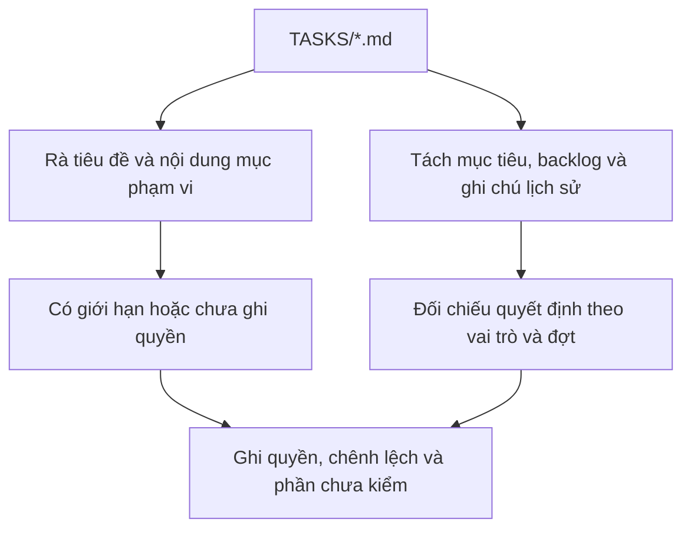

**TÓM TẮT 5 DÒNG**
1. [NGUỒN] [THẤY] Rà 250 tệp Markdown trực tiếp trong `JX1_OPS/TASKS`: 248 tệp task, một mẫu và một backlog.
2. [NGUỒN] [THẤY] Có 104 task dùng đúng tiêu đề và 21 task dùng tiêu đề phạm vi biến thể; không mục nào trong 125 mục này cấp quyền chạy VM, dùng mạng thật hoặc chạy exe game/server.
3. [NGUỒN] [TÀI LIỆU] Sổ quyết định có ngoại lệ riêng cho PM và từng đợt: Q-17–Q-20, Q-28, Q-43, Q-45, Q-50 và Q-55; các quyền và giới hạn có trong bảng đối chiếu.
4. [NGUỒN] [THẤY] Q-19 và `AGENTS.md:23` khác nhau về duyệt từng exe server; các hồ sơ A-07, CL-01, T-02–T-04 và B-02 cần phân biệt quyền theo đợt với phạm vi worker.
5. [CHƯA KIỂM] Chỉ đối chiếu tài liệu; không build, chạy game/exe, dùng VM hay kết nối mạng. Báo cáo giữ local để Tổng quan commit; tệp nhịp ngoài worktree bị từ chối ghi.

# XD-H04 — Rà quyền đã duyệt trong TASKS

- Loại: tổng hợp
- Chủ đề: Đối chiếu quyền VM, mạng và exe ghi trong TASKS với sổ quyết định của dự án.
- Từ khóa: quyền đã duyệt, máy ảo, kết nối mạng, exe, XD-H04, Q-19, Q-45, Q-50
- Trạng thái: DONE — hoàn tất rà và đối chiếu tài liệu; tệp nhịp bị chặn riêng.
- Độ phủ: 250/250 tệp Markdown trực tiếp trong `TASKS/` được phân loại; 125/125 mục phạm vi của task được rà nội dung.
- Liên quan: [task XD-H04](../TASKS/XD-H04.md), [QUYET-DINH](../STATE/QUYET-DINH.md), [CHUAN-BAO-CAO](../DESIGN/CHUAN-BAO-CAO.md), [DOI-TEST-TINH-NANG](../DESIGN/DOI-TEST-TINH-NANG.md), [BANG-NUT-EXE-SERVER](../DESIGN/BANG-NUT-EXE-SERVER.md).
- Cần tôi quyết định: không đối với lượt rà; PM cần xác nhận lại vai trò và biên quyền trước khi giao một lượt vận hành mới.

## Phạm vi và độ phủ

[THẤY] `Get-ChildItem -LiteralPath JX1_OPS/TASKS -File -Filter '*.md'` trả 250 tệp. `Select-String` đọc UTF-8, tìm tiêu đề, lấy phần nội dung đến tiêu đề tiếp theo và kiểm tra các dòng liên quan. 105 tệp khớp đúng tiêu đề, gồm 104 task và một mẫu; 21 tệp có tiêu đề biến thể; 124 tệp còn lại gồm 123 task và backlog. Loại phạm vi trong bảng phản ánh điều đọc được trong mục đang rà, không mặc định là toàn quyền của task.

[THẤY] Trong bảng này, `ID:dòng` là `JX1_OPS/TASKS/ID.md:dòng`. Các ID không có số dòng thuộc nhóm không tìm thấy tiêu đề, xác nhận bằng phép tìm tiêu đề ở trên. Mục tiêu, backlog và ghi chú lịch sử được tra riêng khi có dấu hiệu về VM, mạng hoặc exe.

| Nhóm | Độ phủ | Tệp hoặc dòng bằng chứng |
|---|---|---|
| HG (22) | Đã phủ — đúng tiêu đề; cấm hoặc không cấp quyền cho ba nhóm thao tác | HG-01:28, HG-02:28, HG-02b:28, HG-03:28, HG-03b:28, HG-03c:29, HG-04:28, HG-05:28, HG-05b:29, HG-06:29, HG-07:29, HG-08:29, HG-09:29, HG-10:29, HG-11:29, HG-12:29, HG-13:29, HG-14:28, HG-14b:28, HG-15:28, HG-16:28, HG-16b:28 |
| KC (3) | Đã phủ — đúng tiêu đề; cấm hoặc không cấp quyền cho ba nhóm thao tác | KC-01:28, KC-01b:28, KC-02:28 |
| KV (6) | Đã phủ — đúng tiêu đề; cấm hoặc không cấp quyền cho ba nhóm thao tác | KV-01:26, KV-02:26, KV-03:26, KV-04:26, KV-05:26, KV-06:26 |
| R (19) | Đã phủ — đúng tiêu đề; cấm hoặc không cấp quyền cho ba nhóm thao tác | R-01:25, R-02:25, R-03:25, R-04:28, R-04a:28, R-04b:28, R-04c:28, R-05:27, R-05a:28, R-05b:28, R-05c:28, R-05d:28, R-06:27, R-06a:28, R-06b:28, R-06c:28, R-07:27, R-07a:28, R-07b:28 |
| S (1) | Đã phủ — đúng tiêu đề; cấm hoặc không cấp quyền cho ba nhóm thao tác | S-01:25 |
| SO (28) | Đã phủ — đúng tiêu đề; cấm hoặc không cấp quyền cho ba nhóm thao tác | SO-01:28, SO-02:28, SO-03:28, SO-04:28, SO-05:28, SO-06:28, SO-07:29, SO-08:29, SO-09:29, SO-10:29, SO-11:29, SO-12:29, SO-13:29, SO-14:29, SO-15:29, SO-16:29, SO-17:29, SO-18:29, SO-19:28, SO-20:28, SO-21:28, SO-22:28, SO-23:28, SO-24:28, SO-25:24, SO-26:24, SO-27:24, SO-28:24 |
| TK (1) | Đã phủ — đúng tiêu đề; cấm hoặc không cấp quyền cho ba nhóm thao tác | TK-01:28 |
| U (3) | Đã phủ — đúng tiêu đề; cấm hoặc không cấp quyền cho ba nhóm thao tác | U-01:28, U-02:26, U-03:26 |
| XD (21) | Đã phủ — đúng tiêu đề; cấm hoặc không cấp quyền cho ba nhóm thao tác | XD-A07:24, XD-A07b:24, XD-A07c:24, XD-B04:24, XD-C01:24, XD-C03:24, XD-CL01:24, XD-E01:24, XD-E05:24, XD-E09:24, XD-H01:24, XD-H02:24, XD-H03:24, XD-H05:24, XD-M01:24, XD-O01:24, XD-P02:24, XD-V01:24, XD-W02:24, XD-W02b:24, XD-H04:24 |
| Tiêu đề biến thể (21) | Đã phủ — giới hạn đầu ra, soạn phương án hoặc kiểm offline | 0-03:25, A-02:24, A-03:24, A-05:34, A-06:24, A-07:29, A-07c:21, A-08a:24, A-08b:24, A-08c:24, A-08d:24, A-09:24, A-10:24, C-01:24, C-03:24, D-01:24, E-01:25, E-01b:23, E-05a:28, P-02:24, T-01:22 |
| Không có mục phạm vi, nhóm 1 (47) | Đã rà tiêu đề; không có mục để xác nhận quyền. Các ca đáng chú ý đối chiếu riêng bên dưới | 0-01, 0-02, 0-04, 0-05, 0-06, 0-07, 0-08, 0-09, 0-10, A-01, A-04, A-07b, A-07d, A-07e, A-12, A-14, A-15a, A-15b, A-15c, A-16, A-17, B-01, B-02, B-02b, B-02d, B-03, B-04, B-04a, B-05, C-02, CL-01, D-02, E-02, E-03, E-04, E-05, E-05b, E-06, E-07, E-08, E-09, E-09a, E-10, E-11, E-12, E-13, E-13b |
| Không có mục phạm vi, nhóm 2 (51) | Đã rà tiêu đề; không có mục để xác nhận quyền. Các ca đáng chú ý đối chiếu riêng bên dưới | F-01, G-01, H-01, H-02, H-03, H-04, H-05, H-06, H-07, H-08, H-09, H-10, H-11, H-12, H-13, H-14, H-15, I-01, I-02, I-03, I-04, I-05, I-06, I-06b, I-07, I-08, J-01, J-02, J-03, J-04, J-05, J-06, K-01, K-02, K-02a, K-02b, K-02c, K-02d, K-02e, K-02f, K-02g, K-03, K-03a, K-03b, K-03c, K-03d, K-03e, L-01, L-02, M-01, M-02 |
| Không có mục phạm vi, nhóm 3 (25) | Đã rà tiêu đề; không có mục để xác nhận quyền. Các ca đáng chú ý đối chiếu riêng bên dưới | N-01, N-02, N-03, N-04, N-05, N-06, N-07, O-01, P-01, P-03, T-02, T-03, T-04, V-01, W-01, W-01a, W-01b, W-01c, W-01d, W-02, X-01, X-02, X-03, X-04, X-05 |
| Tệp mẫu và backlog (2) | Đã phân loại riêng | `_MAU-TASK.md:27–31` là mẫu; `BACKLOG.md` là kế hoạch, các dòng liên quan được dẫn trong bảng đối chiếu. |

## Giải mã tên

[TÀI LIỆU] Không áp dụng: báo cáo rà quyền vận hành, không lập dữ liệu tên riêng của kỹ năng, trang bị, quái, NPC hay bản đồ. ID task, VM và quyết định giữ nguyên như trong tài liệu UTF-8.

## Sắp theo cấu trúc game

[TÀI LIỆU] Không áp dụng cấu trúc phái, bộ đồ hoặc bản đồ. Bảng dưới xếp theo đối tượng được phép, môi trường và đợt duyệt để PM tra quyền.

## Đã xác minh — đối chiếu quyền và mâu thuẫn

**Nhãn bằng chứng:** [THẤY] là nội dung hoặc kết quả kiểm tra tệp trực tiếp; [TÀI LIỆU] là phê duyệt, kế hoạch hoặc kết quả do hồ sơ dự án ghi; [CHƯA KIỂM] là điều lượt này chưa có bằng chứng độc lập. Trong các bảng sau, `QUYET-DINH.md` là `JX1_OPS/STATE/QUYET-DINH.md`; tên tắt của task là tệp tương ứng trong `JX1_OPS/TASKS/`.

| Việc hoặc quyền | Hồ sơ trong TASKS và quyết định đối chiếu | Nhận định |
|---|---|---|
| Môi trường thử, mạng VM và chuỗi exe: **0-02, 0-07** | [THẤY] `0-02.md:8`, `0-07.md:5–8`; `BACKLOG.md:10,15` mô tả kiểm môi trường và bật/tắt môi trường thử. [TÀI LIỆU] Q-13 chọn VM thử `JX-Test-36`; Q-17 yêu cầu Host-only và cấm bridged/LAN trực tiếp khi chưa được chủ cho phép; Q-19 cho PM điều khiển chuỗi server đã biết trong VM thử (`QUYET-DINH.md:19,23,25`). Dòng 42 còn nêu việc chủ xác nhận đã đọc báo cáo mạng trước khi tiếp tục dùng VM thử. | [THẤY] Ghi chú 0-07 kể một lượt đã tới trạng thái sẵn sàng và nói chưa chạy bước Main VM. Đó là ghi nhận của đợt trước. [CHƯA KIỂM] Chưa đối chiếu việc xác nhận ở dòng 42 hay runtime của lượt đó. |
| **Main VM** và tường lửa/mạng | [TÀI LIỆU] Q-18 cho phép PM bật headless khi đang tắt, xem trạng thái và khởi động chuỗi khi cần. Q-20 chỉ cho xử lý hồ sơ mạng và luật vào trong điều kiện đã ghi, giới hạn đích cho máy thật; Q-28 chỉ cho dùng các tác vụ Admin và tham số có trong danh sách duyệt (`QUYET-DINH.md:24,26,35`). Q-55 thêm việc tắt sạch Server D và LDPlayer nối D khi không test, bật lại khi chủ báo (`QUYET-DINH.md:69–70`). | [TÀI LIỆU] Q-55 tháo riêng phần “không tắt” của Q-18 trong tình huống trên. Các hạn chế khác của Q-18 vẫn đứng; Q-20 và Q-28 là ngoại lệ hẹp, không mở quyền mạng chung. XD-H04 cấm Main VM và mạng (`XD-H04.md:23–24`). |
| **Duyệt từng exe server** | [TÀI LIỆU] Q-19 cho PM khởi động/dừng/khởi động lại chuỗi đã biết trong VM thử; giới hạn Main VM theo Q-18. Exe lạ chỉ trong VM thử sau lưu SHA-256 và quét Defender; cấm exe game trên máy thật và giữ ba cấm tuyệt đối (`QUYET-DINH.md:25`). | [THẤY] **Mâu thuẫn câu chữ:** Q-19 nói quy tắc duyệt riêng từng exe server trong AGENTS cũ trên main hết hiệu lực; `AGENTS.md:23` trong worktree vẫn yêu cầu duyệt riêng, kể cả S3Relay. `AGENTS.md:27` còn yêu cầu cô lập, quét, lưu hash và bật log. `BACKLOG.md:14` nêu việc đồng bộ tài liệu 0-06. Giữ hai nguồn và biên giao việc hiện hành; báo cáo không tự chọn một nguồn để cấp quyền cho worker. |
| **A-07** và các việc tách A-07b/c/d/e, XD-A07 | [THẤY] `A-07.md:19,24–29` giới hạn worker vào phân tích/dựng tĩnh, soạn lệnh debug, ghi chưa chạy; `BACKLOG.md:30` nêu mục tiêu debug trong VM thử. [TÀI LIỆU] Q-50 duyệt riêng bước 2–6 của A-07 trong VM, kể cả snapshot và dựng lại từ snapshot đã vá (`QUYET-DINH.md:54–55`). | [THẤY] Task A-07 đang có danh sách mục tiêu 1–4, còn Q-50 dẫn bước 2–6. Không ánh xạ số bước khi thiếu kế hoạch gốc. Các việc tách không kế thừa quyền: A-07b/c/e chỉ dựng hoặc kiểm bản dựng (`A-07b.md:17,23`, `A-07c.md:16–21`, `A-07e.md:6–7`); A-07d chỉ đề xuất (`A-07d.md:2–5`); XD-A07 chỉ rà bằng chứng (`XD-A07.md:20,24`). Đây là chênh phạm vi giữa đợt Q-50 và các task tài liệu. |
| **CL-01 — thử client C01/C03** | [THẤY] `CL-01.md:3–5`, `BACKLOG.md:118`: năm ca, ghi chú C01/C03 đạt và C02/C04/C05 chờ chủ. [TÀI LIỆU] Q-50 chỉ duyệt C01/C03 (`QUYET-DINH.md:54–55`). | [THẤY] Phù hợp về phạm vi ca. C01/C03 là mã ca client, khác task công cụ `C-01.md:18,23–24` và `C-03.md:18,23–24` chỉ offline. XD-CL01 chỉ đối chiếu báo cáo (`XD-CL01.md:20,24`). [CHƯA KIỂM] Lượt này chưa xác nhận cách chạy, đích mạng hoặc từng kết quả ca. |
| **T-02–T-04 — dữ liệu thử trong VM** | [TÀI LIỆU] Q-45 cho tạo tài khoản/nhân vật test trên DB của VM thử cho ba vòng, có hoàn tác và cô lập dữ liệu thật (`QUYET-DINH.md:39`). Thiết kế còn ghi chờ T-01 và duyệt tài khoản (`JX1_OPS/DESIGN/DOI-TEST-TINH-NANG.md:10,16,19`). [THẤY] Các lượt đã ghi cấm chạy VM/exe/mạng (`T-02.md:12–15`, `T-03.md:12–14`, `T-04.md:12–14`). | [THẤY] Điều kiện “chờ duyệt tài khoản” trong thiết kế lệch với Q-45; điều kiện T-01 và lệnh giao worker cần đối chiếu riêng. Quyền tạo dữ liệu test ở cấp dự án không làm các lượt chỉ đọc thành lượt runtime. Q-47 còn ghi chủ muốn bỏ T-01 (`QUYET-DINH.md:46`); thiết kế vẫn ghi T-01 là điều kiện. |
| **N-07 — thử nút exe server** | [THẤY] `N-07.md:3–5`, `BACKLOG.md:112` dẫn #161/#162. [TÀI LIỆU] Thiết kế ghi kế hoạch chờ duyệt từng bước và một số kết quả lịch sử của hai đợt (`JX1_OPS/DESIGN/BANG-NUT-EXE-SERVER.md:44–52,56–64`). Q-19 nói về chuỗi exe, không ghi duyệt mọi nút (`QUYET-DINH.md:25`). | [CHƯA KIỂM] Chưa có nội dung phê duyệt gốc #161/#162 trong nguồn đối chiếu. Trạng thái `done` và ghi chép đã thử không đủ để xác nhận từng nút được phép hay tái chạy. |
| **B-02, B-04, E-09 — mục tiêu runtime, bản giao hẹp hơn** | [THẤY] `BACKLOG.md:37,39,67` nêu chạy VM thử, đo hoặc thử bot thật. `B-02.md:18,27–28` chỉ build; `B-04.md:5` và `B-04a.md:11,18` chỉ chuẩn bị bộ đo; `E-09.md:5`, `E-09a.md:11,16–19` ghi allowlist/offline và chưa chạy thật. | [THẤY] Lệch giữa mục tiêu backlog và lượt giao worker. Q-19 không tự cấp quyền cho mọi binary hoặc kịch bản mạng, Q-45 giới hạn các vòng T-02–T-04 (`QUYET-DINH.md:25,39`). Loopback trong B-03/E-05b là kiểm cục bộ (`B-03.md:20`, `E-05b.md:14,26`). |
| **H-15 — đo FPS và APK thử** | [TÀI LIỆU] Q-43 ghi lộ trình đo và điều kiện duyệt thiết kế trước khi sửa bản sao/dựng APK (`QUYET-DINH.md:37`). [THẤY] `H-15.md:11,16–17` ghi khảo sát tĩnh và đề xuất ca tái hiện, chưa chạy. | [THẤY] Không thấy mục phạm vi cấp quyền thực thi cho lượt H-15 đang lưu. Kế hoạch là bằng chứng về việc dự định làm. |
| **0-05 — mạng GitHub** | [TÀI LIỆU] Q-10 và Q-50 từng duyệt kho riêng cho source đã lọc (`QUYET-DINH.md:16,54–55`); dòng 56 ghi chủ yêu cầu 0-05 giữ cục bộ, không đẩy GitHub. [THẤY] `0-05.md:5` ghi giữ cục bộ, `BACKLOG.md:13` còn mô tả kho riêng. | [THẤY] Bản ghi task khớp chỉ thị giữ cục bộ, còn backlog giữ mô tả cũ. Không dùng Q-10/Q-50 để suy quyền push cho XD-H04. |

## Mục sổ thông số

[TÀI LIỆU] Các giá trị dưới đây là ràng buộc tài liệu, chưa đo từ VM hay cấu hình thực. Cột đổi an toàn chỉ áp dụng trong XD-H04.

| Nhóm | Tên | File:dòng | Giá trị | Đơn vị | Ảnh hưởng | Đổi an toàn | Nguồn đo |
|---|---|---|---|---|---|---|---|
| Mạng VM thử | Chế độ mặc định của đợt | `QUYET-DINH.md:23` | Host-only | Chế độ | Không dùng bridged / LAN trực tiếp nếu chưa có duyệt | KHÔNG | Đọc tĩnh Q-17 |
| Exe chưa từng chạy | Kiểm tra trước chạy | `QUYET-DINH.md:25`, `AGENTS.md:27` | SHA-256, Defender; AGENTS yêu cầu thêm cô lập và log/audit | Điều kiện | Phân biệt bản được giao và giới hạn tác động | KHÔNG | Đọc tĩnh; không quét hay chạy |
| Client CL-01 | Ca được duyệt | `QUYET-DINH.md:55`, `CL-01.md:5` | C01, C03 | Ca thử | Không mở rộng sang C02/C04/C05 | KHÔNG | Đọc tĩnh Q-50 |

## Chưa kiểm — chưa xác minh

- [CHƯA KIỂM] Cấu hình mạng, cổng thực mở, snapshot, kết quả Defender/hash, tiến trình, DB và những ca runtime của các task. Không build, chạy test game, exe, vào VM, Main VM hoặc kết nối mạng. Các trạng thái lịch sử chỉ lấy từ tệp được dẫn.
- [CHƯA KIỂM] Không đối chiếu tin nhắn chủ gốc, kế hoạch chứa chỉ số bước 2–6 của Q-50 hay phê duyệt gốc #161/#162; không suy rằng tài liệu thiếu đồng nghĩa với không có phê duyệt.
- [CHƯA KIỂM] Không cần mở nguồn client/server, Graphify hay kho ở ngoài worktree để trả lời câu hỏi quyền trong văn bản. Không đọc dữ liệu tài khoản, khóa, mật khẩu hoặc dump.

## Đề xuất tối ưu và bàn giao

- [THẤY] Đề xuất PM bổ sung mục quyền cho task vận hành khi giao lại: ghi vai trò, quyết định, việc, VM/bản sao, đích mạng và giới hạn cụ thể; ghi rõ quyền ngoại lệ hoặc phạm vi chỉ đọc. Ưu tiên đồng bộ câu duyệt từng exe giữa Q-19 và AGENTS, và cập nhật trạng thái phụ thuộc T-01/Q-45 trong thiết kế. Không sửa các nguồn trong lượt này.
- [THẤY] `git status --short --branch` trước khi ghi cho kết quả `## task/XD-H04`, không có thay đổi local. `rg` trả `CommandNotFoundException`; chuyển sang `Get-ChildItem` và `Select-String` trong vùng nguồn nêu trên, đã ra bảng 250 tệp.
- [THẤY] `git diff --check` trên task và kiểm khoảng trắng bằng `git diff --no-index --check` trên báo cáo mới không phát hiện lỗi; diff task chỉ nối mục Kết quả. Kiểm PowerShell đạt UTF-8 không BOM, đúng năm dòng tóm tắt, một Mermaid, 248/248 ID task không trùng, bốn dòng Kết quả và dòng cuối `ĐẠT`. Lần kiểm BOM đầu báo nhầm do so sánh chuỗi; kiểm lại bằng giải mã UTF-8 nghiêm ngặt và so ký tự đầu cho kết quả đạt.
- [THẤY] Lệnh `Set-Content` ở mốc bắt đầu trả lỗi `Access to the path 'D:\JX-wt\XD-H04.nhip' is denied.` Đường dẫn ngoài vùng ghi; không thử lại cùng lỗi. Mốc thay thế: bắt đầu kiểm nhánh/chuẩn; 03:40 +07 đã rà mục và đối chiếu sơ bộ; 03:41 +07 đã chốt bằng chứng, chuyển sang ghi báo cáo. Các mốc được cập nhật trong hội thoại.
- [THẤY] Đầu ra là báo cáo này và mục `Kết quả` ở cuối task theo `XD-H04.md:26` và prompt. Không ghi tệp chỉ mục ngoài vùng giao; hàng đề xuất cho PM gộp: `XD-H04.md | tổng hợp | quyền VM/mạng/exe | XD-H04, Q-19, Q-45, Q-50 | DONE | 250/250 tệp | QUYET-DINH.md`. Không stage, commit hay push theo yêu cầu; chưa có SHA mới.
- [THẤY] Kỹ năng đã dùng: `jx1-retrofit` (độ phủ và giữ nguyên kết luận), `jx1-read-server`, `jx1-read-client` (giới hạn đọc và không suy runtime; không cần mở mã), `jx1-parameters` (sổ ràng buộc), `jx1-knowledge` (đối chiếu và liên kết nguồn), `jx1-report` (khuôn báo cáo và bàn giao).

ĐẠT
