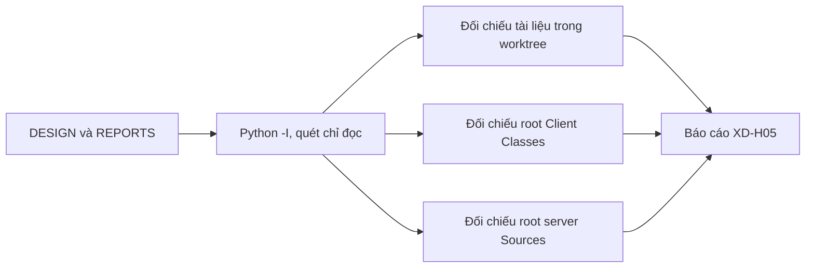

TÓM TẮT 5 DÒNG

1. [NGUỒN][THẤY] Python -I hoàn tất mã 0 sau khi quét 329 tệp Markdown/TSV trong DESIGN và REPORTS; không sửa tài liệu nguồn.
2. [NGUỒN][THẤY] Lượt đối sánh nhận diện 5.132 đường dẫn; 831 phân giải được, 37 nội bộ, 608 client và 70 server không phân giải theo ánh xạ.
3. [CHƯA KIỂM] Kết quả chỉ xuất tối đa 60 dòng mỗi nhóm; còn 548 client và 10 server không hiển thị để kiểm tra chi tiết.
4. [CHƯA KIỂM] 3.476 mục mơ hồ và 110 mục ngoài root; chưa thể kết luận tồn tại/không tồn tại.
5. [CHƯA KIỂM] Chưa chạy build, exe hoặc VM; script lưu và cập nhật task chưa làm do giới hạn vung_file.

# XD-H05 — Kiểm tra liên kết nội bộ DESIGN/REPORTS

Loại: công cụ  
Chủ đề: Kiểm tra tham chiếu đường dẫn và `file:dòng` trong tài liệu DESIGN/REPORTS.  
Từ khóa: liên kết nội bộ, đường dẫn, file:dòng, Python -I, DESIGN, REPORTS, XD-H05  
Trạng thái: PARTIAL — có kết quả quét sơ bộ; thiếu script lưu và danh sách đầy đủ.  
Độ phủ: 329/329 tệp Markdown/TSV trong hai thư mục đích; các root mã nguồn chỉ được kiểm tra theo tham chiếu, không quét đệ quy.  
Liên quan: `JX1_OPS/TASKS/XD-H05.md`, `JX1_OPS/DESIGN/CHUAN-BAO-CAO.md`, `JX1_OPS/DESIGN/MUC-LUC-TRI-THUC.md`.  
Cần tôi quyết định: có — cần mở rộng `vung_file` để lưu công cụ và cập nhật mục Kết quả của task nếu muốn hoàn thành trọn tiêu chí.

Nhãn bằng chứng: **THẤY** = quan sát hoặc lệnh đã chạy; **TÀI LIỆU** = thông tin lấy từ file tài liệu; **CHƯA KIỂM** = chưa đủ quyền, phạm vi hoặc đầu ra để xác nhận.

## Phạm vi và độ phủ

| Phần tử phạm vi | Kết quả | Bằng chứng / giới hạn |
|---|---|---|
| Task XD-H05 | [TÀI LIỆU] Đã đọc | `JX1_OPS/TASKS/XD-H05.md`; task không có mục riêng tên “Nguồn cần đọc”, nên dùng các root được nêu trong Phạm vi |
| Chuẩn báo cáo | [TÀI LIỆU] Đã đọc | `JX1_OPS/DESIGN/CHUAN-BAO-CAO.md`; áp dụng bố cục, sơ đồ, phạm vi, giải mã tên và sắp cấu trúc |
| Mục lục tri thức | [TÀI LIỆU] Đã đọc | `JX1_OPS/DESIGN/MUC-LUC-TRI-THUC.md`; chỉ dùng để định vị, không coi là bằng chứng quét |
| DESIGN + REPORTS | [THẤY] Đã quét 329/329 tệp Markdown/TSV | `python -I -c` (mã inline, chỉ đọc): 79.314 dòng, không có lỗi đọc |
| Client `Classes` được task chỉ định | Đã kiểm tra từng đường dẫn được ánh xạ; chưa phủ đầy đủ | Root tồn tại; 608 đường dẫn không phân giải; lệnh chỉ xuất tối đa 60 mục |
| Server `gameserver/Sources` được task chỉ định | Đã kiểm tra từng đường dẫn được ánh xạ; chưa phủ đầy đủ | Root tồn tại; 70 đường dẫn không phân giải; lệnh chỉ xuất tối đa 60 mục |
| `D:/jx-ops-wt/JX1_OPS` | Chưa đọc được | Đường dẫn không tồn tại trong môi trường này; dùng bản `JX1_OPS` của worktree được giao |
| `JX1_OPS/TOOLS/kiem_lien_ket.py` | Chưa tạo | Ngoài `vung_file` được giao; chỉ báo cáo được phép sửa |
| Mục `## Kết quả` trong task | Chưa ghi | `JX1_OPS/TASKS/XD-H05.md` ngoài `vung_file` |
| `JX1_OPS/REPORTS/_CHIMUC/XD-H05.tsv` | Chưa tạo | Chuẩn báo cáo yêu cầu chỉ mục; ngoài `vung_file` được giao |
| `D:/JX-wt/XD-H05.nhip` | Chưa ghi | Thử lúc bắt đầu nhận lỗi từ chối truy cập; đích nằm ngoài writable root |

## Giải mã tên

| Tên gốc | Mã hóa | Chữ đúng | Nguồn |
|---|---|---|---|
| Không áp dụng — báo cáo chỉ kiểm tra đường dẫn, không trình bày tên kỹ năng, trang bị, quái, NPC hoặc bản đồ | — | — | `JX1_OPS/TASKS/XD-H05.md` |

## Sắp theo cấu trúc game

Không áp dụng: kết quả được nhóm theo loại đích (tài liệu nội bộ, client, server, ngoài root, chưa phân giải), không có dữ liệu game để xếp theo phái, bộ trang bị hoặc bản đồ.

## Kết quả quét

Lệnh chạy: `python -I -c` với chương trình chỉ đọc chạy inline; không lưu chương trình ra tệp. Kết quả của lượt đối sánh:

| Chỉ số | Kết quả |
|---|---:|
| Tệp Markdown/TSV được quét | 329 |
| Dòng đọc | 79.314 |
| Lượt tham chiếu `file:dòng` được nhận diện | 75.682 |
| Đường dẫn duy nhất được gom | 5.132 |
| Phân giải được | 831 |
| Ứng viên đường dẫn nội bộ chưa phân giải | 37 |
| Đường dẫn ánh xạ vào Client Classes nhưng không tìm thấy | 608 |
| Đường dẫn ánh xạ vào server Sources nhưng không tìm thấy | 70 |
| Đích trỏ ra ngoài các root được chỉ định | 110 |
| Mục còn mơ hồ, chưa phân giải | 3.476 |

Đây là kết quả sơ bộ, chưa phải danh sách đầy đủ: chương trình gom đường dẫn có thể gồm cả mẫu/wildcard; đầu ra chỉ giữ tối đa 60 dòng cho mỗi nhóm, nên 548 mục Client và 10 mục server còn lại không được xuất vào phiên kết quả. Trong 37 ứng viên nội bộ có wildcard và tên mẫu; không coi chúng tự động là liên kết hỏng. Mục mơ hồ gồm tên tệp không đủ đường dẫn hoặc alias không ánh xạ chắc chắn vào root được phép. Không coi mục ngoài root hoặc mơ hồ là tệp hỏng.

Các đích tài liệu nội bộ không tìm thấy:

| Nơi nhắc tới | Đích được nhắc | Kết quả |
|---|---|---|
| [THẤY] `JX1_OPS/REPORTS/I-08-he-thong-nhiem-vu.md:196` | `DESIGN/BOT/SHARED_BOT_SOCIAL_AND_INTERACTION_SYSTEM.md:82` | Python `-I`: không tồn tại tại đường dẫn tương ứng trong worktree |
| [THẤY] `JX1_OPS/REPORTS/R-04.md:49` | `JX1_OPS/REPORTS/_CHIMUC/R-04.tsv:1` | Python `-I`: không tồn tại; thư mục có các phần `R-04a.tsv`, `R-04b.tsv`, `R-04c.tsv` |

Ba đích không tìm thấy trong root server được task chỉ định:

| Nơi nhắc tới | Đích được nhắc |
|---|---|
| [THẤY] `JX1_OPS/REPORTS/B-02-loc-hien-thi.md:25` | Python `-I`: `server/jxOnline/gameserver/Sources/Core/Src/KVisibility.cpp:1` không tồn tại tại vị trí ánh xạ |
| [THẤY] `JX1_OPS/REPORTS/B-02-loc-hien-thi.md:26` | Python `-I`: `server/jxOnline/gameserver/Sources/Core/Src/KVisibility.h:1` không tồn tại tại vị trí ánh xạ |
| [THẤY] `JX1_OPS/REPORTS/B-02-loc-hien-thi.md:27` | Python `-I`: `server/jxOnline/gameserver/Sources/Settings/visibility.ini:1` không tồn tại tại vị trí ánh xạ |

Ví dụ tham chiếu client được công cụ phân loại không tìm thấy tại root ánh xạ: [THẤY] `JX1_OPS/DESIGN/HIEU-CAP-KINH-NGHIEM.md:3` nhắc `C/CoreUseNameDef.h:103`; [THẤY] `JX1_OPS/DESIGN/SO-TAY-GOI-TIN.md:1` nhắc `C/KProtocolDef.h:249`. Đây là kết quả kiểm tra đúng đường dẫn sau khi ánh xạ, không khẳng định basename không tồn tại ở nơi khác.

## Đã xác minh

- `JX1_OPS/DESIGN` và `JX1_OPS/REPORTS` tồn tại; lượt Python kết thúc với mã 0, đọc 329 tệp Markdown/TSV và không báo lỗi đọc.
- Hai root code được task nêu tồn tại; các kiểm tra đường dẫn được thực hiện chỉ đọc, không mở rộng quét đệ quy.
- Các liên kết nội bộ và server nêu trong bảng phía trên không tìm thấy ở vị trí được ánh xạ.
- Thư mục báo cáo chỉ mục có các tệp `R-04a.tsv`, `R-04b.tsv`, `R-04c.tsv`; không có `R-04.tsv`.

## Chưa xác minh

- Chưa xác minh đầy đủ 608 đường dẫn Client và 70 đường dẫn server vì kết quả xuất bị cắt ở 60 mục mỗi nhóm; chưa ghi toàn bộ 37 ứng viên nội bộ, 3.476 mục mơ hồ và 110 mục ngoài root.
- Không thể xác nhận `D:/jx-ops-wt/JX1_OPS` vì đường dẫn không tồn tại; các kết quả áp dụng cho bản worktree được giao.
- Không có script bền vững tại `JX1_OPS/TOOLS/kiem_lien_ket.py` và chưa ghi mục Kết quả vào task do ràng buộc `vung_file` chỉ gồm báo cáo.
- Chưa tạo `JX1_OPS/REPORTS/_CHIMUC/XD-H05.tsv` theo chuẩn vì tệp chỉ mục cũng nằm ngoài `vung_file`.
- Không ghi được tệp nhịp `D:/JX-wt/XD-H05.nhip`: lần thử lúc bắt đầu trả lỗi “Access to the path is denied.”
- Chưa chạy build, exe, VM hoặc mạng; không đọc nội dung mã nguồn game.
- `rg` không có trong PATH; các lần tìm chọn lọc dùng `Select-String`, còn lượt quét dùng Python.
- Một lần thử kiểm tra đích ngoài root được phép bị từ chối truy cập; không đọc nội dung, và lượt sau chỉ kiểm tra trong các root được giao.
- Lần chạy Python đầu trả `UnicodeEncodeError` khi xuất tiếng Việt qua CP1252; chạy lại với stdout UTF-8 hoàn tất mã 0.

## Bàn giao

Không commit theo yêu cầu. Bước tiếp theo để hoàn thành là cho phép thêm `JX1_OPS/TOOLS/kiem_lien_ket.py` và `JX1_OPS/TASKS/XD-H05.md` vào `vung_file`, rồi chạy lại bộ quét để xuất đầy đủ các mục bị cắt và ghi kết quả cuối task. Không có kết luận cũ nào bị thay đổi.

Kỹ năng đã dùng: `jx1-retrofit`, `jx1-read-server`, `jx1-read-client`, `jx1-parameters`, `jx1-knowledge`, `jx1-report`.

CHƯA ĐẠT vì chưa thể lưu script và cập nhật mục Kết quả của task trong phạm vi chỉ cho phép sửa `JX1_OPS/REPORTS/XD-H05.md`, đồng thời danh sách tham chiếu client còn thiếu chưa xuất đầy đủ.
