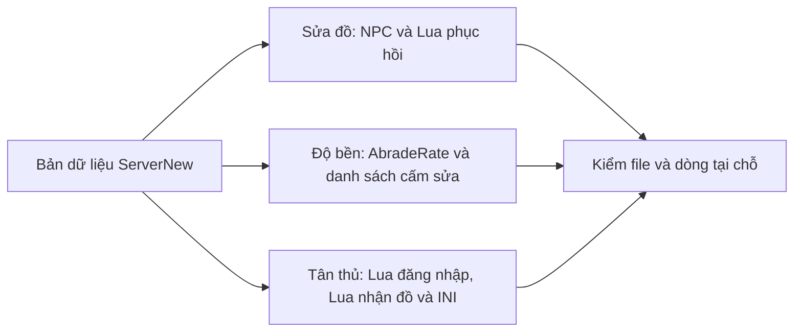

TÓM TẮT 1: [NGUỒN] [THẤY] DONE cho lượt tìm nguồn XD-HG14: cả sửa đồ, độ bền và tân thủ đều có nguồn trên đĩa trong bản ServerNew; xem năm trích dẫn và bảng phạm vi.
TÓM TẮT 2: [NGUỒN] [THẤY] Có hai Lua phục hồi trang bị với cách tính nguyên liệu khác nhau, bảng khai báo NPC, `AbradeRate.ini` và tám INI có nhóm cấm sửa (`G/script/tnlteam/npc/addnpc.lua:50–60`, `G/Settings/item/AbradeRate.ini:1–7`, `G/Settings/gamesetting.ini:84–86`).
TÓM TẮT 3: [NGUỒN] [THẤY] Có `online.lua`, `newplayer_get.lua`, 10 tệp `NewPlayerIni`, bảng chỉ số cơ bản và điểm hồi sinh (`G/script/System/online.lua:11–17`, `G/script/Utf8Script/npc/newplayer_get.lua:8–18,144–157`, `G/Settings/player/NewPlayerIni00.ini:20–23`, `G/Settings/npc/player/NewPlayerBaseAttribute.ini:1–29`, `G/Settings/RevivePos.ini:1`).
TÓM TẮT 4: [CHƯA KIỂM] Chưa xác định dữ liệu GS đang nạp, NPC thực sự xuất hiện hay đường gọi đang dùng cho `newplayer_get.lua`; tham chiếu tìm được là dòng chú thích (`G/script/Pass/creatcitynpc.lua:461`).
TÓM TẮT 5: [CHƯA KIỂM] Chỉ đọc tĩnh; chưa chạy Lua/game, build, exe, VM hay mạng. Tổng quan nhận hai tệp để commit; mục Bàn giao ghi các bước còn lại.

# XD-HG14 — Nguồn Lua sửa đồ, dữ liệu độ bền và tân thủ

- Loại: khảo sát
- Chủ đề: Định vị Lua và INI trong các bản sao trên đĩa để bổ sung nguồn cho HG-14 và HG-16.
- Từ khóa: sửa đồ, độ bền, Thợ Rèn Thần Bí, `SetCurDurability`, `AbradeRate`, tân thủ, `OnLine`, `NewPlayerIni`, HG-14, HG-16
- Trạng thái: DONE — đủ bằng chứng tĩnh cho nhiệm vụ tìm nguồn.
- Độ phủ: 4/4 nhóm yêu cầu (sửa đồ, cấu hình độ bền, script tân thủ, INI tân thủ); phạm vi bản sao và giới hạn ở bảng dưới.
- Liên quan: [HG-14](HG-14.md), [HG-16](HG-16.md), [chuẩn báo cáo](../DESIGN/CHUAN-BAO-CAO.md).
- Cần tôi quyết định: không.

## Phạm vi và độ phủ

| Phần tử | Độ phủ và bằng chứng |
|---|---|
| Sửa đồ | Đã phủ. [THẤY] Hai script phục hồi đồ, một bảng khai báo NPC và hai script nhiệm vụ liên quan đến sửa hoặc đặt độ bền; xem nhóm Sửa đồ bên dưới. |
| Dữ liệu độ bền và cấm sửa | Đã phủ. [THẤY] `G/Settings/item/AbradeRate.ini:1–7,22–24` và tám INI có `[ForbitRepairSet]`; xem bảng nguồn sửa đồ. |
| Script tân thủ | Đã phủ. [THẤY] `G/script/System/online.lua:11–17`, `G/script/Utf8Script/npc/newplayer_get.lua:8–18,144–157`. |
| INI tân thủ | Đã phủ. [THẤY] Mười mẫu trong `G/Settings/player`, bảng cơ bản và tệp hồi sinh; xem nhóm Tân thủ. |
| `C:/Jx1CocoV3` | Đã phủ các nhánh chọn lọc. [THẤY] Nguồn chính nằm trong bản ServerNew. Không thấy Lua/INI liên quan trong `S`, `jxOnline/bin`, `Client/data`, `Client/Resources` hay nhánh `AMOLX-04-20261115/client/Content` theo lệnh bên dưới. Client C++ dùng để đối chiếu UI. |
| `D:/JX-build` | Đã dò các nhánh build và dữ liệu nêu dưới. [THẤY] Không có Lua/INI khớp; `_bin_v2_/gs` là thư mục khác với `G`. |
| `D:/jx1-ops-wt` | Đã phủ kho báo cáo `JX1_OPS` và các nhánh `SERVER`, `CLIENT`, `qh7copy`. [TÀI LIỆU] Báo cáo cũ là căn cứ đối chiếu (`D:/jx1-ops-wt/JX1_OPS/REPORTS/HG-14.md:33–35,53`, `D:/jx1-ops-wt/JX1_OPS/REPORTS/HG-16.md:36,66`); không thấy Lua/INI khớp trong các nhánh đã dò. |
| `data_cdn` | Đã kiểm tệp rời trong `C:/Jx1CocoV3/data_cdn`. [THẤY] Dò 1 INI, 0 kết quả; `data` có 40 tệp `.pak` và 1 `.apk`, `apk` có 7 `.apk` (kiểm phần mở rộng). [CHƯA KIỂM] Nội dung gói. |

Gốc đường dẫn dùng trong tất cả dẫn chứng:

| Ký hiệu | Đường dẫn thật |
|---|---|
| `G` | `C:/Jx1CocoV3/Folder/ServerNew-20260116T043145Z-3-001/ServerNew/_bin_v2_/gs` |
| `J` | `C:/Jx1CocoV3/SwordOnline/SwordOnline/jxOnline` |
| `S` | `C:/Jx1CocoV3/SwordOnline/SwordOnline/jxOnline/gameserver/Sources` |
| `C` | `C:/Jx1CocoV3/Folder/Client2912-20260116T044348Z-3-001/Client2912/Client/Classes` |

## Giải mã tên

| Tên gốc | Mã hóa | Chữ đúng | Nguồn file:dòng |
|---|---|---|---|
| `Thî RÌn ThÇn BÝ`; `Thî RÌn ThÇn BÝ L©m An` | TCVN3 | Thợ Rèn Thần Bí; Thợ Rèn Thần Bí Lâm An | `G/script/tnlteam/npc/addnpc.lua:60`; `G/script/mineitem/lenhbaitanthu.lua:417`; đối chiếu tên UTF-8 ở `C/gamecore/CoreShell.cpp:4399` |
| `NhiÕp ThÝ TrÇn` | TCVN3 | Nhiếp Thí Trần | `G/script/tnlteam/npc/addnpc.lua:50` |
| `Kim Nguyªn B¶o` | TCVN3 | Kim Nguyên Bảo | `G/script/global/npcchucnang/nhiepthitran.lua:178,228` |
| `Hoµng Kim` | TCVN3 | Hoàng Kim (nhóm trang bị) | `G/script/global/npcchucnang/thorenthanbilaman.lua:31` |
| `Ãæ¾ß` (hiển thị khi xem byte gốc qua Windows-1252) | GBK | Mặt nạ (面具; chuỗi lọc tên) | `G/Settings/gamesetting.ini:86` |
| `jin, mu, shui, huo, tu`; `金, 木, 水, 火, 土` | ASCII; UTF-8 | Kim, Mộc, Thủy, Hỏa, Thổ | `C/gameui/KuiNewPlayer.cpp:994` |
| `man, girl`; `男, 女` | ASCII; UTF-8 | Nam, nữ | `C/gameui/KuiNewPlayer.cpp:995` |

[THẤY] Các từ khóa và số trong Lua/INI dẫn dưới dùng ASCII. Các Lua có chữ Việt cũ được đối chiếu theo mẫu TCVN3; tên thư mục `Utf8Script` không xác nhận mã hóa nội dung. Chú thích tiếng Hán trong `AbradeRate.ini` đọc được bằng GBK.

## Sắp theo cấu trúc game

### Sửa đồ: NPC theo bản đồ, rồi cơ chế trang bị

| Vị trí trong game | Nguồn và điều đọc được |
|---|---|
| Thợ Rèn Thần Bí | [THẤY] Bảng khai báo gắn mẫu NPC 199 và script `G/script/global/npcchucnang/thorenthanbilaman.lua` ở mục bản đồ 176, cặp số vị trí `1314,3196` (`G/script/tnlteam/npc/addnpc.lua:60`). Một lời hướng dẫn trên vật phẩm gọi tên Lâm An và ghi `164,199` (`G/script/mineitem/lenhbaitanthu.lua:417`); chưa xác minh hai cách ghi tọa độ tương ứng. Menu có hai nhánh: đồ xanh và Hoàng Kim. Cả hai từ chối độ bền trên 2; nhánh xanh trừ 5, nhánh Hoàng Kim trừ 10 cùng loại vật phẩm theo lời gọi Lua rồi đồng bộ độ bền tối đa. Chữ trên cửa sổ lại ghi 10 và 20 KNB; giữ nguyên khác biệt giữa chữ và lệnh (`G/script/global/npcchucnang/thorenthanbilaman.lua:27–38,54–71,86–87,103–123`). |
| Nhiếp Thí Trần | [THẤY] Bảy dòng khai báo mẫu NPC 769, mã bản đồ `11, 1, 37, 176, 162, 78, 80`; mục 53 bị chú thích (`G/script/tnlteam/npc/addnpc.lua:49–56`). Lua có nhánh Hoàng Kim (từ chối trên 2, khai báo 1 nguyên liệu với mã `{4,343,1}`) và nhánh xanh (từ chối trên 0, khai báo 10 với mã `{4,343,0}`). Cả hai gọi `SetCurDurability(nIndex, 1000)` sau khi trả nguyên liệu thành công, nhưng mục mở menu sửa trong hội thoại đang là chú thích (`G/script/global/npcchucnang/nhiepthitran.lua:56,137–145,164–185,214–235`). Chưa đối chiếu tên bản đồ của bảy mã. |
| Nhiệm vụ | [THẤY] `G/script/task/newtask/baoshiba/dragonfive.lua:60–72,236–249` tạo vũ khí nhiệm vụ với độ bền 27 và kiểm 28 ở bước sau. `G/script/task/newtask/education/jiaoyutasknpc.lua:79–129` có hàm cấp áo theo hệ/giới tính và đặt độ bền ban đầu 14. Hai đoạn này là nguồn cho nhiệm vụ, không dùng làm giá hoặc điều kiện của hai NPC phục hồi trên. |
| Giá sửa thường và hao mòn | [THẤY] `J/header/CoreUseNameDef.h:135` định nghĩa đường dẫn `Settings/item/AbradeRate.ini`; `S/Core/Src/KItemSet.cpp:73–80` nạp tệp và đặt giá trị dự phòng. INI trên đĩa ở `G/Settings/item/AbradeRate.ini:1–7,22–24` cho giá trị khác; xem sổ thông số. |
| Danh sách cấm sửa thường | [THẤY] `S/Core/Src/KPlayer.cpp:10944–10964` đọc `ForbitRepairSet` và so chuỗi tên. `S/Core/Src/KCore.cpp:261–265` dựng tên INI theo tham số. Các bản INI dưới `G/Settings`: `gamesetting.ini:84–86`, `gamesetting_bin_v2_bak.ini:84–86`, `gamesetting_gs001.ini:88–90`, `gamesetting_gs002.ini:88–90`, `gamesetting_gs003.ini:85–87`, `gamesetting_gs004.ini:85–87`, `gamesetting_gs005.ini:85–87`, `gamesetting_gs006.ini:85–87`. Mỗi bản có `Count=1` và cùng chuỗi GBK chỉ mặt nạ; chưa xác định tệp nào được nạp. |

### Tân thủ: đăng nhập, NPC nhận đồ, mẫu theo hệ và giới tính

- [THẤY] Điểm gọi khi đồng bộ ở `S/Core/Src/KPlayer.cpp:1036–1042` chuyển cờ `m_IsFirstLogin` vào `OnLine`. Thân `G/script/System/online.lua:11–17,84–93` gọi `huanyin`; nhánh cờ bằng 1 đã đọc ghi nhận đăng nhập. Chưa thấy lời gọi `newplayer_get.lua` trong `OnLine`.
- [THẤY] `G/script/Utf8Script/npc/newplayer_get.lua:8–18,126–157` có menu và hàm cấp vũ khí tân thủ. Có nhánh thử cờ trước khi cấp quà ở dòng 430–454 và 479–512; riêng lựa chọn menu gọi `XINSHOU` đang bị chú thích ở dòng 11. Tham chiếu gắn NPC tìm được là chú thích tại `G/script/Pass/creatcitynpc.lua:461`. Chưa tìm được đường gắn đang dùng.
- [THẤY] `S/Core/Src/KPlayer.cpp:3377–3394` chọn số tệp bằng `hệ × 2 + giới tính` trong `SetLevel`. Bảng dưới xếp dữ liệu từ `G/Settings/player` theo thứ tự hệ và giới tính thấy ở `C/gameui/KuiNewPlayer.cpp:994–995`. Số theo thứ tự sức mạnh / thân pháp / sinh khí / nội công; đây là giá trị INI trên đĩa.

| Hệ | Nam | Nữ |
|---|---|---|
| Kim | 35 / 25 / 25 / 15 (`NewPlayerIni00.ini:20–23`) | 35 / 20 / 25 / 10 (`NewPlayerIni01.ini:20–23`) |
| Mộc | 20 / 35 / 20 / 25 (`NewPlayerIni02.ini:20–23`) | 20 / 35 / 20 / 25 (`NewPlayerIni03.ini:20–23`) |
| Thủy | 25 / 25 / 25 / 25 (`NewPlayerIni04.ini:20–23`) | 25 / 25 / 25 / 25 (`NewPlayerIni05.ini:20–23`) |
| Hỏa | 30 / 20 / 30 / 20 (`NewPlayerIni06.ini:20–23`) | 30 / 20 / 30 / 20 (`NewPlayerIni07.ini:20–23`) |
| Thổ | 20 / 15 / 25 / 40 (`NewPlayerIni08.ini:20–23`) | 20 / 15 / 25 / 40 (`NewPlayerIni09.ini:20–23`) |

- [THẤY] Nguồn riêng còn có `G/Settings/npc/player/NewPlayerBaseAttribute.ini:1–29` (năm nhóm hệ; đường dẫn khai báo ở `J/header/CoreUseNameDef.h:113`), `G/Settings/RevivePos.ini:1,9,18,24,29` (các nhóm mã) và bảng điểm phục sinh trong `G/script/header/revivepos_head.lua:2–3`. Chưa nối các nguồn này với hồ sơ nhân vật mới hoặc từng quê xuất phát.

## Năm trích dẫn tại chỗ

| file:dòng | Trích đoạn ngắn | Ý nghĩa |
|---|---|---|
| `G/script/global/npcchucnang/thorenthanbilaman.lua:69–71` | `SetCurDurability(nIndex, GetMaxDurability(nIndex));` · `DelItemCount(3, 5, 2, 1, 245, -1, -1);` | [THẤY] Đặt tối đa, trừ 5 ở nhánh đồ xanh. |
| `G/script/global/npcchucnang/nhiepthitran.lua:184–185` | `SetCurDurability(nIndex, 1000);` · `SyncItem(nIndex);` | [THẤY] Nhánh Hoàng Kim truyền 1000 rồi đồng bộ. |
| `G/Settings/item/AbradeRate.ini:1–4` | `[Repair]` · `ItemPriceScale=1` · `MagicPriceScale=100` · `LevelPriceScale=500` | [THẤY] Ba hệ số ghi trong INI. |
| `G/script/System/online.lua:13` | `huanyin(nIsFirstLogin)` | [THẤY] Hàm đăng nhập chuyển tiếp cờ. |
| `G/script/Pass/creatcitynpc.lua:461` | `-- SetNpcScript(xnshou, "\\script\\Utf8Script\\npc\\newplayer_get.lua")` | [THẤY] Tham chiếu tại vị trí này là chú thích. |

## Mục sổ thông số

| Nhóm | Tên/hằng số | file:dòng | Giá trị | Đơn vị | Ảnh hưởng | Đổi an toàn | Nguồn đo |
|---|---|---|---|---|---|---|---|
| Sửa thường | `ItemPriceScale / MagicPriceScale / LevelPriceScale` | `G/Settings/item/AbradeRate.ini:2–4`; `S/Core/Src/KItemSet.cpp:76–78` | 1 / 100 / 500 trong INI; 100 / 10 / 1000 dự phòng trong C++ | Hệ số | Đầu vào tính giá sửa thường | CẨN THẬN | Đọc tĩnh; chưa đo giá trong game |
| Hao mòn | `Attack/Weapon`, `Defend/Head` | `G/Settings/item/AbradeRate.ini:6–7,22–24`; `S/Core/Src/KItemSet.cpp:80,97` | 1024 / 1024 trong INI; 256 / 64 dự phòng | Hệ số cấu hình | Đầu vào hao mòn khi đánh hoặc chịu đòn | CẨN THẬN | Đọc tĩnh; chưa đo mức hao |
| Phục hồi NPC | Ngưỡng từ chối và đích phục hồi | `G/script/global/npcchucnang/thorenthanbilaman.lua:54–71,103–123`; `G/script/global/npcchucnang/nhiepthitran.lua:164–185,214–235` | Thợ Rèn: trên 2, đặt tối đa; Nhiếp Thí Trần: trên 2 (Hoàng Kim) hoặc trên 0 (xanh), truyền 1000 | Điểm độ bền | Lọc món và đặt giá trị sau phục hồi | CẨN THẬN | Đọc Lua và hàm chuyển tiếp tại `S/Core/Src/ScriptFuns.cpp:16158–16177,26041–26043`; chưa đo |
| Tân thủ | `ROLE/ipower, iagility, iouter, iinside` | `G/Settings/player/NewPlayerIni00.ini:20–23` đến `NewPlayerIni09.ini:20–23`; `S/Core/Src/KPlayer.cpp:3383–3394` | Theo bảng 5 hệ × 2 giới tính ở trên | Điểm thuộc tính | Dữ liệu mà `SetLevel` đọc theo chỉ số tệp | CẨN THẬN | Đọc INI trên đĩa; chưa kiểm hồ sơ mới |

## Đã xác minh

- [THẤY] Dò tên bằng `Get-ChildItem -LiteralPath $p -Recurse -File | Where-Object Extension -In '.lua','.ini'` tại các nhánh đã chọn; lọc tên theo `repair|durab|abrad|new[_ -]?player|online\.lua|revivepos|thorenthanbi|nhiepthitran` và các biến thể Việt/Hán. Lượt dò nội dung ngoài `G` dùng `Select-String -Encoding UTF8` với các mốc `SetCurDurability|GetCurDurability|GetMaxDurability|ForbitRepairSet|newplayer_get|AbradeRate|ItemPriceScale|function\s+OnLine` và từ khóa tiếng Việt. `D:/JX-build`: 0 tệp hợp lệ ở `_bin_v2_/gs`, `src18/jxOnline/bin`, `a07/src/gameserver`, `a07/out`; dò 1 tệp ở `iso-stage` và 91 tệp mỗi bản `qh9A`, `qh9A0` trong `data` và `Resources`, 0 khớp cả tên và nội dung. `D:/jx1-ops-wt`: 0 Lua/INI trong bốn nhánh đã chọn. Các nhánh client và CDN ở bảng phạm vi cũng không có kết quả khớp. Loại cấu hình/tệp có tên nhạy cảm khỏi lượt dò nội dung.
- [THẤY] Tại `G/script`, lượt `Get-ChildItem -Filter '*.lua' -File -Recurse` rồi `Select-String -Encoding UTF8` trên 4.025 Lua cho 29 tệp khớp từ khóa rộng. Lượt theo tên script/hàm và chuỗi TCVN3/GBK dùng `[IO.File]::ReadLines(..., [Text.Encoding]::GetEncoding(1252))` trên 4.021 Lua còn lại cùng 531 tệp văn bản ở `Settings/npc`, `Settings/maps`. Có 6 tệp khớp bổ sung: bảng gắn NPC, tham chiếu tân thủ bị chú thích, lời dẫn trên vật phẩm, hai script nhiệm vụ và một kết quả không liên quan (câu đố về sửa đồng hồ, `G/script/subject/hoadang/lib.lua:954`). Trong `G/Settings`, `Select-String -Pattern '^\s*\[ForbitRepairSet\]'` trên 767 INI tìm đúng tám tệp đã nêu.
- [THẤY] `[IO.Compression.ZipFile]::OpenRead(...).Entries.Count` trả 0 cho `G/gs.zip`. Không mở `JxStudio.rar`; không liệt kê theo kiểu đệ quy cả `Folder`, `SwordOnline` hoặc `D:/JX-wt`.
- [TÀI LIỆU] HG-14 và HG-16 còn đánh dấu thiếu nguồn Lua/INI ở phạm vi khảo sát trước. XD-HG14 bổ sung đường dẫn và bằng chứng của bản ServerNew, không sửa kết luận cũ (`D:/jx1-ops-wt/JX1_OPS/REPORTS/HG-14.md:12,34,57`; `D:/jx1-ops-wt/JX1_OPS/REPORTS/HG-16.md:12,36,66`).

## Chưa kiểm

- [CHƯA KIỂM] GS đang nạp bản script/INI nào; bảng NPC có được thực thi, NPC có hiện đúng vị trí và chữ hiển thị có khớp nguyên liệu thực trừ. Hàm tạo NPC trong bản trên đĩa đổi mã bản đồ thành chỉ số, nhân hai tọa độ trong bảng với 32 rồi gắn Lua nếu tạo thành công; chưa đối chiếu với tọa độ trong lời hướng dẫn (`G/script/tnlteam/npc/addnpc.lua:49–60,101–109`, `S/Core/Src/KCore.cpp:261–265`).
- [CHƯA KIỂM] Nơi tạo hồ sơ đầu tiên, caller hoạt động của `newplayer_get.lua`, dữ liệu nhận thực tế, quy tắc cấp một lần trên toàn luồng và điểm vào game theo quê. Điểm kiểm tiếp: `G/script/Pass/creatcitynpc.lua:461`, `G/script/Utf8Script/npc/newplayer_get.lua:430–454,479–512`, `S/Core/Src/KPlayer.cpp:3377–3394`.
- [CHƯA KIỂM] Nội dung các gói `.pak`, `.apk`, `.rar` và các nhánh ngoài danh sách dò. Kết quả âm chỉ áp dụng cho tệp rời, từ khóa, mã hóa và đường dẫn đã nêu. Kiểm đã chạy: truy vấn và đọc tĩnh; chưa chạy Lua, game, build, exe, VM hay mạng theo task.
- [THẤY] `Get-Command rg` không tìm thấy lệnh; đã dùng PowerShell. `Select-String -Encoding Byte` bị PowerShell từ chối; đối chiếu chuỗi byte hiển thị qua Windows-1252 rồi giải mã GBK được `面具`. `Set-Content -LiteralPath 'D:\JX-wt\XD-HG14.nhip'` tại mốc bắt đầu trả lỗi từ chối truy cập (ngoài worktree được ghi); không thử lại cùng đường dẫn, không tạo tệp thay thế. Các mốc tiếp theo được báo trong phiên.

## Đề xuất tối ưu

[TÀI LIỆU] Khi đối chiếu HG-14, ưu tiên xác minh NPC đang gắn script nào và so chữ hiển thị với lệnh trả nguyên liệu. Với HG-16, ưu tiên xác minh chỗ gắn NPC tân thủ và bộ dữ liệu lúc tạo hồ sơ. Dùng đường dẫn trên đĩa và dòng đã ghi để khoanh phạm vi; chưa có căn cứ đề xuất đổi giá hay chỉ số.

## Bàn giao

- Báo cáo và mục **Kết quả** ở cuối task sẵn để Tổng quan rà và commit. Chưa stage, commit hay push theo yêu cầu.
- Hàng đề xuất cho `DESIGN/MUC-LUC-TRI-THUC.md`: `Sửa đồ và tân thủ | XD-HG14; HG-14; HG-16 | ServerNew: hai Lua phục hồi, AbradeRate.ini, online.lua, newplayer_get.lua, 10 NewPlayerIni | Đã đọc tĩnh; chưa đối chiếu GS đang chạy`. Không tạo TSV chỉ mục vì task không giao tệp đó.
- Kỹ năng đã dùng: `jx1-retrofit`, `jx1-read-server`, `jx1-read-client`, `jx1-parameters`, `jx1-knowledge`, `jx1-report`.
