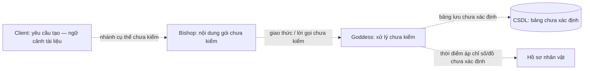

TÓM TẮT 1: [CHƯA KIỂM] Phạm vi là nhánh tạo hồ sơ nhân vật mới qua Bishop/Goddess; báo cáo ghi nhận blocker nguồn.
TÓM TẮT 2: [CHƯA KIỂM] Không mở được 5/5 tệp gateway được task chỉ định trong root C:/Jx1CocoV3/.../gateway/Sources.
TÓM TẮT 3: [CHƯA KIỂM] [TÀI LIỆU] HG-16 mô tả yêu cầu từ client và đường đăng nhập; không chứng minh giao dịch tạo hồ sơ mới.
TÓM TẮT 4: [CHƯA KIỂM] Chưa xác định gói Bishop→Goddess, bảng ghi, kiểm tra tên/số lượng/hệ, hay thời điểm áp chỉ số và đồ.
TÓM TẮT 5: [CHƯA KIỂM] Chỉ khảo sát tĩnh; không build, chạy exe, VM hoặc mạng. Cần cung cấp đúng root nguồn để tiếp tục.

# XD-HG16d — Nhánh tạo hồ sơ nhân vật mới Bishop/Goddess
Loại: khảo sát
Chủ đề: Đối chiếu tĩnh nhánh tạo hồ sơ mới từ Bishop đến Goddess và các giới hạn khởi tạo nhân vật.
Từ khóa: tạo nhân vật, Bishop, Goddess, gateway, role, DBTable, IDBRoleServer, HG-16, XD-HG16d
Trạng thái: BLOCKED — không truy cập được năm tệp nguồn được giao; không suy diễn kết quả.
Độ phủ: 0/5 tệp gateway được xác minh trực tiếp; chỉ đối chiếu tài liệu HG-16 được task chỉ định.
Liên quan: `JX1_OPS/DESIGN/HIEU-TAO-NHAN-VAT-MOI.md`; `JX1_OPS/TASKS/XD-HG16d.md`.
Cần tôi quyết định: không.

## Phạm vi và độ phủ

| Tệp nguồn được giao | Kết quả | Ghi chú |
|---|---|---|
| `C:/Jx1CocoV3/SwordOnline/SwordOnline/jxOnline/gateway/Sources/Bishop/GameServer.cpp` | Chưa phủ | `Test-Path` trả về không tồn tại trong phiên; `Select-String` không mở được đường dẫn. |
| `C:/Jx1CocoV3/SwordOnline/SwordOnline/jxOnline/gateway/Sources/Bishop/SmartClient.cpp` | Chưa phủ | `Test-Path` trả về không tồn tại trong phiên; `Select-String` không mở được đường dẫn. |
| `C:/Jx1CocoV3/SwordOnline/SwordOnline/jxOnline/gateway/Sources/Bishop/Intercessor.cpp` | Chưa phủ | `Test-Path` trả về không tồn tại trong phiên; `Select-String` không mở được đường dẫn. |
| `C:/Jx1CocoV3/SwordOnline/SwordOnline/jxOnline/gateway/Sources/Goddess/DBTable.cpp` | Chưa phủ | `Test-Path` trả về không tồn tại trong phiên; `Select-String` không mở được đường dẫn. |
| `C:/Jx1CocoV3/SwordOnline/SwordOnline/jxOnline/gateway/Sources/Goddess/IDBRoleServer.cpp` | Chưa phủ | `Test-Path` trả về không tồn tại trong phiên; `Select-String` không mở được đường dẫn. |

## Kết quả cần trả lời

- **Gói tạo nhân vật từ Bishop sang Goddess:** [CHƯA KIỂM] Không có mã gateway để lần lời gọi, cấu trúc gói hoặc phản hồi. Tài liệu HG-16 được giao chỉ cho biết client gửi `c2s_newplayer` với dữ liệu tên, giới tính, hệ và ID quê; tài liệu đó không xác nhận nội dung trao đổi Bishop/Goddess khi tạo mới. Ngữ cảnh client được dẫn lại trong HG-16: `C/gameui/KuiNewPlayer.cpp:624-646,1039-1058`; `C/gameui/KuiNewPlayer.cpp:40-47,824-828,873-899`; `C/gameui/KuiSelNativePlace.cpp:368-405,439-448`.
- **Bảng Goddess ghi hồ sơ:** [CHƯA KIỂM] Chưa xác định. `Goddess/DBTable.cpp` và `Goddess/IDBRoleServer.cpp` không mở được; không có căn cứ để nêu tên bảng hay thao tác ghi.
- **Tên trùng, số nhân vật tối đa, giới hạn hệ:** [CHƯA KIỂM] Chưa tìm được nơi kiểm tra do các tệp Bishop không truy cập được. Không kết luận rằng có hoặc không có kiểm tra.
- **Thời điểm ép chỉ số và đồ khởi đầu:** [CHƯA KIỂM] Chưa lần được đường tạo ở gateway/Goddess. HG-16 ghi nhận GS đọc thuộc tính và vật phẩm từ dữ liệu hồ sơ, nhưng điều đó không cho biết khi nào hồ sơ tạo mới được gán các giá trị này. Tham chiếu ngữ cảnh được dẫn trong HG-16: `S/Core/Src/KPlayerDBFuns.cpp:455-456,608-617,818-861`; `S/MultiServer/GameServer/KSOServer.cpp:3865-3869,3937-3992`; `S/MultiServer/GameServer/KSOServer.cpp:5044-5087,5127-5135`; `S/Core/Src/KPlayerDBFuns.cpp:478-548`; `S/Core/Src/KPlayer.cpp:1035-1042`; `S/MultiServer/GameServer/KSOServer.cpp:3804-3812,3937-3992`.

Các dẫn chứng mã trong phần trên được HG-16 dùng cho luồng client/GS nói chung; chúng là **[TÀI LIỆU]**, không phải xác minh độc lập cho nhánh gateway. Như vậy báo cáo có các tham chiếu `file:dòng` của ngữ cảnh cũ, nhưng hiện có **0 tham chiếu dòng trực tiếp** tới năm tệp gateway. Tiêu chí bằng chứng trực tiếp của XD-HG16d còn thiếu.

## Giải mã tên

| Tên gốc | Mã hóa | Chữ đúng | Nguồn file:dòng |
|---|---|---|---|
| `Bishop` | ASCII, tên thành phần trong đường dẫn task | `Bishop` (nhãn thành phần; chưa biết tên dịch trong game) | `JX1_OPS/TASKS/XD-HG16d.md:20` |
| `Goddess` | ASCII, tên thành phần trong đường dẫn task | `Goddess` (nhãn thành phần; chưa biết tên dịch trong game) | `JX1_OPS/TASKS/XD-HG16d.md:20` |
| Tên nhân vật/NPC/vật phẩm trong nhánh tạo | Chưa có dữ liệu | Chưa xác định | Chưa mở được nguồn gateway đã giao. |

## Sắp theo cấu trúc game

| Thứ tự xử lý cần khảo sát | Trạng thái |
|---|---|
| Yêu cầu tạo từ client → tiếp nhận ở Bishop | Chưa xác minh trực tiếp; thông tin client trong HG-16 chỉ làm ngữ cảnh. |
| Bishop → Goddess: gói/lời gọi và kết quả | Chưa xác minh. |
| Goddess → bảng hồ sơ: ánh xạ trường và thao tác ghi | Chưa xác minh. |
| Khởi tạo hồ sơ → chỉ số và vật phẩm mặc định | Chưa xác minh; không thể suy từ mẫu hoặc đường GS đọc hồ sơ. |

## Đã xác minh

- [THẤY] `JX1_OPS/TASKS/XD-HG16d.md:19-24` xác định mục tiêu khảo sát, năm tên tệp gateway, giới hạn chỉ đọc và yêu cầu ghi mục kết quả.
- [THẤY] Năm đường dẫn C: được giao không tồn tại trong môi trường phiên này; `Test-Path` cho cả năm trả về `False`; lần dùng `Select-String` theo đúng đường dẫn báo không tìm thấy tệp.
- [TÀI LIỆU] Tài liệu `JX1_OPS/DESIGN/HIEU-TAO-NHAN-VAT-MOI.md` nêu rõ nhánh tạo hồ sơ mới chưa được đối chiếu; các tham chiếu client/GS phía trên được giữ là ngữ cảnh, không nâng thành bằng chứng gateway.

## Chưa kiểm

- Chưa đọc được bất kỳ nội dung nào trong `GameServer.cpp`, `SmartClient.cpp`, `Intercessor.cpp`, `DBTable.cpp`, `IDBRoleServer.cpp`; vì vậy chưa thể trả lời bốn câu hỏi kỹ thuật của task.
- Chưa đạt xác minh trực tiếp ≥8 dẫn chứng `file:dòng` từ gateway. Không build, chạy test, exe, VM, mạng hoặc truy cập dữ liệu tài khoản; các việc đó ngoài phạm vi.
- `rg` không có sẵn trong phiên. Đã thử fallback `Select-String` trên đúng năm đường dẫn; cùng blocker thiếu tệp. Không cài công cụ và không tìm sang root khác.
- Không thể ghi mốc nhịp tại `D:\JX-wt\XD-HG16d.nhip`: quyền ghi ngoài worktree bị từ chối. Nội dung báo cáo này ghi nhận blocker môi trường đó.

## Mục sổ thông số

| Nhóm | Tên/hằng số | file:dòng | Giá trị | Đơn vị | Ảnh hưởng | Đổi an toàn | Nguồn đo |
|---|---|---|---|---|---|---|---|
| Tạo hồ sơ gateway | Chưa xác định | Năm tệp gateway được giao không mở được | Chưa có | — | Chưa đánh giá | CẨN THẬN | Chưa đo; cần đọc tĩnh đúng root nguồn. |

## Đề xuất tối ưu

Chưa đề xuất thay đổi thiết kế hoặc thông số khi chưa đọc được mã. Bước tiếp theo là làm cho đúng năm tệp nguồn trong root gateway đã ghi ở trên có thể đọc từ worktree/phiên này, rồi tiếp tục đối chiếu caller/callee, bảng DB và nhánh khởi tạo.

## Bàn giao

- Kết quả: BLOCKED do thiếu quyền truy cập/tệp nguồn trong root được giao; chưa có kết luận mới về luồng tạo hồ sơ.
- Thay đổi trong worktree: báo cáo này và mục `## Kết quả` ở cuối tệp task, theo yêu cầu.
- Không stage/commit/push theo chỉ dẫn; chưa có SHA. Không chạy VM/exe/build/mạng.
- Khi nguồn hiện diện, tiếp tục từ năm tệp đã chỉ định, không làm lại phần client/GS đã có trong HG-16.
- Kỹ năng đã dùng: jx1-retrofit, jx1-read-server, jx1-read-client, jx1-parameters, jx1-knowledge, jx1-report.
- Liên quan: `JX1_OPS/DESIGN/HIEU-TAO-NHAN-VAT-MOI.md`; `JX1_OPS/TASKS/XD-HG16d.md`.