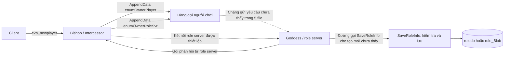

TÓM TẮT 1: [THẤY] Bishop nhận `c2s_newplayer` và đưa gói vào hàng đợi của người chơi; trong phạm vi file này chưa thấy đoạn gửi tiếp sang Goddess (`Bishop/Intercessor.cpp:712-723`).
TÓM TẮT 2: [THẤY] Bishop tạo kết nối client tới role server Goddess và nhận gói phản hồi để chuyển về người chơi (`Bishop/Intercessor.cpp:263-276,627-658`).
TÓM TẮT 3: [THẤY] Goddess có kiểm tra trùng tên và số vai trò theo tài khoản trước nhánh lưu tạo mới; giới hạn mặc định là 3 nhưng giá trị hiệu lực phụ thuộc tham số khởi tạo (`Goddess/IDBRoleServer.cpp:33,187-189,790-827`).
TÓM TẮT 4: [THẤY] Mã lưu ghi dữ liệu hồ sơ nhận vào; không thấy ép chỉ số/vật phẩm khởi đầu hay kiểm giới hạn ngũ hành trong các file được giao (`Goddess/IDBRoleServer.cpp:876-910,960-962`).
TÓM TẮT 5: [CHƯA KIỂM] Chưa xác minh đường gửi yêu cầu đến hàm lưu và nguồn khởi tạo dữ liệu; chỉ đọc tĩnh, không build/chạy exe/VM/mạng.

# XD-HG16e — Luồng tạo hồ sơ nhân vật Bishop/Goddess

Loại: khảo sát
Chủ đề: Bổ sung bằng chứng tĩnh cho nhánh tạo hồ sơ nhân vật mới ở gateway Bishop và kho Goddess.
Từ khóa: tạo nhân vật, hồ sơ mới, Bishop, Goddess, `c2s_newplayer`, `roledb`, `role_Blob`, ngũ hành
Trạng thái: PARTIAL — đã tìm được điểm nhận gói, kiểm tra/lưu tại Goddess; chưa nối được toàn bộ đường gửi yêu cầu hoặc xác định nơi khởi tạo chỉ số/vật phẩm.
Độ phủ: đã rà 5/5 tệp mã được task chỉ định theo symbol và đoạn liên quan; đường tạo xuyên suốt mới phủ một phần.
Liên quan: `JX1_OPS/DESIGN/HIEU-TAO-NHAN-VAT-MOI.md`.
Cần tôi quyết định: không.

Nguồn mã theo task: `C:/Jx1CocoV3/SwordOnline/SwordOnline/jxOnline/gateway/Sources/MultiServer/`. Đây là mã trên đĩa; chưa đối chiếu với bản đang chạy.

## Phạm vi và độ phủ

| Phần tử | Độ phủ | Bằng chứng / giới hạn |
|---|---|---|
| Bishop `GameServer.cpp` | Một phần | Có bộ điều phối gói phía kết nối GS, nhưng không dùng làm bằng chứng cho `c2s_newplayer` (`Bishop/GameServer.cpp:125-140,386-412`). |
| Bishop `Intercessor.cpp` | Đã phủ các điểm trong task | Kết nối role server, tiếp nhận `c2s_newplayer` vào hàng đợi người chơi và chuyển gói phản hồi từ role server (`Bishop/Intercessor.cpp:263-276,627-658,712-723`). |
| Bishop `SmartClient.cpp` | Một phần | Hàm `Send` chuyển dữ liệu qua client tổng quát; không chứng minh gói tạo nhân vật đi tới Goddess (`Bishop/SmartClient.cpp:425-456`). |
| Goddess `IDBRoleServer.cpp` | Đã phủ logic lưu liên quan | Có hàm kiểm tên, kiểm số vai trò theo tài khoản và nhánh lưu; chưa thấy nơi gọi nhánh tạo mới từ giao thức (`Goddess/IDBRoleServer.cpp:562-583,790-827,876-910`). |
| Goddess `DBTable.cpp` | Đã phủ thao tác bảng chính | Tên bảng được mở làm primary database; thao tác `add` ghi cặp khóa/dữ liệu (`Goddess/DBTable.cpp:44,110,199-223`). |
| DESIGN HG-16 | Đã đọc làm tài liệu nền | Dùng để tránh lặp phần đã ghi; báo cáo này bổ sung bằng chứng gateway được task chỉ định. |

## Kết quả khảo sát

### Gói tạo nhân vật đi từ Bishop sang Goddess thế nào?

[THẤY] `CIntercessor::AnalyzePlayerRequire` nhận protocol `c2s_newplayer`; trong cùng nhánh, Bishop lấy `m_thePlayers[index]` và gọi `AppendData(CGamePlayer::enumOwnerPlayer, pData, datalength)` (`Bishop/Intercessor.cpp:684-725`). Đây là bằng chứng gói được chuyển vào đối tượng người chơi của Bishop, chưa phải bằng chứng gói đã được gửi sang Goddess.

[THẤY] `CIntercessor::StartupNetwork` tạo client role database, kết nối theo địa chỉ/cổng role server, rồi gắn client đó vào `CGamePlayer::ATTACH_NETWORK` (`Bishop/Intercessor.cpp:263-276,341-354`). Trong helper, Bishop đọc gói từ client Goddess, lấy identity và gọi `AppendData(CGamePlayer::enumOwnerRoleSvr, ...)` cho người chơi tương ứng (`Bishop/Intercessor.cpp:627-658`).

[CHƯA KIỂM] Năm file được giao không cho thấy đoạn trong `CGamePlayer` chạy hàng đợi `enumOwnerPlayer` rồi gửi yêu cầu tạo đến Goddess; cũng chưa thấy nơi gọi `SaveRoleInfo(..., TRUE)` từ handler giao thức. Vì vậy sơ đồ thể hiện hai đầu đã xác minh và để nét chấm ở chặng chưa đối chiếu.

### Goddess ghi bảng nào?

[THẤY] `InitDBInterface` tạo `ZDBTable("database", "roledb")`, thêm chỉ mục tài khoản và mở bảng (`Goddess/IDBRoleServer.cpp:334-343`). `ZDBTable` dùng tên được truyền để mở primary database; `ZDBTable::add` gọi `primary_db->put` với key và data nhận vào (`Goddess/DBTable.cpp:44,110,199-223`). Tên bảng chính ở nhánh Berkeley DB là `roledb`.

[THẤY] Nhánh SQL tạo bảng `role_Blob`; khi `g_dataType == DATA_KIND_SQL`, `SaveRoleInfo` ghi qua `updateBlobData_n` (`Goddess/IDBRoleServer.cpp:191-207,681-707,755-762`). Giá trị backend đang dùng khi chạy chưa được xác minh; `g_dataType`/tham số khởi tạo và trạng thái dịch vụ không được kiểm runtime.

### Có kiểm tên trùng, số nhân vật tối đa, giới hạn hệ ở đâu?

[THẤY] `CheckRoleName` tìm hồ sơ bằng tên trong `db_table`; tìm thấy thì trả 1, nếu không trả 0 (`Goddess/IDBRoleServer.cpp:562-583`). Với nhánh lưu tạo mới, SQL tra hồ sơ theo tên và từ chối nếu đã có (`Goddess/IDBRoleServer.cpp:681-705`); nhánh DB tìm theo tên rồi từ chối nếu đã tồn tại (`Goddess/IDBRoleServer.cpp:790-807`). Trong `CheckRoleName`, phần thân dành cho `DATA_KIND_SQL` để trống, nên không coi hàm riêng đó là bằng chứng kiểm trùng cho backend SQL.

[THẤY] Nhánh `bAutoInsertWhenNoExistUser` đếm hồ sơ theo tài khoản rồi từ chối khi `nCount >= nMaxRoleCount_InAccount` (`Goddess/IDBRoleServer.cpp:790-827`; SQL tương ứng ở `681-696`). Biến có giá trị khởi đầu 3, nhưng `InitDBInterface(nMaxRoleCount, ...)` gán lại theo tham số (`Goddess/IDBRoleServer.cpp:33,187-189`). Do chưa thấy caller/giá trị cấu hình thực tế trong phạm vi, không kết luận số tối đa đang chạy là 3.

[CHƯA KIỂM] Không tìm thấy kiểm tra giới hạn hệ/ngũ hành trong nhánh kiểm tra/lưu tạo mới của các đoạn đã đối chiếu. `GetRoleListOfAccount` chỉ chép trường `ifiveprop` vào `Series` khi dựng danh sách vai trò, không chứng minh giới hạn lúc tạo (`Goddess/IDBRoleServer.cpp:923-975,960-962`).

### Khi nào server ép chỉ số hoặc đồ khởi đầu?

[THẤY] Nhánh DB lưu key tên và toàn bộ `pRoleBuffer` với kích thước `dwDataLen`; sau khi ghi thành công, mã kiểm tra `nItemCount <= 0` để ghi nhận bất thường (`Goddess/IDBRoleServer.cpp:876-910`). Trong đoạn này, kiểm tra vật phẩm xảy ra sau thao tác ghi và chỉ ghi log; không thấy thao tác thêm vật phẩm hoặc gán lại chỉ số khởi đầu.

[CHƯA KIỂM] Không xác định được thời điểm nào server khởi tạo/ép chỉ số hoặc vật phẩm vì năm file gateway không chứa đường tạo payload hay phần sinh bộ dữ liệu khởi đầu đã xác minh. Cần nguồn handler gửi từ Bishop và mã tạo hồ sơ/khởi tạo dữ liệu ở phía được gọi; không suy đoán từ hồ sơ đã lưu.

## Giải mã tên

| Tên gốc | Mã hóa | Chữ đúng / cách dùng trong báo cáo | Nguồn file:dòng |
|---|---|---|---|
| `Bishop` | ASCII | Tên thành phần Bishop; giữ nguyên identifier | `Bishop/Intercessor.cpp:713` |
| `Goddess` | ASCII | Tên role server Goddess; giữ nguyên identifier | `Bishop/Intercessor.cpp:272-276` |
| `PaySystem` | ASCII | Tên gọi trong chú thích cho tuyến dịch vụ tài khoản; không đồng nhất với role database | `Bishop/Intercessor.cpp:560-579` |
| `roledb` | ASCII | Tên bảng chính trong nhánh `ZDBTable` | `Goddess/IDBRoleServer.cpp:334` |
| `role_Blob` | ASCII | Tên bảng ở nhánh SQL | `Goddess/IDBRoleServer.cpp:200` |

## Sắp theo cấu trúc game

| Thứ tự theo luồng | Thành phần / dữ liệu | Trạng thái |
|---|---|---|
| 1. Nhận yêu cầu | Client → Bishop: `c2s_newplayer` | Đã thấy Bishop nhận và đưa vào hàng đợi; chưa thấy bước gửi sang Goddess. |
| 2. Trao đổi role server | Bishop ↔ Goddess | Đã thấy kết nối và đường nhận phản hồi; yêu cầu tạo cụ thể chưa nối được. |
| 3. Kiểm tra hồ sơ | Goddess: tên trùng, số hồ sơ theo tài khoản | Có điều kiện trong nhánh lưu tạo mới; caller thực tế chưa xác minh. |
| 4. Lưu hồ sơ | `roledb` / `role_Blob` | Tên bảng và thao tác ghi đã thấy; backend hiệu lực chưa xác minh. |
| 5. Khởi tạo game data | Chỉ số, hệ, đồ khởi đầu | Không có dữ liệu khởi tạo để xếp theo hệ/loại vật phẩm; chưa kiểm chứng. |

## Mục sổ thông số

| Nhóm | Tên/hằng số | file:dòng | Giá trị | Đơn vị | Ảnh hưởng | Đổi an toàn | Nguồn đo |
|---|---|---|---|---|---|---|---|
| Tạo hồ sơ | `nMaxRoleCount_InAccount` | `Goddess/IDBRoleServer.cpp:33,187-189,790-827` | Mặc định tĩnh 3; hiệu lực lấy từ tham số `InitDBInterface` | Hồ sơ/tài khoản | Chặn lưu khi số hồ sơ hiện có đạt ngưỡng | CẨN THẬN | Đọc tĩnh; chưa xác minh caller/runtime |
| Kích thước hồ sơ | Ngưỡng `128*1024` | `Goddess/IDBRoleServer.cpp:602-608` | Từ 131072 byte trở lên thì trả lỗi lưu | Byte | Chặn lưu buffer quá ngưỡng | CẨN THẬN | Đọc tĩnh; chưa kiểm thử |

## Đề xuất tối ưu

Chưa đề xuất tối ưu: task này xác minh luồng và điều kiện tạo hồ sơ; chưa có số đo runtime hoặc yêu cầu thay đổi hiệu năng.

## Đã xác minh

Các kết luận [THẤY] ở trên dựa trên mã tĩnh trong source root theo task, với symbol và dòng hiện tại được ghi trực tiếp. Đường kết nối/nhận phản hồi được xác minh trong `Bishop/Intercessor.cpp`; điều kiện lưu, tên bảng và giới hạn được xác minh trong `Goddess/IDBRoleServer.cpp` và `Goddess/DBTable.cpp`.

## Chưa kiểm

- Chưa thấy caller chuyển gói `c2s_newplayer` từ hàng đợi Bishop tới Goddess hoặc gọi nhánh `SaveRoleInfo(..., TRUE)`.
- Chưa biết backend Goddess đang dùng, giá trị `nMaxRoleCount` thực tế, hoặc giới hạn hợp lệ của `ifiveprop`.
- Chưa xác định chỗ tạo/ép chỉ số, ngũ hành hay vật phẩm khởi đầu.
- Không chạy build, exe, VM hoặc mạng theo phạm vi task; không có kiểm thử runtime.
- Tệp nhịp `D:\JX-wt\XD-HG16e.nhip` không ghi được: quyền ghi ngoài workspace bị sandbox từ chối; không đổi quyền hoặc tìm đường vòng.

## Bàn giao

Không commit theo yêu cầu. Báo cáo được ghi tại `JX1_OPS/REPORTS/XD-HG16e.md`; để khép chặng còn thiếu cần task/phạm vi duyệt cho các file handler `CGamePlayer` ở Bishop và đường gọi lưu hồ sơ phía Goddess. Không push.

Liên quan: `JX1_OPS/DESIGN/HIEU-TAO-NHAN-VAT-MOI.md`.

Kỹ năng đã dùng: `jx1-retrofit`, `jx1-read-server`, `jx1-read-client`, `jx1-parameters`, `jx1-knowledge`, `jx1-report`.
