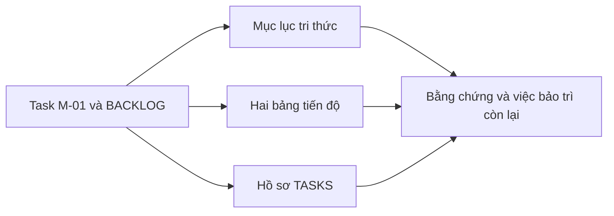

## TÓM TẮT 5 DÒNG
TÓM TẮT 1 [NGUỒN] [TÀI LIỆU] M-01 thiếu mục “Tiêu chí xong”. Ba hạng mục đối chiếu lấy từ tên việc (`JX1_OPS/TASKS/M-01.md:3`, `JX1_OPS/TASKS/M-01.md:8`, `JX1_OPS/TASKS/BACKLOG.md:130`).\
TÓM TẮT 2 [NGUỒN] [THẤY] Mục lục có 16 hàng dữ liệu, chưa có mục riêng cho M-01. Báo cáo lịch sử đã có trong chỉ mục R-07a (lệnh 1 và `JX1_OPS/REPORTS/_CHIMUC/R-07a.tsv:6`).\
TÓM TẮT 3 [NGUỒN] [THẤY] Mẫu số HTML có 101 ID duy nhất và loại XD-M01. Trình sinh Markdown vẫn tính XD-M01 (lệnh 2–3 và `JX1_OPS/TOOLS/tien_do.py:80`).\
TÓM TẮT 4 [NGUỒN] [THẤY] Tệp M-01 và XD-M01 khớp ID, đọc được bằng UTF-8 không BOM. M-01 còn thiếu tiêu chí và quy tắc đóng đợt bảo trì (lệnh 4 và `JX1_OPS/TASKS/M-01.md:4`).\
TÓM TẮT 5 [CHƯA KIỂM] Chỉ chạy kiểm tra offline bằng Python. Chưa build, chạy exe game, VM, kết nối mạng hay kiểm lại máy thật. Tổng quan phụ trách commit (`JX1_OPS/TASKS/XD-M01.md:24`).

# XD-M01 — Đối chiếu việc đóng M-01

Loại: tổng hợp\
Chủ đề: Kiểm tra mục lục tri thức, bảng tiến độ và hồ sơ TASKS trước khi đóng đợt M-01.\
Từ khóa: bảo trì, mục lục tri thức, bảng tiến độ, mẫu số, M-01, XD-M01, TASKS, BACKLOG\
Trạng thái: DONE — XD-M01 đã ghi bằng chứng hoặc phần thiếu cho cả ba hạng mục nhận diện được. M-01 chưa đạt.\
Độ phủ: Đã kiểm 3 trên 3 hạng mục nêu trong tên M-01. Chưa đếm được số vế tiêu chí chính thức vì nguồn không có mục này.\
Liên quan: [Task XD-M01](../TASKS/XD-M01.md), [Task M-01](../TASKS/M-01.md), [Báo cáo kiểm tra máy thật](M-01-kiem-tra-may-that.md), [Mục lục tri thức](../DESIGN/MUC-LUC-TRI-THUC.md).\
Cần tôi quyết định: Có — xác nhận tiêu chí đóng theo đợt và cách xử lý tệp trạng thái M-01 khi gộp.



## Phạm vi và độ phủ

[TÀI LIỆU] Cả bản trong worktree và bản chỉ đọc được chỉ định đều dẫn từ tệp trạng thái sang BACKLOG và DESIGN. Hàng M-01 ở BACKLOG nằm dưới cột cuối là “Phụ thuộc”. Dấu gạch ngang ở hàng này không cung cấp tiêu chí xong. Báo cáo máy thật ghi một đợt khảo sát lịch sử và các phép đo còn thiếu. Căn cứ tại `JX1_OPS/TASKS/M-01.md:8`, `D:/jx1-ops-wt/JX1_OPS/TASKS/M-01.md:8`, `JX1_OPS/TASKS/BACKLOG.md:122`, `JX1_OPS/TASKS/BACKLOG.md:130` và `JX1_OPS/REPORTS/M-01-kiem-tra-may-that.md:65`.

| Hạng mục theo tên M-01 | Độ phủ | Bằng chứng và kết quả |
|---|---|---|
| Bảo trì mục lục | Đã phủ | [THẤY] Lệnh 1 xác nhận mục lục chính chưa có hàng mang ID M-01 hoặc XD-M01. Báo cáo máy thật đã được lập chỉ mục tại `JX1_OPS/REPORTS/_CHIMUC/R-07a.tsv:6`. |
| Bảng tiến độ | Đã phủ | [THẤY] Lệnh 2–3 xác nhận khác biệt giữa HTML và Markdown về việc tính XD-M01. Cách hiển thị trạng thái M-01 cũng khác nhau do hai công cụ diễn giải `active` khác nhau. |
| Dọn TASKS | Đã phủ hai hồ sơ liên quan | [THẤY] Lệnh 4 kiểm ID và UTF-8 của M-01, XD-M01. [CHƯA KIỂM] Chưa có tiêu chí để xác nhận đã dọn TASKS cho cả đợt. |

## Giải mã tên

Không phát sinh tên kỹ năng, trang bị, quái, NPC hoặc bản đồ. Các tên tệp và ID trong báo cáo được giữ nguyên, đọc từ nguồn UTF-8.

## Sắp theo cấu trúc game

Công việc bảo trì tài liệu được sắp theo mục lục → bảng tiến độ → hồ sơ TASKS. Không có dữ liệu game để phân nhóm.

## Kiểm tra offline

Chạy các lệnh từ gốc worktree `D:/JX-wt/XD-M01`. Các lệnh 1, 2 và 4 đọc những tệp xác định trực tiếp. Lệnh 3 chạy hàm sinh bảng Markdown trên hai tập đầu vào giới hạn và giữ đầu ra trong bộ nhớ.

### 1. Đối chiếu mục lục tri thức

```powershell
@'
from pathlib import Path
import re
r = Path('JX1_OPS')
idx = r / 'DESIGN' / 'MUC-LUC-TRI-THUC.md'
entries = [(i, l) for i, l in enumerate(idx.read_text(encoding='utf-8').splitlines(), 1) if l.startswith('|') and not l.startswith('|---')][1:]
p = r / 'REPORTS' / 'M-01-kiem-tra-may-that.md'
print(f'index_rows={len(entries)} historical_report_exists={p.is_file()}')
for name in ('M-01', 'XD-M01'):
    refs = [i for i, l in entries if re.search(r'(?<![A-Za-z0-9-])'+re.escape(name)+r'(?![A-Za-z0-9-])', l)]
    print(f'{name} index_lines={refs}')
'@ | python -I -
```

```text
index_rows=16 historical_report_exists=True
M-01 index_lines=[]
XD-M01 index_lines=[]
```

[ĐÃ XÁC MINH] Mục lục chính có đường dẫn chung cho nhóm vận hành ở `JX1_OPS/DESIGN/MUC-LUC-TRI-THUC.md:22`. Lệnh 1 tìm ID độc lập trong các hàng dữ liệu và không thấy mục riêng của hai ID. Chỉ mục R-07a đã trỏ đến báo cáo máy thật ở `JX1_OPS/REPORTS/_CHIMUC/R-07a.tsv:6`.

### 2. Đối chiếu mẫu số và trạng thái của hai bảng

```powershell
@'
from pathlib import Path
from collections import Counter
import runpy
r = Path('JX1_OPS').resolve()
h = runpy.run_path(str(r/'TOOLS'/'bang_tien_do.py'))
m = runpy.run_path(str(r/'TOOLS'/'tien_do.py'))
b = (r/'TASKS'/'BACKLOG.md').read_text(encoding='utf-8')
s = (r/'STATE'/'TRANG-THAI.md').read_text(encoding='utf-8')
rows = [t['id'] for p in h['parse_backlog'](b) for t in p['tasks']]
table = h['status_table'](s)
print(f'HTML denominator={len(rows)} unique={len(set(rows))} duplicate_ids={sorted(k for k,v in Counter(rows).items() if v>1)}')
for task in ('M-01','XD-M01'):
    p = r/'TASKS'/(task+'.md')
    status = m['front'](p)['status']
    html_count = rows.count(task)
    effective = table.get(task,(None,''))[0] or h['norm'](status)
    md_count = p.is_file() and not p.name.startswith('_')
    print(f'{task} html_count={html_count} html_status={effective if html_count else None} status_override={table.get(task,(None,))[0]} md_count={int(md_count)} front_status={status} md_done={status in m["DONE"]}')
'@ | python -I -B -
```

```text
HTML denominator=101 unique=101 duplicate_ids=[]
M-01 html_count=1 html_status=dang chay status_override=None md_count=1 front_status=active md_done=True
XD-M01 html_count=0 html_status=None status_override=None md_count=1 front_status=ready md_done=False
```

[ĐÃ XÁC MINH] HTML lấy các ID từ BACKLOG và ưu tiên trạng thái trong `TRANG-THAI.md` nếu có. Với đầu vào hiện tại, HTML đếm M-01 một lần, xếp `active` vào “Đang chạy” và loại XD-M01 khỏi mẫu số. Công cụ Markdown xếp `active` vào nhóm hoàn tất và lấy mẫu số từ số tệp có ID. Căn cứ tại `JX1_OPS/TOOLS/bang_tien_do.py:20`, `JX1_OPS/TOOLS/bang_tien_do.py:36`, `JX1_OPS/TOOLS/bang_tien_do.py:129`, `JX1_OPS/TOOLS/tien_do.py:8` và `JX1_OPS/TOOLS/tien_do.py:80`. Hai bảng có quy tắc riêng và số 101 chỉ áp dụng cho HTML tại thời điểm kiểm tra.

### 3. Chạy lại hàm sinh bảng Markdown trong bộ nhớ

```powershell
@'
from pathlib import Path
from types import SimpleNamespace
import io, re, runpy
r = Path('JX1_OPS').resolve()
m = runpy.run_path(str(r/'TOOLS'/'tien_do.py'))
g = m['main'].__globals__
p = r / 'TASKS'
for ids in [('M-01',), ('M-01','XD-M01')]:
    buf = io.StringIO()
    def isolated_open(path, mode='r', **kwargs):
        q = Path(path)
        if q == r/'STATE'/'TIEN-DO.md' and mode == 'w':
            return buf
        if q.parent == p and q.stem in ids and mode == 'r':
            return q.open(mode, **kwargs)
        raise AssertionError('unexpected file access')
    g.update(ROOT=str(r), glob=SimpleNamespace(glob=lambda _: [str(p/(i+'.md')) for i in ids]), open=isolated_open)
    m['main']()
    report = buf.getvalue().splitlines()
    total = [int(n) for n in re.findall(r'[0-9]+', report[-1])]
    print(f'inputs={",".join(ids)} total={total[0]} pending={total[4]} done={total[6]}')
'@ | python -I -B -
```

```text
inputs=M-01 total=1 pending=0 done=1
inputs=M-01,XD-M01 total=2 pending=1 done=1
```

[ĐÃ XÁC MINH] Thêm đúng tệp XD-M01 vào tập tối thiểu làm số tổng tăng từ 1 lên 2 và số chờ tăng từ 0 lên 1. Hàm `main` đọc hai tệp task thật, còn thao tác ghi được chuyển vào `StringIO`. Lần đầu bộ trích kết quả chọn nhầm dòng cuối và báo `IndexError: list index out of range`. Đọc dòng cuối bằng `report[-1]` ở lần chạy lại đã trả kết quả trên. Căn cứ tại `JX1_OPS/TOOLS/tien_do.py:37` và `JX1_OPS/TOOLS/tien_do.py:80`.

### 4. Kiểm tệp trạng thái và dấu vết tiêu chí trong TASKS

```powershell
@'
from pathlib import Path
import re, runpy
r = Path('JX1_OPS')
m = runpy.run_path(str(r/'TOOLS'/'tien_do.py'))
for task in ('M-01','XD-M01'):
    p = r/'TASKS'/(task+'.md')
    data = p.read_bytes()
    lines = data.decode('utf-8').splitlines()
    d = m['front'](p)
    criteria = [i for i,l in enumerate(lines,1) if re.match(r'^#+ .*Ti\u00eau ch\u00ed xong',l,re.I)]
    print(f'{task} lines={len(lines)} utf8_bom={data.startswith(bytes((239,187,191)))} id_matches={d["id"]==task} status={d["status"]} criteria_heading_lines={criteria}')
for i,l in enumerate((r/'TASKS'/'BACKLOG.md').read_text(encoding='utf-8').splitlines(),1):
    if l.startswith('| M-01 |'):
        print(f'BACKLOG:{i} M-01 last_column={ascii(l.strip("|").split("|")[-1].strip())}')
'@ | python -I -B -
```

```text
M-01 lines=8 utf8_bom=False id_matches=True status=active criteria_heading_lines=[]
XD-M01 lines=26 utf8_bom=False id_matches=True status=ready criteria_heading_lines=[19]
BACKLOG:130 M-01 last_column='\u2014'
```

[ĐÃ XÁC MINH] Số 26 dòng của XD-M01 là trước khi nối mục Kết quả. Tệp M-01 có `status_note` là “làm mỗi đợt” và chưa nêu chuẩn đóng đợt. Cần chốt cách giữ tệp trạng thái định kỳ, tiêu chí nhận diện việc phụ và điều kiện lưu trữ các tệp đã xong trước khi xác nhận dọn TASKS. Căn cứ tại `JX1_OPS/TASKS/M-01.md:4`, `JX1_OPS/TASKS/M-01.md:5`, `JX1_OPS/TASKS/M-01.md:8` và `JX1_OPS/TASKS/BACKLOG.md:130`.

## Mục sổ thông số

| Nhóm | Tên | file:dòng | Giá trị | Đơn vị | Ảnh hưởng | Đổi an toàn | Nguồn đo |
|---|---|---|---|---|---|---|---|
| Tiến độ HTML | Mẫu số | `JX1_OPS/TOOLS/bang_tien_do.py:142` | 101 ID duy nhất | việc | Mẫu số HTML trên BACKLOG hiện tại | CẨN THẬN | Lệnh 2, đầu vào worktree |
| Tiến độ Markdown | Phần tăng do XD-M01 | `JX1_OPS/TOOLS/tien_do.py:80` | +1 | việc | Việc phụ làm tăng mẫu số | CẨN THẬN | Lệnh 3, tập đầu vào tối thiểu |
| Mục lục | Hàng dữ liệu | `JX1_OPS/DESIGN/MUC-LUC-TRI-THUC.md:5` | 16 | hàng | Mức bao quát của bảng tại thời điểm kiểm | CẨN THẬN | Lệnh 1, đếm hàng trong bảng |

## Đã xác minh / Chưa xác minh

**Đã xác minh:** Bốn lệnh offline đã trả kết quả sau khi sửa cách lấy dòng tổng ở lệnh 3. Đọc trực tiếp tệp trạng thái M-01, mục lục, BACKLOG và báo cáo lịch sử. Máy thiếu `rg`, dùng `Select-String` với các tệp đã xác định.

### Chưa kiểm

- Tiêu chí đóng chính thức của M-01 và quy tắc dọn TASKS toàn đợt. Các nguồn dẫn trực tiếp chưa cung cấp hai nội dung này.
- Sinh toàn bộ bảng HTML hoặc Markdown ở nơi vận hành, kiểm build, exe game, VM, mạng và đo lại máy thật. Báo cáo lịch sử đã nêu giới hạn phép đo tại `JX1_OPS/REPORTS/M-01-kiem-tra-may-that.md:65` và `JX1_OPS/REPORTS/M-01-kiem-tra-may-that.md:75`.
- Nhịp tại `D:/JX-wt/XD-M01.nhip` chưa ghi vì đường dẫn nằm ngoài vùng được phép ghi của phiên.

## Bàn giao

1. Khi gộp, bổ sung liên kết đến báo cáo kiểm tra máy thật và kết quả XD-M01 trong mục lục chính. Hàng đề xuất theo các cột hiện có:

   | Chủ đề | Báo cáo / tài liệu | File, hàm chính | Độ chắc |
   |---|---|---|---|
   | Bảo trì mục lục, bảng tiến độ và hồ sơ TASKS | `REPORTS/XD-M01.md`, `REPORTS/M-01-kiem-tra-may-that.md` | `TOOLS/bang_tien_do.py`, `TOOLS/tien_do.py` | Đã kiểm offline trong phạm vi nêu trong XD-M01 |

2. Xác định dấu hiệu nhận biết việc phụ và áp dụng khi tính mẫu số Markdown để XD-M01 được loại theo yêu cầu. Chốt ý nghĩa `active` trên từng bảng cho việc định kỳ và kiểm thử lại hai mẫu số.
3. Ghi tiêu chí đóng theo đợt cho M-01, gồm điều kiện dọn TASKS và cách giữ tệp trạng thái định kỳ. Kiểm lại các vế theo tiêu chí vừa chốt trước khi đổi trạng thái M-01.
4. Tổng quan phụ trách commit. Hàng chỉ mục TSV để gộp được ghi tại đây theo giới hạn tệp của XD-M01.

   ```text
   file	loại	chủ đề	từ khóa	trạng thái	độ phủ	liên quan
   JX1_OPS/REPORTS/XD-M01.md	tổng hợp	Đối chiếu việc đóng M-01	bảo trì, mục lục tri thức, bảng tiến độ, mẫu số, M-01, XD-M01, TASKS, BACKLOG	DONE	3/3 hạng mục nhận diện được	JX1_OPS/TASKS/M-01.md, JX1_OPS/REPORTS/M-01-kiem-tra-may-that.md, JX1_OPS/DESIGN/MUC-LUC-TRI-THUC.md
   ```

Kỹ năng đã dùng: `jx1-retrofit` (khuôn chuẩn và giữ kết luận cũ), `jx1-knowledge` (đối chiếu mục lục), `jx1-parameters` (sổ thông số), `jx1-report` (bằng chứng và bàn giao). Đã đọc `jx1-read-server` và `jx1-read-client` theo yêu cầu. Task bảo trì tài liệu không cần tra source game.

M-01 CHƯA ĐẠT vì thiếu tiêu chí đóng chính thức, mục lục chính thiếu mục riêng và bảng tiến độ Markdown vẫn tính XD-M01 vào mẫu số.
