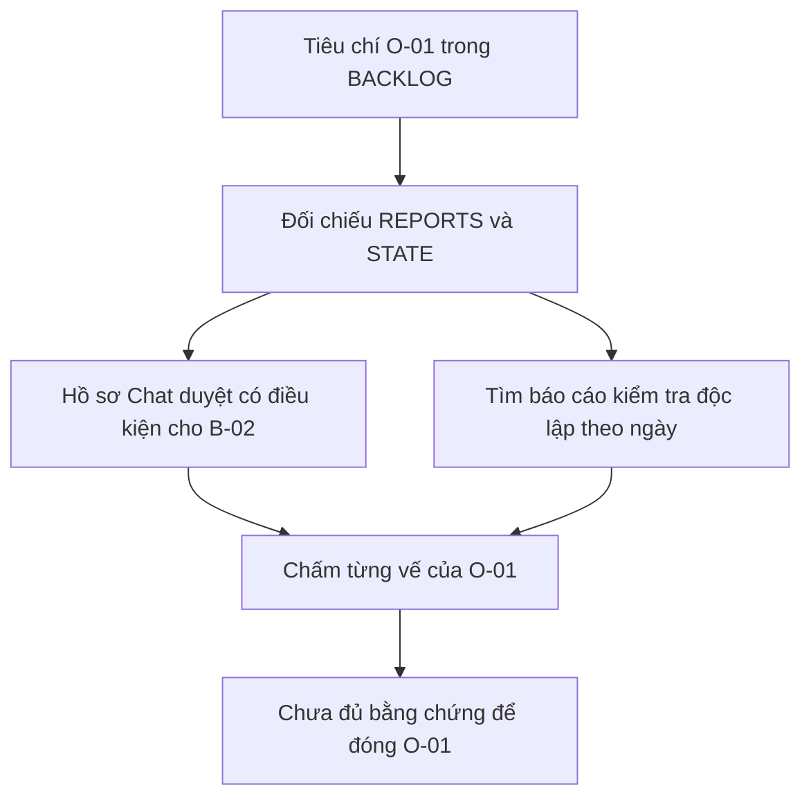

**TÓM TẮT 5 DÒNG**
1. [NGUỒN] [THẤY] XD-O01 đã đối chiếu 8/8 vế của O-01. Kết luận O-01 **CHƯA ĐẠT theo hồ sơ hiện có** (`TASKS/BACKLOG.md:81`).
2. [NGUỒN] [TÀI LIỆU] Hồ sơ ghi một lượt Chat duyệt có điều kiện cho B-02 thử trong VM, chưa duyệt vào bản chính (`REPORTS/O-01-duyet-B-02.md:1–3`).
3. [NGUỒN] [THẤY] Tìm `KIEM-TRA-DOC-LAP-*.md` trong hai thư mục `REPORTS` được giao, kết quả 0 tệp ở mỗi nơi (`Get-ChildItem -Filter`, xem phần kiểm tra).
4. [CHƯA KIỂM] Chưa xác nhận phiên Opus mới, phạm vi kiểm tra và lịch đối chiếu các lần gộp `main` (`TASKS/BACKLOG.md:81`, `TASKS/O-01.md:3–8`).
5. [NGUỒN] [THẤY] Lượt XD-O01 chỉ đọc hồ sơ và ghi báo cáo. Không build, chạy exe, VM hay kiểm thử mạng (`TASKS/XD-O01.md:23–26`).

# XD-O01 — Đối chiếu vận hành định kỳ O-01

Loại: tổng hợp

Chủ đề: Đối chiếu hồ sơ kiểm tra độc lập theo từng tiêu chí vận hành định kỳ của O-01.

Từ khóa: O-01, XD-O01, kiểm tra độc lập, vận hành định kỳ, Opus, B-02, main

Trạng thái: DONE cho XD-O01 — đã hoàn thành đối chiếu. O-01 chưa đủ bằng chứng để đóng.

Độ phủ: Đã phủ 8 trên tổng 8 vế của dòng O-01 trong BACKLOG.

Liên quan: `TASKS/O-01.md`, `TASKS/BACKLOG.md`, `REPORTS/O-01-duyet-B-02.md`, `REPORTS/KIEM-B-02.md`, `STATE/TRANG-THAI.md`.

Cần tôi quyết định: không.

## Phạm vi và độ phủ

Đường dẫn tương đối bên dưới tính từ `JX1_OPS/`. [THẤY] là kết quả đọc hoặc kiểm tra trực tiếp trong lượt này. [TÀI LIỆU] là việc được hồ sơ ghi lại. [CHƯA KIỂM] là việc hồ sơ chưa đủ để xác nhận. “CHƯA ĐẠT” dưới đây là kết luận về bằng chứng nghiệm thu.

| Vế của O-01 theo `TASKS/BACKLOG.md:81` | Độ phủ | Kết luận và bằng chứng |
|---|---|---|
| Dùng một phiên Opus mới | Đã phủ | **CHƯA ĐẠT.** [TÀI LIỆU] Báo cáo ghi người duyệt là Chat (`REPORTS/O-01-duyet-B-02.md:1–3`). [CHƯA KIỂM] Chưa xác nhận model hay phiên mới. |
| Chỉ đọc kế hoạch, `QUYET-DINH.md`, backlog và task đã làm | Đã phủ | **CHƯA ĐẠT.** [TÀI LIỆU] Lượt duyệt B-02 ghi rõ căn cứ là bản tóm tắt diff (`REPORTS/O-01-duyet-B-02.md:1–3`). [CHƯA KIỂM] Chưa có danh sách nguồn của một phiên kiểm tra đủ phạm vi O-01. |
| Báo việc lệch hướng | Đã phủ | **CHƯA ĐẠT.** [TÀI LIỆU] Lượt duyệt ghi điều kiện và rủi ro riêng của B-02 (`REPORTS/O-01-duyet-B-02.md:7–14`). [CHƯA KIỂM] Chưa có kết quả rà việc lệch hướng so với kế hoạch. |
| Báo task không có mã backlog | Đã phủ | **CHƯA ĐẠT.** [CHƯA KIỂM] Chưa có kết quả đối chiếu danh sách task đã làm với mã backlog. `TASKS/O-01.md:8` chỉ dẫn nơi lưu nội dung công việc. |
| Báo quyết định bị làm trái | Đã phủ | **CHƯA ĐẠT.** [TÀI LIỆU] Báo cáo B-02 ghi một quyết định thiết kế còn chờ chủ chốt (`REPORTS/O-01-duyet-B-02.md:11`). [CHƯA KIỂM] Chưa có kết quả rà việc thực hiện trái các quyết định đã chốt. |
| Lưu `REPORTS/KIEM-TRA-DOC-LAP-YYYY-MM-DD.md` | Đã phủ | **CHƯA ĐẠT.** [THẤY] `Get-ChildItem -Filter 'KIEM-TRA-DOC-LAP-*.md'` trả 0 tệp tại mỗi thư mục `REPORTS` được giao. |
| Kiểm tra khoảng ba ngày một lần | Đã phủ | **CHƯA ĐẠT.** [THẤY] Tìm tên tệp theo ngày trả 0 tệp. [TÀI LIỆU] Hồ sơ B-02 ghi giờ duyệt 05:30 (`REPORTS/O-01-duyet-B-02.md:1`). [CHƯA KIỂM] Chưa đủ mốc ngày để tính khoảng cách giữa các phiên độc lập. |
| Kiểm tra trước mỗi lần gộp vào `main` | Đã phủ | **CHƯA ĐẠT.** [TÀI LIỆU] Lượt duyệt B-02 ghi chưa duyệt vào bản chính (`REPORTS/O-01-duyet-B-02.md:3`). [CHƯA KIỂM] Chưa có cặp bằng chứng phiên kiểm tra và lần gộp để xác nhận vế “mỗi lần”. |

## Giải mã tên

Không có tên riêng của kỹ năng, trang bị, quái, NPC hay bản đồ trong báo cáo. Các mã O-01, XD-O01 và B-02 được giữ theo tài liệu UTF-8.

## Sắp theo cấu trúc game

Không áp dụng cấu trúc dữ liệu game cho hồ sơ vận hành. Bảng trên theo thứ tự các vế của O-01, phần dưới ghi theo các mốc có bằng chứng.

## Mốc vận hành tìm được

| Mốc | Hồ sơ ghi nhận | Dùng cho O-01 |
|---|---|---|
| 02:55 và 04:35 trong `STATE` | [TÀI LIỆU] Ghi việc kế tiếp hoặc đang chờ Chat duyệt (`STATE/TRANG-THAI.md:129,135`). | Mốc chuẩn bị, chưa xác nhận đã kiểm tra. |
| 05:30 trong báo cáo duyệt | [TÀI LIỆU] Chat duyệt có điều kiện cho thử B-02 trong VM thử và ghi rõ chỉ đọc tóm tắt (`REPORTS/O-01-duyet-B-02.md:1–3,7–14`). | **ĐẠT** việc có hồ sơ duyệt có điều kiện cho B-02. Chưa đủ để tính một phiên kiểm tra độc lập theo BACKLOG. |
| Cập nhật 18/11/2026 | [TÀI LIỆU] Task cha còn `active` và ghi “định kỳ; đã có duyệt B-02” (`TASKS/O-01.md:4–6`). Báo cáo đối chiếu B-02 cũng ghi chưa có bằng chứng Opus review (`REPORTS/KIEM-B-02.md:38,51`). | Ghi nhận tình trạng hồ sơ, chưa xác nhận một lượt định kỳ khác. |

## Sổ thông số

| Nhóm | Tên | Nguồn file:dòng | Giá trị | Đơn vị | Ảnh hưởng | Đổi an toàn | Nguồn đo |
|---|---|---|---|---|---|---|---|
| Lịch vận hành | Khoảng cách giữa hai phiên | `TASKS/BACKLOG.md:81` | Khoảng 3 | ngày | Mốc đối chiếu giữa các lần kiểm tra | CẨN THẬN | [THẤY] Quy định trong backlog, chưa đo nhịp thực tế |
| Lịch vận hành | Kiểm tra trước khi gộp | `TASKS/BACKLOG.md:81` | Mỗi lần gộp vào `main` | lần gộp | Cần hồ sơ kiểm tra có trước mốc gộp | CẨN THẬN | [THẤY] Quy định trong backlog, chưa có chuỗi để đối chiếu |

## Đã xác minh

- [THẤY] `TASKS/BACKLOG.md:77–81` có dòng O-01 với phạm vi, cách ghi báo cáo và lịch kiểm tra. `TASKS/O-01.md:2–8` là tệp trạng thái trỏ về BACKLOG và REPORTS.
- [THẤY] Đã chạy `Get-ChildItem -File -Name -Filter 'KIEM-TRA-DOC-LAP-*.md'` trên `JX1_OPS/REPORTS` trong worktree và thư mục `REPORTS` của kho đối chiếu chỉ đọc. Mỗi nơi có 0 tệp khớp. `Select-String` theo dấu hiệu kiểm tra độc lập trong REPORTS và STATE không trả thêm ứng viên. Giá trị SHA-256 của BACKLOG, TRANG-THAI, O-01-duyet-B-02 và KIEM-B-02 trùng giữa hai nơi.
- [TÀI LIỆU] Một lượt duyệt B-02 có điều kiện được ghi nhận trực tiếp trong báo cáo duyệt. Các tham chiếu trong STATE và tệp task cha bổ sung ngữ cảnh cho lượt duyệt này (`REPORTS/O-01-duyet-B-02.md:1–3`, `STATE/TRANG-THAI.md:129,135`, `TASKS/O-01.md:4–6`).

## Chưa xác minh (Chưa kiểm)

- [CHƯA KIỂM] Người/model thực hiện, danh sách nguồn đã rà, kết quả cho ba nhóm sai lệch, lịch chạy thực tế và thứ tự với các mốc gộp `main` vẫn cần hồ sơ có ngày. Kết quả tìm tệp chỉ áp dụng cho hai bản lưu đã đối chiếu.
- [CHƯA KIỂM] Source client/server, build và runtime không thuộc tiêu chí vận hành O-01. Không kiểm thử game, chạy VM/exe hoặc dùng mạng trong lượt này.

## Kiểm tra, lỗi và bàn giao

- [THẤY] `rg` không có trong phiên PowerShell. Dùng `Select-String` và `Get-ChildItem` với bộ lọc trong nguồn được giao để hoàn tất đối chiếu.
- [THẤY] `Add-Content` vào `D:\JX-wt\XD-O01.nhip` trả `UnauthorizedAccessException` ở mốc bắt đầu. Tệp nhịp nằm ngoài thư mục được phép ghi. Các mốc sau được báo trong phiên làm việc.
- Bàn giao báo cáo này và mục Kết quả trong `TASKS/XD-O01.md` cho Tổng quan commit. Khi có hồ sơ phiên Opus đủ phạm vi, lưu theo mẫu trong BACKLOG và đối chiếu ngày kiểm tra với các mốc gộp trước khi đóng O-01.
- Đề xuất một dòng cho mục lục khi gộp: `Kiểm tra định kỳ O-01 | REPORTS/XD-O01.md | TASKS/BACKLOG.md:81, REPORTS/O-01-duyet-B-02.md:1–3 | đối chiếu hồ sơ, chưa đủ bằng chứng đạt`.
- Kỹ năng đã dùng: `jx1-retrofit` (giữ kết luận cũ và lập bảng độ phủ), `jx1-parameters`, `jx1-knowledge`, `jx1-report`. Đã đọc `jx1-read-server` và `jx1-read-client` để đối chiếu phạm vi, không mở source vì tiêu chí O-01 nằm ở hồ sơ vận hành.
