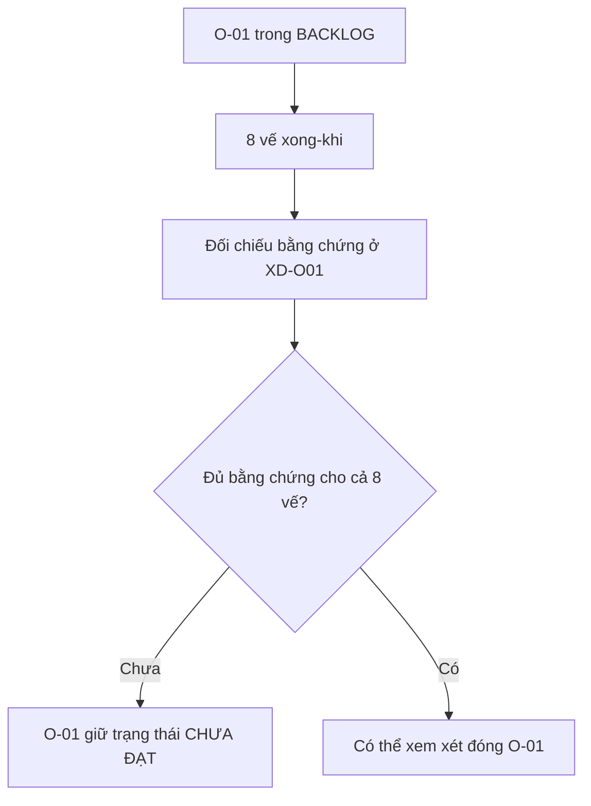

**TÓM TẮT 5 DÒNG**
1. [THẤY] Đã phủ đủ 8/8 vế xong-khi của O-01 theo `TASKS/BACKLOG.md:81`.
2. [TÀI LIỆU] `REPORTS/XD-O01.md:40–47` kết luận cả 8 vế **CHƯA ĐẠT** theo hồ sơ hiện có.
3. [TÀI LIỆU] Duyệt B-02 chỉ có điều kiện cho thử VM, chưa duyệt bản chính (`REPORTS/O-01-duyet-B-02.md:1–3`).
4. [CHƯA KIỂM] Chưa có hồ sơ phiên Opus đủ phạm vi, kết quả ba nhóm rà soát, lịch định kỳ và đối chiếu từng lần gộp (`REPORTS/XD-O01.md:40–47`).
5. [CHƯA KIỂM] Không build/chạy exe/VM hay dùng mạng theo phạm vi task (`TASKS/XD-O01b.md:19–26`); [THẤY] ghi nhịp ngoài worktree bị từ chối (`UnauthorizedAccessException`); không commit, Tổng quan commit hộ.

# XD-O01b — Bảng bằng chứng theo tiêu chí đóng O-01

Loại: tổng hợp

Chủ đề: Chấm từng vế xong-khi của O-01 dựa trên BACKLOG và báo cáo XD-O01.

Từ khóa: đối chiếu, kiểm tra độc lập, O-01, XD-O01b, Opus, BACKLOG, KIEM-TRA-DOC-LAP, main

Trạng thái: PARTIAL — bảng đã phủ 8/8 vế; mốc nhịp ngoài worktree không ghi được.

Độ phủ: Đã phủ 8 trên tổng 8 vế xong-khi của O-01; cả 8 vế đều chưa đạt theo bằng chứng trong XD-O01.

Liên quan: `TASKS/BACKLOG.md`, `TASKS/O-01.md`, `REPORTS/XD-O01.md`, `REPORTS/O-01-duyet-B-02.md`.

Cần tôi quyết định: không.

## Phạm vi và độ phủ

Đối tượng là tám vế trong dòng O-01 (`TASKS/BACKLOG.md:81`). Bảng dưới giữ nguyên kết luận của `REPORTS/XD-O01.md:40–47`; trạng thái “đã phủ” nghĩa là đã chấm vế, không đồng nghĩa tiêu chí đã đạt. Các ghi nhận về hồ sơ B-02 là nội dung tài liệu, không thay thế một phiên kiểm tra độc lập.

| # | Vế xong-khi | Kết quả hiện có | Bằng chứng | Cần có để chấp nhận đạt |
|---:|---|---|---|---|
| 1 | Dùng một phiên Opus mới | **CHƯA ĐẠT** | [TÀI LIỆU] XD-O01 ghi người duyệt B-02 là Chat và chưa xác nhận model/phiên mới (`REPORTS/XD-O01.md:40`; hồ sơ duyệt ghi chỉ đọc tóm tắt, `REPORTS/O-01-duyet-B-02.md:1–3`). | Báo cáo kiểm tra có ngày, nhận diện rõ phiên Opus mới và kết quả của phiên đó. |
| 2 | Chỉ đọc kế hoạch, `QUYET-DINH.md`, backlog và task đã làm | **CHƯA ĐẠT** | [TÀI LIỆU] Lượt duyệt B-02 dựa trên tóm tắt diff; XD-O01 chưa có danh sách nguồn của phiên kiểm tra đủ phạm vi (`REPORTS/XD-O01.md:41`; `REPORTS/O-01-duyet-B-02.md:1–3`). | Ghi danh sách nguồn đã đọc và chứng minh phạm vi chỉ gồm các nhóm được BACKLOG cho phép. |
| 3 | Báo việc lệch hướng | **CHƯA ĐẠT** | [TÀI LIỆU] Báo cáo B-02 nêu điều kiện/rủi ro của B-02; XD-O01 chưa có rà soát việc lệch hướng so với kế hoạch (`REPORTS/XD-O01.md:42`; `REPORTS/O-01-duyet-B-02.md:7–14`). | Nêu kết quả đối chiếu công việc đã làm với kế hoạch; ghi từng lệch hướng hoặc xác nhận không thấy, kèm nguồn. |
| 4 | Báo task không có mã backlog | **CHƯA ĐẠT** | [CHƯA KIỂM] XD-O01 ghi chưa có kết quả đối chiếu danh sách task đã làm với mã backlog; `TASKS/O-01.md:8` chỉ dẫn nơi lưu nội dung (`REPORTS/XD-O01.md:43`). | Có danh sách task đã làm được đối chiếu với BACKLOG, nêu từng task thiếu mã hoặc xác nhận không thấy, kèm nguồn. |
| 5 | Báo quyết định bị làm trái | **CHƯA ĐẠT** | [TÀI LIỆU] Hồ sơ B-02 ghi một quyết định thiết kế còn chờ chủ chốt; chưa có kết quả rà việc trái quyết định đã chốt (`REPORTS/XD-O01.md:44`; `REPORTS/O-01-duyet-B-02.md:11`). | Đối chiếu công việc với các quyết định đã chốt, nêu từng trường hợp hoặc xác nhận không thấy, kèm nguồn. |
| 6 | Lưu `REPORTS/KIEM-TRA-DOC-LAP-YYYY-MM-DD.md` | **CHƯA ĐẠT** | [TÀI LIỆU] XD-O01 ghi lệnh `Get-ChildItem -File -Name -Filter 'KIEM-TRA-DOC-LAP-*.md'` trả 0 tệp ở mỗi thư mục REPORTS đã kiểm (`REPORTS/XD-O01.md:45,75`). Kết quả này được dẫn lại, không chạy lại trong task XD-O01b. | Lưu báo cáo phiên độc lập theo đúng mẫu tên ngày trong `REPORTS/`; dẫn đường dẫn và bằng chứng nội dung. |
| 7 | Kiểm tra khoảng ba ngày một lần | **CHƯA ĐẠT** | [TÀI LIỆU] XD-O01 ghi chưa đủ mốc ngày để tính khoảng cách; hồ sơ duyệt B-02 chỉ cung cấp mốc 05:30 (`REPORTS/XD-O01.md:46`; `REPORTS/O-01-duyet-B-02.md:1`). | Có các báo cáo kiểm tra có ngày đủ để xác nhận nhịp xấp xỉ ba ngày; nêu rõ các mốc được đối chiếu. |
| 8 | Kiểm tra trước mỗi lần gộp vào `main` | **CHƯA ĐẠT** | [TÀI LIỆU] B-02 chưa được duyệt đưa vào bản chính; XD-O01 chưa có cặp mốc kiểm tra và lần gộp để xác nhận điều kiện “mỗi lần” (`REPORTS/XD-O01.md:47`; `REPORTS/O-01-duyet-B-02.md:1–3`). | Đối chiếu từng lần gộp vào `main` với báo cáo kiểm tra có trước lần gộp đó; nêu đủ các mốc và nguồn. |

## Điều kiện cần để đóng O-01

Chỉ xem xét đóng khi hồ sơ chứng minh đủ cả tám vế: có phiên Opus mới; có danh sách nguồn đúng phạm vi; có kết quả rà lệch hướng, task thiếu mã backlog và việc trái quyết định; lưu báo cáo theo tên ngày; có chuỗi ngày xác nhận nhịp khoảng ba ngày; và có đối chiếu trước từng lần gộp vào `main`. Hiện XD-O01 kết luận O-01 chưa đạt theo hồ sơ hiện có; báo cáo XD-O01b giữ nguyên kết luận đó.

## Giải mã tên

| Tên gốc | Mã hóa | Chữ đúng | Nguồn |
|---|---|---|---|
| Không có tên kỹ năng, trang bị, quái, NPC hoặc bản đồ trong phạm vi | Không áp dụng | Không có tên game cần giải mã | `TASKS/BACKLOG.md:81`; `REPORTS/XD-O01.md:40–47` |

Các mã quy trình O-01, XD-O01b, B-02 và tên Opus/`main` được giữ nguyên theo nguồn; chúng không phải tên nội dung trong game cần giải mã.

## Sắp theo cấu trúc game

Không áp dụng: O-01 là tiêu chí vận hành, không chứa dữ liệu game để xếp theo phái, nhánh, cấp, bộ trang bị hay bản đồ. Tám vế được giữ theo thứ tự dòng BACKLOG và bảng đối chiếu (`TASKS/BACKLOG.md:81`; `REPORTS/XD-O01.md:40–47`).

## Đã xác minh

- [THẤY] Dòng O-01 trong BACKLOG nêu phạm vi, tên báo cáo, vai trò Opus, chu kỳ khoảng ba ngày và điều kiện trước mỗi lần gộp `main` (`TASKS/BACKLOG.md:81`).
- [THẤY] Tệp `TASKS/O-01.md` tồn tại; nó ghi trạng thái O-01 là active và trỏ nội dung công việc về BACKLOG/REPORTS (`TASKS/O-01.md:1–8`).
- [THẤY] `REPORTS/XD-O01.md` có tám dòng chấm tiêu chí O-01; tất cả đều mang kết luận CHƯA ĐẠT (`REPORTS/XD-O01.md:40–47`).
- [THẤY] Các tệp liên quan được liệt kê ở trên tồn tại trong worktree; việc này chỉ xác nhận hiện diện, không xác nhận lại nội dung ngoài các đoạn đã đọc.

## Chưa kiểm

- [CHƯA KIỂM] Nội dung nguồn gốc của từng ghi nhận cũ trong XD-O01 chưa được tái-audit trong task này; bảng phân biệt rõ [TÀI LIỆU] với [THẤY].
- [CHƯA KIỂM] Chưa xác nhận phiên Opus mới, danh sách nguồn của phiên đó, ba nhóm kết quả rà soát, các ngày kiểm tra thực tế hoặc quan hệ với từng lần gộp vào `main`; cần hồ sơ nêu ở bảng trên.
- [CHƯA KIỂM] Không kiểm mã client/server, không build, không chạy exe/VM, không dùng mạng; phạm vi nguồn của task là BACKLOG và XD-O01, và quyền task cấm các thao tác này (`TASKS/XD-O01b.md:19–26`).

## Kiểm tra và bàn giao

- [THẤY] `rg` không khả dụng trong PowerShell (lệnh trả lỗi “The term 'rg' is not recognized”); dùng `Get-Content` giới hạn đoạn và `Select-String` trên các tệp được chỉ định.
- [THẤY] Thử ghi `D:\JX-wt\XD-O01b.nhip` bằng `Set-Content` bị hệ thống từ chối với `UnauthorizedAccessException`; tệp nhịp không được tạo/cập nhật. Cần quyền ghi thư mục cha để tiếp tục đáp ứng nhịp.
- Không commit theo yêu cầu; Tổng quan commit hộ.
- Kỹ năng đã dùng: `jx1-retrofit`, `jx1-read-server`, `jx1-read-client`, `jx1-parameters`, `jx1-knowledge`, `jx1-report`.
