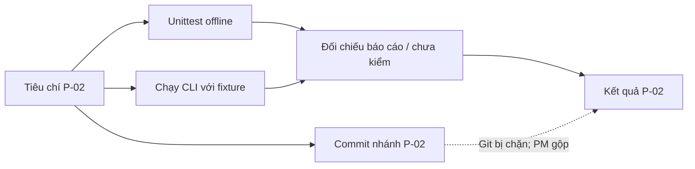

TÓM TẮT 1 [THẤY] `python -I -m unittest discover -s JX1_OPS/TOOLS/bench -v` → exit 0, 12 test pass, `OK` (0.222s).
TÓM TẮT 2 [THẤY] `python -I JX1_OPS/TOOLS/bench/jx1_bench.py` → exit 0, in bảng tick 51.00/53.70 ms, RX/TX 8.00/4.00 Mbps, FPS trung bình 59.00.
TÓM TẮT 3 [TÀI LIỆU] Năm vế tiêu chí P-02 gồm test offline, bảng mẫu, ghi rõ đo thật chưa chạy, ghi “chưa kiểm”, và commit hoặc ghi kết quả khi Git bị chặn (JX1_OPS/TASKS/P-02.md:26-28).
TÓM TẮT 4 [TÀI LIỆU] Báo cáo P-02 ghi collector/runtime chưa kiểm và commit bị chặn; PM cần gộp (D:/jx1-ops-wt/JX1_OPS/REPORTS/P-02-bench.md:94,98-106; JX1_OPS/TASKS/P-02.md:37,46).
TÓM TẮT 5 [CHƯA KIỂM] Không chạy build, exe, VM, server hoặc mạng; không tạo commit trong task XD-P02. Fixture là dữ liệu tổng hợp ngoại tuyến (JX1_OPS/TOOLS/bench/sample_metrics.json:2-6).

# XD-P02 — Đóng việc cha P-02: kiểm chứng bộ đo chuẩn
Loại: tổng hợp
Chủ đề: Chạy lại kiểm thử phân tích ngoại tuyến và đối chiếu từng tiêu chí hoàn thành của P-02.
Từ khóa: bộ đo, tick, băng thông, khung hình, P-02, XD-P02, gs001, JX-Test-36
Trạng thái: PARTIAL — phần kiểm chứng ngoại tuyến hoàn tất; P-02 chưa đạt do chưa có commit; còn giới hạn ghi nhận nhịp và kết quả vào task.
Độ phủ: đã rà 5/5 vế tiêu chí; 4 vế có bằng chứng đạt trực tiếp, vế commit còn thiếu và có ghi rõ blocker/đầu mối gộp.
Liên quan: JX1_OPS/TASKS/P-02.md; D:/jx1-ops-wt/JX1_OPS/REPORTS/P-02-bench.md; JX1_OPS/REPORTS/KIEM-P-02.md
Cần tôi quyết định: không

## Sơ đồ luồng



## Phạm vi và độ phủ

| Vế tiêu chí | Trạng thái | Bằng chứng |
|---|---|---|
| Test ngoại tuyến pass | ĐẠT | Chạy lại đúng lệnh `python -I -m unittest discover -s JX1_OPS/TOOLS/bench -v`; exit 0, `Ran 12 tests in 0.222s`, `OK`. Đây là lượt chạy trong task XD-P02. |
| Một lệnh in bảng từ dữ liệu mẫu | ĐẠT | Chạy `python -I JX1_OPS/TOOLS/bench/jx1_bench.py`; exit 0. Bảng có tick trung bình 51.00 ms, p95 53.70 ms; RX/TX/tổng 8.00/4.00/12.00 Mbps; FPS trung bình/thấp nhất/p05 59.00/58.00/58.10. Fixture được đánh dấu `synthetic_offline` tại `JX1_OPS/TOOLS/bench/sample_metrics.json:2`. |
| Báo cáo nêu rõ phần chưa chạy thật | ĐẠT | `D:/jx1-ops-wt/JX1_OPS/REPORTS/P-02-bench.md:3,96-101` ghi đo thật, collector, runtime, build/game test chưa kiểm. |
| Điều chưa kiểm được ghi “chưa kiểm” | ĐẠT | Các mục collector, mạng/FPS và runtime ghi nguyên cụm “chưa kiểm” tại `D:/jx1-ops-wt/JX1_OPS/REPORTS/P-02-bench.md:98-101`. |
| Commit trên nhánh P-02 với tiêu đề bắt đầu P-02; nếu Git bị chặn thì ghi Kết quả để PM gộp | CHƯA ĐẠT phần commit; đã ghi fallback | Báo cáo nguồn ghi `git add` bị `Permission denied`, chưa stage/commit/SHA tại `D:/jx1-ops-wt/JX1_OPS/REPORTS/P-02-bench.md:94,106`; câu lệnh commit dự kiến ở dòng 112. Task P-02 ghi trạng thái và yêu cầu PM gộp tại `JX1_OPS/TASKS/P-02.md:37,46`. Không thử commit trong task này theo yêu cầu không commit. |

## Giải mã tên

| Tên gốc | Mã hóa | Chữ đúng | Nguồn |
|---|---|---|---|
| P-02 | ASCII (mã ID) | P-02 | JX1_OPS/TASKS/P-02.md:2-3 |
| XD-P02 | ASCII (mã ID) | XD-P02 | JX1_OPS/TASKS/XD-P02.md:2-3 |
| gs001 | ASCII | gs001 | JX1_OPS/TASKS/P-02.md:22 |
| JX-Test-36 | ASCII | JX-Test-36 | JX1_OPS/TASKS/P-02.md:22 |
| Không có tên riêng tiếng Hán hoặc tên Việt cũ trong phạm vi này | — | — | Phạm vi task P-02: JX1_OPS/TASKS/P-02.md:22-28 |

## Sắp theo cấu trúc game

Không có danh sách kỹ năng, trang bị, quái, NPC hoặc bản đồ trong P-02 để xếp theo cấu trúc game. Sắp các chỉ số theo luồng đo của task: tick gs001 → băng thông interface guest → FPS client; các phép tính và thứ tự chỉ số tương ứng được mô tả ở `D:/jx1-ops-wt/JX1_OPS/REPORTS/P-02-bench.md:32-50,70-82`.

## Kết quả kiểm chứng trong task XD-P02

Lệnh unittest bắt buộc:

```text
python -I -m unittest discover -s JX1_OPS/TOOLS/bench -v
Ran 12 tests in 0.222s
OK
```

Lệnh bảng mẫu:

```text
python -I JX1_OPS/TOOLS/bench/jx1_bench.py
exit code: 0
target: JX-Test-36 (192.168.56.150)
gs001 tick trung bình: 51.00 ms (4 mẫu)
gs001 tick p95: 53.70 ms (4 mẫu)
guest RX: 8.00 Mbps (4 mẫu)
guest TX: 4.00 Mbps (4 mẫu)
guest tổng: 12.00 Mbps (4 mẫu)
client FPS trung bình: 59.00 (3 mẫu)
client FPS thấp nhất: 58.00 (3 mẫu)
client FPS p05: 58.10 (3 mẫu)
```

Các số trên chỉ là kết quả phân tích fixture. File mẫu ghi `synthetic_offline`, không phải phép đo thật (`JX1_OPS/TOOLS/bench/sample_metrics.json:2`). Kết quả của lượt chạy trước trong báo cáo P-02 là 0.259 giây; lượt này độc lập chạy lại và mất 0.222 giây. Không sửa mã vì test và lệnh mẫu đều chạy thành công.

## Mục số thông số

| Nhóm | Tên/thông số | Nguồn file:dòng | Giá trị | Đơn vị | Ảnh hưởng | Đổi an toàn | Nguồn đo |
|---|---|---|---:|---|---|---|---|
| Tick | Trung bình / p95 | JX1_OPS/TOOLS/bench/sample_metrics.json:7-9; kết quả CLI ở trên | 51.00 / 53.70 | ms | Tóm tắt tick trong fixture | CẨN THẬN — không phải thông số runtime để chỉnh | Phân tích mẫu ngoại tuyến |
| Mạng guest | RX / TX / tổng | JX1_OPS/TOOLS/bench/sample_metrics.json:11-16; kết quả CLI ở trên | 8.00 / 4.00 / 12.00 | Mbps | Lưu lượng của interface giả lập trong fixture | CẨN THẬN — không phải số đo mạng thật | Phân tích mẫu ngoại tuyến |
| Client | FPS trung bình / thấp nhất / p05 | JX1_OPS/TOOLS/bench/sample_metrics.json:18-22; kết quả CLI ở trên | 59.00 / 58.00 / 58.10 | FPS | Thống kê cửa sổ frame giả lập | CẨN THẬN — không phải số đo client thật | Phân tích mẫu ngoại tuyến |

## Đã xác minh

- Tiêu chí, giới hạn “chỉ test phân tích bằng dữ liệu mẫu” và lệnh test được nêu tại `JX1_OPS/TASKS/P-02.md:22-28`.
- Lượt test thực tế trong task này: `python -I -m unittest discover -s JX1_OPS/TOOLS/bench -v`, exit 0, 12 test, `OK`.
- Lượt chạy bảng mẫu thực tế: `python -I JX1_OPS/TOOLS/bench/jx1_bench.py`, exit 0; các giá trị được chép nguyên từ output trong báo cáo này.
- Fixture có nhãn `synthetic_offline` tại `JX1_OPS/TOOLS/bench/sample_metrics.json:2`; không diễn giải kết quả này thành số đo runtime.
- Trạng thái commit ở P-02 được báo cáo là bị chặn, chưa có SHA, và PM cần gộp (`D:/jx1-ops-wt/JX1_OPS/REPORTS/P-02-bench.md:94,106-112`; `JX1_OPS/TASKS/P-02.md:37,46`).

## Chưa kiểm

- Collector tick thật và ý nghĩa trường tick, interface/counter guest, nguồn frame/FPS client, runtime trên JX-Test-36: `D:/jx1-ops-wt/JX1_OPS/REPORTS/P-02-bench.md:98-100`.
- Build/game test: `D:/jx1-ops-wt/JX1_OPS/REPORTS/P-02-bench.md:101`.
- Không chạy build, exe, VM, server, SQL hay mạng theo phạm vi chỉ đọc/ngoại tuyến của P-02 (`JX1_OPS/TASKS/P-02.md:22-28`).
- Commit của P-02 chưa có; lỗi Git đã được ghi trong báo cáo nguồn. Không stage/commit/push trong task XD-P02 theo yêu cầu.
- Tệp nhịp `D:\JX-wt\XD-P02.nhip` không cập nhật được: PowerShell trả `Access to the path ... is denied`. Không thử ghi ngoài thư mục worktree lần nữa.
- Không thêm mục `## Kết quả` vào `JX1_OPS/TASKS/XD-P02.md`, vì task khai báo `vung_file` chỉ gồm `JX1_OPS/REPORTS/XD-P02.md`. Kết quả thực hiện được ghi đầy đủ trong báo cáo đầu ra này.

## Bàn giao

Task XD-P02 đã chạy lại và ghi bằng chứng cho từng vế. P-02 vẫn chưa đạt cho đến khi PM gộp/hoàn tất commit theo ghi nhận sẵn có; không có SHA mới trong lượt này. Không push. Bước tiếp theo: PM kiểm tra và gộp nội dung P-02 theo `JX1_OPS/TASKS/P-02.md:46`.

Kỹ năng đã dùng: jx1-retrofit, jx1-read-server, jx1-read-client, jx1-parameters, jx1-knowledge, jx1-report.

KẾT LUẬN: P-02 CHƯA ĐẠT vì chưa có commit; P-02-bench.md ghi Git bị chặn và PM cần gộp (D:/jx1-ops-wt/JX1_OPS/REPORTS/P-02-bench.md:94,106; JX1_OPS/TASKS/P-02.md:46).