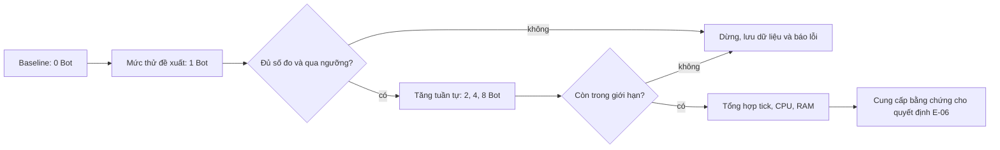

TÓM TẮT 5 DÒNG
1. [NGUỒN] [TÀI LIỆU] PARTIAL: đã hoàn thành báo cáo kế hoạch tĩnh cho P-03 theo yêu cầu và phạm vi XD-P03 (JX1_OPS/TASKS/XD-P03.md:19-26).
2. [NGUỒN] [TÀI LIỆU] Backlog tách E-06 đo tải để quyết định hướng điều khiển Bot và P-03 đo đường cong theo số Bot (D:/jx1-ops-wt/JX1_OPS/TASKS/BACKLOG.md:66,75).
3. [CHƯA KIỂM] Mức 0/1/2/4/8 Bot, cửa sổ đo và ngưỡng dừng trong báo cáo là đề xuất thiết kế, chưa được chạy hay phê duyệt.
4. [CHƯA KIỂM] CLI hiện được mô tả là một Bot trên JX-Test-36; chưa xác minh bộ chạy đồng thời hoặc nguồn thu thập tick/CPU/RAM (JX1_OPS/BOT/cli.py:15-26; JX1_OPS/REPORTS/KIEM-P-02.md:65,76-80).
5. [NGUỒN] [TÀI LIỆU] Theo task, lượt này không chạy test, build, exe, VM hay mạng (JX1_OPS/TASKS/XD-P03.md:23-26).

# XD-P03 — Kế hoạch chuẩn bị đo đường cong tải theo số Bot
Loại: thiết kế
Chủ đề: Chuẩn bị phép đo tải tăng dần theo số Bot trên JX-Test-36, dùng CPU, RAM và độ trễ tick.
Từ khóa: đường cong tải, Bot, P-03, E-06, JX-Test-36, tick, CPU, RAM, P-02
Trạng thái: PARTIAL — báo cáo kế hoạch đã hoàn tất; ghi nhịp ngoài vùng ghi bị chặn, bộ chạy nhiều Bot, bộ thu thập runtime và ngưỡng vận hành chưa xác minh.
Độ phủ: đã lập 5/5 hạng mục đầu ra của task: mức Bot, số đo, lệnh, điều kiện dừng, mẫu bảng; chưa thực hiện phép đo runtime.
Liên quan: D:/jx1-ops-wt/JX1_OPS/TASKS/BACKLOG.md; JX1_OPS/REPORTS/E-01-thieu-giao-thuc.md; JX1_OPS/REPORTS/E-01b-thieu-giao-thuc.md; JX1_OPS/REPORTS/P-02-bench.md; JX1_OPS/REPORTS/KIEM-P-02.md; JX1_OPS/DESIGN/CHUAN-BAO-CAO.md.
Cần tôi quyết định: có — xác nhận ngưỡng dừng, cách đo online và bộ chạy đồng thời trước một task thực thi riêng.

## Sơ đồ chính

## Phạm vi và độ phủ

| Hạng mục task | Kết quả trong kế hoạch | Nguồn và giới hạn |
|---|---|---|
| Các mức số Bot | Đề xuất 0, 1, 2, 4, 8; chỉ tăng sau khi mức trước qua kiểm tra. | [TÀI LIỆU] P-03 yêu cầu đường cong theo số Bot: D:/jx1-ops-wt/JX1_OPS/TASKS/BACKLOG.md:75. Mức cụ thể là đề xuất, CHƯA KIỂM. |
| CPU và RAM | Đề xuất ghi CPU tiến trình/server và CPU guest; working set/private bytes và RAM khả dụng. | [TÀI LIỆU] P-02 hiện có số liệu tick, mạng, FPS từ fixture; [CHƯA KIỂM] collector CPU/RAM runtime: JX1_OPS/REPORTS/KIEM-P-02.md:53,65,76-80. |
| Độ trễ tick | Ghi mẫu ms từng tick, rồi tính p50/p95/tối đa theo cửa sổ; so với baseline 0 Bot. | [TÀI LIỆU] P-02 có xử lý chỉ số tick; [CHƯA KIỂM] nguồn tick runtime: JX1_OPS/REPORTS/KIEM-P-02.md:53,70,76-78. |
| Lệnh Bot trên Test-36 | Có mẫu lệnh cho một Bot; giao diện nhiều tiến trình chưa được xác minh. | [TÀI LIỆU] JX1_OPS/BOT/cli.py:15-26,39-43; JX1_OPS/BOT/README.md:18-20,31-45. Không chạy lệnh trong lượt này. |
| Điều kiện dừng và bảng kết quả | Có ngưỡng dự thảo, quy trình tăng tải và bảng ghi số liệu bên dưới. | Các ngưỡng là đề xuất cho lần chạy được duyệt trong tương lai, không phải ngưỡng đã đo hoặc cấu hình hiện hành. |

## Thiết kế phép đo

### Mức tải và trình tự

Dùng một lần đo baseline 0 Bot, sau đó thử lần lượt 1, 2, 4 và 8 Bot. Đây là các mức khởi đầu được đề xuất, không phải mức đã chạy. Mỗi mức chỉ bắt đầu khi mức trước không chạm điều kiện dừng và trạng thái máy chủ/online đã được người vận hành kiểm tra bằng nguồn đáng tin cậy.

Ở mỗi mức: lấy mẫu mỗi 5 giây trong tổng cộng 420 giây (84 mẫu); loại 24 mẫu đầu để ổn định 120 giây, rồi tính thống kê trên 60 mẫu của cửa sổ 300 giây. Đánh giá trước khi tăng mức. Sau mức cuối, theo dõi thêm 5 phút khi không tăng tải. Chỉ dùng phiên và nhân vật thử đã được người vận hành cấp riêng; danh tính và số phiên khả dụng chưa xác minh. Không gửi lệnh di chuyển/đánh trong bài đo tải nền.

[TÀI LIỆU] CLI ghi rõ chế độ hiện có là một Bot trên JX-Test-36. Do đó không được coi một lần gọi CLI là bộ chạy N Bot. [CHƯA KIỂM] Chưa thấy bằng chứng về launcher nhiều phiên, kiểm tra số online nguyên tử hay cơ chế tách danh tính cho N Bot. Chưa được tiến hành các mức lớn hơn 1 cho tới khi một task riêng xác minh bộ điều phối, số online thực và giới hạn tài khoản/role.

### Số đo cần thu

| Chỉ số | Cách ghi cho mỗi mức | Ghi chú |
|---|---|---|
| CPU | CPU của tiến trình máy chủ và CPU tổng guest; lưu mẫu thô, báo cáo trung bình, p95 và đỉnh. | Nếu có nhiều instance tiến trình, xác định đúng instance trước khi lấy mẫu; % CPU của tiến trình có thể vượt 100% trên máy nhiều lõi nên không so trực tiếp với % CPU tổng guest. |
| RAM | Working Set - Private và Private Bytes của tiến trình; RAM khả dụng guest thấp nhất. | Không thay giá trị thiếu bằng 0. |
| Độ trễ tick | Thời lượng từng tick theo ms; báo cáo p50, p95 và tối đa cho cửa sổ đo. | Cần nguồn tick runtime đã xác minh; không dùng fixture P-02 làm số nền. |
| Sức khỏe phiên | Số lần đăng nhập lỗi, timeout, disconnect, restart hoặc lỗi server; ghi thời điểm và log tham chiếu phù hợp. | Không đưa mật khẩu, khóa, token, payload đăng nhập hoặc dump tài khoản vào báo cáo. |

[TÀI LIỆU] Báo cáo P-02 ghi kết quả mẫu từ fixture tổng hợp và nói rõ runtime/Test-36 chưa được đo; các số trong fixture không phải baseline tải thật (JX1_OPS/REPORTS/KIEM-P-02.md:53,76-78; JX1_OPS/REPORTS/P-02-bench.md:60,73,75,78). Công cụ P-02 đọc JSON cục bộ, không chứng minh tự thu thập CPU/RAM/tick từ máy chủ (JX1_OPS/TOOLS/bench/jx1_bench.py:59-70,236-259; JX1_OPS/REPORTS/KIEM-P-02.md:65).

### Lệnh dự kiến trên Test-36

[CHƯA KIỂM] Mẫu dưới đây dành cho một Bot; các dấu ngoặc nhọn là chỗ giữ chỗ, không phải giá trị có thể chạy trực tiếp. Chỉ thay bằng số vùng, map và số online đã xác nhận trên Test-36. CLI mặc định dùng host thử đã cấu hình trong mã. Giá trị truy cập cần thiết phải được nạp qua cơ chế bảo mật được duyệt bên ngoài lịch sử lệnh; không ghi giá trị hoặc tên biến chứa bí mật vào báo cáo.

    python -I JX1_OPS/BOT/cli.py --connect --region <REGION_DA_XAC_NHAN> --enter-map <MAP_DA_XAC_NHAN> --observed-online <SO_ONLINE_DA_XAC_NHAN_0_DEN_99> --seconds 420

Lệnh trên chỉ tạo một phiên theo giao diện CLI hiện tại. Không nhân bản bằng vòng lặp hay chạy song song cho đến khi đã kiểm chứng launcher nhiều phiên và guard số online. Chưa xác minh được cách ghi mẫu tick runtime. Dữ liệu CPU/RAM có thể thu bằng bộ đếm hiệu năng trên Test-36 sau khi xác minh tên hệ điều hành, đường dẫn bộ đếm và đúng instance tiến trình; đây là đề xuất, chưa chạy:

    $counters = @(
        '\Processor(_Total)\% Processor Time',
        '\Process(gs001)\% Processor Time',
        '\Process(gs001)\Working Set - Private',
        '\Process(gs001)\Private Bytes',
        '\Memory\Available MBytes'
    )
    Get-Counter -Counter $counters -SampleInterval 5 -MaxSamples 84 |
        Export-Counter -Path '<TEP_BLG_DA_CHON>' -FileFormat BLG -Force

[CHƯA KIỂM] Lệnh lấy mẫu bộ đếm trên chưa được xác nhận trên hệ điều hành/locale của Test-36, không thu tick và chưa có bước lưu CSV được kiểm chứng. Không coi đây là lệnh vận hành đã xác nhận; cần hoàn thiện/kiểm tra collector trong task thực thi được duyệt.

### Điều kiện dừng dự thảo

Các ngưỡng định lượng bên dưới chỉ là đề xuất ban đầu và cần được chủ dự án xác nhận trước khi chạy; P-02 chưa cung cấp baseline runtime.

- Dừng ngay khi máy chủ hoặc phiên Bot crash/restart, có lỗi server mới, timeout/disconnect không dự kiến, tác động đến người chơi khác, hoặc kiểm tra cho thấy đang nhắm nhầm môi trường.
- Không bắt đầu/tăng mức nếu không đọc được số online hiện tại đáng tin cậy. Giữ giới hạn tổng online dưới 80 (đề xuất giữ dự phòng 20 chỗ so với giới hạn 100 được ghi trong tài liệu Bot); nếu không chứng minh được số online và tổng Bot, dừng ở mức 0.
- Dừng nếu CPU guest vượt 80% liên tục 60 giây hoặc vượt 90% liên tục 15 giây.
- Dừng nếu RAM khả dụng xuống dưới giá trị lớn hơn giữa 2 GiB và 20% RAM guest; dừng tăng tải nếu working set tiếp tục tăng ở hai cửa sổ liên tiếp.
- Dừng nếu p95 tick tăng hơn 20% so với baseline 0 Bot trong hai cửa sổ liên tiếp, hoặc collector tick mất dữ liệu/không đồng bộ thời gian.
- Các ngưỡng 80/90%, dự phòng 20 chỗ và mức tăng 20% là CHƯA KIỂM; chúng không được suy ra từ fixture P-02. Nếu mức dừng được chạm tới, không tự động thử lại hay tăng tải.

## Mẫu bảng kết quả

| Mức Bot | Lần đo | CPU guest TB/p95/đỉnh (%) | CPU server TB/p95/đỉnh (%) | RAM server WS/private (MB) | RAM khả dụng thấp nhất (MB) | Tick p50/p95/tối đa (ms) | Lỗi/disconnect/restart | File dữ liệu và thời gian | Quyết định |
|---:|---:|---:|---:|---:|---:|---:|---|---|---|
| 0 | 1 | CHƯA KIỂM | CHƯA KIỂM | CHƯA KIỂM | CHƯA KIỂM | CHƯA KIỂM | CHƯA KIỂM | CHƯA KIỂM | Baseline cần đo |
| 1 | 1 | CHƯA KIỂM | CHƯA KIỂM | CHƯA KIỂM | CHƯA KIỂM | CHƯA KIỂM | CHƯA KIỂM | CHƯA KIỂM | Chỉ chạy nếu được duyệt |
| 2 | 1 | CHƯA KIỂM | CHƯA KIỂM | CHƯA KIỂM | CHƯA KIỂM | CHƯA KIỂM | CHƯA KIỂM | CHƯA KIỂM | Chỉ tăng nếu mức 1 đạt |
| 4 | 1 | CHƯA KIỂM | CHƯA KIỂM | CHƯA KIỂM | CHƯA KIỂM | CHƯA KIỂM | CHƯA KIỂM | CHƯA KIỂM | Chỉ tăng nếu mức 2 đạt |
| 8 | 1 | CHƯA KIỂM | CHƯA KIỂM | CHƯA KIỂM | CHƯA KIỂM | CHƯA KIỂM | CHƯA KIỂM | CHƯA KIỂM | Chỉ tăng nếu mức 4 đạt |

## Mục số thông số

| Nhóm | Tên/thông số | Nguồn file:dòng | Giá trị | Đơn vị | Ảnh hưởng | Đổi an toàn (CÓ/CẨN THẬN/KHÔNG) | Nguồn đo |
|---|---|---|---|---|---|---|---|
| Thiết kế tải | Mức thử | Đề xuất XD-P03; task yêu cầu đường cong số Bot tại JX1_OPS/TASKS/XD-P03.md:20 | 0, 1, 2, 4, 8 | Bot đồng thời | Tải mục tiêu theo từng bậc | CẨN THẬN — chưa xác minh bộ chạy N phiên | Chưa đo; đề xuất kế hoạch |
| Thiết kế lấy mẫu | Ổn định / cửa sổ đo / chu kỳ | Đề xuất XD-P03 | 120 / 300 / 5 | giây | Thời gian ổn định, lấy mẫu và khoảng cách mẫu | CẨN THẬN — cần kiểm tra collector | Chưa đo; đề xuất kế hoạch |
| CPU | Ngưỡng tạm dừng | Đề xuất XD-P03 | 80% trong 60 giây; 90% trong 15 giây | % / giây | Giới hạn tải CPU trong lần chạy | CẨN THẬN — chưa được chủ dự án xác nhận | Chưa đo; ngưỡng dự thảo |
| RAM | RAM khả dụng tối thiểu | Đề xuất XD-P03 | max(2 GiB, 20% RAM guest) | GiB hoặc % | Tránh tiếp tục khi máy sắp cạn RAM | CẨN THẬN — chưa được chủ dự án xác nhận | Chưa đo; ngưỡng dự thảo |
| Tick | Mức suy giảm tạm dừng | Đề xuất XD-P03 | p95 tăng >20% trong 2 cửa sổ | % / cửa sổ | Ngăn tăng tải khi tick xấu đi | CẨN THẬN — baseline runtime chưa có | Chưa đo; ngưỡng dự thảo |

## Giải mã tên

| Tên gốc | Mã hóa | Chữ đúng | Nguồn file:dòng |
|---|---|---|---|
| JX-Test-36 | Không phải tên dữ liệu game; tài liệu không nêu mã hóa | JX-Test-36 (tên môi trường thử) | JX1_OPS/BOT/cli.py:15 |

## Sắp theo cấu trúc game

Báo cáo này chỉ thiết kế bài đo tải máy chủ, không liệt kê kỹ năng, trang bị, quái, NPC hoặc bản đồ để xếp theo cấu trúc game. Quy trình được nhóm theo các mức tải 0 → 1 → 2 → 4 → 8 và theo nhóm chỉ số CPU → RAM → tick.

## Đề xuất tối ưu

[CHƯA KIỂM] Trước lần chạy được giao riêng, xác minh một cách đo số online có cập nhật, launcher tạo được N phiên với danh tính thử riêng, và collector đồng bộ tick/CPU/RAM vào một tệp dữ liệu. P-02 hiện xử lý JSON cục bộ; báo cáo nguồn ghi collector và phép đo Test-36 runtime chưa được xác minh (JX1_OPS/REPORTS/KIEM-P-02.md:65,76-80). Không sửa công cụ hay cấu hình trong task này.

## Đã xác minh

- [TÀI LIỆU] Task yêu cầu kế hoạch mức Bot, CPU/RAM/tick, lệnh Test-36, điều kiện dừng và mẫu bảng; đồng thời cấm chạy: JX1_OPS/TASKS/XD-P03.md:19-26.
- [TÀI LIỆU] Backlog mô tả E-06 là đo tải để quyết định chuyển điều khiển Bot vào server và P-03 là đường cong tải theo số Bot: D:/jx1-ops-wt/JX1_OPS/TASKS/BACKLOG.md:66,75.
- [TÀI LIỆU] CLI được mô tả cho một Bot trên JX-Test-36, có tham số số online và thời lượng; giới hạn biến môi trường cần thiết được kiểm trước kết nối: JX1_OPS/BOT/cli.py:15-26,34-43.
- [TÀI LIỆU] Tài liệu Bot ghi mỗi phiên một Bot, chưa có bảo đảm giới hạn toàn server khi người khác đăng nhập đồng thời; runtime chưa kiểm: JX1_OPS/BOT/README.md:18-20,37-45; JX1_OPS/REPORTS/E-01-thieu-giao-thuc.md:101-103.
- [TÀI LIỆU] P-02 tách chỉ số tick/mạng/FPS; báo cáo đối chiếu xác nhận fixture không phải số đo runtime và collector/Test-36 chưa xác minh: JX1_OPS/REPORTS/KIEM-P-02.md:49-53,65,76-80.
- [TÀI LIỆU] Báo cáo chuẩn yêu cầu đúng 5 dòng tóm tắt, sơ đồ Mermaid, bảng phạm vi, giải mã tên, sắp theo cấu trúc game, mức xác minh, bàn giao và không BOM: JX1_OPS/DESIGN/CHUAN-BAO-CAO.md:7-31.

## Chưa kiểm

- Nguồn đếm online trực tiếp, danh tính/role thử, launcher nhiều Bot và tính cô lập tải trên JX-Test-36.
- Bộ đếm CPU/RAM chính xác, tên instance/locale và khả năng xuất dữ liệu trên Test-36.
- Nguồn tick từng mẫu và cách nhập mẫu runtime vào công cụ P-02; không dùng fixture làm baseline.
- [CHƯA KIỂM] Ngưỡng CPU/RAM/tick/dự phòng online trong kế hoạch chưa được xác nhận hoặc đo. [THẤY] Client/server source roots nêu trong task chưa được mở; không suy hành vi runtime từ mã nguồn.
- Không chạy test, build, exe, VM, mạng hoặc phép đo trong XD-P03 theo giới hạn task.
- Ghi nhịp tại D:\JX-wt\XD-P03.nhip bị hệ thống từ chối với Access denied; không đổi quyền hoặc thử đường vòng.

## Bàn giao

Không commit/push theo yêu cầu task; chưa có SHA. Báo cáo kế hoạch đã hoàn tất; trạng thái tổng thể PARTIAL vì tệp nhịp ngoài vùng ghi được chưa cập nhật. Cần task thực thi riêng để xác minh launcher nhiều phiên, nguồn online/tick/CPU/RAM và phê duyệt các ngưỡng dừng.

liên quan: D:/jx1-ops-wt/JX1_OPS/TASKS/BACKLOG.md; JX1_OPS/REPORTS/E-01-thieu-giao-thuc.md; JX1_OPS/REPORTS/E-01b-thieu-giao-thuc.md; JX1_OPS/REPORTS/P-02-bench.md; JX1_OPS/REPORTS/KIEM-P-02.md; JX1_OPS/DESIGN/CHUAN-BAO-CAO.md.

Kỹ năng đã dùng/đối chiếu: jx1-retrofit (khuôn báo cáo), jx1-parameters, jx1-knowledge, jx1-report. Đã nạp hướng dẫn jx1-read-server và jx1-read-client; không mở mã nguồn vì task là thiết kế phép đo và không suy diễn runtime.

## Kết quả cuối

PARTIAL — báo cáo kế hoạch đã hoàn thành tại JX1_OPS/REPORTS/XD-P03.md; tệp nhịp ngoài vùng ghi chưa cập nhật.
Chưa chạy test, build, exe, VM, mạng hoặc đo runtime theo phạm vi task.
Cần xác minh collector và launcher nhiều Bot, rồi giao task thực thi riêng; tệp nhịp bị chặn ghi ngoài vùng cho phép.
