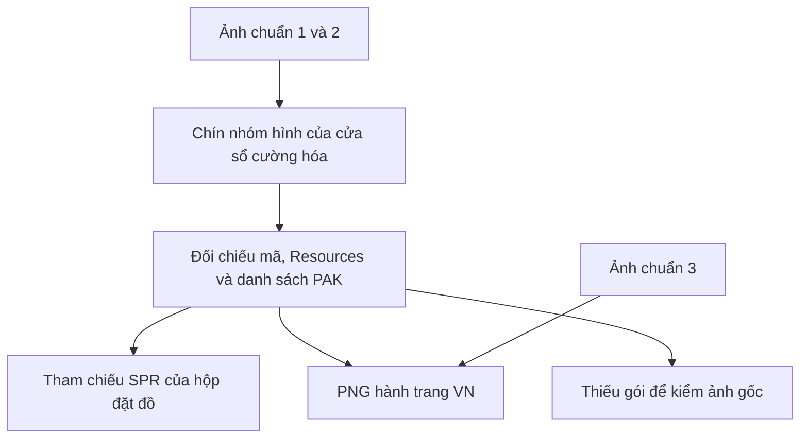

## TÓM TẮT 5 DÒNG

- TÓM TẮT 1/5 [NGUỒN] PARTIAL. Đã đối chiếu 9/9 nhóm hình trong cửa sổ Cường hóa trang bị với bản copy client được giao.
- TÓM TẮT 2/5 [NGUỒN] Đã xác nhận ảnh hành trang VN `ui_item.png` 336 × 511 px, có lưới 5 cột và hai thanh tiền. Ảnh này dùng để đối chiếu hành trang ở ảnh chuẩn 3.
- TÓM TẮT 3/5 [NGUỒN] Đã bổ sung mục Tài nguyên UI cường hóa vào sổ tay và ghi kết quả cuối file task.
- TÓM TẮT 4/5 [CHƯA KIỂM] Chưa định danh được ảnh gốc khớp cửa sổ trong ảnh chuẩn 1–2. Các danh sách có tên `ui.pak` và `spr.pak`, nhưng các vị trí đã kiểm và hai APK trong bản copy thiếu byte của các gói này.
- TÓM TẮT 5/5 [NGUỒN] Đã đọc ảnh, mã, cấu hình lọc và chỉ mục ZIP tại chỗ. Chưa chạy build, test trong game, exe, VM hay mạng. Bàn giao để Tổng quan commit.

# XD-UI01 — Tài nguyên hình ảnh UI cường hóa trang bị

Loại: khảo sát  
Chủ đề: Định danh ảnh của cửa sổ Cường hóa trang bị và các tài nguyên gần nhất trong bản copy client.  
Từ khóa: cường hóa trang bị, ảnh giao diện, hành trang, PAK, SPR, KuiGiveVN, KuiGive_New, KuiItemVN, ui_item.png  
Trạng thái: PARTIAL — đủ đối chiếu trực quan và tham chiếu mã, thiếu PAK để kiểm ảnh gốc.  
Độ phủ: đã đối chiếu 9/9 nhóm cần tìm, tách lưới túi và thanh tiền thành hai nhóm. Đã xác nhận tài nguyên đúng cửa sổ ở ảnh 1–2: 0/9.  
Liên quan: `JX1_OPS/DESIGN/UI-CUONG-HOA/MO-TA.md`, `JX1_OPS/HIEU-GAME/08-giao-dien/SO-TAY-TAI-NGUYEN-CLIENT.md`, `JX1_OPS/HIEU-GAME/08-giao-dien/SO-TAY-GIAO-DIEN.md`.  
Cần tôi quyết định: không.

## Phạm vi và độ phủ

ĐÃ ĐỌC SỔ TAY

- [Tài nguyên client](../HIEU-GAME/08-giao-dien/SO-TAY-TAI-NGUYEN-CLIENT.md) ở dòng 43–55 mô tả luồng PAK, INI và SPR. [Giao diện](../HIEU-GAME/08-giao-dien/SO-TAY-GIAO-DIEN.md) ở dòng 97, 106 và 131 định vị hộp đặt đồ và luồng cường hóa. Các tài liệu này dẫn nguồn từ những lần khảo sát trước.
- Nguồn đối chiếu lần này là `D:/Android/b/Client`, gồm các tệp được định vị trong `Resources/`, `data/data/`, `Classes/` và chỉ mục của hai APK hiện có dưới `proj.android/app/`. Các đường dẫn bắt đầu bằng những thư mục này trong báo cáo đều tính từ root đó.
- Đã xem [ảnh 1 có nguyên liệu](../DESIGN/UI-CUONG-HOA/chuan-1-da-dat-nguyen-lieu.jpg), [ảnh 2 cửa sổ trống](../DESIGN/UI-CUONG-HOA/chuan-2-cua-so-trong.jpg) và [ảnh 3 tooltip](../DESIGN/UI-CUONG-HOA/chuan-3-tooltip-vu-khi-+15-dong-thuoc-tinh.jpg). Ảnh 1–2 cho bố cục cửa sổ. Ảnh 3 cho hành trang và các dòng thuộc tính được khoanh trắng. Mô tả ảnh nằm ở `JX1_OPS/DESIGN/UI-CUONG-HOA/MO-TA.md:2–3`.

| Nhóm cần tìm trong ảnh 1–2 | Độ phủ | Kết quả đối chiếu |
|---|---|---|
| Khung ô có chóp thoi | Đã phủ tìm kiếm | **KHÔNG TÌM THẤY** khung đúng ảnh. Có nền ô vuông rời gần về chức năng. |
| Ô giữa Trang Bị | Đã phủ tìm kiếm | **KHÔNG TÌM THẤY** khung trung tâm. Có luồng vẽ ảnh vật phẩm và lớp màu cho ô. |
| Mũi tên xuống, ngang và chéo vào giữa | Đã phủ tìm kiếm | **KHÔNG TÌM THẤY** bộ mũi tên đúng ảnh. Có PNG mũi tên ngang. |
| Nền cửa sổ và tiêu đề | Đã phủ tìm kiếm | **KHÔNG TÌM THẤY** nền ghép đúng ảnh. Có tham chiếu nền hộp đặt đồ và cách dựng tiêu đề bằng chữ. |
| Dải gợi ý bo tròn | Đã phủ tìm kiếm | **KHÔNG TÌM THẤY** viền đúng ảnh. Có luồng dựng hướng dẫn bằng chữ. |
| Nút Cường hóa | Đã phủ tìm kiếm | **KHÔNG TÌM THẤY** nút đúng ảnh. Mã có SPR xác nhận dùng chung. |
| Lưới túi 5 cột | Đã phủ tìm kiếm | **KHÔNG TÌM THẤY** lưới riêng của cửa sổ. Đã xem PNG hành trang 5 cột gần với ảnh 3. |
| Hai thanh vàng và bạc | Đã phủ tìm kiếm | **KHÔNG TÌM THẤY** cặp thanh đúng ảnh. PNG hành trang có hai thanh tiền và xu. |
| Khung ô nguyên liệu | Đã phủ tìm kiếm | **KHÔNG TÌM THẤY** khung riêng cho ba ô nguyên liệu và hai ô phụ. Mã có lớp nền ô vuông và ảnh vật phẩm. |

## Giải mã tên

| Tên gốc | Mã hóa | Chữ đúng hoặc nghĩa của tên | Nguồn file:dòng |
|---|---|---|---|
| Cường hóa trang bị, Đặt vào trang bị muốn cường hóa, Cường hóa | UTF-8 trong mô tả, chữ hiển thị trong JPG | Giữ nguyên các nhãn | `JX1_OPS/DESIGN/UI-CUONG-HOA/MO-TA.md:3`, ảnh 1–2 |
| Trang Bị, Nguyên Liệu, Thủy Tinh, Bùa Bảo Hộ, Phù May Mắn | UTF-8 trong mô tả, chữ hiển thị trong JPG | Giữ nguyên các nhãn. Ba màu Thủy Tinh là xanh lá, xanh dương và tím. | `JX1_OPS/DESIGN/UI-CUONG-HOA/MO-TA.md:3`, ảnh 1–2 |
| Huyền Thiết Kiếm [cấp 10] +15 | Chữ hiển thị trong JPG, chưa đối chiếu mã hóa dữ liệu vật phẩm | Huyền Thiết Kiếm [cấp 10] +15 | Ảnh 3, loại ảnh xác định ở `JX1_OPS/DESIGN/UI-CUONG-HOA/MO-TA.md:2` |
| HÀNH TRANG | Chữ nằm trong pixel PNG | Hành trang | `Resources/ui/gameworld/UiItem/ui_item.png`, điểm nạp `Classes/vn/gameui/KuiItemVN.cpp:65` |
| Cuong hoa | ASCII | Cường hóa, nhãn nút mở trên thanh công cụ VN | `Classes/vn/gamescence/KgameWorldVN.cpp:1482–1488` |
| `给予界面\给予.spr` | GBK (CP936) | Hình nền cửa sổ trao vật phẩm (给予界面／给予) | `Classes/gameui/KuiGive_New.cpp:83–92` |
| `铸造装备\底图.spr` | GBK (CP936) | Nền cửa sổ rèn trang bị (铸造装备／底图) | `Classes/gameui/KuiCompoundItem.cpp:106–113` |
| `特殊对话条\输入文字条－确定.spr`, `特殊对话条\输入文字条－取消.spr` | GBK (CP936) | Hình nút xác nhận (确定) và hủy (取消) của hộp thoại | `Classes/gameui/KuiGive_New.cpp:749–780` |
| `道具\道具面板3.spr` | GBK (CP936) | Bảng vật phẩm số 3 (道具面板3) | `Classes/gameui/KuiItem.cpp:107–116`, `Classes/gameui/KuiItem_New.cpp:88–97` |
| `问号.spr` | GBK (CP936) | Dấu hỏi (问号) | `Classes/vn/gameui/KuiGiveVN.cpp:717–735` |
| `taskbox.spr`, `btn_confirm_small.spr`, `btn_cancel_small.spr` | ASCII | Nền hộp tác vụ, nút xác nhận nhỏ, nút hủy nhỏ | `Classes/vn/gameui/KuiGiveVN.cpp:35–44,560–584` |

## Sắp theo cấu trúc game

Bảng đi theo cửa sổ từ khung và hướng dẫn đến ô đặt đồ, túi, tiền và nút thao tác. Các đường dẫn có dấu `\` là tên logic được truyền vào bộ đọc SPR. Với các đường dẫn đó, vị trí gói, mã mục trong bảng chỉ mục, kích thước header/frame và nội dung hình đều chưa xác minh. Số frame dưới đây là chỉ số mà source yêu cầu, bắt đầu từ 0. PNG được ghi theo đường dẫn file rời, kèm kích thước ảnh và điểm nạp nếu tìm thấy.

| Vị trí | Tài nguyên gần nhất đã thấy | Frame hoặc kích thước | Cách nạp và giới hạn |
|---|---|---|---|
| Nền và tiêu đề | `\ui\task\taskbox.spr` (VN), `\Spr\Ui3\给予界面\给予.spr` (chung), `\Spr\Ui3\铸造装备\底图.spr` (rèn) | Frame 0 của mỗi SPR, kích thước chưa biết | `KuiGiveVN::init`, `KuiGive_New::init` và `KuiCompoundItem::init` gọi `findinidata_one` rồi tạo sprite từ texture. `KuiGive_New` gắn tiêu đề `LabelTTF` vào nền. `KuiGiveVN` tạo nhãn tương tự nhưng dòng gắn nhãn đang bị comment. `Classes/vn/gameui/KuiGiveVN.cpp:35–44,540–545`, `Classes/gameui/KuiGive_New.cpp:83–92,590–594`, `Classes/gameui/KuiCompoundItem.cpp:106–113`. |
| Dải gợi ý | Hướng dẫn `RichText` trong `KuiGiveVN`. Có ảnh rời `Resources/loadingStart.png` ở nền vùng cuộn. | 40 × 3 px (PNG), vùng cuộn 215 × 100 đơn vị UI | `addDialogData` gọi `setBackGroundImage`, bật Scale9 và đặt opacity nền bằng 0. Chưa tìm thấy ảnh viền bo được nạp cho vùng này. `Classes/vn/gameui/KuiGiveVN.cpp:76–84,501–503,517–536`. |
| Khung ô có chóp thoi | Nền ô vuông rời `Resources/ui/gameworld/mau_equip1.png`, thấy viền mảnh khi mở ảnh. | 58 × 46 px (PNG) | Chưa thấy điểm nạp ảnh này trong luồng hộp đặt đồ đã đọc. Tên file vật lý và kích thước đã kiểm trực tiếp. |
| Ô Trang Bị ở giữa | `KuiGiveVN::AddGiveObject` lấy ảnh của vật phẩm đang đặt. Khi thiếu ảnh, mã thử `\spr\others\问号.spr`. | Frame 0, kích thước SPR chưa biết | `Item[].GetImagePath` → `findinidata_one` → sprite. Lớp màu `KuiEffect` dùng kích thước theo số ô. `Classes/vn/gameui/KuiGiveVN.cpp:701–745,777–794`. |
| Mũi tên vào giữa | `Resources/ui/main/next.png` là mũi tên đơn sang phải. | 47 × 61 px (PNG) | Đã mở ảnh rời và kiểm kích thước. Chưa tìm thấy điểm gọi liên quan cửa sổ cường hóa hoặc bộ đi kèm theo hướng xuống và chéo. |
| Khung nguyên liệu | Cùng mô hình `KuiEffect` của hộp đặt đồ VN. Số lượng chồng vật phẩm do `LabelTTF` vẽ. | Header `KuiGiveVN.h` khai báo ô 40 × 40 đơn vị UI. Kích thước lớp màu lấy số ô nhân cỡ ô rồi trừ 2 trên mỗi trục. | `AddGiveObject` tạo sprite và lớp màu từ tọa độ vùng đồ. Các khung trang trí riêng của ba ô Nguyên Liệu, Bùa Bảo Hộ và Phù May Mắn chưa định danh. `Classes/vn/gameui/KuiGiveVN.h:7`, `Classes/vn/gameui/KuiGiveVN.cpp:690–697,717–757,777–794`. |
| Lưới túi | `Resources/ui/gameworld/UiItem/ui_item.png` có lưới 5 cột × 6 hàng. Hai lớp túi dùng chung tham chiếu `\spr\Ui3\道具\道具面板3.spr`. | PNG 336 × 511 px. SPR frame 0, kích thước chưa biết. | `KuiItemVN::init` gọi `CCSprite::create("ui/gameworld/UiItem/ui_item.png")`. `KuiItem` và `KuiItem_New` gọi `findinidata_one`. Ảnh 2 cho thấy 5 cột của lưới trong cửa sổ chuẩn, ảnh 3 cho thấy hành trang có kiểu khung gần với PNG. `Classes/vn/gameui/KuiItemVN.cpp:45–69,137–147`, `Classes/gameui/KuiItem.cpp:107–116`, `Classes/gameui/KuiItem_New.cpp:88–97`. |
| Hai thanh tiền | Hai ô nền và biểu tượng tiền/xu nằm trong `ui_item.png`. Phần chữ là `pMoneyLabel` và `pXuLabel`. | Kích thước ảnh chung 336 × 511 px. Chưa có ảnh riêng từng thanh. | `KuiItemVN` tạo hai nhãn và đọc `GDI_PLAYER_HOLD_MONEY` và `GDI_PLAYER_HOLD_XU`, định dạng với mốc 10.000. Hai thanh vàng/bạc đặt ngang và cách ghi Ức/Vạn trong ảnh 1–2 chưa xác định được asset và bộ định dạng. `Classes/vn/gameui/KuiItemVN.cpp:110–122,1283–1314`. |
| Nút thao tác | `\ui\task\btn_confirm_small.spr` và `\ui\task\btn_cancel_small.spr` (VN). `\Spr\Ui3\特殊对话条\输入文字条－确定.spr` và `\Spr\Ui3\特殊对话条\输入文字条－取消.spr` (chung). | Frame 0 bình thường, frame 1 được chọn, kích thước chưa biết. | `setcoloseButton` dùng `findinidata_one` và `CCMenuItemSprite::create`. Tài nguyên xác nhận/hủy dùng để so sánh cả nút Cường hóa và nút X. `Classes/vn/gameui/KuiGiveVN.cpp:549–588`, `Classes/gameui/KuiGive_New.cpp:742–785`. |

## Luồng mở cửa sổ và đọc gói

- [ĐÃ XÁC MINH] Nút mở ở cảnh VN nạp nhãn `Cuong hoa` từ `fonts/font_18.fnt`. `qiangItemCallback` gọi `__opensysui(2, 1)`, sau đó `KCoreShell` gọi `SendClientRunScript`. Ở chiều nhận, `SyncGive` chép tiêu đề, nội dung và callback vào thông báo `GDCNI_GIVE`, sự kiện gọi `openGive`. Cảnh VN tạo `KuiGiveVN` cùng `KuiItemVN`, cảnh chung tạo `KuiGive_New` cùng `KuiItem` hoặc `KuiItem_New`. Nhánh `sysqianghua` trong `KuiGive_New` là xử lý xác nhận. `Classes/vn/gamescence/KgameWorldVN.cpp:1481–1491,6360–6384`, `Classes/gamescene/KgameWorld.cpp:14225–14274,14281–14310`, `Classes/gamecore/CoreShell.cpp:247–250`, `Classes/gamecore/KProtocolProcess.cpp:247–261`, `Classes/gameui/GameSpaceChangedNotify.cpp:204–214`, `Classes/gameui/KuiGive_New.cpp:834–840`.
- [ĐÃ XÁC MINH] Gói `ui.pak` có trong danh sách `Resources/package.ini:29` và `data/data/package.ini:31`. Gói `spr.pak` nằm ở `Resources/package.ini:24` và `data/data/package.ini:26`. Danh sách `Resources/paklist.ini:42,50` cũng có hai tên này. `KPakList` mở theo cấu hình và dùng ID để hỏi các gói, còn `findinidata_one` lấy ảnh SPR theo đường dẫn và chỉ số frame, trả kích thước frame riêng với kích thước header. `Classes/engine/KPakList.cpp:66–77,111–126,136–205`, `Classes/engine/Kgetinidata.cpp:101–166`.
- [ĐÃ XÁC MINH] Tìm `*.pak` tại `Resources/`, `Resources/temp/`, `data/` và `data/data/` thu được 0 tệp. Lọc các nhánh `Resources/ui/` và `Resources/ui_vn/` không thấy SPR hay INI rời của cửa sổ. Hai chỉ mục ZIP `proj.android/app/release/projectdebug-release.apk` và `proj.android/app/build/outputs/apk/debug/projectdebug-debug.apk` đều có 0 mục `.pak`. Cả hai chỉ mục có `assets/package.ini`, `assets/paklist.ini` và `assets/ui/gameworld/UiItem/ui_item.png`.
- [CHƯA XÁC MINH] Chưa định vị INI chuyên cho cửa sổ trong ảnh 1–2. Các lớp hộp đặt đồ đã đọc gọi tên SPR trực tiếp trong source. Không có dữ liệu gói để gán một SPR cho `ui.pak`, `spr.pak` hay gói khác.

## Mục sổ thông số

| Nhóm | Tên hoặc hằng số | File:dòng hoặc đường dẫn | Giá trị | Đơn vị | Ảnh hưởng | Đổi an toàn | Nguồn đo |
|---|---|---|---|---|---|---|---|
| Túi VN | `ui_item.png` | `Resources/ui/gameworld/UiItem/ui_item.png`, `Classes/vn/gameui/KuiItemVN.cpp:65` | 336 × 511, 5 cột × 6 hàng | px, ô | Ảnh nền gồm khung, lưới và thanh tiền/xu | CẨN THẬN | Mở PNG và đo bằng `System.Drawing.Image`, đếm ô trên ảnh |
| Túi VN | `ITEM_CELL_SIZE` và `space` | `Classes/vn/gameui/KuiItemVN.h:9`, `Classes/vn/gameui/KuiItemVN.cpp:146,723–730` | 52 và 7 | đơn vị UI | Cỡ ô và phần cách ô trong công thức đặt vật phẩm | CẨN THẬN | Đọc tĩnh khai báo và công thức |
| Hộp đặt đồ VN | `ITEM_CELL_SIZE` | `Classes/vn/gameui/KuiGiveVN.h:7`, `Classes/vn/gameui/KuiGiveVN.cpp:72,777` | 40 | đơn vị UI | Cỡ ô được khai báo cho hộp đặt đồ | CẨN THẬN | Đọc tĩnh |
| Nền vùng gợi ý | `loadingStart.png` và opacity | `Resources/loadingStart.png`, `Classes/vn/gameui/KuiGiveVN.cpp:523–527` | 40 × 3, opacity 0 | px, giá trị opacity | Nền của vùng cuộn được đặt trong suốt | CẨN THẬN | Đo PNG và đọc tĩnh thiết lập |
| Tiền/xu của túi VN | Mốc chia và lấy dư | `Classes/vn/gameui/KuiItemVN.cpp:1288–1312` | 10.000 | đơn vị tiền/xu | Chọn nhánh định dạng số | CẨN THẬN | Đọc tĩnh |
| Nút xác nhận/hủy dùng chung | Chỉ số nạp | `Classes/vn/gameui/KuiGiveVN.cpp:560–584`, `Classes/gameui/KuiGive_New.cpp:749–780` | 0, 1 | frame | Ảnh bình thường và khi chọn | CẨN THẬN | Đọc chỉ số truyền vào hàm, chưa có byte SPR |
| Cửa sổ trong ảnh 1–2 | Kích thước SPR gốc | `JX1_OPS/DESIGN/UI-CUONG-HOA/MO-TA.md:2–3` | Chưa đo | px | Cần để đối chiếu khung, mũi tên, dải gợi ý và nút | CẨN THẬN | Ảnh chụp chỉ cho biết hình nhìn thấy. Thiếu gói để đọc header và frame. |

## Đã xác minh / Chưa xác minh

- **Đã xác minh** ba JPG chuẩn, file PNG hành trang và các ảnh rời có ghi kích thước, đường gọi và chỉ số frame nêu trên, danh sách gói và chỉ mục hai APK. Kiểm thực hiện bằng `Get-ChildItem`, `Select-String`, đo PNG với `System.Drawing.Image` và mở chỉ mục bằng `ZipFile.OpenRead`.
- **Chưa xác minh** nội dung gói, đường dẫn nội bộ và ID của các mục SPR đúng cửa sổ, kích thước frame gốc, giao diện trong phiên chơi, và logic xử lý phía server. Build/test trong game chưa chạy vì task giới hạn ở tra cứu tĩnh.
- **Sự cố và cách xử lý** `rg` báo không có lệnh, đã chuyển sang `Select-String` và `Get-ChildItem` giới hạn đường dẫn. Tên ảnh ghi tắt trong task không trùng tên file, đã tìm được ba JPG theo tiền tố trong thư mục thiết kế. Tên Hán hiện lỗi khi đọc UTF-8 đã được đọc lại theo CP936 trên từng dòng vật lý. File nhịp `D:/JX-wt/XD-UI01.nhip` nằm ngoài vùng ghi của phiên làm việc. Các mốc đã được báo trong trao đổi.

## Đề xuất tối ưu

Khi có bản copy gói thực, ưu tiên đối chiếu `ui.pak`, `spr.pak`, `resource.pak` và các gói ảnh được liệt kê trong `Resources/package.ini:22–29`. Đọc chỉ mục theo đường dẫn logic, kiểm ảnh frame 0/1 và kích thước header/frame, rồi so từng phần với ảnh 1–2. Dùng ảnh 3 khi cần đối chiếu riêng hành trang.

## Bàn giao

Bổ sung sổ tay, báo cáo này và mục Kết quả của task đã sẵn sàng cho Tổng quan commit. Chưa có SHA. Hàng đề xuất để Tổng quan gộp vào mục lục ở `JX1_OPS/DESIGN/MUC-LUC-TRI-THUC.md:14`:

| Chủ đề | Tài liệu | File, hàm chính | Độ chắc |
|---|---|---|---|
| Tài nguyên UI cường hóa | `REPORTS/XD-UI01.md` và `SO-TAY-TAI-NGUYEN-CLIENT.md` | `KuiGiveVN`, `KuiGive_New`, `KuiItemVN`, `ui_item.png` | PARTIAL. Đã xác minh ảnh hành trang và đường nạp tĩnh. Thiếu PAK để chốt ảnh gốc. |

Liên quan: `JX1_OPS/DESIGN/UI-CUONG-HOA/MO-TA.md`, `JX1_OPS/HIEU-GAME/08-giao-dien/SO-TAY-GIAO-DIEN.md`.

Kỹ năng đã dùng: jx1-retrofit, jx1-read-server (giới hạn kết luận ở đường client), jx1-read-client, jx1-parameters, jx1-knowledge, jx1-report.
