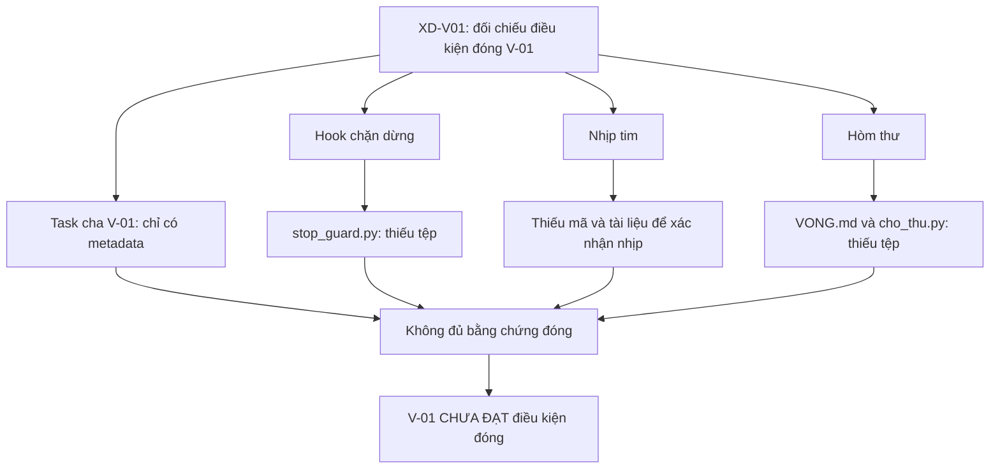

TÓM TẮT 1: [NGUỒN][THẤY] XD-V01 — PARTIAL: đã đối chiếu 4/4 đường dẫn nguồn; chỉ đọc được 1/4 tệp, là metadata V-01, chưa có tiêu chí hoàn tất. Nguồn: JX1_OPS/TASKS/V-01.md:1–7; kiểm tra tồn tại tại mục 5.
TÓM TẮT 2: [NGUỒN][THẤY] V-01 CHƯA ĐẠT điều kiện đóng theo bộ nguồn được giao: chưa đủ bằng chứng cho hook chặn dừng, nhịp tim và hòm thư; đây không phải kết luận các cơ chế đang hỏng. Nguồn: JX1_OPS/TASKS/XD-V01.md:20; kết quả kiểm tra tại mục 5.
TÓM TẮT 3: [NGUỒN][THẤY] Đầu ra là báo cáo này và mục Kết quả cuối task XD-V01; không có báo cáo XD-V01 sẵn để tiếp tục. Nguồn: JX1_OPS/TASKS/XD-V01.md:21–26; lệnh kiểm tra đầu ra tại mục 5.
TÓM TẮT 4: [CHƯA KIỂM] Chưa đối chiếu được từng vế tiêu chí gốc của V-01, cấu hình hook, thông số nhịp hoặc trao đổi thư; ba tệp nguồn thiếu và task cha chỉ có metadata. Nguồn: JX1_OPS/TASKS/V-01.md:1–7; mục 5–6.
TÓM TẮT 5: [CHƯA KIỂM] Không chạy build, exe, VM, mạng hay hai script; không commit/push theo yêu cầu. PM cần cung cấp bộ nguồn còn thiếu để kiểm tiếp; nhịp ngoài worktree bị giới hạn vùng ghi. Nguồn: JX1_OPS/TASKS/XD-V01.md:24; mục 10–11.

# XD-V01 — Đối chiếu điều kiện đóng V-01: vòng Chat⇄Sonnet

Loại: khảo sát
Chủ đề: Đánh giá bằng chứng đóng V-01 cho hook chặn dừng, nhịp tim và hòm thư trong bộ nguồn task chỉ định.
Từ khóa: V-01, XD-V01, Chat, Sonnet, stop_guard.py, cho_thu.py, hook chặn dừng, nhịp tim, hòm thư
Trạng thái: PARTIAL — đã lập kết luận đóng theo bằng chứng hiện có; chưa đối chiếu được toàn bộ tiêu chí gốc và ba tệp nguồn thiếu.
Độ phủ: kiểm tra tồn tại 4/4 đường dẫn nguồn; đọc được 1/4 tệp; đánh giá tình trạng bằng chứng 3/3 hạng mục nêu trong XD-V01, chưa đếm được tổng số vế tiêu chí V-01 vì task cha không có phần tiêu chí.
Liên quan: JX1_OPS/TASKS/XD-V01.md; JX1_OPS/TASKS/V-01.md; JX1_OPS/DESIGN/CHUAN-BAO-CAO.md (đã xác nhận tồn tại và đọc).
Cần tôi quyết định: không — bước tiếp theo là PM bổ sung nguồn và tiêu chí, chưa đề nghị thay đổi mã hoặc vận hành.

## 1. Sơ đồ đối chiếu

[TÀI LIỆU] Ba hạng mục dưới đây lấy từ yêu cầu XD-V01; sơ đồ thể hiện quy trình đối chiếu bằng chứng, không mô tả một vòng tự động đã chạy. Nguồn: `JX1_OPS/TASKS/XD-V01.md:20–24`.

## 2. Phạm vi và độ phủ

[TÀI LIỆU] Danh sách nguồn lấy nguyên từ `JX1_OPS/TASKS/XD-V01.md:20`. Chỉ xét đúng các đường dẫn trong worktree `D:\JX-wt\XD-V01`; không dùng tệp khác thay nguồn thiếu.

| Phần tử trong phạm vi | Độ phủ nội dung | Kết quả và mức xác minh | Bằng chứng |
|---|---|---|---|
| `JX1_OPS/TASKS/V-01.md` | Đã phủ nội dung hiện có, chưa phủ tiêu chí gốc | [THẤY] Tệp có 7 dòng metadata; không có mục tiêu, nguồn hoặc dòng Xong khi | `JX1_OPS/TASKS/V-01.md:1–7` |
| `HOP-THU/VONG.md` | Chưa phủ | [THẤY] Không tồn tại tại đường dẫn chỉ định | Kiểm tra K1 tại mục 5 |
| `TOOLS/stop_guard.py` | Chưa phủ | [THẤY] Không tồn tại tại đường dẫn chỉ định | Kiểm tra K2 tại mục 5 |
| `TOOLS/cho_thu.py` | Chưa phủ | [THẤY] Không tồn tại tại đường dẫn chỉ định | Kiểm tra K3 tại mục 5 |
| Toàn bộ vế tiêu chí hoàn tất V-01 | Chưa phủ; chưa đếm được tổng số | [CHƯA KIỂM] Không thể trích xuất danh sách từ metadata | `JX1_OPS/TASKS/V-01.md:1–7` |
| Hook chặn dừng | Đã phủ tình trạng bằng chứng; chưa phủ hành vi | [CHƯA KIỂM] Chưa đủ bằng chứng đạt | `JX1_OPS/TASKS/XD-V01.md:20`; K2 |
| Nhịp tim | Đã phủ tình trạng bằng chứng; chưa phủ hành vi | [CHƯA KIỂM] Chưa đủ bằng chứng đạt | `JX1_OPS/TASKS/XD-V01.md:20`; K1–K3 |
| Hòm thư | Đã phủ tình trạng bằng chứng; chưa phủ hành vi | [CHƯA KIỂM] Chưa đủ bằng chứng đạt | `JX1_OPS/TASKS/XD-V01.md:20`; K1, K3 |

## 3. Giải mã tên

[THẤY] Các tên dưới đây là định danh công cụ/task trong nội dung UTF-8 đã đọc, không phải tên riêng trong dữ liệu game. Không có dữ liệu tên Hán GBK hoặc tên Việt TCVN3 trong các nguồn đọc được của task. Nguồn: `JX1_OPS/TASKS/V-01.md:2–3`; `JX1_OPS/TASKS/XD-V01.md:2–3,20`.

| Tên gốc | Mã hóa | Chữ đúng, UTF-8 | Nguồn file:dòng |
|---|---|---|---|
| `V-01` | ASCII trong tệp UTF-8 | V-01 | `JX1_OPS/TASKS/V-01.md:2` |
| `XD-V01` | ASCII trong tệp UTF-8 | XD-V01 | `JX1_OPS/TASKS/XD-V01.md:2` |
| `Chat⇄Sonnet` | UTF-8 | Chat⇄Sonnet; giữ nguyên tên gốc | `JX1_OPS/TASKS/V-01.md:3` |
| `stop_guard.py` | ASCII trong tên đường dẫn được dẫn | stop_guard.py; chưa đọc nội dung tệp | `JX1_OPS/TASKS/XD-V01.md:20` |
| `cho_thu.py` | ASCII trong tên đường dẫn được dẫn | cho_thu.py; chưa đọc nội dung tệp | `JX1_OPS/TASKS/XD-V01.md:20` |
| `VONG.md` | ASCII trong tên đường dẫn được dẫn | VONG.md; chưa đọc nội dung tệp | `JX1_OPS/TASKS/XD-V01.md:20` |

## 4. Sắp theo cấu trúc game

[TÀI LIỆU] Không áp dụng phân nhóm phái, kỹ năng, trang bị, quái, NPC hay bản đồ: mục tiêu này là vòng phối hợp công cụ. Báo cáo sắp theo chức năng hook chặn dừng → nhịp tim → hòm thư, đúng ba hạng mục được nêu trong task, không suy ra thứ tự vận hành thực tế. Nguồn: `JX1_OPS/TASKS/XD-V01.md:20`.

## 5. Nguồn đã đọc và kiểm tra thực chạy

[THẤY] Kiểm tra đầu lượt: `git status --short --branch` trả `## task/XD-V01`, không có dòng thay đổi. Đúng nhánh được task chỉ định tại `JX1_OPS/TASKS/XD-V01.md:9–10`; không có thay đổi local được liệt kê cần giữ lại.

[THẤY] Lệnh đọc là PowerShell `Get-Content -LiteralPath $p -Encoding UTF8 -TotalCount 400`, đánh số dòng khi đọc chuẩn, task và nguồn hiện có. Lượt đầu chưa chỉ định UTF-8 nên đầu ra hiển thị lỗi dấu; đọc lại đúng UTF-8 đã hiển thị được tiếng Việt. Đây là lỗi cách hiển thị lượt đọc đầu, chưa có căn cứ kết luận tệp gốc lỗi mã hóa. Không sửa nội dung nguồn.

[THẤY] Kiểm tra tồn tại được thực hiện trực tiếp bằng `Test-Path` với các giá trị `$p` dưới đây; `MISSING` là kết quả nhánh không tồn tại của lệnh kiểm tra, không phải nội dung tệp. Mốc cuối loạt kiểm tra: `Get-Date -Format 'yyyy-MM-dd HH:mm:ss zzz'` trả `2026-11-19 03:09:22 +07:00`.

| Mã | Lệnh thực chạy và giá trị `$p` | Kết quả | Ý nghĩa |
|---|---|---|---|
| K0 | `Test-Path -LiteralPath $p`; `$p = 'JX1_OPS/TASKS/V-01.md'`, sau đó đọc UTF-8 | Có tệp; in dòng 1–7, chỉ metadata | [THẤY] Chưa có văn bản tiêu chí hoàn tất trong tệp hiện tại |
| K1 | `Test-Path -LiteralPath $p`; `$p = 'HOP-THU/VONG.md'` | `MISSING` | [THẤY] Thiếu tài liệu vòng tại đường dẫn được giao |
| K2 | `Test-Path -LiteralPath $p -PathType Leaf`; `$p = 'TOOLS/stop_guard.py'` | `MISSING` | [THẤY] Không đọc được script chặn dừng |
| K3 | `Test-Path -LiteralPath $p -PathType Leaf`; `$p = 'TOOLS/cho_thu.py'` | `MISSING` | [THẤY] Không đọc được script chờ thư |
| K4 | `Test-Path -LiteralPath $p -PathType Leaf`; `$p = 'JX1_OPS/REPORTS/XD-V01.md'` | `MISSING` trước khi tạo báo cáo | [THẤY] Không có báo cáo cũ ở đầu ra này để làm tiếp |

[THẤY] Đã đọc chuẩn báo cáo, task XD-V01, toàn bộ nội dung hiện có của V-01 và sáu `SKILL.md` được yêu cầu. Nguồn nội dung nghiệp vụ đọc được vẫn chỉ là K0; các skill không thay thế ba nguồn thiếu.

## 6. Đối chiếu điều kiện đóng V-01

[THẤY] Metadata cha đang ghi `status: active` và `status_note: "đã thông qua Chrome (#167b)"`. Đây là ghi nhận trong tài liệu, không phải log thực chạy hoặc bằng chứng đủ cho ba hạng mục. Giữ nguyên ghi nhận cũ và không thay trạng thái task cha. Nguồn: `JX1_OPS/TASKS/V-01.md:4–6`.

[TÀI LIỆU] Bảng dưới chỉ phân rã ba hạng mục mà XD-V01 yêu cầu kiểm; không coi đó là bản chép đầy đủ tiêu chí V-01, vì file cha không cung cấp các vế này. Nguồn: `JX1_OPS/TASKS/XD-V01.md:20`; `JX1_OPS/TASKS/V-01.md:1–7`.

| Hạng mục được yêu cầu | Bằng chứng hiện có | Vế chưa đạt điều kiện đóng | Kết luận |
|---|---|---|---|
| Hook chặn dừng | [TÀI LIỆU] Task yêu cầu kiểm hook; [THẤY] `stop_guard.py` thiếu (K2) | Chưa xác định được điều kiện chặn/cho dừng, kết quả trả về hoặc nơi đăng ký hook; chưa có bằng chứng thực thi | [CHƯA KIỂM] CHƯA ĐẠT về bằng chứng đóng; không kết luận hook hỏng |
| Nhịp tim | [TÀI LIỆU] Task yêu cầu kiểm nhịp; [THẤY] chỉ đọc được metadata và thiếu cả ba nguồn mô tả/mã (K0–K3) | Chưa xác định nơi phát/nhận nhịp, chu kỳ, ngưỡng quá hạn hoặc cách xử lý mất nhịp; chưa có mẫu thực chạy | [CHƯA KIỂM] CHƯA ĐẠT về bằng chứng đóng; không suy chu kỳ hoặc tình trạng sống |
| Hòm thư | [TÀI LIỆU] Task yêu cầu kiểm hòm thư; [THẤY] `VONG.md` và `cho_thu.py` thiếu (K1, K3) | Chưa đối chiếu được quy ước gửi/nhận, điều kiện chờ/thoát hoặc bằng chứng hoàn thành một vòng | [CHƯA KIỂM] CHƯA ĐẠT về bằng chứng đóng; không kết luận thư đã mất hoặc kẹt |

**[THẤY + CHƯA KIỂM] Kết luận: V-01 CHƯA ĐẠT điều kiện đóng theo bộ nguồn được giao tại thời điểm khảo sát.** Căn cứ là thiếu ba nguồn K1–K3 và không có tiêu chí hoàn tất trong `JX1_OPS/TASKS/V-01.md:1–7`. Kết luận này chỉ đánh giá mức đủ bằng chứng để đóng; trạng thái vận hành thực tế vẫn chưa kiểm. Việc metadata ghi “đã thông qua Chrome (#167b)” được bảo toàn, chưa thể xác nhận hay bác bỏ bằng các tệp hiện có.

## 7. Mục sổ thông số

[CHƯA KIỂM] Không có số đo hoặc giá trị mặc định từ mã nguồn để ghi thành con số. Bảng chỉ nêu trường cần đối chiếu; không lấy thời điểm khảo sát làm số đo nhịp tim. Nguồn: K0–K3 tại mục 5; yêu cầu tại `JX1_OPS/TASKS/XD-V01.md:20`.

| Nhóm | Tên/hằng số | file:dòng | Giá trị | Đơn vị | Ảnh hưởng | Đổi an toàn (CÓ/CẨN THẬN/KHÔNG) | Nguồn đo |
|---|---|---|---|---|---|---|---|
| Hook chặn dừng | Điều kiện/mã trả về của hook | `TOOLS/stop_guard.py`: chưa có dòng, K2 thiếu tệp | Chưa xác minh | Chưa xác minh | Chưa xác minh hành vi cho phép/chặn dừng | CẨN THẬN — thiếu mã và kiểm thử; task không cho sửa | Chưa đo, không chạy script |
| Nhịp tim | Chu kỳ và ngưỡng quá hạn | Chưa xác định được tệp chứa tham số; K0–K3 | Chưa xác minh | Chưa xác minh | Chưa xác minh cách nhận biết mất nhịp | CẨN THẬN — thiếu nguồn; task không cho sửa | Chưa đo |
| Hòm thư | Thời gian chờ/điều kiện thoát | `TOOLS/cho_thu.py`: chưa có dòng, K3 thiếu tệp | Chưa xác minh | Chưa xác minh | Chưa xác minh cách chờ và hoàn thành vòng | CẨN THẬN — thiếu mã và kiểm thử; task không cho sửa | Chưa đo, không chạy script |

## 8. Đã xác minh

- [THẤY] Đúng nhánh `task/XD-V01`, đầu lượt không có dòng thay đổi local: kết quả `git status --short --branch` tại mục 5.
- [THẤY] Đã đọc toàn bộ tệp cha hiện có; tệp chỉ chứa metadata, vẫn giữ `active`: `JX1_OPS/TASKS/V-01.md:1–7`.
- [THẤY] Đã kiểm tra đủ bốn đường dẫn mà task yêu cầu; ba đường dẫn không tồn tại trong worktree: K0–K3 tại mục 5.
- [TÀI LIỆU] Ba hạng mục cần đối chiếu và yêu cầu kết luận đóng được nêu tại `JX1_OPS/TASKS/XD-V01.md:20–21`; giới hạn không chạy VM/exe/mạng tại dòng 24.

## 9. Chưa xác minh / Chưa kiểm

- [CHƯA KIỂM] Chưa biết đầy đủ từng vế và tổng số tiêu chí xong của V-01; không có văn bản tiêu chí ngoài 7 dòng metadata (`JX1_OPS/TASKS/V-01.md:1–7`).
- [CHƯA KIỂM] Chưa đọc được cơ chế và thông số từ ba tệp thiếu; không có `file:dòng` bên trong các tệp này để viện dẫn (K1–K3).
- [CHƯA KIỂM] Chưa kiểm cấu hình đăng ký hook, nhịp phát/nhận hoặc log hoàn thành vòng thư. Không tìm nguồn thay thế ngoài danh sách task (`JX1_OPS/TASKS/XD-V01.md:20,24`).
- [CHƯA KIỂM] Không chạy hai script, không build, không exe, không VM, không mạng; không có kết quả thử hành vi. Đây là giới hạn được giữ theo `JX1_OPS/TASKS/XD-V01.md:24`, không phải một lần test thất bại.

## 10. Phát hiện khi đối chiếu, lỗi và cách thử

| Phát hiện/lỗi | Cách thử và kết quả | Xử lý trong lượt | Bước tiếp tục |
|---|---|---|---|
| [THẤY] Lượt đọc đầu hiển thị lỗi dấu | `Get-Content` chưa chỉ định encoding; đọc lại với `-Encoding UTF8` hiển thị đúng | Chỉ sửa cách đọc; không sửa tệp nguồn | Tiếp tục dùng UTF-8 khi bàn giao |
| [THẤY] Ba nguồn không tồn tại | Kiểm tra chính xác K1–K3, đều `MISSING` | Ghi nguồn thiếu và giới hạn; không đoán mã, không quét thư mục hay tìm kho khác | PM cung cấp đúng tệp hoặc giao rõ bộ nguồn/phiên bản thay thế |
| [THẤY] Task cha không có tiêu chí hoàn tất | Đọc hết `JX1_OPS/TASKS/V-01.md:1–7` | Giữ metadata/kết luận cũ; phân biệt ba hạng mục XD-V01 với tiêu chí cha chưa có | PM bổ sung tiêu chí V-01 để đối chiếu từng vế |
| [TÀI LIỆU] Nhịp `D:\JX-wt\XD-V01.nhip` nằm ngoài vùng ghi | Quyền phiên chỉ cho ghi trong `D:\JX-wt\XD-V01`; không thử ghi ngoài hoặc đổi quyền | Không tạo được tệp nhịp theo đường dẫn yêu cầu; đã báo ở mốc kiểm nguồn và sắp ghi báo cáo | PM xử lý đường dẫn nhịp trong lượt có vùng ghi phù hợp; không coi đây là phép thử nhịp V-01 |
| [TÀI LIỆU] Chuẩn chung yêu cầu TSV nhưng vùng task chỉ giao báo cáo | Đối chiếu `JX1_OPS/DESIGN/CHUAN-BAO-CAO.md:30` với `JX1_OPS/TASKS/XD-V01.md:13,24,26` và yêu cầu trực tiếp của chủ task | Chỉ tạo báo cáo và ghi Kết quả theo ngoại lệ đã giao; không tạo `_CHIMUC` | PM có thể lấy hàng chỉ mục đề xuất bên dưới khi tổng hợp |

## 11. Bàn giao và đề xuất tối ưu

[THẤY] Đã tạo `JX1_OPS/REPORTS/XD-V01.md` vì K4 xác nhận chưa có tệp, và bổ sung mục Kết quả cuối `JX1_OPS/TASKS/XD-V01.md` theo yêu cầu dòng 26. Không đổi metadata của task, không sửa V-01, mã nguồn hoặc cấu hình.

[TÀI LIỆU] Không stage, commit hoặc push theo yêu cầu trực tiếp “Không cần commit: Tổng quan commit hộ”; chưa có SHA của task. Không có lần push nào được thử hoặc được nhận là thành công.

[TÀI LIỆU] Đề xuất tối ưu bước đóng: PM bổ sung tiêu chí cha và ba nguồn K1–K3 trước; người tiếp tục đọc tĩnh đúng các tệp đó, thay các ô “chưa kiểm” bằng bằng chứng dòng thật khi có. Nếu cần kiểm hành vi, phải có phạm vi kiểm thử được duyệt riêng; không dùng ghi chú metadata làm kết quả chạy thử. Căn cứ phần còn thiếu: `JX1_OPS/TASKS/V-01.md:1–7`; K1–K3; giới hạn tại `JX1_OPS/TASKS/XD-V01.md:24`.

[TÀI LIỆU] Hàng chỉ mục đề xuất để PM gộp, không tạo tệp ngoài vùng giao:

| file | loại | chủ đề | từ khóa | trạng thái | độ phủ | liên quan |
|---|---|---|---|---|---|---|
| `JX1_OPS/REPORTS/XD-V01.md` | khảo sát | Đối chiếu điều kiện đóng V-01 | V-01; XD-V01; Chat; Sonnet; hook; nhịp tim; hòm thư | PARTIAL | Kiểm 4/4 đường dẫn; đọc 1/4 tệp; 3 hạng mục chưa đủ bằng chứng | `JX1_OPS/TASKS/V-01.md`; `JX1_OPS/TASKS/XD-V01.md` |

Kỹ năng đã dùng: jx1-retrofit (giữ kết luận cũ và ghi phát hiện); jx1-read-server, jx1-read-client (nguyên tắc đọc tĩnh, không suy runtime; không có nhu cầu đọc source game trong task này); jx1-parameters (sổ thông số chưa xác minh); jx1-knowledge (nhãn độ chắc và sơ đồ); jx1-report (báo cáo và bàn giao). Đã nạp đúng sáu `.agents/skills/<tên>/SKILL.md`; không mở thêm bản đồ hoặc báo cáo ngoài danh sách nguồn vì không phục vụ việc đối chiếu này.
