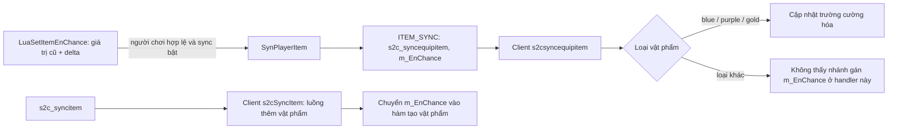

**TÓM TẮT 5 DÒNG**
1. [THẤY] DONE cho khảo sát mã tĩnh: `LuaSetItemEnChance` đổi cấp và gọi đồng bộ theo điều kiện (`ScriptFuns.cpp:10912–10928`).
2. [THẤY] Gói gửi là `s2c_syncequipitem`, field `ITEM_SYNC.m_EnChance`; client có handler cập nhật theo loại vật phẩm (`KItemList.cpp:4379–4405, 4481–4483`; `KProtocolProcess.cpp:1555–1650`).
3. [TÀI LIỆU] Đầu ra: `JX1_OPS/REPORTS/XD-W02.md`.
4. [CHƯA KIỂM] Nguyên nhân tooltip “+N” chưa được xác minh; chưa biết loại vật phẩm Lua và chưa đọc đường dựng tooltip (`KProtocolProcess.cpp:1640–1650`; `KItemList.cpp:4436–4478`).
5. [CHƯA KIỂM] Build/test/exe/VM/mạng chưa chạy theo task (`JX1_OPS/TASKS/XD-W02.md:20–23`); không commit theo yêu cầu, chưa có SHA.

# XD-W02 — Đường đồng bộ cấp cường hóa Lua xuống client

Loại: khảo sát
Chủ đề: Xác định đường đồng bộ cấp cường hóa của vật phẩm từ Lua qua server đến client và giới hạn giải thích tooltip.
Từ khóa: cường hóa, đồng bộ vật phẩm, Lua, SetItemEnChance, SynPlayerItem, s2c_syncequipitem, ITEM_SYNC, m_EnChance, tooltip
Trạng thái: DONE — đã xác minh đường mã tĩnh; nguyên nhân cuối cùng của tooltip được ghi là giả thuyết.
Độ phủ: 4/5 vế được xác minh bằng mã; vế tooltip chưa xác minh nhưng có giả thuyết và giới hạn rõ.
Liên quan: `DESIGN/KE-HOACH-TAI-HIEN-HIEU-UNG.md`; `DESIGN/HIEU-HIEU-UNG-VU-KHI.md`.
Cần tôi quyết định: không.

## Phạm vi và độ phủ

| Vế cần trả lời | Trạng thái | Bằng chứng / giới hạn |
|---|---|---|
| Hàm Lua có đổi mức cường hóa ở server không? | Đã phủ | Cộng `nItemEnChance` vào giá trị hiện tại tại `ScriptFuns.cpp:10920–10922`. |
| Khi nào hàm gọi đồng bộ? | Đã phủ | Điều kiện người chơi có chỉ số hợp lệ và `nIsSyn >= 1`, rồi gọi `SynPlayerItem`, tại `ScriptFuns.cpp:10924–10928`. |
| Gói đồng bộ thực tế và field nào? | Đã phủ | `SynPlayerItem` đặt `ProtocolType = s2c_syncequipitem`, điền `m_EnChance` rồi đóng gói `ITEM_SYNC` gửi client tại `KItemList.cpp:4379–4405, 4481–4483`. |
| Client nhận/cập nhật ra sao? | Đã phủ | Ánh xạ gói ở `KProtocolProcess.cpp:172`; handler tra ID và gán từ `m_EnChance` cho các nhánh blue/purple/gold tại `KProtocolProcess.cpp:1555–1562, 1640–1650`. |
| Vì sao tooltip không có “+N”? | Chưa xác minh nguyên nhân; có giả thuyết | Handler chỉ gán trong một số nhánh loại vật phẩm. Chưa xác định loại cụ thể của vật phẩm Lua và chưa đọc đường dựng tooltip. |

## Giải mã tên

Không có tên riêng trong trò chơi ở phạm vi báo cáo; tên hàm, gói và trường dữ liệu được giữ nguyên như identifier mã nguồn, nên không áp dụng giải mã GBK/TCVN3.

## Sắp theo cấu trúc game

Không có danh sách kỹ năng, trang bị, quái hoặc NPC cần xếp theo cấu trúc game. Nội dung được sắp theo luồng xử lý: Lua → server → gói → client.

## Kết quả đọc mã

`LuaSetItemEnChance` nhận chỉ số vật phẩm, lượng tăng và cờ đồng bộ; sau kiểm tra chỉ số, hàm đọc `GetEnChance()` rồi ghi lại tổng giá trị cũ cộng lượng tăng. Khi ngữ cảnh có người chơi và cờ sync từ 1 trở lên, hàm gọi `Player[..].m_ItemList.SynPlayerItem(...)` (`ScriptFuns.cpp:10912–10928`).

`SynPlayerItem` dựng `ITEM_SYNC`, đặt loại gói `s2c_syncequipitem` và chép `Item[..].GetEnChance()` vào `sItem.m_EnChance`; sau đó gửi nguyên cấu trúc tới kết nối client (`KItemList.cpp:4379–4405, 4481–4483`). Vì vậy câu trả lời cho đường Lua đang xét là **có gửi xuống client**, qua `s2c_syncequipitem`, field `ITEM_SYNC.m_EnChance`.

Tên `s2cSyncItem` ở client ánh xạ `s2c_syncitem` (`KProtocolProcess.cpp:98`) và xử lý đường thêm vật phẩm mới; handler chuyển `pItemSync->m_EnChance` vào hàm tạo vật phẩm (`KProtocolProcess.cpp:1707–1771`). Đây là đường khác với gói cập nhật do `SynPlayerItem` phát. Gói cập nhật dùng ánh xạ `s2c_syncequipitem` → `s2csyncequipitem` (`KProtocolProcess.cpp:172, 1555`). Handler tìm vật phẩm theo ID, rồi gán giá trị từ field `m_EnChance` qua các setter cường hóa cho nhánh vật phẩm blue/purple/gold (`KProtocolProcess.cpp:1560–1562, 1640–1650`).

## Giả thuyết về tooltip “+N”

[GIẢ THUYẾT] Dù gói mang giá trị, nếu vật phẩm Lua thuộc loại không đi vào các nhánh blue/purple/gold, handler cập nhật hiện tại không gọi setter từ `m_EnChance`; đây là khả năng khiến phía client không có giá trị mà tooltip cần. Chưa kiểm tra loại của vật phẩm cụ thể nên chưa thể khẳng định giả thuyết này. Mã server cũng tạo `m_ItmeInfo` bằng kết quả hàm Lua `GetItemDescription` (`KItemList.cpp:4436–4478`); nếu tooltip dựa vào chuỗi này thì nội dung script có thể là yếu tố riêng, nhưng đường hiển thị tooltip chưa được đọc nên đây cũng chỉ là khả năng.

## MỤC SỔ THÔNG SỐ

| Nhóm | Tên/hằng số | file:dòng | Giá trị | Đơn vị | Ảnh hưởng | Đổi an toàn | Nguồn đo |
|---|---|---|---|---|---|---|---|
| Trường gói vật phẩm | `nItemEnChance` → `m_EnChance` | `ScriptFuns.cpp:10915, 10920–10922`; `KItemList.cpp:4404`; `KProtocolProcess.cpp:1642–1650` | Mức hiện tại + lượng truyền vào; không có số đo runtime | Mã không khai báo đơn vị | Giá trị được gửi và có thể cập nhật trạng thái cường hóa phía client tùy loại vật phẩm | CẨN THẬN — chỉ khảo sát tĩnh, không đánh giá an toàn khi đổi | Đọc mã nguồn; chưa chạy thử |

## Đã xác minh

- Server root được chỉ định trong task, nhánh `SwordOnline/.../gameserver/Sources`: `ScriptFuns.cpp:10912–10928` xác nhận phép cộng và điều kiện gọi đồng bộ.
- Server: `KItemList.cpp:4379–4405, 4481–4483` xác nhận loại gói, field và thao tác gửi `ITEM_SYNC`.
- Client root/version được chỉ định trong task, `Client2912-20260116T044348Z-3-001/.../Classes`: `KProtocolProcess.cpp:98, 172, 1555–1650, 1707–1771` xác nhận ánh xạ và cách đọc `m_EnChance` ở hai luồng.
- Tài liệu đầu vào ghi nhận Lua đã cấp vật phẩm nhưng tooltip không hiện cấp cường hóa, và nêu đây là câu hỏi chưa biết: `DESIGN/KE-HOACH-TAI-HIEN-HIEU-UNG.md:44–49`.

## Chưa kiểm

- Chưa đọc code dựng/định dạng tooltip; do đó chưa xác định thành phần nào tạo chuỗi “+N”.
- Chưa xác định loại nội bộ của vật phẩm Lua để biết nhánh setter nào được chạy.
- Chưa chạy client/server, VM, executable, build, test hoặc mạng; kết luận chỉ áp dụng cho mã nguồn đã chỉ định, không xác nhận runtime.
- Dòng nhịp được yêu cầu tại `D:\JX-wt\XD-W02.nhip` không ghi được: thao tác `Set-Content` trả `Access denied`. Không đổi đường dẫn thay thế.

## Bàn giao

Đã tạo báo cáo này; không sửa mã nguồn. Không commit theo yêu cầu. Bước kiểm chứng tiếp theo nếu được giao riêng: xác định loại vật phẩm và đọc đường client dựng tooltip; chưa có bằng chứng runtime.
Kỹ năng đã dùng: jx1-retrofit, jx1-read-server, jx1-read-client, jx1-parameters, jx1-knowledge, jx1-report.

Kết luận cuối: ĐẠT — các câu hỏi mã nguồn có bằng chứng; nguyên nhân tooltip được ghi rõ là giả thuyết/chưa kiểm.