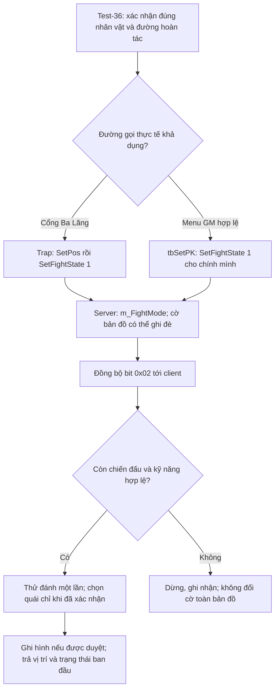

TÓM TẮT 1: [NGUỒN][THẤY] DONE — hoàn thành khảo sát tĩnh cách bật chiến đấu để chuẩn bị quan sát vung kiếm; Lua tác động người chơi hiện tại (S/ScriptFuns.cpp:21133–21151).
TÓM TẮT 2: [NGUỒN][THẤY] Có menu GM `SetFightState /tbSetPK` gọi `SetFightState(1)` và bốn cổng Ba Lăng có nhánh bật/tắt chiến đấu (G/script/mineitem/gmroleitem.lua:1646,1926–1928; G/script/trap/thon/balang/cong*.lua, chi tiết bên dưới).
TÓM TẮT 3: [NGUỒN][THẤY] Báo cáo này có kịch bản từng bước, điều kiện dừng, hoàn tác và sổ thông số; không đổi kết luận tài liệu lần thử trước (JX1_OPS/TASKS/XD-W02b.md:19–26; P/DESIGN/KE-HOACH-TAI-HIEN-HIEU-UNG.md:9,46).
TÓM TẮT 4: [CHƯA KIỂM] Chưa xác nhận menu, trạng thái sau đồng bộ và quái tự nhiên gần nhân vật trên Test-36; không nhận quan sát vung kiếm hay kiểm thử runtime là đạt (JX1_OPS/TASKS/XD-W02b.md:24–25).
TÓM TẮT 5: [CHƯA KIỂM] Không chạy build, exe game, VM hay mạng; không commit/push theo yêu cầu bàn giao; Tổng quan nhận tệp và commit, đường nhịp ngoài vùng ghi không được tạo (phạm vi tại JX1_OPS/TASKS/XD-W02b.md:24–26 và yêu cầu giao việc).

# XD-W02b — Cách chuẩn bị quan sát vung kiếm trên Test-36
Loại: khảo sát
Chủ đề: Định vị đường bật chiến đấu, giới hạn chọn mục tiêu và kịch bản thử an toàn, chưa thực thi.
Từ khóa: vung kiếm, chiến đấu, Test-36, Ba Lăng Huyện, SetFightState, tbSetPK, cong10h, m_FightMode, s2c_syncplayermin
Trạng thái: DONE — đáp ứng đầu ra khảo sát tĩnh, ghi rõ các bằng chứng còn thiếu; không chứng nhận tái hiện runtime.
Độ phủ: 5/6 hạng mục đã phủ ở mức khảo sát; chưa phủ spawn quái tự nhiên gần map 53; 0 ca chạy game.
Liên quan: JX1_OPS/TASKS/XD-W02b.md; P/TASKS/W-02.md; P/DESIGN/KE-HOACH-TAI-HIEN-HIEU-UNG.md; JX1_OPS/REPORTS/I-03-khao-sat-quai-vat.md; JX1_OPS/REPORTS/I-04-khao-sat-map.md.
Cần tôi quyết định: không — lượt này chỉ đọc và viết kịch bản, không xin hoặc thực hiện thao tác runtime.

## 1. Nguồn đọc và quy ước bằng chứng

- [THẤY] `S` = `C:/Jx1CocoV3/SwordOnline/SwordOnline/jxOnline/gameserver/Sources/Core/Src`; `C` = `C:/Jx1CocoV3/Folder/Client2912-20260116T044348Z-3-001/Client2912/Client/Classes`. Đây là hai root task cho phép, không phải xác nhận binary đang chạy cùng phiên bản (JX1_OPS/TASKS/XD-W02b.md:25).
- [TÀI LIỆU → THẤY] `G` = `C:/Jx1CocoV3/Folder/ServerNew-20260116T043145Z-3-001/ServerNew/_bin_v2_/gs`, định vị từ `JX1_OPS/REPORTS/I-03-khao-sat-quai-vat.md:49`, sau đó đối chiếu trực tiếp những tệp Lua/bảng nêu dưới đây. `P` = `D:/jx1-ops-wt/JX1_OPS`, chỉ đọc theo task. Không khẳng định dữ liệu G đã được triển khai lên Test-36.
- [TÀI LIỆU] Lần thử trước dùng client A/qh9A, nhân vật `T36nv1`, nam, cấp 1, tại Ba Lăng Huyện; bấm đánh khi chưa chiến đấu làm nhân vật ngồi. Tài liệu cũng ghi chưa bật được chiến đấu bằng đi bộ qua cổng. Giữ nguyên các kết quả này; source Client2912 trong lượt hiện tại là nguồn khác (P/DESIGN/KE-HOACH-TAI-HIEN-HIEU-UNG.md:3,9,17,46).
- [THẤY] Danh sách đọc được giới hạn theo các nhánh của task: S/ScriptFuns.cpp, KNpc.cpp, KPlayerPK.cpp, KSubWorld.cpp; C/gamecore/KNpc.cpp, KNpcSet.cpp, KProtocolProcess.cpp; các ứng viên nút đánh trong C/gameui, C/gamescene; G/script/item/gm.lua, gma.lua, gmb.lua, script/mineitem/gmroleitem.lua, script/missions/GM/ServerGM.lua, script/gm a phuong.lua và bốn script cổng `balang`; G/Settings/MapList.ini, Npcs.txt, ForbititMap.txt, maps/WorldSet_gs001.ini. Các lượt tìm caller còn đối chiếu tên trường trong S/KCore.cpp, KPlayer.cpp, KSubWorldSet.cpp. Chỉ mở đoạn liên quan, không đọc khóa, mật khẩu hoặc dump tài khoản.
- [THẤY] Chuẩn và skill đã đọc: CHUAN-BAO-CAO.md, sáu SKILL.md được yêu cầu; định vị từ GS001-MAP.md và MUC-LUC-TRI-THUC.md, các dòng liên quan của I-03/I-04/I-05 và W-01a..d; P/TASKS/W-02.md, XD-W02.md để tìm đúng tài liệu cha. Không dùng số dòng bản đồ nhanh thay cho kiểm file thật.
- [THẤY] Nhãn `THẤY` chỉ điều đọc trực tiếp trong tệp; `TÀI LIỆU` là dẫn lại báo cáo, chưa tái đo; `CHƯA KIỂM` gồm dự kiến thử và phần chưa có bằng chứng. Source C++/Lua có comment Hán legacy đọc GBK khi cần; tên Việt legacy đọc byte theo Windows-1252 để giữ dạng TCVN3 rồi đối chiếu tên; tài liệu đầu ra UTF-8 không BOM. Không suy runtime từ source.

## 2. Phạm vi và độ phủ

| Hạng mục | Độ phủ và kết quả | Bằng chứng |
|---|---|---|
| Lua đổi/đọc chiến đấu | [THẤY] Đã phủ: người chơi hiện tại, điều kiện index, tham số 0/khác 0, getter và đăng ký Lua | S/ScriptFuns.cpp:21133–21151,26147–26148 |
| Server → client và điều kiện phát kỹ năng | [THẤY] Đã phủ đường cờ chiến đấu; chưa xác nhận client A đang cài nhận đúng luồng này | S/KNpc.cpp:8057–8061,8210–8221,8235–8244; C/gamecore/KProtocolProcess.cpp:3059,3147–3150; C/gamecore/KNpc.cpp:2195–2243 |
| Đường GM | [THẤY] Đã phủ menu tự bật; nhận diện menu chạy chuỗi bị comment và hàm đổi theo tên có vấn đề khôi phục ngữ cảnh | G/script/mineitem/gmroleitem.lua:1623–1646,1926–1928; G/script/item/gm.lua:1930–1950 |
| Bốn cổng Ba Lăng | [THẤY] Đã phủ 4/4 tệp cổng hiện có trong thư mục; [CHƯA KIỂM] gắn trap và kích hoạt trên Test-36 | G/script/trap/thon/balang/cong10h.lua:1–15; cong2h.lua:1–14; cong4h.lua:1–15; cong8h.lua:1–15 |
| Quái tự nhiên gần map 53 | [CHƯA KIỂM] Chưa phủ tên, template và tọa độ spawn gần nhân vật; có định vị map 50 làm nguồn tham khảo, không gọi là gần map 53 | G/Settings/MapList.ini:654–668; JX1_OPS/REPORTS/I-03-khao-sat-quai-vat.md:239,258,260 |
| Kịch bản kiểm tra, dừng và hoàn tác | [CHƯA KIỂM — KỊCH BẢN] Đã viết ở mục 6 theo bằng chứng tĩnh, chưa chạy bước nào | JX1_OPS/TASKS/XD-W02b.md:19–26; các nguồn của mục 3–5 |

## 3. Giải mã tên và sắp theo cấu trúc game

### 3.1. Giải mã tên

| Tên gốc giữ nguyên | Mã hóa | Chữ đúng/ý nghĩa dùng trong báo cáo | Nguồn file:dòng |
|---|---|---|---|
| `Ba L¨ng HuyÖn` | TCVN3; giữ dạng byte legacy qua Windows-1252 | [THẤY] Ba Lăng Huyện, map 53 | G/Settings/MapList.ini:655 |
| `°ÍÁêÏØ` | GBK; dạng byte qua Windows-1252, hex `B0 CD C1 EA CF D8` | [THẤY] 巴陵县, tên Hán cùng map 53 | G/Settings/MapList.ini:654 |
| `ThÊt S¸t ®éng` | TCVN3 | [THẤY] Thất Sát động, map 50; chỉ là phương án tham khảo | G/Settings/MapList.ini:599 |
| `T©y Nam s¬n  tÆc 1` | TCVN3; giữ cả hai dấu cách trong tên gốc | [THẤY] Tây Nam sơn tặc 1, STT 152; ID template 151 theo báo cáo I-03 | G/Settings/Npcs.txt:153; JX1_OPS/REPORTS/I-03-khao-sat-quai-vat.md:194,260 |
| `T36nv1` | ASCII trong tài liệu UTF-8 | [TÀI LIỆU] Tên nhân vật thử đã ghi trước đây, chưa kiểm hiện trạng | P/DESIGN/KE-HOACH-TAI-HIEN-HIEU-UNG.md:17 |

### 3.2. Sắp theo cấu trúc game

[THẤY] Nội dung được xếp theo cấu trúc game: người chơi và trạng thái chiến đấu → đồng bộ client → bản đồ/cổng → mục tiêu theo map → thao tác quan sát. Không có danh mục kỹ năng theo phái hoặc bộ trang bị trong phạm vi này (JX1_OPS/TASKS/XD-W02b.md:19–20; CHUAN-BAO-CAO.md:20).

## 4. Người chơi: bật chiến đấu và kiểm đường đồng bộ

### 4.1. Hàm Lua thật sự làm gì

[THẤY] `LuaSetFightState` lấy `GetPlayerIndex(L)`, bỏ qua khi index người chơi hoặc index NPC không dương; sau đó gọi `SetFightMode(Lua_ValueToNumber(L,1) != 0)`. Vì vậy dùng đúng `0` để tắt, `1` để bật, không dùng giá trị âm làm “khôi phục”. Hàm trả `0` cho Lua, không trả mã thành công. Muốn xác nhận phải đọc `GetFightState()`, vốn đẩy `m_FightMode` lên Lua và trả một giá trị (S/ScriptFuns.cpp:21133–21151,26147–26148).

[THẤY] `KNpc::SetFightMode` ghi `m_FightMode`; trên server, nếu là người chơi thì gọi `m_cPK.CloseAll()`. `CloseAll()` gọi `ExercisePKClose()` và `EnmityPKClose()`; không có lời gọi đổi chế độ PK thường trong chính thân hàm này. Không diễn giải bật chiến đấu là bật PK thường, cũng không hứa hoàn tác sẽ phục hồi tỷ võ/cừu sát trước đó (S/KNpc.cpp:15328–15336; S/KPlayerPK.cpp:368–372).

### 4.2. Vì sao một lần gọi chưa đủ chứng minh đã vung kiếm

[THẤY] `NormalSync` tạo `PLAYER_NORMAL_SYNC` với protocol `s2c_syncplayermin`, đưa chiến đấu vào bit `0x02` của `m_btSomeFlag`, rồi phát trong vùng hiện tại và vùng nối. Client `SyncPlayerMin` nhận bit đó và gán `Npc[nIdx].m_FightMode = 1/0`. Đường `PLAYER_SYNC` đầy đủ phía client cũng đọc bit `0x02` (S/KNpc.cpp:7886,8057–8061,8210–8216,8235–8244; C/gamecore/KProtocolProcess.cpp:2937–2942,3005–3008,3059,3147–3150).

[THẤY] Ngay sau khi tính bit, mã server có thể cưỡng chế lại `m_FightMode`: cờ map `m_nWFight == 1` bật khi `m_ProtectTime == 0`; cờ map bằng `0` tắt. Mặc định source của cờ map là `-1`, không phải kết quả đo map 53. Thứ tự tính bit trước khi ghi đè có thể tạo chênh một lượt đồng bộ; đây là suy luận từ thứ tự mã, chưa đo độ trễ (S/KNpc.cpp:8215–8221; S/KSubWorld.cpp:83–85).

[THẤY] Client `KNpc::DoSkill` bỏ qua khi `m_RegionIndex < 0`, đang làm skill/bị đánh, hoặc người chơi không có `m_FightMode`. Qua điều kiện chiến đấu vẫn còn kỹ năng hiện hành, thời gian hồi, `CanCastSkill` và chi phí. Vì vậy bật chiến đấu chỉ gỡ một điều kiện chặn, không chứng minh có mục tiêu, phát kỹ năng thành công hay có hoạt cảnh kiếm (C/gamecore/KNpc.cpp:2195–2243).

[CHƯA KIỂM] Chưa đối chiếu binary Test-36/client A với hai root source đang đọc; chưa xác nhận chu kỳ gói và trạng thái UI. Hiện tượng “bấm đánh thì ngồi” và tên `mainSkillattack` được giữ ở mức tài liệu lần thử trước, không nhận là đã đối chiếu chính nút đó trong bản Client2912 (P/DESIGN/KE-HOACH-TAI-HIEN-HIEU-UNG.md:3,9).

## 5. Bản đồ và mục tiêu

### 5.1. Ba Lăng Huyện: bốn cổng có nhánh đổi chiến đấu

[THẤY] MapList xác định map 53 là Ba Lăng Huyện, loại `Country`. Danh sách world mẫu có `World52=53`; đây là số thứ tự world trỏ tới ID map, không phải “map 52”. Có dòng cấu hình không chứng minh map đã nạp trên Test-36 (G/Settings/MapList.ini:654–657; G/maps/WorldSet_gs001.ini:1–3,56).

| Cổng trong source | Ra ngoài khi FightState=0 | Quay vào khi FightState khác 0 | Nhánh SVS và nguồn |
|---|---|---|---|
| `cong10h.lua` | [THẤY] SetPos(1539,3112), rồi SetFightState(1) | [THẤY] SetPos(1542,3116), rồi SetFightState(0) | [THẤY] SVScheck(1)==1: tới (1543,3118), return, không đi qua nhánh đổi trạng thái; G/script/trap/thon/balang/cong10h.lua:3–13 |
| `cong2h.lua` | [THẤY] (1631,3096), rồi bật 1 | [THẤY] (1628,3100), rồi tắt 0 | [THẤY] SVS: (1626,3103), return; G/script/trap/thon/balang/cong2h.lua:3–12 |
| `cong4h.lua` | [THẤY] (1654,3242), rồi bật 1 | [THẤY] (1652,3237), rồi tắt 0 | [THẤY] SVS: (1651,3233), return; G/script/trap/thon/balang/cong4h.lua:3–13 |
| `cong8h.lua` | [THẤY] (1562,3256), rồi bật 1 | [THẤY] (1564,3251), rồi tắt 0 | [THẤY] SVS: (1565,3249), return; G/script/trap/thon/balang/cong8h.lua:3–13 |

[THẤY] Những cặp tọa độ trên là đích `SetPos`, không phải tọa độ chính xác của ô kích hoạt trap. Trên server, Lua `SetPos(x,y)` chuyển sang `KNpc::SetPos(x*32,y*32)`; không tự nhân thêm 32 khi nhập lại vào API Lua (S/ScriptFuns.cpp:5185–5205; bốn tệp cổng ở bảng trên).

[CHƯA KIỂM] Chưa xác nhận dữ liệu region gắn đúng bốn trap, trạng thái SVS, cờ cưỡng chế map hoặc đường đi thực. Nhánh SVS và cờ map là các khả năng cần phân biệt, không phải kết luận nguyên nhân lần qua cổng thất bại. Tài liệu cũ vẫn ghi qua cổng chưa bật được chiến đấu (P/DESIGN/KE-HOACH-TAI-HIEN-HIEU-UNG.md:46; S/KNpc.cpp:8218–8221).

### 5.2. GM: đường tự bật có thật, đường khác cần tránh

- [THẤY] `G/script/mineitem/gmroleitem.lua:1623–1646` tạo tùy chọn dưới điều kiện `CHECKGM()==1`; dòng 1646 là `SetFightState /tbSetPK`. Hàm `tbSetPK()` ở `:1926–1928` chỉ gọi `SetFightState(1)`, không đổi map, không sinh quái và không đổi `PlayerIndex` trong thân hàm. Đây là ứng viên trực tiếp cho chính nhân vật dùng menu, nếu menu ấy thực sự có trên Test-36.
- [CHƯA KIỂM] Chưa xác nhận vật phẩm/menu đang dùng trên Test-36 trỏ tới tệp trên và tài khoản thử qua được `CHECKGM`. Không đọc danh sách định danh/quyền, không sửa kiểm GM hoặc phát thêm vật phẩm để vượt điều kiện. Nếu không thấy đúng tùy chọn thì dừng nhánh này (G/script/mineitem/gmroleitem.lua:1623–1646).
- [THẤY] Menu `Command GM/GMDOSTRING` bị comment ở `G/script/mineitem/gmroleitem.lua:1631`; dù có hàm `GMDOSTRING` và `dostring(szCMD)` ở `:2290–2299`, chưa có bằng chứng đây là ô nhập khả dụng. Không coi `SetFightState(1)` là lệnh chat hoặc chỉ dẫn dán vào một ô GM bất kỳ.
- [THẤY] `G/script/item/gm.lua:928–942` có menu `CHECKDLOG` → `ZHANDOU`; hộp nhập nhận tên và tham số. `ZHANDOUA` đổi `PlayerIndex` sang người đích rồi gọi `SetFightState(nType)`, nhưng dòng cuối lại là `gmidx = PlayerIndex`, không phải khôi phục `PlayerIndex = gmidx`. Đây là dấu hiệu lỗi ngữ cảnh trong thân hàm được đọc; chưa theo vòng đời VM Lua. Không chọn đường này để thử nhanh hoặc hoàn tác cho người khác (G/script/item/gm.lua:1930–1950).
- [THẤY] Có hàm đổi chiến đấu toàn subworld, `LuaSetSubMapFightmodle`, gán `m_nWFight` theo chỉ số subworld. Không dùng nó để gỡ chặn cho một nhân vật: phạm vi tác động là bản đồ và không tương đương ID map 53 (S/ScriptFuns.cpp:18248–18254; S/KNpc.cpp:8218–8221).
- [THẤY] Menu `CANGBAOTU` có lựa chọn Ba Lăng gọi `BALING`; hàm này tắt chiến đấu rồi `NewWorld(53,1582,3237)`. Đây chỉ là đường về thành dự phòng đã định vị trong source, chưa xác nhận menu đang dùng thực sự mở được nó, chưa kiểm kết quả chuyển map hoặc cờ map sau đó (G/script/item/gm.lua:3271–3275,3395–3399).

### 5.3. Mục tiêu: phần biết được và phần chưa biết

| Bản đồ/ứng viên | Bằng chứng và khả năng dùng |
|---|---|
| Ba Lăng Huyện, map 53 | [CHƯA KIỂM] Chưa có tên/template/tọa độ quái tự nhiên ngoài cổng được xác nhận trong nguồn đã đọc. MapList chỉ định danh và thông số map, không cung cấp danh sách spawn. Không đoán tên quái hoặc gọi tọa độ cổng là tọa độ quái (G/Settings/MapList.ini:654–668). |
| NPC đối thoại/đối tượng không đánh được | [THẤY] Bảng quan hệ có nhánh `kind_dialoger` → `relation_dialog`; `GetRelation` còn loại NPC client-only và `kind_normal` thuộc `camp_event`. Không chọn NPC trong thành chỉ vì nhìn thấy nó (C/gamecore/KNpcSet.cpp:166–174,1456–1469). |
| Thất Sát động, map 50 — tham khảo, chưa chứng minh gần map 53 | [THẤY] Cấu hình cấp min=max=15. [TÀI LIỆU] I-03 ghi 122 bản ghi quái tĩnh, trong đó template 151 có 51 bản ghi; chưa tái trích PAK. [THẤY] Npcs.txt:153 có STT 152, tên Tây Nam sơn tặc 1, Kind=0, Camp=5. Không suy STT là ID; không đề xuất đưa nhân vật cấp 1 tới đó (G/Settings/MapList.ini:599,608–610; G/Settings/Npcs.txt:153; JX1_OPS/REPORTS/I-03-khao-sat-quai-vat.md:194,239,260; P/DESIGN/KE-HOACH-TAI-HIEN-HIEU-UNG.md:17). |
| Mục `Goi npc test` trong GM | [THẤY] Tùy chọn hoạt động gọi `Goi_NpcTest`. Hàm lặp 1..20, AddNpc template 565 cấp 95 quanh vị trí hiện tại, còn gắn script và thuộc tính khác. Không dùng mục này làm “một quái thử an toàn” cho cấp 1; không gọi trong lượt khảo sát (G/script/mineitem/gmroleitem.lua:1639,1861–1878). |

[CHƯA KIỂM] Muốn chốt một mục tiêu tự nhiên gần Ba Lăng cần đọc đúng dữ liệu spawn/region của map 53 đang triển khai hoặc có quan sát được duyệt ghi tên, cấp, tọa độ, trạng thái sống và quan hệ đánh được. I-03 đã nêu giới hạn PAK/fallback/Lua động, nên báo cáo này không đổi “chưa định vị” thành “không có quái” (JX1_OPS/REPORTS/I-03-khao-sat-quai-vat.md:258; JX1_OPS/TASKS/XD-W02b.md:24–25).

## 6. Kịch bản từng bước — chỉ đề xuất, chưa chạy

[CHƯA KIỂM — KỊCH BẢN] Toàn bộ mục này dành cho một lượt thực thi Test-36 được giao riêng. Task hiện tại không cấp quyền bật VM, nối mạng, sửa tệp game, chạy lại server hoặc quay/chụp từ VM. Bằng chứng nền: JX1_OPS/TASKS/XD-W02b.md:19,24–25 và các file:dòng ở từng nhánh dưới đây.

### 6.1. Chuẩn bị và chốt đường hoàn tác

1. [CHƯA KIỂM — KỊCH BẢN] Xác nhận đúng Test-36, client A và đúng nhân vật; ghi map, tọa độ, cấp, kỹ năng đang gán, vũ khí đang cầm và trạng thái PK/chiến đấu. Không mặc định nhân vật còn y nguyên lần thử cũ; không đổi cấp/cường hóa để gỡ chặn trong bài thử này (P/DESIGN/KE-HOACH-TAI-HIEN-HIEU-UNG.md:3,17; C/gamecore/KNpc.cpp:2220–2243).
2. [CHƯA KIỂM — KỊCH BẢN] Trước khi dùng nhánh GM, chốt cách đọc `GetFightState()` và dùng `SetFightState(f0)` để trả giá trị ban đầu trong đúng ngữ cảnh của nhân vật. Nếu chỉ có cổng, đối chiếu đường ra/vào theo mục 6.2. Khi chưa xác nhận được cách đọc hoặc hoàn tác, dừng nhánh GM và ghi phần còn thiếu (S/ScriptFuns.cpp:21133–21151; các tệp cổng ở mục 5.1).
3. [CHƯA KIỂM — KỊCH BẢN] Không bắt đầu với tỷ võ/cừu sát đang diễn ra vì setter đóng hai trạng thái đó. Giá trị FightState ban đầu là `f0` phải được ghi nhận, không mặc định bằng 0; không coi gọi lại setter là phục hồi phiên tỷ võ/cừu sát (S/KNpc.cpp:15328–15335; S/KPlayerPK.cpp:368–372).

### 6.2. Nhánh A — ưu tiên cổng tự nhiên, không sửa dữ liệu

4. [CHƯA KIỂM — KỊCH BẢN] Khi FightState ban đầu bằng 0, đi qua một cổng đã nhận diện trên map 53; dùng bảng đích ở mục 5.1 để đối chiếu, không coi đó là ô trap để teleport vào. Ghi tọa độ và trạng thái sau khi qua, chờ trạng thái ổn định qua các lượt cập nhật, không gán thời gian chờ đoán trước (G/script/trap/thon/balang/cong10h.lua:3–13; S/KNpc.cpp:8215–8221).
5. [CHƯA KIỂM — KỊCH BẢN] Nếu vẫn 0 hoặc trở về 0, ghi đúng hiện tượng và dừng nhánh A; đối chiếu gắn trap, nhánh SVS và cờ map trong một lượt chẩn đoán riêng. Không kết luận script không tồn tại, không lặp vô hạn, không đổi `m_nWFight` toàn map để ép thử (bốn tệp cổng mục 5.1; S/ScriptFuns.cpp:18248–18254).

### 6.3. Nhánh B — menu GM tự bật, chỉ khi có đường hoàn tác

6. [CHƯA KIỂM — KỊCH BẢN] Nếu nhánh A không dùng được, chỉ tiếp tục khi bước 2 đã có đường đọc/hoàn tác khác hợp lệ. Mở menu GM hiện có, xác nhận nó trỏ đúng `gmroleitem.lua` và hiển thị `SetFightState`. Chọn đúng một lần; không chọn `Goi npc test`, không bật quyền GM, không bỏ comment hay reload script trong bài thử này (G/script/mineitem/gmroleitem.lua:1623–1646,1926–1928).
7. [CHƯA KIỂM — KỊCH BẢN] Đọc FightState sau khi chọn và kiểm lại sau đồng bộ. Mong đợi là 1, nhưng chỉ công nhận khi đo được. Nếu 0/dao động thì dừng và ghi thiếu bằng chứng về cờ map/phiên bản; không dùng hàm đổi trạng thái theo tên hoặc hàm đổi toàn subworld để chữa tại chỗ (S/ScriptFuns.cpp:21144–21151; S/KNpc.cpp:8215–8221; G/script/item/gm.lua:1934–1950).

### 6.4. Quan sát và kết thúc

8. [CHƯA KIỂM — KỊCH BẢN] Khi chiến đấu đã ổn định, xác nhận kỹ năng tấn công phù hợp vũ khí và thử bấm một lần. Ghi rõ nhân vật ngồi, đứng, di chuyển hay vung kiếm. Nếu không vung thì chưa loại trừ điều kiện kỹ năng/hồi/chi phí/mục tiêu; không nhận “FightState=1” là tái hiện xong (C/gamecore/KNpc.cpp:2195–2243; P/DESIGN/KE-HOACH-TAI-HIEN-HIEU-UNG.md:9).
9. [CHƯA KIỂM — KỊCH BẢN] Nếu cần mục tiêu, chỉ chọn một quái đang sống đã xác nhận ngay tại khu thử: ghi tên, cấp, map/tọa độ và kiểm quan hệ đánh được; không chọn NPC đối thoại, nhân vật khác hoặc dùng menu sinh 20 quái cấp 95. Nếu chưa xác định được quái thì kết thúc ở kết quả “đã/chưa bật chiến đấu; chưa thử với mục tiêu”, không dịch chuyển đoán sang map 50 (C/gamecore/KNpcSet.cpp:166–174,1456–1469; G/script/mineitem/gmroleitem.lua:1861–1878; mục 5.3).
10. [CHƯA KIỂM — KỊCH BẢN] Nếu quan sát được vung, lưu bằng chứng hình/video theo quyền của lượt thực thi, kèm trạng thái, kỹ năng, hướng, vũ khí và từng lần bấm. Không thay kết quả “chưa vung” trong báo cáo cũ bằng nhận xét chưa có hình mới (P/DESIGN/KE-HOACH-TAI-HIEN-HIEU-UNG.md:9,46; JX1_OPS/TASKS/XD-W02b.md:19–20).
11. [CHƯA KIỂM — KỊCH BẢN] Dùng đúng đường hoàn tác đã chốt: qua cổng vào để về 0 khi ban đầu 0; hoặc gọi lại `SetFightState(f0)` bằng đường gọi hợp lệ đã xác nhận, trong đúng ngữ cảnh người chơi, rồi kiểm getter và client. Nếu menu hồi Ba Lăng thực sự khả dụng, `BALING` là lựa chọn dự phòng về (53,1582,3237) và tắt 0, sau đó vẫn phải kiểm lại. Không dùng hàm này khi cần khôi phục vị trí ban đầu khác mà chưa có cách trở lại (các tệp cổng mục 5.1; S/ScriptFuns.cpp:21133–21151; G/script/item/gm.lua:3395–3399).
12. [CHƯA KIỂM — KỊCH BẢN] Ghi kết quả cuối tách ba câu hỏi: đã bật chiến đấu ổn định chưa; có mục tiêu đánh được chưa; có quan sát được vung kiếm chưa. Nếu hoàn tác không thành công, ghi trạng thái còn lại và dừng thao tác tiếp; không tự sửa map, cấu hình, quyền hoặc khởi động lại dịch vụ (JX1_OPS/TASKS/XD-W02b.md:24–25).

## 7. Mục sổ thông số

| Nhóm | Tên/hằng số | file:dòng | Giá trị | Đơn vị | Ảnh hưởng | Đổi an toàn | Nguồn đo |
|---|---|---|---|---|---|---|---|
| Người chơi | SetFightState | S/ScriptFuns.cpp:21140 | 0=tắt; khác 0=bật; đề xuất chỉ dùng 0/1 | Cờ | [THẤY] Đổi chiến đấu của người chơi trong ngữ cảnh Lua | CẨN THẬN: đóng tỷ võ/cừu sát, phải kiểm lại | Đọc tĩnh; chưa đo runtime |
| Đồng bộ | m_btSomeFlag | S/KNpc.cpp:8215–8216; C/gamecore/KProtocolProcess.cpp:3147–3150 | 0x02 | Mặt nạ bit | [THẤY] Truyền chiến đấu xuống client | KHÔNG: không sửa protocol trong task | Đọc tĩnh |
| Bản đồ | m_nWFight | S/KSubWorld.cpp:85; S/KNpc.cpp:8218–8221 | Mặc định -1; nhánh 0/1 cưỡng tắt/bật, nhánh bật còn xét ProtectTime | Cờ subworld | [THẤY] Có thể ghi đè trạng thái cá nhân | KHÔNG: ảnh hưởng rộng, ngoài phạm vi | Đọc tĩnh, chưa đọc giá trị Test-36 |
| Di chuyển | LuaSetPos | S/ScriptFuns.cpp:5198–5205 | x,y được nhân 32 | Tọa độ Lua → tọa độ nội bộ | [THẤY] Tránh nhầm đơn vị ở bảng cổng | CẨN THẬN: phải biết map/đích hợp lệ | Đọc tĩnh |
| GM | tbSetPK | G/script/mineitem/gmroleitem.lua:1926–1928 | SetFightState(1) | Một lần gọi | [THẤY] Chỉ bật, không có toggle/tắt trong hàm | CẨN THẬN: cần đường hoàn tác trước | Đọc tĩnh |
| GM sinh NPC | Goi_NpcTest | G/script/mineitem/gmroleitem.lua:1862–1865 | 20 NPC, template 565, cấp 95 | Số lần tạo/cấp | [THẤY] Không phải một mục tiêu nhỏ cho nhân vật cấp 1 | KHÔNG dùng trong kịch bản này | Đọc tĩnh |
| Map tham khảo | Map50 NpcAutoLevelMin/Max | G/Settings/MapList.ini:608–610 | 15/15; Flag=1 | Cấp cấu hình | [THẤY] Không phải cấp đo quái đang sống hoặc bằng chứng map gần | KHÔNG sửa | Đọc cấu hình |

## 8. Đã xác minh / Chưa xác minh

### Đã xác minh bằng đọc tĩnh

- [THẤY] Lua setter/getter, đăng ký tên Lua, tác động đóng tỷ võ/cừu sát; đường bit 0x02 và điều kiện DoSkill đã có file:dòng tại mục 4.
- [THẤY] 4/4 script cổng, đích hai chiều và nhánh SVS; menu tự bật chiến đấu, menu sinh nhiều NPC cấp 95, menu chuỗi bị comment và dấu hiệu không khôi phục ngữ cảnh của ZHANDOUA đã có file:dòng tại mục 5.
- [THẤY] Lúc bắt đầu khảo sát, Git trả `## task/XD-W02b` và `Test-Path JX1_OPS/REPORTS/XD-W02b.md` trả `False`. Lúc tiếp tục, `git status --short --branch` báo task đã sửa (`M`) và báo cáo đã có ở dạng chưa được Git theo dõi (`??`). Phần khảo sát có sẵn được giữ nguyên.

### Chưa kiểm

- [CHƯA KIỂM] Menu/vật phẩm thực tế, quyền GM thực tế, đường đọc getter và đường hoàn tác runtime; không coi hàm `dostring` tồn tại là ô lệnh đã mở (G/script/mineitem/gmroleitem.lua:1623,1631,2290–2299).
- [CHƯA KIỂM] Binary/source/data triển khai khớp nhau, trap map 53 gắn đúng, cờ SVS và m_nWFight hiện tại; chưa có nguyên nhân kết luận cho thất bại qua cổng (P/DESIGN/KE-HOACH-TAI-HIEN-HIEU-UNG.md:3,46; S/KNpc.cpp:8218–8221).
- [CHƯA KIỂM] Quái tự nhiên gần Ba Lăng: thiếu template/tên/tọa độ spawn và bằng chứng sống/đánh được. Không trích lại PAK và không kiểm dữ liệu Test-36. Map50 chỉ là dẫn định vị gián tiếp, không thay phần còn thiếu (JX1_OPS/REPORTS/I-03-khao-sat-quai-vat.md:239,258,260).
- [CHƯA KIỂM] Không thực thi Lua, bài thử vung kiếm, sát thương, ghi hình, build, exe game, VM hoặc mạng. Không có PASS runtime; các bước mục 6 là dự kiến theo quyền chỉ đọc của task (JX1_OPS/TASKS/XD-W02b.md:19,24–25).

## 9. Lỗi, giới hạn thao tác và đề xuất tối ưu

| Vấn đề thực gặp | Cách thử/xử lý | Kết quả và bước tiếp |
|---|---|---|
| [THẤY] PowerShell đọc UTF-8 theo mặc định hiển thị chữ lỗi | Đặt UTF-8 cho output và đọc lại chuẩn/task bằng `-Encoding UTF8`; source legacy dùng encoding riêng | Đọc được chữ đúng; không sửa tệp nguồn do lỗi hiển thị. Nguồn quy tắc: JX1_OPS/DESIGN/CHUAN-BAO-CAO.md:28. |
| [THẤY] `rg` không được nhận diện trong lượt lệnh đầu có gọi rg | Chuyển sang `Select-String`, `Get-ChildItem` lọc tên và đọc đoạn ngắn; không cài công cụ | Tiếp tục khảo sát được; không coi lỗi công cụ là không có symbol. |
| [THẤY] Đường gs phỏng đoán và một thư mục client `vn/gamescene` không tồn tại; lần ghép danh sách kiểm đường dẫn PowerShell cũng cho chuỗi gộp thay vì từng phần tử | Dùng đường G do I-03:49 chỉ ra, kiểm tệp cụ thể và tìm trong thư mục `gamescene` có thật | Đọc được tệp mục tiêu; không dùng kết quả kiểm chuỗi gộp làm bằng chứng tệp thiếu. |
| [THẤY] Graphify không có tại hai vị trí graph trong root được thử | Kiểm đường S/../../graphify-out/GRAPH_REPORT.md tương ứng dưới Sources và C/graphify-out/.graphify_root trả False; dùng source thật | Không cập nhật/tạo graph. Các kết luận chỉ dựa trên source đã mở. |
| [THẤY] Đường nhịp `D:/JX-wt/XD-W02b.nhip` nằm ngoài vùng được ghi | Lúc tiếp tục, `Add-Content` trả `Access to the path … is denied` (`UnauthorizedAccessException`) | Chưa ghi được file nhịp. Các mốc tiến độ được báo trong hội thoại. |

[CHƯA KIỂM — ĐỀ XUẤT TỐI ƯU] Lượt thực thi sau nên tách kiểm combat khỏi kiểm hiệu ứng: chốt getter/hoàn tác, thử đúng một đường tự bật, xác nhận đồng bộ rồi mới bấm đánh. Nếu thiếu mục tiêu, giao khảo sát spawn map 53 riêng thay vì dùng menu cấp 95 hoặc đổi cờ toàn bản đồ. Căn cứ: S/ScriptFuns.cpp:21133–21151; S/KNpc.cpp:8215–8221; G/script/mineitem/gmroleitem.lua:1861–1878.

## 10. Bàn giao

- [THẤY] Đầu ra chỉ là báo cáo này và mục `Kết quả` cuối task theo yêu cầu trực tiếp; không sửa source, dữ liệu game, báo cáo cũ hoặc BAI_HOC.md. Không tạo TSV riêng vì `vung_file` chỉ giao báo cáo; hàng chỉ mục đề xuất đặt ngay bên dưới để Tổng quan gộp (JX1_OPS/TASKS/XD-W02b.md:13,20,24,26; JX1_OPS/DESIGN/CHUAN-BAO-CAO.md:29).
- [THẤY] Không stage/commit/push theo yêu cầu “Tổng quan commit hộ”; chưa có SHA của báo cáo. Không khẳng định đã push; không có lỗi Git ghi/push vì không thực hiện các thao tác ấy.
- [CHƯA KIỂM — BÀN GIAO] Tổng quan nhận giới hạn quái gần map 53 và đường getter/hoàn tác chưa xác nhận; dùng mục 6 để giao lượt Test-36 riêng khi có đủ quyền. Không cần thay kết luận lần thử cũ để nghiệm thu khảo sát tĩnh này (JX1_OPS/TASKS/XD-W02b.md:19–25).

| file | loại | chủ đề | từ khóa | trạng thái | độ phủ | liên quan |
|---|---|---|---|---|---|---|
| JX1_OPS/REPORTS/XD-W02b.md | khảo sát | [THẤY] Đường bật chiến đấu và kịch bản chuẩn bị quan sát vung kiếm | Ba Lăng Huyện; SetFightState; tbSetPK; Test-36 | DONE, khảo sát tĩnh | 5/6 hạng mục; chưa định vị quái tự nhiên gần map 53; 0 ca runtime | TASKS/XD-W02b.md; DESIGN/KE-HOACH-TAI-HIEN-HIEU-UNG.md tại P; REPORTS/I-03-khao-sat-quai-vat.md; REPORTS/I-04-khao-sat-map.md |

Kỹ năng đã dùng: jx1-retrofit (khuôn và nguyên tắc giữ kết luận cũ), jx1-read-server, jx1-read-client, jx1-parameters, jx1-knowledge, jx1-report.

[THẤY] Nghiệm thu theo tiêu chí “mỗi vế có bằng chứng hoặc ghi rõ thiếu gì”; ĐẠT dưới đây chỉ áp dụng đầu ra khảo sát và kịch bản, không áp dụng runtime Test-36 (JX1_OPS/TASKS/XD-W02b.md:20).

ĐẠT
