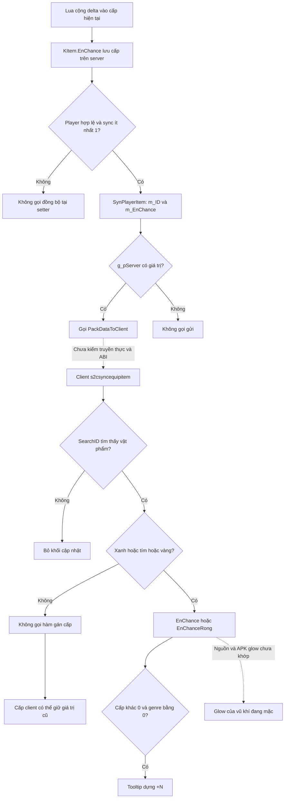

TÓM TẮT 1 — [NGUỒN][THẤY] DONE phạm vi khảo sát: Lua cộng delta rồi đồng bộ có điều kiện; chưa kết luận nguyên nhân runtime W-02 (S/ScriptFuns.cpp:10912–10931).
TÓM TẮT 2 — [NGUỒN][THẤY] Server thực sự chép cấp vào ITEM_SYNC.m_EnChance và gọi gửi s2c_syncequipitem; không có bằng chứng thiếu trường tại hàm gửi này (S/KItemList.cpp:4378–4404,4481–4482).
TÓM TẮT 3 — [NGUỒN][THẤY] Điểm có thể chặn: client bỏ cập nhật cấp khi vật phẩm không xanh/tím/vàng; tooltip chỉ thêm “+N” khi cấp khác 0 và genre=0 (C/gamecore/KProtocolProcess.cpp:1560–1562,1640–1651; C/gameui/KuiItemdesc.cpp:1850–1855).
TÓM TẮT 4 — [CHƯA KIỂM] Một phép thử Test-36 được đề xuất ở mục 6; chưa có payload, trạng thái món W-02 hay bằng chứng APK khớp nguồn (R/DESIGN/KE-HOACH-TAI-HIEN-HIEU-UNG.md:16,45; R/DESIGN/HIEU-HIEU-UNG-VU-KHI.md:114).
TÓM TẮT 5 — [CHƯA KIỂM] Không chạy build, exe game, VM hoặc mạng; không commit/push theo yêu cầu; tệp nhịp ngoài vùng ghi sandbox chưa tạo (JX1_OPS/TASKS/XD-W02c.md:24–26; giới hạn phiên làm việc).

# XD-W02c — Tra đường cấp cường hóa từ Lua tới client

Loại: khảo sát
Chủ đề: Xác định các điểm có thể làm mất cấp cường hóa, chữ “+N” và glow trong đường đồng bộ vật phẩm.
Từ khóa: cường hóa, SetItemEnChance, EnChance, SynPlayerItem, ITEM_SYNC, s2c_syncequipitem, tooltip, glow, Test-36
Trạng thái: DONE — hoàn tất khảo sát và đề xuất một phép thử; nguyên nhân của lần chạy W-02 chưa xác minh.
Độ phủ: 7/7 mắt xích có bằng chứng hoặc giới hạn rõ trong bảng dưới; 0 phép thử game/runtime được chạy.
Liên quan: R/REPORTS/HG-03b.md; R/DESIGN/HIEU-CAP-CUONG-HOA-LUA.md; R/DESIGN/KE-HOACH-TAI-HIEN-HIEU-UNG.md; R/DESIGN/HIEU-HIEU-UNG-VU-KHI.md.
Cần tôi quyết định: không trong phạm vi đọc tĩnh; việc chạy Test-36 thuộc lượt được duyệt riêng.

## 1. Nguồn và quy ước bằng chứng

| Bí danh | Đường dẫn tuyệt đối, chỉ đọc |
|---|---|
| S | `C:/Jx1CocoV3/SwordOnline/SwordOnline/jxOnline/gameserver/Sources/Core/Src` |
| C | `C:/Jx1CocoV3/Folder/Client2912-20260116T044348Z-3-001/Client2912/Client/Classes` |
| R | `D:/jx1-ops-wt/JX1_OPS` |

[THẤY] Danh sách đọc được lập từ mục tiêu task: `S/ScriptFuns.cpp`, đường `SynPlayerItem` trong `S/KItemList.cpp`, bộ nhận `C/gamecore/KProtocolProcess.cpp`. Chỉ mở rộng theo symbol sang `S/KItem.cpp`, `S/KItem.h`, `S/KCore.h`, `C/gamecore/KProtocol.h`, `KProtocolDef.h`, `KItem.cpp`, `KItem.h`, `KItemList.cpp`, `KItemSet.cpp`, `KItemGenerator.CPP`, `C/gameui/KuiItemdesc.cpp` và `C/vn/gamecore/KNpcResVN.cpp`. Các đường này đều nằm trong hai root task cho phép; căn cứ mở rộng là lời gọi ở S/ScriptFuns.cpp:10922,10928; S/KCore.h:67; C/gamecore/KProtocolProcess.cpp:1558–1560,1642–1650,1725–1749; C/gamecore/KItemSet.cpp:447–453.

[THẤY] Đã tra mục liên quan trong `JX1_OPS/DESIGN/MUC-LUC-TRI-THUC.md:17` và tìm các symbol task trong `JX1_OPS/CONTEXT-PACK/GS001-MAP.md` bằng `Select-String`; map không trả kết quả các symbol đó. `Test-Path` cho `Sources/graphify-out/GRAPH_REPORT.md` và `Classes/graphify-out/.graphify_root` đều trả `False`; không dùng graph chưa kiểm root. Đây chỉ là kết quả tại hai vị trí đã kiểm, không kết luận mọi graph đều thiếu.

[THẤY] Ký hiệu hàm/trường được đối chiếu theo ASCII; chú thích `S/ScriptFuns.cpp:10911` và `C/gamecore/KItem.cpp:3524` đọc lại bằng code page 936 cho chữ Hán đọc được. Không dùng chuỗi lỗi khi đọc UTF-8 làm bằng chứng nghiệp vụ. Chưa xác minh mã hóa toàn bộ từng tệp; báo cáo này ghi UTF-8 không BOM.

[TÀI LIỆU] Bối cảnh W-02 ghi `sync=1` nhưng vật phẩm Lua thiếu cả “+N” lẫn glow; quan sát đó là kết quả cũ được dẫn lại, không phải phép đo trong task này (R/DESIGN/KE-HOACH-TAI-HIEN-HIEU-UNG.md:7,25,45). HG-03b để ngỏ hàm gửi và tooltip; báo cáo này bổ sung đối chiếu, không sửa kết luận hoặc số liệu của báo cáo cũ (R/REPORTS/HG-03b.md:62–76).

## 2. Phạm vi và độ phủ

| # | Mắt xích theo luồng game | Độ phủ | Bằng chứng / giới hạn |
|---|---|---|---|
| 1 | Lua chọn vật phẩm, cộng cấp và điều kiện đồng bộ | Đã phủ tĩnh [THẤY] | S/ScriptFuns.cpp:10912–10931,21272–21285; tham số lần chạy W-02 chưa kiểm. |
| 2 | Lưu cấp trong vật phẩm server | Đã phủ tĩnh [THẤY] | S/KItem.cpp:3800–3818; S/KItem.h:371. |
| 3 | Dựng và gọi gửi gói cập nhật | Đã phủ tĩnh [THẤY] | S/KItemList.cpp:4378–4404,4481–4482; truyền thực chưa kiểm. |
| 4 | Bố cục giao thức giữa hai đầu | Phủ một phần [THẤY]/[CHƯA KIỂM] | C/gamecore/KProtocol.h:946–992 có trường int; chưa đối chiếu header server, packing và binary. |
| 5 | Client tra vật phẩm, chọn nhánh gán cấp, báo thay đổi UI | Đã phủ tĩnh [THẤY] | C/gamecore/KProtocolProcess.cpp:1555–1704; C/gamecore/KItem.cpp:3490–3519,3673–3678,3714–3720. |
| 6 | Dựng tên “+N” | Đã phủ tĩnh [THẤY] | C/gameui/KuiItemdesc.cpp:1115–1119,1850–1855; C/gamecore/KItem.cpp:1885–1903; gọi/vẽ thực chưa kiểm. |
| 7 | Glow và tương ứng nguồn/APK | Phủ giới hạn [THẤY]/[TÀI LIỆU]/[CHƯA KIỂM] | C/vn/gamecore/KNpcResVN.cpp:439–469,503–526 khác vị trí glow W-01; R/DESIGN/HIEU-HIEU-UNG-VU-KHI.md:3,45,114. |

### Giải mã tên

[THẤY] Không đưa tên riêng trang bị, nhân vật, bản đồ hay kỹ năng vào báo cáo. Các tên dưới đây là mã định danh, không phải tên game cần đổi GBK/TCVN3; giữ nguyên dạng gốc.

| Tên gốc | Mã hóa | Chữ đúng / nghĩa đọc được | Nguồn file:dòng |
|---|---|---|---|
| SetItemEnChance / LuaSetItemEnChance | ASCII | Hàm Lua tăng/giảm cấp cường hóa theo delta | S/ScriptFuns.cpp:10912–10922,26020 |
| SynPlayerItem | ASCII | Hàm đồng bộ lại vật phẩm đã có | S/KItemList.cpp:4379–4385 |
| s2c_syncequipitem / s2csyncequipitem | ASCII | Mã gói / bộ nhận cập nhật vật phẩm | S/KItemList.cpp:4383; C/gamecore/KProtocolProcess.cpp:172,1555 |
| ITEM_SYNC.m_EnChance | ASCII | Trường cấp cường hóa trong gói | C/gamecore/KProtocol.h:968 |
| s2c_syncitem / s2cSyncItem | ASCII | Đường nhận và tạo vật phẩm, khác gói cập nhật trên | C/gamecore/KProtocolProcess.cpp:98,1707–1736 |
| IsBlue / IsPurple / GetGoldId | ASCII | Các điều kiện phân loại vật phẩm dùng để chọn nhánh | C/gamecore/KItem.cpp:3673–3678,3714–3720; C/gamecore/KProtocolProcess.cpp:1648 |

### Sắp theo cấu trúc game

[THẤY] Nội dung xếp theo vòng đời vật phẩm: Lua trên server → vật phẩm server → gói cập nhật → vật phẩm client → tooltip → glow. Bảng phân loại tại mục 4.2 xếp theo loại trang bị; không có danh mục phái/bộ trang bị/bản đồ cần liệt kê trong task này (S/ScriptFuns.cpp:10922–10928; C/gamecore/KProtocolProcess.cpp:1640–1651).

## 3. Từ Lua tới lời gọi gửi của server

1. [THẤY] Đối số 1 là chỉ số mảng vật phẩm; ngoài khoảng `0 < nItemIdx < MAX_ITEM` thì trả về trước khi sửa. Đối số 2 là lượng cộng, không phải cấp đích: hàm lấy cấp cũ rồi gọi `EnChance(cấp_cũ + delta)` (S/ScriptFuns.cpp:10914–10922). Vì vậy không được gọi lặp `SetItemEnChance(idx,6,1)` với kỳ vọng luôn giữ +6.
2. [THẤY] Trong nguồn server hiện có, `EnChance` chặn cấp về 0–30 rồi gán `m_CommonAttrib.nEnChance` và `return 1` ở khối đầu; phần công thức cũ phía sau không đi tới theo luồng này. Không nhầm hai công thức thành cùng chạy (S/KItem.cpp:3800–3823). Getter đọc trường đó trực tiếp (S/KItem.h:371).
3. [THẤY] `GetPlayerIndex(L)` đọc biến Lua `SCRIPT_PLAYERINDEX`; thiếu biến hoặc chỉ số player ngoài khoảng thì trả -1, cũng trả -1 khi chỉ số NPC vi phạm điều kiện tại hàm (S/ScriptFuns.cpp:21272–21285). Setter chỉ gọi `SynPlayerItem` nếu `nPlayerIndex > 0 && nIsSyn >= 1`; do đó cờ bằng 1 riêng lẻ chưa đủ chứng minh có gọi đồng bộ (S/ScriptFuns.cpp:10924–10929).
4. [THẤY] Hàm gửi thuộc nhánh biên dịch `_SERVER`: xóa trắng `ITEM_SYNC`, đặt `ProtocolType=s2c_syncequipitem`, `m_ID=GetID()`, `m_SyncType=2`; dòng gán `m_EnChance=GetEnChance()` là mã hoạt động (S/KItemList.cpp:4378–4404). Dòng gán trùng ở 4428 là chú thích, không phải bằng chứng trường bị vô hiệu hóa.
5. [THẤY] Cuối hàm có điều kiện `if (g_pServer)` rồi gọi `PackDataToClient(Player[m_PlayerIdx].m_nNetConnectIdx, ..., sizeof(ITEM_SYNC))` (S/KItemList.cpp:4481–4482). Đây là bằng chứng dựng và gọi gửi, chưa phải bằng chứng nhận thành công. Player đích lấy từ item-list đang gọi; chưa kiểm item W-02 có thuộc đúng player đó.
6. [CHƯA KIỂM] Không có giá trị thực của delta, cấp trước/sau, player context, ID hoặc kết quả truyền trong lần W-02; không thể loại trừ các điểm chặn trên chỉ từ tài liệu ghi `sync=1` (R/DESIGN/KE-HOACH-TAI-HIEN-HIEU-UNG.md:45; S/ScriptFuns.cpp:10914–10929).

## 4. Client nhận cấp nhưng có thể bỏ qua nhánh gán

### 4.1. Phải theo đúng gói cập nhật

[THẤY] Bộ nhận đăng ký `s2c_syncequipitem → s2csyncequipitem` ở C/gamecore/KProtocolProcess.cpp:172. Đường `s2c_syncitem → s2cSyncItem` ở dòng 98 là đường khác: tạo vật phẩm bằng `AddCilentItem`/`AddGold` và truyền `m_EnChance` tại 1736,1756,1771. Chỉ đọc đường tạo vật phẩm không chứng minh đường cập nhật sau `SetItemEnChance` đã gán cấp.

[THẤY] `ProcessNetMsg` trả sớm nếu mã gói ngoài khoảng hoặc chưa có handler, còn lại gọi bảng xử lý (C/gamecore/KProtocolProcess.cpp:216–228). Handler cập nhật ép `pMsg` sang `ITEM_SYNC*`, tra `SearchID(m_ID)` rồi chỉ vào khối sửa khi `nIdx > 0` (1555–1562). `SearchID` trả 0 khi player-list chưa có player hoặc không tìm được ID trong danh sách đang dùng (C/gamecore/KItemList.cpp:2561–2572). Nếu gói đến trước lúc có vật phẩm tương ứng, đoạn handler này không tạo mới hay lưu chờ.

[CHƯA KIỂM] Chưa có bằng chứng thứ tự gói của W-02 hoặc ID thực tế, nên khả năng không tìm thấy ID là điểm cần loại trừ, chưa phải nguyên nhân đã xác lập (C/gamecore/KProtocolProcess.cpp:1560–1562).

### 4.2. Điểm chặn đáng kiểm đầu tiên: phân loại trang bị

| Loại vật phẩm theo điều kiện thật | Hành động cập nhật cấp [THẤY] | Bằng chứng |
|---|---|---|
| Xanh, `m_IsWhere>0` hoặc `m_Rongpiont>0` | Gọi `EnChanceRong(m_EnChance)` | C/gamecore/KProtocolProcess.cpp:1640–1642 |
| Xanh, không thuộc điều kiện trên | Gọi `EnChance(m_EnChance)` | C/gamecore/KProtocolProcess.cpp:1643–1644 |
| Tím | Gọi `EnChance(m_EnChance)` | C/gamecore/KProtocolProcess.cpp:1645–1646 |
| Có GoldId | Gọi `EnChanceRong` rồi `EnChanceBao` | C/gamecore/KProtocolProcess.cpp:1648–1650 |
| Không xanh, không tím, không GoldId, gồm ca trang bị trắng dưới đây | Không vào lời gọi gán cấp nào trong khối này | C/gamecore/KProtocolProcess.cpp:1640–1651 |

[THẤY] Ca tĩnh cụ thể: `nPoint=0`, `nGoldId=0`, `m_aryMagicAttrib[0].nAttribType=0` làm `IsBlue()` trả 0; `IsPurple()` cũng trả 0 vì chỉ nhận `0<nPoint<=6`. Khi GoldId=0, handler không gọi cả ba nhánh cập nhật cấp. Nếu cấp client trước đó là 0 thì khối này giữ nguyên 0 dù payload chứa 6 (C/gamecore/KItem.cpp:3673–3678,3714–3720; C/gamecore/KProtocolProcess.cpp:1640–1651).

[THẤY] Đây không phải do `EnChance` client bắt buộc có dòng ma pháp mới lưu cấp: nếu được gọi, hàm vẫn gán `m_CommonAttrib.nEnChance` sau vòng lặp, hoặc chặn trên về 30 (C/gamecore/KItem.cpp:3490–3519). `EnChanceRong` cũng có phép gán cấp ở 3574–3576; thân tính toán `EnChanceBao` đang nằm trong comment, chỉ còn `return 1` ở 3634, nhưng nhánh GoldId đã gọi `EnChanceRong` trước đó (3525–3634; C/gamecore/KProtocolProcess.cpp:1648–1650).

[CHƯA KIỂM — GIẢ THUYẾT] Vật phẩm W-02 có thể là ca bị bỏ qua này, tạo chuỗi “server có cấp → gói có cấp → item client giữ 0 → tooltip thiếu +N”. Cần đo ba điều kiện phân loại cùng ID và cấp thực của chính vật phẩm; tài liệu W-02 không cung cấp các trường đó (R/DESIGN/KE-HOACH-TAI-HIEN-HIEU-UNG.md:7,18,45; các điều kiện nguồn ở đoạn trên).

### 4.3. Cập nhật UI và đường tạo lại không đồng nghĩa nhau

[THẤY] Handler chỉ phát `CoreDataChanged(GDCNI_OBJECT_CHANGED,...)` trong vòng tìm vật phẩm khi `nPlace==pos_equiproom && m_StackNum>0` (C/gamecore/KProtocolProcess.cpp:1679–1696). Ngoài điều kiện đó không thấy thông báo này trong handler; không suy rằng toàn client không có đường làm mới khác. Nếu cấp trong item đã đúng mà tooltip đang mở còn cũ, cần đóng/mở lại trước khi quy lỗi truyền cấp.

[THẤY] Đường tạo mới cho vật phẩm thường truyền cấp vào `Gen_EquipmentCilent` (C/gamecore/KItemSet.cpp:423–453). Trong nhánh `nPoint==0`, nếu `pnaryMALevel==NULL` thì trả trước; nếu có con trỏ thì đến lời gọi `EnChance(nEnChance)` (C/gamecore/KItemGenerator.CPP:2904–2918). Đường `s2cSyncItem` đã đọc tạo mảng `pnMagicParam` rồi truyền con trỏ này (C/gamecore/KProtocolProcess.cpp:1711–1749). Không suy rằng đăng nhập lại chắc chắn sửa lỗi: còn dữ liệu lưu và các nhánh tạo chưa đo runtime.

## 5. Chữ “+N”, glow và giới hạn phiên bản

[THẤY] Tooltip đang dùng trong `KuiItemdesc::addDialogData` lấy `Item[m_ItemData.uId].GetEnChance()` và genre (C/gameui/KuiItemdesc.cpp:1088,1115–1119), sau đó chỉ nối `"%s+%d"` khi `nEnChance != 0` và `nItemGenre==0` (1850–1855). Nhánh mô tả shop cũng đọc cấp và dùng điều kiện tương tự (204–205,834–839); hàm mô tả core cũng có điều kiện này (C/gamecore/KItem.cpp:1885–1903). Vì vậy thiếu “+N” chưa tự chứng minh không có gói: có thể item chưa được gán cấp, chọn sai item, hoặc UI chưa dựng lại.

[THẤY] Trong root C được giao, tìm `GetEnChance|nEnChance|jxwglow|Glow|glow` trên đúng `C/vn/gamecore/KNpcResVN.cpp` cho `glow_symbol_matches=0`. Đoạn vẽ thân ở 439–469 bỏ section không có ảnh; đoạn 503–526 là vòng hiệu ứng trạng thái, không phải đoạn đọc cấp vũ khí theo số dòng W-01. Kết quả này chỉ giới hạn ở tệp và pattern đã tìm, không chứng minh toàn client không có glow bằng cách khác.

[TÀI LIỆU] W-01 khảo sát root `D:/JX-build/qh9A`, mô tả glow đọc cấp vũ khí đang mặc, dành cho player local ngoài menu, từ +6 và cần ảnh section vũ khí; +12/+15 đổi hiệu ứng (R/DESIGN/HIEU-HIEU-UNG-VU-KHI.md:3,6,45,50). Không mở root qh9A trong task này vì nguồn được giao là root C; các ngưỡng/đường vẽ này chỉ là dẫn tài liệu, không phải kết quả kiểm mã qh9A mới.

[TÀI LIỆU] Tài liệu bổ sung ghi APK đang cài trên Test-36 có hash khác qh9A và chưa định danh nguồn (R/DESIGN/HIEU-HIEU-UNG-VU-KHI.md:114; R/DESIGN/KE-HOACH-TAI-HIEN-HIEU-UNG.md:16). Không xác nhận lại hash ở lượt này, không đưa hash thành khóa hay dữ liệu truy cập.

[CHƯA KIỂM] Do chưa nối được binary đang chạy với nguồn được giao và chưa có giá trị cấp ở item client, chưa thể kết luận điểm phân loại trên là lỗi thực của W-02, cũng chưa thể hứa sửa nó sẽ làm glow xuất hiện. Sau khi cấp client đúng, glow vẫn có thể bị điều kiện vũ khí đang mặc, local/menu hoặc resource chặn theo tài liệu W-01 (các nguồn ở ba đoạn trên).

## 6. Một phép thử Test-36 nhỏ nhất được đề xuất

[CHƯA KIỂM — ĐỀ XUẤT, CHƯA CHẠY] Một lần **đồng bộ lại một vật phẩm sẵn có, delta bằng 0**. Mục đích là phân biệt “không gửi/không nhận” với “đã nhận nhưng bỏ nhánh gán cấp”, không đổi mã hay công thức. Cơ sở: setter cộng delta (S/ScriptFuns.cpp:10920–10928); handler phân loại ở C/gamecore/KProtocolProcess.cpp:1640–1651.

1. [CHƯA KIỂM — ĐIỀU KIỆN] Ở lượt được duyệt chạy Test-36 riêng, dùng một vật phẩm thuộc đúng player, đã có cấp server 6 và đang tái hiện thiếu “+N”. Xác nhận binary/header tương ứng trước khi dùng số dòng/bố cục bộ nhớ trong báo cáo. Dùng debugger hoặc log đã được duyệt và có sẵn; nếu chưa có cách quan sát trường thì bàn giao yêu cầu quan sát, không tự patch/build/cài APK hay thay cấu hình. Loại trừ cờ ép glow; tình trạng cờ thực phải ghi lại, không mặc định đã xóa từ lượt cũ (R/DESIGN/KE-HOACH-TAI-HIEN-HIEU-UNG.md:7,19,54).
2. [CHƯA KIỂM — THAO TÁC DUY NHẤT] Trong đúng player context, đọc cấp trước rồi gọi `SetItemEnChance(idx, 0, 1)` đúng một lần, đọc lại cấp. Chỉ dùng khi đã xác nhận cấp trước trong 0–30; dự kiến cấp vẫn là 6. Không gọi delta=6 lần nữa và không phát thêm vật phẩm (S/ScriptFuns.cpp:10914–10928; S/KItem.cpp:3804–3818).
3. [CHƯA KIỂM — QUAN SÁT] Trong cùng lần gọi, ghi bảng tối thiểu sau; chỉ ghi ID vật phẩm và số đo kỹ thuật, không lấy tài khoản, mật khẩu, khóa hoặc dump. Đóng/mở lại tooltip của đúng món sau khi tiếp tục chạy; glow chỉ quan sát khi món đó đang mặc và đã xác nhận đúng nguồn hiệu ứng.

| Điểm quan sát của cùng một lần đồng bộ | Giá trị cần ghi | Vị trí nguồn tham chiếu |
|---|---|---|
| Server sau setter và trước gọi gửi | Cấp trước/sau; có vào nhánh gửi; m_ID; m_EnChance | S/ScriptFuns.cpp:10920–10928; S/KItemList.cpp:4384,4404,4481–4482 |
| Client vào handler | Có nhận đúng gói; m_ID; m_EnChance; SearchID trả gì | C/gamecore/KProtocolProcess.cpp:1555–1562 |
| Client chọn nhánh và ra khối cập nhật | Cấp trước/sau; IsBlue, IsPurple, GoldId; genre và nPoint; kiểu ma pháp đầu | C/gamecore/KProtocolProcess.cpp:1640–1651; C/gamecore/KItem.cpp:3673–3678,3714–3720 |
| Tooltip mở lại | Đúng ID/local index; cấp đọc ra; có “+6”; nếu quan sát được thì glow thật | C/gameui/KuiItemdesc.cpp:1115–1119,1850–1855; giới hạn glow tại mục 5 |

[CHƯA KIỂM — TIÊU CHÍ] Nếu server gửi cấp 6, client nhận cùng ID/cấp, `SearchID>0`, cả ba điều kiện phân loại đều false và cấp client không đổi, phép thử xác nhận điểm bỏ cập nhật cho **ca đo đó**. Nếu không vào gửi thì khoanh player/sync/g_pServer; nếu gửi mà không vào nhận hoặc giá trị khác thì khoanh truyền/dispatch/ABI; nếu nhận nhưng không tìm thấy ID thì khoanh thời điểm/danh sách/đích; nếu cấp client đã 6 thì chuyển trọng tâm sang chọn item/làm mới tooltip hoặc glow. Các nhánh phân định dựa trên S/ScriptFuns.cpp:10926–10928; S/KItemList.cpp:4481–4482; C/gamecore/KProtocolProcess.cpp:216–228,1560–1562,1640–1651; C/gameui/KuiItemdesc.cpp:1850–1855.

[CHƯA KIỂM — HOÀN TÁC] Phép thử delta=0 trên cấp đã kiểm 0–30 dự kiến không đổi cấp, không thêm item/cờ/cấu hình. Nếu thực tế đổi ngoài dự kiến thì dừng, giữ số đo và bàn giao, không tự sửa dữ liệu để che kết quả (S/ScriptFuns.cpp:10920–10922; S/KItem.cpp:3804–3818). Chưa có kết quả PASS/FAIL.

## 7. Mục sổ thông số

| Nhóm | Tên/hằng số | file:dòng | Giá trị | Đơn vị | Ảnh hưởng | Đổi an toàn | Nguồn đo |
|---|---|---|---|---|---|---|---|
| Lua [THẤY] | nItemEnChance | S/ScriptFuns.cpp:10915,10920–10922 | delta cộng vào cấp hiện tại | cấp | Gọi lặp sẽ cộng tiếp | CẨN THẬN | Đọc tĩnh; chưa đo runtime |
| Lua [THẤY] | nIsSyn / nPlayerIndex | S/ScriptFuns.cpp:10926–10928 | sync>=1 và player>0 | cờ / chỉ số | Điều kiện gọi đồng bộ | CẨN THẬN | Đọc tĩnh |
| Server [THẤY] | nN trong EnChance | S/KItem.cpp:3804–3818 | chặn 0–30 | cấp | Giá trị thực được lưu sau setter | CẨN THẬN | Đọc tĩnh; không cho phép sửa |
| Gói [THẤY] | ProtocolType / m_SyncType | S/KItemList.cpp:4383–4385 | s2c_syncequipitem / 2 | mã / giá trị | Chọn đường cập nhật; chưa chứng minh m_SyncType được dùng ở client | KHÔNG | Đọc tĩnh; không đổi giao thức |
| Gói [THẤY] | ITEM_SYNC.m_EnChance | C/gamecore/KProtocol.h:968 | int ở header client | cấp | Có trường nhận cấp; chưa kiểm ABI server | KHÔNG | Đọc tĩnh, chưa đo kích thước/offset |
| Client [THẤY] | EnChance | C/gamecore/KItem.cpp:3493–3519 | dưới 31 gán đầu vào, từ 31 gán 30 | cấp | Chặn trên; khác server ở việc không chặn dưới tại hàm này | CẨN THẬN | Đọc tĩnh, không thử số âm |
| Tooltip [THẤY] | nEnChance / nItemGenre | C/gameui/KuiItemdesc.cpp:1850–1855 | khác 0 / bằng 0 | cấp / loại | Điều kiện thêm +N | CẨN THẬN | Đọc tĩnh |
| Glow [TÀI LIỆU] | Ngưỡng glow | R/DESIGN/HIEU-HIEU-UNG-VU-KHI.md:45,50 | +6; +12; +15 | cấp | Các mức glow/sét ở nguồn qh9A được tài liệu khảo sát | CẨN THẬN | Dẫn tài liệu; chưa kiểm root qh9A/runtime |

## 8. Đã xác minh / Chưa xác minh

### Đã xác minh

- [THẤY] Setter cộng delta, lưu cấp qua hàm server hiện có và chỉ gọi đồng bộ theo player/sync (S/ScriptFuns.cpp:10912–10931; S/KItem.cpp:3800–3818).
- [THẤY] Hàm gửi có trường cấp hoạt động, chọn gói cập nhật và gọi PackDataToClient có điều kiện (S/KItemList.cpp:4381–4404,4481–4482).
- [THẤY] Client có điểm bỏ khối cập nhật khi không tìm ID và điểm bỏ gán cấp theo loại vật phẩm; tooltip có điều kiện cấp/genre riêng (C/gamecore/KProtocolProcess.cpp:1560–1562,1640–1651; C/gameui/KuiItemdesc.cpp:1850–1855).
- [THẤY] Tệp vẽ tại root C không có các symbol glow đã tìm; số dòng W-01 không thể áp nguyên cho nguồn này (C/vn/gamecore/KNpcResVN.cpp:503–526; lệnh và kết quả ở mục 5).

## Chưa kiểm

- [CHƯA KIỂM] Header `KProtocol.h` server không tìm thấy trong kết quả tìm tên `*Protocol*.h` dưới đúng `Sources` được giao; `S/KCore.h:67` có include nhưng task không cấp root header khác. Chưa đối chiếu enum, packing, sizeof/offset với client C/gamecore/KProtocol.h:946–992; không khẳng định hai đầu lệch giao thức.
- [CHƯA KIỂM] Không có payload/ACK, thứ tự gói, chỉ số player/owner, ID và ba cờ phân loại của vật phẩm W-02; điểm chặn tĩnh chưa trở thành kết luận nguyên nhân thực (S/ScriptFuns.cpp:10924–10928; C/gamecore/KProtocolProcess.cpp:1560–1562,1640–1651).
- [CHƯA KIỂM] Chưa xác nhận binary server/client đang chạy có nguồn tương ứng; khác root W-01 và cảnh báo APK phải được giải quyết trước khi áp kết luận mã cho Test-36 (R/DESIGN/HIEU-HIEU-UNG-VU-KHI.md:3,114).
- [CHƯA KIỂM] Chưa đo cập nhật tooltip đang mở, vật phẩm đang mặc, điều kiện glow thật; chưa thử đăng nhập lại, lưu DB hoặc tác động thuộc tính. Không suy khả năng lưu cấp từ setter (C/gamecore/KProtocolProcess.cpp:1679–1696; R/DESIGN/KE-HOACH-TAI-HIEN-HIEU-UNG.md:45).
- [CHƯA KIỂM] Chưa chạy phép thử mục 6, build, exe game, VM, mạng hay Main VM; không có kết quả runtime/PASS giả định (phạm vi JX1_OPS/TASKS/XD-W02c.md:24–26).

## 9. Kiểm tra thực chạy, lỗi và giới hạn thao tác

| Việc | Lệnh / cách thử | Kết quả thực |
|---|---|---|
| [THẤY] Trạng thái trước ghi | `git status --short --branch` một lần | Đúng task/XD-W02c; không có thay đổi local được liệt kê. |
| [THẤY] Tiếp tục việc đã có | `Test-Path JX1_OPS/REPORTS/XD-W02c.md` | False lúc bắt đầu; tạo báo cáo mới, không làm lại báo cáo có sẵn. |
| [THẤY] Công cụ tìm kiếm | Thử rg ở lần định vị đầu | CommandNotFoundException; không cài. Chuyển sang Get-ChildItem có lọc tên và Select-String giới hạn tệp. |
| [THẤY] Kiểm mã | Đọc đoạn bằng Get-Content + Skip/First và tìm symbol bằng Select-String | Mỗi đoạn dưới 400 dòng; tìm caller/callee trong root task, không quét liệt kê toàn ổ/thư mục lớn không lọc. |
| [THẤY] Kiểm nguồn glow | Select-String trên đúng KNpcResVN.cpp, các pattern tại mục 5 | 0 kết quả; đọc đoạn 439–469,503–526 để kiểm nội dung thực. |
| [CHƯA KIỂM] Tệp nhịp | D:/JX-wt/XD-W02c.nhip | Ngoài writable root D:/JX-wt/XD-W02c; không thử vượt sandbox, không ghi tệp thay thế ngoài vung_file. Đã báo giới hạn trong trao đổi. |
| [CHƯA KIỂM] Game/runtime | Test-36, build, VM, exe, mạng | Không chạy theo task; chỉ có thiết kế phép thử. |

## 10. Phát hiện khi đối chiếu và đề xuất tối ưu

[THẤY] Bổ sung quan trọng so với khoảng trống HG-03b: đường setter dùng `s2c_syncequipitem`, không thể lấy bằng chứng `s2cSyncItem` tạo item để thay cho nhánh cập nhật. Đã đối chiếu trực tiếp S/KItemList.cpp:4383,4404,4482 và C/gamecore/KProtocolProcess.cpp:172,1555–1562,1640–1651; không thay nội dung R/REPORTS/HG-03b.md:62–76.

[TÀI LIỆU]/[THẤY] Có khác biệt nguồn cần giữ riêng: W-01 nói về qh9A và glow ở KNpcResVN.cpp:495–548, còn tại root C các dòng đó là comment/vòng trạng thái (R/DESIGN/HIEU-HIEU-UNG-VU-KHI.md:3,45; C/vn/gamecore/KNpcResVN.cpp:475–526). Không hợp nhất hai phiên bản thành một kết luận runtime.

[CHƯA KIỂM — ĐỀ XUẤT] Ưu tiên phép thử duy nhất ở mục 6 trước khi đề xuất sửa. Nếu xác nhận nhánh trắng bị bỏ qua, PM mới đánh giá cách lưu cấp cho các loại được phép; chưa đề xuất bật cường hóa đại trà hay đổi shader/công thức. Đọc tĩnh cho thấy điểm cần kiểm, chưa chứng minh phạm vi sửa an toàn (C/gamecore/KProtocolProcess.cpp:1640–1651; C/gamecore/KItem.cpp:3490–3519).

## 11. Bàn giao

- [THẤY] Đầu ra là `JX1_OPS/REPORTS/XD-W02c.md` và mục Kết quả cuối `JX1_OPS/TASKS/XD-W02c.md` theo yêu cầu riêng; không sửa nguồn hoặc báo cáo cũ. Không tạo chỉ mục riêng vì task chỉ cho vùng đầu ra này (JX1_OPS/TASKS/XD-W02c.md:13,24–26).
- [CHƯA KIỂM] Commit/SHA/push: chưa tạo theo yêu cầu “Không cần commit”; Tổng quan nhận hai tệp local để commit. Không có thông báo đã push.
- [CHƯA KIỂM — ĐỀ XUẤT] Bước tiếp: đối chiếu đúng binary/header và duyệt riêng phép thử một lần đồng bộ Test-36 ở mục 6. Tệp nhịp không ghi được trong sandbox hiện tại; không cần thay quyền để hoàn tất báo cáo.
- [CHƯA KIỂM — ĐỀ XUẤT] Hàng chỉ mục để PM gộp: `XD-W02c | khảo sát | Cấp cường hóa Lua → gói cập nhật → client | SetItemEnChance, SynPlayerItem, s2c_syncequipitem, tooltip, glow | DONE khảo sát, runtime chưa kiểm | 7/7 mắt xích có nguồn/giới hạn | HG-03b; W-02`. Chưa sửa MUC-LUC-TRI-THUC hoặc tạo _CHIMUC ngoài vùng được giao.

Kỹ năng đã dùng: jx1-retrofit, jx1-read-server, jx1-read-client, jx1-parameters, jx1-knowledge, jx1-report (đã nạp từ `.agents/skills`; chỉ áp dụng phần phù hợp vùng ghi của task).
