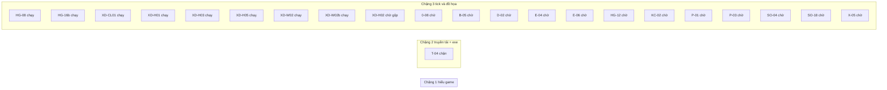

# TIẾN ĐỘ (tự sinh bằng TOOLS/tien_do.py lúc 2026-11-19 03:51, đừng sửa tay)

ĐANG LÀM: HG-08, HG-16b, XD-CL01, XD-H01, XD-H03, XD-H05, XD-W02, XD-W02b
KẾ TIẾP: 0-08, B-05, D-02, E-04, E-06, HG-12
BỊ CHẶN: T-04

Ba chặng #091: 1 hiểu game (chuẩn hóa) → 2 đường truyền + exe → 3 tick/độ phản hồi/đồ họa.

Tổng: 217 việc, 8 đang làm (+0 chết, 1 chờ gộp), 12 chờ, 1 bị chặn, 195 xong.
