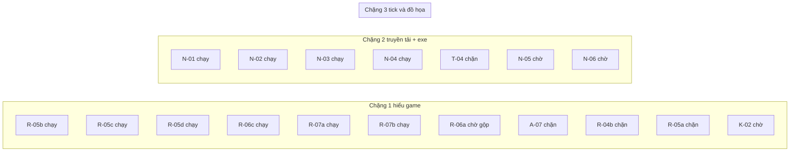

# TIẾN ĐỘ (tự sinh bằng TOOLS/tien_do.py lúc 2026-11-18 18:22, đừng sửa tay)

ĐANG LÀM: N-01, N-02, N-03, N-04, R-05b, R-05c, R-05d, R-06c, R-07a, R-07b
KẾ TIẾP: K-02, N-05, N-06
BỊ CHẶN: A-07, R-04b, R-05a, T-04

Ba chặng #091: 1 hiểu game (chuẩn hóa) → 2 đường truyền + exe → 3 tick/độ phản hồi/đồ họa.

Tổng: 91 việc, 10 đang làm (+0 chết, 1 chờ gộp), 3 chờ, 4 bị chặn, 73 xong.
